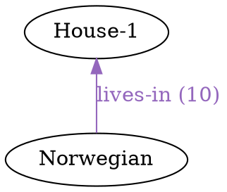
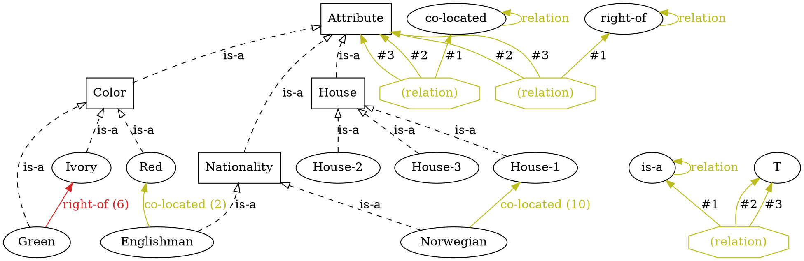
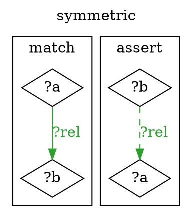
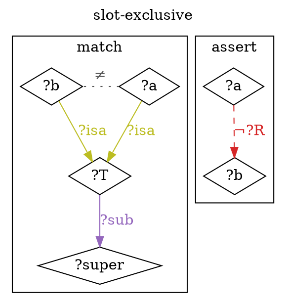

# Examples

Worked fragments of ein-lang, from one fact to the rule libraries the two Zebra encodings import. The complete
puzzles are under [`examples/`](../../../../examples/) (its [catalogue](../../../../examples/README.md)).

## The four-token Zebra sentence

> *"The Norwegian lives in the first house."*

```lisp
(lives-in Norwegian House-1 :source "condition (10)")
```

The shortest meaningful program: one fact, whose `:source` makes it a **given**, a statement of the problem, rather
than background ([facts](../03-syntax-and-semantics/03-facts.md)). `lives-in` is not declared, which a program may leave
it; a declared relation carries a `:why` and a label for each of its slots. `ein render kb` draws the program as the
one arrow it is, labelled with the relation and the clue's number:



## A larger Zebra fragment

```lisp
(rule transitive (?rel)
  :match  (and (?rel ?a ?b) (?rel ?b ?c) (neq ?a ?c))
  :assert (?rel ?a ?c)
  :why    "{?rel} is transitive.")

;; The schema: no :source, so it is background.
(relation is-a       T T :why "{?1} is a {?2}")
(relation co-located Attribute Attribute :why "{?1} and {?2} are in the same house")
(relation right-of   Attribute Attribute :why "{?1}'s house is immediately right of {?2}'s")
;; The attribute hierarchy and its members are ordinary `is-a` facts.
(is-a House Attribute) (is-a Color Attribute) (is-a Nationality Attribute)
(is-a House-1 House) (is-a House-2 House) (is-a House-3 House)
(is-a Red Color) (is-a Green Color) (is-a Ivory Color)
(is-a Norwegian Nationality) (is-a Englishman Nationality)
;; Turn the rule on for co-located.
(transitive co-located)

;; Puzzle conditions: each :source makes it a given.
(co-located Englishman Red    :source "condition (2)")
(right-of   Green Ivory       :source "condition (6)")
(co-located Norwegian House-1 :source "condition (10)")

(solve :no-search)
(query :goal (co-located ?nationality ?house))
```

`transitive` is the rule [`std.algebra`](../../../../stdlib/algebra.ein) ships, written out here; its guard is the
premise `(neq ?a ?c)`, an ordinary conjunct of the `:match`. `(transitive co-located)` turns it on for one relation.
`(solve :no-search)` says that nothing is guessed, so the answer is what the program states and saturation derives;
`ein solve` lists the two bindings of the query, `?house = House-1 · ?nationality = Norwegian` and
`?house = Red · ?nationality = Englishman`. The whole puzzle, fifteen conditions and the rule families that solve it,
is [`examples/zebra.ein`](../../../../examples/zebra.ein).

As a graph, from `ein render kb`: the three declarations, each an octagon with an arrow to the relation's name and
one to each slot's label, the `is-a` facts as dashed arrows with an open head, and the three clues as solid arrows.
`transitive` adds nothing here, since no two `co-located` facts chain, so no arrow is dashed as derived.



## Two ontologies for one puzzle

The same puzzle is encoded **two ways** under `examples/`. Both are valid Ein; what differs is the *ontology* each
commits to, which is what makes the pair worth keeping: it shows which of the reasoning is general and which follows
from how one encoding happens to be written.

### One generic link relation (`zebra.ein`)

It declares its own membership relations and links every attribute through a single generic `co-located`:

```lisp
(relation type       T T :why "{?1} is a subtype of {?2}")
(relation instance   T T :why "{?1} is an instance of {?2}")
(relation co-located Attribute Attribute :why "{?1} and {?2} are in the same house")
(type Nationality Attribute)
(instance Norwegian Nationality)
(instance Japanese  Nationality)
```

Nothing here is a keyword of the language: `type` and `instance` are ordinary relations the puzzle declares, exactly
like `co-located`. **Ein has no types**: it special-cases no relation name and keeps no type or instance view of its
own, and what this puzzle calls a type is a name its `type` and `instance` facts point at, which means what the
rules that read those facts make it mean.

Clues between attributes are *ordinary facts* here, `(co-located Englishman Red)`, and so are the spatial ones,
`(right-of Green Ivory)`: *Green's house is immediately right of Ivory's*. `zebra2.ein` states each of those as an
activator fact of four or five arguments instead, because its attribute relations share no argument to join on.

The ontology decides what the properties can say. `bijective` and its kin are properties **of a relation**, declared
one relation at a time, and one universal `co-located` is not the kind of relation they describe: it is an
*equivalence whose classes hold exactly one member of each attribute*. Restricted to one ordered pair of attributes
it is a bijection, which is why `zebra2.ein`, whose relations *are* those restrictions, can say
`(bijective color-loc)`; `(bijective co-located)` has nowhere to put the pair. What `zebra.ein` uses instead is a
property scoped by the **family** of attributes rather than by the relation,
[`std.slots`](../../../../stdlib/slots.ein), in
[§ Properties of a relation over a family](#properties-of-a-relation-over-a-family-slot-partition-and-slot-spatial)
below. The
file reasons over `co-located`, `right-of`, `next-to`, `instance` and `type`, and no other relation.

### One relation an attribute (`zebra2.ein`)

It uses one membership relation, `is-a`, and its transitive closure `is-a*`:

```lisp
(import std.algebra   :symbols (symmetric transitive includes))
(import std.bijection :symbols (bijective-setup typecheck-setup))
(relation is-a  T T :why "{?1} is a {?2}")
(relation is-a* T T :why "{?1} is a {?2} (transitively)")
(bijection-hierarchy is-a)
(typecheck-hierarchy is-a*)
(includes   is-a is-a*)
(transitive is-a*)
(is-a Nationality Attribute)
(is-a Norwegian Nationality)
(is-a Japanese  Nationality)
```

The grouping is the `is-a` facts and nothing else; `is-a*` is their transitive closure, which `includes` and
`transitive` derive. Ein keeps no view of it: a rule that needs to know what is a nationality reads the `is-a`
facts. Alongside them, `zebra2.ein` splits `co-located` into five attribute relations, `nation-loc`, `drink-loc` and
the rest, each declared with its attribute's name and `House` as the labels of its two slots,
`(relation nation-loc Nationality House …)`, and each with its own `(bijective …)`: that is what the elimination
rules act on, and the substantive difference from `zebra.ein`. `(bijection-hierarchy is-a)` tells `std.bijection`
which relation holds the direct membership the eliminations count over. `(typecheck-hierarchy is-a*)` turns on the
library's check of a fact against its relation's labels: two rules that read a bijective relation's stored
declaration and derive `(false)` from a fact whose argument has no `is-a*` fact into its slot's label. The check is
those rules and nothing in the language, which holds no argument to a label; with it, the labels of this program
are what a fact's arguments must be members of.

## Properties of a relation over a family (`slot-partition` and `slot-spatial`)

A property vocabulary that does not fit *a property of one relation*. Where `(bijective color-loc)` equips *one*
relation, these equip *one relation over a family of attributes*, the shape a generic link relation has. Both are
ordinary facts, read by [`std.slots`](../../../../stdlib/slots.ein):

```lisp
(slot-partition co-located instance type Attribute House)
```

> *`co-located` is an equivalence relation; its classes are **slots**; each slot holds exactly one `instance` of
> every name that is a direct `type`-child of `Attribute`; and the `House` member of a slot is its name.*

Five arguments, and each carries weight. The membership relation (`instance`) and the relation that groups the
attributes (`type`) are *parameters*, so the rules name no `is-a` and the module works for either membership
convention. `Attribute` names the family, so adding an attribute category is adding one `(type T Attribute)` fact,
not a declaration for every pair of attributes. `House` is the **index**: the member that names a slot, which lets the derived facts be anchored on
value × index instead of enumerating the whole equivalence.

```lisp
(slot-spatial co-located right-of instance House)
(slot-spatial co-located next-to  instance House)
```

> *`right-of` relates two values exactly when it relates their slots, and the attribute carrying the structure is
> `House`.*

This lets one relation name do two jobs: `(right-of Green Ivory)` is a **constraint** between two colours, and
`(right-of House-2 House-1)` is the **structure** it resolves against. The rules tell them apart by `instance`
membership of `House`, never by name, so a puzzle states a spatial clue in the vocabulary it is written in.

Both facts activate rules *reflectively* ([rules](../03-syntax-and-semantics/05-rules.md)): a setup rule with no parameters
reads the property fact and derives the facts that turn the generic rules on for it. So until saturation runs, the
generic rules have no activation at all.

## A rule library, imported

Neither encoding writes its property rules; both import them, each module whole, and `:symbols` lists the rules whose
activators the file writes, so the file writes those names short ([the standard library](../04-reference/04-stdlib/README.md)):

```lisp
;; zebra.ein
(import std.algebra :symbols (symmetric symmetric-negative-setup includes))
(import std.slots   :symbols (slot-partition-setup slot-spatial-setup))
```

The imported rules are **relation-polymorphic**: they take the relation as a parameter and are activated by a
property fact ([rules](../03-syntax-and-semantics/05-rules.md)):

```lisp
;; std.algebra
(rule symmetric (?rel)
  :match  (?rel ?a ?b)
  :assert (?rel ?b ?a)
  :why    "{?rel} is symmetric: {?a} ↔ {?b}.")

;; std.slots: two members of one attribute cannot share a slot. The
;; membership and grouping relations are parameters, so the rule is is-a-free;
;; ?T is a variable of the match, not a parameter, so the rule fires once per
;; attribute and a puzzle adds a category by adding its members.
(rule slot-exclusive (?R ?isa ?sub ?super)
  :match  (and (?isa ?a ?T)
               (?sub ?T ?super)
               (?isa ?b ?T)
               (neq ?a ?b))
  :assert (not (?R ?a ?b))
  :why    "{?a} and {?b} are distinct {?T}s — they cannot share a slot under {?R}.")
```

As graphs, from `ein render rule --name symmetric stdlib/algebra.ein` and
`ein render rule --name slot-exclusive stdlib/slots.ein`: what each matches above what it asserts, a variable a
diamond, a guard a dotted `≠` link, the asserted fact dashed and a stored negation labelled `¬`.





A rule that names its relations literally, with no parameter, is still legal, and it is what a genuinely
puzzle-specific rule looks like; neither Zebra encoding needs one for its properties.

## Derived facts

After saturation, `ein saturate examples/zebra.ein --dump` lists every derived fact with the rule that derived it,
a rule a module brings by its full name. Two of them:

```text
  (co-located House-1 Norwegian :rule symmetric)
  (not (co-located Norwegian Japanese) :rule std.slots.slot-exclusive)
```

The first is condition (10) read the other way round; the second says the Norwegian and the Japanese, two members of
`Nationality`, cannot share a slot. A program may write a derived fact itself, with `:rule NAME :using (PREMISE …)`
after it ([syntax](../04-reference/02-syntax.md)); it is then held as derived, not as given.

## See also

- The full puzzles: [`examples/zebra.ein`](../../../../examples/zebra.ein) and
  [`examples/zebra2.ein`](../../../../examples/zebra2.ein).
- [The Zebra puzzle, step by step](06-zebra-walkthrough.md): the human solution against what Ein derives on
  `zebra2.ein`.
- [Syntax](../04-reference/02-syntax.md): every form used above. [Rules](../03-syntax-and-semantics/05-rules.md): what a pattern
  matches inside a rule.
- [Rendering](../04-reference/12-rendering.md): how these fragments are drawn.
