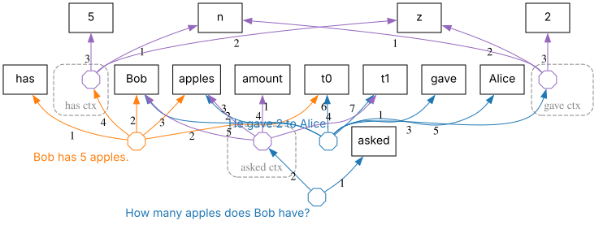
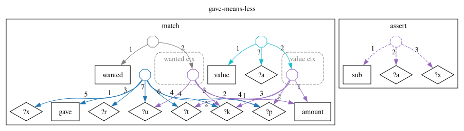

# Word problems, and what else the arithmetic tables answer

Ein knows no number and no word ([Q-M1e2.24](../../../decisions/language/Q-M1e2.24-ein-has-no-numbers-and-no-ranges.md)).
Arithmetic is a theory of the standard library, computed by saturation, and a word of a school problem is a theory
a program writes: rules that turn what a sentence says into a request to the calculator, and read the calculator's
answer back as a fact about the people in the problem. This chapter shows how an elementary-school word problem is
stated in Ein and what `ein` answers, then what else the calculator's tables answer: equations, cryptarithms, laws
checked on every instance of a small domain, and number theory.

Every program named here is in the repository, under [`examples/word_problems/`](../../../../examples/word_problems/)
and [`examples/beyond_arith/`](../../../../examples/beyond_arith/), each with its answers stated as claims; the
transcripts below are what `ein` prints for them, trimmed to the rows that matter. The calculator's modules and every
relation they offer are on the [standard library's reference pages](../04-reference/04-stdlib/07-calculator.md).

## Running the examples

```sh
ein solve examples/word_problems/boxes12.ein                     # the read-out: each query's answer as a sentence
ein test  examples/word_problems/                                # every claim of every file, as a status code
ein solve examples/word_problems/boxes12.ein -G --trace T.md     # the reasoning, one step a rule, each with its :why
ein saturate examples/word_problems/boxes12.ein --dump           # root's state: the plan and the requests made
```

## Numbers are written in digits

A natural number is `z`, zero, or `(n PREFIX DIGIT)`: ten times the prefix, plus a digit, one of the ten names `0` to
`9`. It is nested in the order it is read, so 3 is `(n z 3)`, 12 is `(n (n z 1) 2)` and 1728 is
`(n (n (n (n z 1) 7) 2) 8)`, at any length ([Q-M1f.361](../../../decisions/stdlib/math/decimal/Q-M1f.361-a-natural-number-is-a-numeral-of-digit-names.md)).
A calculation is a fact that asks, `(add X Y)`, and the calculator answers with a fact that repeats the operands,
`(sum-of X Y S)` ([Q-M1f.363](../../../decisions/stdlib/math/Q-M1f.363-a-calculation-is-a-request-fact-answered.md)):

```lisp
;; 5 + 7, and 12 divided by 3: two requests to the calculator.
(import std.math.decimal-arith :symbols (decimal-arith add sum-of div quot-of))
(import std.math.decimal :symbols (n))
(import std.math.arith :symbols (z))

(add (n z 5) (n z 7))
(div (n (n z 1) 2) (n z 3))

(query :goal (sum-of (n z 5) (n z 7) ?s)
       :goal-text "5 + 7 = {?s}"
       :expect (model (sum-of (n z 5) (n z 7) (n (n z 1) 2))))
(query :goal (quot-of (n (n z 1) 2) (n z 3) ?q ?r)
       :goal-text "12 divided by 3 is {?q}, remainder {?r}"
       :expect (model (quot-of (n (n z 1) 2) (n z 3) (n z 4) z)))
```

```text
  query 1 of 2      (sum-of (n z 5) (n z 7) ?s)
  over              all of R — 1 state → 1 projection class
    class 1 of 1    1 state (1)
                      ?s = (n (n z 1) 2)
                        “5 + 7 = (n (n z 1) 2)”
  …
  query 2 of 2      (quot-of (n (n z 1) 2) (n z 3) ?q ?r)
  over              all of R — 1 state → 1 projection class
    class 1 of 1    1 state (1)
                      ?q = (n z 4) · ?r = z
                        “12 divided by 3 is (n z 4), remainder z”
```

Nothing is computed that was not asked for, and nothing is guessed: the universe has no candidate, and the answer is
root's own fixpoint. A number prints as the calculator writes it, so an answer reads `(n z 3)` where a pupil writes 3.

## A problem, and the theory of its words

*Bob has 5 apples. He gave 2 to Alice. How many apples does Bob have?* A problem states what its sentences say as
facts, each with the sentence it encodes as its `:source`, and the question as a fact too. The order of events is
written in the facts: a moment is a name, `t0`, `t1`, and an event names the moment before it and the moment after.
A quantity is a nested fact, `(amount Bob apples t1)`, *how many apples Bob has at t1*.

The theory of the words works **backwards from the question, then forwards from the stated numbers**
([Q-M1f.329](../../../decisions/corpus/Q-M1f.329-the-word-theory-works-backwards-from.md)):

- **the plan**: `(asked Q)` makes Q wanted, and a wanted quantity makes the quantities it is computed from wanted.
  Which ones those are is what the word means: what Bob has after giving comes from what he had before;
- **the computation**: where the quantities a step needs have a value, the word's rule asks the calculator, and a
  second rule reads the answer back as the quantity's value. *Gave away means less* is a subtraction.

Here is the whole program, the part of the theory this problem needs written beside the problem:

```lisp
;; Bob has 5 apples. He gave 2 to Alice. How many apples does Bob have?
;; The problem's three sentences, and the part of a word theory it needs.
(import std.math.decimal-arith :symbols (decimal-arith sub diff-of))
(import std.math.decimal :symbols (n))
(import std.math.arith :symbols (z))

;; What a sentence says.
(relation has Who Kind Number Moment :why "{?3} has {?5} {?4} at {?6}")
(relation gave Who Who Kind Number Moment Moment
  :why "{?3} gave {?6} {?5} to {?4}, between {?7} and {?8}")
(relation asked Quantity :why "the question: {?3}")
;; A quantity, and what is known of it.
(relation amount Who Kind Moment :why "how many {?4} {?3} has at {?5}")
(relation wanted Quantity :why "wanted: {?3}")
(relation value Quantity Number :why "{?3}: {?4}")

;; The plan: backwards from the question.
(rule asked-is-wanted ()
  :match  (asked ?q)
  :assert (wanted ?q)
  :why    "the question asks [{?q}]")
(rule gave-plan-giver ()
  :match  (and (wanted (amount ?p ?k ?u)) (gave ?p ?r ?k ?x ?t ?u))
  :assert (wanted (amount ?p ?k ?t))
  :why    "{?p} gave {?k} away between {?t} and {?u}: first what {?p} had at {?t}")
;; The computation: forwards from the stated numbers.
(rule has-states ()
  :match  (and (wanted (amount ?p ?k ?t)) (has ?p ?k ?v ?t))
  :assert (value (amount ?p ?k ?t) ?v)
  :why    "the problem states it: {?p} has {?v} {?k} at {?t}")
(rule gave-means-less ()
  :match  (and (wanted (amount ?p ?k ?u)) (gave ?p ?r ?k ?x ?t ?u)
               (value (amount ?p ?k ?t) ?a))
  :assert (sub ?a ?x)
  :why    "gave away means less: {?p} had {?a} and gave {?x}, so take {?x} from {?a}")
(rule giver-has-the-difference ()
  :match  (and (wanted (amount ?p ?k ?u)) (gave ?p ?r ?k ?x ?t ?u)
               (value (amount ?p ?k ?t) ?a) (diff-of ?a ?x ?d z))
  :assert (value (amount ?p ?k ?u) ?d)
  :why    "{?a} - {?x} = {?d}: {?p} has {?d} {?k} at {?u}")

;; The theory guesses nothing: every relation of it is closed.
(rule words ()
  :match  ()
  :assert (and (__closed__ has) (__closed__ gave) (__closed__ asked) (__closed__ amount)
               (__closed__ wanted) (__closed__ value))
  :why    "the word theory guesses nothing")

(has Bob apples (n z 5) t0            :source "Bob has 5 apples.")
(gave Bob Alice apples (n z 2) t0 t1  :source "He gave 2 to Alice.")
(asked (amount Bob apples t1)         :source "How many apples does Bob have?")

(query :goal (and (asked ?q) (value ?q ?n))
       :goal-text "{?q}: {?n}"
       :expect (model (asked (amount Bob apples t1))
                      (value (amount Bob apples t1) (n z 3))))
```

`(diff-of ?a ?x ?d z)` reads the subtraction's answer: the difference `?d`, and `z` where the calculator says how
far the first number falls short of the second, here by nothing
([Q-M1f.364](../../../decisions/stdlib/math/decimal/Q-M1f.364-a-subtraction-answers-the-difference.md)). The rule `words` closes the theory's relations, so
the engine supposes no fact of them: a relation left open is one whose facts the engine may take as
[hypotheses](../03-syntax-and-semantics/09-hypotheses.md), and a word theory supposes nothing.

**As a graph.** The problem's three sentences, from the digraph `kb` of `ein render program` on that file, cut to
them: each fact is an octagon, its arrow `1` at its relation and its next arrows at its arguments in order, its
sentence beside it; and a number or a quantity, itself a fact, is an octagon of its own, in a dashed frame named for
the fact that points at it, since the program does not state it
([rendering](../04-reference/12-rendering.md#a-fact-under-an-arrow--every-object-once)).



And the rule that turns *gave* into a subtraction, from `ein render rule --name gave-means-less`: it matches a wanted
amount, the sentence that says what was given, and the value the giver had before, and asserts the request `(sub ?a
?x)`, the dashed octagon. The two amounts are patterns under an arrow, each an octagon in its frame with arrows to
its relation and to the variables it binds.



The answer:

```text
  ∅                 in R — root is alive and owes nothing
  universe          no candidate: R is {∅} or empty, decided by root alone

  query             (and (asked ?q) (value ?q ?n))
  over              all of R — 1 state → 1 projection class
    class 1 of 1    1 state (1)
                      ?n = (n z 3) · ?q = (amount Bob apples t1)
                        “(amount Bob apples t1): (n z 3)”
  as :expect        (model (asked (amount Bob apples t1))
                           (value (amount Bob apples t1) (n z 3)))
  :expect           holds
```

### The theory of the examples

The examples share one theory, in four modules beside the problems, each imported by file name with one entry rule
([Q-M1f.194](../../../decisions/corpus/Q-M1f.194-each-word-problem-is-one-file-written-in-one.md)):
[`words.ein`](../../../../examples/word_problems/words.ein), what the words mean;
[`gaps.ein`](../../../../examples/word_problems/gaps.ein), a quantity no sentence states;
[`readings.ein`](../../../../examples/word_problems/readings.ein), a word with two readings; and
[`listed_is_all.ein`](../../../../examples/word_problems/listed_is_all.ein), the assumption *what is not listed is
zero*. They are examples and not a standard library module: imported, the theory occupies ordinary words, `has`,
`gave`, `asked`, `value`, which a program may want for its own relations
([Q-M1f.334](../../../decisions/corpus/Q-M1f.334-the-word-theory-is-examples-not-a-module.md)). A problem file
opens with its imports, `(import words :symbols (words has gave asked amount value))` in
[`bob1.ein`](../../../../examples/word_problems/bob1.ein), the problem above, then the calculator's three.

**What a problem writes**, each fact with its sentence as its `:source`:

| the fact | the sentence |
|---|---|
| `(has WHO KIND NUMBER MOMENT)` | *Bob has 5 apples.* |
| `(gave WHO WHOM KIND NUMBER BEFORE AFTER)` | *He gave 2 to Alice.* |
| `(holds CONTAINER KIND NUMBER)` | *A box holds 3.* |
| `(packed-in WHO KIND CONTAINER MOMENT)` | *12 boxes of pencils*: the pencils are in the boxes, each full |
| `(there-are KIND NUMBER)` | *31 classes* |
| `(asked QUANTITY)` | the question |
| `(assumed QUANTITY NUMBER)` | an assumption, which is not a sentence of the problem |

A kind is written in the plural, `apples`, `boxes`, since a `:why` cannot inflect, and a moment is `now` where the
problem has no event.

**The quantities** are nested facts: `(amount WHO KIND MOMENT)`, `(together WHO WHO KIND MOMENT)`,
`(apart WHO WHO KIND MOMENT)` (by how many two differ), `(capacity CONTAINER KIND)`, `(needed CONTAINER KIND
QUANTITY)`, `(over QUANTITY)` (left unpacked), `(number-of KIND)`, and a sharing's `(each-of QUANTITY KIND)` and
`(rest-of QUANTITY KIND)`.

**The words the theory reads**, each a few rules, every one with its `:why`:

| the word | what it means in the theory |
|---|---|
| *has* | a stated amount of one kind, at one moment |
| *gave … to* | the giver has less by a subtraction, the receiver more by an addition, anyone else what they had; nobody gives away what they do not have |
| *together* | the sum of what two named people have, of one kind |
| *who has more, and by how many* | a comparison, then the larger less the smaller |
| *holds* | how many of a kind one container holds |
| *N boxes of M* | a product, where the things are stated to be in the boxes |
| *shared equally among* | a division: each one's share is the quotient, what is left over the remainder |
| *need* | a division; where something is left over, the answer depends on how *need* is read (below) |

### The plan, and in what order

*Bob has 5 apples, Alice has 7. A box holds 3. How many boxes do they need?*
([`boxes12.ein`](../../../../examples/word_problems/boxes12.ein)) takes two operations, and nothing in the problem
says which comes first. The plan is in the saturated state, `ein saturate boxes12.ein --dump`: to know the boxes
needed, first the apples to pack and what a box holds; to know the apples together, first Bob's and Alice's.

```text
  (words.needs (needed boxes apples (together Bob Alice apples now)) (together Bob Alice apples now) :rule words.need-plan)
  (words.needs (needed boxes apples (together Bob Alice apples now)) (words.capacity boxes apples) :rule words.need-plan)
  (words.needs (together Bob Alice apples now) (words.amount Bob apples now) :rule words.together-plan)
  (words.needs (together Bob Alice apples now) (words.amount Alice apples now) :rule words.together-plan)
```

The calculator is asked exactly two things, each request carrying the rule that made it:

```text
  (std.math.decimal-arith.add (n z 5) (n z 7) :rule words.together-means-sum)
  (std.math.decimal-arith.div (n (n z 1) 2) (n z 3) :rule words.holds-means-divide)
```

The order is the derivation's own: the rule that asks for the division matches the value of *together*, which
exists only once the sum has been read back. No other operation is asked: $5 \times 3$, $7 \div 3$ and $7 - 5$ never are. A
sentence no question reaches is silent: in [`unused.ein`](../../../../examples/word_problems/unused.ein), *Alice has
7 apples*, *Carol has 9 apples* and the box are never wanted when the question is how many Bob has, and in
[`bystander.ein`](../../../../examples/word_problems/bystander.ein) Carol, who neither gave nor got, keeps her 9.

### The reasoning, as sentences

`ein solve bob1.ein -G --trace T.md` writes the region trace, one step a rule firing, each with its `:why` filled
in. Its quoted lines, `grep '^> ' T.md`, read as a worked solution, the calculator's own steps among the word
theory's:

```text
…
> the question asks [(amount Bob apples t1)]
> the word theory guesses nothing: every relation of it is closed
> Bob gave apples away between t0 and t1: what Bob has at t1 comes from what Bob had at t0
> the problem states it: Bob has (n z 5) apples at t0
> gave away means less: Bob had (n z 5) and gave (n z 2), so take (n z 2) from (n z 5)
> (n z 5) - (n z 2) is asked: first, the number (n z 5) stands for
…
> 5 - 2 - borrow 0 is 3, borrow 0: 3 goes in front of the digits so far
…
> turned round: the answer is (n z 3)
> (n z 5) - (n z 2) = (n z 3), and nothing is short
> (n z 5) - (n z 2) = (n z 3): Bob has (n z 3) apples at t1
```

`-l` prunes each derivation to the steps the answer rests on: the rules that close the theories' relations go, and
so does the walk of the subtraction that found nothing, but the calculation's own steps stay, since the answer rests
on every one of them.

## When the problem leaves a number out

*Bob has 5 apples. He gave 2 to Alice. How many apples do they have together?* How many apples Alice had is not
stated. With `words` alone the plan reaches *Alice's apples before*, no rule gives it a value, and *together* is
simply not derived. [`gaps.ein`](../../../../examples/word_problems/gaps.ein) names the gap
([Q-M1f.330](../../../decisions/corpus/Q-M1f.330-a-missing-quantity-is-a-fact-derived-by-absent.md)): a quantity that
is wanted, has no value, and needs nothing is `(not-stated Q)`, and a question that rests on one is
`(unanswered QUESTION Q)`.

```lisp
;; from examples/word_problems/gaps.ein …
(rule gap-not-stated ()
  :match  (and (wanted ?q) (absent (value ?q ?v)) (absent (needs ?q ?r)))
  :assert (not-stated ?q)
  :why    "[{?q}] is wanted, no sentence states it, and nothing in the problem lets it be computed from something else")

(rule gap-blocks-question ()
  :match  (and (asked ?q) (depends ?q ?g) (not-stated ?g))
  :assert (unanswered ?q ?g)
  :why    "the question needs [{?g}], which the problem does not state")
```

[`gap.ein`](../../../../examples/word_problems/gap.ein) asks three queries: the answer, what is known, and what has
no answer and why. The read-out says all three:

```text
  query 1 of 3      (and (asked ?q) (value ?q ?n))
  over              all of R — 1 state → 1 projection class
    class 1 of 1    1 state (1) — the goal has no row: undetermined here

  query 2 of 3      (value ?q ?n)
  over              all of R — 1 state → 1 projection class
    class 1 of 1    1 state (1)
                      ?n = (n z 3) · ?q = (amount Bob apples t1)
                        “known: (amount Bob apples t1): (n z 3)”
                      ?n = (n z 5) · ?q = (amount Bob apples t0)
                        “known: (amount Bob apples t0): (n z 5)”

  query 3 of 3      (unanswered ?q ?g)
  over              all of R — 1 state → 1 projection class
    class 1 of 1    1 state (1)
                      ?g = (amount Alice apples t0) · ?q = (together Bob Alice apples t1)
                        “no answer to [(together Bob Alice apples t1)]: the problem does not state [(amount Alice apples t0)]”
```

Nothing is searched: the gap is a derived fact, and the program is monotone, since no hypothesis can give a value.

**Two kinds of thing.** *Bob has 5 apples, Alice has 3 pears. How many apples do they have together?*
([`kinds.ein`](../../../../examples/word_problems/kinds.ein)). *Alice has 3 pears* does not say Alice has no apples,
so the theory reads it as a gap: *no answer to [(together Bob Alice apples now)]: the problem does not state [(amount
Alice apples now)]*. Where the problem lists both kinds for both people,
[`kinds_full.ein`](../../../../examples/word_problems/kinds_full.ein), the answer is 8, and the pears are never wanted.

**When the problem gives the number**, [`gap_fact.ein`](../../../../examples/word_problems/gap_fact.ein) adds *Alice
has 4 apples*, `(has Alice apples (n z 4) t0)`, and asks three questions: Bob has 3, Alice 6, together 9.

## When the reader assumes a number

An assumption is not a sentence of the problem. It is a marked fact, `(assumed QUANTITY NUMBER)`, and with `gaps`
imported every answer computed from it carries a second fact beside it, `(rests-on QUESTION QUANTITY NUMBER)`
([Q-M1f.331](../../../decisions/corpus/Q-M1f.331-an-assumption-is-a-marked-fact-and-the-answer.md)):

```lisp
;; examples/word_problems/gap_assume.ein, its imports and queries left out …
(has Bob apples (n z 5) t0            :source "Bob has 5 apples.")
(gave Bob Alice apples (n z 2) t0 t1  :source "He gave 2 to Alice.")
(asked (together Bob Alice apples t1) :source "How many apples do they have together?")
(assumed (amount Alice apples t0) z   :source "ASSUMPTION, not in the problem: Alice had no apples.")
```

```text
  query 1 of 3      (and (asked ?q) (value ?q ?n))
    class 1 of 1    1 state (1)
                      ?n = (n z 5) · ?q = (together Bob Alice apples t1)
                        “(together Bob Alice apples t1): (n z 5)”

  query 2 of 3      (rests-on ?q ?g ?v)
    class 1 of 1    1 state (1)
                      ?g = (amount Alice apples t0) · ?q = (together Bob Alice apples t1) · ?v = z
                        “the answer to [(together Bob Alice apples t1)] rests on the assumption that [(amount Alice apples t0)] is z”
```

The trace's step for the assumption cites its `:source`, so a reader of the worked solution sees which numbers the
problem gave and which were supposed.

**What is not listed is zero** is an assumption a problem may adopt rather than write by hand
([Q-M1f.333](../../../decisions/corpus/Q-M1f.333-what-is-not-listed-is-zero-only-where-a-problem.md)): importing
[`listed_is_all.ein`](../../../../examples/word_problems/listed_is_all.ein) derives, for every holder and kind the
`has` sentences name at a moment with no amount listed, `(assumed (amount WHO KIND MOMENT) z)`, resting on the fact
`(adopted listed-is-all has)`. [`kinds_listed.ein`](../../../../examples/word_problems/kinds_listed.ein) is
[`kinds.ein`](../../../../examples/word_problems/kinds.ein) with it adopted, and states `(solve :no-hypothesis
(has))`, so that what is listed is decided at root: the answer is 5, resting on Alice's apples assumed zero, and the
module also assumes Bob's pears zero, which no question wants. It is no law: in the Zebra puzzle a house whose owner
is not stated is one whose owner is not known yet.
[`kinds_assume.ein`](../../../../examples/word_problems/kinds_assume.ein) writes the same assumption by hand.

## When the problem contradicts itself

*Bob has 5 apples. He gave 7 to Alice. How many apples does Bob have?*
([`contra.ein`](../../../../examples/word_problems/contra.ein)). The subtraction falls short, the theory flags it, and
a rule concludes `(false)`: *nobody gives away what they do not have*. Root is dead, R is empty, and the read-out's
unsat core names what the contradiction rests on, each with its `:source`: the two sentences, the question, which is
what made the subtraction wanted, the calculator's table rows, and the model's assumption.

```text
  empty             every node is dead — root's own fixpoint derives (false)

  unsat core        (asked (amount Bob apples t1))
  unsat core        (gave Bob Alice apples (n z 7) t0 t1)
  unsat core        (has Bob apples (n z 5) t0)
  unsat core        (std.math.digits.fs 7 5 0 2 0)
  unsat core        (std.math.digits.nz 2)
  unsat core        (words.model-counts-only)
  source            (asked (amount Bob apples t1)) :source "How many apples does Bob have?"
  source            (gave Bob Alice apples (n z 7) t0 t1) :source "He gave 7 to Alice."
  source            (has Bob apples (n z 5) t0) :source "Bob has 5 apples."
  source            (words.model-counts-only) :source "the model of the theory `words`: things are counted by number alone (no size, weight, shape or price), any thing of a kind fits any container that holds that kind, and nobody gives away what they do not have"
  refuted by        words.gave-more-than-had-is-false
```

A contradiction is found only where a question reaches it: the plan never wants a quantity no question needs.

## What the model leaves out

`words` counts things by number alone: a thing has no size, weight or price, any apple fits any box that holds
apples, and nobody gives away what they do not have. It states that once, as a fact with a `:source`,
`(model-counts-only)`, and the rules whose conclusion depends on it take it as a premise. So a trace cites the model
exactly where it is used, a contradiction's core lists it, as above, and a problem that wants it said beside the
answer asks a query of no variable, whose `:goal-text` the read-out prints when it holds
([`boxes12.ein`](../../../../examples/word_problems/boxes12.ein)'s third query):

```text
  query 3 of 3      (model-counts-only)
  over              all of R — 2 states → 1 projection class
    class 1 of 1    2 states (1, 2)
                      the goal holds: it has no variable
                        “this answer holds in a model where things are counted by number alone: a box holds any 3 apples”
```

## When a word has two readings

*Bob has 5 apples, Alice has 8. A box holds 3. How many boxes do they need?* Every number is stated: $13 \div 3$ is 4 and
1 over. The word *need* does not say whether the answer is 4 boxes, one apple left out, or 5, the last box part full.
In `words`, a division for *need* that leaves something over derives `(left-over QUANTITY 4 1)` and stops.
[`readings.ein`](../../../../examples/word_problems/readings.ein) holds the two readings as facts, and which one a
problem means is a hypothesis: the hrule `read-need` proposes `(reads-as need R)` for each, and a rule answers under
each reading. **A reading is always chosen**: the obligation `reading-owed` makes a state that asks the question and
reads *need* no way owe one, so root is not in R and every state of R names the reading its answer rests on
([Q-M1f.332](../../../decisions/corpus/Q-M1f.332-a-word-with-two-readings-always-has-one-chosen.md);
[obligations](../03-syntax-and-semantics/08-obligations.md), [hypotheses](../03-syntax-and-semantics/09-hypotheses.md)).

```lisp
;; from examples/word_problems/readings.ein …
(rule reading-owed ()
  :match  (and (wanted (needed ?c ?k ?q))
               (absent (and (reading-of need ?m) (reads-as need ?m))))
  :assert (open reads-as)
  :why    "a reading of need is owed: the question asks how many {?c} are needed for [{?q}], and the problem does not say what need means")

(hrule read-need ()
  :match  (and (wanted (needed ?c ?k ?q)) (reading-of need ?m))
  :assert (reads-as need ?m)
  :why    "suppose need is read as {?m}")
```

A problem that imports `readings` names the hrule itself, `(solve :hrules (read-need))`, which a module cannot do for
it. [`boxes13.ein`](../../../../examples/word_problems/boxes13.ein) answers with two states and two answers, each
named by its reading:

```text
  ∅                 not in R — root owes 1 instance
    owed            a reading of need is owed: the question asks how many boxes are needed for [(together Bob Alice apples now)], and the problem does not say what need means

  (region
    ;; state 1 of 2 — 1 candidate · minimal and maximal · from {(reads-as need pack-all)}
    (model (reads-as need pack-all))
    ;; state 2 of 2 — 1 candidate · minimal and maximal · from {(reads-as need whole-only)}
    (model (reads-as need whole-only)))

  query 2 of 3      (and (asked ?q) (value ?q ?n) (value (over ?q) ?o) (reads-as need ?m))
  over              all of R — 2 states → 2 projection classes
    class 1 of 2    1 state (1)
                      ?m = pack-all · ?n = (n z 5) · ?o = z · ?q = (needed boxes apples (together Bob Alice apples now))
                        “with need read as pack-all: (n z 5) boxes, and z apples left unpacked”
    class 2 of 2    1 state (2)
                      ?m = whole-only · ?n = (n z 4) · ?o = (n z 1) · ?q = (needed boxes apples (together Bob Alice apples now))
                        “with need read as whole-only: (n z 4) boxes, and (n z 1) apples left unpacked”
```

**Where the readings agree**, [`boxes12.ein`](../../../../examples/word_problems/boxes12.ein), twelve apples in boxes
of three, R is still the two readings, and both answer 4: **two solutions and one answer**. The answer is root's, by
the rule for a division with nothing left over, *whatever need means*, and neither state's trace has a step of its
own. A problem that asks what is needed imports the readings whatever its numbers, since whoever writes it does not
know before the run whether the division leaves something over
([Q-M1f.195](../../../decisions/corpus/Q-M1f.195-a-problem-that-asks-what-is-needed-imports.md)).

## The problems

Each answer is the file's own claim, which `ein test examples/word_problems/` holds.

| file | the problem | the answer |
|---|---|---|
| [`bob1.ein`](../../../../examples/word_problems/bob1.ein) | Bob has 5 apples. He gave 2 to Alice. How many apples does Bob have? | 3 |
| [`gap.ein`](../../../../examples/word_problems/gap.ein) | Bob has 5 apples. He gave 2 to Alice. How many apples do they have together? | Bob's 3 is known; *together* has no answer; the gap is named: how many apples Alice had |
| [`gap_fact.ein`](../../../../examples/word_problems/gap_fact.ein) | the same, with *Alice has 4 apples* | Bob 3, Alice 6, together 9 |
| [`gap_assume.ein`](../../../../examples/word_problems/gap_assume.ein) | the same, assuming Alice had none | 5, resting on the assumption |
| [`contra.ein`](../../../../examples/word_problems/contra.ein) | Bob has 5 apples. He gave 7 to Alice. How many apples does Bob have? | the problem contradicts itself: root is dead, and the core names the two sentences, the question and the model |
| [`kinds.ein`](../../../../examples/word_problems/kinds.ein) | Bob has 5 apples, Alice has 3 pears. How many apples do they have together? | no answer: Alice's apples are not stated |
| [`kinds_assume.ein`](../../../../examples/word_problems/kinds_assume.ein) | the same, assuming the problem lists everything each has | 5, resting on the assumption |
| [`kinds_listed.ein`](../../../../examples/word_problems/kinds_listed.ein) | the same, with *what is not listed is zero* adopted | 5, resting on Alice's apples assumed zero |
| [`kinds_full.ein`](../../../../examples/word_problems/kinds_full.ein) | Bob has 5 apples and 2 pears. Alice has 3 apples and 4 pears. How many apples together? | 8 |
| [`more.ein`](../../../../examples/word_problems/more.ein) | Bob has 5 apples. Alice has 12 apples. Who has more apples, and by how many? | Alice, by 7 |
| [`pencils.ein`](../../../../examples/word_problems/pencils.ein) | A school has 12 boxes of pencils, 144 in each. 250 go to the office. The rest is shared equally among 31 classes. How many does each class get, and how many are left over? | 47 each, 21 left over |
| [`boxes12.ein`](../../../../examples/word_problems/boxes12.ein) | Bob has 5 apples, Alice has 7. A box holds 3. How many boxes do they need? | 4, in two states, one a reading of *need* each |
| [`boxes13.ein`](../../../../examples/word_problems/boxes13.ein) | Bob has 5 apples, Alice has 8. A box holds 3. How many boxes do they need? | two states, two answers: 4 boxes and 1 apple unpacked, or 5 boxes |
| [`unused.ein`](../../../../examples/word_problems/unused.ein) | Bob has 5 apples. Alice has 7 apples. Carol has 9 apples and a box that holds 3. Bob gave 2 apples to Alice. How many apples does Bob have? | 3; the rest is never wanted |
| [`bystander.ein`](../../../../examples/word_problems/bystander.ein) | Bob has 5 apples. Carol has 9 apples. Bob gave 2 apples to Alice. How many apples does Carol have? | 9 |
| [`before.ein`](../../../../examples/word_problems/before.ein) | Bob gave Alice 2 apples. Now Bob has 5. How many apples did Bob have before? | no answer, and the question's quantity named as not stated; the answer a pupil gives is 7 (below) |

Every problem is search-free, its universe empty and R decided by root alone, but the two that ask what is
*needed*, whose R is the readings.

## What the theory does not read

The theory holds the readings its problems need and no others
([Q-M1f.335](../../../decisions/corpus/Q-M1f.335-the-word-theory-holds-only-the-readings.md)): not *gave all* or *gave
half*, not *together* over everyone in a problem, not *how many times more*, not sizes or part-filled containers,
and not fractions of a share. A word it does not read leaves its quantity a gap, which `gaps` names.

It reads a word as an instruction in one direction of time. *Gave* says what the giver has **after** from what they
had **before**; no rule plans from a later moment back to an earlier one. So in
[`before.ein`](../../../../examples/word_problems/before.ein), *Bob gave Alice 2 apples. Now Bob has 5. How many
apples did Bob have before?*, no request reaches the calculator, the question has no answer, and `gaps` names its
quantity as not stated, where a pupil answers 7. A theory that read the event as a relation between three
quantities, with whichever one is unknown asked for, would answer it; this one does not.

The facts of each problem are written by hand, sentence by sentence, each with its `:source`. Reading them off the
English is not something Ein does.

## Beyond word problems

The calculator's tables are relations: the full adder `(fa A B CARRY-IN DIGIT CARRY-OUT)`, the digit multiplier
`(md A B CARRY-IN DIGIT CARRY-OUT)` and their kin in `std.math.digits` are facts, and a rule may read a table in any
direction. The programs of [`examples/beyond_arith/`](../../../../examples/beyond_arith/) use them for questions
other than a calculation.

### An equation, read off a table backwards

*Which $x$ makes $x + 4567 = 127645$?* `std.math.decimal-arith` reads the full adder by its two operands. A rule may as
well read it by one operand's digit, the carry and the **sum's** digit, and the table gives the other operand's
digit and the carry out:

```lisp
;; from examples/beyond_arith/inverse_addition.ein …
(rule un-column ()
  :match  (and (un-walk ?t (n ?py ?b) (n ?ps ?d) ?c ?acc) (fa ?a ?b ?c ?d ?k))
  :assert (un-walk ?t ?py ?ps ?k (b ?a ?acc))
  :why    "what plus {?b} plus carry {?c} ends in {?d}? {?a}: write {?a}, carry {?k}")
```

Read that way the full adder has exactly one row for each column, so the walk from the units is a straight line, and
the equation is solved by saturation alone, no hypothesis:
[`inverse_addition.ein`](../../../../examples/beyond_arith/inverse_addition.ein) answers $x = 123078$, and for
$x + 4567 = 999$ it derives a fact, *no natural x makes x + 4567 = 999*, since the walk reaches the end of the sum with
digits of the known operand unread. Its trace is the subtraction a pupil writes:

```text
> what plus 7 plus carry 0 ends in 5? 8: write 8, carry 1
> what plus 6 plus carry 1 ends in 4? 7: write 7, carry 1
> what plus 5 plus carry 1 ends in 6? 0: write 0, carry 0
…
```

**Where a column has two answers**, saturation carries both.
[`tables_backwards.ein`](../../../../examples/beyond_arith/tables_backwards.ein) reads the digit multiplier by the
multiplier, the carry and the product's digit. By 7 a column has one answer: $x \times 7 = 861$ is $x = 123$. By 4 it has
two, five apart, with different carries: at the units of $x \times 4 = 3284$, 1 with carry 0 or 6 with carry 2. Nothing
chooses: the rule fires for both rows, and at the next column the wrong walk finds no row that fits and ends. The
program answers $x \times 4 = 3284$ with 821, $x \times 5 = 61725$ with 12345, $x + x = 2468$ with 1234, and
$x \times 4 = 3285$ and $x + x = 1357$ with no answer fact: *no walk ended well* is an absence, which a rule cannot match.

### An equation, solved by search

With $x$'s digits as hypotheses, the same equations are a search. An hrule proposes every digit at every place,
`total-owed` from `std.algebra` makes a state with a place unset owe a digit, and `functional` says a place has one:

```lisp
;; from examples/beyond_arith/equation_by_search.ein …
(total-owed dig is-a)   ; every place owes a digit: a state with a place unset is no answer
(functional dig)        ; and none has two

(hrule guess-digit ()
  :match  (and (is-a ?p Place) (is-a ?d Digit))
  :assert (dig ?p ?d)
  :why    "suppose the digit of x at {?p} is {?d}")

(rule col-wrong ()
  :match  (and (col ?p ?d ?k) (want ?p ?w) (neq ?d ?w))
  :assert (false)
  :why    "the product's digit at {?p} is {?w}, and this x gives {?d}")
```

[`equation_by_search.ein`](../../../../examples/beyond_arith/equation_by_search.ein) checks a column as soon as the
digits below it are set, so a wrong units digit is dead alone. `ein solve --single` asks whether R is one state:

```text
  asked             is R one state? (--single)
  verdict           Solution — R is one state
  decided           yes — R holds no other state
  universe          30 candidates

  ;; state 1 of 1 — 3 candidates · from {(dig p0 3), (dig p1 2), (dig p2 1)}
  (model (dig p0 3) (dig p1 2) (dig p2 1))
```

**Search and the calculator compose.**
[`equation_two_unknowns.ein`](../../../../examples/beyond_arith/equation_two_unknowns.ein), *which $x$ below 100 and $y$
below 10 make $3x + 5y = 47$?*, guesses three digits and checks each full guess by asking `std.math.decimal-arith` for
$3x$, $5y$ and their sum: every guess is checked by a computation that guesses nothing. R is three states, $x = 4$ and
$y = 7$, $x = 9$ and $y = 4$, $x = 14$ and $y = 1$. The cost of checking only whole numbers is that nothing is refuted before
every digit is set.

### An equation with no solution, three ways

How a *no* reads depends on how the question is asked.

- **By saturation, where a column has several answers**, as $x \times 4 = 3285$ above: silence. No answer fact is derived,
  and nothing says why.
- **By search**: [`equation_no_solution.ein`](../../../../examples/beyond_arith/equation_no_solution.ein), *which $x$
  of two digits makes $x \times 7 = 62$?* Every full assignment is dead, and what is left alive owes a digit it cannot be
  given, so R is empty because **every alive node owes**: `--single` answers `Open — R is empty: every alive node
  owes`, and `ein solve --describe-route states` lists the owing frontier. A query's `:expect (false)` holds
  over an R empty either way; the region claim tells the two apart
  ([Q-M1f.219](../../../decisions/answer/Q-M1f.219-a-querys-false-holds-over-either-kind-of-empty-r.md)).
- **By saturation, where every column has one answer**: a **dead root, whose core is the proof**. By 7 a column has
  exactly one answer, so a carry left over the top of the product refutes the equation outright:

```lisp
;; Which x makes x times 7 = 862? None: the digit multiplier's table read
;; backwards leaves one digit a column, and a carry is left over the top.
(import std.math.digits :symbols (md nz __closed__))

(relation unmul Digit Number :why "asked: which x makes x times {?3} = {?4}?")
(relation one-answer Digit :why "by {?3}, a column has exactly one answer")
(relation um-walk Tag Number Digit Digits :why "for {?3}: {?4} still to read, carry {?5}, x's digits so far {?6}")
(relation factor-digits Digit Number Digits :why "x times {?3} = {?4} for the digits x = {?5}, top first")
(__closed__ unmul) (__closed__ one-answer) (__closed__ um-walk) (__closed__ factor-digits)

;; The multipliers that share no factor with ten: their rows of `md` are a
;; one-to-one map from x's digit to the product's, for every carry.
(one-answer 1) (one-answer 3) (one-answer 7) (one-answer 9)

(unmul 7 (n (n (n z 8) 6) 2))

(rule um-start ()
  :match  (and (unmul ?m ?p) (one-answer ?m))
  :assert (um-walk (unmul ?m ?p) ?p 0 e)
  :why    "start at the units with no carry")

(rule um-column ()
  :match  (and (um-walk (unmul ?m ?p) (n ?pp ?d) ?c ?acc) (md ?a ?m ?c ?d ?k))
  :assert (um-walk (unmul ?m ?p) ?pp ?k (b ?a ?acc))
  :why    "what times {?m} plus carry {?c} ends in {?d}? only {?a}: write {?a}, carry {?k}")

(rule um-end ()
  :match  (um-walk (unmul ?m ?p) z 0 ?acc)
  :assert (factor-digits ?m ?p ?acc)
  :why    "the product is read and no carry is left: x's digits are {?acc}")

(rule um-no-solution ()
  :match  (and (um-walk (unmul ?m ?p) z ?k ?acc) (nz ?k))
  :assert (false)
  :why    "the product is read and a carry of {?k} is left: no x times {?m} is {?p}")

(solve :expect (false))
```

This is [`equation_refuted.ein`](../../../../examples/beyond_arith/equation_refuted.ein). The read-out's unsat core
is the request and the three rows of the table the walk passed through, and the trace is the proof in sentences:

```text
  empty             every node is dead — root's own fixpoint derives (false)

  unsat core        (md 2 7 4 8 1)
  unsat core        (md 6 7 0 2 4)
  unsat core        (md 6 7 4 6 4)
  unsat core        (nz 1)
  unsat core        (one-answer 7)
  unsat core        (unmul 7 (n (n (n z 8) 6) 2))
  refuted by        um-no-solution
```

```text
> what times 7 plus carry 0 ends in 2? only 6: write 6, carry 4
> what times 7 plus carry 4 ends in 6? only 6: write 6, carry 4
> what times 7 plus carry 4 ends in 8? only 2: write 2, carry 1
> the product is read and a carry of 1 is left: no x times 7 is (n (n (n z 8) 6) 2)
```

A refutation is a proof exactly where the theory derives the uniqueness it rests on: here the facts `(one-answer M)`
state it, and the rule reads them. Which of the three forms a question gets is the choice of its encoding.

### Cryptarithms

*I + BB = ILL*: each letter a digit, different letters different digits, no number beginning with zero. The letters'
digits are hypotheses; `total-owed`, `functional` and `injective` from `std.algebra` say every letter has exactly one
digit and no two share one; and each column goes through the full adder as soon as its letters and the carry below
it are known:

```lisp
;; from examples/beyond_arith/cryptarithm.ein …
(total-owed val is-a)   ; every letter owes a digit
(functional val)        ; and has one
(injective val)         ; and no two letters share one

(hrule guess ()
  :match  (and (is-a ?l Letter) (is-a ?d Digit))
  :assert (val ?l ?d)
  :why    "suppose {?l} = {?d}")

(rule add-column ()
  :match  (and (column ?c ?x ?y ?z) (carry-in ?c ?i) (val ?x ?a) (val ?y ?b) (fa ?a ?b ?i ?d ?k))
  :assert (col ?c ?d ?k)
  :why    "{?x} + {?y}: {?a} + {?b} + carry {?i} is digit {?d}, carry {?k}")

(rule column-wrong ()
  :match  (and (col ?c ?d ?k) (column ?c ?x ?y ?z) (val ?z ?v) (neq ?v ?d))
  :assert (false)
  :why    "column {?c} adds up to {?d}, and {?z} is {?v}")
```

[`cryptarithm.ein`](../../../../examples/beyond_arith/cryptarithm.ein) has one state, $1 + 99 = 100$.
[`send_more_money.ein`](../../../../examples/beyond_arith/send_more_money.ein) is the same rules on SEND + MORE =
MONEY, 80 candidates, and `ein solve --single` finds the one answer and shows there is no other:

```text
  asked             is R one state? (--single)
  verdict           Solution — R is one state
  decided           yes — R holds no other state
  universe          80 candidates

  ;; state 1 of 1 — 8 candidates · from {(val D 7), (val E 5), (val M 1), (val N 6), (val O 0), (val R 8), (val S 9), (val Y 2)}
  (model (val D 7) (val E 5) (val M 1) (val N 6) (val O 0) (val R 8) (val S 9)
         (val Y 2))
  …
                        “9567 + 1085 = 10652”
```

The search branches first on the owed letter closest to closing a column's check, which it reads off the program,
so the order the letters are declared in does not matter: [`send_more_money_written.ein`](../../../../examples/beyond_arith/send_more_money_written.ein),
the letters declared as the puzzle is written, is the same run. `ein test` holds the file's claim, one state, by
asking `--single`'s question, the least that decides it
([Q-M1f.221](../../../decisions/answer/Q-M1f.221-ein-test-asks-a-file-the-least-question-that.md)).

The rules of a cryptarithm only check: a column says nothing until its letters are all known. There is no theory
of cryptarithms in the standard library; a program writes its own column rules, as these do.

### A law, checked on every instance of a small domain

[`laws.ein`](../../../../examples/beyond_arith/laws.ein) checks commutativity and associativity of $+$ and $\times$,
distributivity, and the division identity $x = q \cdot y + r$ with $r < y$, on every instance over 0 to 3. For each instance the
calculator computes both sides; a law that holds derives `holds2` or `holds3`, one that fails `fails2` or `fails3`,
and the claims are that nothing fails. The checks are chains of the calculator's **tagged calls**: a rule asks under
a tag of its own, and the answer comes back under the same tag, so the rule that reads it has one premise
([Q-M1f.189](../../../decisions/stdlib/math/Q-M1f.189-the-decimal-arithmetics-tagged-calls-are.md),
[Q-M1f.228](../../../decisions/stdlib/math/Q-M1f.228-the-interface-of-the-tagged-calls-is-what-their.md)):

```lisp
;; from examples/beyond_arith/laws.ein …
(rule commute-add-back ()
  :match  (done (ca ?x ?y) ?s)
  :assert (add-walk (cb ?x ?y ?s) ?y ?x 0 z)
  :why    "{?x} + {?y} is {?s}: now ask {?y} + {?x}")
(rule add-commutes ()
  :match  (done (cb ?x ?y ?s) ?s)
  :assert (holds2 add-commutes ?x ?y)
  :why    "{?x} + {?y} and {?y} + {?x} are both {?s}")
```

That is the way to write a check over the calculator: an answer found by a join of two facts on a number is found by
a scan, where one premise under a tag is found at once
([Q-M1f.362](../../../decisions/stdlib/math/Q-M1f.362-no-rule-of-the-calculator-joins-two-facts-on.md)).

It is a proof for that domain, every case computed and compared, and no further: a rule's variables range over the
facts a state holds, so no rule says *for every number*.

**The column lemma.** *Addition by the walk is right at every length* rests on two parts: every row of the full
adder is right, and an induction on the columns. [`column_lemma.ein`](../../../../examples/beyond_arith/column_lemma.ein)
checks the first: it derives the table a second way, by counting from `(next 0 1)` to `(next 8 9)`, and sets each of
the 200 counted rows against the written one; a walk over the rows in order derives `(every-row agrees)`, since over
a complete table *for every row* is a chain and needs no negation. The induction quantifies over the length of a
number, and is an argument made outside Ein.

### Number theory by saturation

Each of these is a program of a dozen or so rules over the tagged calls, saturation alone, at a size the examples
afford: [`primes.ein`](../../../../examples/beyond_arith/primes.ein) (2 to 30, by trial division),
[`casting_out_nines.ein`](../../../../examples/beyond_arith/casting_out_nines.ein) (0 to 40),
[`perfect.ein`](../../../../examples/beyond_arith/perfect.ein) (1 to 12: 6),
[`collatz.ein`](../../../../examples/beyond_arith/collatz.ein) (7 reaches 1 after 16 steps; 27 is stopped at its
bound), [`fibonacci.ein`](../../../../examples/beyond_arith/fibonacci.ein) ($F(30) = 832040$) and
[`pythagorean.ein`](../../../../examples/beyond_arith/pythagorean.ein) (the triples to 13).
[`gcd.ein`](../../../../examples/beyond_arith/gcd.ein) asks `std.math.gcd`, the module that offers both, `(gcd X Y)`
answered by `(gcd-of X Y G)` and `(lcm X Y)` by `(lcm-of X Y L)`
([Q-M1f.336](../../../decisions/stdlib/math/gcd/Q-M1f.336-gcd-and-lcm-are-a-module-of-their-own-over.md)).

What they show about writing such a thing in Ein:

- **A loop is a chain with a comparison.** Counting from 2 to N, the next trial divisor, the next Collatz step: each
  is a fact that asks a comparison, and one of the rules for its three answers matches. No rule iterates; saturation
  does.
- **Primality needs no negation.** *k does not divide n* is a remainder that is not zero, which is a number written
  `(n PREFIX DIGIT)`, a positive pattern; and *no divisor up to the root* is a scan in order that reaches a quotient
  smaller than its divisor, a positive event:

```lisp
;; from examples/beyond_arith/primes.ein …
(rule trial-remainder ()
  :match  (div-done (tr-div ?n ?k) ?q (n ?p ?a))
  :assert (cmp-walk (tr-small ?n ?k) ?q ?k eq)
  :why    "{?n} divided by {?k} leaves a remainder: is the quotient {?q} below {?k}?")
(rule trial-past-root ()
  :match  (order-is (tr-small ?n ?k) lt)
  :assert (prime ?n)
  :why    "the quotient is below {?k}: no larger number can divide {?n}, which is prime")
```

- **A saturation that might not end is given a bound it can count to.** Whether every Collatz trajectory reaches 1
  is an open problem, so the request carries a bound on the steps and a rule stops there: *27 had not reached 1 after
  20 steps: it was at 274*.
- **Every derived fact is kept.** Nothing a calculation derived is forgotten, though only the verdicts are wanted, so
  the size of an exploration is bounded by memory.
- **A question about a set is a join.** In `pythagorean.ein` a sum of two squares that is itself one of the squares
  is a triple, `(and (squares-sum ?a ?b ?u) (square ?c ?u))`: a join on a number, the natural way to ask about a set,
  and at this size a cheap one.

## What Ein cannot state

- **For every number.** A law is checked on a domain a rule enumerates, never on all numbers, and no rule states an
  induction schema or any statement about statements.
- **Reasoning by cases on an unknown** without a hypothesis for each case. That is a search, and its theorem is *R
  is empty* for the negation.
- **A sentence of English.** A problem's facts are written by hand.

## See also

- [The standard library](../04-reference/04-stdlib/README.md): the calculator's modules, their requests and results, the tagged
  calls, and how a malformed number is flagged.
- [Queries and claims](../03-syntax-and-semantics/12-query.md): `:goal-text`, `:expect`, and the region claim.
- [Hypotheses](../03-syntax-and-semantics/09-hypotheses.md) and [obligations](../03-syntax-and-semantics/08-obligations.md): the
  hrule and `(open R)` behind the readings and the searches.
- [The read-out](../04-reference/08-read-out.md): every row `ein solve` prints.
- [The command line](../04-reference/05-cli.md): `--single`, `--trace` and `ein test`.
