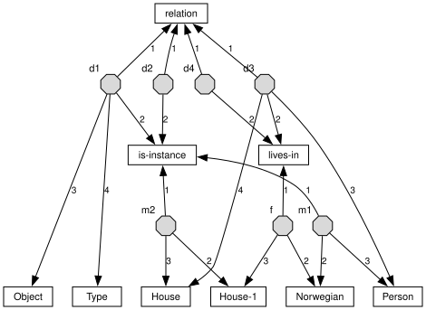
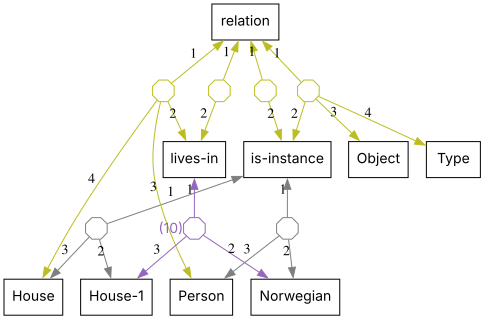
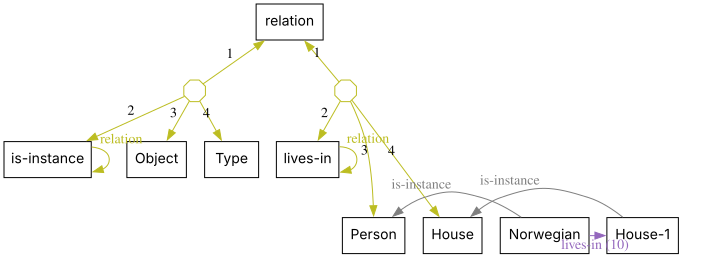
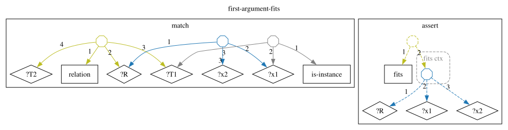
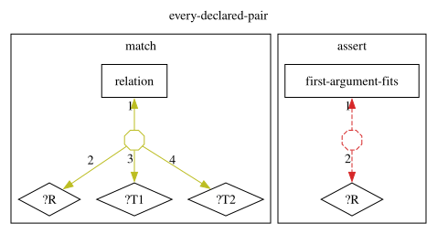

# Objects: atoms and facts

The knowledge base a program describes is a **graph**, and an **object** is a node of it. A node is one of two
sorts, and there is no third:

- an **atom** is a labelled node with no outgoing arrow, and its label is its **name**: `Norwegian`, `House-1`,
  `lives-in`;
- a **fact** is a node with outgoing arrows, in order. The first points at its **relation**, which is an atom, and
  the others at its **arguments**, each an atom or a fact: `(lives-in Norwegian House-1)`.

**An object's identity is its name or its list of arrows**: one atom for a name and one fact for a list, however
often a program writes either. There is no number, no string and no other kind of thing an arrow could point at
([Q-M1f.113](../../../decisions/language/Q-M1f.113-an-object-is-an-atom-or-a-fact-a-state-could.md)).

**Ein has no types.** An atom carries nothing but its name. `Person`, `House`, `Object` and `Type` below are atoms
like `Norwegian`: labels, which mean what the program's rules make them mean, and nothing where no rule reads them
([Q-M1f.372](../../../decisions/language/Q-M1f.372-ein-has-no-types-a-declarations-slot-names-are.md)).

## In Ein

```lisp
(relation is-instance Object Type :why "{?3} is an instance of {?4}")
(relation lives-in Person House   :why "{?3} lives in {?4}")

(is-instance Norwegian Person)
(is-instance House-1 House)
(lives-in Norwegian House-1 :source "condition (10)")

(solve :no-search)
```

Every bare word in this program is a **name**, and a name is one atom wherever it is written. Each of the first
five forms is a **fact**: its first word is the atom under its first arrow, its second word the object under its
second arrow, and so on. The two `(relation …)` forms are facts like the other three, **declarations**, whose
first arrow points at the atom `relation`. What an atom is called depends on which arrow of a fact points at it:

| an atom is called | where it stands | in the program above |
|---|---|---|
| a **relation** | under the first arrow of a fact: the first word of a form | `is-instance`, `lives-in`, and `relation` itself |
| an **argument** | under a later arrow of a fact: a word after the first | `Norwegian`, `House-1`, `Person`, `House` |
| a **declared relation** | under the second arrow of a declaration: the word after `relation` | `is-instance`, `lives-in` |
| a **label** | under a later arrow of a declaration, one per argument of the declared relation | `Object`, `Type`, `Person`, `House` |
| a **rule**'s name | the name a `(rule …)` declares ([rules](05-rules.md)) | none here |

The words are parts an atom plays, not kinds of atom: nothing in a name says which it plays, and one atom plays
several. `Person` is a label of `lives-in` and an argument of `(is-instance Norwegian Person)`; `lives-in` is the
relation of one fact and an argument of its declaration; and a relation is an argument of every fact that
describes it, `(symmetric next-to)` among them ([properties and operators](07-properties-and-operators.md)).

**A relation, its extent, a fact of it.** `is-instance` is one atom. The facts whose first arrow points at it,
taken together, are its **extent**: every such fact, whether a knowledge base holds it or not. The ones a
knowledge base holds are its **held extent**, two of them here, and each is **a fact of** `is-instance`
([relations](02-relations.md), [facts](03-facts.md)).

**A name** is a run of ASCII letters and digits, the connectors `_ - .`, and the characters
`` $ % ^ * + = < > ! & @ ~ / ' ` [ ] { } ``. Nothing else, and never a character outside ASCII: those are written
only in a string or a comment. A run of digits is a name like any other: `1` and `01` are two names, so two atoms,
and Ein has no numbers ([Q-M1e2.24](../../../decisions/language/Q-M1e2.24-ein-has-no-numbers-and-no-ranges.md));
arithmetic is a theory of the standard library ([the calculator](../04-reference/04-stdlib/07-calculator.md)). What
is **not** a name, and so no atom: a variable, `?x`, which a rule or a query binds and no fact holds; a keyword,
`:why`, which marks a clause of a form; a string, `"…"`, which is natural-language text written only after `:why`,
`:source` or `:goal-text`
([Q-M1e2.23](../../../decisions/language/Q-M1e2.23-a-string-is-natural-language-text-never.md)); and the
words the grammar reserves ([reserved names](../04-reference/03-reserved-names.md)).

## As a graph

**The graph itself**, drawn by hand: every object of the program above is one node. A box is an atom, with its
name in it. An octagon is a fact; it has no name, and the letter beside it is only what this page calls it. An
arrow carries its place in the fact's list, `1` on the arrow to the relation:



The program writes five facts and the graph has seven, since a declaration is stored as two: `d1` is `(relation
is-instance Object Type)` and `d2` is `(relation is-instance)`, which says that the name is declared; `d3` and
`d4` are the same two of `lives-in`. `m1` and `m2` are the two `is-instance` facts, and `f` is `(lives-in
Norwegian House-1)`. Each atom is one box however many arrows reach it. `Person` is under the fourth arrow of
`d3` and the third of `m1`. `is-instance` is under the first arrow of `m1` and of `m2`, which is what makes them
two facts of one relation, and under the second arrow of `d1` and of `d2`, which is what makes it a declared
relation. [The knowledge base](../../reasoning/01-static-ir/01-knowledge-base.md) defines this graph and
everything said of it.

**What `ein` draws** is that graph. `ein render kb FILE` draws the program loaded and saturated, each fact an
octagon with no name in it, its arrow `1` at its relation's box and its arrows `2`, `3`, … at its arguments, the
given fact with its source's short tag, `(10)`, beside it
([Q-M1f.419](../../../decisions/cli/Q-M1f.419-ein-render-draws-a-fact-as-the-graph-has-it.md)):



It is the graph above, node for node: its seven octagons are `d1` to `d4`, `m1`, `m2` and `f`, and `is-instance` is
one box, under the first arrows of `m1` and `m2` and the second arrows of `d1` and `d2`. The view writes an arrow's
number beside it and colours a fact's arrows by its relation; the shapes are the
[rendering reference](../04-reference/12-rendering.md)'s legend.

**Folded**, `ein render kb --fold FILE`, each fact of three arrows that nothing points at, a relation and two
arguments, is one arrow from its first argument to its second with the relation's name on it, and each fact of two
arrows a loop on its argument: the graph
[drawn with labelled arrows](../../reasoning/01-static-ir/01-knowledge-base.md#drawn-with-labelled-arrows).



So `m1`, `m2` and `f` are three arrows here, `f` with its `(10)` after the relation's name; the two declarations of
four arrows stay octagons, and the two of two arrows, the facts the loader adds beside them, are loops labelled
`relation` on the relations they declare. A fact that a drawn fact points at is never folded. Folded, a relation is a word written on as many arrows as it has facts, and no node of its
own: `is-instance` is a box here only because its declarations point at it. The folded drawing is not the knowledge
base: it stands for the graph by that rule, and what the engine reasons over is the graph.

**No relation is drawn otherwise than another**
([Q-M1f.421](../../../decisions/cli/Q-M1f.421-no-view-draws-a-relation-otherwise-than-another.md)). A program that
spells its membership relation `is-a` is drawn as this one is, with `is-a` written where `is-instance` is: every
atom is a box, whatever points at it, and a fact of `is-a` is an octagon, or a labelled arrow under `--fold`, as a
fact of any relation is. The two programs hold the same facts under two names, and answer alike.

## In words

An atom reads as its name, as written: Ein has no vocabulary of its own for the things a problem is about. An atom
takes part in sentences through the texts a program writes on the forms around it: a declaration's `:why`, which
reads the declaration, `(relation lives-in Person House :why "{?3} lives in {?4}")` *Person lives in House*; a
fact's `:source`, *condition (10)*; and a rule's `:why`, filled with the atoms a firing binds. A fact of a relation
has no text of its own, and reads as written, `lives-in(Norwegian, House-1)`
([natural language](14-natural-language.md)). `ein solve FILE --trace OUT.md` prints each text where a step reads
its form; of the program [below](#giving-labels-a-meaning), whose rule reads the declaration:

```text
### Step 3 — `first-argument-fits`

> Norwegian is an instance of Person, the label lives-in declares for its first argument

Premises: `relation(lives-in, Person, House)` — Person lives in House, `lives-in(Norwegian, House-1)`, `is-instance(Norwegian, Person)`

Derives `fits(lives-in(Norwegian, House-1))`.
```

A name a module declares prints as the main file writes it, and otherwise by its full name,
`std.math.decimal-arith.add`
([Q-M1f.237](../../../decisions/imports/Q-M1f.237-a-name-prints-as-the-main-file-writes-it-else.md)).

## In mathematics

Write $\Sigma^{+}$ for the names, the non-empty words over the name characters, and $\operatorname{out}(o)$ for
the list of the objects under the arrows of the node $o$, from the first. An atom is its name and has no arrow; a
fact is its list. The **objects** $O$ are the least set with

$$
\begin{aligned}
\Sigma^{+} &\subseteq O && \text{the atoms} \\
(r, o_1, \dots, o_n) &\in O && \text{the facts, for a name } r,\ n \ge 0 \text{ and } o_1, \dots, o_n \in O
\end{aligned}
$$

less the tuples under a word the language keeps from heading a fact ([facts](03-facts.md#a-fact-inside-a-fact)).
The fact $(r, o_1, \dots, o_n)$ is written $r(o_1, \dots, o_n)$: $r$ is its relation and $o_1, \dots, o_n$ are
its arguments. **Identity is the name or the tuple**:

$$
\begin{aligned}
a = b &\iff a \text{ and } b \text{ are one word} && \text{for atoms } a, b \\
f = g &\iff \operatorname{out}(f) = \operatorname{out}(g) && \text{for facts } f, g \\
a &\neq f && \text{for an atom } a \text{ and a fact } f
\end{aligned}
$$

So two occurrences of a name are one node, and two facts are one node exactly when their relations and their
argument lists are equal, at every depth. A knowledge base is a finite set $K$ of facts, and its graph is those
facts and whatever lies under their arrows. For the program above,

$$
\begin{aligned}
\operatorname{out}(d_1) &= (\mathsf{relation},\ \text{is-instance},\ \mathsf{Object},\ \mathsf{Type}) \\
\operatorname{out}(d_2) &= (\mathsf{relation},\ \text{is-instance}) \\
\operatorname{out}(d_3) &= (\mathsf{relation},\ \text{lives-in},\ \mathsf{Person},\ \mathsf{House}) \\
\operatorname{out}(d_4) &= (\mathsf{relation},\ \text{lives-in}) \\
\operatorname{out}(m_1) &= (\text{is-instance},\ \mathsf{Norwegian},\ \mathsf{Person}) \\
\operatorname{out}(m_2) &= (\text{is-instance},\ \text{House-1},\ \mathsf{House}) \\
\operatorname{out}(f) &= (\text{lives-in},\ \mathsf{Norwegian},\ \text{House-1}) \\
K &= \lbrace d_1, d_2, d_3, d_4, m_1, m_2, f \rbrace
\end{aligned}
$$

A program also has a finite set of **names** $N$: every name written as an argument of one of its facts, at any
depth, and every name written anywhere in one of its rules
([Q-M1e2.9](../../../decisions/language/Q-M1e2.9-a-programs-names-are-the-constants-its-facts.md)). Here

$$
\begin{aligned}
N = \lbrace\ & \mathsf{Norwegian},\ \text{House-1},\ \mathsf{Person},\ \mathsf{House}, \\
& \mathsf{Object},\ \mathsf{Type},\ \text{is-instance},\ \text{lives-in}\ \rbrace
\end{aligned}
$$

$N$ is not partitioned: there is no subset of *types* and no function from an atom to a type. The words of the
table above say which arrow points at an atom, and nothing about the atom.

## No types: a label means what a rule makes it mean

`(relation is-instance Object Type :why "…")` is **almost an ordinary fact**. The loader stores it as one, `d1`
of the graph above, which `ein saturate --dump FILE` lists among the program's facts beside a second fact, `d2`,
that says the name is declared:

```text
;; ── BACKGROUND (6 facts) ──
;;   is-instance (2)
  (is-instance Norwegian Person)
  (is-instance House-1 House)
;;   relation (4)
  (relation is-instance Object Type)
  (relation is-instance)
  (relation lives-in Person House)
  (relation lives-in)

;; ── GIVEN (1 fact) ──
  (lives-in Norwegian House-1 :source "condition (10)")
```

`Object` and `Type` are its second and third arguments: atoms under two arrows of a fact, and nothing more. The
engine never asks whether `Norwegian` *is* a `Person`. Beside the declarations above, a program may state

```lisp
(lives-in House-1 Norwegian)
```

and it loads: the second argument of `lives-in` is not held to `House`, nor the first to `Person`. Renaming the
labels, `(relation lives-in X Y :why "…")`, changes no fact but the declaration's own.

*Almost*, because a declaration does three things an ordinary fact does not, and holds no form to its count of
labels: `(lives-in Bob)` beside it loads too, a fact of one argument, which no pattern of two matches
([relations](02-relations.md#a-relation-is-overloaded-by-its-count-and-the-labels-are-not-held)):

| a declaration | which is |
|---|---|
| carries the **sentence** | its `:why` is what each fact of the relation reads as ([natural language](14-natural-language.md)) |
| is written with its `:why` | one with no `:why` is refused; a second `(relation lives-in …)`, at the same count or another, is one more fact of `relation`, and each is read ([Q-M1f.447](../../../decisions/language/Q-M1f.447-a-relation-is-overloaded-by-its-count-of.md)) |
| tells the **blind enumerator** what to guess about | with no hrule and no obligation, the engine proposes facts of declared relations of one or two arguments, over the **guessable atoms**: the program's names less those some declaration writes as a label ([hypotheses](09-hypotheses.md)) |

The last is the one place the engine itself reads which atoms are labels, and it reads them only as *not a thing to
guess about*. Everything else a label means is given to it by a rule.

### Giving labels a meaning

A rule reads a declaration as it reads any fact, so *the first argument of a fact is an instance of its
relation's first label* is a sentence a program can write:

```lisp
(relation is-instance Object Type :why "{?3} is an instance of {?4}")
(relation lives-in Person House   :why "{?3} lives in {?4}")
(relation fits Fact               :why "the first argument of {?3} is what its relation's first label says")

(rule first-argument-fits (?R)
  :match  (and (relation ?R ?T1 ?T2) (?R ?x1 ?x2) (is-instance ?x1 ?T1))
  :assert (fits (?R ?x1 ?x2))
  :why    "{?x1} is an instance of {?T1}, the label {?R} declares for its first argument")

(rule every-declared-pair ()
  :match  (relation ?R ?T1 ?T2)
  :assert (first-argument-fits ?R)
  :why    "{?R} is declared with the labels {?T1} and {?T2}, so its facts are read against them")

(is-instance Norwegian Person)
(is-instance House-1 House)
(lives-in Norwegian House-1)
(lives-in House-1 Norwegian)

(query :goal (fits ?fact) :goal-text "{?fact} fits its declaration")
(solve :no-search)
```

`first-argument-fits` matches three facts at once: the declaration of some relation `?R` with two labels, a fact
of `?R`, and an `is-instance` fact of that fact's first argument and the first label. Where all three are there,
*the type of `?x1` is `?T1`* is a fair thing to call it, and the rule says so of the fact. A relation written as a
variable is a **parameter** of its rule ([rules](05-rules.md)), bound by an activator fact, so the second rule
supplies one for every relation declared with two labels. The first rule written with no parameter, its `?R` bound
by the `(relation ?R ?T1 ?T2)` premise alone, is refused at load: *a relation is named by a name or by a parameter
its activator binds*. `ein solve FILE`:

```text
  query             (fits ?fact)
  over              all of R — 1 state → 1 projection class
    class 1 of 1    1 state (1)
                      ?fact = (lives-in Norwegian House-1)
                        “(lives-in Norwegian House-1) fits its declaration”
  as :expect        (model (fits (lives-in Norwegian House-1)))
```

`(lives-in House-1 Norwegian)` holds as before, and does not fit: nothing says `House-1` is an instance of
`Person`. The rule, as `ein render rule --name first-argument-fits FILE` draws it: each premise an octagon, the
declaration's arrow `1` at the box `relation` and its next three at the variables `?R`, `?T1` and `?T2`, the fact's
arrow `1` at the diamond `?R`, the relation's variable; and, in the conclusion, the same pattern under the second
arrow of `fits`, an octagon in the frame `fits ctx`:



The second rule, `ein render rule --name every-declared-pair FILE`, matches a declaration alone and asserts the
first rule's activator, a fact whose arrow `1` is at the rule's name and whose arrow `2` is at the relation:



In words, from the trace: *Norwegian is an instance of Person, the label lives-in declares for its first
argument*. In mathematics the rule is one implication, for every relation $R$ it is activated on:

$$
\begin{aligned}
& \operatorname{relation}(R, T_1, T_2) \land R(x_1, x_2) \land \operatorname{is-instance}(x_1, T_1) \\
& \implies \operatorname{fits}\bigl(R(x_1, x_2)\bigr)
\end{aligned}
$$

Remove the two rules and `Person` means nothing again. A check that refutes a state whose fact does not fit, a
hierarchy of labels, or inheritance along it is written the same way, as rules over the same facts
([ontology](04-ontology.md)); the standard library's bijection and typing rules read a declaration's labels so
([the relation algebra](../04-reference/04-stdlib/02-relation-algebra.md#labels-and-the-membership-relation),
[bijections](../04-reference/04-stdlib/04-bijections.md#the-argument-check)).

## One name, one atom

**No copies.** Two occurrences of a name anywhere in a program, in its imports included, are the same atom, two
occurrences of a fact are the same fact, and every state the engine considers shares the program's atoms. A
variable is local to the rule or query that writes it: `?a` in one rule and `?a` in another are unrelated.

**No merging.** Two different names are two atoms, always. `(eq ?a ?b)` holds exactly when `?a` and `?b` are bound
to the same object
([Q-M1e2.26](../../../decisions/language/Q-M1e2.26-eq-and-neq-are-the-relations-of-equality-and-non.md)),
and a fact `(= a b)` is an ordinary fact of a relation named `=`: it licenses no substitution and makes `a` and `b`
no more one atom than any other fact does
([Q1](../../../decisions/language/Q1-the-knowledge-base-is-a-hypergraph-of-atoms.md)). The rendering draws a fact of
`=` as a fact of any relation is drawn, an octagon whose arrow `1` is at the box `=`, and that is all `=` means.

**Names an import brings.** Every name a module declares has a full name, its module's name and its own,
`std.algebra.symmetric`; a file writes it short when it lists it in its import, `(import std.algebra :symbols
(symmetric))`, and one short name stands for one declaration in a file
([Q-M1f.231](../../../decisions/imports/Q-M1f.231-every-name-a-module-declares-has-a-full-name.md)). The
[macros and imports](11-macros.md) page has the rest.

**Names the program cannot write.** The loader makes up names of its own, each starting with `#`, which no program
can write ([Q-M1f.339](../../../decisions/language/Q-M1f.339-every-name-the-loader-makes-up-starts-with.md)), and
`__closed__` is the kernel's: a program writes it as a fact's relation, never binds it, and it is no guessable
atom, so no hypothesis is ever about it
([reserved names](../04-reference/03-reserved-names.md)).

## What is refused

Each at the parse, on every command, with a line naming the place
([diagnostics](../04-reference/07-diagnostics.md)):

- a character outside ASCII outside a string or a comment;
- a bare `_` or `?_`, anywhere ([Q-M1e2.22](../../../decisions/language/Q-M1e2.22-a-bare-is-reserved-and-refused.md));
- a string where an argument goes, and a keyword a form does not take;
- `()` as an argument.

What looks like a number or a range is a name: `1`, `01` and `1..3` are three names, each its own atom.

## See also

- [Relations](02-relations.md): the atom under a fact's first arrow, its extent, and its declaration.
- [Facts](03-facts.md): the nodes with arrows, where each came from, and a fact as an argument of a fact.
- [The knowledge base](../../reasoning/01-static-ir/01-knowledge-base.md): the graph defined, with its
  properties: identity, order, the text of an object.
- [Ontology](04-ontology.md): membership, hierarchy and inheritance, each a relation and rules of the program's own.
- [The rendering reference](../04-reference/12-rendering.md): every view `ein render` draws and its legend.
- [The syntax reference](../04-reference/02-syntax.md): the lexer, token by token.
