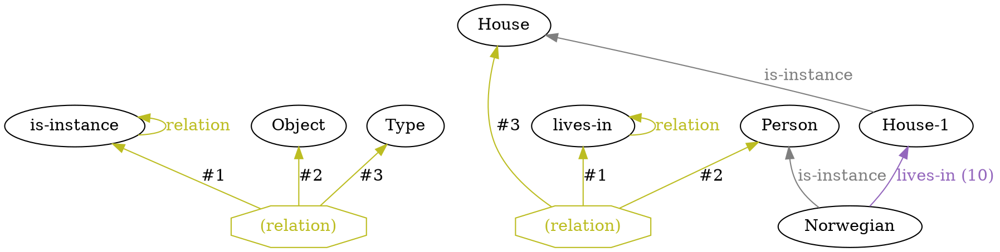
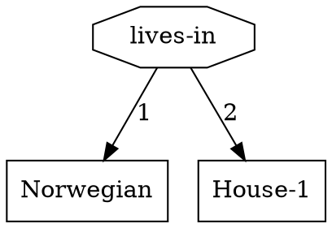
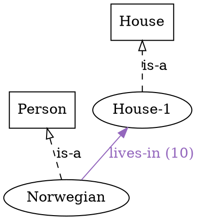
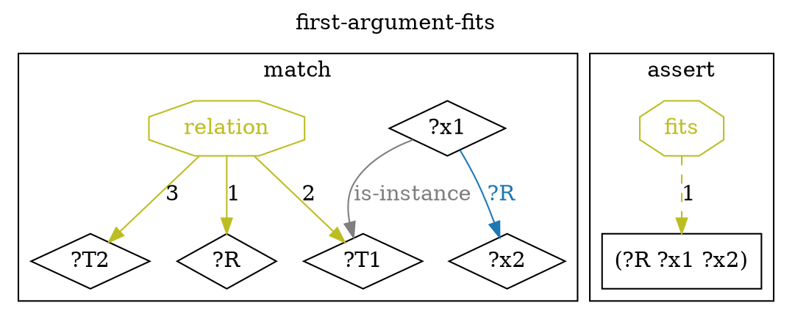

# Objects

An **object** is a thing a program names: `Norwegian`, `House-1`, `Red`. Ein's knowledge base is a graph, and
every part of it is a node named the same way an object is: a relation (`lives-in`) and a rule (`transitive`) are
names too, and a fact is a node built of names. There is no number, no string and no other kind of value: a value
is a **name**, or a **fact** a state could hold
([Q-M1f.113](../../../decisions/language/Q-M1f.113-a-value-is-a-name-or-a-fact-a-state-could-hold.md)).

**Ein has no types.** A name carries nothing but its spelling. `Person`, `House`, `Object` and `Type` below are
names like `Norwegian`: labels, which mean what the program's rules make them mean, and nothing where no rule reads
them ([Q-M1f.372](../../../decisions/language/Q-M1f.372-ein-has-no-types-a-declarations-slot-names-are.md)).

## In Ein

```lisp
(relation is-instance Object Type :why "{?1} is an instance of {?2}")
(relation lives-in Person House   :why "{?1} lives in {?2}")

(is-instance Norwegian Person)
(is-instance House-1 House)
(lives-in Norwegian House-1 :source "condition (10)")

(solve :no-search)
```

Every bare word in this program is a name, and each names one node. What a name is called depends on where the
program writes it:

| a name is called | where it stands | in the program above |
|---|---|---|
| an **object** | an argument of a fact | `Norwegian`, `House-1`, `Person`, `House` |
| a **relation** | the head of a fact, or the name a `(relation …)` declares | `is-instance`, `lives-in` |
| a **label** | after the name in a `(relation …)`, one per argument | `Object`, `Type`, `Person`, `House` |
| a **rule** | the name a `(rule …)` declares ([rules](05-rules.md)) | none here |

and a **fact** is a relation applied to its arguments, `(lives-in Norwegian House-1)`, a node of its own
([facts](03-facts.md)). The words are roles, not kinds: nothing in a name says which it plays, and one name plays
several. `Person` is a label of `lives-in` and an object of `(is-instance Norwegian Person)`; a relation's name is an
object of the facts that describe the relation, `(symmetric next-to)` among them
([properties and operators](07-properties-and-operators.md)).

**A name** is a run of ASCII letters and digits, the connectors `_ - .`, and the characters
`` $ % ^ * + = < > ! & @ ~ / ' ` [ ] { } ``. Nothing else, and never a character outside ASCII: those are written
only in a string or a comment. A run of digits is a name like any other: `1` and `01` are two names, and Ein has no
numbers ([Q-M1e2.24](../../../decisions/language/Q-M1e2.24-ein-has-no-numbers-and-no-ranges.md)); arithmetic is a
theory of the standard library ([the stdlib reference](../04-reference/04-stdlib/README.md)). What is **not** a name:
a variable, `?x`, which a rule or a query binds and no fact holds; a keyword, `:why`, which marks a clause of a
form; a string, `"…"`, which is natural-language text written only after `:why`, `:source` or `:goal-text`
([Q-M1e2.23](../../../decisions/language/Q-M1e2.23-a-string-is-natural-language-text-never-a-value.md)); and the
words the grammar reserves ([reserved names](../04-reference/03-reserved-names.md)).

## As a graph

`ein render kb FILE` draws the program loaded and saturated, one node per name, every form that writes the name
fused into it. The program above, whole:



Every name is one node, and every one is drawn the same way. `Person` is one node: the declaration of `lives-in`
points at it as its second argument, and `(is-instance Norwegian Person)` points at it as an arrow's end. Each
declaration is drawn as what it is stored as, two facts of the relation named `relation`: an octagon with a
numbered edge to the relation's name and to each label, and a loop on the name. A binary fact is one labelled arrow
(the `lives-in` one with its source's short tag, `(10)`), a unary fact a labelled loop, and a fact of three
arguments or more an octagon with an edge to each argument. The shapes are the
[rendering reference](../04-reference/12-rendering.md)'s legend.

That is the **compact** view. The **detailed** view is the canonical one: every fact is a node of its own, an
octagon, with an edge numbered by position to each argument, so a fact of any arity has the same shape and a fact
can itself be an argument. `ein render program --levi FILE` draws the program's stated fact so:



The compact view is a projection of the detailed one: collapse each octagon of one or two arguments into an arrow,
and promote the relation's name to the arrow's label. The two say the same thing of a graph of unary and binary
facts, which is most of a puzzle; past two arguments only the detailed one can be drawn.

**Boxes and ovals are a drawing convention.** Where a program names its membership relation `is-a`, `ein render
kb` draws the second argument of each `is-a` fact as a box, the first as an oval, and the fact as a dashed arrow
with an empty head. The same program with `is-instance` spelt `is-a`, the declarations' facts left out:



The drawing is keyed on the spelling `is-a` and on nothing else: the two programs hold the same facts under two
names, and answer alike. `--no-types` leaves the boxes and their arrows out.

## In words

A name reads as itself, as written: Ein has no vocabulary of its own for the things a problem is about. A name takes
part in sentences through the facts it is an argument of, each read by its relation's `:why`. `ein solve FILE
--dump-answer DIR` writes each fact of the state with its sentence:

```text
(is-instance House-1 House) ; House-1 is an instance of House
(is-instance Norwegian Person) ; Norwegian is an instance of Person
(lives-in Norwegian House-1) ; source "condition (10)" — Norwegian lives in House-1
```

A name a module declares prints as the main file writes it, and otherwise by its full name,
`std.math.decimal-arith.add`
([Q-M1f.237](../../../decisions/imports/Q-M1f.237-a-name-prints-as-the-main-file-writes-it-else.md)).

## In mathematics

A program has a finite set of **names** $N$: every constant written in an argument position of one of its facts, at
any depth, and every constant written anywhere in one of its rules
([Q-M1e2.9](../../../decisions/language/Q-M1e2.9-a-programs-names-are-the-constants-its-facts.md)). The **values**
$V$ are the least set with

$$
N \subseteq V, \qquad r(v_1, \dots, v_n) \in V, \qquad \lnot f \in V
$$

for every relation $r$ of $n$ arguments, all $v_1, \dots, v_n \in V$, and every fact $f = r(v_1, \dots, v_n)$ of an
ordinary relation. A value is a name or a ground term over the relations. Identity is syntactic: two occurrences of
a name are one node, and two facts are one node exactly when their relations and their argument lists are equal, at
every depth. For the program above,

$$
N = \lbrace \mathsf{Norwegian},\ \text{House-1},\ \mathsf{Person},\ \mathsf{House},\ \mathsf{Object},\ \mathsf{Type},\ \text{is-instance},\ \text{lives-in} \rbrace
$$

and the knowledge base is a set of facts over $V$. $N$ is not partitioned: there is no subset of *types* and no
function from a name to a type. The roles of the table above are positions a name is written in.

## No types: a label means what a rule makes it mean

`(relation is-instance Object Type :why "…")` is **almost an ordinary fact**. The loader stores it as one, the
octagon of the graph above, which `ein saturate --dump FILE` lists among the program's facts beside a second fact
that says the name is declared:

```text
;; ── BACKGROUND (2 facts) ──
;;   relation (2)
  (relation is-instance Object Type)
  (relation is-instance)
```

`Object` and `Type` are its second and third arguments: names, written in a fact, and nothing more. The engine
never asks whether `Norwegian` *is* a `Person`. Beside the declarations above, a program may state

```lisp
(lives-in House-1 Norwegian)
```

and it loads: the second argument of `lives-in` is not held to `House`, nor the first to `Person`. Renaming the
labels, `(relation lives-in X Y :why "…")`, changes no fact but the declaration's own.

*Almost*, because a declaration does four things an ordinary fact does not:

| a declaration | which is |
|---|---|
| fixes the **count** of arguments | a form headed by `lives-in` has two, wherever it is written, or the program is refused at load ([relations](02-relations.md)) |
| carries the **sentence** | its `:why` is what each fact of the relation reads as ([natural language](14-natural-language.md)) |
| is written **once**, with its `:why` | a second `(relation lives-in …)` is refused, and so is one with no `:why` |
| tells the **blind enumerator** what to guess about | with no hrule and no obligation, the engine proposes facts of declared relations of one or two arguments, over the program's names less those some declaration writes as a label ([hypotheses](09-hypotheses.md)) |

The last is the one place the engine itself reads which names are labels, and it reads them only as *not a thing to
guess about*. Everything else a label means is given to it by a rule.

### Giving labels a meaning

A rule reads a declaration as it reads any fact, so *the first argument of a fact is an instance of its
relation's first label* is a sentence a program can write:

```lisp
(relation is-instance Object Type :why "{?1} is an instance of {?2}")
(relation lives-in Person House   :why "{?1} lives in {?2}")
(relation fits Fact               :why "the first argument of {?1} is what its relation's first label says")

(rule first-argument-fits (?R)
  :match  (and (relation ?R ?T1 ?T2) (?R ?x1 ?x2) (is-instance ?x1 ?T1))
  :assert (fits (?R ?x1 ?x2))
  :why    "{?x1} is an instance of {?T1}, the label {?R} declares for its first argument")

(rule every-declared-pair ()
  :match  (relation ?R ?T1 ?T2)
  :assert (first-argument-fits ?R)
  :why    "{?R} is declared with the labels {?T1} and {?T2}, so its facts are read against them")

(is-instance Norwegian Person)
(is-instance House-1 House)
(lives-in Norwegian House-1)
(lives-in House-1 Norwegian)

(query :goal (fits ?fact) :goal-text "{?fact} fits its declaration")
(solve :no-search)
```

`first-argument-fits` matches three facts at once: the declaration of some relation `?R` with two labels, a fact
of `?R`, and an `is-instance` arrow from that fact's first argument to the first label. Where all three are there,
*the type of `?x1` is `?T1`* is a fair thing to call it, and the rule says so of the fact. A relation written as a
variable is a **parameter** of its rule ([rules](05-rules.md)), bound by an activator fact, so the second rule
supplies one for every relation declared with two labels. `ein solve FILE`:

```text
  query             (fits ?fact)
  over              all of R — 1 state → 1 projection class
    class 1 of 1    1 state (1)
                      ?fact = (lives-in Norwegian House-1)
                        “(lives-in Norwegian House-1) fits its declaration”
  as :expect        (model (fits (lives-in Norwegian House-1)))
```

`(lives-in House-1 Norwegian)` holds as before, and does not fit: nothing says `House-1` is an instance of
`Person`. The rule, as `ein render rule --name first-argument-fits FILE` draws it, the declaration an octagon over
the relation and its two labels, the fact an arrow labelled with the relation's variable:



In words, from the state file: *Norwegian is an instance of Person, the label lives-in declares for its first
argument*. In mathematics the rule is one implication, for every relation $R$ it is activated on:

$$
\operatorname{relation}(R, T_1, T_2) \land R(x_1, x_2) \land \operatorname{is-instance}(x_1, T_1) \implies \operatorname{fits}\bigl(R(x_1, x_2)\bigr)
$$

Remove the two rules and `Person` means nothing again. A check that refutes a state whose fact does not fit, a
hierarchy of labels, or inheritance along it is written the same way, as rules over the same facts
([ontology](04-ontology.md)); the standard library's bijection and typing rules read a declaration's labels so
([the stdlib reference](../04-reference/04-stdlib/README.md)).

## One name, one node

**No copies.** Two occurrences of a name anywhere in a program, in its imports included, denote the same node, and
every state the engine considers shares the program's names. A variable is local to the rule or query that writes
it: `?a` in one rule and `?a` in another are unrelated.

**No merging.** Two different names are two nodes, always. `(eq ?a ?b)` holds exactly when `?a` and `?b` are the
same name ([Q-M1e2.26](../../../decisions/language/Q-M1e2.26-eq-and-neq-are-the-relations-of-equality-and-non.md)),
and a fact `(= a b)` is an ordinary fact of a relation named `=`: it licenses no substitution and makes `a` and `b`
no more one node than any other fact does
([Q1](../../../decisions/language/Q1-the-knowledge-base-is-a-typed-labelled.md)). The rendering draws a binary `=`
fact as a `doublecircle` node with an edge to each side, and that is all `=` means.

**Names an import brings.** Every name a module declares has a full name, its module's name and its own,
`std.algebra.symmetric`; a file writes it short when it lists it in its import, `(import std.algebra :symbols
(symmetric))`, and one short name stands for one declaration in a file
([Q-M1f.231](../../../decisions/imports/Q-M1f.231-every-name-a-module-declares-has-a-full-name.md)). The
[macros and imports](11-macros.md) page has the rest.

**Names the program cannot write.** The loader makes up names of its own, each starting with `#`, which no program
can write ([Q-M1f.339](../../../decisions/language/Q-M1f.339-every-name-the-loader-makes-up-starts-with.md)), and
`__closed__` and `__symmetric__` are the kernel's: a program writes them as a fact's relation, never binds them, and
no hypothesis is ever about them ([reserved names](../04-reference/03-reserved-names.md)).

## What is refused

Each at the parse, on every command, with a line naming the place
([diagnostics](../04-reference/07-diagnostics.md)):

- a character outside ASCII outside a string or a comment;
- a bare `_` or `?_`, anywhere ([Q-M1e2.22](../../../decisions/language/Q-M1e2.22-a-bare-is-reserved-and-refused.md));
- a string where a value goes, and a keyword a form does not take;
- `()` as a value.

What looks like a number or a range is a name: `1`, `01` and `1..3` are three names, each its own node.

## See also

- [Relations](02-relations.md) and [facts](03-facts.md), the two other things the graph is made of.
- [Ontology](04-ontology.md): membership, hierarchy and inheritance, each a relation and rules of the program's own.
- [The rendering reference](../04-reference/12-rendering.md): every view `ein render` draws and its legend.
- [The syntax reference](../04-reference/02-syntax.md): the lexer, token by token.
