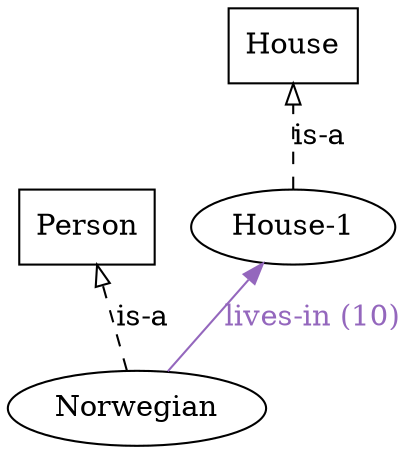
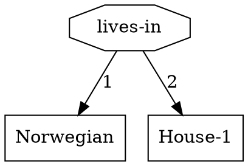

# Objects

An **object** is a thing a program names: `Norwegian`, `House-1`, `Red`. Ein's knowledge base is a graph, and
every part of it is a node named the same way an object is: a type (`Person`), a relation (`lives-in`) and a rule
(`transitive`) are names too, and a fact is a node built of names. There is no number, no string and no other kind
of value: a value is a **name**, or a **fact** a state could hold
([Q-M1f.113](../../../decisions/language/Q-M1f.113-a-value-is-a-name-or-a-fact-a-state-could-hold.md)).

## In Ein

```lisp
(relation is-a T T :why "{?1} is a {?2}")
(relation lives-in Person House :why "{?1} lives in {?2}")

(is-a Norwegian Person)
(is-a House-1 House)
(lives-in Norwegian House-1 :source "condition (10)")

(solve :no-search)
```

Every bare word in this program is a name, and each names one node:

| kind | what it is | in the program above |
|---|---|---|
| **object** | an entity the problem is about | `Norwegian`, `House-1` |
| **type** | a name other objects are classified under, by a fact of the program's own relation | `Person`, `House`, `T` |
| **relation** | a named predicate, declared by `(relation …)` or written in a fact | `is-a`, `lives-in` |
| **rule** | a named rewriting of the graph ([rules](05-rules.md)) | none here |
| **fact** | a relation applied to its arguments ([facts](03-facts.md)) | `(lives-in Norwegian House-1)` |

The kinds are roles, not spellings: nothing in a name says which it is, and one name can play two. A type is an
object that other objects are `is-a` of, and `is-a` and `T` are ordinary names the program declares and gives
meaning to with its own rules ([ontology](04-ontology.md)). A relation's name is an object of the facts that describe
the relation, `(symmetric next-to)` among them ([properties and operators](07-properties-and-operators.md)).

**A name** is a run of ASCII letters and digits, the connectors `_ - .`, and the characters
`` $ % ^ * + = < > ! & @ ~ / ' ` [ ] { } ``. Nothing else, and never a character outside ASCII: those are written
only in a string or a comment. A run of digits is a name like any other: `1` and `01` are two names, and Ein has no
numbers ([Q-M1e2.24](../../../decisions/language/Q-M1e2.24-ein-has-no-numbers-and-no-ranges.md)); arithmetic is a
theory of the standard library ([the stdlib reference](../04-reference/04-stdlib.md)). What is **not** a name: a variable,
`?x`, which a rule or a query binds and no fact holds; a keyword, `:why`, which marks a clause of a form; a string,
`"…"`, which is natural-language text written only after `:why`, `:source` or `:goal-text`
([Q-M1e2.23](../../../decisions/language/Q-M1e2.23-a-string-is-natural-language-text-never-a-value.md)); and the
words the grammar reserves ([reserved names](../04-reference/03-reserved-names.md)).

## As a graph

`ein render kb FILE` draws the program loaded and saturated, one node per name, every form that writes the name
fused into it. The view of the program above, the declarations' stored facts left out:



A **type** is a box and an **instance** an oval, read from the program's own facts of a relation named `is-a`: what
is the second argument of one is a type, what is only ever the first is an instance. A program that spells
membership another way gets the same graph with plain nodes and labelled arrows, since no relation is special. A
binary fact is one labelled arrow (here with its source's short tag, `(10)`), a unary fact a labelled self-loop, and
a fact of three arguments or more an octagon with an edge to each argument. The shapes are the
[rendering reference](../04-reference/12-rendering.md)'s legend.

That is the **compact** view. The **detailed** view is the canonical one: every fact is a node of its own, an
octagon, with an edge numbered by position to each argument, so a fact of any arity has the same shape and a fact
can itself be an argument. `ein render program --levi FILE` draws the program's facts so:



The compact view is a projection of the detailed one: collapse each octagon of one or two arguments into an arrow,
and promote the relation's name to the arrow's label. The two say the same thing of a graph of unary and binary
facts, which is most of a puzzle; past two arguments only the detailed one can be drawn.

## In words

A name reads as itself, as written: Ein has no vocabulary of its own for the things a problem is about. A name takes
part in sentences through the facts it is an argument of, each read by its relation's `:why`:
`(lives-in Norwegian House-1)` reads *Norwegian lives in House-1*. A name a module declares prints as the main file
writes it, and otherwise by its full name, `std.math.decimal-arith.add`
([Q-M1f.237](../../../decisions/imports/Q-M1f.237-a-name-prints-as-the-main-file-writes-it-else.md)).

## In mathematics

A program has a finite set of **names** `N`: every constant written in an argument position of one of its facts, at
any depth, and every constant written anywhere in one of its rules
([Q-M1e2.9](../../../decisions/language/Q-M1e2.9-a-programs-names-are-the-constants-its-facts.md)). The **values**
`V` are the least set with

```text
N ⊆ V
r(v₁, …, vₙ) ∈ V      for a relation r of n arguments and v₁, …, vₙ ∈ V
¬f ∈ V                for a fact f = r(v₁, …, vₙ) of an ordinary relation r
```

so a value is a name or a ground term over the relations. Identity is syntactic: two occurrences of a name are one
node, and two facts are one node exactly when their relations and their argument lists are equal, at every depth.
The knowledge base is a set of facts over `V`; the kinds of the table above are roles a name plays in that set, not
a partition of `N`.

## One name, one node

**No copies.** Two occurrences of a name anywhere in a program, in its imports included, denote the same node, and
every state the engine considers shares the program's names. A variable is local to the rule or query that writes
it: `?a` in one rule and `?a` in another are unrelated.

**No merging.** Two different names are two nodes, always. `(eq ?a ?b)` holds exactly when `?a` and `?b` are the
same name ([Q-M1e2.26](../../../decisions/language/Q-M1e2.26-eq-and-neq-are-the-relations-of-equality-and-non.md)),
and a fact `(= a b)` is an ordinary fact of a relation named `=`: it licenses no substitution and makes `a` and `b`
no more one node than any other fact does
([Q1](../../../decisions/language/Q1-the-knowledge-base-is-a-typed-labelled.md)). The rendering draws a binary `=`
fact as a `doublecircle` node with an edge to each side, and that is all `=` means.

**Names an import brings.** Every name a module declares has a full name, its module's name and its own,
`std.algebra.symmetric`; a file writes it short when it lists it in its import, `(import std.algebra :symbols
(symmetric))`, and one short name stands for one declaration in a file
([Q-M1f.231](../../../decisions/imports/Q-M1f.231-every-name-a-module-declares-has-a-full-name.md)). The
[macros and imports](11-macros.md) page has the rest.

**Names the program cannot write.** The loader makes up names of its own, each starting with `#`, which no program
can write ([Q-M1f.339](../../../decisions/language/Q-M1f.339-every-name-the-loader-makes-up-starts-with.md)), and
`__closed__` and `__symmetric__` are the kernel's: a program writes them as a fact's relation, never binds them, and
no hypothesis is ever about them ([reserved names](../04-reference/03-reserved-names.md)).

## What is refused

Each at the parse, on every command, with a line naming the place
([diagnostics](../04-reference/07-diagnostics.md)):

- a character outside ASCII outside a string or a comment;
- a bare `_` or `?_`, anywhere ([Q-M1e2.22](../../../decisions/language/Q-M1e2.22-a-bare-is-reserved-and-refused.md));
- a string where a value goes, and a keyword a form does not take;
- `()` as a value.

What looks like a number or a range is a name: `1`, `01` and `1..3` are three names, each its own node.

## See also

- [Relations](02-relations.md) and [facts](03-facts.md), the two other things the graph is made of.
- [Ontology](04-ontology.md): every kind of node is itself a node, and types are ordinary names.
- [The rendering reference](../04-reference/12-rendering.md): every view `ein render` draws and its legend.
- [The syntax reference](../04-reference/02-syntax.md): the lexer, token by token.
