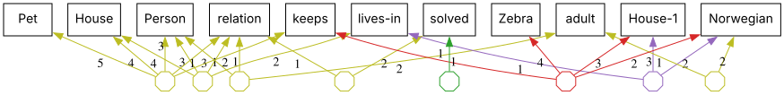
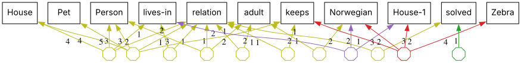

# Relations

A **relation** is the atom under the first arrow of a fact: `lives-in` in `(lives-in Norwegian House-1)`. It is
one object, however many facts point at it. Those facts taken together are the relation's **extent**, and each is
**a fact of** the relation: `lives-in` relates a person to a house, `adult` holds of a person, `solved` holds or
does not. A program **declares** a relation with its name, one **label** per argument, and the sentence one fact
of it reads as ([facts](03-facts.md)). A relation is a node of the graph like every other atom, so a relation's
properties are facts about it, and rules read a relation's declaration as data.

## In Ein

```lisp
(relation lives-in Person House :why "{?1} lives in {?2}")
(relation adult Person :why "{?1} is an adult")
(relation keeps Person House Pet :why "{?1}, in {?2}, keeps the {?3}")
(relation solved :why "the puzzle is solved")

(lives-in Norwegian House-1)
(adult Norwegian)
(keeps Norwegian House-1 Zebra)
(solved)

(solve :no-search)
```

`(relation NAME LABEL… :why "TEXT")` takes a name, zero or more labels, one per argument, and `:why`, and no other
clause. The count of labels is the count of arguments a fact of the relation has, its **arity**: a fact of
`lives-in` has two, of `adult` one, of `keeps` three, and `solved`, declared with no label, has no argument:
`(solved)` is its one fact. A label is an atom, and says to a reader what the argument is meant to be; the engine
holds no argument to it ([objects](01-objects.md#no-types-a-label-means-what-a-rule-makes-it-mean)).

Each declaration is itself a fact, of the relation `relation`, and is stored as two facts about the declared
relation, which rules can read: `(relation lives-in Person House)`, the relation with its labels, and `(relation
lives-in)`, which says that `lives-in` is a **declared relation**. `ein saturate --dump FILE` lists them among
the program's background facts:

```text
;; ── BACKGROUND (11 facts) ──
  (adult Norwegian)
  (keeps Norwegian House-1 Zebra)
  (lives-in Norwegian House-1)
;;   relation (7)
  (relation lives-in Person House)
  (relation lives-in)
  (relation adult Person)
  (relation adult)
  (relation keeps Person House Pet)
  (relation keeps)
  (relation solved)
  (solved)
```

A relation needs no declaration: a fact or a rule that writes `(likes Bob Tea)` makes `likes` a relation of the
program, the atom under that fact's first arrow, with no labels, no held count and no sentence. *Relation* and
*declared relation* are two things an atom can be, and neither needs the other: a declared relation of which the
program has no fact is under no first arrow.

## As a graph

`ein render program FILE` draws the program as written: each declaration of two labels or more as a dashed edge
between its first two, and the facts by their count of arguments, a fact of two as an arrow with the relation's
name on it, a fact of one as a loop with the name on it, and the others as octagons with the name in them and an
edge to each argument, numbered from the first argument:



The two labels a dashed edge joins are drawn as boxes where no fact names them; that is the view's way of setting
the declarations apart from the facts, and says nothing of what `Person` is. `ein render kb FILE` draws the loaded
program, the declarations as the facts they are stored as, so a relation is visibly a node that facts are about:



`(relation lives-in Person House)` is an octagon with an edge to `lives-in` and one to each label; `(relation adult
Person)`, a fact of two arguments, is an arrow from `adult` to `Person`; and `(relation solved)` is a loop on
`solved`. The same shapes draw `(keeps Norwegian House-1 Zebra)`, `(lives-in Norwegian House-1)` and `(adult
Norwegian)`: a declaration is drawn as a fact because it is one.

Both drawings write a fact's relation as a word, on the arrow or in the octagon, and draw no node for it: the
atom `lives-in` is a node of the second drawing because its declaration has it as an argument, and the word
`lives-in` on the arrow from `Norwegian` is the same atom. In the graph itself a fact's first arrow points at
that one node ([objects](01-objects.md#as-a-graph) has the graph beside the engine's drawings).

## In words

A relation's `:why` is the **statement** of each of its facts, a template filled by position: `{?1}` is the fact's
first argument, `{?2}` its second, and so on. `ein solve FILE --dump-answer DIR` writes each fact of a state with its
statement after it:

```text
(adult Norwegian) ; Norwegian is an adult
(keeps Norwegian House-1 Zebra) ; Norwegian, in House-1, keeps the Zebra
(lives-in Norwegian House-1) ; Norwegian lives in House-1
(solved) ; the puzzle is solved
```

A relation nobody declares has no statement, and its facts read as their s-expressions
([natural language](14-natural-language.md)).

## In mathematics

A relation is an atom $r$. Write $F$ for the facts, $O$ for the objects, and $\operatorname{rel}(f)$ for the atom
under the first arrow of the fact $f$. The **extent** of $r$ is every fact of it, and its **held extent** in a
state $S$, a set of facts, is the part of the extent that $S$ holds:

$$
\begin{aligned}
\operatorname{ext}(r) &= \lbrace f \in F \mid \operatorname{rel}(f) = r \rbrace \\
\operatorname{ext}_S(r) &= \operatorname{ext}(r) \cap S
\end{aligned}
$$

The extent is the same whatever is held: it has every fact $r(o_1, \dots, o_n)$ over every list of objects, those
no state holds among them. The held extent is what a rule reads when it matches a fact of $r$. Read by its
argument lists, the held extent of a relation of two arguments is a set of pairs, that of a relation of one
argument a set of objects, and that of a relation of no argument is empty or the one fact $r()$, a proposition
that is true in $S$ exactly when $r() \in S$. For the program above,

$$
\begin{aligned}
\operatorname{ext}_S(\text{lives-in}) &= \lbrace \text{lives-in}(\mathsf{Norwegian}, \text{House-1}) \rbrace \\
\operatorname{ext}_S(\mathsf{adult}) &= \lbrace \mathsf{adult}(\mathsf{Norwegian}) \rbrace \\
\operatorname{ext}_S(\mathsf{keeps}) &= \lbrace \mathsf{keeps}(\mathsf{Norwegian}, \text{House-1}, \mathsf{Zebra}) \rbrace \\
\operatorname{ext}_S(\mathsf{solved}) &= \lbrace \mathsf{solved}() \rbrace
\end{aligned}
$$

A declaration is a fact of the relation $\mathsf{relation}$, and so no member of the extent of the relation it
declares:

$$
\begin{aligned}
\mathsf{relation}(\text{lives-in}, \mathsf{Person}, \mathsf{House}) &\in \operatorname{ext}_S(\mathsf{relation}) \\
\mathsf{relation}(\text{lives-in}, \mathsf{Person}, \mathsf{House}) &\notin \operatorname{ext}(\text{lives-in})
\end{aligned}
$$

It speaks of `lives-in` as one object, and bounds nothing: for labels $L_1, \dots, L_n$ there is no set the
$i$-th argument is drawn from, and $\operatorname{ext}_S(\text{lives-in})$ may hold a fact over any two objects.

## The count is held, the labels are not

A form headed by a declared relation has as many arguments as the declaration has labels, wherever it is written: a
fact, a fact inside a fact and under `(not …)`, a rule's and an hrule's `:match` and `:assert`, a goal and a claim.
`(lives-in Bob)` is refused at load, on every command, with a line that names both counts (the line calls the
labels `types`, the engine's word for them)
([Q-M1f.315](../../../decisions/language/Q-M1f.315-a-form-of-a-declared-relation-has-as-many.md);
[diagnostics](../04-reference/07-diagnostics.md)). A bare `(relation solved)` declares no argument, and `(solved now)` is
refused the same way ([Q-M1f.201](../../../decisions/language/Q-M1f.201-a-bare-relation-r-declares-no-argument.md)).

It is a count and no check of what is counted: what stands in an argument's place is not held to the label declared
for it, and `(lives-in House-1 Norwegian)` loads beside the declaration above
([Q-M1f.372](../../../decisions/language/Q-M1f.372-ein-has-no-types-a-declarations-slot-names-are.md)). A
relation that nobody declares has no count, so a fixture that wants one relation at several counts leaves it
undeclared. A relation written as a variable, `(?R ?a ?b)`, is held to no declared count, nor is a kernel marker or
a rule's activator fact.

## A relation's properties are facts beside it

A declaration takes a name, its labels and `:why`, and nothing else. What is true of the relation as a whole is
written beside it, as facts about it:

```lisp
(import std.algebra :symbols (symmetric includes))

(relation right-of House House :why "{?1} is right of {?2}")
(relation next-to House House :why "{?1} is next to {?2}")
(symmetric next-to)
(includes right-of next-to)

(right-of House-2 House-1)

(solve :no-search)
```

`(right-of House-2 House-1)` derives `(next-to House-2 House-1)` by `includes`, and `(next-to House-1 House-2)` by
`symmetric`.

Each property fact is the activator of a rule that gives it meaning
([Q27](../../../decisions/language/Q27-a-relations-properties-are-facts-beside.md)), so a property can be matched,
derived and explained like any fact. [Properties and operators](07-properties-and-operators.md) lists the standard
library's.

## A relation's declaration is data

Because the declaration is stored as facts, a rule can read it. `(relation ?R ?A ?B)` matches every declaration of
**two** labels and binds them, which is how a library rule reads what a relation is declared over: the standard
library's bijection rules take the two sides of a relation from it, and its converse check reads two declarations
to reject a converse whose labels do not mirror each other. A declaration of one label, `(relation adult Person)`,
is invisible to that pattern; `(relation ?R)` matches every declared relation, whatever its arity, and also every
atom a rule has concluded `(relation X)` of. A rule may conclude a fact of `relation`, `(relation hates Person
Food)`; what it derives is a fact, and declares nothing: no count is held for `hates`, and it has no sentence.

The engine itself reads of a declaration how many labels it has and which atoms they are, never what a label
means. [Objects](01-objects.md#giving-labels-a-meaning) has a rule that gives labels a meaning, and its drawing.

## The relation, its extent, a fact of it

Three things go by a relation's name, and these pages keep the word *relation* for the first:

| | example | what it is |
|---|---|---|
| the **relation** | `co-located` | one object: the atom under the first arrow of each of its facts |
| its **extent** | every `(co-located A B)` | its facts taken together, held or not; the **held extent** is those a knowledge base or a state holds |
| a **fact of** it | `(co-located Norwegian Red)` | one of them: a node with arrows, the first at that atom, which says something of its own arguments |

Which one a form is about is read off where the name stands in it. A fact with `co-located` as its first word is
one member of the extent. A fact with `co-located` as a later word, `(symmetric co-located)` or the declaration
`(relation co-located T T)`, points at the single atom, and so speaks of the relation as one object, of all its
facts at once. Where a page says that something *closes* a relation, or that a relation is *complete*, or that a
commitment *extends* it, the thing closed, complete or extended is the held extent: which facts of the relation a
state holds. Two arrows from one fact to one object are distinct by their place, which is how `(relation
co-located T T)` has both of its labels at the one atom `T`.

## A relation nothing makes

A rule may read a relation that no declaration, fact or conclusion of the program makes: the program loads and the
rule never fires ([Q-M1f.120](../../../decisions/language/Q-M1f.120-a-rule-may-read-a-relation-nothing-makes.md)).
That is what lets a library rule read a marker its importer may never write, and it is also how a misspelt relation
in a rule goes unnoticed: `(instnce ?a ?T)` is a pattern over a relation of that name, of which no state holds a
fact. The
symptom is a rule that never fires, which the trace (`ein solve FILE --trace OUT.md`) and the event log's firings
show.

## Relations the kernel gives meaning to

A few atoms are relations whose meaning is the engine's: `not` (a stored negation, [constraints](06-constraints.md)),
`false` (a contradiction), `relation` (the declarations' facts above), `written` (what a file writes, stated by the
loader), `__closed__` (its one argument a relation no fact of which is proposed as a hypothesis) and
`__symmetric__` (its one argument a relation whose held extent is closed under swapping a fact's two arguments,
the same closure the standard library's `symmetric` rule derives), and the computed relations `eq` and `neq`,
whose facts are never stored. [Reserved names](../04-reference/03-reserved-names.md) lists each and what may be
written with it.

## See also

- [Facts](03-facts.md): what a fact of a relation is, and where each came from.
- [Properties and operators](07-properties-and-operators.md): the algebra of relations, as facts and rules.
- [Ontology](04-ontology.md): membership and inheritance as relations and rules of the program's own.
- [The syntax reference](../04-reference/02-syntax.md): the `(relation …)` form.
