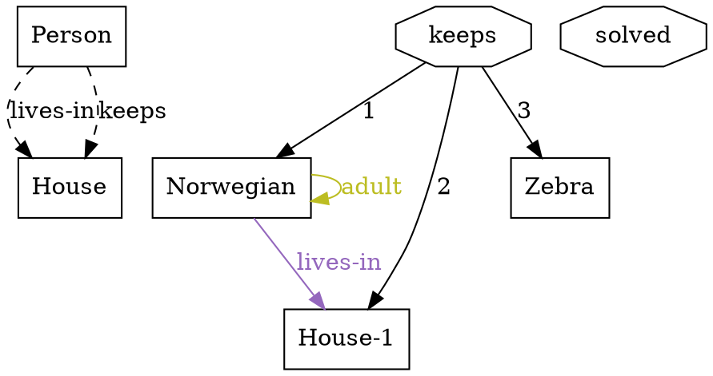
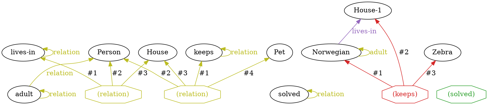

# Relations

A **relation** is a named predicate over a fixed number of arguments: `lives-in` relates a person to a house,
`adult` holds of a person, `solved` holds or does not. A program **declares** a relation with its name, one
**label** per argument, and the sentence one fact of it reads as; a **fact** of the relation applies it to as many
values ([facts](03-facts.md)). Relations are nodes of the graph like everything else, so a relation's properties are
facts about it, and rules read a relation's declaration as data.

## In Ein

```lisp
(relation lives-in Person House :why "{?1} lives in {?2}")
(relation adult Person :why "{?1} is an adult")
(relation keeps Person House Pet :why "{?1}, in {?2}, keeps the {?3}")
(relation solved :why "the puzzle is solved")

(lives-in Norwegian House-1)
(adult Norwegian)
(keeps Norwegian House-1 Zebra)
(solved)

(solve :no-search)
```

`(relation NAME LABEL… :why "TEXT")` takes a name, zero or more labels, one per argument, and `:why`, and no other
clause. The count of labels is the relation's **arity**: `lives-in` is binary, `adult` unary, `keeps` ternary, and
`solved`, declared with no label, has no argument: `(solved)` is its one fact. A label is a name, and says to a
reader what the argument is meant to be; the engine holds no argument to it
([objects](01-objects.md#no-types-a-label-means-what-a-rule-makes-it-mean)).

Each declaration is stored as facts about the relation, which rules can read: `(relation lives-in Person House)`,
the name with its labels, and `(relation lives-in)`, which says that `lives-in` is a declared relation. `ein
saturate --dump FILE` lists them among the program's background facts:

```text
;; ── BACKGROUND (11 facts) ──
  (adult Norwegian)
  (keeps Norwegian House-1 Zebra)
  (lives-in Norwegian House-1)
;;   relation (7)
  (relation lives-in Person House)
  (relation lives-in)
  (relation adult Person)
  (relation adult)
  (relation keeps Person House Pet)
  (relation keeps)
  (relation solved)
  (solved)
```

A relation can also be written without a declaration: a fact or a rule that writes `(likes Bob Tea)` makes `likes`
a relation of the program, **open-world**, with no labels, no held count and no sentence.

## As a graph

`ein render program FILE` draws the program as written: each declaration of two labels or more as a dashed edge
between its first two, and the facts by arity, a binary fact as a labelled arrow, a unary one as a labelled
self-loop, and the others as octagons with an edge numbered by position to each argument:



The two labels a dashed edge joins are drawn as boxes where no fact names them; that is the view's way of setting
the declarations apart from the facts, and says nothing of what `Person` is. `ein render kb FILE` draws the loaded program, the declarations as the
facts they are stored as, so a relation is visibly a node that facts are about:



`(relation lives-in Person House)` is an octagon with an edge to `lives-in` and one to each label; `(relation adult
Person)`, a fact of two arguments, is an arrow from `adult` to `Person`; and `(relation solved)` is a loop on
`solved`. The same shapes draw `(keeps Norwegian House-1 Zebra)`, `(lives-in Norwegian House-1)` and `(adult
Norwegian)`: a declaration is drawn as a fact because it is one.

## In words

A relation's `:why` is the **statement** of each of its facts, a template filled by position: `{?1}` is the fact's
first argument, `{?2}` its second, and so on. `ein solve FILE --dump-answer DIR` writes each fact of a state with its
statement after it:

```text
(adult Norwegian) ; Norwegian is an adult
(keeps Norwegian House-1 Zebra) ; Norwegian, in House-1, keeps the Zebra
(lives-in Norwegian House-1) ; Norwegian lives in House-1
(solved) ; the puzzle is solved
```

A relation nobody declares has no statement, and its facts read as their s-expressions
([natural language](14-natural-language.md)).

## In mathematics

A relation is a symbol $r$ with an arity $n \ge 0$. In a state $S$, a set of facts, its **extent** is the set of
argument lists of its facts:

$$
\operatorname{ext}_S(r) = \lbrace (v_1, \dots, v_n) \mid r(v_1, \dots, v_n) \in S \rbrace \subseteq V^n
$$

so a binary relation is a set of pairs, a unary relation a subset of the values, and a relation of no argument a
proposition, true in $S$ exactly when $r() \in S$. For the program above,

$$
\operatorname{ext}_S(\text{lives-in}) = \lbrace (\mathsf{Norwegian}, \text{House-1}) \rbrace, \qquad
\operatorname{ext}_S(\mathsf{adult}) = \lbrace \mathsf{Norwegian} \rbrace, \qquad
\operatorname{ext}_S(\mathsf{solved}) = \lbrace () \rbrace
$$

A declaration adds its own facts to $S$ and bounds nothing: for labels $L_1, \dots, L_n$ there is no set
$\operatorname{ext}(L_i)$ the $i$-th argument is drawn from, and $\operatorname{ext}_S(\text{lives-in})$ may hold
any pair of values.

## The count is held, the labels are not

A form headed by a declared relation has as many arguments as the declaration has labels, wherever it is written: a
fact, a fact inside a fact and under `(not …)`, a rule's and an hrule's `:match` and `:assert`, a goal and a claim.
`(lives-in Bob)` is refused at load, on every command, with a line that names both counts
([Q-M1f.315](../../../decisions/language/Q-M1f.315-a-form-of-a-declared-relation-has-as-many.md);
[diagnostics](../04-reference/07-diagnostics.md)). A bare `(relation solved)` declares no argument, and `(solved now)` is
refused the same way ([Q-M1f.201](../../../decisions/language/Q-M1f.201-a-bare-relation-r-declares-no-argument.md)).

It is a count and no check of what is counted: what stands in an argument's place is not held to the label declared
for it, and `(lives-in House-1 Norwegian)` loads beside the declaration above
([Q-M1f.372](../../../decisions/language/Q-M1f.372-ein-has-no-types-a-declarations-slot-names-are.md)). A
relation that nobody declares has no count, so a fixture that wants one relation at several counts leaves it
undeclared. A relation written as a variable, `(?R ?a ?b)`, is held to no declared count, nor is a kernel marker or
a rule's activator fact.

## A relation's properties are facts beside it

A declaration takes a name, its labels and `:why`, and nothing else. What is true of the relation as a whole is
written beside it, as facts about it:

```lisp
(import std.algebra :symbols (symmetric includes))

(relation right-of House House :why "{?1} is right of {?2}")
(relation next-to House House :why "{?1} is next to {?2}")
(symmetric next-to)
(includes right-of next-to)

(right-of House-2 House-1)

(solve :no-search)
```

`(right-of House-2 House-1)` derives `(next-to House-2 House-1)` by `includes`, and `(next-to House-1 House-2)` by
`symmetric`.

Each property fact is the activator of a rule that gives it meaning
([Q27](../../../decisions/language/Q27-a-relations-properties-are-facts-beside.md)), so a property can be matched,
derived and explained like any fact. [Properties and operators](07-properties-and-operators.md) lists the standard
library's.

## A relation's declaration is data

Because the declaration is stored as facts, a rule can read it. `(relation ?R ?A ?B)` matches every declaration of
**two** labels and binds them, which is how a library rule reads what a relation is declared over: the standard
library's bijection rules take the two sides of a relation from it, and its converse check reads two declarations
to reject a converse whose labels do not mirror each other. A declaration of one label, `(relation adult Person)`,
is invisible to that pattern; `(relation ?R)` matches every declared relation, whatever its arity, and also every
name a rule has concluded `(relation X)` of. A rule may conclude a fact of `relation`, `(relation hates Person
Food)`; what it derives is a fact, and declares nothing: no count is held for `hates`, and it has no sentence.

The engine itself reads of a declaration how many labels it has and which names they are, never what a label
means. [Objects](01-objects.md#giving-labels-a-meaning) has a rule that gives labels a meaning, and its drawing.

## Three meanings of *relation*

The word is used three ways, and a page that means one says which:

| meaning | example | what it is |
|---|---|---|
| the **declaration** | `(relation co-located T T)` | the relation as a node, with its labels |
| a **fact** of it, an instance | `(co-located Norwegian Red)` | a proposition about its arguments |
| a **node with arrows** | any `(A B C)` | the graph's structural sense: a node with ordered edges to its arguments |

The second is a fact, and the third is what both of the others are, structurally: a node with an ordered list of
arrows. Two arrows from one node to one target are distinct by position, which is how `(relation R T T)` has both
argument slots under the same label.

## A relation nothing makes

A rule may read a relation that no declaration, fact or conclusion of the program makes: the program loads and the
rule never fires ([Q-M1f.120](../../../decisions/language/Q-M1f.120-a-rule-may-read-a-relation-nothing-makes.md)).
That is what lets a library rule read a marker its importer may never write, and it is also how a misspelt relation
in a rule goes unnoticed: `(instnce ?a ?T)` is a pattern over a relation of that name, which nothing holds. The
symptom is a rule that never fires, which the trace (`ein solve FILE --trace OUT.md`) and the event log's firings
show.

## Relations the kernel gives meaning to

A few names are relations whose meaning is the engine's: `not` (a stored negation, [constraints](06-constraints.md)),
`false` (a contradiction), `relation` (the declarations' facts above), `written` (what a file writes, stated by the
loader), `__closed__` (a relation no hypothesis is proposed for) and `__symmetric__` (a relation closed under
swapping its two arguments, the same closure the standard library's `symmetric` rule derives), and the computed
relations `eq` and `neq`, which are never stored. [Reserved names](../04-reference/03-reserved-names.md) lists each and
what may be written with it.

## See also

- [Facts](03-facts.md): what a relation's instances are, and where each came from.
- [Properties and operators](07-properties-and-operators.md): the algebra of relations, as facts and rules.
- [Ontology](04-ontology.md): membership and inheritance as relations and rules of the program's own.
- [The syntax reference](../04-reference/02-syntax.md): the `(relation …)` form.
