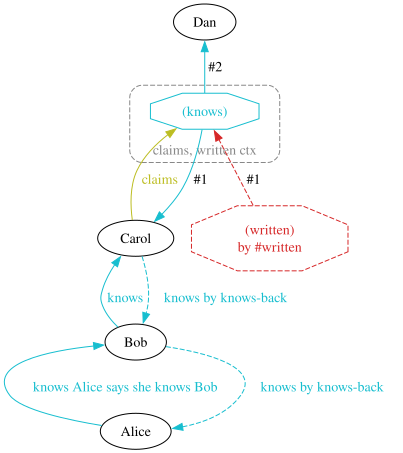
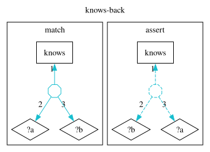
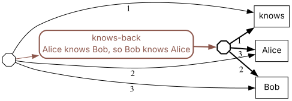

# Facts

A **fact** is a node of the graph with outgoing arrows, in order: the first points at its relation, and the
others at its arguments. `(knows Alice Bob)` is the fact of the relation `knows` with the arguments `Alice` and
`Bob`. A fact has no name: it is identified by the list of objects its arrows point at. The knowledge base a
program describes is a **set** of facts, the ones it **holds**: the ones the program writes, and the ones its
rules derive from them. Every held fact records where it came from, and that record is what an explanation is
made of: why a fact holds, and which facts a contradiction rests on.

## In Ein

```lisp
(relation knows Person Person :why "{?1} knows {?2}")
(relation claims Person Claim :why "{?1} claims that {?2}")

(rule knows-back ()
  :match  (knows ?a ?b)
  :assert (knows ?b ?a)
  :why    "{?a} knows {?b}, so {?b} knows {?a}")

(knows Alice Bob :source "Alice says she knows Bob")
(knows Bob Carol)
(claims Carol (knows Carol Dan))

(solve :no-search)
```

A fact is written as a form, the relation first and the arguments after it, each an atom or a fact. It may carry a
`:source "…"`, the sentence of the problem it states. `ein saturate --dump FILE` lists the saturated knowledge base
grouped by where each fact came from:

```text
;; ── BACKGROUND (6 facts) ──
  (claims Carol (knows Carol Dan))
  (knows Bob Carol)
;;   relation (4)
  (relation knows Person Person)
  (relation knows)
  (relation claims Person Claim)
  (relation claims)

;; ── GIVEN (1 facts) ──
  (knows Alice Bob :source "Alice says she knows Bob")

;; ── DERIVED (3 facts) ──
;;   knows (2)
  (knows Bob Alice :rule knows-back)
  (knows Carol Bob :rule knows-back)
  (written (knows Carol Dan) :rule "#written")
```

`(knows Carol Dan)` inside the `claims` fact is an **argument**, a fact the knowledge base points at and does not
hold: Carol claims it, and nothing says it holds, so `knows-back` does not fire on it. It is a fact of `knows`
all the same, one of the relation's extent and not of its held extent. The loader states `(written (knows Carol
Dan))`, its record that the file wrote that fact as an argument (below).

## As a graph

`ein render kb FILE` draws every fact of the saturated knowledge base, styled by where it came from. The program
above, its declarations' facts left out:



A **given** fact is a solid arrow whose label carries its source, the short `(N)` where the source has one and the
whole sentence otherwise; a **background** fact is a plain solid arrow; a **derived** fact is dashed, labelled with
the rule that derived it. A fact that is an argument of another is a node of its own, with its text in it.
`--colour-by origin`
colours the arrows by the same three origins instead of by relation, and `--since OTHER` draws thick every fact that
`OTHER` lacks, which is how a state is drawn against root. The view leaves out a rule's activator facts and stored
negations; `ein render program FILE` draws a program's written negations.

The two dashed arrows are firings of the program's one rule, which `ein render rule --name knows-back FILE` draws as
what it matches and what it asserts ([rules](05-rules.md)):



and where a derived fact came from is itself a graph, the fact's record drawn: `ein solve FILE --trace OUT.md`
writes one drawing per firing, the premises on the left, the rule with its reason in the middle, the fact it added
on the right. The first step of this program:



## In words

A fact has two texts. Its **statement**, what it says, is its relation's `:why` filled with its arguments. Its
**reason**, why it holds, is read off the first way the engine recorded of reaching it. `ein solve FILE
--dump-answer DIR` writes both after each fact of a state:

```text
(claims Carol (knows Carol Dan)) ; Carol claims that (knows Carol Dan)
(knows Alice Bob) ; source "Alice says she knows Bob" — Alice knows Bob
(knows Bob Alice) ; rule knows-back: Alice knows Bob, so Bob knows Alice — Bob knows Alice
(knows Bob Carol) ; Bob knows Carol
(knows Carol Bob) ; rule knows-back: Bob knows Carol, so Carol knows Bob — Carol knows Bob
```

A given quotes its `:source`; a derived fact gives its rule's `:why`, filled with that firing's bindings; a
background fact has no reason, only its statement. [Natural language](14-natural-language.md) has the whole ladder.

## In mathematics

A fact is a tuple $r(o_1, \dots, o_n)$: $r$ an atom, its relation, and each $o_i$ an object, an atom or a fact.
A knowledge base is a finite set $K$ of facts. Two facts are one exactly when their relations and argument lists
are equal, so $K$ is a set and a fact has one node however often it is stated or derived. The program above
describes

$$
\begin{aligned}
K = \lbrace\ & \mathsf{knows}(\mathsf{Alice}, \mathsf{Bob}), \\
& \mathsf{knows}(\mathsf{Bob}, \mathsf{Carol}), \\
& \mathsf{claims}(\mathsf{Carol}, \mathsf{knows}(\mathsf{Carol}, \mathsf{Dan})), \\
& \mathsf{knows}(\mathsf{Bob}, \mathsf{Alice}), \\
& \mathsf{knows}(\mathsf{Carol}, \mathsf{Bob}), \\
& \dots\ \rbrace
\end{aligned}
$$

where the dots are the declarations' facts and the loader's `written`. One fact is an argument of a member of $K$
and not a member:

$$
\mathsf{knows}(\mathsf{Carol}, \mathsf{Dan}) \notin K
$$

Each fact $f \in K$ has a record of justifications, the ways it was reached, in the order they were recorded:

$$
\begin{aligned}
J(f) &= (j_1, j_2, \dots) \\
j &= (\operatorname{kind}, \rho, P, \theta, A) \\
\operatorname{kind} &\in \lbrace \text{source}, \text{rule}, \text{hypothesis} \rbrace
\end{aligned}
$$

with $\rho$ the rule that fired, $P \subseteq K$ the premises it read, $\theta$ its bindings and $A$ the absences
it relied on. A fact holds if any of its justifications holds, and a justification holds if all of its premises do:

$$
\operatorname{holds}(f) \iff \bigvee_{j \in J(f)} \ \bigwedge_{p \in P_j} \operatorname{holds}(p)
$$

so the provenance of a knowledge base is an AND/OR graph, a fact an OR over its justifications and each
justification an AND over its premises, with the facts of a `source` or `hypothesis` justification, and those a
file writes with no source, as its terminals. For $f = \mathsf{knows}(\mathsf{Bob}, \mathsf{Alice})$ the record is
one firing, the step drawn above:

$$
\begin{aligned}
J(f) &= (j_1) \\
j_1 &= \bigl( \text{rule},\ \text{knows-back},\ P,\ \theta,\ \emptyset \bigr) \\
P &= \lbrace \mathsf{knows}(\mathsf{Alice}, \mathsf{Bob}) \rbrace \\
\theta &= \lbrace a \mapsto \mathsf{Alice},\ b \mapsto \mathsf{Bob} \rbrace
\end{aligned}
$$

## Where a fact came from

The record of each fact partitions the knowledge base three ways. The partition is read, not stored, and only the
presentation uses it: the engine treats every fact alike, and a fact and its negation contradict each other
whatever their origins.

| a fact whose first justification is … | is | what it is |
|---|---|---|
| written by a file, with no `:source` | **background** | the implicit assumptions: declarations, memberships, a theory's activators and tables |
| written by a file, with `:source "…"` | **given** | a statement of the problem, quoted where it is explained |
| a rule's firing | **derived** | what the rules concluded, with the premises and bindings of the firing |
| a commitment's hypothesis | **hypothesis** | a fact the search assumed in one state, never in root |

A derived fact's record names the rule, the activator fact that bound its parameters, the premises it read, its
bindings, and the `(absent …)` queries that had to find nothing for it to fire. That is what makes every derived
fact explainable: walking its premises back reaches the facts the problem stated, and those are what a trace, a
reason and a contradiction's core name.

## A fact is stated once, and may be derived many times

**Stated twice, one fact.** A fact a file writes twice, or a module and the program both write, is one fact, and
keeps the first statement's provenance; the second is dropped with no word
([Q-M1f.139](../../../decisions/imports/Q-M1f.139-a-fact-stated-twice-keeps-its-first-statement.md)). A fact an
import brings keeps its own provenance
([Q-M1f.138](../../../decisions/imports/Q-M1f.138-an-imported-fact-keeps-its-own-provenance.md)).

**Derived again, recorded again.** A firing whose conclusion is already in the knowledge base adds no fact, and its
way of reaching the fact is recorded beside the first, as an **alternative justification**
([Q18](../../../decisions/engine/Q18-provenance-is-per-fact-an-or-of-derivations-over.md)). So one fact has one node
and possibly several derivations, and a contradiction's core can be the smallest explanation over all of them. A
given or a hypothesis takes no alternative: a statement of the problem that a rule happens to re-derive is still a
statement. The alternatives kept per fact are capped, the shortest ones kept; whether they are recorded at all is the
`:record-alternative-justifications` flag of `(config …)` ([configuration](../04-reference/06-config.md)).

The first recorded derivation is the one a reason reads, and which one arrives first may depend on the order rules
fire in: a reason is an explanation, as a core is, and it is not part of the answer.

## A fact inside a fact

An argument may be a fact ([Q40](../../../decisions/language/Q40-a-fact-may-hold-a-fact-as-an-argument.md)):
`(claims Carol (knows Carol Dan))`, `(hypothesis (co-located Norwegian House-2))`, a numeral built of digits,
`(n (n z 4) 2)`. The inner fact is an object like any other, identified by its arrows at every depth, and a
pattern matches into it: `:match (claims ?who (knows ?who ?x))` binds both. It is not held by being written there.

What may be written as an argument is an object: an atom, or a fact a state could hold, which is a fact of an
ordinary relation or its stored negation `(not F)`. `eq`, `neq`, `absent`, `and`, `or`, and `false` with an
argument never head a nested form, since none of them is a fact any state holds, and each is refused where it is
written ([Q-M1f.113](../../../decisions/language/Q-M1f.113-an-object-is-an-atom-or-a-fact-a-state-could.md)).
The refusal's line says `where a value goes`: *value* is the engine's word for an object in an argument's place.

**`written` is the loader's.** For every fact nested in a fact a file writes, and for every fact a rule's conclusion
nests that holds no variable, the loader states `(written T)`, derived by its own step `#written`
([Q-M1f.275](../../../decisions/language/Q-M1f.275-written-states-every-fact-a-file-nests.md)). A rule reads it to
check what a file wrote where it was written, as the standard library's numerals do; no program writes a `written`
fact and no declaration binds the name
([Q-M1f.280](../../../decisions/language/Q-M1f.280-a-program-does-not-write-written.md)).

## Facts in a state

**Root** is the program's facts and everything its rules derive from them. The engine also considers **states**: a
commitment, a set of hypothesis facts, is added to root and the rules run again, and the state is root's facts, the
hypotheses, and what they derive. States share root's facts and see nothing of one another: a fact derived in one
state is not in a sibling, and a justification recorded inside a state may rest on that state's hypothesis, so it
stays there. Which states the answer is made of is [solutions and models](13-solutions-and-models.md); where hypotheses
come from is [hypotheses](09-hypotheses.md).

## See also

- [Relations](02-relations.md): what a fact's first arrow points at, and the extent a fact is one of.
- [Objects](01-objects.md): the graph, its two sorts of node, and how `ein` draws it.
- [Rules](05-rules.md): how a derived fact is made, and what its record holds.
- [Constraints](06-constraints.md): a stored negation, and the three states of a fact.
- [Natural language](14-natural-language.md): the statement and the reason, everywhere they are printed.
- How a contradiction's core is read off the AND/OR graph:
  [the provenance section of the knowledge-base page](../../reasoning/02-kb-evolution/09-cores.md#a-derivation-record).
