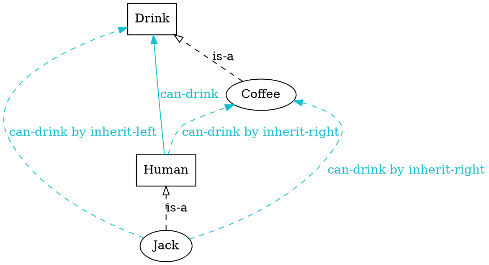

# Ontology

Ein has one kind of thing, the node, and describes itself with it: an object, a type, a relation, a rule and a fact
are each a node, and *being an instance of something* is itself a relation whose facts are nodes too. Nothing about
types is built in. A **type** is a name that other names are classified under by a fact of the program's own
relation, and **inheritance** is whatever the program's rules derive from those facts. This page is the vocabulary
for that, and the reason Ein's rules can read relations, types and rules as ordinary data.

## In Ein

```lisp
(relation is-a T T :why "{?1} is a {?2}")
(relation can-drink T T :why "{?1} can drink {?2}")

(rule inherit-left (?r)
  :match  (and (?r ?t ?other) (is-a ?inst ?t))
  :assert (?r ?inst ?other)
  :why    "{?inst} is a {?t}, so {?inst} inherits {?r} from {?t}")

(rule inherit-right (?r)
  :match  (and (?r ?other ?t) (is-a ?inst ?t))
  :assert (?r ?other ?inst)
  :why    "{?inst} is a {?t}, so {?inst} inherits {?r} from {?t}")

(is-a Jack Human)
(is-a Coffee Drink)
(can-drink Human Drink)
(inherit-left can-drink)
(inherit-right can-drink)

(query :goal (can-drink Jack ?d) :goal-text "Jack can drink {?d}")
(solve :no-search)
```

`is-a` and `T` are names this program declares: neither is reserved, and the engine gives neither a meaning. `Human`
and `Drink` are types because the program says things of them that it means to carry over to their instances,
`(can-drink Human Drink)`, and its two rules carry them over, one per argument position. The fact the puzzle cares
about, *Jack can drink coffee*, is not written: it follows from the types alone, by the two rules chained.

```text
  query             (can-drink Jack ?d)
  over              all of R — 1 state → 1 projection class
    class 1 of 1    1 state (1)
                      ?d = Coffee
                        “Jack can drink Coffee”
                      ?d = Drink
                        “Jack can drink Drink”
  as :expect        (model (can-drink Jack Coffee) (can-drink Jack Drink))
```

The guide's [Jack drinks coffee](../02-guide/05-jack-drinks-coffee.md) works the same example through every
representation.

## As a graph

`ein render kb FILE`, the declarations' facts left out:



The type boxes and instance ovals are read from the program's `is-a` facts; the solid arrow is the fact the
program wrote about the types, and the three dashed ones what the rules derived from it. The two dashed arrows out of
`Jack` and `Human` each lift one end of the solid one, and the third lifts both.

## In words

```text
(can-drink Human Drink) ; Human can drink Drink
(can-drink Jack Drink) ; rule inherit-left: Jack is a Human, so Jack inherits can-drink from Human — Jack can drink Drink
(can-drink Jack Coffee) ; rule inherit-right: Coffee is a Drink, so Coffee inherits can-drink from Drink — Jack can drink Coffee
(inherit-left can-drink)
(is-a Jack Human) ; Jack is a Human
```

Lines of `ein solve FILE --dump-answer DIR`'s state file. The activator facts, `(inherit-left can-drink)`, have no
statement: they are facts about a rule, and no declaration carries a sentence for them.

## In mathematics

Read as sets: a type `T` stands for the set of names `x` with `is-a(x, T)` in the state, and a fact over types
stands for a statement about every member. The two rules compute, for a relation `r` they are activated on,

```text
r(t, o) ∧ is-a(i, t)  ⇒  r(i, o)          (inherit-left)
r(o, t) ∧ is-a(i, t)  ⇒  r(o, i)          (inherit-right)
```

and saturation takes their least fixpoint, so the closure under both is every `r(i, j)` with `i` an instance of a
left type and `j` of a right one, reached by chaining one rule after the other: there is no separate rule for
*any × any*. A relation of `n` arguments takes `n` such rules, one per position. A unary relation is a subset, said
as a predicate: `(adult Jack)` carves the adults out of the names as `(is-a Jack Human)` carves out the humans.

## The reflexive root

Every kind of thing in the knowledge base is a node, and the kinds describe one another:

```text
an instance of a type       is an object
an instance of a relation   is a fact

a relation                  is a type      (its instances are facts)
a fact, a relation, a type  is an object   (each is a node)

being an instance           is a relation  (it relates a member to its type)
an instance assertion       is a fact      (it is a proposition)
being an instance           is an instance of being an instance
```

The last line is the fixed point: the proposition *x is an instance of T* is itself an instance of the instance
relation. Nothing in the language is exempt from being data, which is why a rule can match a relation's
declaration, a property of a relation, or a fact about a fact, with the same patterns it matches anything with.

## Five words

| word | meaning |
|---|---|
| **name** | a token that identifies a node: `Alice`, `co-located`, `T`, `relation`. The name is what is written, the node is what it names, and two occurrences of one name are one node |
| **node** | a vertex of the graph, with an identity |
| **arrow** | a directed edge from one node to another, numbered by position when a node has several |
| **object** | a node named by a name, which arrows point at |
| **relation** | a node with arrows out of it to its arguments; see [relations](02-relations.md) for the word's three uses |

A node is one of two shapes: **named**, a bare name, `Norwegian`; or **relational**, a parenthesised list, `(co-located
Norwegian House-1)`, a node with one ordered arrow to each argument. **Identity has no exceptions.** A named node is
one per name, a relational node one per relation and argument list, a variable `?x` is local to its rule or query,
and a keyword `:why` is no node at all but marks a clause.

## Types are names, and nothing is built in

The engine imposes no type system ([Q23](../../../decisions/language/Q23-a-premise-types-a-variable-and-no-entity-has.md)).
No variable, relation, rule or fact has a type slot. A relation's declaration names a type per argument, and the
engine reads only how many there are; a rule reads them as types through the declaration's stored fact,
`(relation ?R ?A ?B)`. A variable is typed by a premise that reads the program's membership relation,
`(is-a ?h House)`, and an object's type is a fact of that relation. A program that wants a named-type projection,
inheritance, or a check that an argument has the declared type writes it as rules; the standard library has the
common ones ([the stdlib reference](../04-reference/04-stdlib.md)).

**Subtype and instance.** `(is-a Dog Mammal)` and `(is-a Rex Dog)` are one relation in a program that writes them
so, and differ only in where the name sits in the forest: a leaf is an instance, a node with members a subtype.
What propagates along each, the relations of a supertype to a subtype or the propositions about a type to its
instances, is what the program's rules say. A program may also keep two relations, a direct one and its transitive
closure ([properties and operators](07-properties-and-operators.md)).

**Symmetry is not built in either.** `symmetric` is a property fact like `transitive`, given its meaning by the
standard library's rule `(rule symmetric (?rel) :match (?rel ?a ?b) :assert (?rel ?b ?a) …)`, and no search the
engine runs knows that a relation is symmetric. Two orders of one symmetric pair saturate to the same state, so they
are one state of the answer.

## The words the kernel reserves

A few names introduce a kind of node, and are no relation a program can bind:

| word | introduces |
|---|---|
| `relation` | a relation's declaration, `(relation co-located T T :why "…")`, and the facts that store it |
| `rule` | a rule, `(rule NAME (PARAMS) :match … :assert … :why "…")` |
| `hrule` | a rule that proposes a hypothesis rather than concluding a fact ([hypotheses](09-hypotheses.md)) |
| `macro` | a pattern abbreviation, expanded where it is called ([macros](11-macros.md)) |
| `not` | a stored negation, `(not F)`, a fact whose one argument is the fact it denies ([constraints](06-constraints.md)) |
| `false` | a contradiction, `(false)`, which a rule concludes and no state that holds it survives |

The rest of the reserved vocabulary is the [reserved names](../04-reference/03-reserved-names.md) reference.

## Two forms that look alike

**`()`, the empty list.** As a rule's whole `:match` it is the empty conjunction, which is true, so the rule fires
once, or once per activator; as a whole `:assert` it is the empty conclusion, which asserts nothing
([Q-M1e2.36](../../../decisions/language/Q-M1e2.36-an-empty-match-is-true-and-fires-once.md)). Anywhere else, as a
value or inside another premise, it is refused at the parse.

**A declaration and its properties.** A relation is declared flat, `(relation R T1 T2 :why "…")`, and its
properties are separate facts, `(transitive R)`, never a block inside the declaration
([Q27](../../../decisions/language/Q27-a-relations-properties-are-facts-beside.md)). A wrapped argument list,
`(relation R (T1 T2))`, is refused at the parse.

## See also

- [Objects](01-objects.md), [relations](02-relations.md) and [facts](03-facts.md): the three things the graph holds.
- [Rules](05-rules.md): how a rule reads relations and types as data.
- [Properties and operators](07-properties-and-operators.md): the relation algebra, written in Ein.
- The four levels of a knowledge base, objects, facts, relations and rules, and what each consumes:
  [the four-level page](../../reasoning/01-static-ir/04-rules-as-statements.md#the-four-levels-a-knowledge-base-describes-itself-in).
