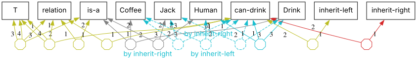
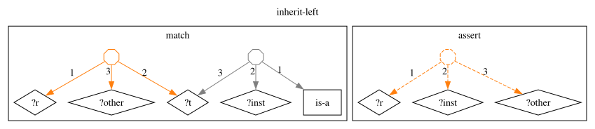
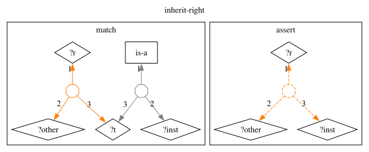
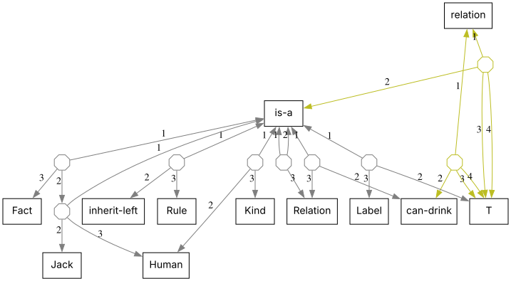

# Ontology

Ein has one kind of thing, the object, a node of the graph, and describes itself with it: the thing a puzzle is
about, a relation, a rule's name and a label are each an atom, a fact is a node too, and *being an instance of
something* is itself a relation whose facts are nodes. **There are no types.** What a program calls a type is an
atom other atoms are classified under by a fact of the program's own relation, and **inheritance** is whatever
the program's rules derive from those facts. This page is the vocabulary for that, and the reason Ein's rules can
read relations, labels and rules as ordinary data.

## In Ein

```lisp
(relation is-a T T :why "{?3} is a {?4}")
(relation can-drink T T :why "{?3} can drink {?4}")

(rule inherit-left (?r)
  :match  (and (?r ?t ?other) (is-a ?inst ?t))
  :assert (?r ?inst ?other)
  :why    "{?inst} is a {?t}, so {?inst} inherits {?r} from {?t}")

(rule inherit-right (?r)
  :match  (and (?r ?other ?t) (is-a ?inst ?t))
  :assert (?r ?other ?inst)
  :why    "{?inst} is a {?t}, so {?inst} inherits {?r} from {?t}")

(is-a Jack Human)
(is-a Coffee Drink)
(can-drink Human Drink)
(inherit-left can-drink)
(inherit-right can-drink)

(query :goal (can-drink Jack ?d) :goal-text "Jack can drink {?d}")
(solve :no-search)
```

`is-a` and `T` are names this program writes: neither is reserved, and the engine gives neither a meaning. `Human`
and `Drink` are atoms like `Jack` and `Coffee`. They stand for *every human* and *every drink* only because the
program says something of them that it means to carry over, `(can-drink Human Drink)`, and its two rules carry it
over along `is-a`, one per argument position. The fact the puzzle cares about, *Jack can drink coffee*, is not
written: it follows by the two rules chained.

```text
  query             (can-drink Jack ?d)
  over              all of R — 1 state → 1 projection class
    class 1 of 1    1 state (1)
                      ?d = Coffee
                        “Jack can drink Coffee”
                      ?d = Drink
                        “Jack can drink Drink”
  as :expect        (model (can-drink Jack Coffee) (can-drink Jack Drink))
```

The second row is as true as the first: `Drink` is an atom, and the rules derived `(can-drink Jack Drink)` on the
way. Nothing tells the engine that one is an answer about a thing and the other about a class of things. The
guide's [Jack drinks coffee](../02-guide/05-jack-drinks-coffee.md) works the same example through every
representation.

## As a graph

`ein render kb FILE`, every fact of the saturated program an octagon with its arrow `1` at its relation's box:



The solid octagon whose arrow `1` is at `can-drink` is the fact the program wrote, and the three dashed ones what
the rules derived from it, each with the rule beside it. `(can-drink Jack Drink)` and `(can-drink Human Coffee)`
each lift one argument of the written one, and `(can-drink Jack Coffee)` lifts both. `is-a` is drawn as any
relation is, its two facts octagons whose arrow `1` is at the box `is-a`, and every atom is a box, whatever points
at it
([Q-M1f.421](../../../decisions/cli/Q-M1f.421-no-view-draws-a-relation-otherwise-than-another.md)): the view gives
no relation a reading of its own. The facts `(inherit-left can-drink)` and `(inherit-right can-drink)`, which
activate the two rules, are facts like the others, each an octagon whose arrow `1` is at the rule's name.

The two rules, as `ein render rules FILE` draws them. Each matches a fact of the relation it is activated on and an
`is-a` fact whose second argument is one of that fact's arguments, and asserts the fact with the `is-a` fact's
first argument in that place:





## In words

```text
### Step 1 — `inherit-left`

> Jack is a Human, so Jack inherits can-drink from Human

Premises: `can-drink(Human, Drink)`, `is-a(Jack, Human)`

Derives `can-drink(Jack, Drink)`.

### Step 2 — `inherit-right`

> Coffee is a Drink, so Coffee inherits can-drink from Drink

Premises: `can-drink(Human, Drink)`, `is-a(Coffee, Drink)`

Derives `can-drink(Human, Coffee)`.

### Step 3 — `inherit-right`

> Coffee is a Drink, so Coffee inherits can-drink from Drink

Premises: `can-drink(Jack, Drink)`, `is-a(Coffee, Drink)`

Derives `can-drink(Jack, Coffee)`.
```

Root's steps in `ein solve FILE --trace OUT.md`: each rule's reason, the facts it read, and what it derives, as
written, since a fact has no text of its own ([natural language](14-natural-language.md)). The activator facts,
`(inherit-left can-drink)`, read as written too: they are facts about a rule, stated with no `:source`.

## In mathematics

Read as sets: the atom $t$ stands for the set of objects classified under it in a state $S$,

$$
\operatorname{inst}_S(t) = \lbrace x \mid \text{is-a}(x, t) \in S \rbrace
$$

and a fact over such atoms is meant as a statement about every member. The two rules say so, for each relation $r$
they are activated on:

$$
\begin{aligned}
r(t, o) \land \text{is-a}(i, t) &\implies r(i, o) && \text{(inherit-left)} \\
r(o, t) \land \text{is-a}(i, t) &\implies r(o, i) && \text{(inherit-right)}
\end{aligned}
$$

Saturation takes their least fixpoint, so from $\text{can-drink}(\mathsf{Human}, \mathsf{Drink})$ the state holds

$$
\begin{aligned}
\text{can-drink}(i, j) &\in S && \text{for every } i \in \operatorname{inst}_S(\mathsf{Human}) \cup \lbrace \mathsf{Human} \rbrace \\
&&& \text{and every } j \in \operatorname{inst}_S(\mathsf{Drink}) \cup \lbrace \mathsf{Drink} \rbrace
\end{aligned}
$$

reached by chaining one rule after the other: there is no separate rule for both ends at once. A relation whose
facts have $n$ arguments takes $n$ such rules, one per argument. The held extent of a relation of one argument
is a subset, said as a predicate: `(adult Jack)` carves the adults out of the atoms as `(is-a Jack Human)` carves
out the humans.

## Everything is a node, and a fact can be about any of them

A fact's argument is an object, an atom or a fact, and a relation, a rule's name and a label are atoms. So a
program can say something of each of them, with the relation it says things of `Jack` with:

```lisp
(relation is-a T T :why "{?3} is a {?4}")
(relation can-drink T T :why "{?3} can drink {?4}")

(rule inherit-left (?r)
  :match  (and (?r ?t ?other) (is-a ?inst ?t))
  :assert (?r ?inst ?other)
  :why    "{?inst} is a {?t}, so {?inst} inherits {?r} from {?t}")

(is-a Jack Human)                   ; about a thing of the puzzle
(is-a Human Kind)                   ; about the atom Jack is classified under
(is-a can-drink Relation)           ; about a relation
(is-a is-a Relation)                ; about the relation the sentence itself uses
(is-a inherit-left Rule)            ; about a rule
(is-a (is-a Jack Human) Fact)       ; about a fact
(is-a T Label)                      ; about a label

(solve :no-search)
```

It loads, and the seven are facts of one relation, each drawn by `ein render program FILE`, in its digraph `kb`,
as an octagon whose arrow `1` is at the box `is-a`:



`Kind`, `Relation`, `Rule`, `Fact` and `Label` are atoms this program made up, and mean what its rules make of
them, which here is nothing. `(is-a is-a Relation)` is the fixed point: the relation that says what a thing is can
be said to be something, by a fact of itself. Its octagon has two arrows to the one box `is-a`: its arrow `1`, to
its relation, and its arrow `2`, to its first argument. `(is-a Jack Human)`, which the fact about a fact points
at, is drawn once, its octagon under that fact's arrow `2`, and in no frame, since the program states it. Nothing in the language is exempt from being data, which
is why a rule can match a relation's declaration, a property of a relation, or a fact about a fact, with the same
patterns it matches anything with.

## Five words

| word | meaning |
|---|---|
| **object** | a node of the graph. Every object is an atom or a fact |
| **atom** | a labelled node with no outgoing arrow: `Alice`, `co-located`, `T`, `relation` |
| **name** | the label of an atom. The name is what is written, the atom is the node, and two occurrences of one name are one atom |
| **fact** | a node with outgoing arrows, in order: `(co-located Norwegian House-1)`. The first arrow points at its relation and the others at its arguments, each an object |
| **relation** | the atom under the first arrow of a fact; see [relations](02-relations.md) for the relation, its extent and a fact of it |

An **arrow** leaves a fact and points at an object, and has a place in the fact's list: first, second, third. A
program writes an atom as a bare name, `Norwegian`, and a fact as a parenthesised list, `(co-located Norwegian
House-1)`. **Identity has no exceptions.** An atom is one per name and a fact one per list of arrows, a variable
`?x` is local to its rule or query, and a keyword `:why` is no node at all but marks a clause.

## No types, and nothing built in

The engine has no type system ([Q23](../../../decisions/language/Q23-a-premise-says-what-a-variable-ranges-over.md),
[Q-M1f.372](../../../decisions/language/Q-M1f.372-ein-has-no-types-a-declarations-slot-names-are.md)). No
variable, relation, rule or fact has a slot for one. A relation's declaration writes a label per argument, and the
engine reads how many there are; a rule reads which they are through the declaration's stored fact, `(relation ?R
?A ?B)`. A variable is restricted by a premise that reads the program's membership relation, `(is-a ?h House)`, and
what an atom is classified under is a fact of that relation. A program that wants inheritance, a check that an
argument is an instance of its relation's label, or a hierarchy of labels writes it as rules, as this page and
[objects](01-objects.md#giving-labels-a-meaning) do; the standard library has the common ones
([`std.typing`](../04-reference/04-stdlib/02-relation-algebra.md#using-stdtyping--a-hierarchy-named-once),
[`std.bijection`'s argument check](../04-reference/04-stdlib/04-bijections.md#the-argument-check)).

**A hierarchy is facts.** `(is-a Dog Mammal)` and `(is-a Rex Dog)` are facts of one relation in a program that
writes them so, and differ only in where the atom sits in the forest: `Rex` has nothing under it, `Dog` has. What propagates
along each, the facts about `Mammal` to `Dog` or the facts about `Dog` to `Rex`, is what the program's rules say. A
program may also keep two relations, a direct one and its transitive closure
([properties and operators](07-properties-and-operators.md)).

**Symmetry is not built in either.** `symmetric` is a property fact like `transitive`, given its meaning by the
standard library's rule `(rule symmetric (?rel) :match (?rel ?a ?b) :assert (?rel ?b ?a) …)`, and no search the
engine runs knows that a relation's held extent is symmetric. Two orders of one symmetric pair saturate to the same state, so they
are one state of the answer.

## The words the kernel reserves

A few names introduce a kind of form. The first four are no relation a program can declare; the last two are the
standard library's names, which the grammar gives a shape where they head a form, and which a program may declare
as it declares any relation
([Q-M1f.593](../../../decisions/language/Q-M1f.593-not-is-a-name-everywhere-but-at-a-forms-head.md)):

| word | introduces |
|---|---|
| `relation` | a relation's declaration, `(relation co-located T T :why "…")`, and the facts that store it |
| `rule` | a rule, `(rule NAME (PARAMS) :match … :assert … :why "…")` |
| `hrule` | a rule that proposes a hypothesis rather than concluding a fact ([hypotheses](09-hypotheses.md)) |
| `macro` | a pattern abbreviation, expanded where it is called ([macros](11-macros.md)) |
| `not` | a stored negation, `(not F)`, a fact whose one argument is the fact it denies, and a contradiction beside `F` where a rule says so, `std.contradiction`'s where the program imports it ([constraints](06-constraints.md)) |
| `false` | `(false)`, a fact of no argument and no truth value: a rule concludes it, and the rule every program gets, `std.core`'s, reads it and ends the state that holds it ([constraints](06-constraints.md)) |

The rest of the reserved vocabulary is the [reserved names](../04-reference/03-reserved-names.md) reference.

## Two forms that look alike

**`()`, the empty list.** As a rule's whole `:match` it is the empty conjunction, which is true, so the rule fires
once, or once per activator; as a whole `:assert` it is the empty conclusion, which asserts nothing
([Q-M1e2.36](../../../decisions/language/Q-M1e2.36-an-empty-match-is-true-and-fires-once.md)). Anywhere else, as an
argument or inside another premise, it is refused at the parse.

**A declaration and its properties.** A relation is declared flat, `(relation R L1 L2 :why "…")`, and its
properties are separate facts, `(transitive R)`, never a block inside the declaration
([Q27](../../../decisions/language/Q27-a-relations-properties-are-facts-beside.md)). A wrapped argument list,
`(relation R (L1 L2))`, is refused at the parse.

## See also

- [Objects](01-objects.md), [relations](02-relations.md) and [facts](03-facts.md): the graph, its atoms and its facts.
- [Rules](05-rules.md): how a rule reads relations and labels as data.
- [Properties and operators](07-properties-and-operators.md): the relation algebra, written in Ein.
- The four levels of a knowledge base, atoms, facts, relations and rules, and what each consumes:
  [the four-level page](../../reasoning/01-static-ir/02-rewriting-rules.md#the-four-levels-a-knowledge-base-describes-itself-in).
