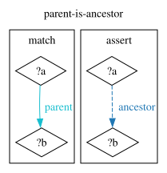
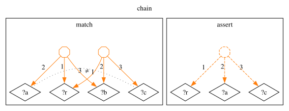
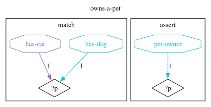
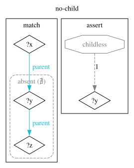
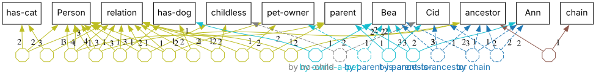
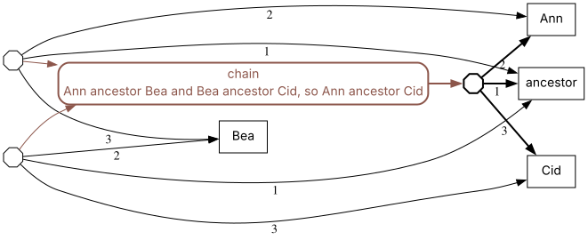
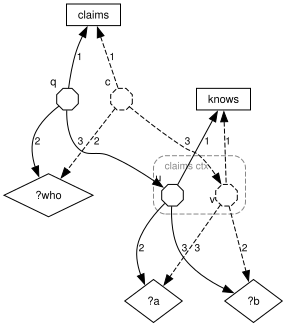

# Rules

A **rule** says: wherever these facts hold, so does that. It has a pattern to find in the knowledge base, a
conclusion to state for each place the pattern matches, and a reason, in English, that each firing gives
([Q4](../../../decisions/language/Q4-a-rule-is-a-pattern-a-conclusion-and-a-reason.md)). Rules only add: a firing
states facts, it never removes one, so the knowledge base grows to a **fixpoint**, the state where no rule adds
anything more. That fixpoint is what a program means.

## In Ein

```lisp
(relation parent Person Person :why "{?3} is a parent of {?4}")
(relation ancestor Person Person :why "{?3} is an ancestor of {?4}")
(relation has-cat Person :why "{?3} has a cat")
(relation has-dog Person :why "{?3} has a dog")
(relation pet-owner Person :why "{?3} owns a pet")
(relation childless Person :why "{?3} has no child")

(rule parent-is-ancestor ()
  :match  (parent ?a ?b)
  :assert (ancestor ?a ?b)
  :why    "{?a} is a parent of {?b}, so an ancestor of {?b}")

(rule chain (?r)
  :match  (and (?r ?a ?b) (?r ?b ?c) (neq ?a ?c))
  :assert (?r ?a ?c)
  :why    "{?a} {?r} {?b} and {?b} {?r} {?c}, so {?a} {?r} {?c}")

(rule owns-a-pet ()
  :match  (or (has-cat ?p) (has-dog ?p))
  :assert (pet-owner ?p)
  :why    "{?p} has a cat or a dog")

(rule no-child ()
  :match  (and (parent ?x ?y) (absent (parent ?y ?z)))
  :assert (childless ?y)
  :why    "{?y} is a child of {?x} and a parent of no one")

(chain ancestor)

(parent Ann Bea)
(parent Bea Cid)
(has-dog Bea)

(query :goal (ancestor Ann ?x) :goal-text "Ann is an ancestor of {?x}")
(solve :no-search)
```

`(rule NAME (PARAMETERS) :match PATTERN :assert CONCLUSION :why "REASON")`, and no other keyword
([Q-M1e2.28](../../../decisions/language/Q-M1e2.28-each-form-takes-a-closed-list-of-keywords.md)) but `:ein`, which
a rule states in the place of its `:assert` where its firing ends a state
([`02-syntax.md` § Conclusion forms in `:assert`](../04-reference/02-syntax.md#conclusion-forms-in-assert)). `?a`, `?b` are
**variables**, bound by the match and local to the rule. `chain` has a **parameter**, `?r`, which stands for a
relation: the rule fires once for each **activator** fact headed by its name, `(chain ancestor)`, with `?r` bound to
`ancestor`. A rule with no parameter, `()`, fires wherever its pattern matches. `ein saturate --dump FILE` lists what
the four rules derive:

```text
;; ── DERIVED (5 facts) ──
;;   ancestor (3)
  (ancestor Ann Bea :rule parent-is-ancestor)
  (ancestor Bea Cid :rule parent-is-ancestor)
  (ancestor Ann Cid :rule chain)
  (childless Cid :rule no-child)
  (pet-owner Bea :rule owns-a-pet)
```

`(ancestor Ann Cid)` needs two rules: `parent-is-ancestor` concludes the two facts `chain` reads.

## As a graph

A rule is a **rewrite of the graph**: where the picture on its left is found in the knowledge base, the picture on
its right is added. `ein render rules FILE` draws every rule of a program so, and `ein render rule --name N FILE`
one of them: two panels, what the rule matches and what it asserts. A pattern is drawn as a fact is, an octagon
with no name in it, its arrow `1` at its relation and its next arrows at its arguments; variables are diamonds and
names boxes, a guard is a dotted undirected link, and the conclusion is dashed. `--fold` draws each pattern of three
arrows that nothing points at as one arrow labelled with its relation. The four rules of the program above, in the
order it writes them:



`chain` is drawn with its parameter as a diamond, `?r`, under the first arrow of each of its patterns: the picture
is of any relation the rule is activated on. The dotted link is the guard `(neq ?a ?c)`:



The two disjuncts of `owns-a-pet`'s `(or …)` are drawn side by side over the variable they share; the picture does
not say *or*, the rule's text does:



An `(absent …)` is a dashed cluster marked `∄`, its own variables inside it and the shared ones outside, so the
drawing still reads *no such match exists*:



`--rule-mode overlay` draws one panel instead, the matched pattern solid and the conclusion dashed over it. A stored
negation `(not P)` is a pattern of `not`, drawn red, whose arrow `2` is at `P`'s node, and `(false)` an octagon whose
arrow `1` is at the box `false` ([constraints](06-constraints.md)).

What the rewrites did to this program's graph is `ein render kb FILE`, every fact an octagon, the declarations' and
the activator `(chain ancestor)` among them: the three solid octagons of `parent` and `has-dog` are what the
program wrote, and each dashed one is a firing's conclusion, with its rule beside it.



## In words

A rule's `:why` is its **reason**, a template filled with the firing's bindings: a parameter, or a variable a
positive premise binds. `ein solve FILE --trace OUT.md` writes root's derivation one firing a step:

```text
### Step 4 — `chain`

> Ann ancestor Bea and Bea ancestor Cid, so Ann ancestor Cid

Premises: `ancestor(Ann, Bea)`, `ancestor(Bea, Cid)`

Derives `ancestor(Ann, Cid)`.
```

and under it the firing drawn, the premises it read above, the rule with its reason under them, the fact it added
below, each fact its octagon with its arrows at its relation and its arguments: the fact added the brightest, wide
and in the rule's colour, the firing's own arrows and the rule's box wide in a deeper shade of it, the premises
black:



The quote is the rule's reason, and the line after *Derives* is the conclusion as written: a fact has no text of
its own, and reads by its rule's. A good reason says what the rule concludes and from what; a refutation's says what
cannot be ([natural language](14-natural-language.md)).

## In mathematics

A rule is an implication, universally quantified over its variables. The four above:

$$
\begin{aligned}
\operatorname{parent}(a, b) &\implies \operatorname{ancestor}(a, b) \\
r(a, b) \land r(b, c) \land a \ne c &\implies r(a, c) && \text{for each activator } \operatorname{chain}(r) \\
\text{has-cat}(p) \lor \text{has-dog}(p) &\implies \text{pet-owner}(p) \\
\operatorname{parent}(x, y) \land \lnot \exists z.\ \operatorname{parent}(y, z) &\implies \operatorname{childless}(y)
\end{aligned}
$$

In general a rule is a triple $(\bar{p}, \varphi, \psi)$: parameters $\bar{p}$, a premise $\varphi(\bar{p}, \bar{x})$
over the variables $\bar{x}$, and a conclusion $\psi(\bar{p}, \bar{x})$, a set of facts written over them. For an
activator binding $\bar{p} \mapsto \bar{a}$ and a state $S$, a **match** is a substitution $\theta$ of the
variables by objects with $S \models \varphi[\bar{a}]\theta$, and the firing adds $\psi[\bar{a}]\theta$. With $P$
the program's rules, the immediate consequence of a state is

$$
\begin{aligned}
T_P(S) = S \cup \lbrace\, \psi[\bar{a}]\theta \mid\ & (\bar{p}, \varphi, \psi) \in P, \\
& \bar{a} \text{ an activator of it in } S, \\
& S \models \varphi[\bar{a}]\theta \,\rbrace
\end{aligned}
$$

and the state a program describes is the least fixpoint above its facts $S_0$:

$$
\operatorname{sat}(S_0) = \bigcup_{k \ge 0} T_P^{\,k}(S_0)
$$

For the program above $\operatorname{sat}(S_0)$ is $S_0$ and the five derived facts listed under *In Ein*; the fact
$\operatorname{ancestor}(\mathsf{Ann}, \mathsf{Cid})$ enters at $k = 2$, since `chain` reads what
`parent-is-ancestor` adds at $k = 1$. On a program without `absent`, $T_P$ is monotone and $\operatorname{sat}$ is
unique, whatever order the rules fire in. An `(absent …)` over a pattern $\psi$ holds in a state $W$ under $\theta$
when no extension of $\theta$ makes $\psi$ match a fact of $W$:

$$
W \models \operatorname{absent}(\psi)\theta \iff W \not\models \exists \bar{y}.\ \psi\theta
$$

with $\bar{y}$ the variables $\theta$ leaves free. It is judged at a fixpoint of the positive rules, never halfway
through one.

## The pattern

A `:match` is a **premise**, made of these:

| premise | example | holds where |
|---|---|---|
| a pattern | `(parent ?a ?b)`, `(?r ?a ?b)` | a fact of the state matches it, binding its variables; a nested pattern matches into a fact that is an argument |
| a stored negation | `(not (in Cat B1))` | the state holds that negation as a fact ([constraints](06-constraints.md)) |
| a conjunction | `(and P Q …)` | every conjunct holds, under one binding; read flat at any depth |
| a disjunction | `(or P Q …)` | some disjunct holds; each disjunct binds what the conclusion uses |
| a guard | `(eq ?a ?b)`, `(neq ?a ?b)` | the two objects are one, the same atom or the same fact, or are not |
| negation as failure | `(absent P)` | no fact of the state matches `P` (below) |
| the empty conjunction | `()`, as a whole `:match` | always: the rule fires once, or once per activator |

The [standard library's macros](11-macros.md) add two more, expanded where they are written: `(unknown P)`, *neither `P`
nor its negation*, and `(forall ?b G B)`, *every `?b` that satisfies `G` satisfies `B`*.

**What a premise is not.** A name, a variable or a string written where a premise goes is refused at load. There is
no aggregate, no counting and no arithmetic in a pattern: *only one candidate remains* is written with `forall` over
nested `absent`s, and arithmetic is a theory of the standard library. `(= ?a ?b)` is a pattern over a relation named
`=`, which matches stored `=` facts; it is not unification, and `(eq ?a ?b)` is the comparison. A pattern over a
relation nothing makes is legal and never matches, which is how a misspelt relation goes unnoticed: the symptom is a
rule that never fires.

## Guards: `eq` and `neq`

`eq` and `neq` are relations, computed and never stored
([Q-M1e2.26](../../../decisions/language/Q-M1e2.26-eq-and-neq-are-the-relations-of-equality-and-non.md)): `(eq x x)`
for every object, `(neq x y)` for every two different objects. A guard whose two sides are bound is a test. One whose
side nothing else in its conjunction binds binds it: `eq` to the other side, `neq` over the program's names but the
other, in the place it is written
([Q-M1f.34](../../../decisions/language/Q-M1f.34-a-guard-that-binds-its-variable-binds-it-where.md)). A conjunction
means the same in any order of its conjuncts. `(not (eq ?a ?b))` is `(neq ?a ?b)`
([Q-M1f.31](../../../decisions/language/Q-M1f.31-not-eq-x-y-is-neq-x-y-in-every-place.md)). A guard's argument is a
variable or an object: an atom, or a fact that holds no variable
([Q-M1f.30](../../../decisions/language/Q-M1f.30-a-guard-argument-holds-no-variable-inside-a-fact.md)). As a
conclusion, a guard is checked: a true one adds nothing, a false one is `(false)`.

## The conclusion

An `:assert` is a conjunction of facts and stored negations, read flat at any depth, with `(false)` and guards among
them; or `()`, which concludes nothing; or, whole, an obligation `(open ?R)` ([obligations](08-obligations.md)). It is
never a disjunction: *one of these* is the [hypotheses](09-hypotheses.md)' job. Every variable a conclusion writes is
bound by a parameter or a premise on every way of satisfying the `:match`, each disjunct of an `(or …)` included
([Q-M1e2.37](../../../decisions/language/Q-M1e2.37-a-conclusions-variable-is-bound-by-every-way.md)); to conclude a
fact about every name of the program, write the binding out, a membership premise such as `(is-a ?y Person)`, or
`(eq ?y ?y)`.

## Parameters and activators

A parameter is bound by an activator fact, `(chain ancestor)`, whose arguments are the parameters' values in order.
A variable that stands for a relation, in the head position of a pattern or a conclusion, must be a parameter:
`(?r ?a ?b)` with `?r` bound by nothing else is refused at load. That is how one rule serves every relation it is
activated on, and it is how the standard library's properties work: `(transitive knows)` is the activator of a
`transitive` rule ([properties and operators](07-properties-and-operators.md)). A rule with parameters and no activator
fact never fires; an activator may itself be derived by a rule, and then the rule starts firing once it is. The
relation an activator gives such a parameter is a relation of the program, declared or not, as every atom the
program writes first in a tuple is, so `(tag happy)` beside `(rule tag (?R) :match (person ?x) :assert (?R ?x))`
makes `happy` one, and the blind enumerator guesses about none of them
([Q-M1f.522](../../../decisions/language/Q-M1f.522-a-relation-of-the-program-is-any-atom-it-writes.md)).

## Rules and contexts

A fact is held, in the global context, or in the context of a fact that points at it, or both
([facts](03-facts.md#the-global-context-and-a-facts-context)). **Every rule is global**: a premise matches a held
fact and nothing else. A pattern written *inside* a premise matches the fact that stands there, held or not. So
a rule over `(knows ?a ?b)` reads what is held, and the same rule for what somebody claims is the same patterns,
each written inside the claim:

```lisp
(relation knows  Person Person :why "{?3} knows {?4}")
(relation claims Person Claim  :why "{?3} claims that {?4}")

(rule knows-back ()
  :match  (knows ?a ?b)
  :assert (knows ?b ?a)
  :why    "{?a} knows {?b}, so {?b} knows {?a}")

(rule knows-back-claimed ()
  :match  (claims ?who (knows ?a ?b))
  :assert (claims ?who (knows ?b ?a))
  :why    "{?who} claims that {?a} knows {?b}, and so that {?b} knows {?a}")

(knows Alice Bob)
(claims Carol (knows Carol Dan))

(query :goal (knows ?a ?b))
(query :goal (claims ?who (knows ?a ?b)))
(solve :no-search)
```

`ein solve FILE` answers:

```text
  query 1 of 2      (knows ?a ?b)
  over              all of R — 1 state → 1 projection class
    class 1 of 1    1 state (1)
                      ?a = Alice · ?b = Bob
                      ?a = Bob · ?b = Alice
  as :expect        (model (knows Alice Bob) (knows Bob Alice))

  query 2 of 2      (claims ?who (knows ?a ?b))
  over              all of R — 1 state → 1 projection class
    class 1 of 1    1 state (1)
                      ?a = Carol · ?b = Dan · ?who = Carol
                      ?a = Dan · ?b = Carol · ?who = Carol
  as :expect        (model (claims Carol (knows Carol Dan))
                           (claims Carol (knows Dan Carol)))
```

`knows-back` fired on `(knows Alice Bob)` and not on `(knows Carol Dan)`, which Carol only claims.
`knows-back-claimed` fired on Carol's claim and concluded another claim of Carol's; `(knows Dan Carol)` is not
held. The two rules do not read one another's facts. The second, as a graph: its premise $q$ points into the
context at $u$, and its conclusion $c$, dashed, at a fact $v$ it builds there:



**A macro writes the wrapping.** A [macro](11-macros.md)'s parameter may stand for a whole pattern, so the
context is named once and the rule reads as the global one does:

```lisp
(macro claimed (?who ?F)
  (claims ?who ?F)
  :why "{?who} claims that {?F}")

(rule knows-back-claimed ()
  :match  (claimed ?who (knows ?a ?b))
  :assert (claimed ?who (knows ?b ?a))
  :why    "{?who} claims that {?a} knows {?b}, and so that {?b} knows {?a}")
```

With `(claims Carol (knows Carol Dan))`, the query `(claimed ?who (knows Dan ?b))` answers `?b = Carol · ?who =
Carol`. A macro is a pattern and writes no rule, so a rule meant for both the global context and a context is
written twice, once bare and once wrapped.

**The context may be a parameter**, as any relation may, and then one rule serves every context relation an
activator names. `(false)` inside a context is a fact about that context, and it leaves the state alive until a
rule says otherwise:

```lisp
(import std.macro :symbols (forall))
(relation knows   Person Person :why "{?3} knows {?4}")
(relation claims  Person Claim  :why "{?3} claims that {?4}")
(relation witness Person        :why "{?3} is a witness")

(rule contradicts-itself (?C ?R)
  :match  (and (?C ?w (?R ?a ?b)) (?C ?w (not (?R ?a ?b))))
  :assert (?C ?w (false))
  :why    "{?w} says both that {?R} holds of {?a} and {?b} and that it does not")
(contradicts-itself claims knows)

(rule no-witness-left ()
  :match  (forall ?w (witness ?w) (claims ?w (false)))
  :assert (false)
  :why    "every witness contradicts themself")

(witness Carol)
(witness Dan)
(claims Carol (knows Carol Dan))
(claims Carol (not (knows Carol Dan)))
(claims Dan (knows Dan Carol))

(query :goal (claims ?w (false)))
(solve :no-search)
```

`ein solve FILE` prints `states (k_s) 1` and answers `?w = Carol`: the state holds `(claims Carol (false))` and is
alive. With the line `(claims Dan (not (knows Dan Carol)))` added it prints `states (k_s) 0`, `refuted by
no-witness-left`, and the core is the four claims. The `(false)` that ends a state is the one a rule concludes
in the global context; one in a context is reached by a rule that reads it, and only so.

**What a rule must spell.** A rule that moves a fact out of a context writes the fact as a pattern:
`(claims ?who (knows ?a ?b))` with the conclusion `(knows ?a ?b)`. What is fixed in the text is the fact's count
of arguments; its relation may be a parameter. A variable that stands for the whole fact is no conclusion,
`:assert ?f`, and no premise, `?f`, `(not ?f)`, `(absent ?f)`; the one thing written over it is the conclusion
`(not ?f)`, which denies whatever fact `?f` is bound to
([Q-M1f.393](../../../decisions/language/Q-M1f.393-a-rule-unpacks-a-fact-by-its-count.md)); bound to a stored
negation, it concludes [the negation of that negation](06-constraints.md#the-negation-of-a-negation). In mathematics, with
$K$ the facts held:

$$
\begin{aligned}
K \models g\,\theta &\iff g\theta \in K && \text{a premise reads the global context} \\
K \models c(u, g)\,\theta &\iff c(u, g)\theta \in K && \text{a pattern inside a premise reads a context, and says nothing of } g\theta \in K
\end{aligned}
$$

[Packing and unpacking](../../reasoning/01-static-ir/02-rewriting-rules.md#packing-and-unpacking) has both
directions as rewritings of the graph.

## Negation as failure: `absent`

`(absent P)` holds where no fact of the state matches `P`, its variables that nothing outside it binds read as
*there is some*. It is not judged at the moment a firing is considered. The positive rules run to a fixpoint first,
asking no negative question, and every `absent` is judged against that fixpoint, a whole state; a firing it admits
adds facts, the positive rules run again, and so on until nothing is admitted. So `(absent (parent ?y ?z))` asks
about every parent fact the state will hold, not those derived so far.

The definition, and what a rule set whose `absent`s read each other in a cycle still owes to the order rules are
admitted in, is [the semantics of `absent`](../../reasoning/02-kb-evolution/03-absent-and-naf.md). One thing follows for a
program:

- **A program whose rules read under `absent` what a hypothesis can change is flagged.** Adding a fact can then
  retract a conclusion, or bring a state a contradiction called dead back to life; the answer's region may have
  holes, and the read-out opens with a warning in capitals and names the sites under its `lattice` row. Such a program loads and is
  answered, and of its answer the engine claims nothing
  ([Q-M1f.564](../../../decisions/answer/Q-M1f.564-a-non-monotone-program-loads-with-a-warning.md);
  [solutions and models](13-solutions-and-models.md)).

## Every firing is recorded

A firing that adds a fact records the rule, its activator, the premises it read, its bindings and the `absent`
queries that had to find nothing; a firing whose conclusion is already there records itself as one more way of
reaching it ([facts](03-facts.md)). Every derived fact has a recoverable reason, which the trace prints and a
contradiction's core reads. A rule that concludes several facts derives each with the same record, and the trace's
*Derives* line names every one, in the order the rule writes them.

## The order rules fire in

Rules fire in a fixed order: first what leads to `(false)`, a rule that concludes it, a stored negation, or a fact
whose negation can be concluded, then the rest, each half in the order rules are written and facts arrive
([Q-M1f.313](../../../decisions/engine/Q-M1f.313-the-agenda-fires-first-what-leads-to-false.md)). Where no
rule's `absent` reads facts of a relation that another rule waiting on an `absent` derives facts of, the order
decides no answer: it decides the order of the trace's steps and which way of reaching a fact is recorded first.
The order is not a thing a program states: rules have no priority.

## What is refused

At the parse or at load, on every command, one line each ([diagnostics](../04-reference/07-diagnostics.md)):

- a keyword a rule does not take, `:where` among them, and a keyword pair inside a pattern;
- a rule, relation or macro with no `:why`, unless `--no-require-why`;
- a relation variable no parameter binds, and a parameter whose activator would bind it to a fact;
- a conclusion variable nothing binds;
- `not`, `eq`, `neq` or `absent` at another count of arguments, `(and)` and `(or)` with nothing to join, and a
  connective, a guard or an `absent` where an argument goes, written or produced by a macro's expansion;
- a conclusion `(not ?x)` where the program shows that `?x` can be bound to an atom, which has no negation;
- a premise that reads nothing: a name, a variable or a string where a premise goes.

## See also

- [Constraints](06-constraints.md): rules that conclude what cannot be.
- [Theories](10-theory.md): how rules read one another's conclusions, and a rule set as a whole.
- [Macros and imports](11-macros.md): `forall`, `unknown`, and a program's own macros.
- [Properties and operators](07-properties-and-operators.md): the standard library's parameterised rules.
- [The syntax reference](../04-reference/02-syntax.md): the `(rule …)` form, clause by clause.
