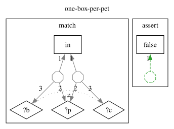
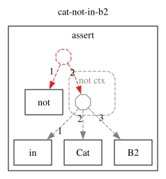
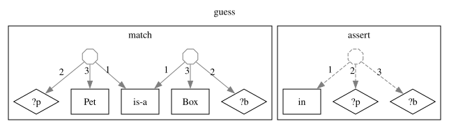
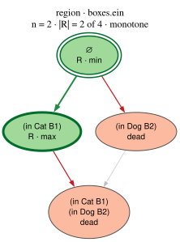

# Constraints

A **constraint** says what cannot be. In Ein it is written two ways: a rule that concludes `(false)` where its
pattern matches, and a **stored negation** `(not P)`, a fact that denies `P`, where the program imports
`std.contradiction`, whose rules conclude `(false)` from a fact beside its negation: the kernel has no such check of
its own, and a program that imports no such rule may hold both. A state that holds `(false)` is **dead**, by the one
rule every program gets, which reads it and ends the state: it is no answer, and nothing it would add counts. A rule
may also end a state itself, with `:ein inconsistent` in the place of its `:assert`
([rules](05-rules.md#ending-a-state-ein-inconsistent)). Constraints are the upper bound of the answer, what a state
may not hold; [obligations](08-obligations.md) are the lower bound, what a state still has to find.

## In Ein

```lisp
(import std.contradiction)

(relation is-a T T :why "{?3} is a {?4}")
(relation in Pet Box :why "the {?3} is in box {?4}")

(rule guess ()
  :match  (and (is-a ?p Pet) (is-a ?b Box))
  :assert (open (in ?p ?b))
  :why    "guess that the {?p} is in box {?b}")

(rule one-box-per-pet ()
  :match  (and (in ?p ?b) (in ?p ?c) (neq ?b ?c))
  :assert (false)
  :why    "the {?p} cannot be in both box {?b} and box {?c}")

(rule cat-not-in-b2 ()
  :match  ()
  :assert (not (in Cat B2))
  :why    "the cat is never in box B2")

(is-a Dog Pet)
(is-a Cat Pet)
(is-a B1 Box)
(is-a B2 Box)
(in Dog B1)
```

The rule `guess` concludes where each pet might be, `(open (in ?p ?b))`, a hypothesis each
([hypotheses](09-hypotheses.md)); the two constraints cut the guesses down.
`one-box-per-pet` refutes any state that puts one pet in two boxes, and `cat-not-in-b2` stores `(not (in Cat B2))`
at root, so no state may hold `(in Cat B2)`: `ein show hyps FILE` lists two candidates, and that is not one of them.
The import is what makes the negation a constraint: without its first line `(in Cat B2)` is a third candidate, and a
third state of the answer holds it beside its negation ([below](#the-contradiction-is-a-rule)).

```text
  (region
    ;; state 1 of 2 — ∅, root itself · minimal
    (model (in Dog B1))
    ;; state 2 of 2 — 1 candidate · maximal · from {(in Cat B1)}
    (model (in Cat B1) (in Dog B1)))
```

The answer has two states. The other candidate, `(in Dog B2)`, is dead: `--trace` lists it among the minimal dead
sets, with the facts its death rests on and the rule that refuted it.

## As a graph

A constraint is a rule, and is drawn as one ([rules](05-rules.md)): `ein render rules FILE`. The picture on the left
of `one-box-per-pet` is what may not be found in a state, two facts of `in` from one pet to two different boxes,
and on its right is `(false)`, an octagon with one arrow, at the box `false`, and no argument:



A stored negation is a fact of `not`, drawn red, whose arrow `2` is at the fact it denies; that fact is pointed at
and not asserted, so it stands in the frame `not ctx`. The empty `:match` of `cat-not-in-b2` draws nothing:



The rule the two constraints cut down is drawn the same way, its conclusion the guess, `(open (in ?p ?b))`, the
candidate standing in its context:



What the constraints do to the answer is a picture of the lattice. `ein oracle FILE --dump DIR` classifies every
set of candidates, and `ein render region DIR` draws them, one layer per number of candidates, an edge per added
candidate, green in R and red dead (the layer labels, the tooltips and the legend left out):



`(in Dog B2)` is dead alone, by `one-box-per-pet` against root's `(in Dog B1)`, and everything above it is dead
with it. `(in Cat B2)` is no node at all: root holds its negation, which `std.contradiction` refutes it beside, so it
was never a candidate. `ein render kb FILE`
draws the stored negation root holds as the rule draws it, a fact of `not` whose arrow `2` is at `(in Cat B2)`,
which stands in the frame `not ctx`, since nothing holds it.

## In words

A refutation's `:why` says what cannot be, and it is what the read-out prints of a dead state. Where root itself is
dead, `ein solve FILE` names the facts the contradiction rests on, the **unsat core**, and what refuted it. A program
that states `(in Cat B2 :source "the cat sleeps in box B2")` beside `cat-not-in-b2`:

```text
  unsat core        (in Cat B2)
  source            (in Cat B2) :source "the cat sleeps in box B2"
  refuted by        (given), cat-not-in-b2

  (false)
```

`(given)` names the statement that the negation contradicts, and `cat-not-in-b2` the rule that stored the negation.
For a dead state other than root, `--trace` writes the same, under the minimal dead sets:

```text
<summary>{(in Dog B2)} — dead</summary>

Core: `(in Dog B1)`, `(in Dog B2)`

Refuted by `one-box-per-pet`.
```

A core is an explanation, not part of the answer: where a contradiction can be reached two ways it names one, and
which one may depend on the order rules fire in
([Q-M1f.6](../../../decisions/answer/Q-M1f.6-a-core-is-an-explanation.md)).

## In mathematics

A constraint is an implication whose conclusion is falsity, or a negated fact. The two above:

$$
\begin{aligned}
\operatorname{in}(p, b) \land \operatorname{in}(p, c) \land b \ne c &\implies \bot \\
\top &\implies \lnot \operatorname{in}(\mathsf{Cat}, \mathsf{B2})
\end{aligned}
$$

Let $\operatorname{sat}(S)$ be the fixpoint of a state $S$ under the program's rules ([rules](05-rules.md)). $S$ is
**dead** when its fixpoint holds the contradiction:

$$
\bot \in \operatorname{sat}(S) \implies \operatorname{dead}(S)
$$

With `std.contradiction` imported, its rules put $\bot$ in every fixpoint that holds a fact $f$ beside $\lnot f$,
for every relation the program declares:

$$
f \in \operatorname{sat}(S) \land \lnot f \in \operatorname{sat}(S) \implies \bot \in \operatorname{sat}(S)
$$

and **alive** otherwise. $\bot$ makes a state dead by a rule, the one every program gets, which matches a held
`(false)` and states `:ein inconsistent`, a word to the engine and no fact; a program's own rule may state it over
other premises, and a state in which it fires is dead as well
([syntax](../04-reference/02-syntax.md#conclusion-forms-in-assert)). On a program whose rules read no `absent` a hypothesis can change, $\operatorname{sat}$ is
monotone, so a state that contains a dead one is dead:

$$
S \subseteq S' \land \operatorname{dead}(S) \implies \operatorname{dead}(S')
$$

Constraints cut the answer from above, and the dead states are closed upward, as the red nodes of the drawing are.
A **core** of a dead state is a set of its terminal facts, statements of the problem and hypotheses, whose closure
is already dead, as small as the recorded derivations allow; the smallest over every recorded derivation is the one
reported ([Q-M1e2.11](../../../decisions/answer/Q-M1e2.11-a-core-is-the-smallest-over-every-derivation.md)). For
the dead node above it is $\lbrace \operatorname{in}(\mathsf{Dog}, \mathsf{B1}),\ \operatorname{in}(\mathsf{Dog}, \mathsf{B2}) \rbrace$.

## Two shapes: `(false)` and `(not P)`

**`(false)`** is a contradiction with no further content: a fact, the standard library's word for what cannot be,
and no truth value, since nothing reads it by its name. Rules conclude it: a restriction where the state is impossible
as a whole rather than one proposition false, as `one-box-per-pet` does, a guard concluded and false, and
`std.contradiction`'s rules from a fact beside its negation. One rule reads it, the one every program gets with no
import line, `std.core`'s, which ends the state that holds it
([`std.core`](../04-reference/04-stdlib/21-core.md)). Under an arrow of another fact it ends nothing: `(claims Carol
(false))` is what Carol claims ([facts](03-facts.md#what-a-context-does-not-do)). It takes no argument: `(false k)` is
refused wherever it is written, and two contradictions are told apart by what they rest on, not by a witness
argument.

**`(not P)`** is a fact whose one argument is the fact it denies. It is stored like any fact, by a rule's conclusion
or written by the program, and it is a contradiction only beside `P`, and only where a rule says so, the standard
library's or the program's (below): the pair is then one wherever either half came from, a statement, a rule or a
hypothesis. A negation is of a fact; an atom has none, so a conclusion `(not ?x)` where `?x` can be bound to an atom
is refused at load.

## The contradiction is a rule

*Whatever is held beside its negation is impossible* is one rule in logic, $f \land \lnot f \implies \bot$, and Ein
cannot write it so: a premise is a fact pattern, its relation and its count of arguments written, and a variable for
a whole fact is no premise. The rule written with one, as `whole-fact.ein`, is refused at the parse:

```lisp
(rule contradiction ()
  :match  (and ?f (not ?f))
  :assert (false)
  :why    "{?f} holds beside its negation")
```

`ein solve whole-fact.ein` prints, and exits 1:

```text
whole-fact.ein:2:16: unexpected `?f`: a variable
  repair: Insert `(`
whole-fact.ein:2:24: unexpected `?f`: a variable
  repair: Insert `(`
whole-fact.ein:3:3: unexpected `:assert`
  repair: Delete `:assert`
whole-fact.ein:4:3: unexpected `:why`
  repair: Insert `)`, Insert `)`
```

So the contradiction is a rule for one relation, or for one count of arguments with the relation a parameter
([cores § A contradiction](../../reasoning/02-kb-evolution/09-cores.md#a-contradiction) has why). **For one
relation**, the program names it:

```lisp
(relation in Pet Box :why "the {?3} is in box {?4}")

(rule in-and-not ()
  :match  (and (in ?p ?b) (not (in ?p ?b)))
  :assert (false)
  :why    "the {?p} is in box {?b}, and is not")

(in Cat B2)
(not (in Cat B2))

(solve :expect (false))
```

`ein solve FILE` ends:

```text
  unsat core        (in Cat B2)
  unsat core        (not (in Cat B2))
  refuted by        (given)

  (false)

  (solve :expect)   holds
```

The core is the pair, explained together, and `refuted by` names the rules that put each side there, here none: both
are given. **For one count**, the relation is a parameter, and each activator turns the rule on for one relation:

```lisp
(relation in   Pet Box    :why "the {?3} is in box {?4}")
(relation owns Person Pet :why "{?3} owns the {?4}")

(rule clash (?R)
  :match  (and (?R ?a ?b) (not (?R ?a ?b)))
  :assert (false)
  :why    "({?R} {?a} {?b}) holds beside its negation")

(clash in)

(owns Ann Cat)
(not (owns Ann Cat))

(solve :no-search)
```

`(clash in)` reaches `in` and not `owns`, so the pair of `owns` is two facts and root is alive. `ein solve FILE`
prints, among its rows:

```text
  states (k_s)      1
  ∅                 in R — root is alive and owes nothing
```

With `(clash owns)` added under `(clash in)`, it ends:

```text
  unsat core        (not (owns Ann Cat))
  unsat core        (owns Ann Cat)
  refuted by        (given)

  (false)
```

**The standard library's is `std.contradiction`**: `clash-0` to `clash-6`, the rule above at each count from none
to six, and `clash-of-0` to `clash-of-6`, which derive each activator from a declaration of that count, so importing
it is the whole switch:

```lisp
(import std.contradiction)

(relation in   Pet Box    :why "the {?3} is in box {?4}")
(relation owns Person Pet :why "{?3} owns the {?4}")

(owns Ann Cat)
(not (owns Ann Cat))

(solve :no-search)
```

`ein solve FILE` ends as the program with `(clash owns)` does. A relation no declaration names is reached by an
activator written by hand, `(clash-1 loose)`, and a fact of more than six arguments by the rule written at its
count, as `clash` is above; `std.algebra`, `std.bijection` and
`std.slots`, which conclude stored negations, import the module, so a program that imports one of them has it
([negation as rules](../04-reference/04-stdlib/20-negation-and-contradiction.md#using-stdcontradiction--a-fact-beside-its-negation-concludes-false)).
A program that imports none of them and writes no rule of its own has no contradiction of a fact and its negation:
the two stand together, as in a three- or four-valued or a paraconsistent logic
([Q-M1f.557](../../../decisions/stdlib/Q-M1f.557-the-contradiction-is-a-theory-a-program-imports.md)).

## The three states of a fact

At any moment a fact `P` is in one of three states, and a pattern can ask about each:

| state | the knowledge base holds | matched by |
|---|---|---|
| **asserted** | `P` | `P` |
| **negated** | `(not P)` | `(not P)` |
| **open** | neither | `(unknown P)`, which is `(and (absent P) (absent (not P)))` |

`(not P)` in a `:match` matches a stored negation: it is not *P is not provable*. That question is
`(absent P)`, negation as failure, asked of a whole state ([rules](05-rules.md)). `unknown` is a macro of the standard
library, which a program imports to write it ([macros](11-macros.md)).

Stored negations are what lets elimination be written as rules. *Every colour but one is excluded for this house,
so it is the remaining one* is a rule whose premise is a `forall` over stored negations; the standard library's
bijection and slot theories are written so ([bijections](../04-reference/04-stdlib/04-bijections.md#root-decides-negatives-and-elimination),
[slots](../04-reference/04-stdlib/05-slots.md)).

## The negation of a negation

A stored negation is a fact, so it can be denied in its turn: `(not (not P))` is the fact of `not` whose one
argument is the fact `(not P)`. A program writes it, a rule matches it and concludes it, and a query asks for it,
as for any fact ([Q-M1f.391](../../../decisions/language/Q-M1f.391-the-negation-of-a-negation-is-a-fact.md)). One
arises without being written wherever a rule denies whatever a variable is bound to, and the variable is bound to
a negation:

```lisp
;; Alice lies, and thinks that five is not two plus two.
(relation = Thing Thing :why "{?3} is {?4}")
(think Alice (not (= 5 (+ 2 2))))
(liar Alice)

(rule distrust ()
  :match  (and (liar ?p) (think ?p ?f))
  :assert (not ?f)
  :why    "{?p} lies and thinks {?f}")

(query :goal (not (not (= ?a ?b))))
(query :goal (= ?a ?b))
(solve :no-search)
```

`ein solve` answers the first question `?a = 5 · ?b = (+ 2 2)` and the second with no row. **The denial of a
denial says that the denial does not hold, and nothing more.** With $K$ the facts held:

$$
\lnot\lnot P \in K \ \not\Longrightarrow\ P \in K
$$

`(not P)` beside `(not (not P))` is a fact with its own negation, a contradiction where the program's contradiction
reaches the relation `not`, as `std.contradiction` does once `not` is declared, `(relation not Claim)`, or activated,
`(clash-1 not)` ([`examples/beliefs/04_liar_denial_contradicted.ein`](../../../../examples/beliefs/04_liar_denial_contradicted.ein));
and `P` beside `(not (not P))` is none. **That `P` then holds is a rule a program asks for**, one rule for a count of arguments
with the relation a parameter, turned on for the relations it is meant for. The standard library has it,
[`std.negation`](../04-reference/04-stdlib/20-negation-and-contradiction.md#using-stdnegation--eliminating-a-double-negation),
and `eliminate-2` is its rule for a fact of two arguments:

```lisp
(import std.negation :symbols (eliminate-2))
(eliminate-2 =)
```

With those two forms added the second question answers `?a = 5 · ?b = (+ 2 2)`. The rule is three lines, and a
program may write it for itself, as it must for a double negation that stands inside another fact:

```lisp
(rule eliminate (?R)
  :match  (not (not (?R ?a ?b)))
  :assert (?R ?a ?b)
  :why    "it is not so that {?a} {?R} {?b} is not so")
(eliminate =)
```

What `not` may not deny is unchanged: an atom, an equality, and a bare variable anywhere but as a conclusion of its
own, `(not ?f)`. The programs are under [`examples/beliefs/`](../../../../examples/beliefs/), `03_liar_denial.ein`
to `06_double_negation.ein`.

## What a constraint is not

A constraint narrows what a state may hold; it never chooses among possibilities. *One of these* is a hypothesis,
and the engine finds which choices survive. A rule never states a disjunction, and a constraint never retracts a
fact: the knowledge base only grows, and a state that reaches a contradiction is dead as a whole.

A constraint is judged in the state it fires in, and says nothing about other states: no rule can require that there
be exactly one answer ([Q-M1d.7](../../../decisions/language/Q-M1d.7-a-rule-is-a-sentence-about-the-state-it-fires.md)).
A claim about the answer as a whole is a query's `:expect` ([queries](12-query.md)).

## See also

- [Obligations](08-obligations.md): the other bound, what a state still owes.
- [Rules](05-rules.md): the pattern language, `absent` among it.
- [Solutions and models](13-solutions-and-models.md): which states the answer is, and what dead means to it.
- [The read-out reference](../04-reference/08-read-out.md): the `unsat core`, `refuted by` and `N` rows.
