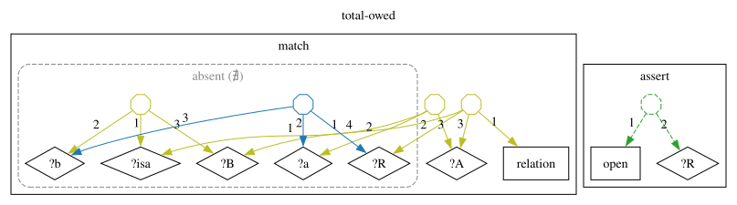
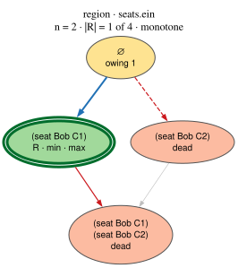

# Obligations

An **obligation** says that something must exist: every person likes some food, every house has an owner, every
chair is taken. It is a rule that matches while the thing is missing and whose whole conclusion is the verdict
`(open ?R)`, *this state is unfinished: the facts of `?R` are incomplete*. A state the rule matches **owes**; a state
that owes nothing is **discharged**. An obligation is no part of saturation: it is read once on each state the engine
reaches, at its fixpoint, and the state that owes holds the fact `(open R)`
([Q-M1f.566](../../../decisions/hypotheses/Q-M1f.566-what-a-state-owes-is-open-r-a-fact-and-open-f.md)). It is half
of what decides the answer. The other half is the restriction, a
rule that concludes `(false)` ([constraints](06-constraints.md)): restrictions say what a solution may not be,
obligations what it must contain, and the answer is every state between them
([solutions and models](13-solutions-and-models.md)).

## In Ein

Two people, two chairs, a rule against sharing, and the requirement that everyone sits:

```lisp
;; Two people, two chairs, and everyone sits.
(relation is-a T T          :why "{?3} is a {?4}")
(relation seat Person Chair :why "{?3} sits on {?4}")

(is-a Ann Person) (is-a Bob Person)
(is-a C1 Chair)   (is-a C2 Chair)

(rule one-chair-each ()
  :match  (and (seat ?p ?a) (seat ?p ?b) (neq ?a ?b))
  :assert (false)
  :why    "{?p} cannot sit on both {?a} and {?b}")
(rule one-person-a-chair ()
  :match  (and (seat ?p ?c) (seat ?q ?c) (neq ?p ?q))
  :assert (false)
  :why    "{?p} and {?q} cannot share {?c}")

(rule everyone-sits ()
  :match  (and (is-a ?p Person)
               (absent (and (is-a ?c Chair) (seat ?p ?c))))
  :assert (open seat)
  :why    "{?p} has no chair yet")

(seat Ann C2 :source "Ann sits on the second chair")

(query :goal (seat Bob ?chair))
```

`everyone-sits` is the obligation. Its `:match` has two parts: the **trigger**, `(is-a ?p Person)`, which says who
is owed, and one `(absent …)`, which says what is missing, the **witness**: some chair `?c` with `(seat ?p ?c)`.
`(open seat)` names the relation whose facts would pay the debt. At root Ann sits and Bob does not, so root owes one
instance, for Bob. No rule says where Bob sits, so the engine proposes the two facts that would pay the debt,
`(seat Bob C1)` and `(seat Bob C2)`, and keeps each state that is alive and owes nothing:

```text
  ∅                 not in R — root owes 1 instance
    owed            Bob has no chair yet
  …
  (region
    ;; state 1 of 1 — 1 candidate · minimal and maximal · from {(seat Bob C1)}
    (model (seat Ann C2) (seat Bob C1)))

  query             (seat Bob ?chair)
  over              all of R — 1 state → 1 projection class
    class 1 of 1    1 state (1)
                      ?chair = C1
```

`(seat Bob C2)` pays the debt too, but `one-person-a-chair` kills that state, so the one solution is Bob on the first
chair. The restriction bounds the answer from above, the obligation from below, and here they meet in one state.

A library states its obligations once, over any relation. `std.algebra`'s `total-owed` is the obligation *every
member of the domain has an image*, activated per relation by a fact:

```lisp
(rule total-owed (?R ?isa)
  :match  (and (relation ?R ?A ?B)
               (?isa ?a ?A)
               (absent (and (?isa ?b ?B) (?R ?a ?b))))
  :assert (open ?R)
  :why    "{?R} owes {?a} a {?B}.")
…
(total-owed likes is-a)     ; every Person likes some Food
```

## As a graph

`ein render rule --name everyone-sits FILE` draws the obligation as its two sides: the match, with the `absent` as a
dashed cluster (*∄*), and the verdict, a fact of `open`, an octagon whose arrow `1` is at the box `open` and whose
arrow `2` is at the relation it names.


Outside the cluster is the trigger, a fact of `is-a` over a person; inside it is what must not be missing, a chair
and a fact of `seat` from that person to it. The library's `total-owed` is the same picture with every name a variable: the relation `?R` and its
two labels are read from the declaration's fact, and `?isa` is the membership relation the activator passes
(`ein render rule --name total-owed STDLIB/algebra.ein`, with `STDLIB` a standard library on disk, the directory
`ein --version` names):



The program's two restrictions, `one-chair-each` and `one-person-a-chair`, are drawn on
[hypotheses](09-hypotheses.md#as-a-graph), whose program shares them.

What the obligation does to the answer is a picture of the lattice: `ein oracle FILE --dump DIR`, then `ein render
region DIR` (the layer labels, the tooltips and the legend left out). An owing node is filled amber, a node of R
green, a dead one red, and the edge that pays a node's last debt is drawn blue:



Root owes, so it is below R; one candidate pays the debt and one dies of the restriction; the answer is the one
green node between them ([rendering](../04-reference/12-rendering.md)).

## In words

An obligation's `:why` is the debt, said of the instance that owes it: *Bob has no chair yet*. It is printed under
the state that owes, one line per undischarged instance, as the `owed` row under `∅` when root owes, and under each
node of the `owing` block when every alive node owes ([read-out](../04-reference/08-read-out.md)). Read aloud, the rule is
a sentence with a gap: *for every person, some chair is theirs; until one is, the state owes it*. The trigger is the
*for every*, the `absent` is the *some*, and `(open seat)` says which facts fill the gap.

## In mathematics

The requirement `everyone-sits` states is a sentence with two quantifiers:

$$
\begin{aligned}
\forall p.\ \ & \text{is-a}(p, \mathsf{Person}) \\
\implies\ & \exists c.\ \text{is-a}(c, \mathsf{Chair}) \land \operatorname{seat}(p, c)
\end{aligned}
$$

and the rule matches where it fails:

$$
\begin{aligned}
& \text{is-a}(p, \mathsf{Person}) \land \lnot \exists c.\ \bigl( \text{is-a}(c, \mathsf{Chair}) \land \operatorname{seat}(p, c) \bigr) \\
& \implies \operatorname{open}(\mathsf{seat})
\end{aligned}
$$

In general an obligation rule $o$, activated by $a$, has a trigger $T$ and a witness $W$, and matches a state $S$
at the bindings $\theta$ of the trigger where no witness exists:

$$
\operatorname{owes}(o, a, \theta, S) \iff S \models T(\theta) \land \lnot \exists \bar{y}.\ S \models W(\theta, \bar{y})
$$

$$
\begin{aligned}
\operatorname{owes}(S) &= \bigl| \lbrace (o, a, \theta) \mid \operatorname{owes}(o, a, \theta, S) \rbrace \bigr| \\
\operatorname{discharged}(S) &\iff \operatorname{owes}(S) = 0
\end{aligned}
$$

`(open ?R)` names the relation of the one premise of $W$ that binds $\bar{y}$, the slot a payment fills. In the
program above $T(p)$ is $\text{is-a}(p, \mathsf{Person})$, $W(p, c)$ is
$\text{is-a}(c, \mathsf{Chair}) \land \operatorname{seat}(p, c)$, and at root $\operatorname{owes}$ is 1, the
instance $p = \mathsf{Bob}$. A state of the answer is alive and discharged:

$$
\begin{aligned}
R = \lbrace\, C \subseteq H \mid\ & \bot \notin \operatorname{sat}(\mathrm{root} \cup C) \\
\land\ & \operatorname{owes}(\operatorname{sat}(\mathrm{root} \cup C)) = 0 \,\rbrace
\end{aligned}
$$

Discharge is a positive test, $\exists \bar{y}.\ W$, so on a program where commitments cannot grow $T$, a state
that is discharged stays discharged as facts are added; an obligation bounds $R$ from below as a restriction
bounds it from above.

## The form: `(open ?R)`

An obligation is a `rule` whose **whole** `:assert` is `(open ?R)`, `?R` a parameter of the rule, bound by its
activator, or `(open R)`, a relation written by name: the facts of `R` are incomplete. Beside another conclusion it is
refused ([Q-M1f.575](../../../decisions/language/Q-M1f.575-open-r-is-a-rules-whole-assert-and-open-f-stands.md));
`(open F)`, `F` a fact, is a hypothesis and no obligation, and the bare `(open)` is refused at the parse
([Q-M1f.566](../../../decisions/hypotheses/Q-M1f.566-what-a-state-owes-is-open-r-a-fact-and-open-f.md)). A state that
owes an instance of `R` holds `(open R)`, once, written at its fixpoint and dropped at a fork, so a state that pays
it holds none. The requirement is stated once, in the guard; `(open ?R)` restates nothing of it
([Q-M1d.2](../../../decisions/hypotheses/Q-M1d.2-an-obligation-is-a-rule-that-concludes-open-r.md)):

- **the witness** is the premise of `?R` inside the rule's one `(absent …)` that binds a variable the rest of the
  guard does not, `?c` in `(seat ?p ?c)`;
- **the domain** is everything else inside that `absent`, `(is-a ?c Chair)`: the objects a payment may take;
- **the direction** falls out of which slot is free. `total-owed` leaves the image `?b` free, so it owes each member
  of the domain an image; `surjective-owed` leaves `?a` free, so it owes each member of the range a preimage. Neither
  carries a position number.

Where the guard does not say this one way, the program is refused at load rather than guessed: no `absent` holds a
premise of `?R`, two do, the premise binds no variable of its own (a ground check, which no witness could pay), or two
premises of `?R` each bind one (a *compound witness*, two facts that together pay, which has no single slot to fill).
Each refusal is a line of [diagnostics](../04-reference/07-diagnostics.md).

## When an obligation is read

An obligation is **not in the saturation agenda**. Saturation runs to its fixpoint; then one pass reads every
obligation against that fixpoint, and the instances it matches are the state's debts. Three things follow:

- **It writes only `open` facts.** An obligation concludes nothing saturation reads; a rule that reads what a state
  owes makes its program not monotone
  ([Q-M1f.569](../../../decisions/hypotheses/Q-M1f.569-a-rule-may-read-an-open-fact-and-its-program.md)). A rule that
  concluded what a state owes and something else would belong to both passes, so that is refused at load.
- **Firing is being undischarged.** The rule matches while the witness is missing and stops matching once it is
  there, so the pass asks no second question: what discharges a debt is exactly what the guard looks for.
- **`(open R)` is one fact, however many instances.** Two people without a chair are two instances of
  `everyone-sits` and one fact, `(open seat)`: the count of instances is kept beside it, in every report of a
  state that owes, and where each was written is the engine's record and no part of the fact
  ([Q-M1f.390](../../../decisions/hypotheses/Q-M1f.390-open-r-carries-no-justification-and-the-instance.md)).
- **A debt is a fact of the state that owes it alone.** `(false)` is inherited, because a dead state stays dead
  whatever is added; a debt exists to be paid by an addition, and an inherited one would survive its own payment. So
  `(open R)` is held by the state that owes it, in a part of the state no fork inherits, and a state that pays it
  holds none. What a state owes is read at every state the engine builds; the pass that writes a state's `open`
  facts runs at root, and above root at a state that is printed or saved, or whose rules read them, and at every
  state under `--in-flight` ([Q-M1f.655](../../../decisions/engine/Q-M1f.655-open-facts-are-written-at-root-and-where-a-state.md), [Q-M1f.656](../../../decisions/cli/Q-M1f.656-a-flag-runs-the-pass-at-every-state-and-checks.md)). No rule removes
  a fact.

A state that holds `(false)` is dead whatever it owes. The order of the debts in a report is the order the
obligation rules are written in.

## The requirement and the payment, as facts

What a state owes is lost as the state grows, which is why `(open R)` is the state's own. Its two halves are not.
The **requirement**, that the trigger holds, and the **payment**, that the trigger holds with a witness beside it,
each stay true in every larger state, and so does *nothing required is unpaid*. So each is an ordinary rule, and a
fork inherits what it concludes. For `everyone-sits`, three rules added to the program above:

```lisp
(rule seat-due ()
  :match  (is-a ?p Person)
  :assert (debt-due seat (everyone-sits-of ?p))
  :why    "{?p} is required a chair")
(rule seat-paid ()
  :match  (and (is-a ?p Person) (is-a ?c Chair) (seat ?p ?c))
  :assert (debt-paid seat (everyone-sits-of ?p))
  :why    "{?p} has a chair")
(rule nothing-unpaid ()
  :match  (absent (and (debt-due ?r ?j) (absent (debt-paid ?r ?j))))
  :assert (debts-discharged)
  :why    "every requirement is paid")
```

`seat-due` is the obligation's trigger, and `seat-paid` the trigger with what its `absent` looks for; neither reads
an `absent`. `(everyone-sits-of ?p)` names the instance, a fact no state holds. `nothing-unpaid` reads an `absent`
inside an `absent`, *for every requirement, a payment*. At root, `ein saturate --dump FILE` lists two requirements,
one payment, and what root owes:

<!-- output -->
```text
;; ── DERIVED (6 facts) ──
;;   debt-due (2)
  (debt-due seat (everyone-sits-of Ann) :rule seat-due)
  (debt-due seat (everyone-sits-of Bob) :rule seat-due)
  (debt-paid seat (everyone-sits-of Ann) :rule seat-paid)
;;   open (3)
  (open seat :rule everyone-sits)
  (open (seat Bob C1) :rule everyone-sits)
  (open (seat Bob C2) :rule everyone-sits)
```

and `ein solve -p FILE` lists the one state of R with both payments, `(debts-discharged)`, and no `open` fact:

<!-- output -->
```text
── state 1 of 1 ──
final-state facts (beyond the program as loaded: root's derivations, the commitment and what it derives; 6 facts):
  (debt-due seat (everyone-sits-of Ann))
  (debt-due seat (everyone-sits-of Bob))
  (debt-paid seat (everyone-sits-of Ann))
  (debt-paid seat (everyone-sits-of Bob))
  (debts-discharged)
  (seat Bob C1)
```

The rest of the read-out is the program's without the three rules, two facts more beyond root, and its `lattice`
row still says `monotone (the static check)`. The requirement reads only `is-a`, which no commitment adds to, so a
state that holds `(debts-discharged)` passes it to every larger state, as a state that holds `(false)` does.
[`std.debts`](../04-reference/04-stdlib/22-debts.md) states the same three for the library's four obligations, with
the words these rules borrow.

What is lost as a state grows is not written so. The debt itself, concluded by an ordinary rule from the
obligation's `:match`,

```lisp
(rule unseated ()
  :match  (and (is-a ?p Person)
               (absent (and (is-a ?c Chair) (seat ?p ?c))))
  :assert (unseated ?p)
  :why    "{?p} has no chair yet")
```

concludes a fact from an `absent` a commitment can fill, and a fork inherits it where its guard no longer holds.
The static check flags the program, and `ein solve FILE` names the stale fact in the state that seats Bob:

<!-- output -->
```text
  WARNING           THIS PROGRAM IS NOT MONOTONE: NOTHING IS CLAIMED OF THIS ANSWER.
                    IT IS NOT CLAIMED TO BE RIGHT, SOUND OR COMPLETE (Q-M1f.564).
                    THE `lattice` ROWS BELOW NAME THE SITES.
  …
  lattice           not monotone: 1 site (the static check) — no hole in this cube
    assumes         every node is a fork of root (root's fixpoint, its commitment added, saturated); what a node is on this program is not decided: Q-M1e2.2
    site            unseated: absent reads seat at absent depth 1, concludes a positive fact — at stake: the state
    status          monotone here (conservative) — the cube: no hole, no dead node with an alive superset, no discharged node with an owing superset
    state           stale facts — 3 of the cube's 4 nodes hold one: a fact whose absent guard the node's own fixpoint falsifies
    stale           {(seat Bob C1)}, in R: (unseated Bob) ← unseated (absent (is-a _ Chair)) (absent (seat Bob _))
  …
```

*Alive* is the other: concluded from the absence of `(false)`, it is the same shape, and a dead fork would inherit
it. A state's verdicts that a larger state can lose are read on the state, or written where no fork inherits them.

## What an obligation quantifies over

An obligation needs no closed domain, no relation whose held extent is closed and no type system
([Q-M1d.3](../../../decisions/hypotheses/Q-M1d.3-an-obligation-needs-no-closed-domain.md)). Four things hold of every
obligation, and they are what makes it safe to state in an open world.

### The domain is the guard

The domain of a debt is written nowhere but in the rule's own `absent`: the objects the premise beside the witness
matches. A library takes the membership relation as a parameter, `?isa`, never as a literal `is-a`, so a program may
pass `is-a`, `is-a*` or a relation of its own, and stating an obligation asks nothing about whether that
relation's held extent is closed or complete.

### Paying a debt needs no closure

A debt is paid when a witness is **present**, which is a positive check: once paid, it stays paid as the state grows.
So an obligation assumes nothing about the facts not yet known. It may report a debt that a scan over stored
negations would show can never be paid; it never reports a state discharged that is not.

### Refuting stays with the restrictions

*The requirement can never be met* is a different statement, and an obligation does not make it. It is a
restriction's: a rule that scans every candidate for a **stored negation** and concludes `(false)` when all are
excluded. The stdlib pairs each obligation with such a scan: `total` and `surjective` beside `total-owed` and
`surjective-owed` in `std.algebra`, `slot-no-room` and `slot-no-fill` beside `slot-owed-room` and `slot-owed-fill`
in `std.slots`; `std.elim`'s `no-room-left` is another. A scan for stored negations is safe in an open world, since it fires
only on a genuine exclusion; the one scan in the stdlib that reads absence instead, `connex`, is sound only where
the held extent of its relation is fully determined by saturation, and its module says so.

| candidates left for an owed slot | which rule speaks | the state is |
|---|---|---|
| none: every one excluded by a stored negation | the restriction (`total`) | dead |
| none present, some still open | the obligation (`total-owed`) | owing |
| one present | neither | discharged for that instance |

### What would pay a debt

The facts that would pay a debt are read off the same guard with the witness step left out: every binding of the
domain premise for which the witness is neither present nor negated. Nothing is stored, so an object that arrives
later is seen. Choosing among those facts is exhaustive only while the set cannot grow under the choice, so where an
obligation's domain could grow, because its guard or its trigger reads facts of a relation a commitment can add to,
the obligation still writes what root's guard gives, and the program is one the static check flags: nothing is
claimed of its answer ([Q-M1f.579](../../../decisions/hypotheses/Q-M1f.579-an-obligation-whose-guard-or-trigger-reads-what.md)). The `universe` row of the read-out says how H was built.

## What an obligation does to the answer

An obligation plays two parts ([hypotheses](09-hypotheses.md)):

- **It judges.** A state that owes is not in R, whatever proposed it. This holds beside a hypothesis rule too: the rule
  proposes, the obligation proposes and judges, and that is how [`zebra2.ein`](../../../../examples/zebra2.ein)
  states its puzzle.
- **It generates.** An obligation **activated** at root (a rule with no parameters always is; a parameterised one is
  once an activator fact matches it) writes the facts that would pay the debts as hypotheses, beside what a rule
  proposes ([Q-M1f.570](../../../decisions/hypotheses/Q-M1f.570-h-is-the-union-of-the-hypotheses-root-holds.md)). A root that owes nothing then proposes nothing from it. An obligation rule that a
  program loads and nothing activates, as an import of a whole library brings its obligation rules, does neither.

An obligation whose `open` facts at root are of a relation the program also keeps out of the guessing, by
`(__closed__ R)` or by a `(solve …)` list, is refused at load: the lists and a closure configure the blind
enumerator, and one that disagrees with root's `open` facts says what the program does not do
([Q-M1f.578](../../../decisions/hypotheses/Q-M1f.578-the-two-lists-and-a-closure-configure-the-blind.md)).
To judge root alone, with nothing proposed, a program states `(solve :no-search)` ([query](12-query.md)).

## Reading a state that owes

Where a state owes, every surface says what:

| surface | what it says |
|---|---|
| the read-out, `∅` row | *not in R — root owes n instances*, and an `owed` row under it per instance, the `:why` |
| the read-out, `empty` row | *every alive node owes — no commitment pays every debt*: R is empty of the second kind, and an `owing` block lists the alive owing nodes with no alive node one fact up, each with its debts |
| the printed region | `(region (owing (model …) …))` for that kind of empty R, which reads back as a claim ([query](12-query.md)) |
| `--single` | the word `Open`: R is empty and every alive node owes |
| `--json-summary` | `root.owes`, the count, and `root.owed`, the texts |
| `--events` | one `owe` line per undischarged instance: the rule, its activator, the relation, the bindings and the `:why` |

With the seating program above stating `(solve :no-search)`, so that root alone is judged:

```text
  empty             every alive node owes — no commitment pays every debt
  …
  owing             ∅ — owes 1
                      Bob has no chair yet

  (region (owing (model)))
```

`Open` and `Contradiction` are two different empty answers: *not yet a model* against *no model*. `Contradiction`
is said only where no node is alive
([Q-M1d.6](../../../decisions/answer/Q-M1d.6-contradiction-is-said-only-where-no-node-is.md)), and `Open` where nodes
are alive and every one of them owes.

## The stdlib's four

| rule | module | owes | activated by |
|---|---|---|---|
| `total-owed` | `std.algebra` | each member of `?R`'s domain an image | `(total-owed R isa)`, or `std.bijection`'s `bijective-setup` from `(bijective R)` |
| `surjective-owed` | `std.algebra` | each member of `?R`'s range a preimage | `(surjective-owed R isa)`, or `bijective-setup` |
| `slot-owed-room` | `std.slots` | each item a slot | `std.slots`' `slot-partition-setup` |
| `slot-owed-fill` | `std.slots` | each slot an item of each kind | `slot-partition-setup` |

Each asserts `(open ?R)` and nothing else, and each is paired with the restriction that refutes the same requirement
once it cannot be met. Their reference is the standard library's:
[`total-owed` and `surjective-owed`](../04-reference/04-stdlib/02-relation-algebra.md#obligations-total-owed-and-surjective-owed),
[`std.slots`](../04-reference/04-stdlib/05-slots.md#where-root-owes-the-search).

What one of the four owes is a fact its state holds, `(open R)`, once a relation. Its two halves, per instance, are
facts where a program asks for them:
[`std.debts`](../04-reference/04-stdlib/22-debts.md) states what each requires and what pays it, `(debt-due R J)`
and `(debt-paid R J)`, and `(debts-discharged)` where nothing required is unpaid.

## Saying how many

Ein has no numbers ([Q-M1e2.24](../../../decisions/language/Q-M1e2.24-ein-has-no-numbers-and-no-ranges.md)), so a
bound is not `1..1` or `at least 2`: it is a relation to another set, said with the four properties of a relation.

| the claim | said with relations |
|---|---|
| at least one | an obligation (`total-owed`) |
| at most one | `functional`: two images are `(false)` |
| as many as `S` or more | a pairing from `S`: `total` on it, `functional` and `injective` |
| exactly as many as `S` | a bijection: `(bijective R)` |

*At least two* is an injection from a set of two the program declares: the two is a set of two atoms, not a number.
The cost is ontology, one relation per bound, and the gain is that every bound is something the rules can read.

## What is refused

Each of these is refused before anything runs, on every command, with the line under
[diagnostics](../04-reference/07-diagnostics.md):

- `(open)` with no argument, or more than one, and `open` or `absent` directly under `open`, at the parse;
- `(open R)` beside another conclusion, at load: what a state owes is a rule's whole `:assert`;
- `(open ?R)` whose witness the guard does not give one way, at load;
- an obligation owing a relation that a `(__closed__ R)` closes, or that a `(solve …)` list leaves out or names in
  `:no-hypothesis`, at load: root holds `(open R)` and the lists and a closure configure the blind enumerator.

## See also

- [Constraints](06-constraints.md): `(false)`, the other bound.
- [Hypotheses](09-hypotheses.md): the writers of H, an obligation's payments among them.
- [Solutions and models](13-solutions-and-models.md): R, its two lines, and the two kinds of empty R.
- [The standard library](../04-reference/04-stdlib/README.md): `std.algebra`, `std.bijection`, `std.slots`, `std.elim`.
- [The read-out](../04-reference/08-read-out.md): every row that reports a debt.
- [The definition of R](../../reasoning/02-kb-evolution/06-solution-semantics.md), stated for a second implementation.
