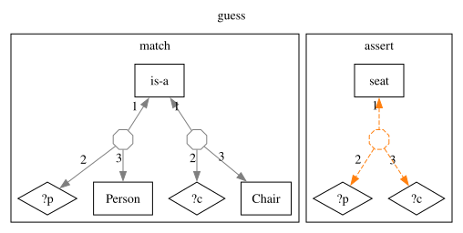
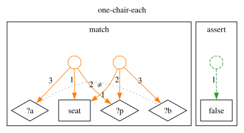
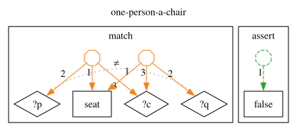
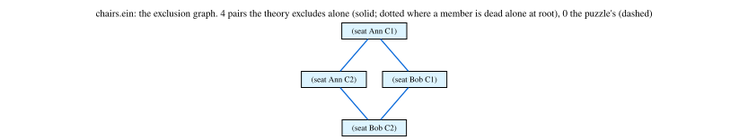

# Hypotheses

A **hypothesis**, or **candidate**, is a fact the engine may assume: one the program does not state and its rules do
not derive, but a solution might hold. The candidates of a program are its **hypothesis set H**, built once, at root.
A **commitment** is a set of candidates assumed together, and the answer is the commitments whose state is alive and
owes nothing ([solutions and models](13-solutions-and-models.md)). So H is the space the answer is drawn from, and a
program says what may go into it: an `hrule` that proposes candidates, an obligation whose payments are the
candidates, or neither, and then every fact the blind enumerator can form. `(solve …)` and `(__closed__ R)` narrow
it, and `(solve :no-search)` empties it. A `(__closed__ R)` fact **closes** the relation `R`: the held extent of
`R` is fixed, and no candidate is a fact of it; *a closed relation* on these pages is a relation such a fact
names.

## In Ein

An `hrule` is a rule whose conclusion is not derived but **proposed**: each match gives one candidate.

```lisp
;; Two people, two chairs: who sits where?
(relation is-a T T          :why "{?1} is a {?2}")
(relation seat Person Chair :why "{?1} sits on {?2}")

(is-a Ann Person) (is-a Bob Person)
(is-a C1 Chair)   (is-a C2 Chair)

(rule one-chair-each ()
  :match  (and (seat ?p ?a) (seat ?p ?b) (neq ?a ?b))
  :assert (false)
  :why    "{?p} cannot sit on both {?a} and {?b}")
(rule one-person-a-chair ()
  :match  (and (seat ?p ?c) (seat ?q ?c) (neq ?p ?q))
  :assert (false)
  :why    "{?p} and {?q} cannot share {?c}")

(hrule guess ()
  :match  (and (is-a ?p Person) (is-a ?c Chair))
  :assert (seat ?p ?c)
  :why    "suppose {?p} sits on {?c}")

(query :goal (seat ?who ?chair) :over maximal)
```

`ein show hyps FILE` lists H, one candidate a line, as Ein facts, and says on stderr which rung built it:

```text
note: chairs.ein: H, built by the rung `hrules`: 4 candidates
(seat Ann C1)
(seat Ann C2)
(seat Bob C1)
(seat Bob C2)
```

The answer is over the 16 commitments these four make: seven of them are alive (∅, the four single seatings and the
two full ones), and the query, asked over the maximal line, has two classes, Ann on `C1` with Bob on `C2`, and the
other way round.

An hrule with parameters is activated by the activators `(solve :hrules …)` lists, each binding its parameters once:

```lisp
(hrule guess (?p ?s)
  :match  (instance ?p Person)
  :assert (seat ?p ?s)
  :why    "suppose {?p} sits in {?s}")

(solve
  :hrules (guess (Ann S1) (Ann S2) (Bob S1) (Bob S2)))
```

## As a graph

An hrule is drawn as a rule is, `ein render rule --name guess FILE`: what it matches at root, and the fact each
match proposes, dashed.



The drawing is the same as a rule's, and the difference is in what the dashed fact means: a rule's is added to
the state the rule fires in, an hrule's is a candidate, added in the states that commit to it and in no other.

The program's two restrictions are what the guesses are judged by ([constraints](06-constraints.md)). Each is a
picture of what a state may not hold, two facts of `seat` from one person or to one chair, with `(false)` on the
other side:





`ein render h-space FILE --view exclusion` draws H itself as an undirected graph: a candidate a node, and an edge
between two that exclude each other, solid where the theory alone excludes them. For the chairs program:



The other views draw the groups H falls into (*pick at most one*, *exactly one*) and what couples them; what each
structure means is [the hypothesis space](../../reasoning/02-kb-evolution/05-hypothesis-space.md). The lattice of
commitments over these four candidates, each node coloured by what its state is, is drawn on
[solutions and models](13-solutions-and-models.md#as-a-graph).

## In words

An hrule's `:why` says the guess it proposes: *suppose Ann sits on C1*. A candidate is a fact, and reads as one, by
its relation's `:why`: *Ann sits on C1*. The read-out names the candidates of a state by its commitment, `from
{(seat Ann C1), (seat Bob C2)}`, and a run's trace opens each state with *Assuming (seat Ann C1), (seat Bob C2)*.

## In mathematics

Write $\operatorname{sat}$ for saturation, the fixpoint of a set of facts under the program's rules
([rules](05-rules.md)). Root is the program saturated, $H$ the candidates proposed at root, none of which root
holds, and a commitment any subset of $H$:

$$
\begin{aligned}
\mathrm{root} &= \operatorname{sat}(\mathrm{program}) \\
C &\subseteq H \\
\operatorname{st}(C) &= \operatorname{sat}(\mathrm{root} \cup C)
\end{aligned}
$$

A hypothesis adds one fact to what the rules start from, and everything the rules then derive. The commitments
ordered by inclusion are the lattice $(2^H, \subseteq)$, with $2^n$ nodes for $n = |H|$. The hrule above proposes

$$
\begin{aligned}
H = \lbrace\, \operatorname{seat}(p, c) \mid\ & \text{is-a}(p, \mathsf{Person}) \in \mathrm{root}, \\
& \text{is-a}(c, \mathsf{Chair}) \in \mathrm{root} \,\rbrace
\end{aligned}
$$

which is the four facts `ein show hyps` lists. In general $H$ is built by the first rung of the ladder that
applies, and narrowed by the program's scoping:

$$
\begin{aligned}
H &= \operatorname{scope}(G) \\
G &= \begin{cases}
\operatorname{hrules}(\mathrm{root}) & \text{if the program declares an hrule} \\
\operatorname{payments}(\mathrm{root}) & \text{else, if an obligation is activated at root and its domain cannot grow} \\
\operatorname{blind}(\mathrm{root}) & \text{else}
\end{cases}
\end{aligned}
$$

The blind enumerator's facts, and the scoping:

$$
\begin{aligned}
\operatorname{blind}(\mathrm{root}) =\ & \lbrace\, r(x) \mid r \text{ of one argument},\ x \in A,\ r(x) \notin \mathrm{root} \,\rbrace \\
\cup\ & \lbrace\, r(x, y) \mid r \text{ of two arguments},\ x, y \in A,\ x \ne y,\ r(x, y) \notin \mathrm{root} \,\rbrace
\end{aligned}
$$

$$
\begin{aligned}
\operatorname{scope}(S) = \lbrace\, f \in S \mid\ & \operatorname{rel}(f) \in \mathit{HR} \text{ (if listed)}, \\
& \operatorname{rel}(f) \notin \mathit{NH}, \\
& \operatorname{rel}(f) \text{ not closed} \,\rbrace
\end{aligned}
$$

with $r$ ranging over the declared relations and $\operatorname{scope}$ applied on the second and third rungs
only. $A$ is the **guessable atoms**: the program's names, less the names a declaration writes as a label, the
kernel's own words and the names of relations and rules
([Q-M1f.306](../../../decisions/hypotheses/Q-M1f.306-the-guessable-atoms-are-the-programs-names-never.md)).
Candidates are proposed at a fixpoint, after saturation, never in the middle of it
([Q19](../../../decisions/hypotheses/Q19-hypotheses-are-proposed-at-a-fixpoint-after.md)).

## Where candidates come from: the ladder

| rung | when | the candidates |
|---|---|---|
| **hrules** | the program declares an `hrule` | each active hrule's conclusion, once per match at root. The other two rungs never run |
| **obligations** | no hrule, and an obligation is activated at root | the facts that would pay what root owes, and what a commitment can bring it to owe; a root that owes nothing proposes nothing ([obligations](08-obligations.md)) |
| **blind** | neither, or the obligations rung declines | every fact of a declared relation of one or two arguments over the guessable atoms, whatever the labels |

The ladder is decided once, at root
([Q-M1f.308](../../../decisions/hypotheses/Q-M1f.308-the-ladders-second-rung-is-taken-where-root.md)), and the
read-out's `universe` row and `ein show hyps`' note name the rung. An obligation rule the program loads and nothing
activates chooses no rung: an import brings its module whole, so importing `std.algebra` for `symmetric` loads its two
obligation rules, and they decide nothing until a fact activates one.

### The hrule

```text
(hrule <name> (<param>*)
  :match  <premise>
  :assert <one fact>
  :why    "<the guess, in words>")
```

- **Its conclusion is one fact**: each match proposes one candidate, a commitment of its own. An `:assert` of two
  conclusions is refused at load; write one hrule per conclusion
  ([Q-M1f.271](../../../decisions/language/Q-M1f.271-an-hrules-conclusion-is-one-fact.md)).
- **Active**: an hrule with no parameters always; one with parameters once per activator in `(solve :hrules (h (a b)
  …))`. Every name in that list is an hrule the program declares, and each activator has as many arguments as its
  hrule has parameters ([Q-M1f.115](../../../decisions/language/Q-M1f.115-an-hrules-list-names-declared-hrules.md)).
- **It matches at root.** `:match ()` proposes its conclusion once. A fact of `eq` or `neq` is no hypothesis
  ([Q-M1f.32](../../../decisions/hypotheses/Q-M1f.32-an-hrules-eq-or-neq-instance-is-no-hypothesis.md)), and an hrule
  may read a stored `(not …)`, which it reads in root's state
  ([Q-M1f.129](../../../decisions/engine/Q-M1f.129-an-hrule-that-reads-not-reads-the-state-it-was.md)).
- **No list and no closure filters it.** What an hrule proposes is what it proposes.

### The blind enumerator

With no hrule and no activated obligation, the engine proposes every fact of every declared relation of one or two
arguments, over every **guessable atom**, a pair of two different ones for a relation of two. It reads **no
label**: the declaration `(relation seat Person Chair)` does not keep `(seat C1 Ann)` out. What a label does is
leave the guessable atoms: `Person`, `Chair` and `T` are written as labels, so no candidate is about them, and the
guessable atoms are the four names left
([objects](01-objects.md#no-types-a-label-means-what-a-rule-makes-it-mean)). Dropping the hrule from the chairs
program gives 24 candidates, `is-a` and `seat` facts over every pair of the four atoms; `(solve
:hypothesis-relations (seat))` brings it to the twelve `seat` facts. No fact of a relation of three arguments or
more is enumerated. Where `ein` prints *object* in a row about the enumerator, it means a guessable atom.

## Narrowing what is guessed

| the program states | it means | read by |
|---|---|---|
| `(solve :hypothesis-relations (R …))` | propose facts of these relations only; `()` names none | the obligations rung and the blind enumerator |
| `(solve :no-hypothesis (R …))` | propose no fact of these | the same |
| `(__closed__ R)`, written or derived | the held extent of R is fixed: no commitment adds a fact of R | the same, and the read-out |
| `(solve :no-search)` | the lattice is root alone: nothing is proposed, H is empty, R is {∅} or empty | every rung, before the first |

Every name a list holds is a relation the program writes elsewhere, or the program is refused at load
([Q-M1f.114](../../../decisions/language/Q-M1f.114-a-relation-a-solve-list-names-is-one-the-program.md)). A
saturation rule still derives facts of a relation the lists take out; only guessing stops. `(__closed__ R)` is also
what makes an `absent` over facts of R safe to read before the search is over, since no commitment can add one. The
`(solve …)` form
is [query](12-query.md)'s; `ein solve --no-search`, a command declining to search, is another thing from the program's
`:no-search` ([the CLI](../04-reference/05-cli.md)).

## The mechanisms do not contradict one another

An hrule (**H**), an obligation (**O**), `:hypothesis-relations` (**HR**), `:no-hypothesis` (**NH**) and
`(__closed__ R)` (**C**) each say something about what a commitment may be about, and a program in which two of them
say opposite things of one relation is **refused at load**, on every command, one line per conflict
([Q-M1f.245](../../../decisions/hypotheses/Q-M1f.245-the-hypothesis-mechanisms-are-judged-at-load-on.md)). A
declaration that filters nothing, or repeats what another says, is one `note:` line on stderr and changes nothing
([Q-M1f.242](../../../decisions/hypotheses/Q-M1f.242-a-hypothesis-declaration-that-filters-nothing-is.md)).

| pair | refused where | a `note:` where |
|---|---|---|
| H + O | never: H generates, O judges | — |
| H + HR | an active hrule proposes a fact of a relation the list leaves out | the list, which filters nothing beside an hrule |
| H + NH | an active hrule proposes a fact of a relation the list names | the same |
| H + C | an active hrule proposes a fact of a closed relation | — |
| O + HR | no hrule, and an obligation owes facts of a relation the list leaves out | — |
| O + NH | no hrule, and an obligation owes facts of a relation the list names | — |
| O + C | an obligation owes facts of a closed relation, whatever generates | — |
| HR + NH | a relation is in both | no hrule: an NH name HR already leaves out |
| HR + C | a listed relation is closed | — |
| NH + C | never | no hrule: an NH name a closure already closes |

The check reads the program at root's fixpoint, so a closure or an activator a rule derives counts as one written.
An obligation counts as declared once root activates it, whether root owes it or not. Adding `(__closed__ seat)` to
the chairs program:

```text
kb load error: chairs.ein:19:12: hrule 'guess' proposes facts of seat, and (__closed__ seat), written at chairs.ein:23:2, says seat is closed — a closed relation is one no commitment extends, and each fact the hrule proposes is a commitment: drop the closure, or the hrule's seat
```

and `(solve :no-hypothesis (seat))` to the seating program of [obligations](08-obligations.md):

```text
kb load error: seats.ein:26:24: solve: its :no-hypothesis names seat, and obligation 'everyone-sits' owes seat — an obligation is paid by facts of the relation it owes, so a state that owes seat and may not be given one is stuck: drop seat from the list
```

`(solve :no-search)` relaxes no conflict: beside an obligation or a closure it is silent, beside an hrule or a list it
is a `note:` saying that nothing is proposed, and every refused pair is refused beside it too
([Q-M1f.254](../../../decisions/hypotheses/Q-M1f.254-solve-no-search-relaxes-no-conflict.md)). It is the way to say
*judge root alone*. The exact lines are [diagnostics](../04-reference/07-diagnostics.md)'.

## What the universe leaves out

R is over H, so of a relation H has no candidate of, the answer holds only the facts the program states and
saturation derives. The read-out names such a relation under `universe`, where a rule concludes a fact of it or a
goal asks about one and the program has not scoped it out itself: an `outside` row, *gives — no candidate: it has
arity 3, and the blind enumerator proposes arity 1 and 2 only*
([Q-M1e2.3](../../../decisions/answer/Q-M1e2.3-r-is-over-the-universe-and-the-read-out-names.md)). One more row
names what the blind enumerator did: a `relation names` row, where an argument of a candidate is a relation that
only a rule's conclusion writes. Neither changes R; declaring the relation takes the atom out of the guessable ones.
The blind enumerator is untyped, and a candidate about an atom the program's membership facts point at is a
candidate like any other
([Q-M1e.12](../../../decisions/hypotheses/Q-M1e.12-the-blind-enumerator-is-untyped.md)): a
declaration that writes the atom as a label takes it out of the guessable ones.

## Seeing H

| command | shows |
|---|---|
| `ein show hyps FILE` | H as Ein facts, one candidate a line, uncut, nothing else on stdout; the rung and the count on stderr. Costs root's saturation and the generator, no search |
| `ein solve FILE -H` | after the read-out, H by relation, with the candidates dead alone |
| `ein render h-space FILE` | the structure of H: which candidates exclude each other, the groups, the owed groups and grids, what couples them; a read-out, a graph as DOT (`--view`), or a JSON document (`--dump`) |

None of them changes an answer. What the structure of H means is [the hypothesis space](../../reasoning/02-kb-evolution/05-hypothesis-space.md).

## See also

- [Obligations](08-obligations.md): the second rung, and the judge beside the first.
- [Query](12-query.md): the `(solve …)` form that carries the lists and `:no-search`.
- [Solutions and models](13-solutions-and-models.md): what the lattice over H is, and R in it.
- [Diagnostics](../04-reference/07-diagnostics.md): every refusal named here, word for word.
- [The hypothesis space](../../reasoning/02-kb-evolution/05-hypothesis-space.md): the structure of H.
