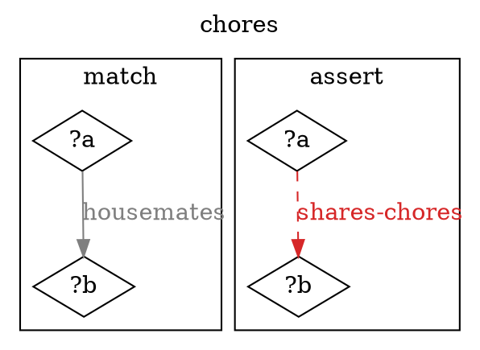
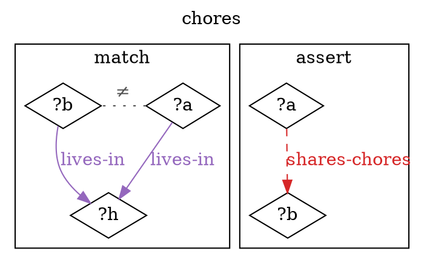
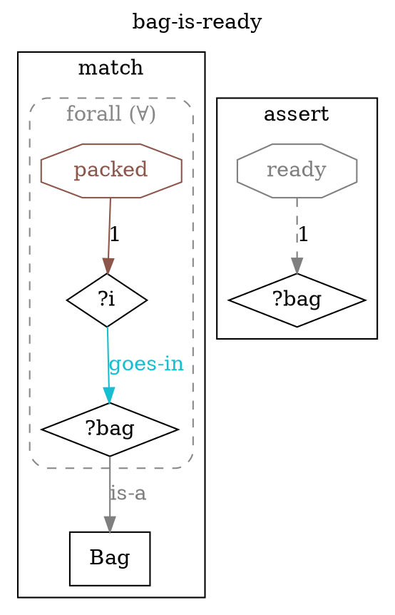
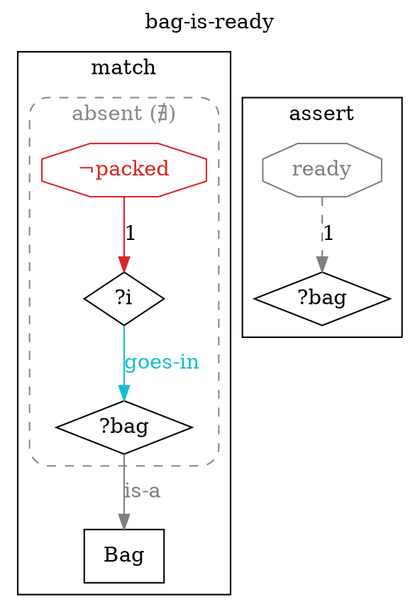

# Macros and imports

Two ways a program is made of more than what one file writes out. A **macro** is a name for a pattern: written once,
and called wherever a rule or a query reads a premise, where the loader replaces the call by the macro's body before
anything runs. An **import** brings a module, another `.ein` file, into the program whole: its declarations, its
rules and its facts, under names that say which module each came from. Neither adds meaning the language does not
have: a macro is a pattern written out, and an import is the module's forms written into the program, once.

The macro *form* and the import are syntax, a text put in the place of another, and have no drawing and no formula
of their own ([Q-M1f.371](../../../decisions/docs/Q-M1f.371-a-core-notion-is-shown-four-ways-in-the-users.md)). A
*specific* macro means what its body means, and has both: [`forall`](#a-macro-that-means-something-forall) below is
shown as Ein, as a graph, in words and as a formula.

## A macro, defined and used

### The definition and its calls

Two rules and a question all need the same three premises, *two different people who live in one house*. The
program names the pattern once and calls it three times:

```lisp
;; Who lives with whom, and what follows from it.
(relation lives-in Person House       :why "{?1} lives in {?2}")
(relation owns-bike Person            :why "{?1} owns a bicycle")
(relation may-borrow Person Person    :why "{?1} may borrow {?2}'s bicycle")
(relation shares-chores Person Person :why "{?1} shares the chores with {?2}")

(macro housemates (?a ?b)
  (and (lives-in ?a ?h) (lives-in ?b ?h) (neq ?a ?b))
  :why "{?a} and {?b} are two people who live in one house")

(rule borrow ()
  :match  (and (housemates ?a ?b) (owns-bike ?b))
  :assert (may-borrow ?a ?b)
  :why    "{?a} lives with {?b}, who owns a bicycle")

(rule chores ()
  :match  (housemates ?a ?b)
  :assert (shares-chores ?a ?b)
  :why    "{?a} and {?b} live in one house")

(lives-in Ann Elm-St)
(lives-in Bob Elm-St)
(lives-in Cy  Oak-St)
(owns-bike Bob)
(owns-bike Cy)

(query :goal (may-borrow ?who ?whose) :goal-text "{?who} may borrow {?whose}'s bicycle")
(query :goal (housemates Ann ?x) :goal-text "Ann lives with {?x}")
(solve :no-search)
```

`(macro NAME (PARAMETERS) BODY :why "TEXT")` is the definition: a name, one or more parameters, and a body, which is
a premise written over the parameters. `(housemates ?a ?b)` in `borrow` and in `chores`, and `(housemates Ann ?x)`
in the second query, are **calls**: the name, and an argument for each parameter. A call is written where a premise
is, in a `:match`, an `:assert` or a `:goal`.

### What a call expands to

At load, each call is replaced by the body with the call's arguments put for the parameters. The three calls above
become

```lisp
(and (lives-in ?a ?h) (lives-in ?b ?h) (neq ?a ?b))        ; (housemates ?a ?b), in borrow and in chores
(and (lives-in Ann ?h) (lives-in ?x ?h) (neq Ann ?x))      ; (housemates Ann ?x), in the query
```

so the program the engine runs is this one, in which no macro is left:

```lisp
;; Who lives with whom, and what follows from it: no macro, each pattern written out.
(relation lives-in Person House       :why "{?1} lives in {?2}")
(relation owns-bike Person            :why "{?1} owns a bicycle")
(relation may-borrow Person Person    :why "{?1} may borrow {?2}'s bicycle")
(relation shares-chores Person Person :why "{?1} shares the chores with {?2}")

(rule borrow ()
  :match  (and (and (lives-in ?a ?h) (lives-in ?b ?h) (neq ?a ?b)) (owns-bike ?b))
  :assert (may-borrow ?a ?b)
  :why    "{?a} lives with {?b}, who owns a bicycle")

(rule chores ()
  :match  (and (lives-in ?a ?h) (lives-in ?b ?h) (neq ?a ?b))
  :assert (shares-chores ?a ?b)
  :why    "{?a} and {?b} live in one house")

(lives-in Ann Elm-St)
(lives-in Bob Elm-St)
(lives-in Cy  Oak-St)
(owns-bike Bob)
(owns-bike Cy)

(query :goal (may-borrow ?who ?whose) :goal-text "{?who} may borrow {?whose}'s bicycle")
(query :goal (and (lives-in Ann ?h) (lives-in ?x ?h) (neq Ann ?x)) :goal-text "Ann lives with {?x}")
(solve :no-search)
```

No command prints a rule's expansion as text. The engine shows it where it answers a goal that holds a call: the
goal prints as the program wrote it, and the class under it lists the instances of what the call expanded to. `ein
solve FILE`, on the program with the macro:

```text
  query 2 of 2      (housemates Ann ?x)
  over              all of R — 1 state → 1 projection class
    class 1 of 1    1 state (1)
                      ?h = Elm-St · ?x = Bob
                        “Ann lives with Bob”
  as :expect        (model (lives-in Ann Elm-St) (lives-in Bob Elm-St)
                           (neq Ann Bob))
```

`?h` is the body's own variable, and the three facts of the claim are the body's three premises, filled.

### The same answer, with the macro and without

The two programs describe the same knowledge base. `ein saturate --dump FILE` lists the same facts for both, the
three derived ones among them:

```text
;; ── DERIVED (3 facts) ──
  (may-borrow Ann Bob :rule borrow)
;;   shares-chores (2)
  (shares-chores Ann Bob :rule chores)
  (shares-chores Bob Ann :rule chores)
```

and the state files `ein solve FILE --dump-answer DIR` writes for the two are the same, line for line, from the
first fact to the last:

```text
(lives-in Ann Elm-St) ; Ann lives in Elm-St
(lives-in Bob Elm-St) ; Bob lives in Elm-St
(lives-in Cy Oak-St) ; Cy lives in Oak-St
(may-borrow Ann Bob) ; rule borrow: Ann lives with Bob, who owns a bicycle — Ann may borrow Bob's bicycle
(owns-bike Bob) ; Bob owns a bicycle
(owns-bike Cy) ; Cy owns a bicycle
(shares-chores Ann Bob) ; rule chores: Ann and Bob live in one house — Ann shares the chores with Bob
(shares-chores Bob Ann) ; rule chores: Bob and Ann live in one house — Bob shares the chores with Ann
```

The query's answer is the block above under either program, its first row excepted, which prints the goal as each
wrote it. What the macro bought is the program's text: the pattern is stated once, has a name a reader can look
up, and is changed in one place.

### How it is drawn, and how it reads

`ein render rule --name chores FILE` draws a program as it is written, before the loader expands anything, so in
the program with the macro the call is drawn as if `housemates` were a relation, one arrow:



and the same command on the program written out draws what the engine matches, the pattern the arrow stood for:



A macro's `:why` documents the pattern for a reader of the program, *Ann and Bob are two people who live in one
house*, and is printed nowhere: a call is gone by the time anything runs, so what a derivation reads as is the
`:why` of the rule whose `:match` used it, as the state file above shows.

## A macro that means something: `forall`

The standard library's `std.macro` declares two macros, in Ein, and a program imports the module to call them:

```lisp
(macro forall (?b ?G ?B)
  (absent (and ?G (absent ?B)))
  :why "every {?b} the guard {?G} holds of satisfies {?B}: none satisfies the guard and not the body")
(macro unknown (?P)
  (and (absent ?P) (absent (not ?P)))
  :why "{?P} is unknown: neither it nor its negation holds")
```

`(forall ?b G B)` says *every `?b` that satisfies the guard `G` satisfies the body `B`*. Its arguments are a
variable and two premises, which is all a macro's argument has to be: whatever the call writes there.

### In Ein

```lisp
;; Which bag is ready to go: one whose every item is packed.
(import std.macro :symbols (forall))

(relation is-a T T         :why "{?1} is a {?2}")
(relation goes-in Item Bag :why "{?1} goes in {?2}")
(relation packed Item      :why "{?1} is packed")
(relation ready Bag        :why "{?1} is ready to go")

(rule bag-is-ready ()
  :match  (and (is-a ?bag Bag)
               (forall ?i (goes-in ?i ?bag) (packed ?i)))
  :assert (ready ?bag)
  :why    "every item that goes in {?bag} is packed")

(is-a Red Bag) (is-a Blue Bag)
(goes-in Socks Red) (goes-in Map Red) (goes-in Tent Blue)
(packed Socks) (packed Map)

(query :goal (ready ?bag) :goal-text "{?bag} is ready to go")
(solve :no-search)
```

The call expands, by the definition above, to

```lisp
(absent (and (goes-in ?i ?bag) (absent (packed ?i))))
```

*no item goes in the bag and is not packed*. The red bag's two items are packed, the blue bag's tent is not:

```text
  query             (ready ?bag)
  over              all of R — 1 state → 1 projection class
    class 1 of 1    1 state (1)
                      ?bag = Red
                        “Red is ready to go”
  as :expect        (model (ready Red))
```

The program with the call replaced by its expansion, and the import dropped, saturates to the same facts.

### As a graph

`ein render rule --name bag-is-ready FILE` knows this macro, and draws its call as a dashed cluster marked `∀`:
the quantified variable, the guard and the body inside it, the variable the rest of the rule shares, `?bag`,
outside.



The same command on the program with the expansion written out draws what the engine matches: an `absent (∄)`
cluster around the guard and the body's absence.



The two pictures are one statement read two ways: *for every item in the bag, packed*, and *there is no item in
the bag that is not packed*. The inner `(absent (packed ?i))` is drawn red with a `¬`, the mark the view also gives a
stored negation `(not (packed ?i))`: the drawing does not tell the two apart, and the rule's text does.

### In words

The rule's `:why` says what the quantifier says, of the bag it fired for. `ein solve FILE --trace OUT.md`:

```text
### Step 1 — `bag-is-ready`

> every item that goes in Red is packed

Premises: `is-a(Red, Bag)`

Derives `ready(Red)` — Red is ready to go
```

The premises a firing lists are the facts it read; what had to be missing is not a fact, and is not among them.

### In mathematics

`forall` is the guarded universal quantifier, and its body is the classical rewriting of one as the absence of a
counterexample:

$$
\forall b.\ \bigl( G(b) \implies B(b) \bigr) \iff \lnot \exists b.\ \bigl( G(b) \land \lnot B(b) \bigr)
$$

For the rule above, with $S$ the state it is judged in:

$$
\text{is-a}(\mathit{bag}, \mathsf{Bag}) \land \forall i.\ \bigl( \text{goes-in}(i, \mathit{bag}) \implies \operatorname{packed}(i) \bigr) \implies \operatorname{ready}(\mathit{bag})
$$

Both negations are negation as failure, read off $S$ ([rules](05-rules.md)): the inner one is
$\operatorname{packed}(i) \notin S$, not a stored $\lnot \operatorname{packed}(i)$. So the quantifier ranges over
the items $S$ holds a `goes-in` fact of, and a bag nothing goes in is ready, vacuously. `unknown` is the third
state of a fact ([constraints](06-constraints.md)):

$$
\operatorname{unknown}(P) \iff P \notin S \land \lnot P \notin S
$$

## Macros

The form is `(macro NAME (PARAMETER…) BODY :why "TEXT")`, with one parameter or more.

- **Where a call is expanded**: in a rule's or an hrule's `:match` and `:assert`, and in a query's `:goal`. The call
  is replaced by the body with the arguments put for the parameters, and the call's arguments are what the call
  writes, a premise among them, so `forall` can take premises. A call has as many arguments as the macro has
  parameters.
- **A variable of the body that is no parameter is written out as it is.** `?h` in `housemates` is the same `?h` in
  every call a rule makes, so `(and (housemates ?x ?y) (housemates ?y ?z))` asks for one house all three live in.
  A body that needs a variable of its own per call takes it as a parameter.
- **Where it is not**: a fact, a claim, a `:using`. A fact is what a state holds, and no state holds a call, so a
  fact headed by a macro's name, or holding a call at any depth, is refused at load, and so is a claim that lists
  one. Write the fact itself, `(lives-in Ann Elm-St)`. A macro's name written as a value is a name like another.
- **The expansion is read as if written out.** It is held to every rule the language has for the place it lands, and
  a shape the grammar would refuse there is refused at load, its line placed at the call
  ([Q-M1f.80](../../../decisions/language/Q-M1f.80-a-malformed-primitive-a-macros-expansion-writes.md)). A macro no
  rule calls is never expanded, and loads whatever its body
  ([Q-M1f.67](../../../decisions/language/Q-M1f.67-a-macros-body-is-checked-where-it-is-called.md)).
- **A body never writes `open`**: the verdict of an obligation is written in the rule
  ([Q-M1f.86](../../../decisions/language/Q-M1f.86-a-macros-body-never-writes-open.md)).
- **A goal prints as written**: the read-out shows `(housemates Ann ?x)`, not its expansion, and the class lists the
  expansion's instances ([Q-M1f.117](../../../decisions/language/Q-M1f.117-a-macro-call-in-a-goal-is-expanded-and-the-goal.md)).
- **No relation is declared under a macro's name**: a premise `(housemates …)` would be the call and a fact
  `(housemates …)` refused, so nothing could be of the relation
  ([Q-M1f.131](../../../decisions/language/Q-M1f.131-no-relation-is-declared-under-a-macros-name.md)).

`std.macro`'s two are imported like any module's names
([`std.macro`](../04-reference/04-stdlib/01-macros.md)). They are not reserved, and a program that writes
`unknown` without importing it is refused, since unexpanded it would match nothing.

## Imports

A module of the program's own is a file found from the program's directory, a dot per directory:

```lisp
;; seating/rules.ein — a module: the rules of a seating, for any relation that seats people on chairs.
(rule one-chair-each (?R)
  :match  (and (?R ?p ?a) (?R ?p ?b) (neq ?a ?b))
  :assert (false)
  :why    "{?p} cannot sit on both {?a} and {?b}")

(rule one-person-a-chair (?R)
  :match  (and (?R ?p ?c) (?R ?q ?c) (neq ?p ?q))
  :assert (false)
  :why    "{?p} and {?q} cannot share {?c}")
```

```lisp
;; seats.ein, beside the seating/ directory
(import seating.rules :symbols (one-chair-each))
(import seating.rules :as s)

(relation seat Person Chair :why "{?1} sits on {?2}")

(one-chair-each seat)
(s.one-person-a-chair seat)

(seat Ann C1)
(seat Bob C1)
```

Both imports bring the one module, once. The file writes `one-chair-each` short, because it lists it, and the other
rule as `s.one-person-a-chair`, through its alias. Root is dead, and the read-out names the rule as the file wrote it:
`refuted by s.one-person-a-chair`. The three shapes an import takes:

```lisp
(import M)                   ; the module whole; the file writes its names in full, M.x
(import M :as a)             ; the module whole; the file writes a.x for M.x
(import M :symbols (x y))    ; the module whole; the file writes x and y short
```

**Every import brings its module whole**: its declarations, its rules, its macros and its facts, with the module's
own imports, all the way down, **one copy per program** however many imports reach it. The three shapes differ only
in the names the file may write
([Q-M1f.247](../../../decisions/imports/Q-M1f.247-every-import-brings-its-module-whole.md)), and **the answer does not
depend on which is used**
([Q-M1f.249](../../../decisions/imports/Q-M1f.249-the-answer-does-not-depend-on-the-import-form.md)).

### Full names and short names

- **A full name is the name.** Every name a module declares, a relation, a rule, an hrule or a macro, has one full
  name: the module's name and the name, `std.math.decimal-arith.add`, `seating.rules.one-chair-each`. It is the same
  through every import, and any file of the program may write it
  ([Q-M1f.231](../../../decisions/imports/Q-M1f.231-every-name-a-module-declares-has-a-full-name.md)). What the main
  file declares keeps its own name. A name no file declares, a label, a value, a digit, has no full name and is one
  name in every file.
- **A short name is local to the file that binds it.** A file writes short what it declares itself, the names its
  imports list in `:symbols`, and, under `:as a`, `a.` before a name the module declares. A bare `(import M)` binds no
  short name. Nothing is re-exported: a module's short names are its own, and a name a module only imports is listed
  from the module that declares it ([Q-M1f.232](../../../decisions/imports/Q-M1f.232-a-module-has-no-export-list.md)).
- **A short name a file writes and binds nowhere is its own**, whatever a module of the program declares under it
  ([Q-M1f.236](../../../decisions/imports/Q-M1f.236-a-short-name-a-file-writes-and-lists-from-no.md)).
- **One short name, one full name, in a file.** Binding one short name to two full names, by two imports or by an
  import and the file's own declaration, is refused; so is one alias prefixing two modules
  ([Q-M1f.234](../../../decisions/imports/Q-M1f.234-one-short-name-bound-to-two-full-names-in-one.md)). Declaring a
  rule `unknown` in a file `bill.ein`, beside its `(import std.macro :symbols (unknown))`:

  ```text
  kb load error: bill.ein:1:9: 'unknown' is bound to two full names in the program, unknown (its own declaration) and std.macro.unknown — one short name names one declaration in a file: list it from one module, or write the other by its full name
  ```

- **What prints** is the main file's spelling: the short name it lists, else its first alias's, else the full name
  ([Q-M1f.237](../../../decisions/imports/Q-M1f.237-a-name-prints-as-the-main-file-writes-it-else.md)), on every
  surface, a state, a core, `refuted by` and the event log alike.

### Where a module is found

- `std.x.y` is the standard library's, `x/y.ein` under its root
  ([the standard library](../04-reference/04-stdlib/README.md#importing-a-module); which copy of it a binary reads is
  [install](../01-install.md)'s).
- Any other name is a path **from the program file's directory**, a dot per directory: `seating.rules` is
  `seating/rules.ein` beside the program. A module's own imports are found from the program's directory too, not the
  module's ([Q-M1f.235](../../../decisions/imports/Q-M1f.235-a-module-has-one-path-from-the-program-files.md)).
- A name with an empty segment or a `/` is refused, so no `..` reaches a sibling directory
  ([Q-M1f.252](../../../decisions/imports/Q-M1f.252-a-modules-name-has-no-empty-segment-and-no-slash.md)), and a
  cycle of imports is refused. A module is Ein text: a `.einb` container is refused as one
  ([Q-M1f.91](../../../decisions/imports/Q-M1f.91-an-imported-module-is-ein-text-and-a-einb.md)).

### What an import brings, and what it does not

- **A module's facts are facts of the program**, stored as if written where the import stands, keeping their own
  `:source` ([Q-M1f.138](../../../decisions/imports/Q-M1f.138-an-imported-fact-keeps-its-own-provenance.md)). Their
  constants are names of the program, so the blind enumerator proposes about them
  ([Q-M1f.137](../../../decisions/imports/Q-M1f.137-an-imported-facts-constants-are-names.md)): a program that wants
  no guesses about a library's relation closes it. A fact a module states arrives once, however many imports reach it
  ([Q-M1f.143](../../../decisions/imports/Q-M1f.143-a-modules-fact-arrives-once-however-many-imports.md)).
- **No import brings a `(query …)`, `(solve …)`, `(config …)` or `(trace …)`**: those are what a program asks, how
  it is solved and how it is configured, and a module that is also a program keeps them to itself
  ([Q-M1f.215](../../../decisions/imports/Q-M1f.215-no-import-brings-a-modules-query-solve-config.md)).
- **An obligation rule a module brings decides nothing until something activates it**: importing `std.algebra` for
  `symmetric` loads its two obligation rules, and they choose no rung of the hypothesis ladder
  ([hypotheses](09-hypotheses.md)).
- **A view draws a file, not a program.** `ein render` draws what the file writes, its imports unresolved, so a
  module's rule is drawn from the module's own file.

## What is refused

Each at load, on every command, one line each ([diagnostics](../04-reference/07-diagnostics.md)):

- a fact, or a claim, that is a macro's call, at any depth; a relation declared under a macro's name;
- a call with another count of arguments than the macro's parameters; an expansion of a shape the grammar refuses
  where it lands; a `std.macro` macro used without importing it;
- one short name bound to two full names in a file; one alias for two modules;
- a prefixed or full name that names nothing its module declares
  ([Q-M1f.251](../../../decisions/imports/Q-M1f.251-a-prefixed-name-that-names-nothing-its-module.md)), or that is
  a full name of a module no import brings
  ([Q-M1f.238](../../../decisions/imports/Q-M1f.238-a-full-name-of-a-module-no-import-brings-is.md));
- the main file declaring a name under the full name of a module it imports
  ([Q-M1f.239](../../../decisions/imports/Q-M1f.239-a-program-declares-no-name-under-the-full-name.md)); a module
  declaring a name with a dot ([Q-M1f.241](../../../decisions/imports/Q-M1f.241-a-modules-declared-name-holds-no-dot.md));
- a module's name with an empty segment or a `/`, a module not found, a cycle.

## See also

- [Rules](05-rules.md): the premises a macro's body stands for.
- [Query](12-query.md): a call in a `:goal`.
- [The standard library](../04-reference/04-stdlib/README.md): every `std.*` module, and what each declares.
- [Syntax](../04-reference/02-syntax.md): the `macro` and `import` forms in the grammar.
