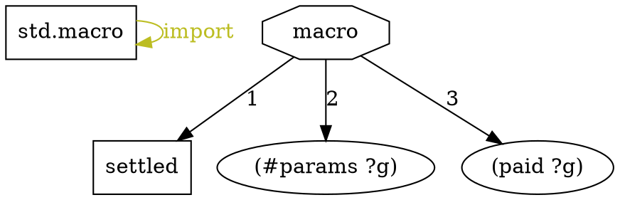

# Macros and imports

Two ways a program is made of more than what one file writes out. A **macro** is a name for a pattern: written once,
`(macro settled (?g) (paid ?g))`, and called wherever a rule or a query reads a premise, where the loader replaces the
call by its body before anything runs. An **import** brings a module, another `.ein` file, into the program whole:
its declarations, its rules and its facts, under names that say which module each came from. Neither adds meaning the
language does not have: a macro is a pattern written out, and an import is the module's forms written into the
program, once.

## In Ein

```lisp
;; Who may still owe the bill?
(import std.macro :symbols (unknown))

(relation is-a     T T   :why "{?1} is a {?2}")
(relation paid     Guest :why "{?1} has paid")
(relation may-owe  Guest :why "{?1} may still owe the bill")

(macro settled (?g) (paid ?g)
  :why "{?g} is settled: they have paid")

(is-a Ann Guest) (is-a Bob Guest) (is-a Cy Guest)
(paid Ann)
(not (paid Bob))
(__closed__ paid)

(rule may-still-owe ()
  :match  (and (is-a ?g Guest) (unknown (settled ?g)))
  :assert (may-owe ?g)
  :why    "nothing says whether {?g} has paid")

(solve :no-search)
(query :goal (may-owe ?g) :expect (model (may-owe Cy)))
```

`settled` is the program's own macro, and `unknown` is the standard library's, from `std.macro`. At load,
`(unknown (settled ?g))` becomes `(unknown (paid ?g))`, and that becomes `(and (absent (paid ?g)) (absent (not (paid
?g))))`: *neither paid nor known not to have paid*. Ann has paid and Bob has not, so the one guest it is unknown of is
Cy, and the claim holds.

A module of the program's own is a file found from the program's directory, a dot per directory:

```lisp
;; seating/rules.ein — a module: the rules of a seating, for any relation that seats people on chairs.
(rule one-chair-each (?R)
  :match  (and (?R ?p ?a) (?R ?p ?b) (neq ?a ?b))
  :assert (false)
  :why    "{?p} cannot sit on both {?a} and {?b}")

(rule one-person-a-chair (?R)
  :match  (and (?R ?p ?c) (?R ?q ?c) (neq ?p ?q))
  :assert (false)
  :why    "{?p} and {?q} cannot share {?c}")
```

```lisp
;; seats.ein, beside the seating/ directory
(import seating.rules :symbols (one-chair-each))
(import seating.rules :as s)

(relation seat Person Chair :why "{?1} sits on {?2}")

(one-chair-each seat)
(s.one-person-a-chair seat)

(seat Ann C1)
(seat Bob C1)
```

Both imports bring the one module, once. The file writes `one-chair-each` short, because it lists it, and the other
rule as `s.one-person-a-chair`, through its alias. Root is dead, and the read-out names the rule as the file wrote it:
`refuted by s.one-person-a-chair`.

## As a graph

`ein render program FILE` draws the program as written, before the loader expands a macro or resolves an import. A
macro's declaration is an octagon `macro` with three numbered arms, its name, its parameters and its body; an import
is a labelled loop on the module's name. In a rule's view a call stays a call: `unknown` is an octagon over its
argument, `(settled ?g)`. From the drawing of the program above, abridged:



## In words

A macro's `:why` documents the pattern for a reader of the program, *Cy is settled: they have paid*, and is printed
nowhere: a call is gone by the time anything runs, so what a derivation reads as is the `:why` of the rule whose
`:match` used it. A module's rules and relations read as their own `:why`s say, whichever file imported them.

## In mathematics

A macro is a substitution on the program's text. For `(macro m (?p₁ … ?pₖ) B)`:

```text
m(t₁, …, tₖ)  ↦  B[?p₁ := t₁, …, ?pₖ := tₖ]          in a :match, an :assert, a :goal

std.macro:
(forall ?b G B)  ↦  (absent (and G (absent B)))       ∀b. G(b) → B(b),  as  ¬∃b. G(b) ∧ ¬B(b)
(unknown P)      ↦  (and (absent P) (absent (not P)))  P ∉ S  ∧  ¬P ∉ S
```

An import is a union. The program is its main file together with every module its imports reach, each once, every
name a module declares written under its full name:

```text
program  =  main  ∪  ⋃ { full(M) : M reachable from main by imports }
full(M)  =  M's forms, each name n M declares written M.n
```

## Macros

```text
(macro <name> (<param>+) <body> :why "<what the pattern means>")
```

- **Where a call is expanded**: in a rule's or an hrule's `:match` and `:assert`, and in a query's `:goal`. The call
  is replaced by the body with the arguments put for the parameters, and the call's arguments are what the call
  writes, a premise among them, so `forall` can take premises. A call has as many arguments as the macro has
  parameters.
- **Where it is not**: a fact, a claim, a `:using`. A fact is what a state holds, and no state holds a call, so a
  fact headed by a macro's name, or holding a call at any depth, is refused at load, and so is a claim that lists
  one. Write the fact itself, `(paid Ann)`. A macro's name written as a value is a name like another.
- **The expansion is read as if written out.** It is held to every rule the language has for the place it lands, and
  a shape the grammar would refuse there is refused at load, its line placed at the call
  ([Q-M1f.80](../../../decisions/language/Q-M1f.80-a-malformed-primitive-a-macros-expansion-writes.md)). A macro no
  rule calls is never expanded, and loads whatever its body
  ([Q-M1f.67](../../../decisions/language/Q-M1f.67-a-macros-body-is-checked-where-it-is-called.md)).
- **A body never writes `open`**: the verdict of an obligation is written in the rule
  ([Q-M1f.86](../../../decisions/language/Q-M1f.86-a-macros-body-never-writes-open.md)).
- **A goal prints as written**: the read-out shows `(unknown (paid ?g))`, not its expansion, and the class lists the
  expansion's instances ([Q-M1f.117](../../../decisions/language/Q-M1f.117-a-macro-call-in-a-goal-is-expanded-and-the-goal.md)).
- **No relation is declared under a macro's name**: a premise `(settled …)` would be the call and a fact `(settled …)`
  refused, so nothing could be of the relation
  ([Q-M1f.131](../../../decisions/language/Q-M1f.131-no-relation-is-declared-under-a-macros-name.md)).

`std.macro` holds two, imported like any module: `forall` and `unknown`
([the standard library](../04-reference/04-stdlib.md)). They are not reserved, and a program that writes `unknown` without
importing it is refused, since unexpanded it would match nothing.

## Imports

```lisp
(import M)                   ; the module whole; the file writes its names in full, M.x
(import M :as a)             ; the module whole; the file writes a.x for M.x
(import M :symbols (x y))    ; the module whole; the file writes x and y short
```

**Every import brings its module whole**: its declarations, its rules, its macros and its facts, with the module's
own imports, all the way down, **one copy per program** however many imports reach it. The three shapes differ only
in the names the file may write
([Q-M1f.247](../../../decisions/imports/Q-M1f.247-every-import-brings-its-module-whole.md)), and **the answer does not
depend on which is used**
([Q-M1f.249](../../../decisions/imports/Q-M1f.249-the-answer-does-not-depend-on-the-import-form.md)).

### Full names and short names

- **A full name is the name.** Every name a module declares, a relation, a rule, an hrule or a macro, has one full
  name: the module's name and the name, `std.math.decimal-arith.add`, `seating.rules.one-chair-each`. It is the same
  through every import, and any file of the program may write it
  ([Q-M1f.231](../../../decisions/imports/Q-M1f.231-every-name-a-module-declares-has-a-full-name.md)). What the main
  file declares keeps its own name. A name no file declares, a type, a value, a digit, has no full name and is one
  name in every file.
- **A short name is local to the file that binds it.** A file writes short what it declares itself, the names its
  imports list in `:symbols`, and, under `:as a`, `a.` before a name the module declares. A bare `(import M)` binds no
  short name. Nothing is re-exported: a module's short names are its own, and a name a module only imports is listed
  from the module that declares it ([Q-M1f.232](../../../decisions/imports/Q-M1f.232-a-module-has-no-export-list.md)).
- **A short name a file writes and binds nowhere is its own**, whatever a module of the program declares under it
  ([Q-M1f.236](../../../decisions/imports/Q-M1f.236-a-short-name-a-file-writes-and-lists-from-no.md)).
- **One short name, one full name, in a file.** Binding one short name to two full names, by two imports or by an
  import and the file's own declaration, is refused; so is one alias prefixing two modules
  ([Q-M1f.234](../../../decisions/imports/Q-M1f.234-one-short-name-bound-to-two-full-names-in-one.md)). Declaring a
  rule `unknown` in the bill program, beside its `(import std.macro :symbols (unknown))`:

  ```text
  kb load error: bill.ein:2:9: 'unknown' is bound to two full names in the program, unknown (its own declaration) and std.macro.unknown — one short name names one declaration in a file: list it from one module, or write the other by its full name
  ```

- **What prints** is the main file's spelling: the short name it lists, else its first alias's, else the full name
  ([Q-M1f.237](../../../decisions/imports/Q-M1f.237-a-name-prints-as-the-main-file-writes-it-else.md)), on every
  surface, a state, a core, `refuted by` and the event log alike.

### Where a module is found

- `std.x.y` is the standard library's, `x/y.ein` under its root ([the standard library](../04-reference/04-stdlib.md);
  which copy of it a binary reads is [install](../01-install.md)'s).
- Any other name is a path **from the program file's directory**, a dot per directory: `seating.rules` is
  `seating/rules.ein` beside the program. A module's own imports are found from the program's directory too, not the
  module's ([Q-M1f.235](../../../decisions/imports/Q-M1f.235-a-module-has-one-path-from-the-program-files.md)).
- A name with an empty segment or a `/` is refused, so no `..` reaches a sibling directory
  ([Q-M1f.252](../../../decisions/imports/Q-M1f.252-a-modules-name-has-no-empty-segment-and-no-slash.md)), and a
  cycle of imports is refused. A module is Ein text: a `.einb` container is refused as one
  ([Q-M1f.91](../../../decisions/imports/Q-M1f.91-an-imported-module-is-ein-text-and-a-einb.md)).

### What an import brings, and what it does not

- **A module's facts are facts of the program**, stored as if written where the import stands, keeping their own
  `:source` ([Q-M1f.138](../../../decisions/imports/Q-M1f.138-an-imported-fact-keeps-its-own-provenance.md)). Their
  constants are names of the program, so the blind enumerator proposes about them
  ([Q-M1f.137](../../../decisions/imports/Q-M1f.137-an-imported-facts-constants-are-names.md)): a program that wants
  no guesses about a library's relation closes it. A fact a module states arrives once, however many imports reach it
  ([Q-M1f.143](../../../decisions/imports/Q-M1f.143-a-modules-fact-arrives-once-however-many-imports.md)).
- **No import brings a `(query …)`, `(solve …)`, `(config …)` or `(trace …)`**: those are what a program asks, how
  it is solved and how it is configured, and a module that is also a program keeps them to itself
  ([Q-M1f.215](../../../decisions/imports/Q-M1f.215-no-import-brings-a-modules-query-solve-config.md)).
- **An obligation rule a module brings decides nothing until something activates it**: importing `std.algebra` for
  `symmetric` loads its two obligation rules, and they choose no rung of the hypothesis ladder
  ([hypotheses](09-hypotheses.md)).

## What is refused

Each at load, on every command, one line each ([diagnostics](../04-reference/07-diagnostics.md)):

- a fact, or a claim, that is a macro's call, at any depth; a relation declared under a macro's name;
- a call with another count of arguments than the macro's parameters; an expansion of a shape the grammar refuses
  where it lands; a `std.macro` macro used without importing it;
- one short name bound to two full names in a file; one alias for two modules;
- a prefixed or full name that names nothing its module declares
  ([Q-M1f.251](../../../decisions/imports/Q-M1f.251-a-prefixed-name-that-names-nothing-its-module.md)), or that is
  a full name of a module no import brings
  ([Q-M1f.238](../../../decisions/imports/Q-M1f.238-a-full-name-of-a-module-no-import-brings-is.md));
- the main file declaring a name under the full name of a module it imports
  ([Q-M1f.239](../../../decisions/imports/Q-M1f.239-a-program-declares-no-name-under-the-full-name.md)); a module
  declaring a name with a dot ([Q-M1f.241](../../../decisions/imports/Q-M1f.241-a-modules-declared-name-holds-no-dot.md));
- a module's name with an empty segment or a `/`, a module not found, a cycle.

## See also

- [Rules](05-rules.md): the premises a macro's body stands for.
- [Query](12-query.md): a call in a `:goal`.
- [The standard library](../04-reference/04-stdlib.md): every `std.*` module, and what each declares.
- [Syntax](../04-reference/02-syntax.md): the `macro` and `import` forms in the grammar.
