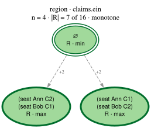
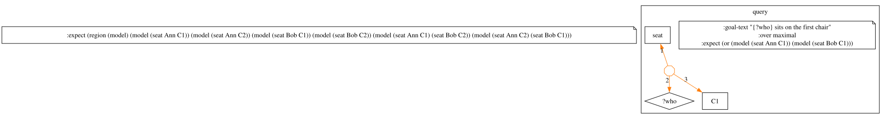
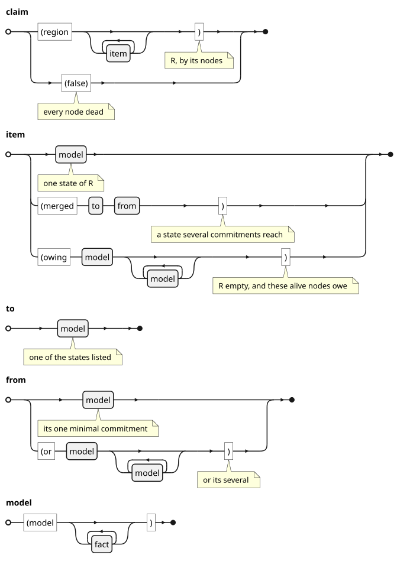

# Query: `(solve …)`, `(query …)` and claims

A program asks its question in two forms. **`(solve …)`** states the problem's lattice once: what may be guessed, and,
with `:expect`, the whole region R the program claims as its answer. **`(query …)`** asks one question about R: a
goal pattern, answered by the different ways the goal comes out across R's states, its **projection classes**, and,
with `:expect`, the classes the program claims. A claim is a test the program carries: `ein solve` checks every claim
it can decide and exits 1 when one is false, and `ein test` runs a directory of programs as a status code. R is
computed once, and every query is a question about that one R. **`(config …)`** sets the two solver flags.

## In Ein

```lisp
;; Two people, two chairs, no sharing: every way they can sit, and who sits where.
(relation is-a T T          :why "{?3} is a {?4}")
(relation seat Person Chair :why "{?3} sits on {?4}")

(is-a Ann Person) (is-a Bob Person)
(is-a C1 Chair)   (is-a C2 Chair)

(rule one-chair-each ()
  :match  (and (seat ?p ?a) (seat ?p ?b) (neq ?a ?b))
  :assert (false)
  :why    "{?p} cannot sit on both {?a} and {?b}")
(rule one-person-a-chair ()
  :match  (and (seat ?p ?c) (seat ?q ?c) (neq ?p ?q))
  :assert (false)
  :why    "{?p} and {?q} cannot share {?c}")

(hrule guess ()
  :match  (and (is-a ?p Person) (is-a ?c Chair))
  :assert (seat ?p ?c)
  :why    "suppose {?p} sits on {?c}")

(solve
  :expect (region
            (model)
            (model (seat Ann C1))
            (model (seat Ann C2))
            (model (seat Bob C1))
            (model (seat Bob C2))
            (model (seat Ann C1) (seat Bob C2))
            (model (seat Ann C2) (seat Bob C1))))

(query
  :goal      (seat ?who C1)
  :goal-text "{?who} sits on the first chair"
  :over      maximal
  :expect    (or (model (seat Ann C1))
                 (model (seat Bob C1))))
```

The region claim lists R's seven states: nobody seated, each of the four single seatings, and the two full ones. The
query asks who sits on the first chair in the states nothing can be added to, the maximal line, and claims two
answers. `ein solve` prints the query's classes and checks both claims:

```text
  query             (seat ?who C1)
  over              the maximal line — 2 states → 2 projection classes
    class 1 of 2    1 state (6)
                      ?who = Ann
                        “Ann sits on the first chair”
    class 2 of 2    1 state (7)
                      ?who = Bob
                        “Bob sits on the first chair”
  as :expect        (or (model (seat Ann C1))
                        (model (seat Bob C1)))
  :expect           holds

  (solve :expect)   holds
```

and `ein test FILE -v` says which question decided each:

```text
ok           claims.ein
  solve · :expect (region …) — holds (state route, k_s = 7, k_c = 7)
  :goal (seat ?who C1) — holds (describe: the maximal line, 2 classes over 2 states)
1 file, 2 expectations: 2 held, 0 FAILED, 0 not checked, 0 errors  (… s)
```

## As a graph

What a query asks about is a part of R, and R is a set of nodes of the lattice. `ein oracle FILE --dump DIR`
classifies every node, and `ein render region DIR --view lines` draws root and R's two lines, a dashed edge for the
candidates between them (the tooltips and the legend left out):



The query above is asked `:over maximal`, of the two heavy-bordered nodes, and each gives one class: the goal `(seat
?who C1)` sees `Bob` in the one that seats Bob on `C1` and `Ann` in the other. Asked `:over minimal` it would be
asked of `∅`, where the goal has no row. The region claim is about all seven green nodes, which the whole drawing
shows
([solutions and models](13-solutions-and-models.md#as-a-graph)).

`ein render program FILE` draws the two forms themselves in its digraph `query`, beside its digraph `kb` and a
digraph per rule (the program's hrule and its two restrictions are drawn on
[hypotheses](09-hypotheses.md#as-a-graph)): the `(solve …)` clause a note holding its keywords, and the query a
cluster, its `:goal` drawn as a rule's match is, a pattern whose arrow `1` is at the box `seat`, and its other
clauses in a note beside it:



## In words

A `:goal-text` is the answer as a sentence, a template over the goal's own variables, filled once per binding row:
*Ann sits on the first chair*. With none, a class reads as its bindings, `?who = Ann`. Under each query the read-out
prints `as :expect`, the claim that states exactly the classes found, ready to paste into the program; and a printed
region is itself a claim, so a run's answer reads back as its own expectation.

## In mathematics

A query's goal $g$ is made of patterns $a_1, \dots, a_m$, each a fact written with variables, and asks about a
part $P$ of R: all of it, its minimal members or its maximal ones, by `:over all`, `minimal` or `maximal`.

$$
P \in \lbrace R,\ \min(R),\ \max(R) \rbrace
$$

In a state $S$ the goal's **projection** is the fact each pattern becomes under every binding that satisfies the
whole goal, and the query's classes are the projections over $P$, each once:

$$
\begin{aligned}
\pi_g(S) &= \lbrace a_i\theta \mid 1 \le i \le m,\ \theta \text{ a binding under which } g \text{ holds in } S \rbrace \\
\operatorname{classes}(g, P) &= \lbrace \pi_g(S) \mid S \in P \rbrace
\end{aligned}
$$

A state where the goal has no binding gives $\pi_g(S) = \emptyset$, the class a claim writes `(model)`. For the
query above,

$$
\begin{aligned}
\operatorname{classes}\bigl(\operatorname{seat}(w, \mathsf{C1}),\ \max(R)\bigr) = \bigl\lbrace\ & \lbrace \operatorname{seat}(\mathsf{Ann}, \mathsf{C1}) \rbrace, \\
& \lbrace \operatorname{seat}(\mathsf{Bob}, \mathsf{C1}) \rbrace\ \bigr\rbrace
\end{aligned}
$$

A query's claim lists classes $M_1, \dots, M_k$, and holds when they are the classes; its `(false)` holds when
there is none:

$$
\begin{aligned}
\operatorname{holds}\bigl(\text{:expect } (\text{or } M_1 \dots M_k)\bigr) &\iff \lbrace M_1, \dots, M_k \rbrace = \operatorname{classes}(g, P) \\
\operatorname{holds}\bigl(\text{:expect } (\text{false})\bigr) &\iff \operatorname{classes}(g, P) = \emptyset
\end{aligned}
$$

A region claim lists models $M_1, \dots, M_k$. Let $N$ be the relations it names, positively, anywhere. It holds
when the models are R's states one to one: there is a bijection
$\beta : \operatorname{states}(R) \to \lbrace M_1, \dots, M_k \rbrace$ such that, for every state $S$,

$$
\begin{aligned}
\lbrace f \in S \mid \operatorname{rel}(f) \in N,\ f \text{ positive} \rbrace &= \lbrace f \in \beta(S) \mid f \text{ positive} \rbrace \\
\lnot f \in \beta(S) &\implies \lnot f \in S
\end{aligned}
$$

The first row is the held extent of every named relation, claimed whole. The two claims of an empty answer are

$$
\begin{aligned}
\operatorname{holds}\bigl((\text{region})\bigr) &\iff R = \emptyset \\
\operatorname{holds}\bigl((\text{false})\bigr) &\iff \text{every node is dead}
\end{aligned}
$$

## `(solve …)`: the lattice, stated once

```text
(solve
  [:hrules (<activator> …)]          ; which hrules propose, and with what
  [:hypothesis-relations (<rel> …)]  ; guess only these
  [:no-hypothesis (<rel> …)]         ; …or never these
  [:no-search]                       ; nothing is guessed: the lattice is root alone
  [:expect <claim>])                 ; the region the program claims
```

- **At most one per program.** A second is refused at load: two would be two lattices, and a program has one lattice
  and one R. With none, the lattice is the default ladder's, unrestricted, and `(solve)` says the same.
- **The lattice is what the lists choose**: which candidates there are, and so which commitments. The lists, the
  ladder and `:no-search` are [hypotheses](09-hypotheses.md)'. Every name a list holds is something the program has, or
  it is refused at load.
- **`:no-search` is a flag**, the one keyword with no value: the program states its lattice is root alone, nothing is
  proposed, and R is {∅} where root is alive and owes nothing, empty otherwise. It is how a program says *judge root
  alone*; `ein solve --no-search` is a different thing, a command declining to search ([the CLI](../04-reference/05-cli.md)).
- **It takes these five keywords and no other.** On a `(query …)`, each of the four that choose the lattice is
  refused at the parse with a note that names `(solve …)`. `solve` is a reserved word, never a name.

## `(query …)`: one question about R

```text
(query
  :goal <premise>                    ; the pattern asked about
  [:goal-text "<template>"]          ; the answer as a sentence, over the goal's variables
  [:over all|minimal|maximal]        ; which states of R: all (the default), or one of the two lines
  [:expect <claim>])                 ; the classes the program claims
```

- **A program may carry several**, each a question about the one R, answered from one run and printed `query i of n`.
- **The answer is projection classes.** Each state of the part asked gives the goal's instances under its bindings;
  states that give the same instances are one class, and the class is printed once with the states that give it. A
  state where the goal has no binding gives the empty class, printed *the goal has no row: undetermined here*, and
  claimed as `(model)`. Facts the goal does not name are hidden: two seatings that differ only at another table are
  one class.
- **`:over`** picks the part: `all`, `minimal` or `maximal`. A program with restrictions only has ∅ in R, where a goal
  about the answer has no row, so a question about *the* answer is asked `:over maximal`
  ([solutions and models](13-solutions-and-models.md)).
- **A goal is held to what a rule's `:match` is held to.** A macro's call in it is expanded, and the read-out prints the
  goal as written. Every relation it names, at any depth, is one the program has: declared, stated, written as the
  relation of a fact that is an argument, written in a rule or an hrule, or proposed by an hrule a `(solve :hrules …)` activator turns on; `eq` and `neq` are every
  program's, and no theory's relation is: `is-a` is one where the program writes it. A relation written as a variable is refused, since a query has no activator to bind it
  ([Q-M1f.119](../../../decisions/language/Q-M1f.119-a-goal-and-a-claim-ask-only-about-relations.md)).
- **`eq` and `neq` may be asked about**: `(query :goal (neq w ?y))` answers a row for each name of the program but
  `w`. A goal with no variable prints *the goal holds: it has no variable*; one whose every variable is an
  `(absent …)`'s own prints *the goal holds: it binds no variable*.
- **A constant written only in a query is no name of the program**: R is the program's, so adding a query never
  changes it.

## Claims

A claim is ground: an answer, never a pattern. A variable or a `_` in one is refused at the parse. Two places take
one, and they are about different things:

| where | it is about | its forms |
|---|---|---|
| `(solve … :expect …)` | R: every state, by its facts | `(region <item>*)`, `(false)` |
| `(query … :expect …)` | the query's classes over its part of R | `(model …)`, `(or (model …) …)`, `(false)` |

The words `region`, `merged` and `owing` mean something only inside `(solve … :expect …)`, and a top-level
`(region …)`, `(merged …)` or `(owing …)` is refused at the parse, where it would otherwise load as a fact of a new
relation and check nothing. `model` is not reserved.

### The region claim



How a region claim reads:

1. **A `(model …)` is a state of R.** Root's facts are part of it: a state is everything that holds there, not only
   what was guessed.
2. **Naming a relation closes its held extent, across the whole claim.** Every relation the claim names positively
   is listed at its whole held extent in every model, every fact of it the state holds, so `(model)` beside
   `(model (seat Ann C1))` is a state with no `seat` fact. Stored negatives are not closed: a listed `(not …)` is
   checked for presence, and the whole of the stored `(not (seat …))` facts is not claimed. A relation the claim
   never names is not constrained.
3. **The models are R's states, one to one**, in any order. Their number is the claimed `k_s`, the count of
   states. A state of R no model matches, or a model no state matches, makes the claim false.
4. **`(merged …)` is all or nothing.** A claim with none is about states and claims no `k_c`, the count of
   commitments. A claim with one lists every state reached by more than one commitment, each with exactly its
   minimal commitments, and so pins `k_c` too. `<to>` repeats a listed state; the `<from>` models are
   **commitments**: the candidates committed, with nothing derived and nothing of root's.
5. **`(owing …)` says R is empty and lists the alive, owing nodes with no alive node one fact up**, each by its
   facts: the debts no alive extension pays.
6. **`(false)` says every node is dead**, the first kind of empty R. **`(region)`** with nothing in it says R is
   empty, of either kind.

Under rule 2 a claim can say that a state holds no fact of a relation
([Q-M1c.6](../../../decisions/answer/Q-M1c.6-a-claim-can-say-that-a-state-holds-no-fact.md)), and it may name a relation
only a rule derives ([Q-M1c.7](../../../decisions/answer/Q-M1c.7-a-claim-may-name-a-relation-only-a-rule-derives.md)).
It may not name `eq` or `neq`, which a state never stores. A `(merged …)` whose state is not one the claim lists, and
`(owing …)` beside states of R, are refused at load.

### The query's claim

A query's `:expect` lists **projection classes**, deduplicated:

- `(model …)` is one class, `(or (model …) …)` several, and `(false)` no class at all;
- `(model)` is the class where the goal has no row;
- **only goal facts**: a listed fact that no pattern of the goal matches is refused at load, with a line that names
  the region claim as the place for it (the line says *no atom of the query's :goal*: the engine's word for a
  pattern of the goal);
- **naming a relation closes its held extent** over the class, as in a region claim; a class lists the goal's
  instances only, so an `eq` or `neq` the goal asks about is closed over them.

It holds when the classes it lists are exactly the classes of the part asked. A query's `(false)` holds over either
kind of empty R, since a query with no state to answer from has no class
([Q-M1f.219](../../../decisions/answer/Q-M1f.219-a-querys-false-holds-over-either-kind-of-empty-r.md)); the region's
`(false)` holds on the dead kind alone. A claim lists facts, so a macro's call in it is not expanded, and one headed by
a call is refused ([Q-M1f.118](../../../decisions/language/Q-M1f.118-a-claim-is-not-expanded-so-a-claim-headed.md)).

### The rules, on real programs

Each claim below states the program's real R, and each holds: `ein test FILE -v` prints the line under it.

**Everything at once**: [`examples/branching/05_mini_zebra.ein`](../../../../examples/branching/05_mini_zebra.ein), two
people, two drinks and two pets. The clues put Alice with the tea and the cat, so root holds six `co-located` facts,
the clues, their mirrors and the one transitivity derives. R has five states; four are reached by one commitment each,
and the maximal one by four, three of them minimal. The goal asks who drinks coffee and which pet they keep, and has
no row on four of the five states. `ein solve` prints the region and the query's claim:

```text
  (region
    ;; state 1 of 5 — ∅, root itself · minimal
    (model (co-located Alice Cat) (co-located Alice Tea)
           (co-located Cat Alice) (co-located Cat Tea) (co-located Tea Alice)
           (co-located Tea Cat))
    ;; state 2 of 5 — 1 candidate · from {(co-located Bob Coffee)}
    (model (co-located Alice Cat) (co-located Alice Tea)
           (co-located Bob Coffee) (co-located Cat Alice) (co-located Cat Tea)
           (co-located Coffee Bob) (co-located Tea Alice) (co-located Tea Cat))
    ;; state 3 of 5 — 1 candidate · from {(co-located Bob Dog)}
    (model (co-located Alice Cat) (co-located Alice Tea) (co-located Bob Dog)
           (co-located Cat Alice) (co-located Cat Tea) (co-located Dog Bob)
           (co-located Tea Alice) (co-located Tea Cat))
    ;; state 4 of 5 — 1 candidate · from {(co-located Coffee Dog)}
    (model (co-located Alice Cat) (co-located Alice Tea)
           (co-located Cat Alice) (co-located Cat Tea) (co-located Coffee Dog)
           (co-located Dog Coffee) (co-located Tea Alice) (co-located Tea Cat))
    ;; state 5 of 5 — 3 candidates · maximal · 4 commitments, 3 minimal
    (model (co-located Alice Cat) (co-located Alice Tea)
           (co-located Bob Coffee) (co-located Bob Dog) (co-located Cat Alice)
           (co-located Cat Tea) (co-located Coffee Bob)
           (co-located Coffee Dog) (co-located Dog Bob)
           (co-located Dog Coffee) (co-located Tea Alice) (co-located Tea Cat))
    ;; state 5 is reached by 4 commitments; its 3 minimal
    (merged (model (co-located Alice Cat) (co-located Alice Tea)
                   (co-located Bob Coffee) (co-located Bob Dog)
                   (co-located Cat Alice) (co-located Cat Tea)
                   (co-located Coffee Bob) (co-located Coffee Dog)
                   (co-located Dog Bob) (co-located Dog Coffee)
                   (co-located Tea Alice) (co-located Tea Cat))
            (or (model (co-located Bob Coffee) (co-located Bob Dog))
                (model (co-located Bob Coffee) (co-located Coffee Dog))
                (model (co-located Bob Dog) (co-located Coffee Dog)))))

  query             (and (co-located ?n Coffee) (co-located ?n ?p) (is-a ?p Pet))
  over              all of R — 5 states → 2 projection classes
    class 1 of 2    4 states (1, 2, 3, 4) — the goal has no row: undetermined here
    class 2 of 2    1 state (5)
                      ?n = Bob · ?p = Dog
  as :expect        (or (model)
                        (model (co-located Bob Coffee) (co-located Bob Dog)
                               (is-a Dog Pet)))
```

The region, pasted under `(solve :expect …)`, and the query's `as :expect`, pasted under the query, hold on this run.

**A state reached by two commitments of different sizes**:
[`tests/region/03_merged_or.ein`](../../../../tests/region/03_merged_or.ein). `(co-located A B)` and `(co-located B C)`
with `transitive`, no hrule. The maximal state is reached by five commitments, two of them minimal, `{(co-located C
A)}` and `{(co-located B A), (co-located C B)}`; transitivity derives the rest either way:

```lisp
            (merged (model (co-located A B) (co-located A C) (co-located B A)
                           (co-located B C) (co-located C A) (co-located C B))
                    (or (model (co-located B A) (co-located C B))
                        (model (co-located C A))))
```

**One generator on every state**: [`tests/region/02_merged_single.ein`](../../../../tests/region/02_merged_single.ein).
*A brings B* and *C brings D*; an obligation needs A or C, and A with C is dead, so ∅ is not in R. Every state is
reached by its minimal commitment and that one plus the fact it brings, so every one of the eight states has a
`(merged …)` with a single `(model …)` after it, `(merged (model (h A) (h B)) (model (h A)))`.

**∅ as `(model)`**: [`tests/region/01_states.ein`](../../../../tests/region/01_states.ein). Three properties, every
pair alive, the triple dead. ∅ is in R and root holds no fact of the three relations, so its model is `(model)`.
Asked `(a-prop ?x)` over all of R, the seven states fall into two classes, `(or (model) (model (a-prop X)))`
([`tests/region/08_query_classes.ein`](../../../../tests/region/08_query_classes.ein)).

**A question about the answer is asked over the maximal line**:
[`tests/region/09_query_over_maximal.ein`](../../../../tests/region/09_query_over_maximal.ein). Two people, two
slots, restrictions only: R has seven states and its maximal line two, and the query claims those two:

```lisp
(query :goal   (seat ?who ?slot)
       :over   maximal
       :expect (or (model (seat Ann S1) (seat Bob S2))
                   (model (seat Ann S2) (seat Bob S1))))
```

**R empty, root owes**: [`tests/region/04_owing.ein`](../../../../tests/region/04_owing.ein). `total-owed` on
`likes`, Bob's liking stated and Ann's not, and `(solve :no-search)`: root owes Ann a food and nothing is guessed.
`(region (owing (model (likes Bob Stew))))` holds; so does `(region)`
([`tests/region/05_empty.ein`](../../../../tests/region/05_empty.ein)), which says only that R is empty.

**Every node dead**: [`tests/region/06_false.ein`](../../../../tests/region/06_false.ein). Root holds `(loops A A)`,
which `irreflexive` refutes: `(solve :no-hypothesis (loops) :expect (false))`.

**The puzzle**: [`examples/zebra2.ein`](../../../../examples/zebra2.ein). R is one state, and the puzzle's question is
a query whose class is four facts and whose `:goal-text` reads the answer:

```text
  query             (and (drink-loc Water ?h_water) (nation-loc ?who_water ?h_water) (pet-loc Zebra ?h_zebra) (nation-loc ?who_zebra ?h_zebra))
  over              all of R — 1 state → 1 projection class
    class 1 of 1    1 state (1)
                      ?h_water = House-1 · ?h_zebra = House-5 · ?who_water = Norwegian · ?who_zebra = Japanese
                        “The Norwegian drinks water in House-1; the Japanese owns zebra in House-5”
  as :expect        (model (drink-loc Water House-1)
                           (nation-loc Japanese House-5)
                           (nation-loc Norwegian House-1)
                           (pet-loc Zebra House-5))
```

Its region claim would list the state's twenty-five `*-loc` facts; with no `(merged …)` it claims `k_s` and not
`k_c`, whose minimal commitments would be the claim's bulk.

### What the examples show

- **Root's facts repeat in every model** whose relations the claim names: six of every model's facts are root's in
  the mini zebra. A claim cannot leave them out, since naming a relation closes its held extent.
- **A derived mirror is listed beside its candidate**: `(co-located Bob Coffee)` and `(co-located Coffee Bob)`.
- **`<to>` repeats a listed state in full**, so each `(merged …)` reads on its own.
- **A goal's membership patterns are part of its class**: `(is-a Dog Pet)` is in the mini zebra's answer because the goal
  names `(is-a ?p Pet)`.
- **`:over all` and `:over maximal` can give the same classes from different states**: seven states and three, two
  classes each, on `01_states.ein`'s program.
- **A region too large to read states only its states**, as the zebra puzzle's would.

### Why `(owing …)` and not `(region)`

Nothing is wrong with `(region)` as a statement about R, and it stays legal. `(owing …)` is the one item of a claim
that is not about R: it lists the alive nodes outside R that owe, which is what an empty R leaves to say. It exists
for two reasons. **The read-out has to say why R is empty**, no node alive or alive nodes that all owe and what they
hold, and `(owing …)` is that answer in a form that reads back as a claim, as every other printed answer does. And
**it pins what the owing nodes hold**: a program that tests what a rule derives on a root that owes would find R empty
whether the rule works or not, and only the facts listed under `(owing …)` let its claim see the rule.

## Who checks a claim

A claim is about a whole part of R, so it is decided only by an answer that lists that part whole. Three outcomes,
each printed under the claim:

| outcome | `ein solve` | `ein test` |
|---|---|---|
| `holds` | exit 0 | `ok` |
| `FAILED`, and why | one stderr line, exit 1 | `FAILED`, exit 1 |
| `NOT CHECKED`, and why | a `note:` on stderr, exit 0: the run answered the question it was asked | exit 1: a claim nobody checked is not a pass |

A claim the run refutes, with one model left out of the chairs program's region:

```text
  (solve :expect)   FAILED
                    the claim lists 6 states and R has 7
                      a state of R no model lists: (model (seat Bob C2))
claims.ein: (solve :expect) FAILED — the claim lists 6 states and R has 7
```

**`ein solve`** checks every claim the question it asked can decide: under a bare `ein solve`, which describes R, all
of them once R is exhausted; under `--single` that answers `Solution`, `Contradiction` or `Open`, and under `-n N`
that found fewer than N states, the claims over the part listed; under any other answer a claim is *not checked*.

**`ein test`** asks each file **the least question that can decide every claim it states**, read off the claims'
shapes and never chosen by an option
([Q-M1f.221](../../../decisions/answer/Q-M1f.221-ein-test-asks-a-file-the-least-question-that.md)):

| the file's claims | the question | what its answer decides |
|---|---|---|
| queries' claims, all over one part of R, none listing more than one class | `--single` over that part | one state or none decides every claim; with two, a claim is refuted where one of them gives a class it does not list |
| queries' claims over one part, the most classes one lists being k, two or more | `-n k+1` over that part | fewer than k + 1 states decide every claim; with k + 1, a claim is refuted where one gives a class it does not list |
| a `(solve … :expect …)`, alone or beside queries' claims | describe, a bare `ein solve` | every claim, when R is exhausted |
| queries' claims over more than one part | describe | every claim, when R is exhausted |

What that leaves undecided it asks the describing question, of the program loaded again. A state found always
belongs to the part asked, so **under `ein test` a run that did not exhaust a part still refutes a claim by a class it
does not list**, where `ein solve` would print a note
([Q-M1f.222](../../../decisions/answer/Q-M1f.222-under-ein-test-a-state-found-refutes-a-claim.md)). `-v` names the
question each claim was read off, and `--diff` how a claim's models differ from what was found, over what the claim
names: which match a state or a class, which are a few facts off one and in which facts, which are missing and what
was found beyond them; it decides nothing. A query with no `:expect` states nothing and is never solved. Under `--no-search`
each file is read at root alone and a claim root does not decide is `NOT CHECKED`, moving no exit code
([Q-M1f.256](../../../decisions/answer/Q-M1f.256-under-no-search-a-claim-is-decided-as-far-as.md)). A load error
takes exit 2 under `ein test`, so a broken file is never mistaken for a false claim. The command, its options and its
report are [the CLI](../04-reference/05-cli.md)'s.

## `(config …)`: the solver's flags

```text
(config [:lattice-sanity-check true|false]
        [:record-alternative-justifications true|false])
```

Two flags, each `true` or `false`, and no other keyword. `(config)` is valid and states the defaults. A program may
write several, and the last one's value of each flag wins: a config is a setting, where a query is content. No import
brings a module's `(config …)`. **No flag changes R**
([Q-M1e2.30](../../../decisions/answer/Q-M1e2.30-no-configuration-option-lever-or-flag-changes-r.md)); what each does
and costs, and the one place `:record-alternative-justifications false` may change an explanation, a dead node's core,
is [configuration](../04-reference/06-config.md)'s.

## What is refused

Each with its line in [diagnostics](../04-reference/07-diagnostics.md):

- at the parse: a keyword a form does not take, a lattice keyword on a `(query …)`, a value after `:no-search`, a claim
  or a region item not of its shape, a variable or a `_` in a claim, a top-level `(region …)`, `(merged …)` or
  `(owing …)`;
- at load: a second `(solve …)`; a list name the program does not have; a goal or a claim naming a relation the
  program does not have; a relation written as a variable in a goal; a query's claim listing a fact no pattern of
  the goal matches; a region claim naming `eq` or `neq`; a `(merged …)` whose state the region does not list; `(owing …)` beside
  states.

## See also

- [Solutions and models](13-solutions-and-models.md): R, its states, its lines, and the two kinds of empty R.
- [Hypotheses](09-hypotheses.md): what `(solve …)`'s lists and `:no-search` do.
- [The read-out](../04-reference/08-read-out.md): every row a query and a claim print.
- [The CLI](../04-reference/05-cli.md): `ein solve`'s questions and `ein test`.
- [Syntax](../04-reference/02-syntax.md): the forms in the grammar.
