# The grammar

Ein parses with a lexer and a parser generated from two grammar files: the lexer's,
[`ein.l`](../../../../ein.rs/crates/ein-ir/src/ein.l), and the parser's,
[`ein.y`](../../../../ein.rs/crates/ein-ir/src/ein.y). The diagrams on this page are those two files, every rule of
each, written as EBNF and drawn as railroad diagrams; the EBNF of a diagram, as text, is the file linked above it,
which is the picture's source. **They are what parses.** Each diagram is generated from its
file, rule by rule, and never edited by hand, and the test suite fails when a diagram and its file differ
([Q-M1f.378](../../../decisions/docs/Q-M1f.378-the-grammar-page-is-the-two-grammar-files-as-ebnf.md)). The prose
around them says what the diagrams cannot show; where the two disagree, the diagram is right. What each form means,
and what the loader holds it to, is [`02-syntax.md`](02-syntax.md).

**Notation.** The diagrams are EBNF in the notation of ISO 14977:

| | |
|---|---|
| `Name = … ;` | a rule: in §1 a token and what it matches, in §2 a production |
| `a , b` | `a`, then `b` |
| `a \| b` | `a` or `b` |
| `{ a }`, `{ a }-` | `a` any number of times; `a` one or more times |
| `[ a ]` | `a` or nothing |
| `n * a` | `a`, `n` times, so `5 * [ "0" ]` is up to five `0` |
| `( … )` | grouping |
| `"rule"`, `'"'` | a terminal: in §1 the characters themselves, in §2 the token that is that text |
| `NAME`, `Premise` | in §2, a class of tokens, by the name of the rule of §1 that makes it, or another production |
| `? … ?` | a set of characters, in words: `one of:` and its members, each a character or a range `a-z`; `any character but:` and the members left out; `one of: …, but none of: …`, a set less another. `whitespace` is what a regular expression's `\s` matches, and a character that does not print is its code point, `U+000A` the newline and `U+0020` the space |

**What is generated from what.** §1 writes each rule of `ein.l`, whose right side is a regular expression, as the
EBNF that expression is, node for node: a run of characters is a terminal, a class of a few characters their
alternation and any other class a `? … ?`, `*` and `+` the two repetitions, `?` an option and `{m,n}` a count. The
lexer has one rule for each token; the rules of §1.1, in lower case, are the page's, each the list of the tokens
that are their own text, and §2 writes such a token as the terminal. §2 writes each rule of `ein.y` with its
productions as the alternatives. A list, which `ein.y` writes as a rule that names itself first,
`Names: | Names Name`, is drawn as the repetition it derives, `Names = { Name } ;`. EBNF has no way to say which
start conditions a lexer rule is tried in or what a parse error calls its token, so §1.5 is a table.

The lexer and the parser are separate layers. The lexer turns the whole text into tokens before the parser reads one,
and the parser is an LR(1) parser over those tokens, with no lookahead into the text and no token read by what is
being parsed: a word is the token the lexer makes of it wherever it is written.

## 1. Lexical grammar

The lexer tries every rule its current start condition allows at each position and takes the **longest** match;
between two matches of one length, the rule written first, and the diagrams list the rules in the file's order. Every
terminal is ASCII: a character that is not ASCII is written only inside a string (`TEXT`) or a comment, and anywhere
else no rule matches it, so the lexer stops there and the error names it (fact 6). Names are ASCII; a string is
natural-language text in any Unicode (fact 4).

<!-- generated: ein.l -->
### 1.1 The tokens that are their own text

From [`ein.l`](../../../../ein.rs/crates/ein-ir/src/ein.l), as EBNF in
[`01-grammar-lexical-own-text.puml`](diagrams/01-grammar-lexical-own-text.puml):
`punctuation`, `reserved-word`, `position-word`, `known-keyword`.

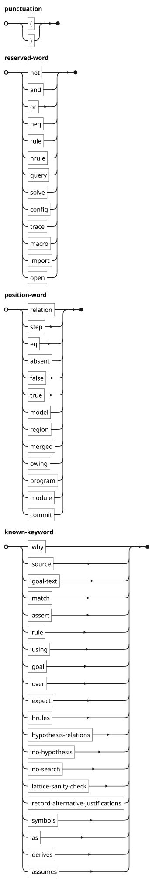

### 1.2 The reserved spellings, names, variables and keywords

From [`ein.l`](../../../../ein.rs/crates/ein-ir/src/ein.l), as EBNF in
[`01-grammar-lexical-names-variables-keywords.puml`](diagrams/01-grammar-lexical-names-variables-keywords.puml):
`UNDERSCORE`, `VARUNDERSCORE`, `WRITEBACK`, `NAME`, `VAR`, `KEYWORD`.

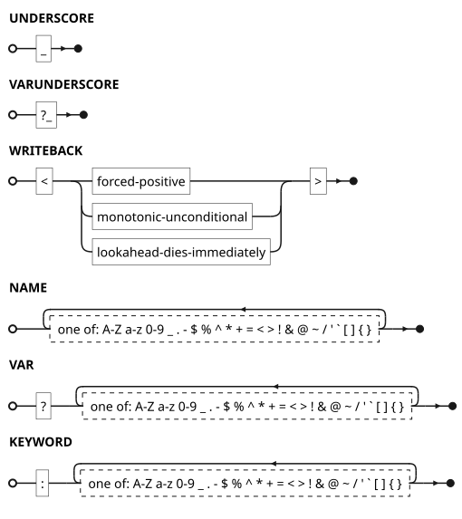

### 1.3 Strings

From [`ein.l`](../../../../ein.rs/crates/ein-ir/src/ein.l), as EBNF in
[`01-grammar-lexical-strings.puml`](diagrams/01-grammar-lexical-strings.puml):
`TEXT`, `BADESCAPE`, `BADTEXT`.

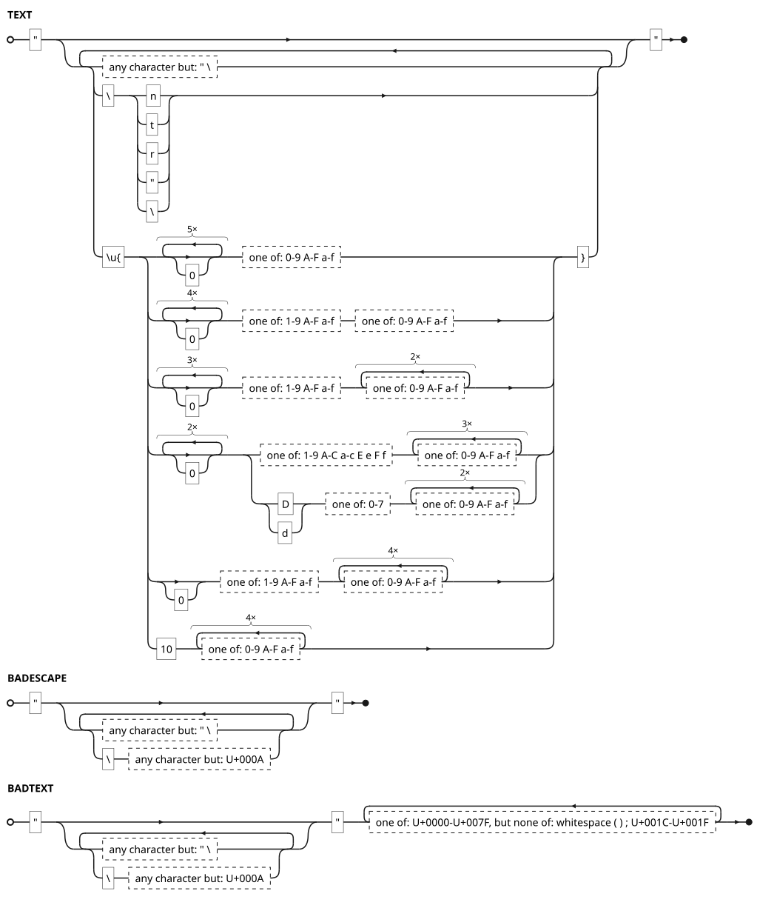

### 1.4 What is no token, and what separates tokens

From [`ein.l`](../../../../ein.rs/crates/ein-ir/src/ein.l), as EBNF in
[`01-grammar-lexical-no-token-and-separators.puml`](diagrams/01-grammar-lexical-no-token-and-separators.puml):
`BAD`, `skipped`.

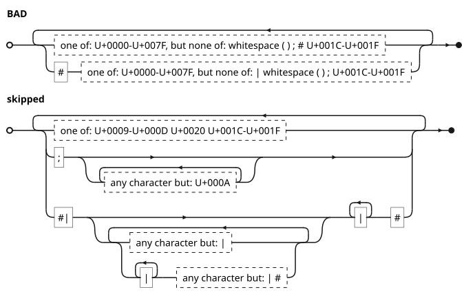

### 1.5 The start conditions, and a token's name in an error

What the diagrams cannot state, from [`ein.l`](../../../../ein.rs/crates/ein-ir/src/ein.l).
The exclusive start conditions are `AFTER_WORD`: a rule that names no condition is not tried in one.

| rule | tried in | then | a parse error calls its token |
|---|---|---|---|
| `punctuation` | `INITIAL`, `AFTER_WORD` | `INITIAL` | by its text |
| `reserved-word` | `INITIAL` | `AFTER_WORD` | by its text |
| `position-word` | `INITIAL` | `AFTER_WORD` | by its text |
| `known-keyword` | `INITIAL` | `AFTER_WORD` | by its text |
| `UNDERSCORE` | `INITIAL` | `AFTER_WORD` | `_ (reserved)` |
| `VARUNDERSCORE` | `INITIAL` | `AFTER_WORD` | `?_ (reserved)` |
| `WRITEBACK` | `INITIAL` | `AFTER_WORD` | `the engine's writeback rule name (reserved)` |
| `NAME` | `INITIAL` | `AFTER_WORD` | `a name` |
| `VAR` | `INITIAL` | `AFTER_WORD` | `a variable` |
| `KEYWORD` | `INITIAL` | `AFTER_WORD` | `a keyword this form does not take` |
| `TEXT` | `INITIAL` | `AFTER_WORD` | `a string` |
| `BADESCAPE` | `INITIAL` | `AFTER_WORD` | `a string with an unknown escape` |
| `BADTEXT` | `INITIAL` | `AFTER_WORD` | `a string glued to what follows` |
| `BAD` | `INITIAL` | `AFTER_WORD` | `a token that is not a name` |
| `skipped` | `INITIAL`, `AFTER_WORD` | `INITIAL` | it makes no token |
<!-- /generated: ein.l -->

Six facts about the terminals that the diagrams state and do not explain:

1. **A reserved word is a token only as a whole word.** The thirteen reserved words, `not`, `and`, `or`, `neq`,
   `rule`, `hrule`, `query`, `solve`, `config`, `trace`, `macro`, `import` and `open`, and the thirteen position
   words, `relation`, `step`, `eq`, `absent`, `false`, `true`, `model`, `region`, `merged`, `owing`, and a saved
   file's `program`, `module` and `commit`, are rules written
   before `NAME`, and `NAME` is longest match: `neq` is the token `'neq'`, a tie the earlier rule wins, while `neqw`,
   `neq_test`, `neq-1`, `rule-x`, `rule.x`, `not-a` and `open-slot` are each the one `NAME` they spell, wherever they
   are written ([Q-M1e2.17](../../../decisions/language/Q-M1e2.17-a-reserved-word-is-a-keyword-only-as-a-whole.md)).
   A reserved word is never a name. A position word is a token of its own and a name too, wherever §2's `Name` goes.
   - **`open` is written only as a rule's verdict**: §2's `Assert` is the one production that takes it, a rule's
     whole `:assert`, `(open)` or `(open ?R)`
     ([Q-M1f.66](../../../decisions/language/Q-M1f.66-open-is-written-only-as-a-rules-verdict.md)). An error found
     at any other `open` carries the note *open is reserved: it is the verdict a rule's :assert states, written as the
     whole :assert, (open) or (open ?R), and nowhere else, so it names no relation and no value*. *Value*, in that
     note, in the production `ValueHead` and in every line `ein` prints, is the engine's word for an object in an
     argument's place: an atom, or a fact a state could hold.
   - **`eq`, `absent` and `false` head no argument.** §2's `ValueHead` lists the words that may head a fact inside a
     fact, a pattern inside a pattern and a conclusion's argument, and those three are not among them: `absent` heads
     only a premise's connective and a fact a claim's class lists, `false` is written only as `(false)`, and `(eq a
     b)` only as a fact, a premise or a conclusion of its own. An error found at an `absent` that opens a form, at an
     `eq` or `neq` that opens a form inside another, and at an argument written after `(false`, carries a note saying
     so ([`07-diagnostics.md`](07-diagnostics.md#222-an-object-is-an-atom-or-a-fact-a-state-could-hold), *an object
     is an atom, or a fact a state could hold*).
   - **A keyword is `:` and a run of name characters**, read the same way: `:why` is the token `':why'`, and `:where`
     a `KEYWORD`, which no production of §2 takes, so a keyword a form does not take is a parse error that says so
     ([Q-M1e2.28](../../../decisions/language/Q-M1e2.28-each-form-takes-a-closed-list-of-keywords.md)).
2. **A bare `_` and `?_` name nothing**
   ([Q-M1e2.22](../../../decisions/language/Q-M1e2.22-a-bare-is-reserved-and-refused.md)). `UNDERSCORE` and
   `VARUNDERSCORE` are tokens no production of §2 takes: they exist so that the parse error can say why, wherever
   either is written, with the note *_ is reserved and names nothing: where any value will do, write a variable used
   once*. Anywhere else in a word `_` is a name character: `_a_in_b_`, `_______01`, `A________B` and `__closed__` are
   names, and `?_x` is a variable.
3. **There is no number and no range**
   ([Q-M1e2.24](../../../decisions/language/Q-M1e2.24-ein-has-no-numbers-and-no-ranges.md)): `7`, `07`, `-7` and
   `1..5` are names (fact 5), each printed as written, and a fact of one is never a fact of another.
4. **A string is natural-language text, with five escapes and `\u{…}`**
   ([Q-M1e2.23](../../../decisions/language/Q-M1e2.23-a-string-is-natural-language-text-never.md)). `TEXT`
   is the value of `:why`, `:source` or `:goal-text` and nothing else (§2's `Text`): written anywhere an argument goes it
   is a parse error at the string, with a note saying so, and the name written bare is what it meant. It holds any
   character but `"` and `\` as itself, a raw newline among them, and reads `\n` `\t` `\r` `\"` `\\` and `\u{…}`, one
   to six hex digits naming a Unicode scalar value, 0 to 10FFFF and not D800 to DFFF (`\u{1F993}` is 🦓). Any other
   escape, `\x41`, `\Ж`, `\u{}`, and a `\u{…}` that names no character, `\u{110000}` or a surrogate, make the
   string a `BADESCAPE`, refused at its opening quote with a note per escape naming it and its line and column. A
   backslash before a newline is no escape: the string is a `BAD` token there.
5. **A token ends at a separator.** After any token but `(` and `)` the lexer is in `AFTER_WORD`, where it tries `(`,
   `)` and the skip rule, `skipped`, alone: a space, a paren, a comment or the end of input ends a token, and any other ASCII
   character continues it. So `a?x`, `?x?y` and `a,b` are each one `BAD` token, *a token that is not a name*, and
   `"a"b` one `BADTEXT`, *a string glued to what follows*, each a parse error at the token with the file, line and
   column; none splits in silence. **The name rule**: a `NAME` is a run of the ASCII name characters `ein.l` lists,
   letters, digits and `` _ . - $ % ^ * + = < > ! & @ ~ / ' ` [ ] { } ``, and a `VAR` is `?` and such a run, so `7`,
   `07`, `-7`, `1..5`, `=`, `<=`, `a/b` and `f'` are names and `?a.b` is a variable.
6. **A character that is not ASCII is written only inside a string or a comment**
   ([Q-M1f.65](../../../decisions/language/Q-M1f.65-a-comment-may-hold-any-character.md)). `TEXT` and `BADESCAPE`
   take any character between their quotes, and the skip rule's comments any to their end; `BAD`, `BADTEXT`'s tail
   and the skip rule's whitespace are ASCII, `U+0000-U+007F` less the separators, which are `U+0009-U+000D`, the
   space and `U+001C-U+001F`. So no rule matches a character that is not ASCII anywhere else, in either start condition: the lexer
   stops at the file's first one, and the report names it, its code point and where Unicode is allowed
   ([Q-M1f.95](../../../decisions/diagnostics/Q-M1f.95-a-file-is-refused-at-its-first-character-that-is.md)),
   quoting a character a reader cannot see as the escape a string writes it with
   ([Q-M1f.92](../../../decisions/diagnostics/Q-M1f.92-a-character-a-reader-cannot-see-is-quoted-as.md)):

   ```text
   x.ein:2:7: 'é' (U+00E9) is not ASCII: Unicode is allowed only inside a string literal (after :why, :source or :goal-text) or in a comment
   x.ein:2:3: '\u{a0}' (U+00A0) is not ASCII: Unicode is allowed only inside a string literal (after :why, :source or :goal-text) or in a comment
   ```

   A `#` before such a character is passed over, the character being what the line is about.

## 2. Phrase grammar

`Program` is the start symbol. The skip rule's whitespace and comments (§1.4's `skipped`) may appear between any two
tokens, and no production names them.

<!-- generated: ein.y -->
### 2.1 A program and its forms

From [`ein.y`](../../../../ein.rs/crates/ein-ir/src/ein.y), as EBNF in
[`01-grammar-phrase-program.puml`](diagrams/01-grammar-phrase-program.puml):
`Program`, `TopForm`, `Forms`, `Form`.

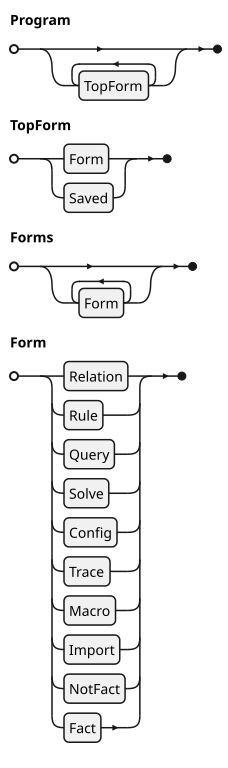

### 2.2 Names, and the name a form is headed by

From [`ein.y`](../../../../ein.rs/crates/ein-ir/src/ein.y), as EBNF in
[`01-grammar-phrase-names.puml`](diagrams/01-grammar-phrase-names.puml):
`Name`, `DeclName`, `FactHead`, `ValueHead`, `PremiseHead`, `ConclusionHead`.

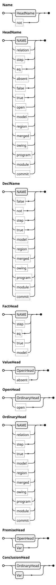

### 2.3 Variables, strings, flags and lists of names

From [`ein.y`](../../../../ein.rs/crates/ein-ir/src/ein.y), as EBNF in
[`01-grammar-phrase-variables-strings-flags.puml`](diagrams/01-grammar-phrase-variables-strings-flags.puml):
`Var`, `Text`, `Bool`, `Names`, `NamesPlus`, `Vars`, `VarsPlus`, `NameList`, `NameListPlus`.

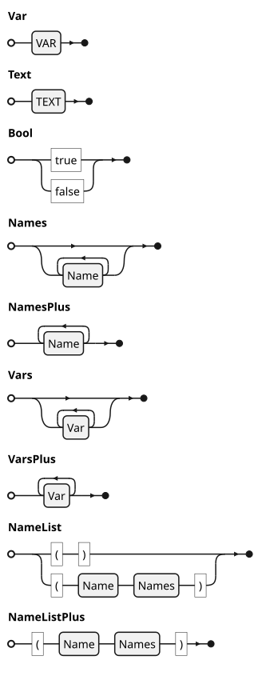

### 2.4 A fact, a stored negation and a fact as an argument

From [`ein.y`](../../../../ein.rs/crates/ein-ir/src/ein.y), as EBNF in
[`01-grammar-phrase-fact.puml`](diagrams/01-grammar-phrase-fact.puml):
`Fact`, `NotFact`, `NegFact`, `NestedFact`, `EqFact`, `FactArg`, `FactArgs`, `FactClause`, `FactClauses`,
`NestedFacts`.

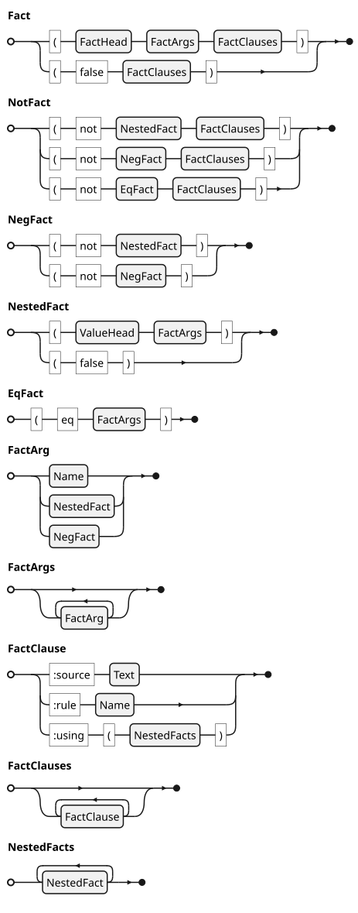

### 2.5 A relation's declaration

From [`ein.y`](../../../../ein.rs/crates/ein-ir/src/ein.y), as EBNF in
[`01-grammar-phrase-relation.puml`](diagrams/01-grammar-phrase-relation.puml):
`Relation`, `RelationClauses`.

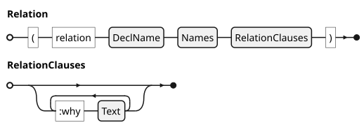

### 2.6 A rule and an hrule

From [`ein.y`](../../../../ein.rs/crates/ein-ir/src/ein.y), as EBNF in
[`01-grammar-phrase-rule.puml`](diagrams/01-grammar-phrase-rule.puml):
`Rule`, `Params`, `RuleClause`, `RuleClauses`.

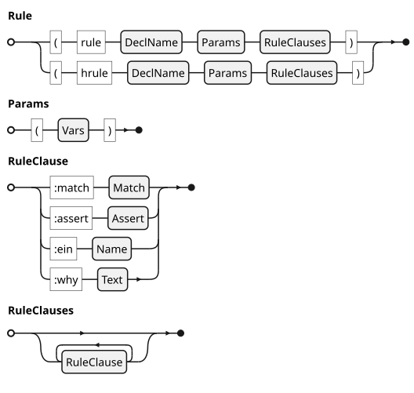

### 2.7 A rule's `:match`: premises

From [`ein.y`](../../../../ein.rs/crates/ein-ir/src/ein.y), as EBNF in
[`01-grammar-phrase-match.puml`](diagrams/01-grammar-phrase-match.puml):
`Match`, `Premise`, `Premises`, `Connective`, `Negated`, `Guard`, `Args`, `Arg`, `ArgHead`.

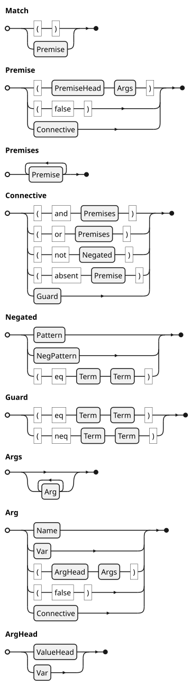

### 2.8 A pattern and its terms

From [`ein.y`](../../../../ein.rs/crates/ein-ir/src/ein.y), as EBNF in
[`01-grammar-phrase-pattern.puml`](diagrams/01-grammar-phrase-pattern.puml):
`Pattern`, `AnyHead`, `Term`, `NegPattern`, `Terms`.

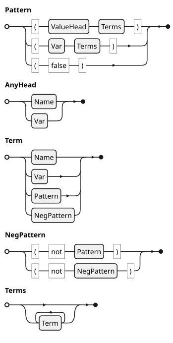

### 2.9 A rule's `:assert`: conclusions

From [`ein.y`](../../../../ein.rs/crates/ein-ir/src/ein.y), as EBNF in
[`01-grammar-phrase-assert.puml`](diagrams/01-grammar-phrase-assert.puml):
`Assert`, `Conclusion`, `Conclusions`.

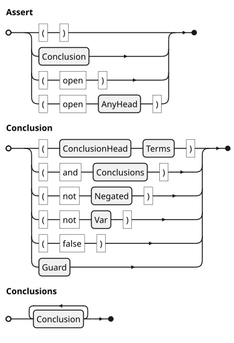

### 2.10 A query and its claim

From [`ein.y`](../../../../ein.rs/crates/ein-ir/src/ein.y), as EBNF in
[`01-grammar-phrase-query.puml`](diagrams/01-grammar-phrase-query.puml):
`Query`, `QueryClause`, `QueryClausesPlus`, `Claim`, `Model`, `Models`, `ClaimFact`, `ClaimAtom`, `ClaimFacts`.

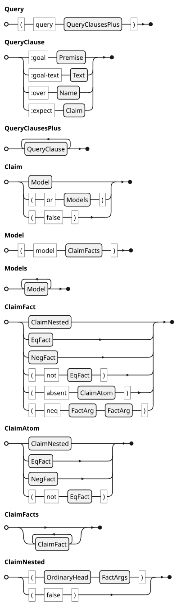

### 2.11 A solve and its claim

From [`ein.y`](../../../../ein.rs/crates/ein-ir/src/ein.y), as EBNF in
[`01-grammar-phrase-solve.puml`](diagrams/01-grammar-phrase-solve.puml):
`Solve`, `SolveClause`, `SolveClauses`, `Hrules`, `HruleItem`, `HruleItems`, `RegionClaim`, `RegionItem`,
`RegionItems`, `MergedFrom`.

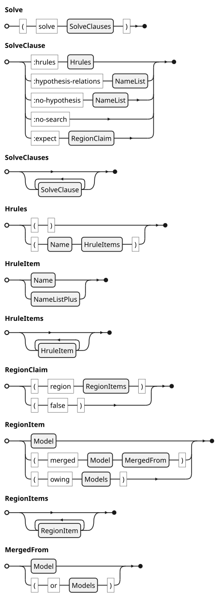

### 2.12 A config

From [`ein.y`](../../../../ein.rs/crates/ein-ir/src/ein.y), as EBNF in
[`01-grammar-phrase-config.puml`](diagrams/01-grammar-phrase-config.puml):
`Config`, `ConfigClause`, `ConfigClauses`.

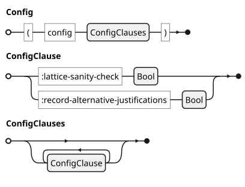

### 2.13 A macro

From [`ein.y`](../../../../ein.rs/crates/ein-ir/src/ein.y), as EBNF in
[`01-grammar-phrase-macro.puml`](diagrams/01-grammar-phrase-macro.puml):
`Macro`, `MacroParams`, `Template`, `Templates`, `TemplateItem`, `TemplateItems`.

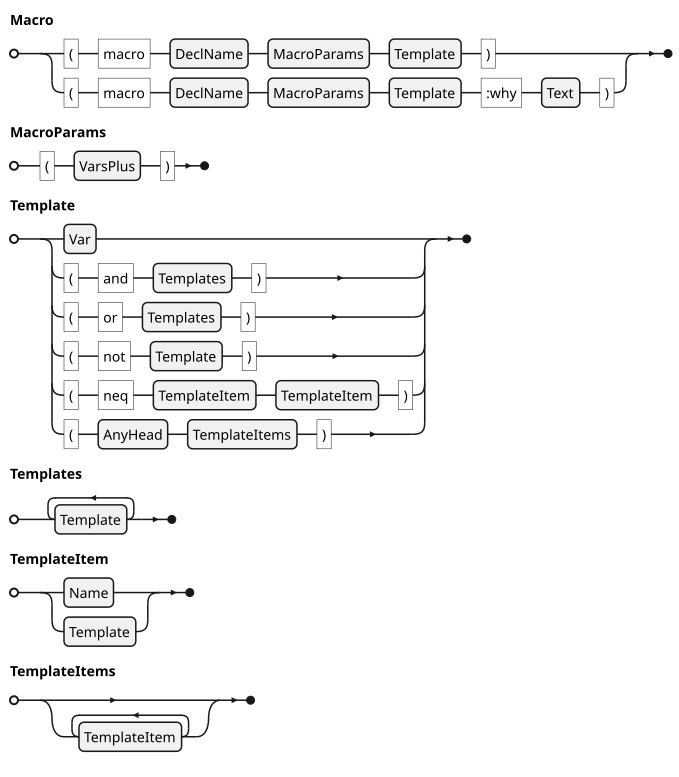

### 2.14 An import

From [`ein.y`](../../../../ein.rs/crates/ein-ir/src/ein.y), as EBNF in
[`01-grammar-phrase-import.puml`](diagrams/01-grammar-phrase-import.puml):
`Import`, `ImportClause`, `ImportClauses`.

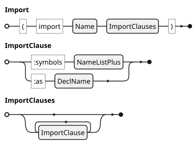

### 2.15 A trace

From [`ein.y`](../../../../ein.rs/crates/ein-ir/src/ein.y), as EBNF in
[`01-grammar-phrase-trace.puml`](diagrams/01-grammar-phrase-trace.puml):
`Trace`, `Steps`, `Step`, `StepClause`, `StepClauses`, `StepUsing`, `Derived`.

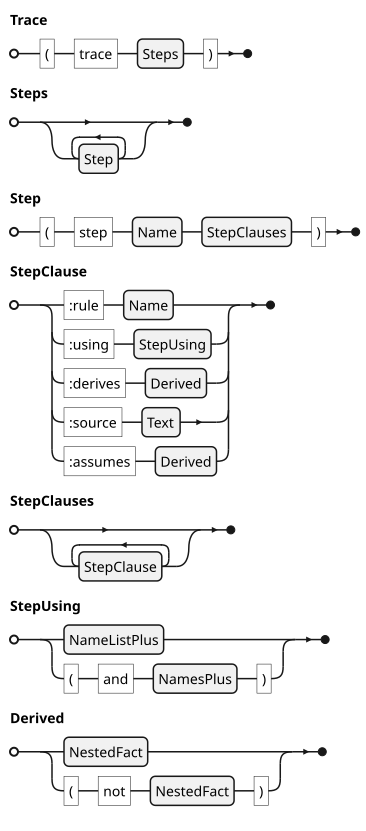

### 2.16 A saved file: the program, its modules and the choices made

From [`ein.y`](../../../../ein.rs/crates/ein-ir/src/ein.y), as EBNF in
[`01-grammar-phrase-saved.puml`](diagrams/01-grammar-phrase-saved.puml):
`Saved`, `ModuleName`, `CommitFact`, `CommitFacts`.

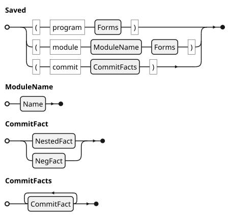

<!-- /generated: ein.y -->

Five things the productions say that are easy to read past:

- **A `Conclusion` is a conjunction of literals, read flat.** `Conclusions` nests, and an `(and …)` inside an
  `(and …)` concludes each of its members, as the outer one does, at any depth. No production takes `or` in a
  conclusion, or a connective inside a `Term`, so a rule concludes no disjunction and no compound fact
  ([`02-syntax.md` § Rules](02-syntax.md#rules)).
- **A stored negative, `NotFact`, takes a fact's clauses**, so a derived `(not …)` fact's provenance, `:rule
  type-exclusivity :using ((c10 a))`, attaches as a fact's does. A `(not …)` in a `:match` or an `:assert` is a
  `Connective` or a `Conclusion` and takes no clause: a keyword pair there is a parse error.
- **A stored negation may be of a stored negation**, at any depth: `NegFact`, where a fact is written, and
  `NegPattern`, where a pattern is, each take themselves under `not`
  ([Q-M1f.391](../../../decisions/language/Q-M1f.391-the-negation-of-a-negation-is-a-fact.md)). Neither takes a
  name, an equality or a variable there: `(not ?x)` is a `Conclusion` of its own and stands nowhere else.
- **Each form's keywords are its own productions**, `RelationClauses`, `RuleClause`, `QueryClause`, `SolveClause`,
  `ConfigClause`, `ImportClause`, `StepClause` and `FactClause`, and each keyword's value is the production after it:
  a claim is a `Claim` or a `RegionClaim`, a flag a `Bool`, a `:hrules` value `Hrules`, and `:no-search` takes none
  ([`02-syntax.md` § The keywords each form takes](02-syntax.md#the-keywords-each-form-takes)).
- **A `(trace …)` holds `step` events alone**: `(trace (branch-open …))` is a parse error at its head, a name where
  a trace wants `step`.

## 3. What the grammar leaves to the loader

Everything below parses and is refused later, at load. A parse error and a load error are reported differently, and
both are specified in [`07-diagnostics.md`](07-diagnostics.md): a parse error is one line per error recovery reaches,
`file:line:col: unexpected X`, the token's name after it where it has one, then the error's notes, at most three
ranked repairs and a count of the rest; a loader error about a top-level form ends `at None`.

- **That a form's keywords are written, and once.** The grammar states which keywords each form takes and refuses any
  other, but takes them in any order and number: a rule with no `:match`, or with two, parses, and the loader refuses
  it, `(rule r) missing :match or :assert at None`, as it refuses a rule that states `:ein` beside an `:assert`, on
  an hrule, or with a word that is none of the engine's
  ([`07-diagnostics.md` § 2.31](07-diagnostics.md#231-a-rules-word-to-the-engine)). A query takes at least one clause of its four, any one
  (`QueryClausesPlus`).
- **What a claim names.** An expectation's facts have a fact's shape at the parse (`ClaimFact`); that the relations it
  names exist, and that it names the goal's, is the loader's.
- **How many arguments a form of a declared relation has.** The loader holds every form of a declared relation to the
  count of slots its declaration names ([`02-syntax.md` § Relation declarator](02-syntax.md#relation-declarator)). The
  names it gives the slots are labels, ordinary atoms, and no argument is checked against one.
- **Unbound variables**: a conclusion's variable that no way of satisfying the `:match` binds
  ([`02-syntax.md` § Conclusion forms in `:assert`](02-syntax.md#conclusion-forms-in-assert)).
- **What a macro's body expands to.** A `Template` takes any head at any arity, and a call takes any premise as an
  argument (`Arg`'s `Connective`), so a premise that is a name, `eq` or `absent` at another arity, a `not` of no fact,
  a connective where an argument goes, `false` with an argument, an `(or …)` as a conclusion and a conclusion that is a
  bare variable reach the loader through a macro. The loader refuses each after expansion, holding the expanded rule
  to this grammar's shapes by position. A macro no rule calls is not read, so it loads whatever its body
  ([Q-M1f.67](../../../decisions/language/Q-M1f.67-a-macros-body-is-checked-where-it-is-called.md)).
- **A connective as a pattern's argument.** `Arg` takes a `Connective`, since a macro such as `forall` is called as a
  pattern and takes premises, and the grammar cannot tell a macro's call from a pattern. Once the macros are expanded,
  a connective that is still a pattern's argument, `(q (and (p ?x)))`, `(q (eq ?a ?b))` or `(q (absent (p ?x)))`, is
  a pattern no fact matches, and the loader refuses it, in a rule, an hrule, an obligation and a goal; `(not
  <pattern>)`, a stored negation, stays. The same reading refuses what a macro's expansion writes of the shapes §2
  refuses written out: a fact, argument or conclusion of `absent`, `false` with an argument, and `(eq …)` as an argument.
- **Where an `(or …)` sits, how wide a clause is, and a goal's relations.** `Connective` takes an `(or …)` wherever a
  premise goes, so an `(or …)` written as a premise of an `(and …)`, under an `(absent …)` or as a whole `:match`
  parses; so do a `:match` or a `:goal` of any width, and a goal's premise whose relation is a variable
  (`PremiseHead`'s `Var`). The loader refuses each shape no plan can be compiled from, a macro's expansion included.
- **The kernel's names.** The dunder `__closed__` is a `NAME` the loader refuses where a program
  binds it ([Q-M1f.7](../../../decisions/language/Q-M1f.7-the-dunder-is-never-bound-and-the-writeback.md)).
  Where `open` stands is the grammar's; what the loader still refuses of it is the program's to tell, an `(open ?R)`
  whose `?R` is no parameter or whose projection does not resolve, each line placed where the `(open …)` is written
  ([`03-reserved-names.md` § The verdict](03-reserved-names.md#the-verdict--open)).

Every program under [`examples/broken/`](../../../../examples/broken/) is refused, and its report, the engine's
defined output for it, is kept beside it as its `.expected` file: a parse error at the top, and one refused at load in
`load/` and `compile/`.
