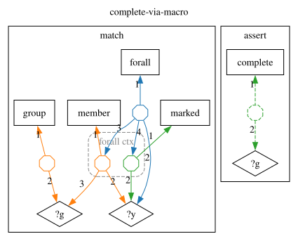
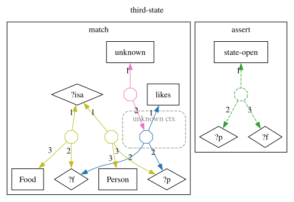
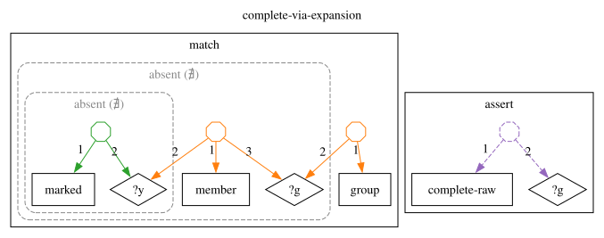

# Pattern macros: `std.macro`

Two macros, `forall` and `unknown`, which a program writes inside the `:match` of a rule of its own. Each expands
when the program is loaded; neither is a rule, and neither is reserved: a program that does not import the module
has neither. What a macro is, and how a program defines one, is
[Macros and imports](../../03-syntax-and-semantics/11-macros.md).

## Using it

```lisp
(import std.macro :symbols (forall unknown))
```

A program that writes one in its own rule lists it. The module imports nothing and has no entry.

| a program writes | it means |
|---|---|
| `(forall ?b G B)` | every `?b` the guard `G` holds of satisfies `B`; `?b` must occur in `G` |
| `(unknown P)` | `P` is neither stated nor negated: the third state of a fact |

### `forall` — every one the guard holds of

`(forall ?b G B)` is a premise that holds where no `?b` satisfies the guard `G` and not the body `B`:

$$
\forall b.\; G(b) \to B(b) \;\;\equiv\;\; \lnot \exists b.\; G(b) \land \lnot B(b)
$$

The program below is [`tests/stdlib/macro/01_forall.ein`](../../../../../tests/stdlib/macro/01_forall.ein). A group
is `complete` where every member of it is marked. Its second rule is the first with the macro written out, so the
two must agree.

```lisp
(import std.macro :symbols (forall))

(relation group        Group       :why "{?1} is a group")
(relation member       Thing Group :why "{?1} is in {?2}")
(relation marked       Thing       :why "{?1} is marked")
(relation complete     Group       :why "every member of {?1} is marked")
(relation complete-raw Group       :why "every member of {?1} is marked (by the written-out expansion)")

(group Team) (group Crew)
(member Ann Team) (member Bob Team)
(member Cid Crew) (member Dee Crew)
(marked Ann) (marked Bob) (marked Cid)

;; The macro.
(rule complete-via-macro ()
  :match  (and (group ?g)
               (forall ?y (member ?y ?g) (marked ?y)))
  :assert (complete ?g)
  :why    "every member of {?g} is marked (via forall)")

;; …and the same thing with `forall` expanded by hand. `(forall ?b G B)` is
;; `(absent (and G (absent B)))` — that is the whole macro, and this is it.
(rule complete-via-expansion ()
  :match  (and (group ?g)
               (absent (and (member ?y ?g) (absent (marked ?y)))))
  :assert (complete-raw ?g)
  :why    "every member of {?g} is marked (expansion written out)")

(solve
  :no-hypothesis (group member marked complete complete-raw)
  :expect (region (model (complete Team) (complete-raw Team))))

(query
  :goal (complete ?g))
```

<!-- output -->
```text
  query             (complete ?g)
  over              all of R — 1 state → 1 projection class
    class 1 of 1    1 state (1)
                      ?g = Team
  as :expect        (model (complete Team))

  (solve :expect)   holds
```

`Team`'s two members are both marked. `Crew` is not complete: Dee is a member and is not marked. Both rules derive
the same, and the claim on the `(solve …)` form, which lists `complete` and `complete-raw` for `Team` and for no
other group, holds.

The engine draws the call as a dashed cluster labelled `forall (∀)`: the variable it binds is inside, the ones it
shares with the rest of the match are outside. This is `ein render rule --name complete-via-macro` of the program:



Inside the cluster, the arrow from `?y` to `?g` labelled `member` is the guard, and the octagon `marked` over `?y` is the body.

`forall` reads an absence, so it is sound only where the guard's relation and the body's are decided by saturation:
the program above names all five relations in `:no-hypothesis`. `std.algebra`'s `total` and `surjective`, and the
elimination and no-room rules of `std.bijection`, `std.elim` and `std.slots`, are written with it.

### `unknown` — neither stated nor negated

A fact has three states in a knowledge base $S$: stated, negated, or neither. `(unknown P)` holds in the third:

$$
\operatorname{unknown}(P) \iff P \notin S \;\land\; \lnot P \notin S
$$

The program below is [`tests/stdlib/macro/02_unknown.ein`](../../../../../tests/stdlib/macro/02_unknown.ein): Ann
likes soup and is known not to like stew; nothing is said of Bob.

```lisp
(import std.macro :symbols (unknown))

(relation is-a       T T          :why "{?1} is a {?2}")
(relation likes      Person Food  :why "{?1} likes {?2}")
(relation state-open Person Food  :why "whether {?1} likes {?2} is undecided")

(is-a Ann Person) (is-a Bob Person)
(is-a Soup Food)  (is-a Stew Food)

(likes Ann Soup)             ; asserted
(not (likes Ann Stew))       ; denied

(rule third-state (?isa)
  :match  (and (?isa ?p Person)
               (?isa ?f Food)
               (unknown (likes ?p ?f)))
  :assert (state-open ?p ?f)
  :why    "{?p} and {?f} are in neither store")

(third-state is-a)

(solve
  :no-hypothesis (is-a likes state-open)
  :expect (region (model (state-open Bob Soup) (state-open Bob Stew)
                         (likes Ann Soup)
                         (not (likes Ann Stew)))))

(query
  :goal (state-open ?who ?what))
```

<!-- output -->
```text
  query             (state-open ?who ?what)
  over              all of R — 1 state → 1 projection class
    class 1 of 1    1 state (1)
                      ?what = Soup · ?who = Bob
                      ?what = Stew · ?who = Bob
  as :expect        (model (state-open Bob Soup) (state-open Bob Stew))

  (solve :expect)   holds
```

Both of Ann's pairs are decided, one each way, so only Bob's two are in neither store.

`unknown` is how a rule of a program says that a fact was decided neither way. Naming a relation closes its positive
facts, and a stored negation is not closed by it, so a rule that probes with `unknown` is how a program states that
a negation was *not* derived.

The engine draws a call of `unknown` as a call: an octagon over the fact it asks about.



## How it works

The module is two `(macro …)` forms and no rule, so nothing of it is in a state: a call is replaced by its
expansion when the program is loaded.

```lisp
(macro forall (?b ?G ?B)
  (absent (and ?G (absent ?B)))
  :why "every {?b} the guard {?G} holds of satisfies {?B}: none satisfies the guard and not the body")

(macro unknown (?P)
  (and (absent ?P) (absent (not ?P)))
  :why "{?P} is unknown: neither it nor its negation holds")
```

| call | expands to |
|---|---|
| `(forall ?b G B)` | `(absent (and G (absent B)))` |
| `(unknown P)` | `(and (absent P) (absent (not P)))` |

The first program's second rule, `complete-via-expansion`, is `forall`'s expansion written by hand, and the engine
draws it as what it is, an `absent` inside an `absent`:



`ein test` holds both programs to their claims:

<!-- output -->
```text
ok           tests/stdlib/macro/01_forall.ein
ok           tests/stdlib/macro/02_unknown.ein
```
