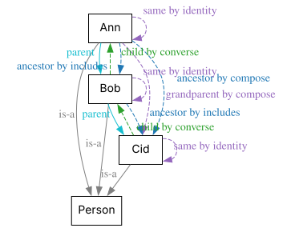

# The relation algebra: `std.algebra`, `std.typing`, `std.closure`

`std.algebra` is Tarski's relation algebra over relations of two arguments, each read as the set of pairs its held
facts relate, as generic rules: the operators that derive the facts of one relation from those of others, and the
property checks, closures and obligations a puzzle declares of a relation. In the algebra's own notation its
signature is

$$
\langle\, \cup,\ \cap,\ \overline{\phantom{R}},\ 0,\ 1,\ ;\,,\ {}^{-1},\ 1' \,\rangle
$$

union, intersection, complement, the empty and the full relation, composition, converse and the identity.
`std.typing` and `std.closure` are two small modules over it. What each property means, in the four
representations, is [Properties and operators](../../03-syntax-and-semantics/07-properties-and-operators.md); how
every rule here is written and drawn is [the next page](03-relation-algebra-rules.md).

The relation algebra expresses first-order constraints of at most three variables; a constraint over more (a
co-location of four, an adjacency of five) is a puzzle's own named rule.

## Using `std.algebra`

Each rule is generic, and is activated for one relation by a fact headed by the rule's name. A file lists the rules
whose activators it writes:

```lisp
(import std.algebra :symbols (converse compose meet symmetric transitive))
(converse right-of left-of)             ; left-of holds right-of, turned round
(compose  right-of right-of two-right)  ; two-right holds right-of twice
```

The import brings `std.macro`. The module has no entry: what it closes is the program's to say.

### Labels, and the membership relation

Ein has no types
([Q-M1f.372](../../../../decisions/language/Q-M1f.372-ein-has-no-types-a-declarations-slot-names-are.md)). A
declaration `(relation likes Person Food)` writes a name in each argument place, and those
atoms are labels: they mean something only where a rule reads them. Some rules of this module do. They match the
declaration itself, `(relation ?R ?A ?B)`, and take the *members* of the label `A` to be the objects `a` of which
the state holds `(isa a A)`, where `isa` is a relation the program has and passes in the activator:
`(total likes is-a)`. Below, for a state $S$,

$$
A_S = \lbrace \, a : \operatorname{isa}(a, A) \in S \, \rbrace
$$

is the set of members of a label, and $R(a, b)$ stands for the fact `(R a b)` in $S$.

### Three distinctions that govern soundness

Read these before importing a relation-algebra module: they decide whether a rule is safe for a problem.

- **Intrinsic or extensive.** An **intrinsic** operator reads only existing edges: `compose`, `meet`, `difference`,
  `converse`, `join`, `difunctional`. An **extensive** one ranges over the members of labels to reach pairs that
  are absent, so it takes the program's membership relation and the labels as parameters, `(?isa ?Dom ?Ran)`:
  `complement`, `top`, `identity`, `connex`.
- **Check, closure or obligation.** A **check** concludes `(false)` on a violation (`functional`, `injective`,
  `total`, `surjective`, `empty`, `irreflexive`, `antisymmetric`, `asymmetric`, `connex`): a state that breaks it is
  dead. A **closure** derives the edge that makes the property hold (`symmetric`, `transitive`, `includes`,
  `difunctional`, `reflexive`). An **obligation** concludes `(open R)` while a requirement is unmet (`total-owed`,
  `surjective-owed`, and `std.slots`' `slot-owed-room` and `slot-owed-fill`): it derives nothing, and a state that
  owes is not an answer ([Obligations](../../03-syntax-and-semantics/08-obligations.md)).
- **The closed-world caveat.** A rule that reads an absence — the extensive operators, `difference`,
  `compose-negative-*`, `std.closure`'s `infer-closure`, the `absent` guards of `std.slots`' spatial rules — is
  sound only where the facts of its operand are decided by saturation, never where they are found by hypotheses, as
  those of the attribute relations of the Zebra puzzle are. Each is opted into per use.

### Operators: the relative layer

| a program writes | it produces | kind |
|---|---|---|
| `(converse R1 R2)` | `(R2 b a)` for each `(R1 a b)`: $R_2 \supseteq R_1^{-1}$ | intrinsic |
| `(imply1 R1 R2)` | `(R2 a)` for each `(R1 a)`, a property implying a property: `(imply1 functional __closed__)` | intrinsic |
| `(imply2-fwd R1 R2)` | `(R2 a b)` for each `(R1 a b)`: $R_2 \supseteq R_1$ | intrinsic |
| `(imply2-reverse R1 R2)` | `(R2 b a)` for each `(R1 a b)`, the same as `converse` | intrinsic |
| `(compose R1 R2 R3)` | `(R3 a c)` for each `(R1 a b)` and `(R2 b c)`: $R_3 \supseteq R_1 ; R_2$. `(compose R R R)` is R's transitive closure | intrinsic |
| `(identity R isa Dom)` | `(R a a)` for every member `a` of `Dom`: $R \supseteq \lbrace (a, a) : a \in \mathit{Dom}_S \rbrace$ | extensive |

```lisp
(import std.algebra :symbols (converse compose includes identity))

(relation is-a        T T           :why "{?3} is a {?4}")
(relation parent      Person Person :why "{?3} is a parent of {?4}")
(relation child       Person Person :why "{?3} is a child of {?4}")
(relation grandparent Person Person :why "{?3} is a grandparent of {?4}")
(relation ancestor    Person Person :why "{?3} is an ancestor of {?4}")
(relation same        Person Person :why "{?3} is {?4}")

(is-a Ann Person) (is-a Bob Person) (is-a Cid Person)

(converse parent child)                  ; child = parent, turned round
(compose  parent parent grandparent)     ; a parent of a parent
(includes parent ancestor)               ; every parent is an ancestor
(compose  ancestor ancestor ancestor)    ; and an ancestor of an ancestor is one
(identity same is-a Person)              ; every person is the same as themselves

(parent Ann Bob) (parent Bob Cid)

(solve :no-search)
(query :goal (child ?x ?y))
(query :goal (grandparent ?x ?y))
(query :goal (ancestor ?x ?y))
(query :goal (same ?x ?y))
```

<!-- output -->
```text
  query 1 of 4      (child ?x ?y)
  over              all of R — 1 state → 1 projection class
    class 1 of 1    1 state (1)
                      ?x = Bob · ?y = Ann
                      ?x = Cid · ?y = Bob
  as :expect        (model (child Bob Ann) (child Cid Bob))

  query 2 of 4      (grandparent ?x ?y)
  over              all of R — 1 state → 1 projection class
    class 1 of 1    1 state (1)
                      ?x = Ann · ?y = Cid
  as :expect        (model (grandparent Ann Cid))

  query 3 of 4      (ancestor ?x ?y)
  over              all of R — 1 state → 1 projection class
    class 1 of 1    1 state (1)
                      ?x = Ann · ?y = Bob
                      ?x = Ann · ?y = Cid
                      ?x = Bob · ?y = Cid
  as :expect        (model (ancestor Ann Bob) (ancestor Ann Cid)
                           (ancestor Bob Cid))

  query 4 of 4      (same ?x ?y)
  over              all of R — 1 state → 1 projection class
    class 1 of 1    1 state (1)
                      ?x = Ann · ?y = Ann
                      ?x = Bob · ?y = Bob
                      ?x = Cid · ?y = Cid
  as :expect        (model (same Ann Ann) (same Bob Bob) (same Cid Cid))
```

The same state as `ein render kb --fold` draws it, each fact of three arrows one arrow labelled with its relation,
and of it the facts of the six declared relations alone: the declarations' facts and the facts that apply a rule,
`(converse parent child)` and the others, are left out. A fact the program wrote is a solid arrow, and one a rule
derived is a dashed arrow labelled with the relation and the rule that derived it; `(same Ann Ann)` folds into an
arrow from `Ann` back to itself, its two arguments one atom.



`(includes parent ancestor)`, a closure of [the section below](#closures), copies the two parent facts, and `(compose ancestor ancestor ancestor)` closes them:
Ann is an ancestor of Cid. `imply1`, `imply2-fwd` and `imply2-reverse` copy a property or a relation into
another:

```lisp
(import std.algebra :symbols (imply1 imply2-fwd imply2-reverse))

(relation cat     Animal        :why "{?3} is a cat")
(relation pet     Animal        :why "{?3} is a pet")
(relation feeds   Person Animal :why "{?3} feeds {?4}")
(relation cares   Person Animal :why "{?3} cares for {?4}")
(relation fed-by  Animal Person :why "{?3} is fed by {?4}")

(imply1 cat pet)
(imply2-fwd feeds cares)
(imply2-reverse feeds fed-by)

(cat Tom)
(feeds Ann Tom)

(solve :no-search)
(query :goal (pet ?x))
(query :goal (cares ?x ?y))
(query :goal (fed-by ?x ?y))
```

<!-- output -->
```text
  query 1 of 3      (pet ?x)
  over              all of R — 1 state → 1 projection class
    class 1 of 1    1 state (1)
                      ?x = Tom
  as :expect        (model (pet Tom))

  query 2 of 3      (cares ?x ?y)
  over              all of R — 1 state → 1 projection class
    class 1 of 1    1 state (1)
                      ?x = Ann · ?y = Tom
  as :expect        (model (cares Ann Tom))

  query 3 of 3      (fed-by ?x ?y)
  over              all of R — 1 state → 1 projection class
    class 1 of 1    1 state (1)
                      ?x = Tom · ?y = Ann
  as :expect        (model (fed-by Tom Ann))
```

### Operators: the Boolean layer

| a program writes | it produces | kind |
|---|---|---|
| `(meet R1 R2 R3)` | `(R3 a b)` where both `(R1 a b)` and `(R2 a b)`: $R_3 \supseteq R_1 \cap R_2$ | intrinsic |
| `(join R1 R2 R3)` | `(R3 a b)` where either: $R_3 \supseteq R_1 \cup R_2$. `join` is no rule's name, so it is written unlisted | intrinsic |
| `(difference R1 R2 R3)` | `(R3 a b)` where `(R1 a b)` and no `(R2 a b)`: $R_3 \supseteq R_1 \setminus R_2$ | intrinsic, closed-world |
| `(empty R)` | a check: any `(R a b)` is a contradiction, $R = 0$ | check |
| `(top R isa Dom Ran)` | `(R a b)` for every member `a` of `Dom` and `b` of `Ran`: $R \supseteq \mathit{Dom}_S \times \mathit{Ran}_S$ | extensive |
| `(complement R1 R2 isa Dom Ran)` | `(R2 a b)` for each such pair with no `(R1 a b)`: $R_2 \supseteq (\mathit{Dom}_S \times \mathit{Ran}_S) \setminus R_1$ | extensive, closed-world |

```lisp
(import std.algebra :symbols (symmetric transitive meet difference))

(relation linked T T :why "{?3} is linked to {?4}")
(relation owns   T T :why "{?3} owns {?4}")
(relation rents  T T :why "{?3} rents {?4}")
(relation either T T :why "{?3} owns or rents {?4}")
(relation shares T T :why "{?3} owns and rents {?4}")
(relation only-owns T T :why "{?3} owns {?4} and does not rent it")

(symmetric linked)
(transitive linked)
(join owns rents either)
(meet owns rents shares)
(difference owns rents only-owns)

(linked a b) (linked b c)
(owns Ann Car) (owns Ann Bike)
(rents Ann Car) (rents Bob Bike)

(solve :no-search)
(query :goal (linked a ?x))
(query :goal (either ?p ?t))
(query :goal (shares ?p ?t))
(query :goal (only-owns ?p ?t))
```

<!-- output -->
```text
  query 1 of 4      (linked a ?x)
  over              all of R — 1 state → 1 projection class
    class 1 of 1    1 state (1)
                      ?x = b
                      ?x = c
  as :expect        (model (linked a b) (linked a c))

  query 2 of 4      (either ?p ?t)
  over              all of R — 1 state → 1 projection class
    class 1 of 1    1 state (1)
                      ?p = Ann · ?t = Bike
                      ?p = Ann · ?t = Car
                      ?p = Bob · ?t = Bike
  as :expect        (model (either Ann Bike) (either Ann Car)
                           (either Bob Bike))

  query 3 of 4      (shares ?p ?t)
  over              all of R — 1 state → 1 projection class
    class 1 of 1    1 state (1)
                      ?p = Ann · ?t = Car
  as :expect        (model (shares Ann Car))

  query 4 of 4      (only-owns ?p ?t)
  over              all of R — 1 state → 1 projection class
    class 1 of 1    1 state (1)
                      ?p = Ann · ?t = Bike
  as :expect        (model (only-owns Ann Bike))
```

`(linked a a)` is not derived: the transitive closure's guard keeps it irreflexive.

The three extensive operators, in [`tests/stdlib/algebra/04_extensive.ein`](../../../../../tests/stdlib/algebra/04_extensive.ein),
over a label `Node` with two members:

```lisp
(import std.algebra :symbols (identity top complement))

(relation instance Thing Type :why "{?3} is a {?4}")
(relation edge     Node Node :why "{?3} is joined to {?4}")
(relation loop     Node Node :why "{?3} has a self-loop to {?4}")   ; 1' on Node
(relation full     Node Node :why "{?3} and {?4} are a pair in the full Node×Node rectangle")   ; 1 on Node×Node
(relation gap      Node Node :why "{?3} is not joined to {?4}")   ; ¬edge on Node×Node

(instance A Node) (instance B Node)

(identity   loop instance Node)
(top        full instance Node Node)
(complement edge gap instance Node Node)

(edge A B)

(solve
  :no-hypothesis (instance edge loop full gap)
  :expect (region (model (edge A B)
                         (loop A A) (loop B B)
                         (full A A) (full A B) (full B A) (full B B)
                         (gap  A A) (gap  B A) (gap  B B))))

(query
  :goal (gap ?x ?y))
```

<!-- output -->
```text
  query             (gap ?x ?y)
  over              all of R — 1 state → 1 projection class
    class 1 of 1    1 state (1)
                      ?x = A · ?y = A
                      ?x = B · ?y = A
                      ?x = B · ?y = B
  as :expect        (model (gap A A) (gap B A) (gap B B))

  (solve :expect)   holds
```

### Closures

A closure derives the edges that make a property hold.

| a program writes | it produces |
|---|---|
| `(symmetric R)` | `(R b a)` for each `(R a b)`, and `(not (R b a))` for each `(not (R a b))`: the negation mirrors too |
| `(transitive R)` | `(R a c)` for each `(R a b)` and `(R b c)` with `a` and `c` distinct; the guard keeps an irreflexive closure irreflexive |
| `(includes R S)` | `(S a b)` for each `(R a b)`: S includes R, `(includes is-a is-a*)` |
| `(difunctional R)` | `(R a d)` for each `(R a b)`, `(R c b)` and `(R c d)` |

$$
\begin{aligned}
\operatorname{symmetric}(R) &:\ \ R(a, b) \implies R(b, a) \\
\operatorname{transitive}(R) &:\ \ R(a, b) \land R(b, c) \land a \neq c \implies R(a, c) \\
\operatorname{difunctional}(R) &:\ \ R(a, b) \land R(c, b) \land R(c, d) \implies R(a, d)
\end{aligned}
$$

`(transitive R)` differs from `(compose R R R)` by its guard alone:
[`tests/stdlib/algebra/21_transitive.ein`](../../../../../tests/stdlib/algebra/21_transitive.ein) runs both over a
cycle of two, and the composition derives the two self-loops the closure does not.

A stored negation is mirrored with no further declaration. In
[`tests/stdlib/algebra/22_symmetric_negative.ein`](../../../../../tests/stdlib/algebra/22_symmetric_negative.ein)
A sits with B and is known not to sit with C:

```lisp
(import std.algebra :symbols (symmetric symmetric-negative-setup symmetric-negative))
(import std.macro   :symbols (unknown))

(relation sits-with Guest Guest :why "{?3} sits with {?4}")
(relation undecided Guest Guest :why "whether {?3} sits with {?4} is still open")

(symmetric sits-with)

(sits-with A B)
(not (sits-with A C))

(rule probe-undecided ()
  :match  (unknown (sits-with B C))
  :assert (undecided B C)
  :why    "B and C were never related either way, and the mirror must not invent it")

(solve
  :no-hypothesis (sits-with undecided)
  :expect (region (model (sits-with A B) (sits-with B A)
                         (not (sits-with A C))
                         (not (sits-with C A))
                         (undecided B C))))

(query
  :goal (sits-with ?x ?y))
```

<!-- output -->
```text
  (region
    ;; state 1 of 1 — ∅, root itself · minimal and maximal
    (model))
```

The program's claim lists `(not (sits-with C A))`, which the mirror derives, and `(undecided B C)`, which says the
mirror invented nothing between B and C.

`difunctional` says that two things that share one partner share all of them:

```lisp
(import std.algebra :symbols (difunctional))

(relation plays Person Game :why "{?3} plays {?4}")

(difunctional plays)

(plays Ann Chess) (plays Bob Chess) (plays Bob Go)

(solve :no-search)
(query :goal (plays Ann ?g))
```

<!-- output -->
```text
  query             (plays Ann ?g)
  over              all of R — 1 state → 1 projection class
    class 1 of 1    1 state (1)
                      ?g = Chess
                      ?g = Go
  as :expect        (model (plays Ann Chess) (plays Ann Go))
```

### Checks

A check derives nothing: a state that violates the property derives `(false)` and is dead.

| a program writes | a state is dead where |
|---|---|
| `(functional R)` | `(R a b)` and `(R a c)` with `b` and `c` distinct: R is right-unique |
| `(injective R)` | `(R a c)` and `(R b c)` with `a` and `b` distinct: R is left-unique |
| `(total R isa)` | a member `a` of R's first label has `(not (R a b))` stated for **every** member `b` of its second: R is left-total. A state that merely knows nothing yet is not refuted |
| `(surjective R isa)` | the dual: a member `b` of the second label is excluded for every `a` of the first |
| `(irreflexive R)` | `(R a a)` |
| `(antisymmetric R)` | `(R a b)` and `(R b a)` with `a` and `b` distinct |
| `(asymmetric R)` | `(R a b)` and `(R b a)`, a self-loop included: antisymmetric and irreflexive |
| `(connex R isa Dom)` | two distinct members of `Dom` are related neither way (extensive, closed-world) |
| `(empty R)` | any `(R a b)` |

$$
\begin{aligned}
\operatorname{functional}(R) &:\ \ R(a, b) \land R(a, c) \land b \neq c \implies \bot \\
\operatorname{injective}(R) &:\ \ R(a, c) \land R(b, c) \land a \neq b \implies \bot \\
\operatorname{total}(R, \mathit{isa}) &:\ \ a \in A_S \land \forall b \in B_S.\ \lnot R(a, b) \in S \implies \bot \\
\operatorname{surjective}(R, \mathit{isa}) &:\ \ b \in B_S \land \forall a \in A_S.\ \lnot R(a, b) \in S \implies \bot \\
\operatorname{connex}(R, \mathit{isa}, D) &:\ \ a, b \in D_S \land a \neq b \land R(a, b) \notin S \land R(b, a) \notin S \implies \bot
\end{aligned}
$$

The labels $A$ and $B$ are read from `(relation R A B)`. A program whose facts satisfy its checks is untouched by
them:

```lisp
(import std.algebra :symbols (irreflexive antisymmetric asymmetric injective empty))

(relation taller  Person Person :why "{?3} is taller than {?4}")
(relation manages Person Person :why "{?3} manages {?4}")
(relation badge   Person Badge  :why "{?3} carries {?4}")
(relation banned  Person Thing  :why "{?3} is banned from {?4}")

(irreflexive taller)
(asymmetric  manages)
(injective   badge)
(empty       banned)

(taller Ann Bob) (taller Bob Cid)
(manages Ann Bob)
(badge Ann B1) (badge Bob B2)

(solve :no-search)
(query :goal (taller ?x ?y))
```

<!-- output -->
```text
  ∅                 in R — root is alive and owes nothing
  …
  query             (taller ?x ?y)
  …
  as :expect        (model (taller Ann Bob) (taller Bob Cid))
```

A violation kills root, and the read-out names the facts that collide and the rule. This is
[`tests/stdlib/algebra/14_functional_violated.ein`](../../../../../tests/stdlib/algebra/14_functional_violated.ein):

```lisp
(import std.algebra :symbols (functional))

(relation assigned Task Worker :why "{?3} is assigned to {?4}")

(functional assigned)

(assigned Build Ann)
(assigned Build Bob)   ; ⊥ — one task, two distinct workers

(solve
  :no-hypothesis (assigned)
  :expect (false))

(query
  :goal (assigned ?task ?who))
```

<!-- output -->
```text
  empty             every node is dead — root's own fixpoint derives (false)

  unsat core        (assigned Build Ann)
  unsat core        (assigned Build Bob)
  refuted by        functional

  (false)

  query             (assigned ?task ?who)
  over              all of R — R is empty, root is dead: no state to answer from
  as :expect        (false)

  (solve :expect)   holds
```

A program whose root is dead claims `(solve :expect (false))`, as this one does. `connex` reads an absence: two teams
that never played refute it.

```lisp
(import std.algebra :symbols (connex))

(relation is-a  T T           :why "{?3} is a {?4}")
(relation beats Team Team     :why "{?3} beats {?4}")

(is-a Reds Team) (is-a Blues Team) (is-a Greens Team)

(connex beats is-a Team)

(beats Reds Blues) (beats Blues Greens)

(solve :no-search)
(query :goal (beats ?x ?y))
```

<!-- output -->
```text
  unsat core        (is-a Greens Team)
  unsat core        (is-a Reds Team)
  refuted by        connex

  (false)
```

Each check has a program that violates it under [`tests/stdlib/algebra/`](../../../../../tests/stdlib/algebra/):
`09_irreflexive_violated.ein`, `10_antisymmetric_violated.ein`, `11_asymmetric_violated.ein`,
`12_connex_violated.ein`, `13_empty_violated.ein`, `14_functional_violated.ein`, `15_injective_violated.ein`,
`19_total_violated.ein`, `20_surjective_violated.ein`; `08_checks_satisfied.ein` loads them all and violates none,
and `18_totality_open_world.ein` holds `total` to its open-world reading, a person half of whose candidates are
excluded.

### `(bijective R)`: the four markers

`bijective` is no rule's name, so a program writes it unlisted. The module answers it with the four one-argument
markers `(functional R)`, `(injective R)`, `(total R)` and `(surjective R)`, which `std.bijection` and
`std.closure` read. The first two are also the activators of the two checks; `total` and `surjective` check
nothing until they are given a membership relation, `(total R isa)`.

```lisp
(import std.algebra :symbols (functional injective total surjective))

(relation wears Agent Colour :why "{?3} wears {?4}")

(bijective wears)

(solve :no-search)
(query :goal (functional ?r))
(query :goal (injective ?r))
(query :goal (total ?r))
(query :goal (surjective ?r))
```

<!-- output -->
```text
  query 1 of 4      (functional ?r)
  over              all of R — 1 state → 1 projection class
    class 1 of 1    1 state (1)
                      ?r = wears
  as :expect        (model (functional wears))

  query 2 of 4      (injective ?r)
  over              all of R — 1 state → 1 projection class
    class 1 of 1    1 state (1)
                      ?r = wears
  as :expect        (model (injective wears))

  query 3 of 4      (total ?r)
  over              all of R — 1 state → 1 projection class
    class 1 of 1    1 state (1)
                      ?r = wears
  as :expect        (model (total wears))

  query 4 of 4      (surjective ?r)
  over              all of R — 1 state → 1 projection class
    class 1 of 1    1 state (1)
                      ?r = wears
  as :expect        (model (surjective wears))
```

### Obligations: `total-owed` and `surjective-owed`

| a program writes | a state owes where |
|---|---|
| `(total-owed R isa)` | a member `a` of R's first label has no `(R a b)` stated for any member `b` of its second: R owes `a` a partner |
| `(surjective-owed R isa)` | a member `b` of the second label has no `(R a b)` for any `a`: R owes `b` a preimage |

$$
\begin{aligned}
\operatorname{owes}_{\text{total}}(R, a, S) &\iff a \in A_S \land \lnot \exists b \in B_S.\ R(a, b) \in S \\
\operatorname{owes}_{\text{surjective}}(R, b, S) &\iff b \in B_S \land \lnot \exists a \in A_S.\ R(a, b) \in S
\end{aligned}
$$

An obligation concludes `(open R)` and derives nothing. A state that owes is alive and is not an answer.
`total` and `total-owed` are one property at its two ends: the check is about a candidate set emptied by stated
negatives, so the requirement cannot be met and the state is dead; the obligation is about a set with nothing
stated in it yet, so the requirement is unmet and the state is unfinished.

[`tests/stdlib/algebra/23_total_owed.ein`](../../../../../tests/stdlib/algebra/23_total_owed.ein) judges root
alone. Bob likes stew; nothing is said of Ann:

```lisp
(import std.algebra :symbols (total-owed))

(relation is-a  T T         :why "{?3} is a {?4}")
(relation likes Person Food :why "{?3} likes {?4}")

(is-a Ann Person) (is-a Bob Person)
(is-a Soup Food)  (is-a Stew Food)

(total-owed likes is-a)

(likes Bob Stew)

;; Root alone (Q-M1f.254): this file's question is what root owes, so
;; nothing is guessed. R is empty, and root, which owes, is the owing node
;; it stops at. `:no-search` is the one way to say so: a `:no-hypothesis`
;; list naming `likes`, the relation the obligation owes, contradicts the
;; obligation and is refused (Q-M1f.244), and with the obligation free to
;; propose, R would be the states that pay, which is another question.
;; The claim is root's state, under `owing`.
(solve
  :no-search
  :expect (region (owing (model (likes Bob Stew)))))

(query
  :goal (likes ?who ?what))
```

<!-- output -->
```text
  empty             every alive node owes — no commitment pays every debt

  owing             ∅ — owes 1
                      likes owes Ann a Food.

  (region (owing (model)))

  query             (likes ?who ?what)
  over              all of R — R is empty, root is alive and owes 1 instance: no state to answer from
  as :expect        (false)

  (solve :expect)   holds
```

An obligation is also what proposes candidates: where root owes, the search tries the facts that would pay
([Hypotheses](../../03-syntax-and-semantics/09-hypotheses.md)). The same program without `:no-search`, and with
`functional` beside the obligation, has two answers, one for each thing Ann could like:

```lisp
(import std.algebra :symbols (total-owed functional))

(relation is-a  T T         :why "{?3} is a {?4}")
(relation likes Person Food :why "{?3} likes {?4}")

(is-a Ann Person) (is-a Bob Person)
(is-a Soup Food)  (is-a Stew Food)

(total-owed likes is-a)      ; everyone likes something
(functional likes)           ; and no one likes two things

(likes Bob Stew)

(query :goal (likes Ann ?what))
```

<!-- output -->
```text
  ∅                 not in R — root owes 1 instance
    owed            likes owes Ann a Food.
  …
  universe          2 candidates, 0 dead alone
  …
  (region
    ;; state 1 of 2 — 1 candidate · minimal and maximal · from {(likes Ann Soup)}
    (model (likes Ann Soup) (likes Bob Stew))
    ;; state 2 of 2 — 1 candidate · minimal and maximal · from {(likes Ann Stew)}
    (model (likes Ann Stew) (likes Bob Stew)))
  …
  query             (likes Ann ?what)
  over              all of R — 2 states → 2 projection classes
    class 1 of 2    1 state (1)
                      ?what = Soup
    class 2 of 2    1 state (2)
                      ?what = Stew
  as :expect        (or (model (likes Ann Soup))
                        (model (likes Ann Stew)))
```

`24_total_owed_satisfied.ein`, `25_surjective_owed.ein` and `26_surjective_owed_satisfied.ein` beside it are the
other three cases.

### A converse whose declarations do not reverse

| a program writes | a state is dead where |
|---|---|
| `(converse-illtyped-dom R1 R2 isR*)`, `(converse-illtyped-ran R1 R2 isR*)` | `(converse R1 R2)` is stated and the labels of the two declarations do not reverse: the two labels of a side are neither equal nor related by `isR*`, either way |

The labels are read off the two `(relation …)` declarations, and `isR*` is a relation of the program's that orders
labels. `std.typing` derives these activators from one declaration ([below](#using-stdtyping--a-hierarchy-named-once)).
In [`tests/stdlib/algebra/16_converse_illtyped_dom.ein`](../../../../../tests/stdlib/algebra/16_converse_illtyped_dom.ein)
`owns` runs from `Person` to `Pet` and its converse is declared from `Place`:

```lisp
(import std.algebra :symbols (converse-illtyped-dom converse-illtyped-ran converse))

(relation is-a*    T T :why "{?3} is a subtype of {?4}")
(relation owns     Person Pet   :why "{?3} owns {?4}")
(relation owned-by Place  Person :why "{?3} is owned by {?4}")

(converse owns owned-by)
(converse-illtyped-dom owns owned-by is-a*)
(converse-illtyped-ran owns owned-by is-a*)   ; well-typed on its side: silent

(solve
  :no-hypothesis (is-a* owns owned-by)
  :expect (false))

(query
  :goal (owns ?who ?what))
```

<!-- output -->
```text
  unsat core        (converse owns owned-by)
  unsat core        (relation owned-by Place Person)
  unsat core        (relation owns Person Pet)
  refuted by        converse-illtyped-dom

  (false)
```

`27_converse_welltyped_either_way.ein` holds the other side: a pair one of whose labels is below the other's
passes, whichever of the two is the lower.

### What the module derives by itself

Five rules have no activator: they read the operator facts a program states and derive more of them, which then
activate the rules above. Every derivation back is a fact already present, so they converge.

| from | the module derives |
|---|---|
| `(symmetric R)` | `(converse R R)`, and from `(converse R R)`, `(symmetric R)` |
| `(converse R1 R2)` | `(converse R2 R1)` |
| `(compose R S T)`, `(converse R R')`, `(converse S S')`, `(converse T T')` | `(compose S' R' T')`: $(R ; S)^{-1} = S^{-1} ; R^{-1}$ |
| `(join R S T)` and the three converses | `(join R' S' T')`: $(R \cup S)^{-1} = R^{-1} \cup S^{-1}$ |

```lisp
(import std.algebra :symbols (symmetric converse))

(relation next-to House House :why "{?3} is next to {?4}")

(symmetric next-to)

(solve :no-search)
(query :goal (converse ?r ?s))
```

<!-- output -->
```text
  query             (converse ?r ?s)
  over              all of R — 1 state → 1 projection class
    class 1 of 1    1 state (1)
                      ?r = next-to · ?s = next-to
  as :expect        (model (converse next-to next-to))
```

Schröder's law is opted into per triple, for a composite $T = R ; S$ that composition alone produces:

| a program writes | it produces |
|---|---|
| `(compose-negative-s R S T)` | `(not (S b c))` for each `(not (T a c))` and `(R a b)` |
| `(compose-negative-r R S T)` | `(not (R a b))` for each `(not (T a c))` and `(S b c)` |

$$
\begin{aligned}
\lnot T(a, c) \land R(a, b) &\implies \lnot S(b, c) && \text{(compose-negative-s)} \\
\lnot T(a, c) \land S(b, c) &\implies \lnot R(a, b) && \text{(compose-negative-r)}
\end{aligned}
$$

Both are closed-world, so each is declared per triple.
[`tests/stdlib/algebra/07_schroder.ein`](../../../../../tests/stdlib/algebra/07_schroder.ein) states one premise
of each and probes that nothing more was excluded:

```lisp
(import std.algebra :symbols (compose-negative-s compose-negative-r))
(import std.macro   :symbols (unknown))

(relation r         Node Node :why "{?3} steps to {?4}")
(relation s         Node Node :why "{?3} s-steps to {?4}")
(relation t         Node Node :why "{?3} steps to some node that s-steps to {?4}")   ; = r;s, and closed — that is the obligation
(relation undecided Node Node :why "{?3}→{?4} is neither asserted nor denied")

(compose-negative-s r s t)
(compose-negative-r r s t)

(r A B)  (not (t A C))          ; ⟹ (not (s B C))
(s E F)  (not (t D F))          ; ⟹ (not (r D E))

;; `(t A G)` is undecided — never asserted, never denied — so nothing may be
;; concluded about `(s B G)` from it.
(rule probe-undecided ()
  :match  (unknown (s B G))
  :assert (undecided B G)
  :why    "(s B G) is still open: no exclusion was derived from an absent (t A G)")

(solve
  :no-hypothesis (r s t undecided)
  :expect (region (model (r A B) (s E F)
                         (not (s B C))
                         (not (r D E))
                         (undecided B G))))

(query
  :goal (undecided ?x ?y))
```

<!-- output -->
```text
  (region
    ;; state 1 of 1 — ∅, root itself · minimal and maximal
    (model))
```

## Using `std.typing` — a hierarchy named once

Two conveniences over `std.algebra`, which the import brings. Neither `type-hierarchy` nor `reflexive` is a rule's
name, so a program writes both unlisted.

| a program writes | it produces |
|---|---|
| `(type-hierarchy isR*)` | for every `(converse R1 R2)` the program states, the two activators `(converse-illtyped-dom R1 R2 isR*)` and `(converse-illtyped-ran R1 R2 isR*)`: the relation that orders the labels is named once |
| `(reflexive R)` | `(R a a)` for every name R touches, in either place, which makes an irreflexive `is-a*` a preorder |

```lisp
(import std.algebra :symbols (converse))
(import std.typing)

(relation is-a*    T T           :why "{?3} is a kind of {?4}")
(relation owns     Person Pet    :why "{?3} owns {?4}")
(relation owned-by Animal Person :why "{?3} is owned by {?4}")

(is-a* Pet Animal)

(converse owns owned-by)
(type-hierarchy is-a*)

(owns Ann Rex)

(solve :no-search)
(query :goal (owned-by ?x ?y))
```

<!-- output -->
```text
  query             (owned-by ?x ?y)
  over              all of R — 1 state → 1 projection class
    class 1 of 1    1 state (1)
                      ?x = Rex · ?y = Ann
  as :expect        (model (owned-by Rex Ann))
```

`owned-by` is declared from `Animal`, and `(is-a* Pet Animal)` relates it to `owns`' `Pet`, so the pair passes.
Declared from `Place`, which nothing relates to `Pet`, it does not:

<!-- output -->
```text
  unsat core        (converse owns owned-by)
  unsat core        (relation owned-by Place Person)
  unsat core        (relation owns Person Pet)
  refuted by        std.algebra.converse-illtyped-dom

  (false)
```

The reflexive closure:

```lisp
(import std.typing)

(relation is-a* T T :why "{?3} is a kind of {?4}")

(reflexive is-a*)
(is-a* Cat Animal)

(solve :no-search)
(query :goal (is-a* ?x ?y))
```

<!-- output -->
```text
  query             (is-a* ?x ?y)
  over              all of R — 1 state → 1 projection class
    class 1 of 1    1 state (1)
                      ?x = Animal · ?y = Animal
                      ?x = Cat · ?y = Animal
                      ?x = Cat · ?y = Cat
  as :expect        (model (is-a* Animal Animal) (is-a* Cat Animal)
                           (is-a* Cat Cat))
```

## Using `std.closure` — closing a relation that is a total function

| a program writes | it produces |
|---|---|
| `(import std.closure)`, and nothing more | `(__closed__ R)` for every R marked `(functional R)` and `(total R)`, so that no fact of R is proposed as a hypothesis |

The import brings `std.algebra`, whose one-argument markers it reads. **The import is the switch**, and it is a
completeness hazard: *functional and total* is a witness about how saturation reaches the facts of R, not about R
itself, so it is safe only where the facts of R are decided by saturation. Imported into a puzzle that finds the
facts of R by hypotheses, it closes R, fixing its held extent, and takes away the candidates the search needs.

`ein show hyps` lists the candidates a program's search would try. Without the import, this program's candidates
are the facts of `wears` it does not state:

```lisp
(import std.algebra :symbols (functional total))

(relation is-a  T T          :why "{?3} is a {?4}")
(relation wears Agent Colour :why "{?3} wears {?4}")

(is-a Ann Agent)  (is-a Bob Agent)
(is-a Red Colour) (is-a Green Colour)

(functional wears)
(total wears)
(wears Ann Red)

(solve :no-hypothesis (is-a))
```

<!-- output -->
```text
(wears Ann Bob)
(wears Ann Green)
(wears Bob Ann)
(wears Bob Green)
(wears Bob Red)
(wears Green Ann)
(wears Green Bob)
(wears Green Red)
(wears Red Ann)
(wears Red Bob)
(wears Red Green)
note: closure-off.ein: H, built by the rung `blind`: 11 candidates
```

With `(import std.closure)` added, and a query for what is closed, it has none, and the state holds the closure:

<!-- output -->
```text
note: closure-on.ein: H, built by the rung `blind`: no candidate
```

<!-- output -->
```text
  query             (__closed__ ?r)
  over              all of R — 1 state → 1 projection class
    class 1 of 1    1 state (1)
                      ?r = wears
  as :expect        (model (__closed__ wears))
```

[`tests/stdlib/closure/01_infer_closure.ein`](../../../../../tests/stdlib/closure/01_infer_closure.ein) is the case
the module is for, a relation whose facts saturation decides, and `02_closed_and_satisfied.ein` its control.

## How it works

Every rule of the three modules, as Ein and as the engine draws it, is on
[the next page](03-relation-algebra-rules.md).
