# The relation algebra's rules

How `std.algebra`, `std.typing` and `std.closure` work: every rule of the three, as the module writes it and as the
engine draws it. What a program writes to use them, and what each produces, is
[the page before](02-relation-algebra.md); how to read a drawing is
[the index](README.md#how-a-rule-is-shown).

A rule with parameters is activated by a fact headed by its name: `(rule converse (?R1 ?R2) …)` does nothing until
a program states `(converse right-of left-of)`, and then runs with `?R1` and `?R2` bound to those two relations. A
rule with an empty parameter list is active wherever the module is loaded. The rules read no relation of their
own: every premise is a fact of the relation a parameter names, of `relation` (a declaration, which a state holds
as a fact), or of the membership relation the activator passes as `?isa`.

## `std.algebra`

The module imports `std.macro` for `forall`, and declares nothing but its rules.

### The relative layer

Copying a relation into another, turned round or not, and composing two.

#### `converse`

Mirrors each edge of `?R1` into `?R2` with its ends exchanged.

<!-- rule std.algebra converse -->
```lisp
(rule converse (?R1 ?R2)
  :match  (?R1 ?a ?b)
  :assert (?R2 ?b ?a)
  :why    "(converse {?R1} {?R2}): mirror {?R1}({?a},{?b}) → {?R2}({?b},{?a})")
```

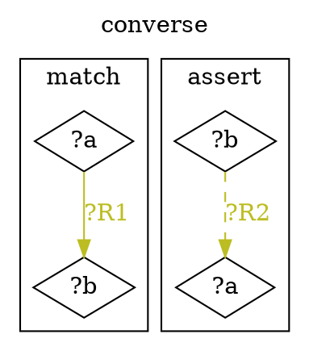
<!-- /rule -->

#### `imply1`

Copies a property, a fact of one argument, into another.

<!-- rule std.algebra imply1 -->
```lisp
(rule imply1 (?R1 ?R2)
  :match  (?R1 ?a)
  :assert (?R2 ?a)
  :why    "(imply1 {?R1} {?R2}): {?R1}({?a}) → {?R2}({?a})")
```

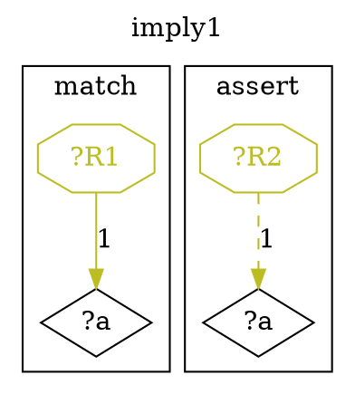
<!-- /rule -->

#### `imply2-fwd`

Copies each edge of `?R1` into `?R2`, as it stands.

<!-- rule std.algebra imply2-fwd -->
```lisp
(rule imply2-fwd (?R1 ?R2)
  :match  (?R1 ?a ?b)
  :assert (?R2 ?a ?b)
  :why    "(imply2-fwd {?R1} {?R2}): {?R1}({?a},{?b}) → {?R2}({?a},{?b})")
```

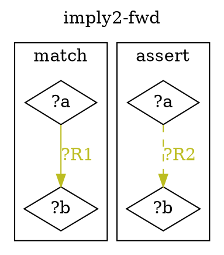
<!-- /rule -->

#### `imply2-reverse`

The same rule as `converse`, under a second name.

<!-- rule std.algebra imply2-reverse -->
```lisp
(rule imply2-reverse (?R1 ?R2)
  :match  (?R1 ?a ?b)
  :assert (?R2 ?b ?a)
  :why    "(imply2-reverse {?R1} {?R2}): {?R1}({?a},{?b}) → {?R2}({?b},{?a})")
```

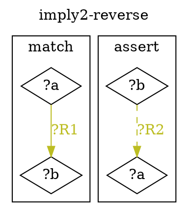
<!-- /rule -->

#### `compose`

Joins an edge of `?R1` and an edge of `?R2` on their shared middle and concludes the edge of `?R3` between the ends.

<!-- rule std.algebra compose -->
```lisp
(rule compose (?R1 ?R2 ?R3)
  :match  (and (?R1 ?a ?b) (?R2 ?b ?c))
  :assert (?R3 ?a ?c)
  :why    "(compose {?R1} {?R2} {?R3}): {?R1}({?a},{?b})∧{?R2}({?b},{?c}) → {?R3}({?a},{?c}).")
```

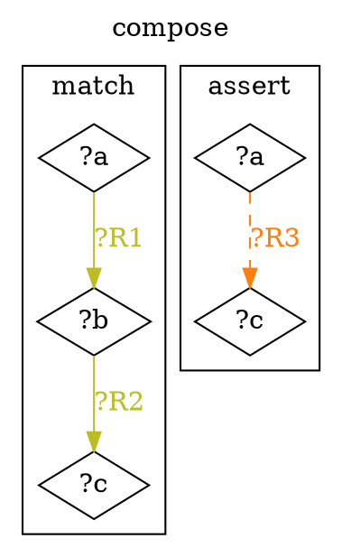
<!-- /rule -->

#### `identity`

The identity on a label: every member of `?Dom`, by the membership relation `?isa`, gets a loop.

<!-- rule std.algebra identity -->
```lisp
(rule identity (?R ?isa ?Dom)
  :match  (?isa ?a ?Dom)
  :assert (?R ?a ?a)
  :why    "(identity {?R} {?isa} {?Dom}): {?a}∈{?Dom} → {?R}({?a},{?a}).")
```

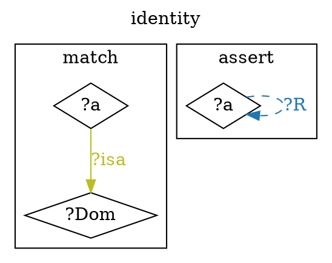
<!-- /rule -->

### The lemmas about converses

Three rules with no parameter that derive operator facts from operator facts: a derived `(converse R R)` is itself
an activator of `converse`. Each derivation back is a fact that is already there, so the three converge.

#### `symmetric-is-self-converse`

A symmetric relation is its own converse.

<!-- rule std.algebra symmetric-is-self-converse -->
```lisp
(rule symmetric-is-self-converse ()
  :match  (symmetric ?R)
  :assert (converse ?R ?R)
  :why    "symmetric {?R} ⟹ (converse {?R} {?R})")
```

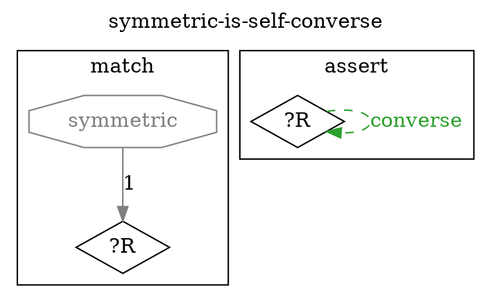
<!-- /rule -->

#### `self-converse-is-symmetric`

And a relation that is its own converse is symmetric.

<!-- rule std.algebra self-converse-is-symmetric -->
```lisp
(rule self-converse-is-symmetric ()
  :match  (converse ?R ?R)
  :assert (symmetric ?R)
  :why    "(converse {?R} {?R}) ⟹ symmetric {?R}")
```

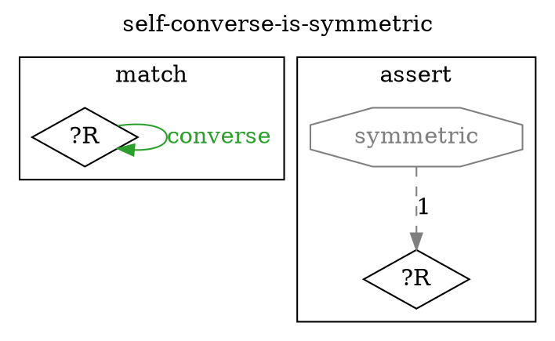
<!-- /rule -->

#### `converse-pair-symmetric`

Being converses is mutual.

<!-- rule std.algebra converse-pair-symmetric -->
```lisp
(rule converse-pair-symmetric ()
  :match  (converse ?R1 ?R2)
  :assert (converse ?R2 ?R1)
  :why    "(converse {?R1} {?R2}) ⟹ (converse {?R2} {?R1})")
```

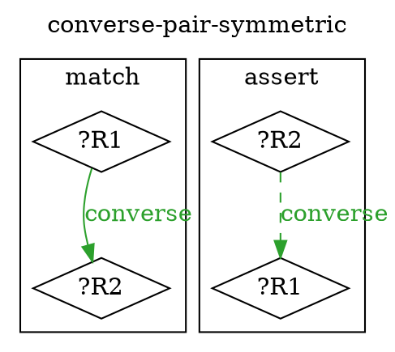
<!-- /rule -->

### The converse's declarations

Two checks of a `(converse R1 R2)` pair against the two `(relation …)` declarations: the second label of one must
meet the first of the other. The two labels pass where they are equal (the `neq` guard) or related by `?isR*`
either way (the two `absent` clusters).

#### `converse-illtyped-dom`

Refutes a pair where `?R1`'s second label and `?R2`'s first are unrelated.

<!-- rule std.algebra converse-illtyped-dom -->
```lisp
(rule converse-illtyped-dom (?R1 ?R2 ?isR*)
  :match  (and (converse  ?R1 ?R2)
               (relation  ?R1 ?D1 ?Rn1)
               (relation  ?R2 ?D2 ?Rn2)
               (neq ?Rn1 ?D2)
               (absent (?isR* ?Rn1 ?D2))
               (absent (?isR* ?D2 ?Rn1)))
  :assert (false)
  :why    "converse {?R1}/{?R2} ill-typed: range({?R1})={?Rn1} and domain({?R2})={?D2} are neither equal nor one a subtype of the other under {?isR*}.")
```

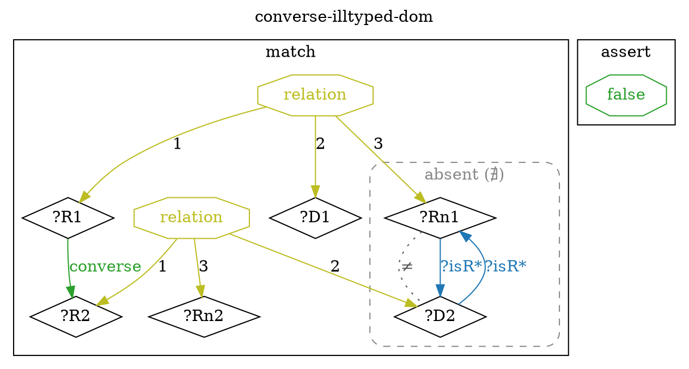
<!-- /rule -->

#### `converse-illtyped-ran`

Refutes a pair where `?R1`'s first label and `?R2`'s second are unrelated.

<!-- rule std.algebra converse-illtyped-ran -->
```lisp
(rule converse-illtyped-ran (?R1 ?R2 ?isR*)
  :match  (and (converse  ?R1 ?R2)
               (relation  ?R1 ?D1 ?Rn1)
               (relation  ?R2 ?D2 ?Rn2)
               (neq ?D1 ?Rn2)
               (absent (?isR* ?D1 ?Rn2))
               (absent (?isR* ?Rn2 ?D1)))
  :assert (false)
  :why    "converse {?R1}/{?R2} ill-typed: domain({?R1})={?D1} and range({?R2})={?Rn2} are neither equal nor one a subtype of the other under {?isR*}.")
```

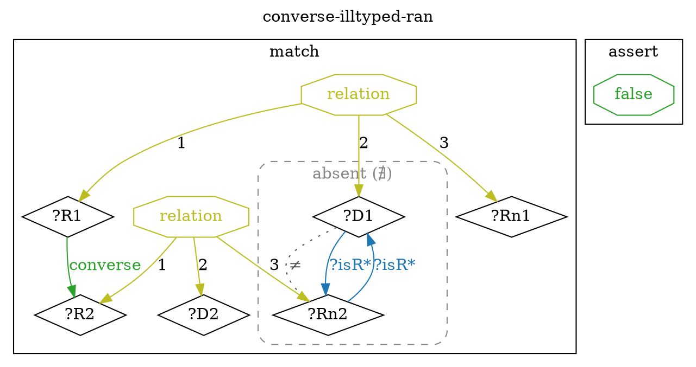
<!-- /rule -->

### The Boolean layer

#### `meet`

An edge in both `?R1` and `?R2` is an edge of `?R3`.

<!-- rule std.algebra meet -->
```lisp
(rule meet (?R1 ?R2 ?R3)
  :match  (and (?R1 ?a ?b) (?R2 ?a ?b))
  :assert (?R3 ?a ?b)
  :why    "(meet {?R1} {?R2} {?R3}): {?R1}({?a},{?b})∧{?R2}({?a},{?b}) → {?R3}({?a},{?b}).")
```

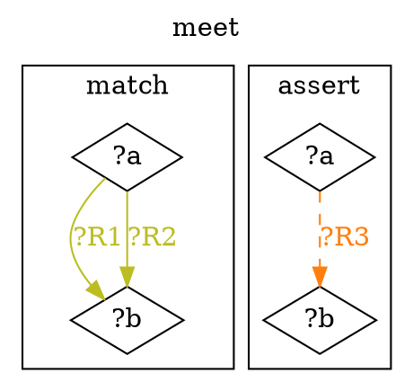
<!-- /rule -->

#### `difference`

An edge of `?R1` that `?R2` lacks is an edge of `?R3`; the `absent` is the closed-world reading.

<!-- rule std.algebra difference -->
```lisp
(rule difference (?R1 ?R2 ?R3)
  :match  (and (?R1 ?a ?b) (absent (?R2 ?a ?b)))
  :assert (?R3 ?a ?b)
  :why    "(difference {?R1} {?R2} {?R3}): {?R1}({?a},{?b})∧¬{?R2}({?a},{?b}) → {?R3}({?a},{?b}).")
```

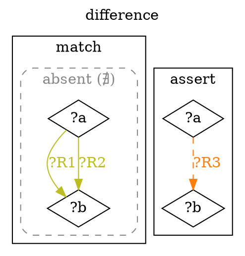
<!-- /rule -->

#### `derive-join`

`join` is not a rule but a fact the program writes; this rule turns it into the activators of the two copiers.

<!-- rule std.algebra derive-join -->
```lisp
(rule derive-join ()
  :match  (join ?R1 ?R2 ?R3)
  :assert (and (join-l ?R1 ?R2 ?R3) (join-r ?R1 ?R2 ?R3))
  :why    "(join {?R1} {?R2} {?R3}): fan out into the two per-operand copiers.")
```

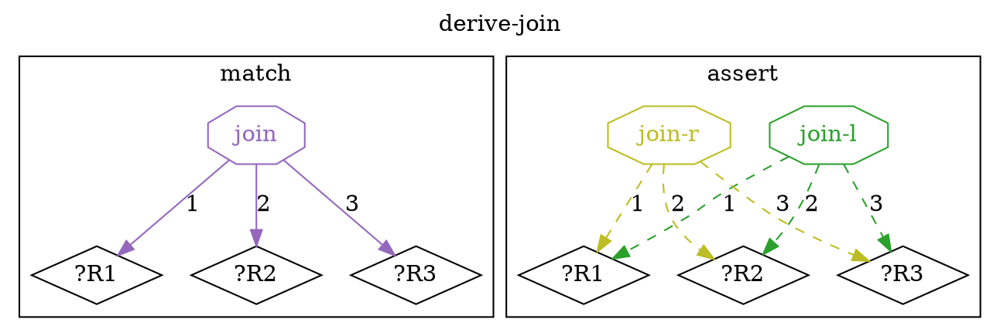
<!-- /rule -->

#### `join-l`

Copies the first operand's edges into the union.

<!-- rule std.algebra join-l -->
```lisp
(rule join-l (?R1 ?R2 ?R3)
  :match  (?R1 ?a ?b)
  :assert (?R3 ?a ?b)
  :why    "(join {?R1} {?R2} {?R3}): {?R1}({?a},{?b}) → {?R3}({?a},{?b}).")
```

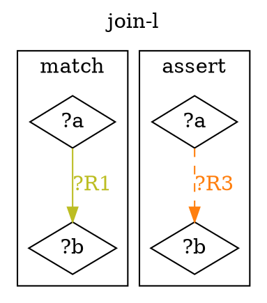
<!-- /rule -->

#### `join-r`

Copies the second operand's edges into the union.

<!-- rule std.algebra join-r -->
```lisp
(rule join-r (?R1 ?R2 ?R3)
  :match  (?R2 ?a ?b)
  :assert (?R3 ?a ?b)
  :why    "(join {?R1} {?R2} {?R3}): {?R2}({?a},{?b}) → {?R3}({?a},{?b}).")
```

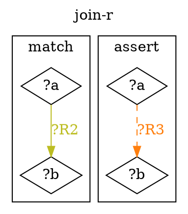
<!-- /rule -->

#### `empty`

A check: any edge of `?R` is a contradiction.

<!-- rule std.algebra empty -->
```lisp
(rule empty (?R)
  :match  (?R ?a ?b)
  :assert (false)
  :why    "(empty {?R}) violated: {?R}({?a},{?b}) exists.")
```

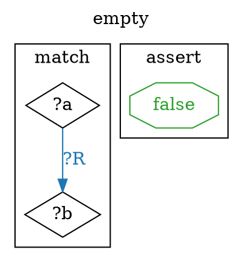
<!-- /rule -->

#### `top`

Every pair of a member of `?Dom` and a member of `?Ran` is an edge.

<!-- rule std.algebra top -->
```lisp
(rule top (?R ?isa ?Dom ?Ran)
  :match  (and (?isa ?a ?Dom) (?isa ?b ?Ran))
  :assert (?R ?a ?b)
  :why    "(top {?R} {?isa} {?Dom} {?Ran}): {?a}∈{?Dom},{?b}∈{?Ran} → {?R}({?a},{?b}).")
```

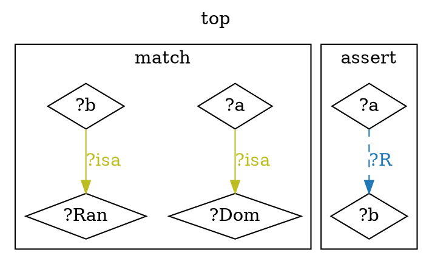
<!-- /rule -->

#### `complement`

Every such pair that `?R1` lacks is an edge of `?R2`.

<!-- rule std.algebra complement -->
```lisp
(rule complement (?R1 ?R2 ?isa ?Dom ?Ran)
  :match  (and (?isa ?a ?Dom) (?isa ?b ?Ran) (absent (?R1 ?a ?b)))
  :assert (?R2 ?a ?b)
  :why    "(complement {?R1} {?R2}): {?a}∈{?Dom},{?b}∈{?Ran},¬{?R1}({?a},{?b}) → {?R2}({?a},{?b}).")
```

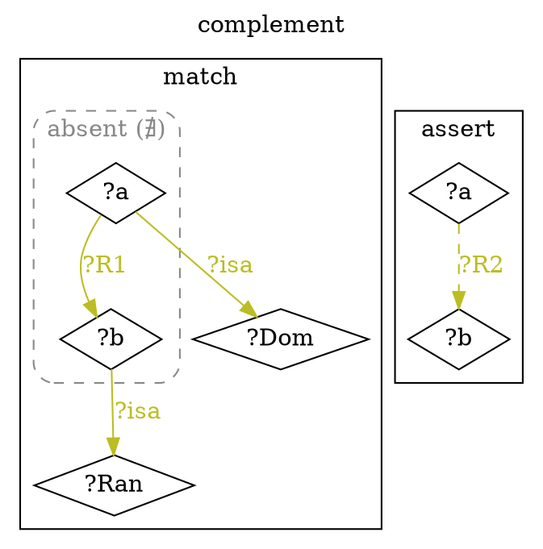
<!-- /rule -->

### The cardinality checks

#### `functional`

Two edges from one source to two distinct targets are a contradiction.

<!-- rule std.algebra functional -->
```lisp
(rule functional (?R)
  :match  (and (?R ?a ?b) (?R ?a ?c) (neq ?b ?c))
  :assert (false)
  :why    "{?R} not functional: {?a} has both {?b} and {?c}.")
```

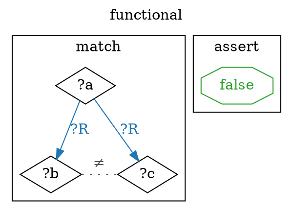
<!-- /rule -->

#### `injective`

Two edges from two distinct sources to one target are a contradiction.

<!-- rule std.algebra injective -->
```lisp
(rule injective (?R)
  :match  (and (?R ?a ?c) (?R ?b ?c) (neq ?a ?b))
  :assert (false)
  :why    "{?R} not injective: {?c} reached from both {?a} and {?b}.")
```

```dot
digraph rule_injective_lhs_rhs {
  rankdir=TB;
  label="injective"; labelloc=t;
  subgraph cluster_lhs { label="match";
    "?a_L" [label="?a", shape=diamond];
    "?c_L" [label="?c", shape=diamond];
    "?b_L" [label="?b", shape=diamond];
    "?a_L" -> "?c_L" [label="?R", color="#1f77b4", fontcolor="#1f77b4"];
    "?b_L" -> "?c_L" [label="?R", color="#1f77b4", fontcolor="#1f77b4"];
    "?a_L" -> "?b_L" [label="≠", dir=none, style=dotted, color="#555555", fontcolor="#555555", constraint=false];
  }
  subgraph cluster_rhs { label="assert";
    "h1_false_R" [shape=octagon, label="false", color="#2ca02c", fontcolor="#2ca02c"];
  }
}
```
<!-- /rule -->

#### `bijective-properties`

Fans a program's `(bijective R)` out into the four one-argument markers.

<!-- rule std.algebra bijective-properties -->
```lisp
(rule bijective-properties ()
  :match  (bijective ?R)
  :assert (and (functional ?R) (injective ?R) (total ?R) (surjective ?R))
  :why    "{?R} is bijective ⟹ functional ∧ injective ∧ total ∧ surjective.")
```

```dot
digraph rule_bijective_properties_lhs_rhs {
  rankdir=TB;
  label="bijective-properties"; labelloc=t;
  subgraph cluster_lhs { label="match";
    "?R_L" [label="?R", shape=diamond];
    "h1_bijective_L" [shape=octagon, label="bijective", color="#17becf", fontcolor="#17becf"];
    "h1_bijective_L" -> "?R_L" [label="1", color="#17becf"];
  }
  subgraph cluster_rhs { label="assert";
    "?R_R" [label="?R", shape=diamond];
    "h2_functional_R" [shape=octagon, label="functional", color="#bcbd22", fontcolor="#bcbd22"];
    "h2_functional_R" -> "?R_R" [label="1", color="#bcbd22", style=dashed];
    "h3_injective_R" [shape=octagon, label="injective", color="#ff7f0e", fontcolor="#ff7f0e"];
    "h3_injective_R" -> "?R_R" [label="1", color="#ff7f0e", style=dashed];
    "h4_total_R" [shape=octagon, label="total", color="#1f77b4", fontcolor="#1f77b4"];
    "h4_total_R" -> "?R_R" [label="1", color="#1f77b4", style=dashed];
    "h5_surjective_R" [shape=octagon, label="surjective", color="#2ca02c", fontcolor="#2ca02c"];
    "h5_surjective_R" -> "?R_R" [label="1", color="#2ca02c", style=dashed];
  }
}
```
<!-- /rule -->

#### `total`

Refutes a state in which a member of the first label has every member of the second excluded; the `forall` is
`std.macro`'s.

<!-- rule std.algebra total -->
```lisp
(rule total (?R ?isa)
  :match  (and (relation ?R ?A ?B)
               (?isa ?a ?A)
               (forall ?b (?isa ?b ?B) (not (?R ?a ?b))))
  :assert (false)
  :why    "{?R} not total at {?a}: every {?B} is excluded.")
```

```dot
digraph rule_total_lhs_rhs {
  rankdir=TB;
  label="total"; labelloc=t;
  subgraph cluster_lhs { label="match";
    "?R_L" [label="?R", shape=diamond];
    "?A_L" [label="?A", shape=diamond];
    "?B_L" [label="?B", shape=diamond];
    "?a_L" [label="?a", shape=diamond];
    "h1_relation_L" [shape=octagon, label="relation", color="#bcbd22", fontcolor="#bcbd22"];
    "h1_relation_L" -> "?R_L" [label="1", color="#bcbd22"];
    "h1_relation_L" -> "?A_L" [label="2", color="#bcbd22"];
    "h1_relation_L" -> "?B_L" [label="3", color="#bcbd22"];
    "?a_L" -> "?A_L" [label="?isa", color="#bcbd22", fontcolor="#bcbd22"];
    subgraph cluster_forall_L_0 {
      label="forall (∀)"; style="dashed,rounded"; color="#888888"; fontcolor="#888888";
      "?b_L" [label="?b", shape=diamond];
      "?b_L" -> "?B_L" [label="?isa", color="#bcbd22", fontcolor="#bcbd22"];
      "?a_L" -> "?b_L" [label="¬?R", color="#d62728", fontcolor="#d62728"];
    }
  }
  subgraph cluster_rhs { label="assert";
    "h2_false_R" [shape=octagon, label="false", color="#2ca02c", fontcolor="#2ca02c"];
  }
}
```
<!-- /rule -->

#### `surjective`

The dual: a member of the second label excluded for every member of the first.

<!-- rule std.algebra surjective -->
```lisp
(rule surjective (?R ?isa)
  :match  (and (relation ?R ?A ?B)
               (?isa ?b ?B)
               (forall ?a (?isa ?a ?A) (not (?R ?a ?b))))
  :assert (false)
  :why    "{?R} not surjective at {?b}: every {?A} is excluded.")
```

```dot
digraph rule_surjective_lhs_rhs {
  rankdir=TB;
  label="surjective"; labelloc=t;
  subgraph cluster_lhs { label="match";
    "?R_L" [label="?R", shape=diamond];
    "?A_L" [label="?A", shape=diamond];
    "?B_L" [label="?B", shape=diamond];
    "?b_L" [label="?b", shape=diamond];
    "h1_relation_L" [shape=octagon, label="relation", color="#bcbd22", fontcolor="#bcbd22"];
    "h1_relation_L" -> "?R_L" [label="1", color="#bcbd22"];
    "h1_relation_L" -> "?A_L" [label="2", color="#bcbd22"];
    "h1_relation_L" -> "?B_L" [label="3", color="#bcbd22"];
    "?b_L" -> "?B_L" [label="?isa", color="#bcbd22", fontcolor="#bcbd22"];
    subgraph cluster_forall_L_0 {
      label="forall (∀)"; style="dashed,rounded"; color="#888888"; fontcolor="#888888";
      "?a_L" [label="?a", shape=diamond];
      "?a_L" -> "?A_L" [label="?isa", color="#bcbd22", fontcolor="#bcbd22"];
      "?a_L" -> "?b_L" [label="¬?R", color="#d62728", fontcolor="#d62728"];
    }
  }
  subgraph cluster_rhs { label="assert";
    "h2_false_R" [shape=octagon, label="false", color="#2ca02c", fontcolor="#2ca02c"];
  }
}
```
<!-- /rule -->

### The totality obligations

The two rules beside `total` and `surjective` that conclude `(open ?R)`. An obligation derives nothing and is not
run with the others: it is read once over a state that has stopped changing, and a match means the state owes.

#### `total-owed`

A member of the first label with no partner stated: the relation owes it one.

<!-- rule std.algebra total-owed -->
```lisp
(rule total-owed (?R ?isa)
  :match  (and (relation ?R ?A ?B)
               (?isa ?a ?A)
               (absent (and (?isa ?b ?B) (?R ?a ?b))))
  :assert (open ?R)
  :why    "{?R} owes {?a} a {?B}.")
```

```dot
digraph rule_total_owed_lhs_rhs {
  rankdir=TB;
  label="total-owed"; labelloc=t;
  subgraph cluster_lhs { label="match";
    "?R_L" [label="?R", shape=diamond];
    "?A_L" [label="?A", shape=diamond];
    "?B_L" [label="?B", shape=diamond];
    "?a_L" [label="?a", shape=diamond];
    "h1_relation_L" [shape=octagon, label="relation", color="#bcbd22", fontcolor="#bcbd22"];
    "h1_relation_L" -> "?R_L" [label="1", color="#bcbd22"];
    "h1_relation_L" -> "?A_L" [label="2", color="#bcbd22"];
    "h1_relation_L" -> "?B_L" [label="3", color="#bcbd22"];
    "?a_L" -> "?A_L" [label="?isa", color="#bcbd22", fontcolor="#bcbd22"];
    subgraph cluster_absent_L_0 {
      label="absent (∄)"; style="dashed,rounded"; color="#888888"; fontcolor="#888888";
      "?b_L" [label="?b", shape=diamond];
      "?b_L" -> "?B_L" [label="?isa", color="#bcbd22", fontcolor="#bcbd22"];
      "?a_L" -> "?b_L" [label="?R", color="#1f77b4", fontcolor="#1f77b4"];
    }
  }
  subgraph cluster_rhs { label="assert";
    "?R_R" [label="?R", shape=diamond];
    "h2_open_R" [shape=octagon, label="open", color="#2ca02c", fontcolor="#2ca02c"];
    "h2_open_R" -> "?R_R" [label="1", color="#2ca02c", style=dashed];
  }
}
```
<!-- /rule -->

#### `surjective-owed`

A member of the second label with no preimage stated: the relation owes it one.

<!-- rule std.algebra surjective-owed -->
```lisp
(rule surjective-owed (?R ?isa)
  :match  (and (relation ?R ?A ?B)
               (?isa ?b ?B)
               (absent (and (?isa ?a ?A) (?R ?a ?b))))
  :assert (open ?R)
  :why    "{?R} owes {?b} a preimage in {?A}.")
```

```dot
digraph rule_surjective_owed_lhs_rhs {
  rankdir=TB;
  label="surjective-owed"; labelloc=t;
  subgraph cluster_lhs { label="match";
    "?R_L" [label="?R", shape=diamond];
    "?A_L" [label="?A", shape=diamond];
    "?B_L" [label="?B", shape=diamond];
    "?b_L" [label="?b", shape=diamond];
    "h1_relation_L" [shape=octagon, label="relation", color="#bcbd22", fontcolor="#bcbd22"];
    "h1_relation_L" -> "?R_L" [label="1", color="#bcbd22"];
    "h1_relation_L" -> "?A_L" [label="2", color="#bcbd22"];
    "h1_relation_L" -> "?B_L" [label="3", color="#bcbd22"];
    "?b_L" -> "?B_L" [label="?isa", color="#bcbd22", fontcolor="#bcbd22"];
    subgraph cluster_absent_L_0 {
      label="absent (∄)"; style="dashed,rounded"; color="#888888"; fontcolor="#888888";
      "?a_L" [label="?a", shape=diamond];
      "?a_L" -> "?A_L" [label="?isa", color="#bcbd22", fontcolor="#bcbd22"];
      "?a_L" -> "?b_L" [label="?R", color="#1f77b4", fontcolor="#1f77b4"];
    }
  }
  subgraph cluster_rhs { label="assert";
    "?R_R" [label="?R", shape=diamond];
    "h2_open_R" [shape=octagon, label="open", color="#2ca02c", fontcolor="#2ca02c"];
    "h2_open_R" -> "?R_R" [label="1", color="#2ca02c", style=dashed];
  }
}
```
<!-- /rule -->

### The property checks

#### `irreflexive`

A loop is a contradiction.

<!-- rule std.algebra irreflexive -->
```lisp
(rule irreflexive (?R)
  :match  (?R ?a ?a)
  :assert (false)
  :why    "(irreflexive {?R}) violated: self-loop {?R}({?a},{?a}).")
```

```dot
digraph rule_irreflexive_lhs_rhs {
  rankdir=TB;
  label="irreflexive"; labelloc=t;
  subgraph cluster_lhs { label="match";
    "?a_L" [label="?a", shape=diamond];
    "?a_L" -> "?a_L" [label="?R", color="#1f77b4", fontcolor="#1f77b4"];
  }
  subgraph cluster_rhs { label="assert";
    "h1_false_R" [shape=octagon, label="false", color="#2ca02c", fontcolor="#2ca02c"];
  }
}
```
<!-- /rule -->

#### `antisymmetric`

Two distinct names related both ways are a contradiction.

<!-- rule std.algebra antisymmetric -->
```lisp
(rule antisymmetric (?R)
  :match  (and (?R ?a ?b) (?R ?b ?a) (neq ?a ?b))
  :assert (false)
  :why    "(antisymmetric {?R}) violated: {?R}({?a},{?b})∧{?R}({?b},{?a}), {?a}≠{?b}.")
```

```dot
digraph rule_antisymmetric_lhs_rhs {
  rankdir=TB;
  label="antisymmetric"; labelloc=t;
  subgraph cluster_lhs { label="match";
    "?a_L" [label="?a", shape=diamond];
    "?b_L" [label="?b", shape=diamond];
    "?a_L" -> "?b_L" [label="?R", color="#1f77b4", fontcolor="#1f77b4"];
    "?b_L" -> "?a_L" [label="?R", color="#1f77b4", fontcolor="#1f77b4"];
    "?a_L" -> "?b_L" [label="≠", dir=none, style=dotted, color="#555555", fontcolor="#555555", constraint=false];
  }
  subgraph cluster_rhs { label="assert";
    "h1_false_R" [shape=octagon, label="false", color="#2ca02c", fontcolor="#2ca02c"];
  }
}
```
<!-- /rule -->

#### `asymmetric`

Two names related both ways are a contradiction, a loop included, since nothing keeps `?a` and `?b` apart.

<!-- rule std.algebra asymmetric -->
```lisp
(rule asymmetric (?R)
  :match  (and (?R ?a ?b) (?R ?b ?a))
  :assert (false)
  :why    "(asymmetric {?R}) violated: both {?R}({?a},{?b}) and {?R}({?b},{?a}).")
```

```dot
digraph rule_asymmetric_lhs_rhs {
  rankdir=TB;
  label="asymmetric"; labelloc=t;
  subgraph cluster_lhs { label="match";
    "?a_L" [label="?a", shape=diamond];
    "?b_L" [label="?b", shape=diamond];
    "?a_L" -> "?b_L" [label="?R", color="#1f77b4", fontcolor="#1f77b4"];
    "?b_L" -> "?a_L" [label="?R", color="#1f77b4", fontcolor="#1f77b4"];
  }
  subgraph cluster_rhs { label="assert";
    "h1_false_R" [shape=octagon, label="false", color="#2ca02c", fontcolor="#2ca02c"];
  }
}
```
<!-- /rule -->

#### `connex`

Two distinct members of `?Dom` related neither way are a contradiction.

<!-- rule std.algebra connex -->
```lisp
(rule connex (?R ?isa ?Dom)
  :match  (and (?isa ?a ?Dom) (?isa ?b ?Dom) (neq ?a ?b)
               (absent (?R ?a ?b)) (absent (?R ?b ?a)))
  :assert (false)
  :why    "(connex {?R}) violated: {?a},{?b}∈{?Dom} incomparable (neither {?R}({?a},{?b}) nor {?R}({?b},{?a})).")
```

```dot
digraph rule_connex_lhs_rhs {
  rankdir=TB;
  label="connex"; labelloc=t;
  subgraph cluster_lhs { label="match";
    "?a_L" [label="?a", shape=diamond];
    "?Dom_L" [label="?Dom", shape=diamond];
    "?b_L" [label="?b", shape=diamond];
    "?a_L" -> "?Dom_L" [label="?isa", color="#bcbd22", fontcolor="#bcbd22"];
    "?b_L" -> "?Dom_L" [label="?isa", color="#bcbd22", fontcolor="#bcbd22"];
    "?a_L" -> "?b_L" [label="≠", dir=none, style=dotted, color="#555555", fontcolor="#555555", constraint=false];
    subgraph cluster_absent_L_0 {
      label="absent (∄)"; style="dashed,rounded"; color="#888888"; fontcolor="#888888";
      "?a_L" -> "?b_L" [label="?R", color="#1f77b4", fontcolor="#1f77b4"];
    }
    subgraph cluster_absent_L_1 {
      label="absent (∄)"; style="dashed,rounded"; color="#888888"; fontcolor="#888888";
      "?b_L" -> "?a_L" [label="?R", color="#1f77b4", fontcolor="#1f77b4"];
    }
  }
  subgraph cluster_rhs { label="assert";
    "h1_false_R" [shape=octagon, label="false", color="#2ca02c", fontcolor="#2ca02c"];
  }
}
```
<!-- /rule -->

### The property closures

#### `difunctional`

Two sources that share a target share every target.

<!-- rule std.algebra difunctional -->
```lisp
(rule difunctional (?R)
  :match  (and (?R ?a ?b) (?R ?c ?b) (?R ?c ?d))
  :assert (?R ?a ?d)
  :why    "(difunctional {?R}): {?R}({?a},{?b})∧{?R}({?c},{?b})∧{?R}({?c},{?d}) → {?R}({?a},{?d}).")
```

```dot
digraph rule_difunctional_lhs_rhs {
  rankdir=TB;
  label="difunctional"; labelloc=t;
  subgraph cluster_lhs { label="match";
    "?a_L" [label="?a", shape=diamond];
    "?b_L" [label="?b", shape=diamond];
    "?c_L" [label="?c", shape=diamond];
    "?d_L" [label="?d", shape=diamond];
    "?a_L" -> "?b_L" [label="?R", color="#1f77b4", fontcolor="#1f77b4"];
    "?c_L" -> "?b_L" [label="?R", color="#1f77b4", fontcolor="#1f77b4"];
    "?c_L" -> "?d_L" [label="?R", color="#1f77b4", fontcolor="#1f77b4"];
  }
  subgraph cluster_rhs { label="assert";
    "?a_R" [label="?a", shape=diamond];
    "?d_R" [label="?d", shape=diamond];
    "?a_R" -> "?d_R" [label="?R", color="#1f77b4", fontcolor="#1f77b4", style=dashed];
  }
}
```
<!-- /rule -->

#### `symmetric`

Mirrors each edge.

<!-- rule std.algebra symmetric -->
```lisp
(rule symmetric (?rel)
  :match  (?rel ?a ?b)
  :assert (?rel ?b ?a)
  :why    "{?rel} is symmetric: {?a} ↔ {?b}.")
```

```dot
digraph rule_symmetric_lhs_rhs {
  rankdir=TB;
  label="symmetric"; labelloc=t;
  subgraph cluster_lhs { label="match";
    "?a_L" [label="?a", shape=diamond];
    "?b_L" [label="?b", shape=diamond];
    "?a_L" -> "?b_L" [label="?rel", color="#2ca02c", fontcolor="#2ca02c"];
  }
  subgraph cluster_rhs { label="assert";
    "?b_R" [label="?b", shape=diamond];
    "?a_R" [label="?a", shape=diamond];
    "?b_R" -> "?a_R" [label="?rel", color="#2ca02c", fontcolor="#2ca02c", style=dashed];
  }
}
```
<!-- /rule -->

#### `symmetric-negative-setup`

Activates the negative mirror for every relation declared symmetric, which is why a program lists nothing for it.

<!-- rule std.algebra symmetric-negative-setup -->
```lisp
(rule symmetric-negative-setup ()
  :match  (symmetric ?rel)
  :assert (symmetric-negative ?rel)
  :why    "{?rel} symmetric ⟹ activate its negative mirror.")
```

```dot
digraph rule_symmetric_negative_setup_lhs_rhs {
  rankdir=TB;
  label="symmetric-negative-setup"; labelloc=t;
  subgraph cluster_lhs { label="match";
    "?rel_L" [label="?rel", shape=diamond];
    "h1_symmetric_L" [shape=octagon, label="symmetric", color="#7f7f7f", fontcolor="#7f7f7f"];
    "h1_symmetric_L" -> "?rel_L" [label="1", color="#7f7f7f"];
  }
  subgraph cluster_rhs { label="assert";
    "?rel_R" [label="?rel", shape=diamond];
    "h2_symmetric-negative_R" [shape=octagon, label="symmetric-negative", color="#7f7f7f", fontcolor="#7f7f7f"];
    "h2_symmetric-negative_R" -> "?rel_R" [label="1", color="#7f7f7f", style=dashed];
  }
}
```
<!-- /rule -->

#### `symmetric-negative`

Mirrors each stored negation.

<!-- rule std.algebra symmetric-negative -->
```lisp
(rule symmetric-negative (?rel)
  :match  (not (?rel ?a ?b))
  :assert (not (?rel ?b ?a))
  :why    "{?rel} symmetric: ¬{?rel}({?a},{?b}) ⟹ ¬{?rel}({?b},{?a}).")
```

```dot
digraph rule_symmetric_negative_lhs_rhs {
  rankdir=TB;
  label="symmetric-negative"; labelloc=t;
  subgraph cluster_lhs { label="match";
    "?a_L" [label="?a", shape=diamond];
    "?b_L" [label="?b", shape=diamond];
    "?a_L" -> "?b_L" [label="¬?rel", color="#d62728", fontcolor="#d62728"];
  }
  subgraph cluster_rhs { label="assert";
    "?b_R" [label="?b", shape=diamond];
    "?a_R" [label="?a", shape=diamond];
    "?b_R" -> "?a_R" [label="¬?rel", color="#d62728", fontcolor="#d62728", style=dashed];
  }
}
```
<!-- /rule -->

#### `transitive`

Closes a chain of two edges; the `neq` guard is the one difference from `(compose R R R)`.

<!-- rule std.algebra transitive -->
```lisp
(rule transitive (?rel)
  :match  (and (?rel ?a ?b) (?rel ?b ?c) (neq ?a ?c))
  :assert (?rel ?a ?c)
  :why    "{?rel} is transitive.")
```

```dot
digraph rule_transitive_lhs_rhs {
  rankdir=TB;
  label="transitive"; labelloc=t;
  subgraph cluster_lhs { label="match";
    "?a_L" [label="?a", shape=diamond];
    "?b_L" [label="?b", shape=diamond];
    "?c_L" [label="?c", shape=diamond];
    "?a_L" -> "?b_L" [label="?rel", color="#2ca02c", fontcolor="#2ca02c"];
    "?b_L" -> "?c_L" [label="?rel", color="#2ca02c", fontcolor="#2ca02c"];
    "?a_L" -> "?c_L" [label="≠", dir=none, style=dotted, color="#555555", fontcolor="#555555", constraint=false];
  }
  subgraph cluster_rhs { label="assert";
    "?a_R" [label="?a", shape=diamond];
    "?c_R" [label="?c", shape=diamond];
    "?a_R" -> "?c_R" [label="?rel", color="#2ca02c", fontcolor="#2ca02c", style=dashed];
  }
}
```
<!-- /rule -->

#### `includes`

Copies each edge of `?p` into `?q`.

<!-- rule std.algebra includes -->
```lisp
(rule includes (?p ?q)
  :match  (?p ?a ?b)
  :assert (?q ?a ?b)
  :why    "{?q} includes {?p}: from {?a} →{?p}→ {?b}, derive {?a} →{?q}→ {?b}.")
```

```dot
digraph rule_includes_lhs_rhs {
  rankdir=TB;
  label="includes"; labelloc=t;
  subgraph cluster_lhs { label="match";
    "?a_L" [label="?a", shape=diamond];
    "?b_L" [label="?b", shape=diamond];
    "?a_L" -> "?b_L" [label="?p", color="#17becf", fontcolor="#17becf"];
  }
  subgraph cluster_rhs { label="assert";
    "?a_R" [label="?a", shape=diamond];
    "?b_R" [label="?b", shape=diamond];
    "?a_R" -> "?b_R" [label="?q", color="#bcbd22", fontcolor="#bcbd22", style=dashed];
  }
}
```
<!-- /rule -->

### The equational lemmas

Schröder's law, opted into per triple, and the two laws that carry a composition and a union through a converse.

#### `compose-negative-s`

From an excluded composite and an edge of the first factor, excludes the edge of the second.

<!-- rule std.algebra compose-negative-s -->
```lisp
(rule compose-negative-s (?R ?S ?T)
  :match  (and (?R ?a ?b) (not (?T ?a ?c)))
  :assert (not (?S ?b ?c))
  :why    "Schröder ({?R};{?S}={?T} closed): {?R}({?a},{?b})∧¬{?T}({?a},{?c}) → ¬{?S}({?b},{?c}).")
```

```dot
digraph rule_compose_negative_s_lhs_rhs {
  rankdir=TB;
  label="compose-negative-s"; labelloc=t;
  subgraph cluster_lhs { label="match";
    "?a_L" [label="?a", shape=diamond];
    "?b_L" [label="?b", shape=diamond];
    "?c_L" [label="?c", shape=diamond];
    "?a_L" -> "?b_L" [label="?R", color="#1f77b4", fontcolor="#1f77b4"];
    "?a_L" -> "?c_L" [label="¬?T", color="#d62728", fontcolor="#d62728"];
  }
  subgraph cluster_rhs { label="assert";
    "?b_R" [label="?b", shape=diamond];
    "?c_R" [label="?c", shape=diamond];
    "?b_R" -> "?c_R" [label="¬?S", color="#d62728", fontcolor="#d62728", style=dashed];
  }
}
```
<!-- /rule -->

#### `compose-negative-r`

From an excluded composite and an edge of the second factor, excludes the edge of the first.

<!-- rule std.algebra compose-negative-r -->
```lisp
(rule compose-negative-r (?R ?S ?T)
  :match  (and (?S ?b ?c) (not (?T ?a ?c)))
  :assert (not (?R ?a ?b))
  :why    "Schröder ({?R};{?S}={?T} closed): {?S}({?b},{?c})∧¬{?T}({?a},{?c}) → ¬{?R}({?a},{?b}).")
```

```dot
digraph rule_compose_negative_r_lhs_rhs {
  rankdir=TB;
  label="compose-negative-r"; labelloc=t;
  subgraph cluster_lhs { label="match";
    "?b_L" [label="?b", shape=diamond];
    "?c_L" [label="?c", shape=diamond];
    "?a_L" [label="?a", shape=diamond];
    "?b_L" -> "?c_L" [label="?S", color="#2ca02c", fontcolor="#2ca02c"];
    "?a_L" -> "?c_L" [label="¬?T", color="#d62728", fontcolor="#d62728"];
  }
  subgraph cluster_rhs { label="assert";
    "?a_R" [label="?a", shape=diamond];
    "?b_R" [label="?b", shape=diamond];
    "?a_R" -> "?b_R" [label="¬?R", color="#d62728", fontcolor="#d62728", style=dashed];
  }
}
```
<!-- /rule -->

#### `compose-contravariant`

The converse of a composition is the composition of the converses, in the other order.

<!-- rule std.algebra compose-contravariant -->
```lisp
(rule compose-contravariant ()
  :match  (and (compose ?R ?S ?T)
               (converse ?R ?Rc) (converse ?S ?Sc) (converse ?T ?Tc))
  :assert (compose ?Sc ?Rc ?Tc)
  :why    "B7 contravariance: ({?R};{?S}={?T}) ⟹ ({?Sc};{?Rc}={?Tc}) (converses).")
```

```dot
digraph rule_compose_contravariant_lhs_rhs {
  rankdir=TB;
  label="compose-contravariant"; labelloc=t;
  subgraph cluster_lhs { label="match";
    "?R_L" [label="?R", shape=diamond];
    "?S_L" [label="?S", shape=diamond];
    "?T_L" [label="?T", shape=diamond];
    "?Rc_L" [label="?Rc", shape=diamond];
    "?Sc_L" [label="?Sc", shape=diamond];
    "?Tc_L" [label="?Tc", shape=diamond];
    "h1_compose_L" [shape=octagon, label="compose", color="#bcbd22", fontcolor="#bcbd22"];
    "h1_compose_L" -> "?R_L" [label="1", color="#bcbd22"];
    "h1_compose_L" -> "?S_L" [label="2", color="#bcbd22"];
    "h1_compose_L" -> "?T_L" [label="3", color="#bcbd22"];
    "?R_L" -> "?Rc_L" [label="converse", color="#2ca02c", fontcolor="#2ca02c"];
    "?S_L" -> "?Sc_L" [label="converse", color="#2ca02c", fontcolor="#2ca02c"];
    "?T_L" -> "?Tc_L" [label="converse", color="#2ca02c", fontcolor="#2ca02c"];
  }
  subgraph cluster_rhs { label="assert";
    "?Sc_R" [label="?Sc", shape=diamond];
    "?Rc_R" [label="?Rc", shape=diamond];
    "?Tc_R" [label="?Tc", shape=diamond];
    "h2_compose_R" [shape=octagon, label="compose", color="#bcbd22", fontcolor="#bcbd22"];
    "h2_compose_R" -> "?Sc_R" [label="1", color="#bcbd22", style=dashed];
    "h2_compose_R" -> "?Rc_R" [label="2", color="#bcbd22", style=dashed];
    "h2_compose_R" -> "?Tc_R" [label="3", color="#bcbd22", style=dashed];
  }
}
```
<!-- /rule -->

#### `join-converse`

The converse of a union is the union of the converses.

<!-- rule std.algebra join-converse -->
```lisp
(rule join-converse ()
  :match  (and (join ?R ?S ?U)
               (converse ?R ?Rc) (converse ?S ?Sc) (converse ?U ?Uc))
  :assert (join ?Rc ?Sc ?Uc)
  :why    "B8: ({?R}∪{?S}={?U}) ⟹ ({?Rc}∪{?Sc}={?Uc}) (converses).")
```

```dot
digraph rule_join_converse_lhs_rhs {
  rankdir=TB;
  label="join-converse"; labelloc=t;
  subgraph cluster_lhs { label="match";
    "?R_L" [label="?R", shape=diamond];
    "?S_L" [label="?S", shape=diamond];
    "?U_L" [label="?U", shape=diamond];
    "?Rc_L" [label="?Rc", shape=diamond];
    "?Sc_L" [label="?Sc", shape=diamond];
    "?Uc_L" [label="?Uc", shape=diamond];
    "h1_join_L" [shape=octagon, label="join", color="#9467bd", fontcolor="#9467bd"];
    "h1_join_L" -> "?R_L" [label="1", color="#9467bd"];
    "h1_join_L" -> "?S_L" [label="2", color="#9467bd"];
    "h1_join_L" -> "?U_L" [label="3", color="#9467bd"];
    "?R_L" -> "?Rc_L" [label="converse", color="#2ca02c", fontcolor="#2ca02c"];
    "?S_L" -> "?Sc_L" [label="converse", color="#2ca02c", fontcolor="#2ca02c"];
    "?U_L" -> "?Uc_L" [label="converse", color="#2ca02c", fontcolor="#2ca02c"];
  }
  subgraph cluster_rhs { label="assert";
    "?Rc_R" [label="?Rc", shape=diamond];
    "?Sc_R" [label="?Sc", shape=diamond];
    "?Uc_R" [label="?Uc", shape=diamond];
    "h2_join_R" [shape=octagon, label="join", color="#9467bd", fontcolor="#9467bd"];
    "h2_join_R" -> "?Rc_R" [label="1", color="#9467bd", style=dashed];
    "h2_join_R" -> "?Sc_R" [label="2", color="#9467bd", style=dashed];
    "h2_join_R" -> "?Uc_R" [label="3", color="#9467bd", style=dashed];
  }
}
```
<!-- /rule -->

## `std.typing`

The module imports `std.algebra` and lists `converse` and the two checks of its declarations.

#### `type-hierarchy-converse`

For every converse pair stated, activates both checks with the relation `(type-hierarchy …)` names.

<!-- rule std.typing type-hierarchy-converse -->
```lisp
(rule type-hierarchy-converse ()
  :match  (and (converse ?R1 ?R2) (type-hierarchy ?isR*))
  :assert (and (converse-illtyped-dom ?R1 ?R2 ?isR*)
               (converse-illtyped-ran ?R1 ?R2 ?isR*))
  :why    "typecheck converse {?R1}/{?R2} under hierarchy {?isR*}.")
```

```dot
digraph rule_type_hierarchy_converse_lhs_rhs {
  rankdir=TB;
  label="type-hierarchy-converse"; labelloc=t;
  subgraph cluster_lhs { label="match";
    "?R1_L" [label="?R1", shape=diamond];
    "?R2_L" [label="?R2", shape=diamond];
    "?isR*_L" [label="?isR*", shape=diamond];
    "?R1_L" -> "?R2_L" [label="converse", color="#2ca02c", fontcolor="#2ca02c"];
    "h1_type-hierarchy_L" [shape=octagon, label="type-hierarchy", color="#2ca02c", fontcolor="#2ca02c"];
    "h1_type-hierarchy_L" -> "?isR*_L" [label="1", color="#2ca02c"];
  }
  subgraph cluster_rhs { label="assert";
    "?R1_R" [label="?R1", shape=diamond];
    "?R2_R" [label="?R2", shape=diamond];
    "?isR*_R" [label="?isR*", shape=diamond];
    "h2_converse-illtyped-dom_R" [shape=octagon, label="converse-illtyped-dom", color="#d62728", fontcolor="#d62728"];
    "h2_converse-illtyped-dom_R" -> "?R1_R" [label="1", color="#d62728", style=dashed];
    "h2_converse-illtyped-dom_R" -> "?R2_R" [label="2", color="#d62728", style=dashed];
    "h2_converse-illtyped-dom_R" -> "?isR*_R" [label="3", color="#d62728", style=dashed];
    "h3_converse-illtyped-ran_R" [shape=octagon, label="converse-illtyped-ran", color="#1f77b4", fontcolor="#1f77b4"];
    "h3_converse-illtyped-ran_R" -> "?R1_R" [label="1", color="#1f77b4", style=dashed];
    "h3_converse-illtyped-ran_R" -> "?R2_R" [label="2", color="#1f77b4", style=dashed];
    "h3_converse-illtyped-ran_R" -> "?isR*_R" [label="3", color="#1f77b4", style=dashed];
  }
}
```
<!-- /rule -->

#### `derive-reflexive`

Turns a program's `(reflexive R)` into the activators of the two rules below.

<!-- rule std.typing derive-reflexive -->
```lisp
(rule derive-reflexive ()
  :match  (reflexive ?R)
  :assert (and (reflexive-dom ?R) (reflexive-cod ?R))
  :why    "(reflexive {?R}) ⟹ close {?R} reflexively on both argument positions.")
```

```dot
digraph rule_derive_reflexive_lhs_rhs {
  rankdir=TB;
  label="derive-reflexive"; labelloc=t;
  subgraph cluster_lhs { label="match";
    "?R_L" [label="?R", shape=diamond];
    "h1_reflexive_L" [shape=octagon, label="reflexive", color="#2ca02c", fontcolor="#2ca02c"];
    "h1_reflexive_L" -> "?R_L" [label="1", color="#2ca02c"];
  }
  subgraph cluster_rhs { label="assert";
    "?R_R" [label="?R", shape=diamond];
    "h2_reflexive-dom_R" [shape=octagon, label="reflexive-dom", color="#9467bd", fontcolor="#9467bd"];
    "h2_reflexive-dom_R" -> "?R_R" [label="1", color="#9467bd", style=dashed];
    "h3_reflexive-cod_R" [shape=octagon, label="reflexive-cod", color="#1f77b4", fontcolor="#1f77b4"];
    "h3_reflexive-cod_R" -> "?R_R" [label="1", color="#1f77b4", style=dashed];
  }
}
```
<!-- /rule -->

#### `reflexive-dom`

Every name an edge leaves gets a loop.

<!-- rule std.typing reflexive-dom -->
```lisp
(rule reflexive-dom (?R)
  :match  (?R ?a ?b)
  :assert (?R ?a ?a)
  :why    "{?R} reflexive: ({?R} {?a} {?b}) ⟹ ({?R} {?a} {?a}).")
```

```dot
digraph rule_reflexive_dom_lhs_rhs {
  rankdir=TB;
  label="reflexive-dom"; labelloc=t;
  subgraph cluster_lhs { label="match";
    "?a_L" [label="?a", shape=diamond];
    "?b_L" [label="?b", shape=diamond];
    "?a_L" -> "?b_L" [label="?R", color="#1f77b4", fontcolor="#1f77b4"];
  }
  subgraph cluster_rhs { label="assert";
    "?a_R" [label="?a", shape=diamond];
    "?a_R" -> "?a_R" [label="?R", color="#1f77b4", fontcolor="#1f77b4", style=dashed];
  }
}
```
<!-- /rule -->

#### `reflexive-cod`

Every name an edge reaches gets a loop.

<!-- rule std.typing reflexive-cod -->
```lisp
(rule reflexive-cod (?R)
  :match  (?R ?a ?b)
  :assert (?R ?b ?b)
  :why    "{?R} reflexive: ({?R} {?a} {?b}) ⟹ ({?R} {?b} {?b}).")
```

```dot
digraph rule_reflexive_cod_lhs_rhs {
  rankdir=TB;
  label="reflexive-cod"; labelloc=t;
  subgraph cluster_lhs { label="match";
    "?a_L" [label="?a", shape=diamond];
    "?b_L" [label="?b", shape=diamond];
    "?a_L" -> "?b_L" [label="?R", color="#1f77b4", fontcolor="#1f77b4"];
  }
  subgraph cluster_rhs { label="assert";
    "?b_R" [label="?b", shape=diamond];
    "?b_R" -> "?b_R" [label="?R", color="#1f77b4", fontcolor="#1f77b4", style=dashed];
  }
}
```
<!-- /rule -->

## `std.closure`

The module's one rule reads `std.algebra`'s one-argument markers, which a `(bijective R)` or the program states.

#### `infer-closure`

A relation marked functional and total is closed: no fact of it is a hypothesis.

<!-- rule std.closure infer-closure -->
```lisp
(rule infer-closure ()
  :match  (and (functional ?R) (total ?R))
  :assert (__closed__ ?R)
  :why    "{?R} is functional + total → its extension is fixed (operational closure)")
```

```dot
digraph rule_infer_closure_lhs_rhs {
  rankdir=TB;
  label="infer-closure"; labelloc=t;
  subgraph cluster_lhs { label="match";
    "?R_L" [label="?R", shape=diamond];
    "h1_functional_L" [shape=octagon, label="functional", color="#bcbd22", fontcolor="#bcbd22"];
    "h1_functional_L" -> "?R_L" [label="1", color="#bcbd22"];
    "h2_total_L" [shape=octagon, label="total", color="#1f77b4", fontcolor="#1f77b4"];
    "h2_total_L" -> "?R_L" [label="1", color="#1f77b4"];
  }
  subgraph cluster_rhs { label="assert";
    "?R_R" [label="?R", shape=diamond];
    "h3___closed___R" [shape=octagon, label="__closed__", color="#e377c2", fontcolor="#e377c2"];
    "h3___closed___R" -> "?R_R" [label="1", color="#e377c2", style=dashed];
  }
}
```
<!-- /rule -->
