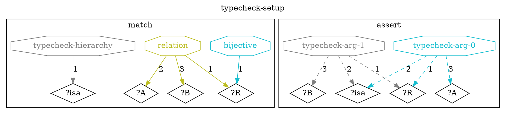
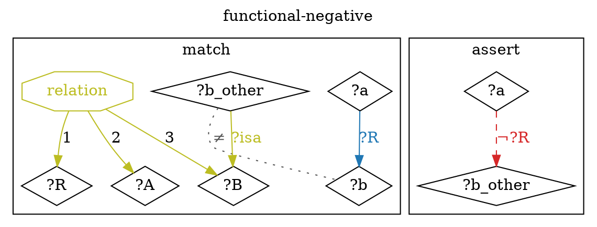
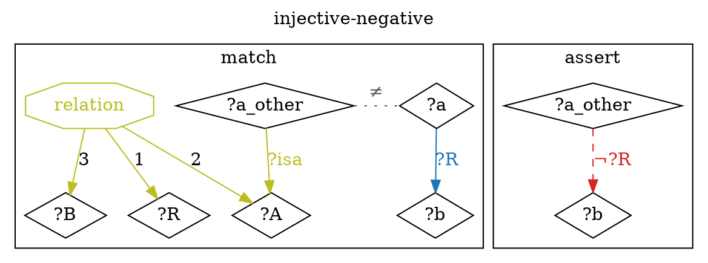
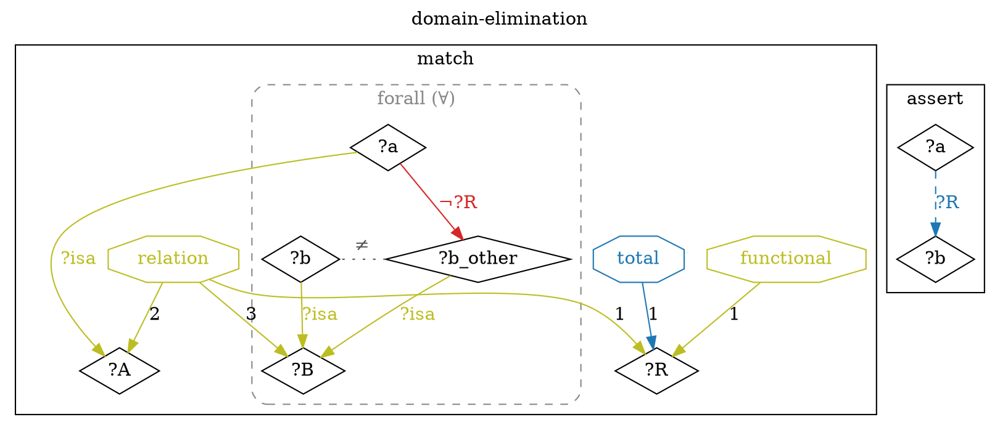
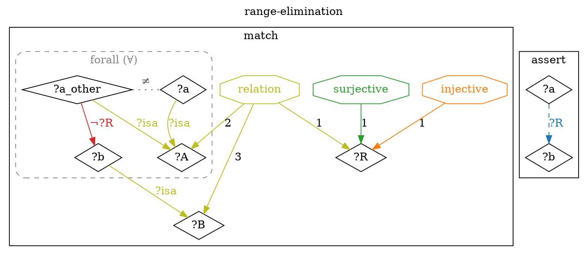
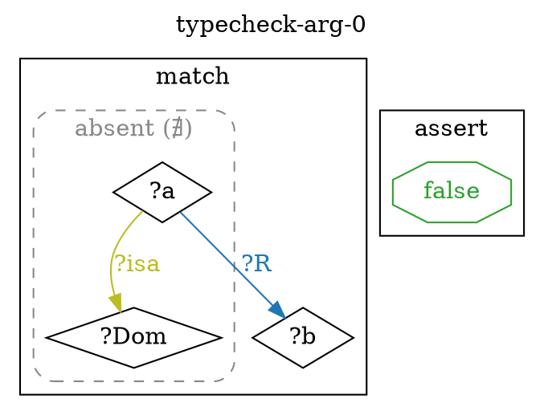
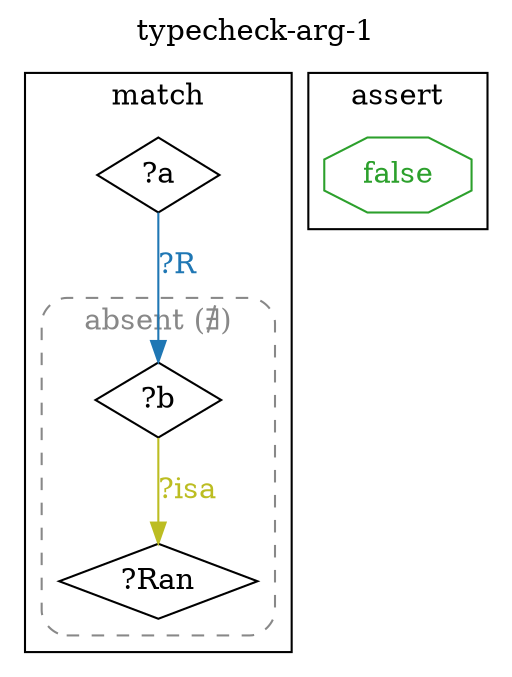
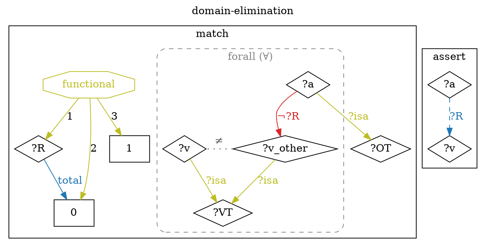
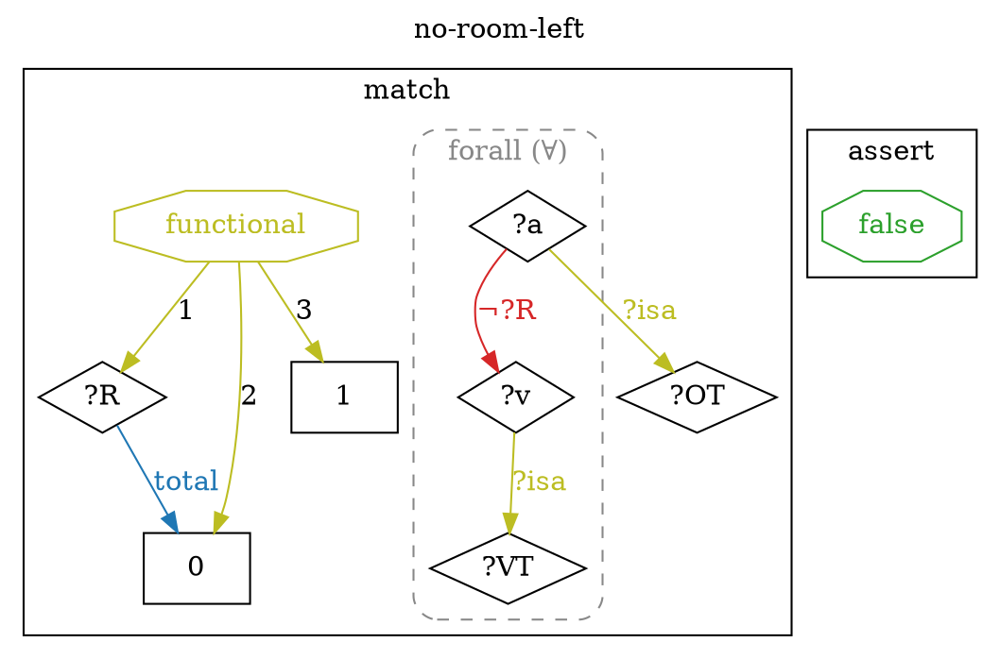

# Bijections and elimination: `std.bijection`, `std.elim`

The inference a bijection licenses, beside [`std.algebra`](02-relation-algebra.md)'s checks: **negative
completion** (a positive excludes the alternatives), **elimination** (the last candidate left is forced), and an
**argument check**. `std.bijection` reads everything off a relation declared `(bijective R)`; `std.elim` is the
same elimination with the labels named in each activator. The labels of a declaration and their members are
[the relation algebra's](02-relation-algebra.md#labels-and-the-membership-relation): for `(relation R A B)`, $A_S$
and $B_S$ are the members the program's membership relation gives the two labels in a state $S$.

## Using `std.bijection`

```lisp
(import std.bijection)
(bijective wears)             ; per relation
(bijection-hierarchy is-a)    ; direct membership: elimination, totality, negatives
(typecheck-hierarchy is-a*)   ; the transitive closure: the argument check
```

`bijective`, `bijection-hierarchy` and `typecheck-hierarchy` are no module's names, so this needs no list. The
import brings `std.algebra` and `std.macro`. The labels are read from `(relation R A B)`, and the membership
relation is a parameter, so a program names it once.

| a program writes | it produces |
|---|---|
| `(bijective R)` and `(bijection-hierarchy isa)` | the eight activators `(total R isa)`, `(surjective R isa)`, `(total-owed R isa)`, `(surjective-owed R isa)`, `(domain-elimination R isa)`, `(range-elimination R isa)`, `(functional-negative R isa)`, `(injective-negative R isa)`, beside `std.algebra`'s four markers of `(bijective R)` |
| `(bijective R)`, declared `(relation R A B)`, and `(typecheck-hierarchy isa)` | `(typecheck-arg-0 R isa A)` and `(typecheck-arg-1 R isa B)` |

What a bijection asserts of a state, with $R(a, b)$ for the fact `(R a b)`:

$$
\begin{aligned}
\text{negative completion} &: \quad R(a, b) \implies \lnot R(a, b') \ \text{for each}\ b' \in B_S,\ b' \neq b; \qquad \lnot R(a', b) \ \text{for each}\ a' \in A_S,\ a' \neq a \\
\text{elimination} &: \quad a \in A_S \land b \in B_S \land \forall b' \in B_S.\ (b' \neq b \to \lnot R(a, b') \in S) \implies R(a, b) \\
\text{the argument check} &: \quad R(a, b) \land a \notin A_S \implies \bot
\end{aligned}
$$

with the dual of each on the other side. Totality and its obligations are `std.algebra`'s.

### Root decides: negatives and elimination

```lisp
(import std.bijection)

(relation is-a  T T          :why "{?1} is a {?2}")
(relation wears Agent Colour :why "{?1} wears {?2}")

(is-a Ann Agent)  (is-a Bob Agent)    (is-a Cid Agent)
(is-a Red Colour) (is-a Green Colour) (is-a Blue Colour)

(bijective wears)
(bijection-hierarchy is-a)

(not (wears Ann Red))
(wears Bob Green)

(query :goal (wears ?who ?colour))
```

<!-- output -->
```text
  ∅                 in R — root is alive and owes nothing
  …
  universe          no candidate: R is {∅} or empty, decided by root alone
  …
  query             (wears ?who ?colour)
  over              all of R — 1 state → 1 projection class
    class 1 of 1    1 state (1)
                      ?colour = Blue · ?who = Ann
                      ?colour = Green · ?who = Bob
                      ?colour = Red · ?who = Cid
  as :expect        (model (wears Ann Blue) (wears Bob Green) (wears Cid Red))
```

Bob's green excludes green for Ann; red was excluded for her by the program; blue is the one colour left, and it is
forced. Then red is the one colour left for Cid. Nothing is guessed.
[`examples/zebra2.ein`](../../../../../examples/zebra2.ein) is the Zebra puzzle in this encoding.

What the two declarations put into a state is plain where the state is small. Two agents, two colours, one fact,
and `ein solve -p`, which prints what a state holds beyond the program:

```lisp
(import std.bijection)

(relation is-a  T T          :why "{?1} is a {?2}")
(relation wears Agent Colour :why "{?1} wears {?2}")

(is-a Ann Agent)  (is-a Bob Agent)
(is-a Red Colour) (is-a Green Colour)

(bijective wears)
(bijection-hierarchy is-a)

(wears Ann Red)

(solve :no-hypothesis (is-a))
```

<!-- output -->
```text
final-state facts (beyond the program as loaded: root's derivations, the commitment and what it derives; 15 facts):
  (not (wears Ann Green))
  (not (wears Bob Red))
  (std.algebra.functional wears)
  (std.algebra.injective wears)
  (std.algebra.surjective wears)
  (std.algebra.surjective wears is-a)
  (std.algebra.surjective-owed wears is-a)
  (std.algebra.total wears)
  (std.algebra.total wears is-a)
  (std.algebra.total-owed wears is-a)
  (std.bijection.domain-elimination wears is-a)
  (std.bijection.functional-negative wears is-a)
  (std.bijection.injective-negative wears is-a)
  (std.bijection.range-elimination wears is-a)
  (wears Bob Green)
```

The two negations are the negative completion of `(wears Ann Red)`, and `(wears Bob Green)` is forced by
elimination. The rest are the activators: `std.algebra`'s four one-argument markers, and the eight the setup
derives. A name the file does not write is printed by its full name.

### Where root owes: the search

With less given, root is alive and owes: the obligations name what is missing, and the search tries the facts that
pay ([Hypotheses](../../03-syntax-and-semantics/09-hypotheses.md)).

```lisp
(import std.bijection)

(relation is-a  T T          :why "{?1} is a {?2}")
(relation wears Agent Colour :why "{?1} wears {?2}")

(is-a Ann Agent)  (is-a Bob Agent)    (is-a Cid Agent)
(is-a Red Colour) (is-a Green Colour) (is-a Blue Colour)

(bijective wears)
(bijection-hierarchy is-a)

(not (wears Ann Red))

(solve :no-hypothesis (is-a))
(query :goal (wears Ann ?colour))
```

<!-- output -->
```text
  ∅                 not in R — root owes 6 instances
    owed            wears owes Ann a Colour.
    owed            wears owes Bob a Colour.
    owed            wears owes Cid a Colour.
    owed            wears owes Red a preimage in Agent.
                    … 2 more instances: --dump-answer DIR writes every one, to DIR/answer.txt
  …
  universe          8 candidates, 0 dead alone
  …
    ;; state 1 of 4 — 3 candidates · minimal and maximal · 5 commitments, 2 minimal
    (model (wears Ann Blue) (wears Bob Green) (wears Cid Red))
    ;; state 2 of 4 — 3 candidates · minimal and maximal · 5 commitments, 2 minimal
    (model (wears Ann Blue) (wears Bob Red) (wears Cid Green))
    ;; state 3 of 4 — 3 candidates · minimal and maximal · 5 commitments, 2 minimal
    (model (wears Ann Green) (wears Bob Blue) (wears Cid Red))
    ;; state 4 of 4 — 3 candidates · minimal and maximal · 5 commitments, 2 minimal
    (model (wears Ann Green) (wears Bob Red) (wears Cid Blue))
  query             (wears Ann ?colour)
  over              all of R — 4 states → 2 projection classes
    class 1 of 2    2 states (1, 2)
                      ?colour = Blue
    class 2 of 2    2 states (3, 4)
                      ?colour = Green
```

Each answer is a bijection that keeps red off Ann.

### A function that is not a bijection

A relation that is a function and not a bijection skips the setup: the program states the markers and the
activators it wants, and lists them.

```lisp
(import std.algebra   :symbols (functional total))
(import std.bijection :symbols (functional-negative domain-elimination))

(relation is-a     T T        :why "{?1} is a {?2}")
(relation lives-in Person Town :why "{?1} lives in {?2}")

(is-a Ann Person) (is-a Bob Person) (is-a Cid Person)
(is-a Oslo Town)  (is-a Rome Town)

(functional lives-in)                 ; a person lives in one town
(total      lives-in)                 ; and in some town
(functional-negative lives-in is-a)
(domain-elimination  lives-in is-a)

(lives-in Ann Oslo)
(not (lives-in Bob Oslo))

(solve :no-search)
(query :goal (lives-in ?who ?where))
```

<!-- output -->
```text
  query             (lives-in ?who ?where)
  over              all of R — 1 state → 1 projection class
    class 1 of 1    1 state (1)
                      ?where = Oslo · ?who = Ann
                      ?where = Rome · ?who = Bob
  as :expect        (model (lives-in Ann Oslo) (lives-in Bob Rome))
```

Ann's town excludes the other for her; Bob's one excluded town leaves Rome. Nothing is said of Cid, and nothing is
derived: no rule here is an obligation, so root owes nothing.

| a program writes | it produces |
|---|---|
| `(functional-negative R isa)` | `(not (R a b'))` for each `(R a b)` and every other member `b'` of the second label |
| `(injective-negative R isa)` | `(not (R a' b))` for each `(R a b)` and every other member `a'` of the first label |
| `(domain-elimination R isa)` | with `(functional R)` and `(total R)`: `(R a b)` where every member of the second label but `b` is stated excluded for `a` |
| `(range-elimination R isa)` | with `(injective R)` and `(surjective R)`: the dual |
| `(typecheck-arg-0 R isa Dom)`, `(typecheck-arg-1 R isa Ran)` | a check: an argument that is not an `isa`-member of the label is a contradiction |

### The argument check

```lisp
(import std.bijection)

(relation is-a  T T          :why "{?1} is a {?2}")
(relation wears Agent Colour :why "{?1} wears {?2}")

(is-a Ann Agent)
(is-a Red Colour)

(bijective wears)
(bijection-hierarchy is-a)
(typecheck-hierarchy is-a)

(wears Zed Red)

(solve :no-search)
```

<!-- output -->
```text
  empty             every node is dead — root's own fixpoint derives (false)

  unsat core        (wears Zed Red)
  refuted by        std.bijection.typecheck-arg-0

  (false)
```

Zed is no agent. [`tests/stdlib/bijection/`](../../../../../tests/stdlib/bijection/) has a program for each rule;
`06_blind_enumeration.ein` runs with the blind enumerator left on, and holds that no candidate is ever a fact of
an activator the setup derives.

## Using `std.elim` — elimination with positional markers

`std.bijection`'s elimination and argument check, with the labels named in each activator and the properties
written as positional markers, `(functional R 0 1)` and `(total R 0)`. The import brings `std.macro`. The markers
are no module's names: a file that also lists `functional` or `total` from `std.algebra` makes them
`std.algebra`'s, and this module no longer reads them.

```lisp
(import std.elim :symbols (domain-elimination no-room-left typecheck-arg-0 typecheck-arg-1))
(functional holds 0 1)
(total      holds 0)
(domain-elimination holds is-a Slot Value)
```

| a program writes | it produces |
|---|---|
| `(domain-elimination R isa OT VT)` | with `(functional R 0 1)` and `(total R 0)`: the one member of `VT` left for a member `a` of `OT` is forced, `(R a v)` |
| `(no-room-left R isa OT VT)` | with the same two markers, a check: every member of `VT` excluded for `a` is a contradiction |
| `(typecheck-arg-0 R isa Dom)`, `(typecheck-arg-1 R isa Ran)` | a check: argument 0 or 1 not an `isa`-member of `Dom` or `Ran` is a contradiction |

[`tests/stdlib/elim/01_domain_elimination.ein`](../../../../../tests/stdlib/elim/01_domain_elimination.ein): two
of three values are excluded for the first slot, and nothing for the second.

```lisp
(import std.macro :symbols (forall unknown))
(import std.elim  :symbols (domain-elimination no-room-left))

(relation is-a      T T        :why "{?1} is a {?2}")
(relation holds     Slot Value :why "{?1} holds {?2}")
(relation undecided Slot Value :why "whether {?1} holds {?2} is still open")

(is-a S1 Slot) (is-a S2 Slot) (is-a S3 Slot)
(is-a V1 Value) (is-a V2 Value) (is-a V3 Value)

(functional holds 0 1)
(total      holds 0)
(domain-elimination holds is-a Slot Value)
(no-room-left       holds is-a Slot Value)

(not (holds S1 V1))
(not (holds S1 V2))

(rule probe-undecided ()
  :match  (unknown (holds S2 V1))
  :assert (undecided S2 V1)
  :why    "S2 has nothing excluded, so nothing may be forced into it")

(solve
  :no-hypothesis (is-a holds undecided)
  :expect (region (model (holds S1 V3)
                         (not (holds S1 V1)) (not (holds S1 V2))
                         (undecided S2 V1))))

(query
  :goal (holds ?slot ?value))
```

<!-- output -->
```text
  query             (holds ?slot ?value)
  over              all of R — 1 state → 1 projection class
    class 1 of 1    1 state (1)
                      ?slot = S1 · ?value = V3
  as :expect        (model (holds S1 V3))

  (solve :expect)   holds
```

With all three excluded, in `02_no_room_left.ein`, root is dead:

<!-- output -->
```text
  unsat core        (functional holds 0 1)
  unsat core        (is-a S1 Slot)
  unsat core        (not (holds S1 V1))
  unsat core        (not (holds S1 V2))
  unsat core        (not (holds S1 V3))
  unsat core        (total holds 0)
  refuted by        no-room-left

  (false)
```

`std.elim` and `std.bijection` both declare `domain-elimination`, `typecheck-arg-0` and `typecheck-arg-1`: a file
that imports both lists each from one of them ([the index](README.md#what-to-list)).

## How it works

### `std.bijection`

Two setup rules with no parameter turn the program's declarations into activators, and six rules do the work.
`domain-elimination` and `range-elimination` read `std.algebra`'s one-argument markers, which is why the module
lists `functional`, `injective`, `total` and `surjective` from it.

#### `bijective-setup`

Fans a `(bijective R)` and the hierarchy out into eight activators: `std.algebra`'s two totality checks and two
obligations, and this module's two eliminations and two negative completions.

<!-- rule std.bijection bijective-setup -->
```lisp
(rule bijective-setup ()
  :match  (and (bijective ?R) (bijection-hierarchy ?isa))
  :assert (and (total ?R ?isa) (surjective ?R ?isa)
               (total-owed ?R ?isa) (surjective-owed ?R ?isa)
               (domain-elimination ?R ?isa) (range-elimination ?R ?isa)
               (functional-negative ?R ?isa) (injective-negative ?R ?isa))
  :why    "(bijective {?R}) + hierarchy {?isa} ⟹ totality / obligations / elimination / negative-completion activators.")
```


<!-- /rule -->

```dot
digraph rule_bijective_setup_lhs_rhs {
  rankdir=TB;
  label="bijective-setup"; labelloc=t;
  subgraph cluster_lhs { label="match";
    "?R_L" [label="?R", shape=diamond];
    "?isa_L" [label="?isa", shape=diamond];
    "h1_bijective_L" [shape=octagon, label="bijective", color="#17becf", fontcolor="#17becf"];
    "h1_bijective_L" -> "?R_L" [label="1", color="#17becf"];
    "h2_bijection-hierarchy_L" [shape=octagon, label="bijection-hierarchy", color="#8c564b", fontcolor="#8c564b"];
    "h2_bijection-hierarchy_L" -> "?isa_L" [label="1", color="#8c564b"];
  }
  subgraph cluster_rhs { label="assert";
    "?R_R" [label="?R", shape=diamond];
    "?isa_R" [label="?isa", shape=diamond];
    "?R_R" -> "?isa_R" [label="total", color="#1f77b4", fontcolor="#1f77b4", style=dashed];
    "?R_R" -> "?isa_R" [label="surjective", color="#2ca02c", fontcolor="#2ca02c", style=dashed];
    "?R_R" -> "?isa_R" [label="total-owed", color="#2ca02c", fontcolor="#2ca02c", style=dashed];
    "?R_R" -> "?isa_R" [label="surjective-owed", color="#17becf", fontcolor="#17becf", style=dashed];
    "?R_R" -> "?isa_R" [label="domain-elimination", color="#17becf", fontcolor="#17becf", style=dashed];
    "?R_R" -> "?isa_R" [label="range-elimination", color="#d62728", fontcolor="#d62728", style=dashed];
    "?R_R" -> "?isa_R" [label="functional-negative", color="#8c564b", fontcolor="#8c564b", style=dashed];
    "?R_R" -> "?isa_R" [label="injective-negative", color="#2ca02c", fontcolor="#2ca02c", style=dashed];
  }
}
```

#### `typecheck-setup`

Reads the two labels off the declaration and activates the argument check of each.

<!-- rule std.bijection typecheck-setup -->
```lisp
(rule typecheck-setup ()
  :match  (and (relation ?R ?A ?B) (bijective ?R) (typecheck-hierarchy ?isa))
  :assert (and (typecheck-arg-0 ?R ?isa ?A) (typecheck-arg-1 ?R ?isa ?B))
  :why    "(bijective {?R}) typed {?A}×{?B} + hierarchy {?isa} ⟹ typecheck activators.")
```


<!-- /rule -->

#### `functional-negative`

A positive excludes every other member of the second label for the same first argument.

<!-- rule std.bijection functional-negative -->
```lisp
(rule functional-negative (?R ?isa)
  :match  (and (?R ?a ?b)
               (relation ?R ?A ?B)
               (?isa ?b_other ?B)
               (neq ?b_other ?b))
  :assert (not (?R ?a ?b_other))
  :why    "{?R} functional: ({?R} {?a} {?b}) ⟹ (not ({?R} {?a} {?b_other})).")
```


<!-- /rule -->

#### `injective-negative`

A positive excludes every other member of the first label for the same second argument.

<!-- rule std.bijection injective-negative -->
```lisp
(rule injective-negative (?R ?isa)
  :match  (and (?R ?a ?b)
               (relation ?R ?A ?B)
               (?isa ?a_other ?A)
               (neq ?a_other ?a))
  :assert (not (?R ?a_other ?b))
  :why    "{?R} injective: ({?R} {?a} {?b}) ⟹ (not ({?R} {?a_other} {?b})).")
```


<!-- /rule -->

#### `domain-elimination`

Forces the one partner left: the `forall` says that every other member of the second label is stated excluded.

<!-- rule std.bijection domain-elimination -->
```lisp
(rule domain-elimination (?R ?isa)
  :match  (and (functional ?R) (total ?R)
               (relation ?R ?A ?B)
               (?isa ?a ?A)
               (?isa ?b ?B)
               (forall ?b_other
                 (and (?isa ?b_other ?B) (neq ?b_other ?b))
                 (not (?R ?a ?b_other))))
  :assert (?R ?a ?b)
  :why    "every {?B} except {?b} excluded for {?a} → ({?R} {?a} {?b}).")
```


<!-- /rule -->

#### `range-elimination`

The dual, on the first label.

<!-- rule std.bijection range-elimination -->
```lisp
(rule range-elimination (?R ?isa)
  :match  (and (injective ?R) (surjective ?R)
               (relation ?R ?A ?B)
               (?isa ?b ?B)
               (?isa ?a ?A)
               (forall ?a_other
                 (and (?isa ?a_other ?A) (neq ?a_other ?a))
                 (not (?R ?a_other ?b))))
  :assert (?R ?a ?b)
  :why    "every {?A} except {?a} excluded for {?b} → ({?R} {?a} {?b}).")
```


<!-- /rule -->

#### `typecheck-arg-0`

Refutes a fact whose first argument is no member of the label; the `absent` is the closed-world reading of
membership.

<!-- rule std.bijection typecheck-arg-0 -->
```lisp
(rule typecheck-arg-0 (?R ?isa ?Dom)
  :match  (and (?R ?a ?b) (absent (?isa ?a ?Dom)))
  :assert (false)
  :why    "{?R} arg 0 expects {?Dom} (via {?isa}); {?a} is not a {?Dom}.")
```


<!-- /rule -->

#### `typecheck-arg-1`

The same for the second argument.

<!-- rule std.bijection typecheck-arg-1 -->
```lisp
(rule typecheck-arg-1 (?R ?isa ?Ran)
  :match  (and (?R ?a ?b) (absent (?isa ?b ?Ran)))
  :assert (false)
  :why    "{?R} arg 1 expects {?Ran} (via {?isa}); {?b} is not a {?Ran}.")
```


<!-- /rule -->

### `std.elim`

Four rules, each activated directly. The markers `(functional ?R 0 1)` and `(total ?R 0)` are premises, facts of
relations the module does not declare.

#### `typecheck-arg-0`

Refutes a fact whose first argument is no member of `?Dom`.

<!-- rule std.elim typecheck-arg-0 -->
```lisp
(rule typecheck-arg-0 (?R ?isa ?Dom)
  :match  (and (?R ?a ?b)
               (absent (?isa ?a ?Dom)))
  :assert (false)
  :why    "{?R} arg 0 expects {?Dom} (via {?isa}); {?a} is not a {?Dom}")
```


<!-- /rule -->

#### `typecheck-arg-1`

Refutes a fact whose second argument is no member of `?Ran`.

<!-- rule std.elim typecheck-arg-1 -->
```lisp
(rule typecheck-arg-1 (?R ?isa ?Ran)
  :match  (and (?R ?a ?b)
               (absent (?isa ?b ?Ran)))
  :assert (false)
  :why    "{?R} arg 1 expects {?Ran} (via {?isa}); {?b} is not a {?Ran}")
```


<!-- /rule -->

#### `domain-elimination`

Forces the one value left for an object.

<!-- rule std.elim domain-elimination -->
```lisp
(rule domain-elimination (?R ?isa ?OT ?VT)
  :match  (and (functional ?R 0 1)
               (total      ?R 0)
               (?isa ?a ?OT)
               (?isa ?v ?VT)
               (forall ?v_other
                 (and (?isa ?v_other ?VT) (neq ?v_other ?v))
                 (not (?R ?a ?v_other))))
  :assert (?R ?a ?v)
  :why    "every {?VT} except {?v} excluded for {?a} → ({?R} {?a} {?v})")
```


<!-- /rule -->

#### `no-room-left`

Refutes an object every value of which is excluded.

<!-- rule std.elim no-room-left -->
```lisp
(rule no-room-left (?R ?isa ?OT ?VT)
  :match  (and (functional ?R 0 1)
               (total      ?R 0)
               (?isa ?a ?OT)
               (forall ?v
                 (?isa ?v ?VT)
                 (not (?R ?a ?v))))
  :assert (false)
  :why    "{?a} has every {?VT} excluded — no value left")
```


<!-- /rule -->
