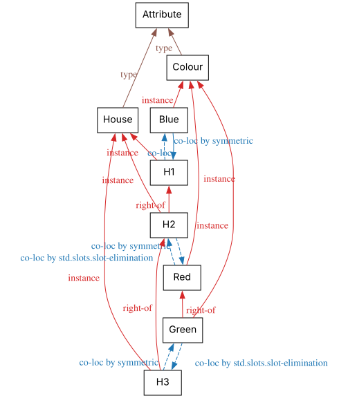

# Slots: `std.slots`

Where [`std.bijection`](04-bijections.md) equips one relation an attribute, each a bijection onto the positions,
this module equips **one** relation shared by every attribute: an equivalence R whose classes are *slots*, each
holding exactly one member of every attribute. `(bijective R)` cannot say this, since the property holds between
each pair of attributes and not of R as a whole; so it is scoped by a family of labels instead. Its rules, drawn,
are [the next page](06-slots-rules.md).

## Using it

```lisp
(import std.algebra :symbols (symmetric))
(import std.slots)
(symmetric co-located)
(slot-partition co-located instance type Attribute House)
(slot-spatial   co-located next-to instance House)
```

`slot-partition` and `slot-spatial` are no module's names, so `std.slots` needs no list. The import brings
`std.macro`; R's symmetry is `std.algebra`'s, which the program imports and declares, and its negative mirror
comes with it.

| a program writes | it means |
|---|---|
| `(slot-partition R isa sub Super Index)` | R is an equivalence relation; its classes are slots; each slot holds exactly one `isa`-member of every label that is a direct `sub`-child of `Super`; and a slot's `Index` member is its name |
| `(slot-spatial R S isa PT)` | S relates two values exactly when it relates their slots, and the members of `PT` carry S's structure |

A **value**, on this page and the next, is `std.slots`' word for an atom that sits in a slot: the value an
attribute takes there, `Green` for the colour of a house. It is an atom like any other.

With $\operatorname{slot}(v)$ for the member of `Index` that $v$ shares a class with, and $T_S$ for the members of
a label $T$ in a state $S$ ([labels](02-relation-algebra.md#labels-and-the-membership-relation)):

$$
\begin{aligned}
\text{slot-partition} &:\ \ \bigl|\lbrace\, v \in T_S : R(v, i) \,\rbrace\bigr| = 1 && \text{for every } i \in \mathit{Index}_S \text{ and every } T \text{ with } \operatorname{sub}(T, \mathit{Super}) \\
\text{slot-spatial} &:\ \ S(a, b) \iff S(\operatorname{slot}(a), \operatorname{slot}(b))
\end{aligned}
$$

So one relation name is both a constraint between values, `(right-of Green Ivory)`, and the structure it is
resolved against, `(right-of House-2 House-1)`; the rules tell them apart by membership of `PT`, never by name.

Transitivity holds of R and justifies the rules, but must **not** be declared: each conclusion is anchored at the
slot's index, which keeps the derived facts on the rectangle of attribute by index rather than every pair inside a
class. A puzzle whose clues never name an index would need `(transitive R)` and pays for it.

### A partition: who sits where

```lisp
(import std.algebra :symbols (symmetric))
(import std.slots)

(relation type     T T                 :why "{?3} is a kind of {?4}")
(relation instance T T                 :why "{?3} is a {?4}")
(relation co-loc   Attribute Attribute :why "{?3} and {?4} are in the same seat")

(symmetric co-loc)
(slot-partition co-loc instance type Attribute Seat)

(type Seat Attribute) (type Who Attribute) (type Pet Attribute)
(instance S1 Seat) (instance S2 Seat)
(instance Ann Who) (instance Bob Who)
(instance Cat Pet) (instance Dog Pet)

(co-loc Ann Cat)
(co-loc Ann S1)

(query :goal (co-loc ?who S2))
```

<!-- output -->
```text
  ∅                 in R — root is alive and owes nothing
  …
  universe          no candidate: R is {∅} or empty, decided by root alone
  …
  query             (co-loc ?who S2)
  over              all of R — 1 state → 1 projection class
    class 1 of 1    1 state (1)
                      ?who = Bob
                      ?who = Dog
  as :expect        (model (co-loc Bob S2) (co-loc Dog S2))
```

R is the one state root is: Ann and the cat take seat 1, so Bob and the dog are left seat 2.
[`examples/zebra.ein`](../../../../../examples/zebra.ein) is the Zebra puzzle in this encoding, and reaches the same
model as `zebra2.ein`.

What the partition produces, rule by rule:

| from `slot-partition` | a state gains |
|---|---|
| `slot-locate` | `(R a i)` from `(R a b)` and `(R b i)`, `i` an index: a clue between two attributes becomes a placement |
| `slot-exclusive` | `(not (R a b))` for two distinct members of one label |
| `slot-occupied` | `(not (R a c))` from `(R a b)`, for every other `c` of `b`'s label |
| `slot-negative` | `(not (R a i))` from `(R a b)` and `(not (R b i))` |
| `slot-elimination` | `(R a i)` where every index but `i` is excluded for `a` |
| `slot-fill` | `(R i v)` where every member of a label but `v` is excluded for slot `i` |
| `slot-no-room`, `slot-no-fill` | `(false)`: a value with every slot excluded, a slot with every member of a label excluded |
| `slot-owed-room`, `slot-owed-fill` | the obligations of the two above: a value in no slot yet, a slot with no member of a label yet, each `(open R)` |

### A row: one relation, between slots and between values

```lisp
(import std.algebra :symbols (symmetric))
(import std.slots)

(relation type     T T                 :why "{?3} is a kind of {?4}")
(relation instance T T                 :why "{?3} is a {?4}")
(relation co-loc   Attribute Attribute :why "{?3} and {?4} are in the same house")
(relation right-of Attribute Attribute :why "{?3} is just to the right of {?4}")

(symmetric co-loc)
(slot-partition co-loc instance type Attribute House)
(slot-spatial   co-loc right-of instance House)

(type House Attribute) (type Colour Attribute)
(instance H1 House) (instance H2 House) (instance H3 House)
(instance Red Colour) (instance Green Colour) (instance Blue Colour)

(right-of H2 H1) (right-of H3 H2)      ; the row: the structure
(right-of Green Red)                   ; a clue: the same relation, between values
(co-loc Blue H1)

(query :goal (co-loc ?colour H2))
(query :goal (co-loc ?colour H3))
```

<!-- output -->
```text
  query 1 of 2      (co-loc ?colour H2)
  over              all of R — 1 state → 1 projection class
    class 1 of 1    1 state (1)
                      ?colour = Red
  as :expect        (model (co-loc Red H2))

  query 2 of 2      (co-loc ?colour H3)
  over              all of R — 1 state → 1 projection class
    class 1 of 1    1 state (1)
                      ?colour = Green
  as :expect        (model (co-loc Green H3))
```

The state as `ein render kb --fold` draws it, each fact of three arrows one labelled arrow, and of it the facts of
`type`, `instance`, `right-of` and `co-loc` alone: the declarations' facts, the facts that apply a rule and the
stored negations are left out. The solid `right-of` arrows are the row and the clue; each dashed `co-loc` arrow is a
placement a rule derived, labelled with the rule.



Blue is in house 1, so red is not; green is just to the right of red, and house 1 has nothing to its left, so
green is not there either. Red in house 3 would put green off the row. So red is in house 2 and green in house 3.

| from `slot-spatial` | a state gains |
|---|---|
| `slot-adjacent-fwd`, `-bwd` | from `(S a b)` with `b` at a position whose only S-neighbour is `p`: `a` at `p`, and the reverse |
| `slot-adjacent-fwd-neg`, `-bwd-neg` | their contrapositives: a negative on one side of a spatial clue reaches the other |
| `slot-prune-fwd`, `-bwd` | once one end is placed, the other is excluded from every position that is not its S-neighbour |
| `slot-endpoint-fwd`, `-bwd` | a position with no S-source cannot hold `b`, one with no S-target cannot hold `a` |

Every negative is a stated consequence of the partition, except the `absent` guards of the spatial rules, which
read the position structure alone: sound where that structure is decided by saturation, as a row of houses is.

### Where root owes: the search

Without the blue house's place, root is alive and owes every colour a house and every house a colour. The search
tries the placements that pay:

```lisp
(import std.algebra :symbols (symmetric))
(import std.slots)

(relation type     T T                 :why "{?3} is a kind of {?4}")
(relation instance T T                 :why "{?3} is a {?4}")
(relation co-loc   Attribute Attribute :why "{?3} and {?4} are in the same house")
(relation right-of Attribute Attribute :why "{?3} is just to the right of {?4}")

(symmetric co-loc)
(slot-partition co-loc instance type Attribute House)
(slot-spatial   co-loc right-of instance House)

(type House Attribute) (type Colour Attribute)
(instance H1 House) (instance H2 House) (instance H3 House)
(instance Red Colour) (instance Green Colour) (instance Blue Colour)

(right-of H2 H1) (right-of H3 H2)
(right-of Green Red)

(solve :no-hypothesis (type instance right-of))
(query :goal (co-loc Red ?house))
```

<!-- output -->
```text
  ∅                 not in R — root owes 6 instances
    owed            Red is in no slot yet — some House is still owed.
    owed            Green is in no slot yet — some House is still owed.
    owed            Blue is in no slot yet — some House is still owed.
    owed            slot H1 has no Colour yet — one is still owed.
                    … 2 more instances: --dump-answer DIR writes every one, to DIR/answer.txt
  …
  universe          14 candidates, 2 dead alone
  …
    ;; state 1 of 2 — 6 candidates · minimal and maximal · 63 commitments, 6 minimal
    (model (co-loc Blue H1) (co-loc Green H3) (co-loc H1 Blue) (co-loc H2 Red)
           (co-loc H3 Green) (co-loc Red H2))
    ;; state 2 of 2 — 6 candidates · minimal and maximal · 63 commitments, 6 minimal
    (model (co-loc Blue H3) (co-loc Green H2) (co-loc H1 Red)
           (co-loc H2 Green) (co-loc H3 Blue) (co-loc Red H1))
  query             (co-loc Red ?house)
  over              all of R — 2 states → 2 projection classes
    class 1 of 2    1 state (2)
                      ?house = H1
    class 2 of 2    1 state (1)
                      ?house = H2
```

Two rows keep green just to the right of red.

### No room

A value excluded from every slot is a contradiction:

```lisp
(import std.algebra :symbols (symmetric))
(import std.slots)

(relation type     T T                 :why "{?3} is a kind of {?4}")
(relation instance T T                 :why "{?3} is a {?4}")
(relation co-loc   Attribute Attribute :why "{?3} and {?4} are in the same seat")

(symmetric co-loc)
(slot-partition co-loc instance type Attribute Seat)

(type Seat Attribute) (type Who Attribute)
(instance S1 Seat) (instance S2 Seat)
(instance Ann Who) (instance Bob Who)

(not (co-loc Ann S1))
(not (co-loc Ann S2))

(solve :no-search)
```

<!-- output -->
```text
  empty             every node is dead — root's own fixpoint holds a contradiction

  unsat core        (instance Ann Who)
  unsat core        (not (co-loc Ann S1))
  unsat core        (not (co-loc Ann S2))
  unsat core        (type Who Attribute)
  refuted by        std.slots.slot-no-room

  (false)
```

The obligation is the same question asked before anything is excluded.
[`tests/stdlib/slots/09_owed_room.ein`](../../../../../tests/stdlib/slots/09_owed_room.ein) activates
`slot-owed-room` alone and judges root:

```lisp
(import std.slots :symbols (slot-owed-room))

(relation type     T T :why "{?3} is a subtype of {?4}")
(relation instance T T :why "{?3} is an instance of {?4}")
(relation co-loc   Attribute Attribute :why "{?3} and {?4} are in the same seat")

(slot-owed-room co-loc instance type Attribute Seat)

(type Attribute T)
(type Seat Attribute) (type Who Attribute) (type Pet Attribute)

(instance S1 Seat) (instance S2 Seat)
(instance Ann Who) (instance Bob Who)
(instance Cat Pet) (instance Dog Pet)

(co-loc Ann S1)              ; Bob, Cat and Dog are still owed a seat

;; Root alone (Q-M1f.254): this file's question is what root owes, so
;; nothing is guessed. R is empty, and root, which owes, is the owing node
;; it stops at. `:no-search` is the one way to say so: a `:no-hypothesis`
;; list naming `co-loc`, the relation the obligation owes, contradicts the
;; obligation and is refused (Q-M1f.244), and with the obligation free to
;; propose, R would be the states that pay, which is another question.
;; The claim is root's state, under `owing`.
(solve
  :no-search
  :expect (region (owing (model (co-loc Ann S1)))))

(query
  :goal (co-loc ?a ?b))
```

<!-- output -->
```text
  owing             ∅ — owes 3
                      Bob is in no slot yet — some Seat is still owed.
                      Cat is in no slot yet — some Seat is still owed.
                      Dog is in no slot yet — some Seat is still owed.

  (region (owing (model)))
```

A rule of the module may be activated by itself, as that program does, with the activator its parameters name; the
file then lists it. [`tests/stdlib/slots/`](../../../../../tests/stdlib/slots/) has a program for each rule.

### The words it shares

A fact of a relation no module declares has no full name: `(bijective R)` is the same fact whoever writes it. So a module that reads such a relation reads it in every program that imports the module, a fact the program wrote for a rule of its own among them, and a module that writes one writes the program's fact. These are the words the module reads and does not declare: `slot-partition`, read by `slot-partition-setup`, and
`slot-spatial`, read by `slot-spatial-setup`. A program writes them to use the module, `(slot-partition R isa sub
Super Index)`, and a fact of either that a program writes for a rule of its own activates the module's rules too.

## How it works

Two setup rules turn the two declarations into the activators of the others. Every rule is on
[the next page](06-slots-rules.md), as Ein and as the engine draws it.
