# The slots' rules

How `std.slots` works: every rule of the module, as it writes it and as the engine draws it. What a program
writes to use it is [the page before](05-slots.md); how to read a drawing is
[the index](README.md#how-a-rule-is-shown).

The parameters every rule shares: `?R` is the co-location relation, `?isa` the membership relation, `?sub` the
relation that puts a label under `?super`, `?index` the label whose members name the slots; in the spatial rules
`?S` is the relation that holds between slots and between values, and `?PT` the label of the positions. A *value*
is the module's word for an atom that sits in a slot ([the page before](05-slots.md#using-it)).

## The setup

Two rules with no parameter read the two declarations a program writes and derive the activators of the others.

#### `slot-partition-setup`

Fans `(slot-partition R isa sub Super Index)` out into the activators of the partition rules.

<!-- rule std.slots slot-partition-setup -->
```lisp
(rule slot-partition-setup ()
  :match  (slot-partition ?R ?isa ?sub ?super ?index)
  :assert (and (slot-locate      ?R ?isa ?index)
               (slot-exclusive   ?R ?isa ?sub ?super)
               (slot-occupied    ?R ?isa ?sub ?super)
               (slot-negative    ?R ?isa ?index)
               (slot-elimination ?R ?isa ?sub ?super ?index)
               (slot-fill        ?R ?isa ?sub ?super ?index)
               (slot-no-room     ?R ?isa ?sub ?super ?index)
               (slot-no-fill     ?R ?isa ?sub ?super ?index)
               (slot-owed-room   ?R ?isa ?sub ?super ?index)
               (slot-owed-fill   ?R ?isa ?sub ?super ?index))
  :why    "(slot-partition {?R} …) ⟹ locate / exclusion / occupancy / negative-propagation / elimination / fill / no-room / no-fill / owed-room / owed-fill activators.")
```

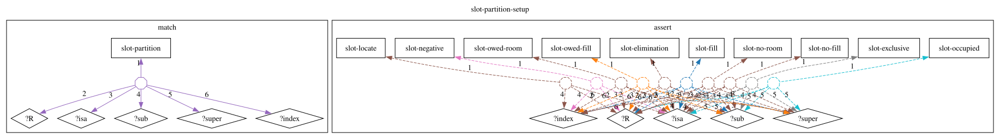
<!-- /rule -->

#### `slot-spatial-setup`

Fans `(slot-spatial R S isa PT)` out into the activators of the spatial rules.

<!-- rule std.slots slot-spatial-setup -->
```lisp
(rule slot-spatial-setup ()
  :match  (slot-spatial ?R ?S ?isa ?PT)
  :assert (and (slot-adjacent-fwd     ?R ?S ?isa ?PT)
               (slot-adjacent-bwd     ?R ?S ?isa ?PT)
               (slot-adjacent-fwd-neg ?R ?S ?isa ?PT)
               (slot-adjacent-bwd-neg ?R ?S ?isa ?PT)
               (slot-prune-fwd        ?R ?S ?isa ?PT)
               (slot-prune-bwd        ?R ?S ?isa ?PT)
               (slot-endpoint-fwd     ?R ?S ?isa ?PT)
               (slot-endpoint-bwd     ?R ?S ?isa ?PT))
  :why    "(slot-spatial {?R} {?S} …) ⟹ the eight directional propagation / pruning / endpoint activators.")
```

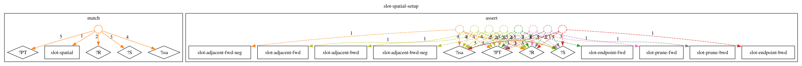
<!-- /rule -->

## The partition rules

### Placing

#### `slot-locate`

Transitivity with its conclusion pinned to the slot's index: a clue between two values becomes a placement of the
first.

<!-- rule std.slots slot-locate -->
```lisp
(rule slot-locate (?R ?isa ?index)
  :match  (and (?R ?a ?b)
               (?R ?b ?i)
               (?isa ?i ?index)
               (neq ?a ?i))
  :assert (?R ?a ?i)
  :why    "{?a} shares a slot with {?b}, and {?b} is at {?i} ⟹ {?a} is at {?i}.")
```

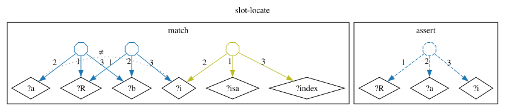
<!-- /rule -->

### The negatives a placement implies

#### `slot-exclusive`

Two distinct members of one label are never in one slot.

<!-- rule std.slots slot-exclusive -->
```lisp
(rule slot-exclusive (?R ?isa ?sub ?super)
  :match  (and (?isa ?a ?T)
               (?sub ?T ?super)
               (?isa ?b ?T)
               (neq ?a ?b))
  :assert (not (?R ?a ?b))
  :why    "{?a} and {?b} are distinct {?T}s — they cannot share a slot under {?R}.")
```

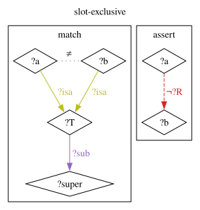
<!-- /rule -->

#### `slot-occupied`

A value co-located with a member of a label is co-located with no other member of it.

<!-- rule std.slots slot-occupied -->
```lisp
(rule slot-occupied (?R ?isa ?sub ?super)
  :match  (and (?R ?a ?b)
               (?isa ?b ?T)
               (?sub ?T ?super)
               (?isa ?c ?T)
               (neq ?c ?b))
  :assert (not (?R ?a ?c))
  :why    "{?a}'s slot already holds the {?T} {?b} ⟹ it does not hold {?c}.")
```

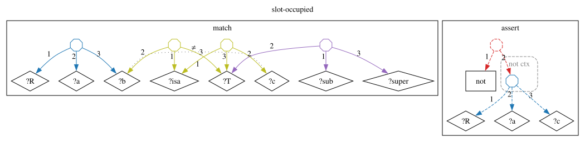
<!-- /rule -->

#### `slot-negative`

A value co-located with something excluded from a slot is excluded from that slot.

<!-- rule std.slots slot-negative -->
```lisp
(rule slot-negative (?R ?isa ?index)
  :match  (and (?R ?a ?b)
               (not (?R ?b ?i))
               (?isa ?i ?index))
  :assert (not (?R ?a ?i))
  :why    "{?a} shares a slot with {?b}, and {?b} cannot be at {?i} ⟹ neither can {?a}.")
```

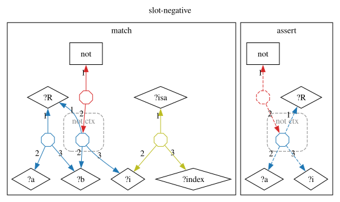
<!-- /rule -->

### The last candidate left

Both are written with `std.macro`'s `forall`: every other candidate is stated excluded.

#### `slot-elimination`

The one index left for a value is its slot.

<!-- rule std.slots slot-elimination -->
```lisp
(rule slot-elimination (?R ?isa ?sub ?super ?index)
  :match  (and (?isa ?a ?Ta)
               (?sub ?Ta ?super)
               (neq ?Ta ?index)
               (?isa ?i ?index)
               (forall ?i_other
                 (and (?isa ?i_other ?index) (neq ?i_other ?i))
                 (not (?R ?a ?i_other))))
  :assert (?R ?a ?i)
  :why    "every slot except {?i} is excluded for {?a} ⟹ {?a} is at {?i}.")
```

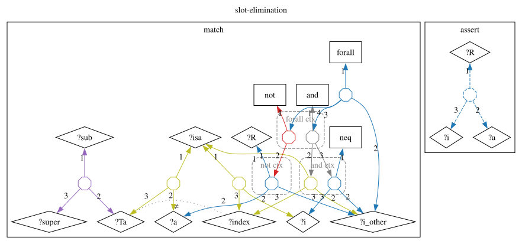
<!-- /rule -->

#### `slot-fill`

The one member of a label left for a slot fills it.

<!-- rule std.slots slot-fill -->
```lisp
(rule slot-fill (?R ?isa ?sub ?super ?index)
  :match  (and (?isa ?i ?index)
               (?sub ?Tv ?super)
               (neq ?Tv ?index)
               (?isa ?v ?Tv)
               (forall ?v_other
                 (and (?isa ?v_other ?Tv) (neq ?v_other ?v))
                 (not (?R ?i ?v_other))))
  :assert (?R ?i ?v)
  :why    "every {?Tv} except {?v} is excluded for slot {?i} ⟹ {?v} is at {?i}.")
```

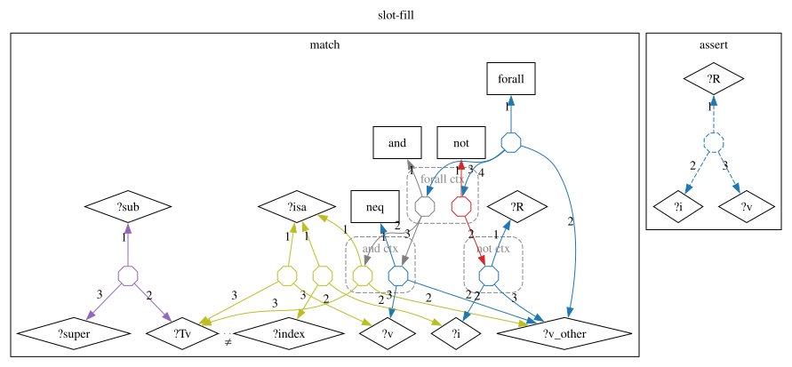
<!-- /rule -->

### Nothing left

#### `slot-no-room`

A value with every slot excluded is a contradiction.

<!-- rule std.slots slot-no-room -->
```lisp
(rule slot-no-room (?R ?isa ?sub ?super ?index)
  :match  (and (?isa ?a ?Ta)
               (?sub ?Ta ?super)
               (neq ?Ta ?index)
               (forall ?i (?isa ?i ?index) (not (?R ?a ?i))))
  :assert (false)
  :why    "{?a} has every slot excluded — there is nowhere left for it.")
```

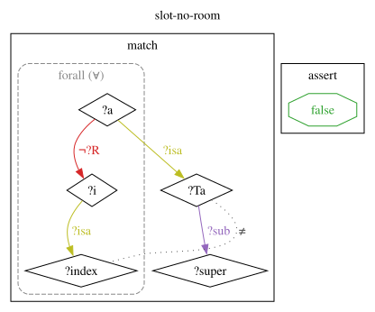
<!-- /rule -->

#### `slot-no-fill`

A slot with every member of a label excluded is a contradiction.

<!-- rule std.slots slot-no-fill -->
```lisp
(rule slot-no-fill (?R ?isa ?sub ?super ?index)
  :match  (and (?isa ?i ?index)
               (?sub ?Tv ?super)
               (neq ?Tv ?index)
               (forall ?v (?isa ?v ?Tv) (not (?R ?i ?v))))
  :assert (false)
  :why    "slot {?i} has every {?Tv} excluded — it has no {?Tv} left.")
```

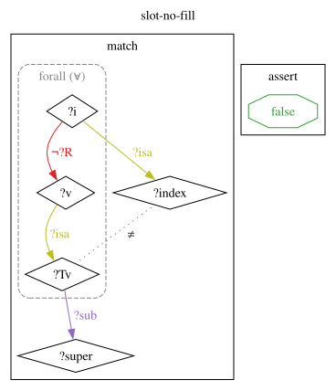
<!-- /rule -->

### What is still owed

The obligations of the two rules above: the same question where nothing is stated yet. Each concludes `(open ?R)`,
derives nothing, and is read once over a state that has stopped changing.

#### `slot-owed-room`

A value in no slot yet: the relation owes it one.

<!-- rule std.slots slot-owed-room -->
```lisp
(rule slot-owed-room (?R ?isa ?sub ?super ?index)
  :match  (and (?isa ?a ?Ta)
               (?sub ?Ta ?super)
               (neq ?Ta ?index)
               (absent (and (?isa ?i ?index) (?R ?a ?i))))
  :assert (open ?R)
  :why    "{?a} is in no slot yet — some {?index} is still owed.")
```

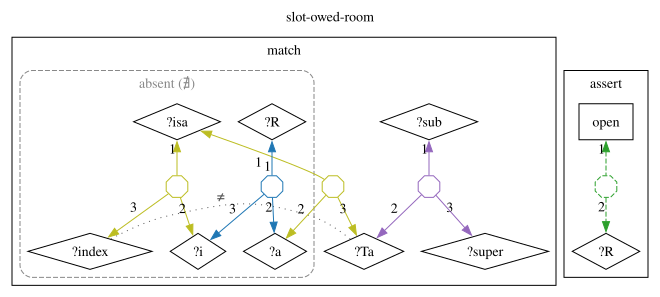
<!-- /rule -->

#### `slot-owed-fill`

A slot with no member of a label yet: the relation owes it one.

<!-- rule std.slots slot-owed-fill -->
```lisp
(rule slot-owed-fill (?R ?isa ?sub ?super ?index)
  :match  (and (?isa ?i ?index)
               (?sub ?Tv ?super)
               (neq ?Tv ?index)
               (absent (and (?isa ?v ?Tv) (?R ?i ?v))))
  :assert (open ?R)
  :why    "slot {?i} has no {?Tv} yet — one is still owed.")
```

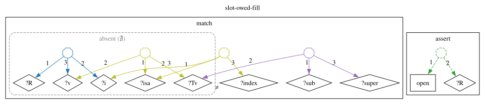
<!-- /rule -->

## The spatial rules

Each reads a clue `(?S a b)` between two values, and the structure `(?S p q)` between two positions, which it
tells from a clue by `(?isa p ?PT)`. The `absent` clusters read the structure alone.

### A neighbour that is the only one

#### `slot-adjacent-fwd`

With `b` at a position whose only source under `?S` is `p2`, the value `a` is at `p2`.

<!-- rule std.slots slot-adjacent-fwd -->
```lisp
(rule slot-adjacent-fwd (?R ?S ?isa ?PT)
  :match  (and (?S ?a ?b)
               (?R ?b ?p1) (?isa ?p1 ?PT)
               (?S ?p2 ?p1) (?isa ?p2 ?PT)
               (absent (and (?S ?p_o ?p1) (?isa ?p_o ?PT) (neq ?p_o ?p2))))
  :assert (?R ?a ?p2)
  :why    "{?b} is at {?p1}, whose only {?S}-source is {?p2}, and {?S}({?a},{?b}) ⟹ {?a} is at {?p2}.")
```


<!-- /rule -->

#### `slot-adjacent-bwd`

The reverse: with `a` at a position whose only target is `p1`, the value `b` is at `p1`.

<!-- rule std.slots slot-adjacent-bwd -->
```lisp
(rule slot-adjacent-bwd (?R ?S ?isa ?PT)
  :match  (and (?S ?a ?b)
               (?R ?a ?p2) (?isa ?p2 ?PT)
               (?S ?p2 ?p1) (?isa ?p1 ?PT)
               (absent (and (?S ?p2 ?p_o) (?isa ?p_o ?PT) (neq ?p_o ?p1))))
  :assert (?R ?b ?p1)
  :why    "{?a} is at {?p2}, whose only {?S}-target is {?p1}, and {?S}({?a},{?b}) ⟹ {?b} is at {?p1}.")
```

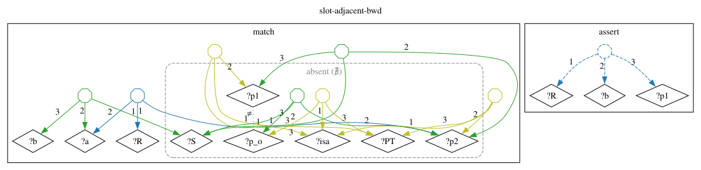
<!-- /rule -->

#### `slot-adjacent-fwd-neg`

The contrapositive of the first: `a` excluded from the only source of a position excludes `b` from that position.

<!-- rule std.slots slot-adjacent-fwd-neg -->
```lisp
(rule slot-adjacent-fwd-neg (?R ?S ?isa ?PT)
  :match  (and (?S ?a ?b)
               (not (?R ?a ?p2)) (?isa ?p2 ?PT)
               (?S ?p2 ?p1) (?isa ?p1 ?PT)
               (absent (and (?S ?p_o ?p1) (?isa ?p_o ?PT) (neq ?p_o ?p2))))
  :assert (not (?R ?b ?p1))
  :why    "{?a} cannot be at {?p2}, the only {?S}-source of {?p1} ⟹ {?b} cannot be at {?p1}.")
```

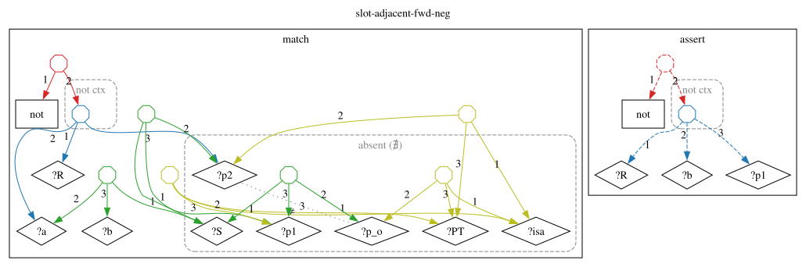
<!-- /rule -->

#### `slot-adjacent-bwd-neg`

The contrapositive of the second: `b` excluded from the only target of a position excludes `a` from that position.

<!-- rule std.slots slot-adjacent-bwd-neg -->
```lisp
(rule slot-adjacent-bwd-neg (?R ?S ?isa ?PT)
  :match  (and (?S ?a ?b)
               (not (?R ?b ?p1)) (?isa ?p1 ?PT)
               (?S ?p2 ?p1) (?isa ?p2 ?PT)
               (absent (and (?S ?p2 ?p_o) (?isa ?p_o ?PT) (neq ?p_o ?p1))))
  :assert (not (?R ?a ?p2))
  :why    "{?b} cannot be at {?p1}, the only {?S}-target of {?p2} ⟹ {?a} cannot be at {?p2}.")
```


<!-- /rule -->

### Pruning

#### `slot-prune-fwd`

Once `b` is placed, `a` is excluded from every position that is not a source of `b`'s.

<!-- rule std.slots slot-prune-fwd -->
```lisp
(rule slot-prune-fwd (?R ?S ?isa ?PT)
  :match  (and (?S ?a ?b)
               (?R ?b ?p1) (?isa ?p1 ?PT)
               (?isa ?p_o ?PT)
               (neq ?p_o ?p1)
               (absent (?S ?p_o ?p1)))
  :assert (not (?R ?a ?p_o))
  :why    "{?b} is at {?p1}, so {?a} is at an {?S}-source of {?p1}; {?p_o} is not one.")
```

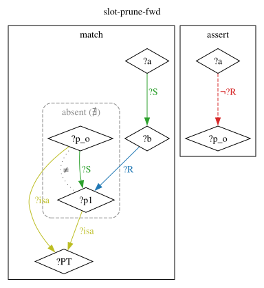
<!-- /rule -->

#### `slot-prune-bwd`

Once `a` is placed, `b` is excluded from every position that is not a target of `a`'s.

<!-- rule std.slots slot-prune-bwd -->
```lisp
(rule slot-prune-bwd (?R ?S ?isa ?PT)
  :match  (and (?S ?a ?b)
               (?R ?a ?p2) (?isa ?p2 ?PT)
               (?isa ?p_o ?PT)
               (neq ?p_o ?p2)
               (absent (?S ?p2 ?p_o)))
  :assert (not (?R ?b ?p_o))
  :why    "{?a} is at {?p2}, so {?b} is at an {?S}-target of {?p2}; {?p_o} is not one.")
```

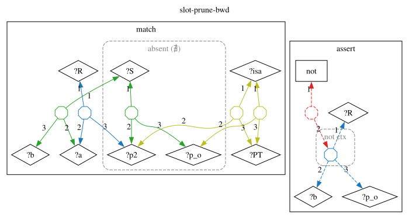
<!-- /rule -->

### The ends

#### `slot-endpoint-fwd`

A position with no source under `?S` cannot hold `b`.

<!-- rule std.slots slot-endpoint-fwd -->
```lisp
(rule slot-endpoint-fwd (?R ?S ?isa ?PT)
  :match  (and (?S ?a ?b)
               (?isa ?p1 ?PT)
               (absent (and (?isa ?p2 ?PT) (?S ?p2 ?p1))))
  :assert (not (?R ?b ?p1))
  :why    "{?p1} has no {?S}-source, and {?b} needs one ({?S}({?a},{?b})) ⟹ {?b} is not at {?p1}.")
```

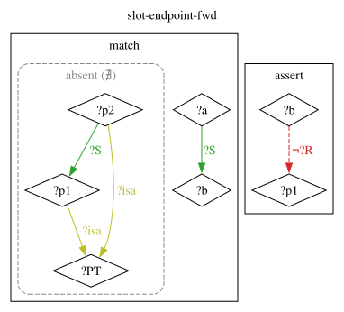
<!-- /rule -->

#### `slot-endpoint-bwd`

A position with no target under `?S` cannot hold `a`.

<!-- rule std.slots slot-endpoint-bwd -->
```lisp
(rule slot-endpoint-bwd (?R ?S ?isa ?PT)
  :match  (and (?S ?a ?b)
               (?isa ?p2 ?PT)
               (absent (and (?isa ?p1 ?PT) (?S ?p2 ?p1))))
  :assert (not (?R ?a ?p2))
  :why    "{?p2} has no {?S}-target, and {?a} needs one ({?S}({?a},{?b})) ⟹ {?a} is not at {?p2}.")
```

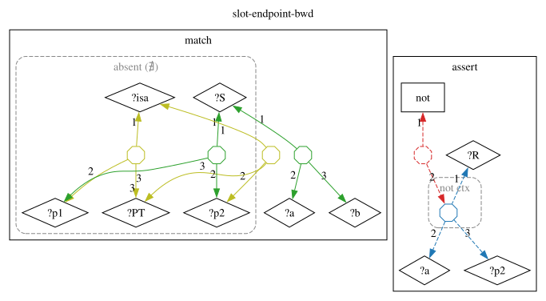
<!-- /rule -->
