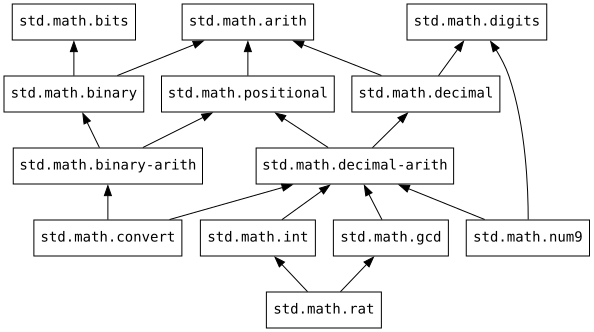

# The calculator: `std.math.*`

Arithmetic in Ein is a theory over names. A digit is one of the ten names `0` to `9`; a number is a term built from
them; what school arithmetic knows of the digits is written down once, as tables of facts; and the rules are the
wiring that looks each column up in a table. Nothing in the language knows what `7` is.

This page is what every module of the calculator shares. The modules themselves:

| page | modules | numbers |
|---|---|---|
| [Natural numbers](08-natural-numbers.md) | `std.math.digits`, `std.math.arith`, `std.math.decimal`, `std.math.decimal-arith` | `z` and `(n PREFIX DIGIT)`, of any length |
| [Integers, rationals, gcd](11-integers-rationals-gcd.md) | `std.math.int`, `std.math.rat`, `std.math.gcd` | `(int P N)`, `(rat Z D)` |
| [Binary numbers and conversion](14-binary.md) | `std.math.bits`, `std.math.binary`, `std.math.binary-arith`, `std.math.convert` | `(b2 PREFIX BIT)` |
| [Nine digits in one fact](16-nine-digit-numbers.md) | `std.math.num9` | `(num9 d8 … d0)`, a fixed width |
| [The rules every base shares](10-positional-rules.md) | `std.math.positional` | none of its own: a base connects them |

Each module, and the modules it imports, which an import of it brings. An arrow reads *imports*:



The guide's [word problems](../../02-guide/08-word-problems.md) are programs written over these modules.

## Using it: what every module shares

### A calculation is a request, answered by a result

A calculation is a request fact, answered by a result fact that repeats its operands
([Q-M1f.363](../../../../decisions/stdlib/math/Q-M1f.363-a-calculation-is-a-request-fact-answered.md)): the
program states `(add X Y)`, the theory derives `(sum-of X Y S)`, and a query reads it with a variable in the
result's place. Nothing is computed that was not asked for.

```lisp
(import std.math.decimal-arith :symbols (decimal-arith add sum-of))
(import std.math.decimal :symbols (n))
(import std.math.arith :symbols (z))

(add (n (n (n z 1) 2) 3) (n (n z 4) 5))      ; 123 + 45

(query :goal (sum-of ?x ?y ?s))
```

<!-- output -->
```text
  universe          no candidate: R is {∅} or empty, decided by root alone
  …
  query             (sum-of ?x ?y ?s)
  over              all of R — 1 state → 1 projection class
    class 1 of 1    1 state (1)
                      ?s = (n (n (n z 1) 6) 8) · ?x = (n (n (n z 1) 2) 3) · ?y = (n (n z 4) 5)
```

A rule of the program may match a result like any fact, and may state a request. Here the product is asked by a
fact, the sum by a rule that reads the product, and a third rule reads both:

```lisp
(import std.math.decimal-arith :symbols (mul product-of add sum-of))
(import std.math.decimal :symbols (n))
(import std.math.arith :symbols (z))

(relation total-is Number :why "the bill comes to {?3}")

(mul (n (n z 1) 2) (n z 3))        ; 12 × 3

(rule add-the-fee ()
  :match  (product-of (n (n z 1) 2) (n z 3) ?p)
  :assert (add ?p (n z 5))
  :why    "the goods cost {?p}; the fee of 5 is added")

(rule the-total ()
  :match  (and (product-of (n (n z 1) 2) (n z 3) ?p) (sum-of ?p (n z 5) ?t))
  :assert (total-is ?t)
  :why    "{?p} and the fee make {?t}")

(solve :no-search)
(query :goal (total-is ?t))
```

<!-- output -->
```text
  query             (total-is ?t)
  over              all of R — 1 state → 1 projection class
    class 1 of 1    1 state (1)
                      ?t = (n (n z 4) 1)
  as :expect        (model (total-is (n (n z 4) 1)))
```

### It searches nothing

Each module's entry closes the held extent of every relation of the module and of every table it reads
([Q-M1f.365](../../../../decisions/stdlib/math/Q-M1f.365-the-calculator-closes-the-held-extents.md)), so a
program that imports the calculator and states requests has no candidate: `ein solve` prints *universe: no
candidate*, R is the one state root is or empty, and the answer is root's fixpoint under `ein solve`,
`ein saturate` and `ein test` alike. **A relation the importing program declares is the program's to close**: the
program above declares `total-is` and says `(solve :no-search)`, since no fact of it is a guess.

### A fault is a flag, and the flag is a contradiction

A division by zero, a malformed numeral, a digit where a number goes and a name no `let` states each derive a
flag fact, and a second rule derives `(false)` from the flag, so a trace shows the flag as one step and the
contradiction as the next. Root is dead, R is empty, every command exits 0, and `ein solve` names, in
`unsat core`, the fact the fault was written in, and the rule in `refuted by`.

```lisp
(import std.math.decimal-arith :symbols (div quot-of))
(import std.math.decimal :symbols (n))
(import std.math.arith :symbols (z))

(div (n z 7) z)

(query :goal (quot-of ?x ?y ?q ?r))
```

<!-- output -->
```text
  empty             every node is dead — root's own fixpoint derives (false)
  universe          no candidate: R is {∅} or empty, decided by root alone

  unsat core        (div (n z 7) z)
  refuted by        std.math.arith.division-by-zero-is-false

  (false)

  query             (quot-of ?x ?y ?q ?r)
  over              all of R — R is empty, root is dead: no state to answer from
  as :expect        (false)
```

The flag is a fact of the dead state. `ein saturate --dump` prints a state with the rule that derived each fact,
and the flags of this one are

<!-- output -->
```text
  (std.math.arith.division-by-zero (div (n z 7) z) :rule std.math.positional.div-by-zero)
  (std.math.arith.division-by-zero (std.math.decimal-arith.div-call (std.math.decimal-arith.quotient (n z 7) z) (n z 7) z) :rule std.math.positional.div-call-by-zero)
```

the request's and its call's. A program whose root is dead claims only `(solve :expect (false))`:

```lisp
(import std.math.decimal-arith :symbols (div))
(import std.math.decimal :symbols (n))
(import std.math.arith :symbols (z division-by-zero))

(div (n z 7) z)

(solve :expect (false))
```

<!-- output -->
```text
ok           nat-flag-claim.ein
```

[Which fault is flagged, and by which module](#malformed-numbers-what-is-flagged-and-where) is below.

### No rule joins two facts on a number

Each rule of the calculator has one premise that holds numbers, and its others are table rows looked up by digits,
guards, or a probe
([Q-M1f.362](../../../../decisions/stdlib/math/Q-M1f.362-no-rule-of-the-calculator-joins-two-facts-on.md)). A
theory a program builds on the calculator keeps to it by the **tagged calls**: a request's result repeats its
operands, so a rule that wanted an answer for a purpose of its own would have to find it by its operands, a join on
a number; a tagged call hands the answer back under a tag the caller chose, and the rule that reads it has one
premise. A call checks the numerals it is handed, as a request's operands are, and a malformed one is flagged.
The tag is a fact of the caller's own relation:

```lisp
(import std.math.decimal-arith :symbols (add-walk done))
(import std.math.decimal :symbols (n))
(import std.math.arith :symbols (z))

(relation double  Number        :why "twice {?3} is wanted")
(relation twice   Number        :why "the call that doubles {?3}")
(relation doubled Number Number :why "twice {?3} is {?4}")

(double (n (n z 2) 6))             ; 26

(rule ask-the-double ()
  :match  (double ?x)
  :assert (add-walk (twice ?x) ?x ?x 0 z)
  :why    "{?x} is added to itself, under the tag (twice {?x})")

(rule read-the-double ()
  :match  (done (twice ?x) ?s)
  :assert (doubled ?x ?s)
  :why    "the walk tagged (twice {?x}) answers {?s}")

(solve :no-search)
(query :goal (doubled ?x ?s))
```

<!-- output -->
```text
  query             (doubled ?x ?s)
  over              all of R — 1 state → 1 projection class
    class 1 of 1    1 state (1)
                      ?s = (n (n z 5) 2) · ?x = (n (n z 2) 6)
  as :expect        (model (doubled (n (n z 2) 6) (n (n z 5) 2)))
```

Each module's page lists its tagged calls.

## Malformed numbers: what is flagged, and where

A fault is flagged by the module whose term it is a fault of
([Q-M1f.210](../../../../decisions/stdlib/math/Q-M1f.210-a-malformed-number-is-its-representations-fault.md),
[Q-M1f.316](../../../../decisions/stdlib/math/Q-M1f.316-the-calculator-flags-each-malformed-request-it.md)): a
numeral's by its representation, where an operation takes it or a tagged call is handed it, unless an operation
made it from valid numbers, and one no operation takes is not checked
([Q-M1f.404](../../../../decisions/stdlib/math/Q-M1f.404-a-numeral-is-checked-where-an-operation-takes-it.md)); an operand's and a `let`'s by the module that reads it.

| what the program wrote | the flag | by |
|---|---|---|
| a digit's place that holds a name that is no digit, `(n (n z 1) x)`, or a fact, `(n z (n z 1))` | `(not-decimal NUMERAL THING)` | `std.math.decimal` |
| a numeral that ends in a digit where `z` goes, `(n 1 2)`, `(n 0 2)`, or in a named constant, `(n price 1)` | `(not-decimal NUMERAL THING)` | `std.math.decimal` |
| the same faults in a binary numeral, `(b2 (b2 z 1) 2)`, `(b2 1 0)`, `(b2 mask 1)` | `(not-binary NUMERAL THING)` | `std.math.binary` |
| a digit or a named constant where a part of an integer goes, `(int 7 z)` | `(not-integer INTEGER THING)` | `std.math.int` |
| a digit or a named constant where a rational's integer or denominator goes, `(rat 7 (n z 2))` | `(not-rational RATIONAL THING)` | `std.math.rat` |
| a digit where a number goes, `(add 7 X)`: seven is `(n z 7)` | `(malformed REQUEST)` | the arithmetic that reads the operand |
| a name stated twice with two numbers; `z` or a digit as a constant's name; a `let` that names a digit or another named constant, `(let seven 7)`, `(let alias price)` | `(malformed (let NAME N))`, whether or not a request uses it ([Q-M1f.207](../../../../decisions/stdlib/math/decimal/Q-M1f.207-a-let-that-cannot-be-read-is-flagged-whether.md), [Q-M1f.281](../../../../decisions/stdlib/math/decimal/Q-M1f.281-a-let-that-names-a-digit-is-flagged.md)) | `std.math.decimal-arith` |
| an operand that is a name no `let` states, `(add foo X)` | `(undeclared foo REQUEST)` ([Q-M1f.317](../../../../decisions/stdlib/math/decimal/Q-M1f.317-a-name-no-let-states-is-flagged-as-undeclared.md)) | the arithmetic that reads the operand |
| an undeclared name or a digit as an operand of `std.math.int`, `std.math.rat` or `std.math.gcd` | `(undeclared …)`, `(malformed REQUEST)`, on the request ([Q-M1f.206](../../../../decisions/stdlib/math/decimal/Q-M1f.206-an-operands-fault-travels-with-its-tag.md)) | that module |

Each flag derives `(false)` by a rule of its own — `not-decimal-is-false`, `not-binary-is-false`,
`not-integer-is-false`, `not-rational-is-false`, `malformed-is-false`, `undeclared-is-false` — so the read-out
names the rule.

**A malformed numeral**, a letter in a digit's place:

```lisp
(import std.math.decimal-arith :symbols (decimal-arith add sum-of))
(import std.math.decimal :symbols (n))
(import std.math.arith :symbols (z))

(add (n (n z 1) x) (n z 5))

(query :goal (sum-of ?x ?y ?s))
```

<!-- output -->
```text
  empty             every node is dead — root's own fixpoint derives (false)
  universe          no candidate: R is {∅} or empty, decided by root alone

  unsat core        (add (n (n z 1) x) (n z 5))
  refuted by        std.math.decimal.not-decimal-is-false

  (false)

  query             (sum-of ?x ?y ?s)
  over              all of R — R is empty, root is dead: no state to answer from
  as :expect        (false)
```

<!-- output -->
```text
  (std.math.decimal.not-decimal (n (n z 1) x) x :rule std.math.decimal.numeral-digit)
```

The core names the fact the numeral was written in. A numeral written whole in a rule's conclusion rests on no
fact, and its core is empty.

**A digit where a number goes**, `(add 7 (n z 5))` in place of the program's request:

<!-- output -->
```text
  unsat core        (add 7 (n z 5))
  unsat core        (std.math.digits.nz 7)
  refuted by        std.math.positional.malformed-is-false

  (false)
```

<!-- output -->
```text
  (std.math.decimal-arith.malformed (add 7 (n z 5)) :rule std.math.positional.bad-request-malformed)
```

**A name no `let` states**, `(add foo (n z 5))`:

<!-- output -->
```text
  unsat core        (add foo (n z 5))
  refuted by        std.math.positional.undeclared-is-false

  (false)
```

<!-- output -->
```text
  (std.math.decimal-arith.undeclared foo (add foo (n z 5)) :rule std.math.positional.bad-request-undeclared)
```

**A name stated twice with two numbers**, whether or not a request uses it:

```lisp
(import std.math.decimal-arith :symbols (let))
(import std.math.decimal :symbols (n))
(import std.math.arith :symbols (z))

(let price (n z 3))
(let price (n z 4))
```

<!-- output -->
```text
  unsat core        (let price (n z 3))
  unsat core        (let price (n z 4))
  refuted by        std.math.positional.malformed-is-false

  (false)
```

### What stays silent

**A flag means malformed; no flag does not mean well-formed**
([Q-M1f.318](../../../../decisions/stdlib/math/Q-M1f.318-a-flag-means-malformed-and-no-flag-does-not-mean.md)).
These are answered by silence, a request neither refused nor answered:

- a numeral that ends in a name that is neither a digit nor a named constant, `(n end 1)`, and in binary a decimal
  digit as the prefix, `(b2 7 1)`;
- a fact of another relation where a number goes, as an operand or inside a number, `(add (pair 1 2) X)`;
- a name that stands for either of those;
- a numeral a rule assembles from a variable, `(n ?p x)`, which is no term a file writes, and a top-level fact of
  `n`;
- an operand of another kind of number: a natural number where `std.math.int` takes an integer, an integer or a
  natural number where `std.math.rat` takes a rational, an integer or a rational where `std.math.gcd` takes a
  natural number
  ([Q-M1f.277](../../../../decisions/stdlib/math/Q-M1f.277-an-operand-of-another-kind-of-number-is-answered.md));
- every malformed digit of `std.math.num9`.

The first of these, `(add (n end 1) (n z 5))`: root is alive, and the query has no row.

<!-- output -->
```text
  ∅                 in R — root is alive and owes nothing
  …
  query             (sum-of ?x ?y ?s)
  over              all of R — 1 state → 1 projection class
    class 1 of 1    1 state (1) — the goal has no row: undetermined here
  as :expect        (model)
```

### What the load refuses

A wrong count of arguments, `(add X)`, `(n 1)`, a `num9` of eight digits, is refused when the program is loaded,
since a form of a declared relation has the declared count of arguments ([diagnostics](../07-diagnostics.md)):

```lisp
(import std.math.decimal-arith :symbols (add))
(import std.math.decimal :symbols (n))
(import std.math.arith :symbols (z))

(add (n z 7))
```

<!-- output -->
```text
kb load error: nat-arity.ein:5:2: the fact (add (n z 7)) gives add 1 argument, and (relation add Operand Operand) declares 2 — a form headed by a declared relation has as many arguments as its declaration has types
```

## How it works

The calculator is a stack of modules, each entered by a closing rule that names the entry of the one below it, so
one name brings everything under it:

| entry | names the entries |
|---|---|
| `arith` (`std.math.arith`) | none |
| `decimal` (`std.math.decimal`) | `arith` |
| `decimal-arith` (`std.math.decimal-arith`) | `arith`, `decimal`, and one call of the macro `positional` |
| `binary` (`std.math.binary`) | `arith` |
| `binary-arith` (`std.math.binary-arith`) | `arith`, `binary`, and one call of `positional` |
| `convert` (`std.math.convert`) | `decimal-arith`, `binary-arith` |
| `int-arith` (`std.math.int`) | `decimal-arith`, `decimal`, `arith` |
| `gcd` (`std.math.gcd`) | `decimal-arith`, `decimal`, `arith` |
| `rat-arith` (`std.math.rat`) | `int-arith`, `decimal-arith`, `decimal`, `arith`, `gcd` |
| `arith9` (`std.math.num9`) | none |

A closing rule has an empty `:match`, so it fires once. It concludes `(__closed__ R)` for every relation of its
module and every table it reads, which is why nothing of the calculator is ever a hypothesis, and a fact naming
each rule of the module. The rules themselves:

- [the natural numbers' rules](09-natural-numbers-rules.md): `std.math.arith`, `std.math.decimal`, and what is
  decimal's own in `std.math.decimal-arith`, multiplication by a digit and long division;
- [the rules every base shares](10-positional-rules.md): `std.math.positional`, the walks over columns, the
  requests, and the operands' faults;
- [the integers' rules](12-integers-rules.md), [the rationals' and the divisor's](13-rationals-and-gcd-rules.md);
- [binary's and the conversion's](15-binary-rules.md);
- [the nine-digit numbers'](17-nine-digit-numbers-rules.md).
