# The natural numbers' rules

How `std.math.arith`, `std.math.decimal` and `std.math.decimal-arith` work: every rule of the three, as the module
writes it and as the engine draws it. What a program writes to use them is
[the page before](08-natural-numbers.md); how to read a drawing is [the index](README.md#how-a-rule-is-shown).

None of these rules has a parameter: each is active wherever its module is loaded. A rule's `:why` says what one
firing of it does, in the words a trace prints. The addition, the subtraction and the comparison of a column, the
requests and their answers, and the faults of an operand are not here: every positional base does them the same
way, and they are [`std.math.positional`'s](10-positional-rules.md), which `std.math.decimal-arith` connects by
one call of a macro in its closing rule.

## `std.math.arith`

One rule, and the entry. The flag is a fact of `division-by-zero`, which a module that divides derives.

#### `division-by-zero-is-false`

The flag is a contradiction.

<!-- rule std.math.arith division-by-zero-is-false -->
```lisp
(rule division-by-zero-is-false ()
  :match  (division-by-zero ?request)
  :assert (false)
  :why    "{?request} divides by zero: no number is the answer")
```

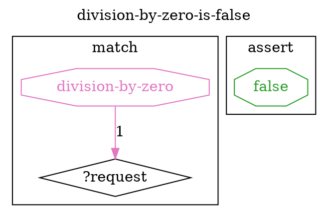
<!-- /rule -->

#### `arith`

The entry: it closes the flag's relation and names the module's one rule.

<!-- rule std.math.arith arith -->
```lisp
(rule arith ()
  :match  ()
  :assert (and (__closed__ division-by-zero)
               (__closed__ arith-module-rule)
               (arith-module-rule division-by-zero-is-false))
  :why    "arithmetic is computed and never guessed: its flag is closed")
```

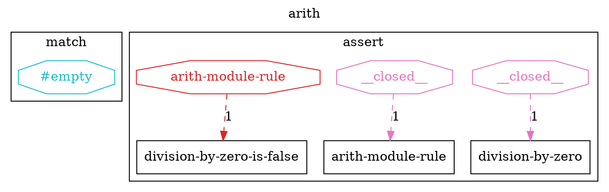
<!-- /rule -->

## `std.math.decimal`

The numeral's check. The loader states `(written T)` for every fact nested in a fact a file writes, so each rule
has one premise that holds a number, a written numeral, beside a guard or a row of `nz`.

#### `numeral-digit`

The last place of a numeral holds something that is none of the ten digits: one `neq` guard a digit.

<!-- rule std.math.decimal numeral-digit -->
```lisp
(rule numeral-digit ()
  :match  (and (written (n ?p ?a))
               (neq ?a 0) (neq ?a 1) (neq ?a 2) (neq ?a 3) (neq ?a 4)
               (neq ?a 5) (neq ?a 6) (neq ?a 7) (neq ?a 8) (neq ?a 9))
  :assert (not-decimal (n ?p ?a) ?a)
  :why    "{?a} stands where a digit goes and is none of the ten")
```

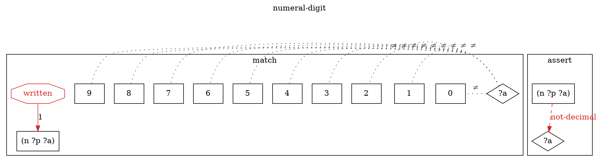
<!-- /rule -->

#### `numeral-prefix-digit`

The prefix is a digit that is not zero, `(n 1 2)`.

<!-- rule std.math.decimal numeral-prefix-digit -->
```lisp
(rule numeral-prefix-digit ()
  :match  (and (written (n ?m ?a)) (nz ?m))
  :assert (not-decimal (n ?m ?a) ?m)
  :why    "the digit {?m} stands where a number goes: a number ends in z")
```

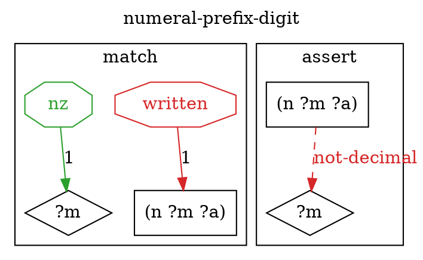
<!-- /rule -->

#### `numeral-prefix-zero`

The prefix is the digit `0`, `(n 0 2)`.

<!-- rule std.math.decimal numeral-prefix-zero -->
```lisp
(rule numeral-prefix-zero ()
  :match  (written (n 0 ?a))
  :assert (not-decimal (n 0 ?a) 0)
  :why    "the digit 0 stands where a number goes: a number ends in z")
```

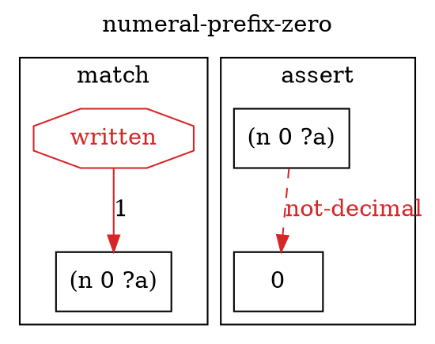
<!-- /rule -->

#### `numeral-prefix-named`

The prefix is a named constant, `(n price 1)`.

<!-- rule std.math.decimal numeral-prefix-named -->
```lisp
(rule numeral-prefix-named ()
  :match  (and (written (n ?m ?a)) (neq ?m z) (named ?m))
  :assert (not-decimal (n ?m ?a) ?m)
  :why    "the name {?m} stands where a number goes: a name stands for a number as an operand, not inside one")
```

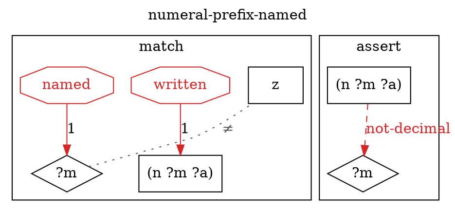
<!-- /rule -->

#### `not-decimal-is-false`

The flag is a contradiction.

<!-- rule std.math.decimal not-decimal-is-false -->
```lisp
(rule not-decimal-is-false ()
  :match  (not-decimal ?x ?thing)
  :assert (false)
  :why    "{?x} is not a decimal number: the program cannot hold it")
```

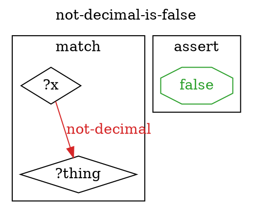
<!-- /rule -->

#### `decimal`

The entry: it closes the module's relations, names its rules, and names `arith`.

<!-- rule std.math.decimal decimal -->
```lisp
(rule decimal ()
  :match  ()
  :assert (and (__closed__ nz)
               (__closed__ n) (__closed__ named) (__closed__ not-decimal)
               (__closed__ decimal-rule)
               (decimal-rule arith)
               (decimal-rule numeral-digit) (decimal-rule numeral-prefix-digit)
               (decimal-rule numeral-prefix-zero)
               (decimal-rule numeral-prefix-named)
               (decimal-rule not-decimal-is-false))
  :why    "a numeral is written, and never guessed: every relation of the module is closed")
```

```dot
digraph rule_decimal_lhs_rhs {
  rankdir=TB;
  label="decimal"; labelloc=t;
  subgraph cluster_lhs { label="match";
    "h1_#empty_L" [shape=octagon, label="#empty", color="#17becf", fontcolor="#17becf"];
  }
  subgraph cluster_rhs { label="assert";
    "nz_R" [label="nz", shape=rectangle];
    "n_R" [label="n", shape=rectangle];
    "named_R" [label="named", shape=rectangle];
    "not-decimal_R" [label="not-decimal", shape=rectangle];
    "decimal-rule_R" [label="decimal-rule", shape=rectangle];
    "arith_R" [label="arith", shape=rectangle];
    "numeral-digit_R" [label="numeral-digit", shape=rectangle];
    "numeral-prefix-digit_R" [label="numeral-prefix-digit", shape=rectangle];
    "numeral-prefix-zero_R" [label="numeral-prefix-zero", shape=rectangle];
    "numeral-prefix-named_R" [label="numeral-prefix-named", shape=rectangle];
    "not-decimal-is-false_R" [label="not-decimal-is-false", shape=rectangle];
    "h2___closed___R" [shape=octagon, label="__closed__", color="#e377c2", fontcolor="#e377c2"];
    "h2___closed___R" -> "nz_R" [label="1", color="#e377c2", style=dashed];
    "h3___closed___R" [shape=octagon, label="__closed__", color="#e377c2", fontcolor="#e377c2"];
    "h3___closed___R" -> "n_R" [label="1", color="#e377c2", style=dashed];
    "h4___closed___R" [shape=octagon, label="__closed__", color="#e377c2", fontcolor="#e377c2"];
    "h4___closed___R" -> "named_R" [label="1", color="#e377c2", style=dashed];
    "h5___closed___R" [shape=octagon, label="__closed__", color="#e377c2", fontcolor="#e377c2"];
    "h5___closed___R" -> "not-decimal_R" [label="1", color="#e377c2", style=dashed];
    "h6___closed___R" [shape=octagon, label="__closed__", color="#e377c2", fontcolor="#e377c2"];
    "h6___closed___R" -> "decimal-rule_R" [label="1", color="#e377c2", style=dashed];
    "h7_decimal-rule_R" [shape=octagon, label="decimal-rule", color="#17becf", fontcolor="#17becf"];
    "h7_decimal-rule_R" -> "arith_R" [label="1", color="#17becf", style=dashed];
    "h8_decimal-rule_R" [shape=octagon, label="decimal-rule", color="#17becf", fontcolor="#17becf"];
    "h8_decimal-rule_R" -> "numeral-digit_R" [label="1", color="#17becf", style=dashed];
    "h9_decimal-rule_R" [shape=octagon, label="decimal-rule", color="#17becf", fontcolor="#17becf"];
    "h9_decimal-rule_R" -> "numeral-prefix-digit_R" [label="1", color="#17becf", style=dashed];
    "h10_decimal-rule_R" [shape=octagon, label="decimal-rule", color="#17becf", fontcolor="#17becf"];
    "h10_decimal-rule_R" -> "numeral-prefix-zero_R" [label="1", color="#17becf", style=dashed];
    "h11_decimal-rule_R" [shape=octagon, label="decimal-rule", color="#17becf", fontcolor="#17becf"];
    "h11_decimal-rule_R" -> "numeral-prefix-named_R" [label="1", color="#17becf", style=dashed];
    "h12_decimal-rule_R" [shape=octagon, label="decimal-rule", color="#17becf", fontcolor="#17becf"];
    "h12_decimal-rule_R" -> "not-decimal-is-false_R" [label="1", color="#17becf", style=dashed];
  }
}
```
<!-- /rule -->

## `std.math.decimal-arith`

What is decimal's own: a product's row by one digit, the multiples of a divisor, and the bisection that finds a
digit of a quotient. Every other step of the five operations is a shared rule.

### Multiplication: a row is the multiplicand times one digit

A product is summed from the multiplier's top digit: the sum so far, times ten, plus the next row. A row is one
walk over the multiplicand's columns through the table `md`,

$$
x_i \cdot m + c_i = 10 \cdot c_{i+1} + s_i, \qquad c_0 = 0
$$

with $m$ the multiplier's digit and $c_i$ a carry from `0` to `8`.

#### `mul-column`

<!-- rule std.math.decimal-arith mul-column -->
```lisp
(rule mul-column ()
  :match  (and (mul-walk ?k (n ?p ?a) ?m ?e ?acc)
               (md ?a ?m ?e ?s ?f))
  :assert (mul-walk ?k ?p ?m ?f (b ?s ?acc))
  :why    "{?a} x {?m} + carry {?e} is {?s}, carry {?f}: {?s} goes in front of the digits so far")
```

```dot
digraph rule_mul_column_lhs_rhs {
  rankdir=TB;
  label="mul-column"; labelloc=t;
  subgraph cluster_lhs { label="match";
    "?k_L" [label="?k", shape=diamond];
    "(n ?p ?a)_L" [label="(n ?p ?a)", shape=rectangle];
    "?m_L" [label="?m", shape=diamond];
    "?e_L" [label="?e", shape=diamond];
    "?acc_L" [label="?acc", shape=diamond];
    "?a_L" [label="?a", shape=diamond];
    "?s_L" [label="?s", shape=diamond];
    "?f_L" [label="?f", shape=diamond];
    "h1_mul-walk_L" [shape=octagon, label="mul-walk", color="#7f7f7f", fontcolor="#7f7f7f"];
    "h1_mul-walk_L" -> "?k_L" [label="1", color="#7f7f7f"];
    "h1_mul-walk_L" -> "(n ?p ?a)_L" [label="2", color="#7f7f7f"];
    "h1_mul-walk_L" -> "?m_L" [label="3", color="#7f7f7f"];
    "h1_mul-walk_L" -> "?e_L" [label="4", color="#7f7f7f"];
    "h1_mul-walk_L" -> "?acc_L" [label="5", color="#7f7f7f"];
    "h2_md_L" [shape=octagon, label="md", color="#bcbd22", fontcolor="#bcbd22"];
    "h2_md_L" -> "?a_L" [label="1", color="#bcbd22"];
    "h2_md_L" -> "?m_L" [label="2", color="#bcbd22"];
    "h2_md_L" -> "?e_L" [label="3", color="#bcbd22"];
    "h2_md_L" -> "?s_L" [label="4", color="#bcbd22"];
    "h2_md_L" -> "?f_L" [label="5", color="#bcbd22"];
  }
  subgraph cluster_rhs { label="assert";
    "?k_R" [label="?k", shape=diamond];
    "?p_R" [label="?p", shape=diamond];
    "?m_R" [label="?m", shape=diamond];
    "?f_R" [label="?f", shape=diamond];
    "(b ?s ?acc)_R" [label="(b ?s ?acc)", shape=rectangle];
    "h3_mul-walk_R" [shape=octagon, label="mul-walk", color="#7f7f7f", fontcolor="#7f7f7f"];
    "h3_mul-walk_R" -> "?k_R" [label="1", color="#7f7f7f", style=dashed];
    "h3_mul-walk_R" -> "?p_R" [label="2", color="#7f7f7f", style=dashed];
    "h3_mul-walk_R" -> "?m_R" [label="3", color="#7f7f7f", style=dashed];
    "h3_mul-walk_R" -> "?f_R" [label="4", color="#7f7f7f", style=dashed];
    "h3_mul-walk_R" -> "(b ?s ?acc)_R" [label="5", color="#7f7f7f", style=dashed];
  }
}
```
<!-- /rule -->

#### `mul-walk-end`

<!-- rule std.math.decimal-arith mul-walk-end -->
```lisp
(rule mul-walk-end ()
  :match  (mul-walk ?k z ?m 0 ?acc)
  :assert (strip ?k ?acc)
  :why    "no column is left and no carry: the digits are {?acc}")
```

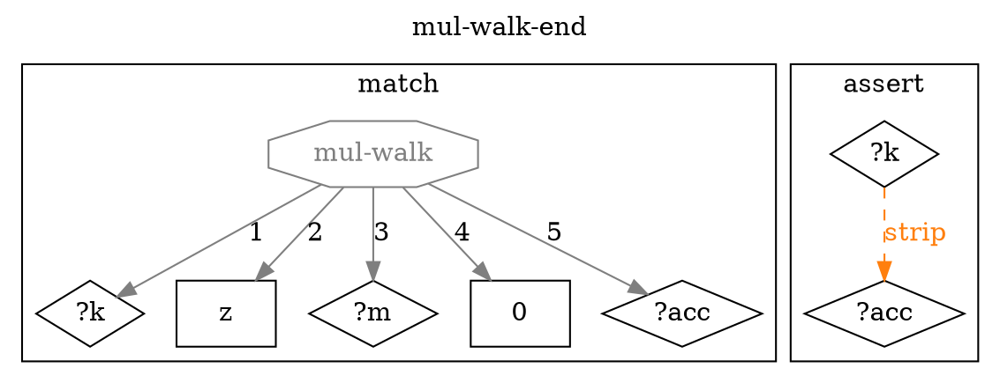
<!-- /rule -->

#### `mul-carry-out`

<!-- rule std.math.decimal-arith mul-carry-out -->
```lisp
(rule mul-carry-out ()
  :match  (and (mul-walk ?k z ?m ?e ?acc) (nz ?e))
  :assert (turn ?k (b ?e ?acc) z)
  :why    "no column is left: the carry {?e} is the top digit, in front of {?acc}")
```

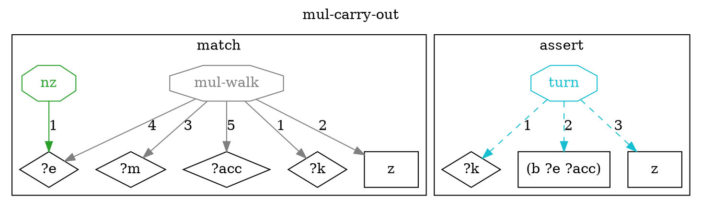
<!-- /rule -->

#### `mul-row`

<!-- rule std.math.decimal-arith mul-row -->
```lisp
(rule mul-row ()
  :match  (mul-step ?k ?u (b ?a ?rest) ?acc)
  :assert (mul-walk (mul-row-of ?k ?u ?rest ?acc) ?u ?a 0 z)
  :why    "the next digit of the multiplier is {?a}: the row {?u} x {?a}")
```

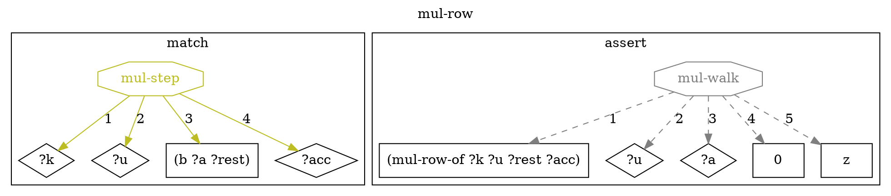
<!-- /rule -->

#### `mul-first-row`

<!-- rule std.math.decimal-arith mul-first-row -->
```lisp
(rule mul-first-row ()
  :match  (done (mul-row-of ?k ?u ?rest z) ?row)
  :assert (mul-step ?k ?u ?rest ?row)
  :why    "nothing was summed yet: the row {?row} is the sum so far")
```

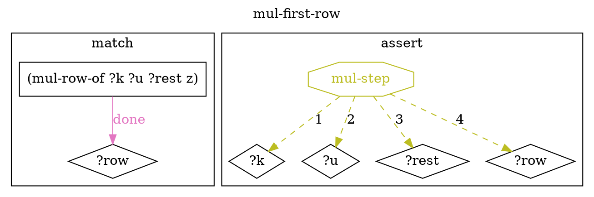
<!-- /rule -->

#### `mul-add-row`

<!-- rule std.math.decimal-arith mul-add-row -->
```lisp
(rule mul-add-row ()
  :match  (done (mul-row-of ?k ?u ?rest (n ?p ?a)) ?row)
  :assert (add-walk (mul-sum ?k ?u ?rest) (n (n ?p ?a) 0) ?row 0 z)
  :why    "ten times the sum so far, plus the row {?row}")
```

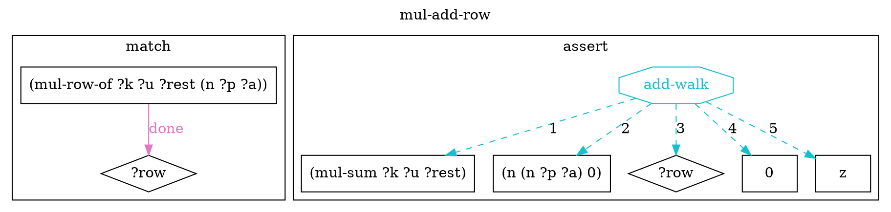
<!-- /rule -->

### Division: the divisor's multiples

Long division needs the divisor times one to nine. They are computed once a division, each by one walk of the divisor times a digit,
one after another, and `div-turn` then turns the dividend's digits round so that the top one comes first.

#### `div-multiples`

<!-- rule std.math.decimal-arith div-multiples -->
```lisp
(rule div-multiples ()
  :match  (div-call ?k ?u ?v)
  :assert (mul-walk (div-m1 ?k ?u ?v) ?v 1 0 z)
  :why    "to divide {?u} by {?v}: first {?v} x 1, the divisor in normal form")
```

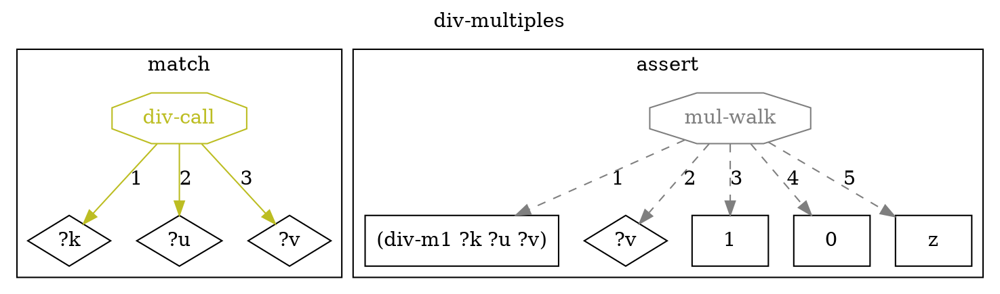
<!-- /rule -->

#### `div-multiple-2`

<!-- rule std.math.decimal-arith div-multiple-2 -->
```lisp
(rule div-multiple-2 ()
  :match  (done (div-m1 ?k ?u ?v) (n ?p ?a))
  :assert (mul-walk (div-m2 ?k ?u (n ?p ?a)) (n ?p ?a) 2 0 z)
  :why    "the divisor is not zero: next, 2 times the divisor")
```

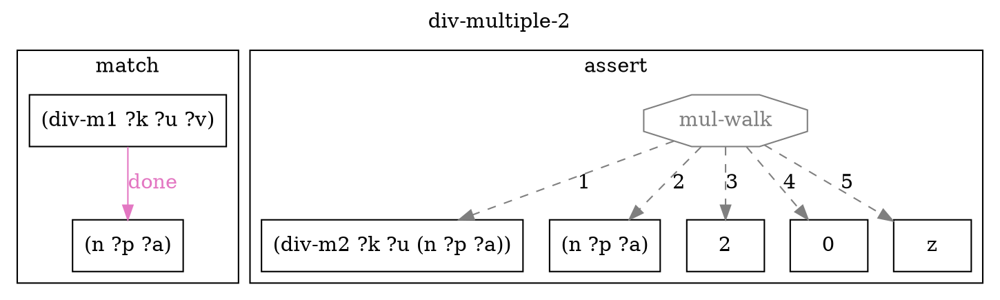
<!-- /rule -->

#### `div-multiple-3`

<!-- rule std.math.decimal-arith div-multiple-3 -->
```lisp
(rule div-multiple-3 ()
  :match  (done (div-m2 ?k ?u ?m1) ?m2)
  :assert (mul-walk (div-m3 ?k ?u ?m1 ?m2) ?m1 3 0 z)
  :why    "2 times the divisor is {?m2}: next, 3 times the divisor")
```

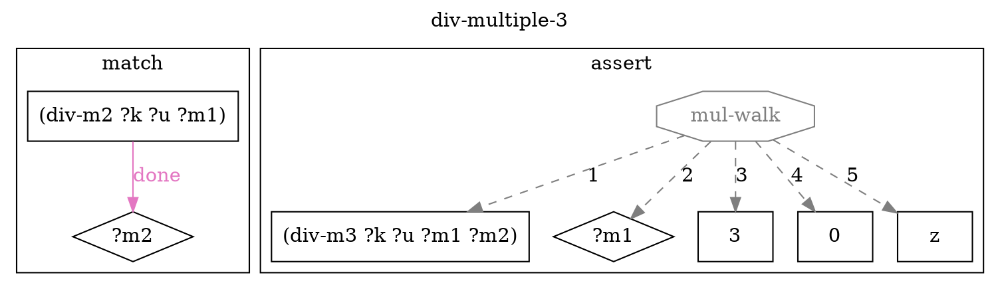
<!-- /rule -->

#### `div-multiple-4`

<!-- rule std.math.decimal-arith div-multiple-4 -->
```lisp
(rule div-multiple-4 ()
  :match  (done (div-m3 ?k ?u ?m1 ?m2) ?m3)
  :assert (mul-walk (div-m4 ?k ?u ?m1 ?m2 ?m3) ?m1 4 0 z)
  :why    "3 times the divisor is {?m3}: next, 4 times the divisor")
```

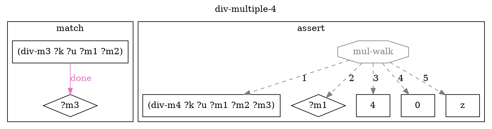
<!-- /rule -->

#### `div-multiple-5`

<!-- rule std.math.decimal-arith div-multiple-5 -->
```lisp
(rule div-multiple-5 ()
  :match  (done (div-m4 ?k ?u ?m1 ?m2 ?m3) ?m4)
  :assert (mul-walk (div-m5 ?k ?u ?m1 ?m2 ?m3 ?m4) ?m1 5 0 z)
  :why    "4 times the divisor is {?m4}: next, 5 times the divisor")
```

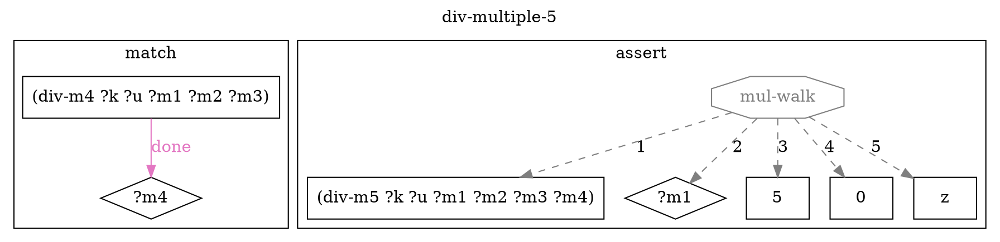
<!-- /rule -->

#### `div-multiple-6`

<!-- rule std.math.decimal-arith div-multiple-6 -->
```lisp
(rule div-multiple-6 ()
  :match  (done (div-m5 ?k ?u ?m1 ?m2 ?m3 ?m4) ?m5)
  :assert (mul-walk (div-m6 ?k ?u ?m1 ?m2 ?m3 ?m4 ?m5) ?m1 6 0 z)
  :why    "5 times the divisor is {?m5}: next, 6 times the divisor")
```

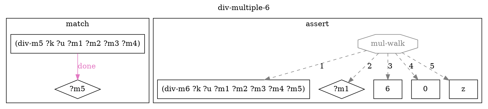
<!-- /rule -->

#### `div-multiple-7`

<!-- rule std.math.decimal-arith div-multiple-7 -->
```lisp
(rule div-multiple-7 ()
  :match  (done (div-m6 ?k ?u ?m1 ?m2 ?m3 ?m4 ?m5) ?m6)
  :assert (mul-walk (div-m7 ?k ?u ?m1 ?m2 ?m3 ?m4 ?m5 ?m6) ?m1 7 0 z)
  :why    "6 times the divisor is {?m6}: next, 7 times the divisor")
```

```dot
digraph rule_div_multiple_7_lhs_rhs {
  rankdir=TB;
  label="div-multiple-7"; labelloc=t;
  subgraph cluster_lhs { label="match";
    "(div-m6 ?k ?u ?m1 ?m2 ?m3 ?m4 ?m5)_L" [label="(div-m6 ?k ?u ?m1 ?m2 ?m3 ?m4 ?m5)", shape=rectangle];
    "?m6_L" [label="?m6", shape=diamond];
    "(div-m6 ?k ?u ?m1 ?m2 ?m3 ?m4 ?m5)_L" -> "?m6_L" [label="done", color="#e377c2", fontcolor="#e377c2"];
  }
  subgraph cluster_rhs { label="assert";
    "(div-m7 ?k ?u ?m1 ?m2 ?m3 ?m4 ?m5 ?m6)_R" [label="(div-m7 ?k ?u ?m1 ?m2 ?m3 ?m4 ?m5 ?m6)", shape=rectangle];
    "?m1_R" [label="?m1", shape=diamond];
    "7_R" [label="7", shape=rectangle];
    "0_R" [label="0", shape=rectangle];
    "z_R" [label="z", shape=rectangle];
    "h1_mul-walk_R" [shape=octagon, label="mul-walk", color="#7f7f7f", fontcolor="#7f7f7f"];
    "h1_mul-walk_R" -> "(div-m7 ?k ?u ?m1 ?m2 ?m3 ?m4 ?m5 ?m6)_R" [label="1", color="#7f7f7f", style=dashed];
    "h1_mul-walk_R" -> "?m1_R" [label="2", color="#7f7f7f", style=dashed];
    "h1_mul-walk_R" -> "7_R" [label="3", color="#7f7f7f", style=dashed];
    "h1_mul-walk_R" -> "0_R" [label="4", color="#7f7f7f", style=dashed];
    "h1_mul-walk_R" -> "z_R" [label="5", color="#7f7f7f", style=dashed];
  }
}
```
<!-- /rule -->

#### `div-multiple-8`

<!-- rule std.math.decimal-arith div-multiple-8 -->
```lisp
(rule div-multiple-8 ()
  :match  (done (div-m7 ?k ?u ?m1 ?m2 ?m3 ?m4 ?m5 ?m6) ?m7)
  :assert (mul-walk (div-m8 ?k ?u ?m1 ?m2 ?m3 ?m4 ?m5 ?m6 ?m7) ?m1 8 0 z)
  :why    "7 times the divisor is {?m7}: next, 8 times the divisor")
```

```dot
digraph rule_div_multiple_8_lhs_rhs {
  rankdir=TB;
  label="div-multiple-8"; labelloc=t;
  subgraph cluster_lhs { label="match";
    "(div-m7 ?k ?u ?m1 ?m2 ?m3 ?m4 ?m5 ?m6)_L" [label="(div-m7 ?k ?u ?m1 ?m2 ?m3 ?m4 ?m5 ?m6)", shape=rectangle];
    "?m7_L" [label="?m7", shape=diamond];
    "(div-m7 ?k ?u ?m1 ?m2 ?m3 ?m4 ?m5 ?m6)_L" -> "?m7_L" [label="done", color="#e377c2", fontcolor="#e377c2"];
  }
  subgraph cluster_rhs { label="assert";
    "(div-m8 ?k ?u ?m1 ?m2 ?m3 ?m4 ?m5 ?m6 ?m7)_R" [label="(div-m8 ?k ?u ?m1 ?m2 ?m3 ?m4 ?m5 ?m6 ?m7)", shape=rectangle];
    "?m1_R" [label="?m1", shape=diamond];
    "8_R" [label="8", shape=rectangle];
    "0_R" [label="0", shape=rectangle];
    "z_R" [label="z", shape=rectangle];
    "h1_mul-walk_R" [shape=octagon, label="mul-walk", color="#7f7f7f", fontcolor="#7f7f7f"];
    "h1_mul-walk_R" -> "(div-m8 ?k ?u ?m1 ?m2 ?m3 ?m4 ?m5 ?m6 ?m7)_R" [label="1", color="#7f7f7f", style=dashed];
    "h1_mul-walk_R" -> "?m1_R" [label="2", color="#7f7f7f", style=dashed];
    "h1_mul-walk_R" -> "8_R" [label="3", color="#7f7f7f", style=dashed];
    "h1_mul-walk_R" -> "0_R" [label="4", color="#7f7f7f", style=dashed];
    "h1_mul-walk_R" -> "z_R" [label="5", color="#7f7f7f", style=dashed];
  }
}
```
<!-- /rule -->

#### `div-multiple-9`

<!-- rule std.math.decimal-arith div-multiple-9 -->
```lisp
(rule div-multiple-9 ()
  :match  (done (div-m8 ?k ?u ?m1 ?m2 ?m3 ?m4 ?m5 ?m6 ?m7) ?m8)
  :assert (mul-walk (div-m9 ?k ?u ?m1 ?m2 ?m3 ?m4 ?m5 ?m6 ?m7 ?m8) ?m1 9 0 z)
  :why    "8 times the divisor is {?m8}: next, 9 times the divisor")
```

```dot
digraph rule_div_multiple_9_lhs_rhs {
  rankdir=TB;
  label="div-multiple-9"; labelloc=t;
  subgraph cluster_lhs { label="match";
    "(div-m8 ?k ?u ?m1 ?m2 ?m3 ?m4 ?m5 ?m6 ?m7)_L" [label="(div-m8 ?k ?u ?m1 ?m2 ?m3 ?m4 ?m5 ?m6 ?m7)", shape=rectangle];
    "?m8_L" [label="?m8", shape=diamond];
    "(div-m8 ?k ?u ?m1 ?m2 ?m3 ?m4 ?m5 ?m6 ?m7)_L" -> "?m8_L" [label="done", color="#e377c2", fontcolor="#e377c2"];
  }
  subgraph cluster_rhs { label="assert";
    "(div-m9 ?k ?u ?m1 ?m2 ?m3 ?m4 ?m5 ?m6 ?m7 ?m8)_R" [label="(div-m9 ?k ?u ?m1 ?m2 ?m3 ?m4 ?m5 ?m6 ?m7 ?m8)", shape=rectangle];
    "?m1_R" [label="?m1", shape=diamond];
    "9_R" [label="9", shape=rectangle];
    "0_R" [label="0", shape=rectangle];
    "z_R" [label="z", shape=rectangle];
    "h1_mul-walk_R" [shape=octagon, label="mul-walk", color="#7f7f7f", fontcolor="#7f7f7f"];
    "h1_mul-walk_R" -> "(div-m9 ?k ?u ?m1 ?m2 ?m3 ?m4 ?m5 ?m6 ?m7 ?m8)_R" [label="1", color="#7f7f7f", style=dashed];
    "h1_mul-walk_R" -> "?m1_R" [label="2", color="#7f7f7f", style=dashed];
    "h1_mul-walk_R" -> "9_R" [label="3", color="#7f7f7f", style=dashed];
    "h1_mul-walk_R" -> "0_R" [label="4", color="#7f7f7f", style=dashed];
    "h1_mul-walk_R" -> "z_R" [label="5", color="#7f7f7f", style=dashed];
  }
}
```
<!-- /rule -->

#### `div-turn`

<!-- rule std.math.decimal-arith div-turn -->
```lisp
(rule div-turn ()
  :match  (done (div-m9 ?k ?u ?m1 ?m2 ?m3 ?m4 ?m5 ?m6 ?m7 ?m8) ?m9)
  :assert (top-first (div-digits ?k (multiples ?m1 ?m2 ?m3 ?m4 ?m5 ?m6 ?m7 ?m8 ?m9)) ?u z)
  :why    "9 times the divisor is {?m9}: the nine multiples are known. Now the digits of {?u}, the top one first")
```

```dot
digraph rule_div_turn_lhs_rhs {
  rankdir=TB;
  label="div-turn"; labelloc=t;
  subgraph cluster_lhs { label="match";
    "(div-m9 ?k ?u ?m1 ?m2 ?m3 ?m4 ?m5 ?m6 ?m7 ?m8)_L" [label="(div-m9 ?k ?u ?m1 ?m2 ?m3 ?m4 ?m5 ?m6 ?m7 ?m8)", shape=rectangle];
    "?m9_L" [label="?m9", shape=diamond];
    "(div-m9 ?k ?u ?m1 ?m2 ?m3 ?m4 ?m5 ?m6 ?m7 ?m8)_L" -> "?m9_L" [label="done", color="#e377c2", fontcolor="#e377c2"];
  }
  subgraph cluster_rhs { label="assert";
    "(div-digits ?k (multiples ?m1 ?m2 ?m3 ?m4 ?m5 ?m6 ?m7 ?m8 ?m9))_R" [label="(div-digits ?k (multiples ?m1 ?m2 ?m3 ?m4 ?m5 ?m6 ?m7 ?m8 ?m9))", shape=rectangle];
    "?u_R" [label="?u", shape=diamond];
    "z_R" [label="z", shape=rectangle];
    "h1_top-first_R" [shape=octagon, label="top-first", color="#9467bd", fontcolor="#9467bd"];
    "h1_top-first_R" -> "(div-digits ?k (multiples ?m1 ?m2 ?m3 ?m4 ?m5 ?m6 ?m7 ?m8 ?m9))_R" [label="1", color="#9467bd", style=dashed];
    "h1_top-first_R" -> "?u_R" [label="2", color="#9467bd", style=dashed];
    "h1_top-first_R" -> "z_R" [label="3", color="#9467bd", style=dashed];
  }
}
```
<!-- /rule -->

### Division: bringing a digit down

Each digit of the dividend, from the top, is brought down beside what is left over, and the next digit of the
quotient is known to lie between `0` and `10`.

#### `div-bring`

<!-- rule std.math.decimal-arith div-bring -->
```lisp
(rule div-bring ()
  :match  (div-step ?k ?ms (b ?a ?rest) (n ?p ?c) ?w)
  :assert (div-choose ?k ?ms ?rest ?w (n (n ?p ?c) ?a) 0 10 (n (n ?p ?c) ?a))
  :why    "bring down {?a} beside what is left over: the next digit of the quotient is at least 0 and less than 10")
```

```dot
digraph rule_div_bring_lhs_rhs {
  rankdir=TB;
  label="div-bring"; labelloc=t;
  subgraph cluster_lhs { label="match";
    "?k_L" [label="?k", shape=diamond];
    "?ms_L" [label="?ms", shape=diamond];
    "(b ?a ?rest)_L" [label="(b ?a ?rest)", shape=rectangle];
    "(n ?p ?c)_L" [label="(n ?p ?c)", shape=rectangle];
    "?w_L" [label="?w", shape=diamond];
    "h1_div-step_L" [shape=octagon, label="div-step", color="#d62728", fontcolor="#d62728"];
    "h1_div-step_L" -> "?k_L" [label="1", color="#d62728"];
    "h1_div-step_L" -> "?ms_L" [label="2", color="#d62728"];
    "h1_div-step_L" -> "(b ?a ?rest)_L" [label="3", color="#d62728"];
    "h1_div-step_L" -> "(n ?p ?c)_L" [label="4", color="#d62728"];
    "h1_div-step_L" -> "?w_L" [label="5", color="#d62728"];
  }
  subgraph cluster_rhs { label="assert";
    "?k_R" [label="?k", shape=diamond];
    "?ms_R" [label="?ms", shape=diamond];
    "?rest_R" [label="?rest", shape=diamond];
    "?w_R" [label="?w", shape=diamond];
    "(n (n ?p ?c) ?a)_R" [label="(n (n ?p ?c) ?a)", shape=rectangle];
    "0_R" [label="0", shape=rectangle];
    "10_R" [label="10", shape=rectangle];
    "h2_div-choose_R" [shape=octagon, label="div-choose", color="#8c564b", fontcolor="#8c564b"];
    "h2_div-choose_R" -> "?k_R" [label="1", color="#8c564b", style=dashed];
    "h2_div-choose_R" -> "?ms_R" [label="2", color="#8c564b", style=dashed];
    "h2_div-choose_R" -> "?rest_R" [label="3", color="#8c564b", style=dashed];
    "h2_div-choose_R" -> "?w_R" [label="4", color="#8c564b", style=dashed];
    "h2_div-choose_R" -> "(n (n ?p ?c) ?a)_R" [label="5", color="#8c564b", style=dashed];
    "h2_div-choose_R" -> "0_R" [label="6", color="#8c564b", style=dashed];
    "h2_div-choose_R" -> "10_R" [label="7", color="#8c564b", style=dashed];
    "h2_div-choose_R" -> "(n (n ?p ?c) ?a)_R" [label="8", color="#8c564b", style=dashed];
  }
}
```
<!-- /rule -->

#### `div-bring-first`

<!-- rule std.math.decimal-arith div-bring-first -->
```lisp
(rule div-bring-first ()
  :match  (and (div-step ?k ?ms (b ?a ?rest) z ?w) (nz ?a))
  :assert (div-choose ?k ?ms ?rest ?w (n z ?a) 0 10 (n z ?a))
  :why    "nothing was left over: bring down {?a}. The next digit of the quotient is at least 0 and less than 10")
```

```dot
digraph rule_div_bring_first_lhs_rhs {
  rankdir=TB;
  label="div-bring-first"; labelloc=t;
  subgraph cluster_lhs { label="match";
    "?k_L" [label="?k", shape=diamond];
    "?ms_L" [label="?ms", shape=diamond];
    "(b ?a ?rest)_L" [label="(b ?a ?rest)", shape=rectangle];
    "z_L" [label="z", shape=rectangle];
    "?w_L" [label="?w", shape=diamond];
    "?a_L" [label="?a", shape=diamond];
    "h1_div-step_L" [shape=octagon, label="div-step", color="#d62728", fontcolor="#d62728"];
    "h1_div-step_L" -> "?k_L" [label="1", color="#d62728"];
    "h1_div-step_L" -> "?ms_L" [label="2", color="#d62728"];
    "h1_div-step_L" -> "(b ?a ?rest)_L" [label="3", color="#d62728"];
    "h1_div-step_L" -> "z_L" [label="4", color="#d62728"];
    "h1_div-step_L" -> "?w_L" [label="5", color="#d62728"];
    "h2_nz_L" [shape=octagon, label="nz", color="#2ca02c", fontcolor="#2ca02c"];
    "h2_nz_L" -> "?a_L" [label="1", color="#2ca02c"];
  }
  subgraph cluster_rhs { label="assert";
    "?k_R" [label="?k", shape=diamond];
    "?ms_R" [label="?ms", shape=diamond];
    "?rest_R" [label="?rest", shape=diamond];
    "?w_R" [label="?w", shape=diamond];
    "(n z ?a)_R" [label="(n z ?a)", shape=rectangle];
    "0_R" [label="0", shape=rectangle];
    "10_R" [label="10", shape=rectangle];
    "h3_div-choose_R" [shape=octagon, label="div-choose", color="#8c564b", fontcolor="#8c564b"];
    "h3_div-choose_R" -> "?k_R" [label="1", color="#8c564b", style=dashed];
    "h3_div-choose_R" -> "?ms_R" [label="2", color="#8c564b", style=dashed];
    "h3_div-choose_R" -> "?rest_R" [label="3", color="#8c564b", style=dashed];
    "h3_div-choose_R" -> "?w_R" [label="4", color="#8c564b", style=dashed];
    "h3_div-choose_R" -> "(n z ?a)_R" [label="5", color="#8c564b", style=dashed];
    "h3_div-choose_R" -> "0_R" [label="6", color="#8c564b", style=dashed];
    "h3_div-choose_R" -> "10_R" [label="7", color="#8c564b", style=dashed];
    "h3_div-choose_R" -> "(n z ?a)_R" [label="8", color="#8c564b", style=dashed];
  }
}
```
<!-- /rule -->

#### `div-bring-zero`

<!-- rule std.math.decimal-arith div-bring-zero -->
```lisp
(rule div-bring-zero ()
  :match  (div-step ?k ?ms (b 0 ?rest) z ?w)
  :assert (div-digit ?k ?ms ?rest ?w 0 z)
  :why    "nothing was left over and the digit brought down is 0: the next digit of the quotient is 0")
```

```dot
digraph rule_div_bring_zero_lhs_rhs {
  rankdir=TB;
  label="div-bring-zero"; labelloc=t;
  subgraph cluster_lhs { label="match";
    "?k_L" [label="?k", shape=diamond];
    "?ms_L" [label="?ms", shape=diamond];
    "(b 0 ?rest)_L" [label="(b 0 ?rest)", shape=rectangle];
    "z_L" [label="z", shape=rectangle];
    "?w_L" [label="?w", shape=diamond];
    "h1_div-step_L" [shape=octagon, label="div-step", color="#d62728", fontcolor="#d62728"];
    "h1_div-step_L" -> "?k_L" [label="1", color="#d62728"];
    "h1_div-step_L" -> "?ms_L" [label="2", color="#d62728"];
    "h1_div-step_L" -> "(b 0 ?rest)_L" [label="3", color="#d62728"];
    "h1_div-step_L" -> "z_L" [label="4", color="#d62728"];
    "h1_div-step_L" -> "?w_L" [label="5", color="#d62728"];
  }
  subgraph cluster_rhs { label="assert";
    "?k_R" [label="?k", shape=diamond];
    "?ms_R" [label="?ms", shape=diamond];
    "?rest_R" [label="?rest", shape=diamond];
    "?w_R" [label="?w", shape=diamond];
    "0_R" [label="0", shape=rectangle];
    "z_R" [label="z", shape=rectangle];
    "h2_div-digit_R" [shape=octagon, label="div-digit", color="#9467bd", fontcolor="#9467bd"];
    "h2_div-digit_R" -> "?k_R" [label="1", color="#9467bd", style=dashed];
    "h2_div-digit_R" -> "?ms_R" [label="2", color="#9467bd", style=dashed];
    "h2_div-digit_R" -> "?rest_R" [label="3", color="#9467bd", style=dashed];
    "h2_div-digit_R" -> "?w_R" [label="4", color="#9467bd", style=dashed];
    "h2_div-digit_R" -> "0_R" [label="5", color="#9467bd", style=dashed];
    "h2_div-digit_R" -> "z_R" [label="6", color="#9467bd", style=dashed];
  }
}
```
<!-- /rule -->

### Division: a quotient's digit by bisection

A digit $q$ of the quotient is the largest with $q \cdot Y \le U$, where $U$ is what was brought down. It is kept
between two bounds, $lo \le q < hi$; the table `mid` names the digit $j$ to try between them; one subtraction walk
takes $j \cdot Y$ from $U$, and either it fits, so $lo$ becomes $j$, or it does not, so $hi$ becomes $j$; the table
`adj` says when nothing lies between the bounds. One rule a digit tried, since the multiple to take is a
different place of the `multiples` fact for each.

#### `div-try-1`

<!-- rule std.math.decimal-arith div-try-1 -->
```lisp
(rule div-try-1 ()
  :match  (and (div-choose ?k (multiples ?m1 ?m2 ?m3 ?m4 ?m5 ?m6 ?m7 ?m8 ?m9) ?rest ?w ?u ?lo ?hi ?left)
               (mid ?lo ?hi 1))
  :assert (sub-walk (div-trial ?k (multiples ?m1 ?m2 ?m3 ?m4 ?m5 ?m6 ?m7 ?m8 ?m9) ?rest ?w ?u ?lo ?hi ?left 1)
                    ?u ?m1 0 z)
  :why    "the digit is at least {?lo} and less than {?hi}: try 1, and take 1 times the divisor, {?m1}, from {?u}")
```

```dot
digraph rule_div_try_1_lhs_rhs {
  rankdir=TB;
  label="div-try-1"; labelloc=t;
  subgraph cluster_lhs { label="match";
    "?k_L" [label="?k", shape=diamond];
    "(multiples ?m1 ?m2 ?m3 ?m4 ?m5 ?m6 ?m7 ?m8 ?m9)_L" [label="(multiples ?m1 ?m2 ?m3 ?m4 ?m5 ?m6 ?m7 ?m8 ?m9)", shape=rectangle];
    "?rest_L" [label="?rest", shape=diamond];
    "?w_L" [label="?w", shape=diamond];
    "?u_L" [label="?u", shape=diamond];
    "?lo_L" [label="?lo", shape=diamond];
    "?hi_L" [label="?hi", shape=diamond];
    "?left_L" [label="?left", shape=diamond];
    "1_L" [label="1", shape=rectangle];
    "h1_div-choose_L" [shape=octagon, label="div-choose", color="#8c564b", fontcolor="#8c564b"];
    "h1_div-choose_L" -> "?k_L" [label="1", color="#8c564b"];
    "h1_div-choose_L" -> "(multiples ?m1 ?m2 ?m3 ?m4 ?m5 ?m6 ?m7 ?m8 ?m9)_L" [label="2", color="#8c564b"];
    "h1_div-choose_L" -> "?rest_L" [label="3", color="#8c564b"];
    "h1_div-choose_L" -> "?w_L" [label="4", color="#8c564b"];
    "h1_div-choose_L" -> "?u_L" [label="5", color="#8c564b"];
    "h1_div-choose_L" -> "?lo_L" [label="6", color="#8c564b"];
    "h1_div-choose_L" -> "?hi_L" [label="7", color="#8c564b"];
    "h1_div-choose_L" -> "?left_L" [label="8", color="#8c564b"];
    "h2_mid_L" [shape=octagon, label="mid", color="#ff7f0e", fontcolor="#ff7f0e"];
    "h2_mid_L" -> "?lo_L" [label="1", color="#ff7f0e"];
    "h2_mid_L" -> "?hi_L" [label="2", color="#ff7f0e"];
    "h2_mid_L" -> "1_L" [label="3", color="#ff7f0e"];
  }
  subgraph cluster_rhs { label="assert";
    "(div-trial ?k (multiples ?m1 ?m2 ?m3 ?m4 ?m5 ?m6 ?m7 ?m8 ?m9) ?rest ?w ?u ?lo ?hi ?left 1)_R" [label="(div-trial ?k (multiples ?m1 ?m2 ?m3 ?m4 ?m5 ?m6 ?m7 ?m8 ?m9) ?rest ?w ?u ?lo ?hi ?left 1)", shape=rectangle];
    "?u_R" [label="?u", shape=diamond];
    "?m1_R" [label="?m1", shape=diamond];
    "0_R" [label="0", shape=rectangle];
    "z_R" [label="z", shape=rectangle];
    "h3_sub-walk_R" [shape=octagon, label="sub-walk", color="#8c564b", fontcolor="#8c564b"];
    "h3_sub-walk_R" -> "(div-trial ?k (multiples ?m1 ?m2 ?m3 ?m4 ?m5 ?m6 ?m7 ?m8 ?m9) ?rest ?w ?u ?lo ?hi ?left 1)_R" [label="1", color="#8c564b", style=dashed];
    "h3_sub-walk_R" -> "?u_R" [label="2", color="#8c564b", style=dashed];
    "h3_sub-walk_R" -> "?m1_R" [label="3", color="#8c564b", style=dashed];
    "h3_sub-walk_R" -> "0_R" [label="4", color="#8c564b", style=dashed];
    "h3_sub-walk_R" -> "z_R" [label="5", color="#8c564b", style=dashed];
  }
}
```
<!-- /rule -->

#### `div-try-2`

<!-- rule std.math.decimal-arith div-try-2 -->
```lisp
(rule div-try-2 ()
  :match  (and (div-choose ?k (multiples ?m1 ?m2 ?m3 ?m4 ?m5 ?m6 ?m7 ?m8 ?m9) ?rest ?w ?u ?lo ?hi ?left)
               (mid ?lo ?hi 2))
  :assert (sub-walk (div-trial ?k (multiples ?m1 ?m2 ?m3 ?m4 ?m5 ?m6 ?m7 ?m8 ?m9) ?rest ?w ?u ?lo ?hi ?left 2)
                    ?u ?m2 0 z)
  :why    "the digit is at least {?lo} and less than {?hi}: try 2, and take 2 times the divisor, {?m2}, from {?u}")
```

```dot
digraph rule_div_try_2_lhs_rhs {
  rankdir=TB;
  label="div-try-2"; labelloc=t;
  subgraph cluster_lhs { label="match";
    "?k_L" [label="?k", shape=diamond];
    "(multiples ?m1 ?m2 ?m3 ?m4 ?m5 ?m6 ?m7 ?m8 ?m9)_L" [label="(multiples ?m1 ?m2 ?m3 ?m4 ?m5 ?m6 ?m7 ?m8 ?m9)", shape=rectangle];
    "?rest_L" [label="?rest", shape=diamond];
    "?w_L" [label="?w", shape=diamond];
    "?u_L" [label="?u", shape=diamond];
    "?lo_L" [label="?lo", shape=diamond];
    "?hi_L" [label="?hi", shape=diamond];
    "?left_L" [label="?left", shape=diamond];
    "2_L" [label="2", shape=rectangle];
    "h1_div-choose_L" [shape=octagon, label="div-choose", color="#8c564b", fontcolor="#8c564b"];
    "h1_div-choose_L" -> "?k_L" [label="1", color="#8c564b"];
    "h1_div-choose_L" -> "(multiples ?m1 ?m2 ?m3 ?m4 ?m5 ?m6 ?m7 ?m8 ?m9)_L" [label="2", color="#8c564b"];
    "h1_div-choose_L" -> "?rest_L" [label="3", color="#8c564b"];
    "h1_div-choose_L" -> "?w_L" [label="4", color="#8c564b"];
    "h1_div-choose_L" -> "?u_L" [label="5", color="#8c564b"];
    "h1_div-choose_L" -> "?lo_L" [label="6", color="#8c564b"];
    "h1_div-choose_L" -> "?hi_L" [label="7", color="#8c564b"];
    "h1_div-choose_L" -> "?left_L" [label="8", color="#8c564b"];
    "h2_mid_L" [shape=octagon, label="mid", color="#ff7f0e", fontcolor="#ff7f0e"];
    "h2_mid_L" -> "?lo_L" [label="1", color="#ff7f0e"];
    "h2_mid_L" -> "?hi_L" [label="2", color="#ff7f0e"];
    "h2_mid_L" -> "2_L" [label="3", color="#ff7f0e"];
  }
  subgraph cluster_rhs { label="assert";
    "(div-trial ?k (multiples ?m1 ?m2 ?m3 ?m4 ?m5 ?m6 ?m7 ?m8 ?m9) ?rest ?w ?u ?lo ?hi ?left 2)_R" [label="(div-trial ?k (multiples ?m1 ?m2 ?m3 ?m4 ?m5 ?m6 ?m7 ?m8 ?m9) ?rest ?w ?u ?lo ?hi ?left 2)", shape=rectangle];
    "?u_R" [label="?u", shape=diamond];
    "?m2_R" [label="?m2", shape=diamond];
    "0_R" [label="0", shape=rectangle];
    "z_R" [label="z", shape=rectangle];
    "h3_sub-walk_R" [shape=octagon, label="sub-walk", color="#8c564b", fontcolor="#8c564b"];
    "h3_sub-walk_R" -> "(div-trial ?k (multiples ?m1 ?m2 ?m3 ?m4 ?m5 ?m6 ?m7 ?m8 ?m9) ?rest ?w ?u ?lo ?hi ?left 2)_R" [label="1", color="#8c564b", style=dashed];
    "h3_sub-walk_R" -> "?u_R" [label="2", color="#8c564b", style=dashed];
    "h3_sub-walk_R" -> "?m2_R" [label="3", color="#8c564b", style=dashed];
    "h3_sub-walk_R" -> "0_R" [label="4", color="#8c564b", style=dashed];
    "h3_sub-walk_R" -> "z_R" [label="5", color="#8c564b", style=dashed];
  }
}
```
<!-- /rule -->

#### `div-try-3`

<!-- rule std.math.decimal-arith div-try-3 -->
```lisp
(rule div-try-3 ()
  :match  (and (div-choose ?k (multiples ?m1 ?m2 ?m3 ?m4 ?m5 ?m6 ?m7 ?m8 ?m9) ?rest ?w ?u ?lo ?hi ?left)
               (mid ?lo ?hi 3))
  :assert (sub-walk (div-trial ?k (multiples ?m1 ?m2 ?m3 ?m4 ?m5 ?m6 ?m7 ?m8 ?m9) ?rest ?w ?u ?lo ?hi ?left 3)
                    ?u ?m3 0 z)
  :why    "the digit is at least {?lo} and less than {?hi}: try 3, and take 3 times the divisor, {?m3}, from {?u}")
```

```dot
digraph rule_div_try_3_lhs_rhs {
  rankdir=TB;
  label="div-try-3"; labelloc=t;
  subgraph cluster_lhs { label="match";
    "?k_L" [label="?k", shape=diamond];
    "(multiples ?m1 ?m2 ?m3 ?m4 ?m5 ?m6 ?m7 ?m8 ?m9)_L" [label="(multiples ?m1 ?m2 ?m3 ?m4 ?m5 ?m6 ?m7 ?m8 ?m9)", shape=rectangle];
    "?rest_L" [label="?rest", shape=diamond];
    "?w_L" [label="?w", shape=diamond];
    "?u_L" [label="?u", shape=diamond];
    "?lo_L" [label="?lo", shape=diamond];
    "?hi_L" [label="?hi", shape=diamond];
    "?left_L" [label="?left", shape=diamond];
    "3_L" [label="3", shape=rectangle];
    "h1_div-choose_L" [shape=octagon, label="div-choose", color="#8c564b", fontcolor="#8c564b"];
    "h1_div-choose_L" -> "?k_L" [label="1", color="#8c564b"];
    "h1_div-choose_L" -> "(multiples ?m1 ?m2 ?m3 ?m4 ?m5 ?m6 ?m7 ?m8 ?m9)_L" [label="2", color="#8c564b"];
    "h1_div-choose_L" -> "?rest_L" [label="3", color="#8c564b"];
    "h1_div-choose_L" -> "?w_L" [label="4", color="#8c564b"];
    "h1_div-choose_L" -> "?u_L" [label="5", color="#8c564b"];
    "h1_div-choose_L" -> "?lo_L" [label="6", color="#8c564b"];
    "h1_div-choose_L" -> "?hi_L" [label="7", color="#8c564b"];
    "h1_div-choose_L" -> "?left_L" [label="8", color="#8c564b"];
    "h2_mid_L" [shape=octagon, label="mid", color="#ff7f0e", fontcolor="#ff7f0e"];
    "h2_mid_L" -> "?lo_L" [label="1", color="#ff7f0e"];
    "h2_mid_L" -> "?hi_L" [label="2", color="#ff7f0e"];
    "h2_mid_L" -> "3_L" [label="3", color="#ff7f0e"];
  }
  subgraph cluster_rhs { label="assert";
    "(div-trial ?k (multiples ?m1 ?m2 ?m3 ?m4 ?m5 ?m6 ?m7 ?m8 ?m9) ?rest ?w ?u ?lo ?hi ?left 3)_R" [label="(div-trial ?k (multiples ?m1 ?m2 ?m3 ?m4 ?m5 ?m6 ?m7 ?m8 ?m9) ?rest ?w ?u ?lo ?hi ?left 3)", shape=rectangle];
    "?u_R" [label="?u", shape=diamond];
    "?m3_R" [label="?m3", shape=diamond];
    "0_R" [label="0", shape=rectangle];
    "z_R" [label="z", shape=rectangle];
    "h3_sub-walk_R" [shape=octagon, label="sub-walk", color="#8c564b", fontcolor="#8c564b"];
    "h3_sub-walk_R" -> "(div-trial ?k (multiples ?m1 ?m2 ?m3 ?m4 ?m5 ?m6 ?m7 ?m8 ?m9) ?rest ?w ?u ?lo ?hi ?left 3)_R" [label="1", color="#8c564b", style=dashed];
    "h3_sub-walk_R" -> "?u_R" [label="2", color="#8c564b", style=dashed];
    "h3_sub-walk_R" -> "?m3_R" [label="3", color="#8c564b", style=dashed];
    "h3_sub-walk_R" -> "0_R" [label="4", color="#8c564b", style=dashed];
    "h3_sub-walk_R" -> "z_R" [label="5", color="#8c564b", style=dashed];
  }
}
```
<!-- /rule -->

#### `div-try-4`

<!-- rule std.math.decimal-arith div-try-4 -->
```lisp
(rule div-try-4 ()
  :match  (and (div-choose ?k (multiples ?m1 ?m2 ?m3 ?m4 ?m5 ?m6 ?m7 ?m8 ?m9) ?rest ?w ?u ?lo ?hi ?left)
               (mid ?lo ?hi 4))
  :assert (sub-walk (div-trial ?k (multiples ?m1 ?m2 ?m3 ?m4 ?m5 ?m6 ?m7 ?m8 ?m9) ?rest ?w ?u ?lo ?hi ?left 4)
                    ?u ?m4 0 z)
  :why    "the digit is at least {?lo} and less than {?hi}: try 4, and take 4 times the divisor, {?m4}, from {?u}")
```

```dot
digraph rule_div_try_4_lhs_rhs {
  rankdir=TB;
  label="div-try-4"; labelloc=t;
  subgraph cluster_lhs { label="match";
    "?k_L" [label="?k", shape=diamond];
    "(multiples ?m1 ?m2 ?m3 ?m4 ?m5 ?m6 ?m7 ?m8 ?m9)_L" [label="(multiples ?m1 ?m2 ?m3 ?m4 ?m5 ?m6 ?m7 ?m8 ?m9)", shape=rectangle];
    "?rest_L" [label="?rest", shape=diamond];
    "?w_L" [label="?w", shape=diamond];
    "?u_L" [label="?u", shape=diamond];
    "?lo_L" [label="?lo", shape=diamond];
    "?hi_L" [label="?hi", shape=diamond];
    "?left_L" [label="?left", shape=diamond];
    "4_L" [label="4", shape=rectangle];
    "h1_div-choose_L" [shape=octagon, label="div-choose", color="#8c564b", fontcolor="#8c564b"];
    "h1_div-choose_L" -> "?k_L" [label="1", color="#8c564b"];
    "h1_div-choose_L" -> "(multiples ?m1 ?m2 ?m3 ?m4 ?m5 ?m6 ?m7 ?m8 ?m9)_L" [label="2", color="#8c564b"];
    "h1_div-choose_L" -> "?rest_L" [label="3", color="#8c564b"];
    "h1_div-choose_L" -> "?w_L" [label="4", color="#8c564b"];
    "h1_div-choose_L" -> "?u_L" [label="5", color="#8c564b"];
    "h1_div-choose_L" -> "?lo_L" [label="6", color="#8c564b"];
    "h1_div-choose_L" -> "?hi_L" [label="7", color="#8c564b"];
    "h1_div-choose_L" -> "?left_L" [label="8", color="#8c564b"];
    "h2_mid_L" [shape=octagon, label="mid", color="#ff7f0e", fontcolor="#ff7f0e"];
    "h2_mid_L" -> "?lo_L" [label="1", color="#ff7f0e"];
    "h2_mid_L" -> "?hi_L" [label="2", color="#ff7f0e"];
    "h2_mid_L" -> "4_L" [label="3", color="#ff7f0e"];
  }
  subgraph cluster_rhs { label="assert";
    "(div-trial ?k (multiples ?m1 ?m2 ?m3 ?m4 ?m5 ?m6 ?m7 ?m8 ?m9) ?rest ?w ?u ?lo ?hi ?left 4)_R" [label="(div-trial ?k (multiples ?m1 ?m2 ?m3 ?m4 ?m5 ?m6 ?m7 ?m8 ?m9) ?rest ?w ?u ?lo ?hi ?left 4)", shape=rectangle];
    "?u_R" [label="?u", shape=diamond];
    "?m4_R" [label="?m4", shape=diamond];
    "0_R" [label="0", shape=rectangle];
    "z_R" [label="z", shape=rectangle];
    "h3_sub-walk_R" [shape=octagon, label="sub-walk", color="#8c564b", fontcolor="#8c564b"];
    "h3_sub-walk_R" -> "(div-trial ?k (multiples ?m1 ?m2 ?m3 ?m4 ?m5 ?m6 ?m7 ?m8 ?m9) ?rest ?w ?u ?lo ?hi ?left 4)_R" [label="1", color="#8c564b", style=dashed];
    "h3_sub-walk_R" -> "?u_R" [label="2", color="#8c564b", style=dashed];
    "h3_sub-walk_R" -> "?m4_R" [label="3", color="#8c564b", style=dashed];
    "h3_sub-walk_R" -> "0_R" [label="4", color="#8c564b", style=dashed];
    "h3_sub-walk_R" -> "z_R" [label="5", color="#8c564b", style=dashed];
  }
}
```
<!-- /rule -->

#### `div-try-5`

<!-- rule std.math.decimal-arith div-try-5 -->
```lisp
(rule div-try-5 ()
  :match  (and (div-choose ?k (multiples ?m1 ?m2 ?m3 ?m4 ?m5 ?m6 ?m7 ?m8 ?m9) ?rest ?w ?u ?lo ?hi ?left)
               (mid ?lo ?hi 5))
  :assert (sub-walk (div-trial ?k (multiples ?m1 ?m2 ?m3 ?m4 ?m5 ?m6 ?m7 ?m8 ?m9) ?rest ?w ?u ?lo ?hi ?left 5)
                    ?u ?m5 0 z)
  :why    "the digit is at least {?lo} and less than {?hi}: try 5, and take 5 times the divisor, {?m5}, from {?u}")
```

```dot
digraph rule_div_try_5_lhs_rhs {
  rankdir=TB;
  label="div-try-5"; labelloc=t;
  subgraph cluster_lhs { label="match";
    "?k_L" [label="?k", shape=diamond];
    "(multiples ?m1 ?m2 ?m3 ?m4 ?m5 ?m6 ?m7 ?m8 ?m9)_L" [label="(multiples ?m1 ?m2 ?m3 ?m4 ?m5 ?m6 ?m7 ?m8 ?m9)", shape=rectangle];
    "?rest_L" [label="?rest", shape=diamond];
    "?w_L" [label="?w", shape=diamond];
    "?u_L" [label="?u", shape=diamond];
    "?lo_L" [label="?lo", shape=diamond];
    "?hi_L" [label="?hi", shape=diamond];
    "?left_L" [label="?left", shape=diamond];
    "5_L" [label="5", shape=rectangle];
    "h1_div-choose_L" [shape=octagon, label="div-choose", color="#8c564b", fontcolor="#8c564b"];
    "h1_div-choose_L" -> "?k_L" [label="1", color="#8c564b"];
    "h1_div-choose_L" -> "(multiples ?m1 ?m2 ?m3 ?m4 ?m5 ?m6 ?m7 ?m8 ?m9)_L" [label="2", color="#8c564b"];
    "h1_div-choose_L" -> "?rest_L" [label="3", color="#8c564b"];
    "h1_div-choose_L" -> "?w_L" [label="4", color="#8c564b"];
    "h1_div-choose_L" -> "?u_L" [label="5", color="#8c564b"];
    "h1_div-choose_L" -> "?lo_L" [label="6", color="#8c564b"];
    "h1_div-choose_L" -> "?hi_L" [label="7", color="#8c564b"];
    "h1_div-choose_L" -> "?left_L" [label="8", color="#8c564b"];
    "h2_mid_L" [shape=octagon, label="mid", color="#ff7f0e", fontcolor="#ff7f0e"];
    "h2_mid_L" -> "?lo_L" [label="1", color="#ff7f0e"];
    "h2_mid_L" -> "?hi_L" [label="2", color="#ff7f0e"];
    "h2_mid_L" -> "5_L" [label="3", color="#ff7f0e"];
  }
  subgraph cluster_rhs { label="assert";
    "(div-trial ?k (multiples ?m1 ?m2 ?m3 ?m4 ?m5 ?m6 ?m7 ?m8 ?m9) ?rest ?w ?u ?lo ?hi ?left 5)_R" [label="(div-trial ?k (multiples ?m1 ?m2 ?m3 ?m4 ?m5 ?m6 ?m7 ?m8 ?m9) ?rest ?w ?u ?lo ?hi ?left 5)", shape=rectangle];
    "?u_R" [label="?u", shape=diamond];
    "?m5_R" [label="?m5", shape=diamond];
    "0_R" [label="0", shape=rectangle];
    "z_R" [label="z", shape=rectangle];
    "h3_sub-walk_R" [shape=octagon, label="sub-walk", color="#8c564b", fontcolor="#8c564b"];
    "h3_sub-walk_R" -> "(div-trial ?k (multiples ?m1 ?m2 ?m3 ?m4 ?m5 ?m6 ?m7 ?m8 ?m9) ?rest ?w ?u ?lo ?hi ?left 5)_R" [label="1", color="#8c564b", style=dashed];
    "h3_sub-walk_R" -> "?u_R" [label="2", color="#8c564b", style=dashed];
    "h3_sub-walk_R" -> "?m5_R" [label="3", color="#8c564b", style=dashed];
    "h3_sub-walk_R" -> "0_R" [label="4", color="#8c564b", style=dashed];
    "h3_sub-walk_R" -> "z_R" [label="5", color="#8c564b", style=dashed];
  }
}
```
<!-- /rule -->

#### `div-try-6`

<!-- rule std.math.decimal-arith div-try-6 -->
```lisp
(rule div-try-6 ()
  :match  (and (div-choose ?k (multiples ?m1 ?m2 ?m3 ?m4 ?m5 ?m6 ?m7 ?m8 ?m9) ?rest ?w ?u ?lo ?hi ?left)
               (mid ?lo ?hi 6))
  :assert (sub-walk (div-trial ?k (multiples ?m1 ?m2 ?m3 ?m4 ?m5 ?m6 ?m7 ?m8 ?m9) ?rest ?w ?u ?lo ?hi ?left 6)
                    ?u ?m6 0 z)
  :why    "the digit is at least {?lo} and less than {?hi}: try 6, and take 6 times the divisor, {?m6}, from {?u}")
```

```dot
digraph rule_div_try_6_lhs_rhs {
  rankdir=TB;
  label="div-try-6"; labelloc=t;
  subgraph cluster_lhs { label="match";
    "?k_L" [label="?k", shape=diamond];
    "(multiples ?m1 ?m2 ?m3 ?m4 ?m5 ?m6 ?m7 ?m8 ?m9)_L" [label="(multiples ?m1 ?m2 ?m3 ?m4 ?m5 ?m6 ?m7 ?m8 ?m9)", shape=rectangle];
    "?rest_L" [label="?rest", shape=diamond];
    "?w_L" [label="?w", shape=diamond];
    "?u_L" [label="?u", shape=diamond];
    "?lo_L" [label="?lo", shape=diamond];
    "?hi_L" [label="?hi", shape=diamond];
    "?left_L" [label="?left", shape=diamond];
    "6_L" [label="6", shape=rectangle];
    "h1_div-choose_L" [shape=octagon, label="div-choose", color="#8c564b", fontcolor="#8c564b"];
    "h1_div-choose_L" -> "?k_L" [label="1", color="#8c564b"];
    "h1_div-choose_L" -> "(multiples ?m1 ?m2 ?m3 ?m4 ?m5 ?m6 ?m7 ?m8 ?m9)_L" [label="2", color="#8c564b"];
    "h1_div-choose_L" -> "?rest_L" [label="3", color="#8c564b"];
    "h1_div-choose_L" -> "?w_L" [label="4", color="#8c564b"];
    "h1_div-choose_L" -> "?u_L" [label="5", color="#8c564b"];
    "h1_div-choose_L" -> "?lo_L" [label="6", color="#8c564b"];
    "h1_div-choose_L" -> "?hi_L" [label="7", color="#8c564b"];
    "h1_div-choose_L" -> "?left_L" [label="8", color="#8c564b"];
    "h2_mid_L" [shape=octagon, label="mid", color="#ff7f0e", fontcolor="#ff7f0e"];
    "h2_mid_L" -> "?lo_L" [label="1", color="#ff7f0e"];
    "h2_mid_L" -> "?hi_L" [label="2", color="#ff7f0e"];
    "h2_mid_L" -> "6_L" [label="3", color="#ff7f0e"];
  }
  subgraph cluster_rhs { label="assert";
    "(div-trial ?k (multiples ?m1 ?m2 ?m3 ?m4 ?m5 ?m6 ?m7 ?m8 ?m9) ?rest ?w ?u ?lo ?hi ?left 6)_R" [label="(div-trial ?k (multiples ?m1 ?m2 ?m3 ?m4 ?m5 ?m6 ?m7 ?m8 ?m9) ?rest ?w ?u ?lo ?hi ?left 6)", shape=rectangle];
    "?u_R" [label="?u", shape=diamond];
    "?m6_R" [label="?m6", shape=diamond];
    "0_R" [label="0", shape=rectangle];
    "z_R" [label="z", shape=rectangle];
    "h3_sub-walk_R" [shape=octagon, label="sub-walk", color="#8c564b", fontcolor="#8c564b"];
    "h3_sub-walk_R" -> "(div-trial ?k (multiples ?m1 ?m2 ?m3 ?m4 ?m5 ?m6 ?m7 ?m8 ?m9) ?rest ?w ?u ?lo ?hi ?left 6)_R" [label="1", color="#8c564b", style=dashed];
    "h3_sub-walk_R" -> "?u_R" [label="2", color="#8c564b", style=dashed];
    "h3_sub-walk_R" -> "?m6_R" [label="3", color="#8c564b", style=dashed];
    "h3_sub-walk_R" -> "0_R" [label="4", color="#8c564b", style=dashed];
    "h3_sub-walk_R" -> "z_R" [label="5", color="#8c564b", style=dashed];
  }
}
```
<!-- /rule -->

#### `div-try-7`

<!-- rule std.math.decimal-arith div-try-7 -->
```lisp
(rule div-try-7 ()
  :match  (and (div-choose ?k (multiples ?m1 ?m2 ?m3 ?m4 ?m5 ?m6 ?m7 ?m8 ?m9) ?rest ?w ?u ?lo ?hi ?left)
               (mid ?lo ?hi 7))
  :assert (sub-walk (div-trial ?k (multiples ?m1 ?m2 ?m3 ?m4 ?m5 ?m6 ?m7 ?m8 ?m9) ?rest ?w ?u ?lo ?hi ?left 7)
                    ?u ?m7 0 z)
  :why    "the digit is at least {?lo} and less than {?hi}: try 7, and take 7 times the divisor, {?m7}, from {?u}")
```

```dot
digraph rule_div_try_7_lhs_rhs {
  rankdir=TB;
  label="div-try-7"; labelloc=t;
  subgraph cluster_lhs { label="match";
    "?k_L" [label="?k", shape=diamond];
    "(multiples ?m1 ?m2 ?m3 ?m4 ?m5 ?m6 ?m7 ?m8 ?m9)_L" [label="(multiples ?m1 ?m2 ?m3 ?m4 ?m5 ?m6 ?m7 ?m8 ?m9)", shape=rectangle];
    "?rest_L" [label="?rest", shape=diamond];
    "?w_L" [label="?w", shape=diamond];
    "?u_L" [label="?u", shape=diamond];
    "?lo_L" [label="?lo", shape=diamond];
    "?hi_L" [label="?hi", shape=diamond];
    "?left_L" [label="?left", shape=diamond];
    "7_L" [label="7", shape=rectangle];
    "h1_div-choose_L" [shape=octagon, label="div-choose", color="#8c564b", fontcolor="#8c564b"];
    "h1_div-choose_L" -> "?k_L" [label="1", color="#8c564b"];
    "h1_div-choose_L" -> "(multiples ?m1 ?m2 ?m3 ?m4 ?m5 ?m6 ?m7 ?m8 ?m9)_L" [label="2", color="#8c564b"];
    "h1_div-choose_L" -> "?rest_L" [label="3", color="#8c564b"];
    "h1_div-choose_L" -> "?w_L" [label="4", color="#8c564b"];
    "h1_div-choose_L" -> "?u_L" [label="5", color="#8c564b"];
    "h1_div-choose_L" -> "?lo_L" [label="6", color="#8c564b"];
    "h1_div-choose_L" -> "?hi_L" [label="7", color="#8c564b"];
    "h1_div-choose_L" -> "?left_L" [label="8", color="#8c564b"];
    "h2_mid_L" [shape=octagon, label="mid", color="#ff7f0e", fontcolor="#ff7f0e"];
    "h2_mid_L" -> "?lo_L" [label="1", color="#ff7f0e"];
    "h2_mid_L" -> "?hi_L" [label="2", color="#ff7f0e"];
    "h2_mid_L" -> "7_L" [label="3", color="#ff7f0e"];
  }
  subgraph cluster_rhs { label="assert";
    "(div-trial ?k (multiples ?m1 ?m2 ?m3 ?m4 ?m5 ?m6 ?m7 ?m8 ?m9) ?rest ?w ?u ?lo ?hi ?left 7)_R" [label="(div-trial ?k (multiples ?m1 ?m2 ?m3 ?m4 ?m5 ?m6 ?m7 ?m8 ?m9) ?rest ?w ?u ?lo ?hi ?left 7)", shape=rectangle];
    "?u_R" [label="?u", shape=diamond];
    "?m7_R" [label="?m7", shape=diamond];
    "0_R" [label="0", shape=rectangle];
    "z_R" [label="z", shape=rectangle];
    "h3_sub-walk_R" [shape=octagon, label="sub-walk", color="#8c564b", fontcolor="#8c564b"];
    "h3_sub-walk_R" -> "(div-trial ?k (multiples ?m1 ?m2 ?m3 ?m4 ?m5 ?m6 ?m7 ?m8 ?m9) ?rest ?w ?u ?lo ?hi ?left 7)_R" [label="1", color="#8c564b", style=dashed];
    "h3_sub-walk_R" -> "?u_R" [label="2", color="#8c564b", style=dashed];
    "h3_sub-walk_R" -> "?m7_R" [label="3", color="#8c564b", style=dashed];
    "h3_sub-walk_R" -> "0_R" [label="4", color="#8c564b", style=dashed];
    "h3_sub-walk_R" -> "z_R" [label="5", color="#8c564b", style=dashed];
  }
}
```
<!-- /rule -->

#### `div-try-8`

<!-- rule std.math.decimal-arith div-try-8 -->
```lisp
(rule div-try-8 ()
  :match  (and (div-choose ?k (multiples ?m1 ?m2 ?m3 ?m4 ?m5 ?m6 ?m7 ?m8 ?m9) ?rest ?w ?u ?lo ?hi ?left)
               (mid ?lo ?hi 8))
  :assert (sub-walk (div-trial ?k (multiples ?m1 ?m2 ?m3 ?m4 ?m5 ?m6 ?m7 ?m8 ?m9) ?rest ?w ?u ?lo ?hi ?left 8)
                    ?u ?m8 0 z)
  :why    "the digit is at least {?lo} and less than {?hi}: try 8, and take 8 times the divisor, {?m8}, from {?u}")
```

```dot
digraph rule_div_try_8_lhs_rhs {
  rankdir=TB;
  label="div-try-8"; labelloc=t;
  subgraph cluster_lhs { label="match";
    "?k_L" [label="?k", shape=diamond];
    "(multiples ?m1 ?m2 ?m3 ?m4 ?m5 ?m6 ?m7 ?m8 ?m9)_L" [label="(multiples ?m1 ?m2 ?m3 ?m4 ?m5 ?m6 ?m7 ?m8 ?m9)", shape=rectangle];
    "?rest_L" [label="?rest", shape=diamond];
    "?w_L" [label="?w", shape=diamond];
    "?u_L" [label="?u", shape=diamond];
    "?lo_L" [label="?lo", shape=diamond];
    "?hi_L" [label="?hi", shape=diamond];
    "?left_L" [label="?left", shape=diamond];
    "8_L" [label="8", shape=rectangle];
    "h1_div-choose_L" [shape=octagon, label="div-choose", color="#8c564b", fontcolor="#8c564b"];
    "h1_div-choose_L" -> "?k_L" [label="1", color="#8c564b"];
    "h1_div-choose_L" -> "(multiples ?m1 ?m2 ?m3 ?m4 ?m5 ?m6 ?m7 ?m8 ?m9)_L" [label="2", color="#8c564b"];
    "h1_div-choose_L" -> "?rest_L" [label="3", color="#8c564b"];
    "h1_div-choose_L" -> "?w_L" [label="4", color="#8c564b"];
    "h1_div-choose_L" -> "?u_L" [label="5", color="#8c564b"];
    "h1_div-choose_L" -> "?lo_L" [label="6", color="#8c564b"];
    "h1_div-choose_L" -> "?hi_L" [label="7", color="#8c564b"];
    "h1_div-choose_L" -> "?left_L" [label="8", color="#8c564b"];
    "h2_mid_L" [shape=octagon, label="mid", color="#ff7f0e", fontcolor="#ff7f0e"];
    "h2_mid_L" -> "?lo_L" [label="1", color="#ff7f0e"];
    "h2_mid_L" -> "?hi_L" [label="2", color="#ff7f0e"];
    "h2_mid_L" -> "8_L" [label="3", color="#ff7f0e"];
  }
  subgraph cluster_rhs { label="assert";
    "(div-trial ?k (multiples ?m1 ?m2 ?m3 ?m4 ?m5 ?m6 ?m7 ?m8 ?m9) ?rest ?w ?u ?lo ?hi ?left 8)_R" [label="(div-trial ?k (multiples ?m1 ?m2 ?m3 ?m4 ?m5 ?m6 ?m7 ?m8 ?m9) ?rest ?w ?u ?lo ?hi ?left 8)", shape=rectangle];
    "?u_R" [label="?u", shape=diamond];
    "?m8_R" [label="?m8", shape=diamond];
    "0_R" [label="0", shape=rectangle];
    "z_R" [label="z", shape=rectangle];
    "h3_sub-walk_R" [shape=octagon, label="sub-walk", color="#8c564b", fontcolor="#8c564b"];
    "h3_sub-walk_R" -> "(div-trial ?k (multiples ?m1 ?m2 ?m3 ?m4 ?m5 ?m6 ?m7 ?m8 ?m9) ?rest ?w ?u ?lo ?hi ?left 8)_R" [label="1", color="#8c564b", style=dashed];
    "h3_sub-walk_R" -> "?u_R" [label="2", color="#8c564b", style=dashed];
    "h3_sub-walk_R" -> "?m8_R" [label="3", color="#8c564b", style=dashed];
    "h3_sub-walk_R" -> "0_R" [label="4", color="#8c564b", style=dashed];
    "h3_sub-walk_R" -> "z_R" [label="5", color="#8c564b", style=dashed];
  }
}
```
<!-- /rule -->

#### `div-try-9`

<!-- rule std.math.decimal-arith div-try-9 -->
```lisp
(rule div-try-9 ()
  :match  (and (div-choose ?k (multiples ?m1 ?m2 ?m3 ?m4 ?m5 ?m6 ?m7 ?m8 ?m9) ?rest ?w ?u ?lo ?hi ?left)
               (mid ?lo ?hi 9))
  :assert (sub-walk (div-trial ?k (multiples ?m1 ?m2 ?m3 ?m4 ?m5 ?m6 ?m7 ?m8 ?m9) ?rest ?w ?u ?lo ?hi ?left 9)
                    ?u ?m9 0 z)
  :why    "the digit is at least {?lo} and less than {?hi}: try 9, and take 9 times the divisor, {?m9}, from {?u}")
```

```dot
digraph rule_div_try_9_lhs_rhs {
  rankdir=TB;
  label="div-try-9"; labelloc=t;
  subgraph cluster_lhs { label="match";
    "?k_L" [label="?k", shape=diamond];
    "(multiples ?m1 ?m2 ?m3 ?m4 ?m5 ?m6 ?m7 ?m8 ?m9)_L" [label="(multiples ?m1 ?m2 ?m3 ?m4 ?m5 ?m6 ?m7 ?m8 ?m9)", shape=rectangle];
    "?rest_L" [label="?rest", shape=diamond];
    "?w_L" [label="?w", shape=diamond];
    "?u_L" [label="?u", shape=diamond];
    "?lo_L" [label="?lo", shape=diamond];
    "?hi_L" [label="?hi", shape=diamond];
    "?left_L" [label="?left", shape=diamond];
    "9_L" [label="9", shape=rectangle];
    "h1_div-choose_L" [shape=octagon, label="div-choose", color="#8c564b", fontcolor="#8c564b"];
    "h1_div-choose_L" -> "?k_L" [label="1", color="#8c564b"];
    "h1_div-choose_L" -> "(multiples ?m1 ?m2 ?m3 ?m4 ?m5 ?m6 ?m7 ?m8 ?m9)_L" [label="2", color="#8c564b"];
    "h1_div-choose_L" -> "?rest_L" [label="3", color="#8c564b"];
    "h1_div-choose_L" -> "?w_L" [label="4", color="#8c564b"];
    "h1_div-choose_L" -> "?u_L" [label="5", color="#8c564b"];
    "h1_div-choose_L" -> "?lo_L" [label="6", color="#8c564b"];
    "h1_div-choose_L" -> "?hi_L" [label="7", color="#8c564b"];
    "h1_div-choose_L" -> "?left_L" [label="8", color="#8c564b"];
    "h2_mid_L" [shape=octagon, label="mid", color="#ff7f0e", fontcolor="#ff7f0e"];
    "h2_mid_L" -> "?lo_L" [label="1", color="#ff7f0e"];
    "h2_mid_L" -> "?hi_L" [label="2", color="#ff7f0e"];
    "h2_mid_L" -> "9_L" [label="3", color="#ff7f0e"];
  }
  subgraph cluster_rhs { label="assert";
    "(div-trial ?k (multiples ?m1 ?m2 ?m3 ?m4 ?m5 ?m6 ?m7 ?m8 ?m9) ?rest ?w ?u ?lo ?hi ?left 9)_R" [label="(div-trial ?k (multiples ?m1 ?m2 ?m3 ?m4 ?m5 ?m6 ?m7 ?m8 ?m9) ?rest ?w ?u ?lo ?hi ?left 9)", shape=rectangle];
    "?u_R" [label="?u", shape=diamond];
    "?m9_R" [label="?m9", shape=diamond];
    "0_R" [label="0", shape=rectangle];
    "z_R" [label="z", shape=rectangle];
    "h3_sub-walk_R" [shape=octagon, label="sub-walk", color="#8c564b", fontcolor="#8c564b"];
    "h3_sub-walk_R" -> "(div-trial ?k (multiples ?m1 ?m2 ?m3 ?m4 ?m5 ?m6 ?m7 ?m8 ?m9) ?rest ?w ?u ?lo ?hi ?left 9)_R" [label="1", color="#8c564b", style=dashed];
    "h3_sub-walk_R" -> "?u_R" [label="2", color="#8c564b", style=dashed];
    "h3_sub-walk_R" -> "?m9_R" [label="3", color="#8c564b", style=dashed];
    "h3_sub-walk_R" -> "0_R" [label="4", color="#8c564b", style=dashed];
    "h3_sub-walk_R" -> "z_R" [label="5", color="#8c564b", style=dashed];
  }
}
```
<!-- /rule -->

#### `div-fits`

<!-- rule std.math.decimal-arith div-fits -->
```lisp
(rule div-fits ()
  :match  (done (div-trial ?k ?ms ?rest ?w ?u ?lo ?hi ?left ?j) ?t)
  :assert (div-choose ?k ?ms ?rest ?w ?u ?j ?hi ?t)
  :why    "{?j} times the divisor fits, and leaves {?t}: the digit is at least {?j}")
```

```dot
digraph rule_div_fits_lhs_rhs {
  rankdir=TB;
  label="div-fits"; labelloc=t;
  subgraph cluster_lhs { label="match";
    "(div-trial ?k ?ms ?rest ?w ?u ?lo ?hi ?left ?j)_L" [label="(div-trial ?k ?ms ?rest ?w ?u ?lo ?hi ?left ?j)", shape=rectangle];
    "?t_L" [label="?t", shape=diamond];
    "(div-trial ?k ?ms ?rest ?w ?u ?lo ?hi ?left ?j)_L" -> "?t_L" [label="done", color="#e377c2", fontcolor="#e377c2"];
  }
  subgraph cluster_rhs { label="assert";
    "?k_R" [label="?k", shape=diamond];
    "?ms_R" [label="?ms", shape=diamond];
    "?rest_R" [label="?rest", shape=diamond];
    "?w_R" [label="?w", shape=diamond];
    "?u_R" [label="?u", shape=diamond];
    "?j_R" [label="?j", shape=diamond];
    "?hi_R" [label="?hi", shape=diamond];
    "?t_R" [label="?t", shape=diamond];
    "h1_div-choose_R" [shape=octagon, label="div-choose", color="#8c564b", fontcolor="#8c564b"];
    "h1_div-choose_R" -> "?k_R" [label="1", color="#8c564b", style=dashed];
    "h1_div-choose_R" -> "?ms_R" [label="2", color="#8c564b", style=dashed];
    "h1_div-choose_R" -> "?rest_R" [label="3", color="#8c564b", style=dashed];
    "h1_div-choose_R" -> "?w_R" [label="4", color="#8c564b", style=dashed];
    "h1_div-choose_R" -> "?u_R" [label="5", color="#8c564b", style=dashed];
    "h1_div-choose_R" -> "?j_R" [label="6", color="#8c564b", style=dashed];
    "h1_div-choose_R" -> "?hi_R" [label="7", color="#8c564b", style=dashed];
    "h1_div-choose_R" -> "?t_R" [label="8", color="#8c564b", style=dashed];
  }
}
```
<!-- /rule -->

#### `div-too-big`

<!-- rule std.math.decimal-arith div-too-big -->
```lisp
(rule div-too-big ()
  :match  (short (div-trial ?k ?ms ?rest ?w ?u ?lo ?hi ?left ?j))
  :assert (div-choose ?k ?ms ?rest ?w ?u ?lo ?j ?left)
  :why    "{?j} times the divisor does not fit: the digit is less than {?j}")
```

```dot
digraph rule_div_too_big_lhs_rhs {
  rankdir=TB;
  label="div-too-big"; labelloc=t;
  subgraph cluster_lhs { label="match";
    "(div-trial ?k ?ms ?rest ?w ?u ?lo ?hi ?left ?j)_L" [label="(div-trial ?k ?ms ?rest ?w ?u ?lo ?hi ?left ?j)", shape=rectangle];
    "h1_short_L" [shape=octagon, label="short", color="#9467bd", fontcolor="#9467bd"];
    "h1_short_L" -> "(div-trial ?k ?ms ?rest ?w ?u ?lo ?hi ?left ?j)_L" [label="1", color="#9467bd"];
  }
  subgraph cluster_rhs { label="assert";
    "?k_R" [label="?k", shape=diamond];
    "?ms_R" [label="?ms", shape=diamond];
    "?rest_R" [label="?rest", shape=diamond];
    "?w_R" [label="?w", shape=diamond];
    "?u_R" [label="?u", shape=diamond];
    "?lo_R" [label="?lo", shape=diamond];
    "?j_R" [label="?j", shape=diamond];
    "?left_R" [label="?left", shape=diamond];
    "h2_div-choose_R" [shape=octagon, label="div-choose", color="#8c564b", fontcolor="#8c564b"];
    "h2_div-choose_R" -> "?k_R" [label="1", color="#8c564b", style=dashed];
    "h2_div-choose_R" -> "?ms_R" [label="2", color="#8c564b", style=dashed];
    "h2_div-choose_R" -> "?rest_R" [label="3", color="#8c564b", style=dashed];
    "h2_div-choose_R" -> "?w_R" [label="4", color="#8c564b", style=dashed];
    "h2_div-choose_R" -> "?u_R" [label="5", color="#8c564b", style=dashed];
    "h2_div-choose_R" -> "?lo_R" [label="6", color="#8c564b", style=dashed];
    "h2_div-choose_R" -> "?j_R" [label="7", color="#8c564b", style=dashed];
    "h2_div-choose_R" -> "?left_R" [label="8", color="#8c564b", style=dashed];
  }
}
```
<!-- /rule -->

#### `div-digit-found`

<!-- rule std.math.decimal-arith div-digit-found -->
```lisp
(rule div-digit-found ()
  :match  (and (div-choose ?k ?ms ?rest ?w ?u ?lo ?hi ?left) (adj ?lo ?hi))
  :assert (div-digit ?k ?ms ?rest ?w ?lo ?left)
  :why    "nothing lies between {?lo} and {?hi}: the digit is {?lo}, and {?left} is left over")
```

```dot
digraph rule_div_digit_found_lhs_rhs {
  rankdir=TB;
  label="div-digit-found"; labelloc=t;
  subgraph cluster_lhs { label="match";
    "?k_L" [label="?k", shape=diamond];
    "?ms_L" [label="?ms", shape=diamond];
    "?rest_L" [label="?rest", shape=diamond];
    "?w_L" [label="?w", shape=diamond];
    "?u_L" [label="?u", shape=diamond];
    "?lo_L" [label="?lo", shape=diamond];
    "?hi_L" [label="?hi", shape=diamond];
    "?left_L" [label="?left", shape=diamond];
    "h1_div-choose_L" [shape=octagon, label="div-choose", color="#8c564b", fontcolor="#8c564b"];
    "h1_div-choose_L" -> "?k_L" [label="1", color="#8c564b"];
    "h1_div-choose_L" -> "?ms_L" [label="2", color="#8c564b"];
    "h1_div-choose_L" -> "?rest_L" [label="3", color="#8c564b"];
    "h1_div-choose_L" -> "?w_L" [label="4", color="#8c564b"];
    "h1_div-choose_L" -> "?u_L" [label="5", color="#8c564b"];
    "h1_div-choose_L" -> "?lo_L" [label="6", color="#8c564b"];
    "h1_div-choose_L" -> "?hi_L" [label="7", color="#8c564b"];
    "h1_div-choose_L" -> "?left_L" [label="8", color="#8c564b"];
    "?lo_L" -> "?hi_L" [label="adj", color="#bcbd22", fontcolor="#bcbd22"];
  }
  subgraph cluster_rhs { label="assert";
    "?k_R" [label="?k", shape=diamond];
    "?ms_R" [label="?ms", shape=diamond];
    "?rest_R" [label="?rest", shape=diamond];
    "?w_R" [label="?w", shape=diamond];
    "?lo_R" [label="?lo", shape=diamond];
    "?left_R" [label="?left", shape=diamond];
    "h2_div-digit_R" [shape=octagon, label="div-digit", color="#9467bd", fontcolor="#9467bd"];
    "h2_div-digit_R" -> "?k_R" [label="1", color="#9467bd", style=dashed];
    "h2_div-digit_R" -> "?ms_R" [label="2", color="#9467bd", style=dashed];
    "h2_div-digit_R" -> "?rest_R" [label="3", color="#9467bd", style=dashed];
    "h2_div-digit_R" -> "?w_R" [label="4", color="#9467bd", style=dashed];
    "h2_div-digit_R" -> "?lo_R" [label="5", color="#9467bd", style=dashed];
    "h2_div-digit_R" -> "?left_R" [label="6", color="#9467bd", style=dashed];
  }
}
```
<!-- /rule -->

### Division: the quotient grows

#### `div-next`

<!-- rule std.math.decimal-arith div-next -->
```lisp
(rule div-next ()
  :match  (and (div-digit ?k ?ms ?rest ?w ?j ?t) (nz ?j))
  :assert (div-step ?k ?ms ?rest ?t (n ?w ?j))
  :why    "the digit {?j} goes after the quotient so far")
```

```dot
digraph rule_div_next_lhs_rhs {
  rankdir=TB;
  label="div-next"; labelloc=t;
  subgraph cluster_lhs { label="match";
    "?k_L" [label="?k", shape=diamond];
    "?ms_L" [label="?ms", shape=diamond];
    "?rest_L" [label="?rest", shape=diamond];
    "?w_L" [label="?w", shape=diamond];
    "?j_L" [label="?j", shape=diamond];
    "?t_L" [label="?t", shape=diamond];
    "h1_div-digit_L" [shape=octagon, label="div-digit", color="#9467bd", fontcolor="#9467bd"];
    "h1_div-digit_L" -> "?k_L" [label="1", color="#9467bd"];
    "h1_div-digit_L" -> "?ms_L" [label="2", color="#9467bd"];
    "h1_div-digit_L" -> "?rest_L" [label="3", color="#9467bd"];
    "h1_div-digit_L" -> "?w_L" [label="4", color="#9467bd"];
    "h1_div-digit_L" -> "?j_L" [label="5", color="#9467bd"];
    "h1_div-digit_L" -> "?t_L" [label="6", color="#9467bd"];
    "h2_nz_L" [shape=octagon, label="nz", color="#2ca02c", fontcolor="#2ca02c"];
    "h2_nz_L" -> "?j_L" [label="1", color="#2ca02c"];
  }
  subgraph cluster_rhs { label="assert";
    "?k_R" [label="?k", shape=diamond];
    "?ms_R" [label="?ms", shape=diamond];
    "?rest_R" [label="?rest", shape=diamond];
    "?t_R" [label="?t", shape=diamond];
    "(n ?w ?j)_R" [label="(n ?w ?j)", shape=rectangle];
    "h3_div-step_R" [shape=octagon, label="div-step", color="#d62728", fontcolor="#d62728"];
    "h3_div-step_R" -> "?k_R" [label="1", color="#d62728", style=dashed];
    "h3_div-step_R" -> "?ms_R" [label="2", color="#d62728", style=dashed];
    "h3_div-step_R" -> "?rest_R" [label="3", color="#d62728", style=dashed];
    "h3_div-step_R" -> "?t_R" [label="4", color="#d62728", style=dashed];
    "h3_div-step_R" -> "(n ?w ?j)_R" [label="5", color="#d62728", style=dashed];
  }
}
```
<!-- /rule -->

#### `div-next-zero`

<!-- rule std.math.decimal-arith div-next-zero -->
```lisp
(rule div-next-zero ()
  :match  (div-digit ?k ?ms ?rest (n ?p ?c) 0 ?t)
  :assert (div-step ?k ?ms ?rest ?t (n (n ?p ?c) 0))
  :why    "the digit 0 goes after a quotient that is not zero")
```

```dot
digraph rule_div_next_zero_lhs_rhs {
  rankdir=TB;
  label="div-next-zero"; labelloc=t;
  subgraph cluster_lhs { label="match";
    "?k_L" [label="?k", shape=diamond];
    "?ms_L" [label="?ms", shape=diamond];
    "?rest_L" [label="?rest", shape=diamond];
    "(n ?p ?c)_L" [label="(n ?p ?c)", shape=rectangle];
    "0_L" [label="0", shape=rectangle];
    "?t_L" [label="?t", shape=diamond];
    "h1_div-digit_L" [shape=octagon, label="div-digit", color="#9467bd", fontcolor="#9467bd"];
    "h1_div-digit_L" -> "?k_L" [label="1", color="#9467bd"];
    "h1_div-digit_L" -> "?ms_L" [label="2", color="#9467bd"];
    "h1_div-digit_L" -> "?rest_L" [label="3", color="#9467bd"];
    "h1_div-digit_L" -> "(n ?p ?c)_L" [label="4", color="#9467bd"];
    "h1_div-digit_L" -> "0_L" [label="5", color="#9467bd"];
    "h1_div-digit_L" -> "?t_L" [label="6", color="#9467bd"];
  }
  subgraph cluster_rhs { label="assert";
    "?k_R" [label="?k", shape=diamond];
    "?ms_R" [label="?ms", shape=diamond];
    "?rest_R" [label="?rest", shape=diamond];
    "?t_R" [label="?t", shape=diamond];
    "(n (n ?p ?c) 0)_R" [label="(n (n ?p ?c) 0)", shape=rectangle];
    "h2_div-step_R" [shape=octagon, label="div-step", color="#d62728", fontcolor="#d62728"];
    "h2_div-step_R" -> "?k_R" [label="1", color="#d62728", style=dashed];
    "h2_div-step_R" -> "?ms_R" [label="2", color="#d62728", style=dashed];
    "h2_div-step_R" -> "?rest_R" [label="3", color="#d62728", style=dashed];
    "h2_div-step_R" -> "?t_R" [label="4", color="#d62728", style=dashed];
    "h2_div-step_R" -> "(n (n ?p ?c) 0)_R" [label="5", color="#d62728", style=dashed];
  }
}
```
<!-- /rule -->

#### `div-next-none`

<!-- rule std.math.decimal-arith div-next-none -->
```lisp
(rule div-next-none ()
  :match  (div-digit ?k ?ms ?rest z 0 ?t)
  :assert (div-step ?k ?ms ?rest ?t z)
  :why    "the digit is 0 and the quotient so far is zero: no high zero is written")
```

```dot
digraph rule_div_next_none_lhs_rhs {
  rankdir=TB;
  label="div-next-none"; labelloc=t;
  subgraph cluster_lhs { label="match";
    "?k_L" [label="?k", shape=diamond];
    "?ms_L" [label="?ms", shape=diamond];
    "?rest_L" [label="?rest", shape=diamond];
    "z_L" [label="z", shape=rectangle];
    "0_L" [label="0", shape=rectangle];
    "?t_L" [label="?t", shape=diamond];
    "h1_div-digit_L" [shape=octagon, label="div-digit", color="#9467bd", fontcolor="#9467bd"];
    "h1_div-digit_L" -> "?k_L" [label="1", color="#9467bd"];
    "h1_div-digit_L" -> "?ms_L" [label="2", color="#9467bd"];
    "h1_div-digit_L" -> "?rest_L" [label="3", color="#9467bd"];
    "h1_div-digit_L" -> "z_L" [label="4", color="#9467bd"];
    "h1_div-digit_L" -> "0_L" [label="5", color="#9467bd"];
    "h1_div-digit_L" -> "?t_L" [label="6", color="#9467bd"];
  }
  subgraph cluster_rhs { label="assert";
    "?k_R" [label="?k", shape=diamond];
    "?ms_R" [label="?ms", shape=diamond];
    "?rest_R" [label="?rest", shape=diamond];
    "?t_R" [label="?t", shape=diamond];
    "z_R" [label="z", shape=rectangle];
    "h2_div-step_R" [shape=octagon, label="div-step", color="#d62728", fontcolor="#d62728"];
    "h2_div-step_R" -> "?k_R" [label="1", color="#d62728", style=dashed];
    "h2_div-step_R" -> "?ms_R" [label="2", color="#d62728", style=dashed];
    "h2_div-step_R" -> "?rest_R" [label="3", color="#d62728", style=dashed];
    "h2_div-step_R" -> "?t_R" [label="4", color="#d62728", style=dashed];
    "h2_div-step_R" -> "z_R" [label="5", color="#d62728", style=dashed];
  }
}
```
<!-- /rule -->

### An operand that is a name no `let` states

The one `absent` of the theory, over its own `let`, which no rule may derive.

#### `operand-undeclared`

<!-- rule std.math.decimal-arith operand-undeclared -->
```lisp
(rule operand-undeclared ()
  :match  (and (operand ?k ?x)
               (neq ?v z) (eq ?v ?x)
               (neq ?x 0) (neq ?x 1) (neq ?x 2) (neq ?x 3) (neq ?x 4)
               (neq ?x 5) (neq ?x 6) (neq ?x 7) (neq ?x 8) (neq ?x 9)
               (absent (let ?x ?w)))
  :assert (bad-operand ?k (no-let ?x))
  :why    "{?x} is a name, and no let states it")
```

```dot
digraph rule_operand_undeclared_lhs_rhs {
  rankdir=TB;
  label="operand-undeclared"; labelloc=t;
  subgraph cluster_lhs { label="match";
    "?k_L" [label="?k", shape=diamond];
    "?x_L" [label="?x", shape=diamond];
    "?v_L" [label="?v", shape=diamond];
    "z_L" [label="z", shape=rectangle];
    "0_L" [label="0", shape=rectangle];
    "1_L" [label="1", shape=rectangle];
    "2_L" [label="2", shape=rectangle];
    "3_L" [label="3", shape=rectangle];
    "4_L" [label="4", shape=rectangle];
    "5_L" [label="5", shape=rectangle];
    "6_L" [label="6", shape=rectangle];
    "7_L" [label="7", shape=rectangle];
    "8_L" [label="8", shape=rectangle];
    "9_L" [label="9", shape=rectangle];
    "?k_L" -> "?x_L" [label="operand", color="#2ca02c", fontcolor="#2ca02c"];
    "?v_L" -> "z_L" [label="≠", dir=none, style=dotted, color="#555555", fontcolor="#555555", constraint=false];
    "?v_L" -> "?x_L" [label="=", dir=none, style=dotted, color="#555555", fontcolor="#555555", constraint=false];
    "?x_L" -> "0_L" [label="≠", dir=none, style=dotted, color="#555555", fontcolor="#555555", constraint=false];
    "?x_L" -> "1_L" [label="≠", dir=none, style=dotted, color="#555555", fontcolor="#555555", constraint=false];
    "?x_L" -> "2_L" [label="≠", dir=none, style=dotted, color="#555555", fontcolor="#555555", constraint=false];
    "?x_L" -> "3_L" [label="≠", dir=none, style=dotted, color="#555555", fontcolor="#555555", constraint=false];
    "?x_L" -> "4_L" [label="≠", dir=none, style=dotted, color="#555555", fontcolor="#555555", constraint=false];
    "?x_L" -> "5_L" [label="≠", dir=none, style=dotted, color="#555555", fontcolor="#555555", constraint=false];
    "?x_L" -> "6_L" [label="≠", dir=none, style=dotted, color="#555555", fontcolor="#555555", constraint=false];
    "?x_L" -> "7_L" [label="≠", dir=none, style=dotted, color="#555555", fontcolor="#555555", constraint=false];
    "?x_L" -> "8_L" [label="≠", dir=none, style=dotted, color="#555555", fontcolor="#555555", constraint=false];
    "?x_L" -> "9_L" [label="≠", dir=none, style=dotted, color="#555555", fontcolor="#555555", constraint=false];
    subgraph cluster_absent_L_0 {
      label="absent (∄)"; style="dashed,rounded"; color="#888888"; fontcolor="#888888";
      "?w_L" [label="?w", shape=diamond];
      "?x_L" -> "?w_L" [label="let", color="#7f7f7f", fontcolor="#7f7f7f"];
    }
  }
  subgraph cluster_rhs { label="assert";
    "?k_R" [label="?k", shape=diamond];
    "(no-let ?x)_R" [label="(no-let ?x)", shape=rectangle];
    "?k_R" -> "(no-let ?x)_R" [label="bad-operand", color="#1f77b4", fontcolor="#1f77b4", style=dashed];
  }
}
```
<!-- /rule -->

### The entry

The closing rule. It closes every relation of the module and the seven tables of `std.math.digits`, names the
entries `arith` and `decimal` and each rule above, and calls the macro `positional` once, with this module's
relations, which activates every shared rule for decimal. Its drawing is not shown: it has a node for each of
those facts.

#### `decimal-arith`

<!-- rule std.math.decimal-arith decimal-arith -->
```lisp
(rule decimal-arith ()
  :match  ()
  :assert (and (__closed__ fa) (__closed__ fs) (__closed__ md) (__closed__ cl)
               (__closed__ nz) (__closed__ mid) (__closed__ adj)
               (__closed__ b)
               (__closed__ let) (__closed__ add) (__closed__ sum-of)
               (__closed__ sub) (__closed__ diff-of)
               (__closed__ cmp) (__closed__ cmp-of)
               (__closed__ mul) (__closed__ product-of)
               (__closed__ div) (__closed__ quot-of)
               (__closed__ malformed) (__closed__ undeclared)
               (__closed__ bad-operand)
               (__closed__ bad-request) (__closed__ not-a-number)
               (__closed__ no-let)
               (__closed__ operand) (__closed__ operand-is)
               (__closed__ add-walk) (__closed__ strip) (__closed__ turn)
               (__closed__ done)
               (__closed__ sub-walk) (__closed__ short)
               (__closed__ cmp-walk) (__closed__ order-is)
               (__closed__ top-first) (__closed__ top-first-is)
               (__closed__ mul-walk) (__closed__ mul-call) (__closed__ mul-step)
               (__closed__ div-call) (__closed__ div-done)
               (__closed__ multiples) (__closed__ div-step)
               (__closed__ div-choose) (__closed__ div-digit)
               (__closed__ sum) (__closed__ add-first) (__closed__ add-second)
               (__closed__ difference) (__closed__ shortfall)
               (__closed__ sub-first) (__closed__ sub-second)
               (__closed__ order) (__closed__ cmp-first) (__closed__ cmp-second)
               (__closed__ product) (__closed__ mul-first) (__closed__ mul-second)
               (__closed__ mul-digits) (__closed__ mul-row-of) (__closed__ mul-sum)
               (__closed__ quotient) (__closed__ div-first)
               (__closed__ div-second) (__closed__ div-m1) (__closed__ div-m2)
               (__closed__ div-m3) (__closed__ div-m4) (__closed__ div-m5)
               (__closed__ div-m6) (__closed__ div-m7) (__closed__ div-m8)
               (__closed__ div-m9) (__closed__ div-digits)
               (__closed__ div-trial)
               (__closed__ arith-rule)
               (arith-rule arith) (arith-rule decimal)
               (arith-rule mul-column) (arith-rule mul-walk-end)
               (arith-rule mul-carry-out)
               (arith-rule mul-row) (arith-rule mul-first-row)
               (arith-rule mul-add-row) (arith-rule div-multiples) (arith-rule div-multiple-2)
               (arith-rule div-multiple-3) (arith-rule div-multiple-4)
               (arith-rule div-multiple-5) (arith-rule div-multiple-6)
               (arith-rule div-multiple-7) (arith-rule div-multiple-8)
               (arith-rule div-multiple-9) (arith-rule div-turn)
               (arith-rule div-bring)
               (arith-rule div-bring-first) (arith-rule div-bring-zero)
               (arith-rule div-try-1) (arith-rule div-try-2)
               (arith-rule div-try-3) (arith-rule div-try-4)
               (arith-rule div-try-5) (arith-rule div-try-6)
               (arith-rule div-try-7) (arith-rule div-try-8)
               (arith-rule div-try-9) (arith-rule div-fits)
               (arith-rule div-too-big) (arith-rule div-digit-found)
               (arith-rule div-next) (arith-rule div-next-zero)
               (arith-rule div-next-none) (arith-rule operand-undeclared)
               (positional operand operand-is n let named add-walk fa b strip turn nz done
                           add add-first add-second sum sum-of
                           sub-walk fs short sub sub-first sub-second difference shortfall diff-of
                           cmp-walk cl order-is cmp cmp-first cmp-second order cmp-of
                           top-first top-first-is mul-call mul-digits mul-step mul-sum
                           mul mul-first mul-second product product-of
                           div-digits div-step div-done div div-first div-second div-call
                           quotient quot-of div-m1
                           bad-operand not-a-number malformed bad-request no-let undeclared))
  :why    "arithmetic is computed and never guessed: every relation of the theory is closed")
```
<!-- /rule -->
