# The rules every base shares: `std.math.positional`

Most of school arithmetic does not know its base: a walk takes a column and looks it up in a table, and nothing in
it says *ten* or *two*. Those rules are written here once, for decimal and binary, every relation a rule names a
parameter in capitals. This page is the module: it has no usage of its own, since a program never writes its macro
and never imports it. It comes with a base, [`std.math.decimal-arith`](08-natural-numbers.md) or
[`std.math.binary-arith`](14-binary.md).

## What a program sees of it

A shared rule prints by its own full name whichever base activated it: `std.math.positional.add-column` in a
trace, `std.math.positional.malformed-is-false` under `refuted by`. This request has a name no `let` states, and
the rule that refutes it is the shared one:

```lisp
(import std.math.decimal-arith :symbols (add sum-of))
(import std.math.decimal :symbols (n))
(import std.math.arith :symbols (z))

(add foo (n z 5))

(query :goal (sum-of ?x ?y ?s))
```

<!-- output -->
```text
  unsat core        (add foo (n z 5))
  refuted by        std.math.positional.undeclared-is-false

  (false)
```

A state also holds one activator fact for each shared rule and each base that connected it. These are the ones of
the addition walk in a decimal program, from `ein solve -P`:

<!-- output -->
```text
  (std.math.positional.add-carry-out std.math.decimal-arith.add-walk std.math.decimal-arith.turn std.math.decimal-arith.b)
  (std.math.positional.add-column std.math.decimal-arith.add-walk n std.math.digits.fa std.math.decimal-arith.b)
  (std.math.positional.add-column-first std.math.decimal-arith.add-walk n std.math.digits.fa std.math.decimal-arith.b)
  (std.math.positional.add-column-second std.math.decimal-arith.add-walk n std.math.digits.fa std.math.decimal-arith.b)
  (std.math.positional.add-end std.math.decimal-arith.add-walk std.math.decimal-arith.strip)
```

## How it works

### The connection: one macro, called once by a base

The module declares no relation and has one macro, `positional`, whose one call inside a base's closing rule
activates every shared rule with that base's relations
([Q-M1f.266](../../../../decisions/stdlib/math/Q-M1f.266-a-base-is-connected-to-the-shared-rules-by-one.md)):
`(positional operand operand-is n let named add-walk fa b strip turn nz done …)` in decimal's,
`(positional bin-operand … b2 bin-let …)` in binary's.

```lisp
(macro positional (?OPERAND ?OPERAND-IS ?N ?LET ?NAMED ?ADD-WALK ?FA ?B ?STRIP ?TURN ?NZ
                   ?DONE ?ADD ?ADD-FIRST ?ADD-SECOND ?SUM ?SUM-OF ?SUB-WALK ?FS ?SHORT ?SUB
                   ?SUB-FIRST ?SUB-SECOND ?DIFFERENCE ?SHORTFALL ?DIFF-OF ?CMP-WALK ?CL
                   ?ORDER-IS ?CMP ?CMP-FIRST ?CMP-SECOND ?ORDER ?CMP-OF ?TOP-FIRST
                   ?TOP-FIRST-IS ?MUL-CALL ?MUL-DIGITS ?MUL-STEP ?MUL-SUM ?MUL ?MUL-FIRST
                   ?MUL-SECOND ?PRODUCT ?PRODUCT-OF ?DIV-DIGITS ?DIV-STEP ?DIV-DONE ?DIV
                   ?DIV-FIRST ?DIV-SECOND ?DIV-CALL ?QUOTIENT ?QUOT-OF ?DIV-M1 ?BAD-OPERAND
                   ?NOT-A-NUMBER ?MALFORMED ?BAD-REQUEST ?NO-LET ?UNDECLARED)
  (and (operand-zero ?OPERAND ?OPERAND-IS)
       (operand-number ?OPERAND ?N ?OPERAND-IS)
       (let-named ?LET ?NAMED)
       (operand-name ?OPERAND ?NAMED ?LET ?OPERAND-IS)
       (add-column ?ADD-WALK ?N ?FA ?B)
       (add-column-first ?ADD-WALK ?N ?FA ?B)
       (add-column-second ?ADD-WALK ?N ?FA ?B)
       (add-end ?ADD-WALK ?STRIP)
       (add-carry-out ?ADD-WALK ?TURN ?B)
       (strip-zero ?STRIP ?B)
       (strip-top ?STRIP ?B ?NZ ?TURN)
       (strip-none ?STRIP ?DONE)
       (turn-step ?TURN ?B ?N)
       (turn-end ?TURN ?DONE)
       (add-ask ?ADD ?OPERAND ?ADD-FIRST)
       (add-ask-second ?OPERAND-IS ?ADD-FIRST ?OPERAND ?ADD-SECOND)
       (add-start ?OPERAND-IS ?ADD-SECOND ?ADD-WALK ?SUM)
       (add-answer ?DONE ?SUM ?SUM-OF)
       (sub-column ?SUB-WALK ?N ?FS ?B)
       (sub-column-first ?SUB-WALK ?N ?FS ?B)
       (sub-column-second ?SUB-WALK ?N ?FS ?B)
       (sub-end ?SUB-WALK ?STRIP)
       (sub-borrow-out ?SUB-WALK ?SHORT)
       (sub-ask ?SUB ?OPERAND ?SUB-FIRST)
       (sub-ask-second ?OPERAND-IS ?SUB-FIRST ?OPERAND ?SUB-SECOND)
       (sub-start ?OPERAND-IS ?SUB-SECOND ?SUB-WALK ?DIFFERENCE ?SHORTFALL)
       (sub-answer ?DONE ?DIFFERENCE ?DIFF-OF)
       (sub-answer-short ?DONE ?SHORTFALL ?DIFF-OF)
       (cmp-column ?CMP-WALK ?N ?CL)
       (cmp-column-first ?CMP-WALK ?N ?CL)
       (cmp-column-second ?CMP-WALK ?N ?CL)
       (cmp-end ?CMP-WALK ?ORDER-IS)
       (cmp-ask ?CMP ?OPERAND ?CMP-FIRST)
       (cmp-ask-second ?OPERAND-IS ?CMP-FIRST ?OPERAND ?CMP-SECOND)
       (cmp-start ?OPERAND-IS ?CMP-SECOND ?CMP-WALK ?ORDER)
       (cmp-answer ?ORDER-IS ?ORDER ?CMP-OF)
       (top-first-step ?TOP-FIRST ?N ?B)
       (top-first-end ?TOP-FIRST ?TOP-FIRST-IS)
       (mul-turn ?MUL-CALL ?TOP-FIRST ?MUL-DIGITS)
       (mul-begin ?TOP-FIRST-IS ?MUL-DIGITS ?MUL-STEP)
       (mul-next ?DONE ?MUL-SUM ?MUL-STEP)
       (mul-end ?MUL-STEP ?DONE)
       (mul-ask ?MUL ?OPERAND ?MUL-FIRST)
       (mul-ask-second ?OPERAND-IS ?MUL-FIRST ?OPERAND ?MUL-SECOND)
       (mul-start ?OPERAND-IS ?MUL-SECOND ?MUL-CALL ?PRODUCT)
       (mul-answer ?DONE ?PRODUCT ?PRODUCT-OF)
       (div-begin ?TOP-FIRST-IS ?DIV-DIGITS ?DIV-STEP)
       (div-end ?DIV-STEP ?DIV-DONE)
       (div-ask ?DIV ?OPERAND ?DIV-FIRST)
       (div-ask-second ?OPERAND-IS ?DIV-FIRST ?OPERAND ?DIV-SECOND)
       (div-start ?OPERAND-IS ?DIV-SECOND ?DIV-CALL ?QUOTIENT)
       (div-answer ?DIV-DONE ?QUOTIENT ?QUOT-OF)
       (div-by-zero ?DONE ?DIV-M1 ?QUOTIENT ?DIV)
       (div-call-by-zero ?DONE ?DIV-M1 ?DIV-CALL)
       (operand-digit ?OPERAND ?NZ ?BAD-OPERAND ?NOT-A-NUMBER ?N)
       (operand-digit-zero ?OPERAND ?BAD-OPERAND ?NOT-A-NUMBER)
       (let-twice ?LET ?MALFORMED)
       (let-zero ?LET ?MALFORMED)
       (let-digit ?LET ?NZ ?MALFORMED)
       (let-digit-zero ?LET ?MALFORMED)
       (let-to-name ?LET ?NAMED ?MALFORMED)
       (let-to-digit ?LET ?NZ ?MALFORMED ?N)
       (let-to-digit-zero ?LET ?MALFORMED)
       (bad-add-first ?BAD-OPERAND ?ADD-FIRST ?BAD-REQUEST ?ADD)
       (bad-add-second ?BAD-OPERAND ?ADD-SECOND ?BAD-REQUEST ?ADD)
       (bad-sub-first ?BAD-OPERAND ?SUB-FIRST ?BAD-REQUEST ?SUB)
       (bad-sub-second ?BAD-OPERAND ?SUB-SECOND ?BAD-REQUEST ?SUB)
       (bad-cmp-first ?BAD-OPERAND ?CMP-FIRST ?BAD-REQUEST ?CMP)
       (bad-cmp-second ?BAD-OPERAND ?CMP-SECOND ?BAD-REQUEST ?CMP)
       (bad-mul-first ?BAD-OPERAND ?MUL-FIRST ?BAD-REQUEST ?MUL)
       (bad-mul-second ?BAD-OPERAND ?MUL-SECOND ?BAD-REQUEST ?MUL)
       (bad-div-first ?BAD-OPERAND ?DIV-FIRST ?BAD-REQUEST ?DIV)
       (bad-div-second ?BAD-OPERAND ?DIV-SECOND ?BAD-REQUEST ?DIV)
       (bad-request-malformed ?BAD-REQUEST ?NOT-A-NUMBER ?MALFORMED)
       (bad-request-undeclared ?BAD-REQUEST ?NO-LET ?UNDECLARED)
       (malformed-is-false ?MALFORMED)
       (undeclared-is-false ?UNDECLARED))
  :why "the rules every positional base shares, each activated once with this base's relations: {?N} the numeral, {?ADD-WALK} the addition's walk, {?FA} its table, and the rest")
```

A parameter is the relation a base names for it: `?N` the numeral's constructor, `?B` the accumulator, `?FA`,
`?FS`, `?CL` and `?NZ` the tables of the full adder, the full subtractor, the comparator and *not zero*; the rest
are named as decimal names them, `?ADD-WALK` for `add-walk`. The digits `0` and `1`, which every base has, are
written as themselves: the carry and the borrow in and out, the high zero, the digit `0` as no number. So are `z`,
zero, and `eq`, a comparison's start.

Each rule below is activated by the fact of its name the macro states, so in a drawing a parameter is a diamond
like any variable, and a premise headed by one is an octagon labelled with the parameter. A rule's `:why` says
what one firing does, in the words a trace prints.

The module keeps the calculator's rule: no rule joins two facts on a number. Each has one premise that holds
numbers, and its others are rows of a table.

### The operands

A request's operand is looked up before anything is computed: zero and a numeral stand for themselves, and a name
stands for the number its `let` states. `let-named` marks each such name `named`, which is how the numeral's check
tells a constant from a stray name.

#### `operand-zero`

<!-- rule std.math.positional operand-zero -->
```lisp
(rule operand-zero (?OPERAND ?OPERAND-IS)
  :match  (?OPERAND ?k z)
  :assert (?OPERAND-IS ?k z)
  :why    "zero stands for itself")
```

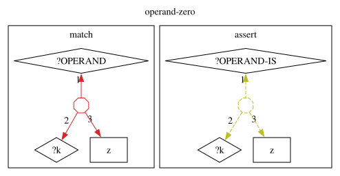
<!-- /rule -->

#### `operand-number`

<!-- rule std.math.positional operand-number -->
```lisp
(rule operand-number (?OPERAND ?N ?OPERAND-IS)
  :match  (?OPERAND ?k (?N ?p ?a))
  :assert (?OPERAND-IS ?k (?N ?p ?a))
  :why    "a number stands for itself")
```

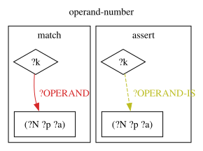
<!-- /rule -->

#### `let-named`

<!-- rule std.math.positional let-named -->
```lisp
(rule let-named (?LET ?NAMED)
  :match  (?LET ?x ?v)
  :assert (?NAMED ?x)
  :why    "{?x} is the name of a number")
```

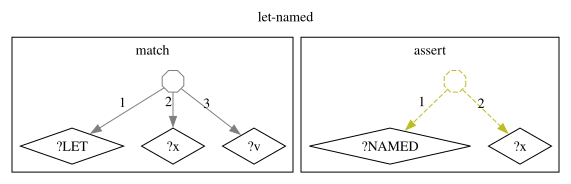
<!-- /rule -->

#### `operand-name`

<!-- rule std.math.positional operand-name -->
```lisp
(rule operand-name (?OPERAND ?NAMED ?LET ?OPERAND-IS)
  :match  (and (?OPERAND ?k ?x) (?NAMED ?x) (?LET ?x ?v))
  :assert (?OPERAND-IS ?k ?v)
  :why    "{?x} names {?v}")
```

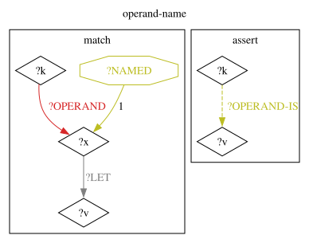
<!-- /rule -->

### The addition walk

One walk from the units. With $x_i$ and $y_i$ the digits of the two numbers, $c_i$ the carry into column $i$ and
$b$ the base, each column is one row of the adder's table:

$$
\begin{aligned}
x_i + y_i + c_i &= b \cdot c_{i+1} + s_i \\
c_0 &\in \lbrace 0, 1 \rbrace
\end{aligned}
$$

`add-column` takes a column where both numbers have a digit, `add-column-first` and `add-column-second` one where
a number has run out, and the walk ends by `add-end`, with no carry, or by `add-carry-out`, which puts the last
carry in front. Every circuit that adds, a sum, a product's rows, a conversion, runs this walk under a tag of its
own.

#### `add-column`

<!-- rule std.math.positional add-column -->
```lisp
(rule add-column (?ADD-WALK ?N ?FA ?B)
  :match  (and (?ADD-WALK ?k (?N ?p ?a) (?N ?q ?c) ?e ?acc)
               (?FA ?a ?c ?e ?s ?f))
  :assert (?ADD-WALK ?k ?p ?q ?f (?B ?s ?acc))
  :why    "{?a} + {?c} + carry {?e} is {?s}, carry {?f}: {?s} goes in front of the digits so far")
```

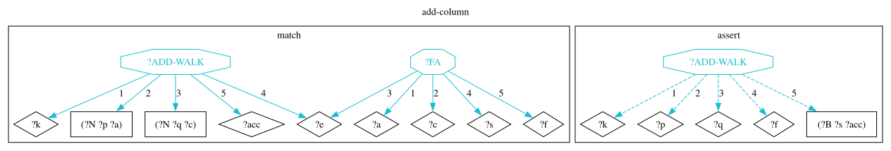
<!-- /rule -->

#### `add-column-first`

<!-- rule std.math.positional add-column-first -->
```lisp
(rule add-column-first (?ADD-WALK ?N ?FA ?B)
  :match  (and (?ADD-WALK ?k (?N ?p ?a) z ?e ?acc)
               (?FA ?a 0 ?e ?s ?f))
  :assert (?ADD-WALK ?k ?p z ?f (?B ?s ?acc))
  :why    "the second number has run out: {?a} + carry {?e} is {?s}, carry {?f}")
```

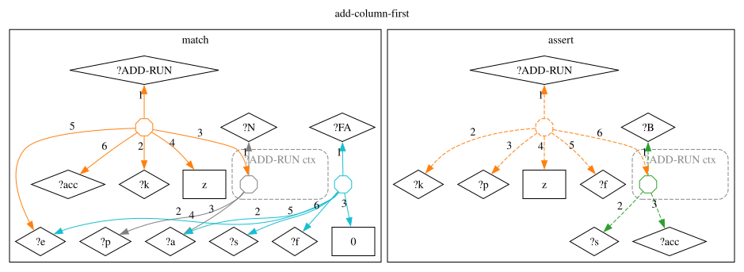
<!-- /rule -->

#### `add-column-second`

<!-- rule std.math.positional add-column-second -->
```lisp
(rule add-column-second (?ADD-WALK ?N ?FA ?B)
  :match  (and (?ADD-WALK ?k z (?N ?q ?c) ?e ?acc)
               (?FA 0 ?c ?e ?s ?f))
  :assert (?ADD-WALK ?k z ?q ?f (?B ?s ?acc))
  :why    "the first number has run out: {?c} + carry {?e} is {?s}, carry {?f}")
```


<!-- /rule -->

#### `add-end`

<!-- rule std.math.positional add-end -->
```lisp
(rule add-end (?ADD-WALK ?STRIP)
  :match  (?ADD-WALK ?k z z 0 ?acc)
  :assert (?STRIP ?k ?acc)
  :why    "no column is left and no carry: the digits are {?acc}")
```

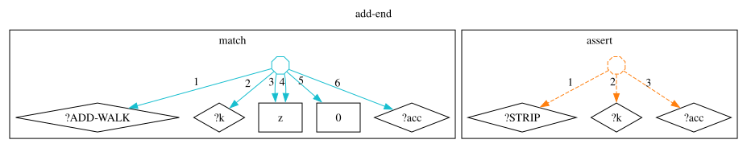
<!-- /rule -->

#### `add-carry-out`

<!-- rule std.math.positional add-carry-out -->
```lisp
(rule add-carry-out (?ADD-WALK ?TURN ?B)
  :match  (?ADD-WALK ?k z z 1 ?acc)
  :assert (?TURN ?k (?B 1 ?acc) z)
  :why    "no column is left: the carry is the top digit, in front of {?acc}")
```

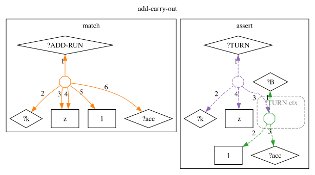
<!-- /rule -->

### The normal form

A walk leaves its digits in an accumulator, the top digit first. `strip` drops the high zeros, and `turn` turns
what is left round into the numeral's shape and hands it over as `done`. Zero comes out as `z`.

#### `strip-zero`

<!-- rule std.math.positional strip-zero -->
```lisp
(rule strip-zero (?STRIP ?B)
  :match  (?STRIP ?k (?B 0 ?r))
  :assert (?STRIP ?k ?r)
  :why    "a high zero is dropped")
```

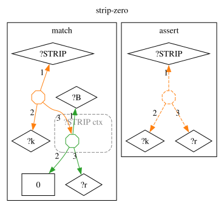
<!-- /rule -->

#### `strip-top`

<!-- rule std.math.positional strip-top -->
```lisp
(rule strip-top (?STRIP ?B ?NZ ?TURN)
  :match  (and (?STRIP ?k (?B ?a ?r)) (?NZ ?a))
  :assert (?TURN ?k (?B ?a ?r) z)
  :why    "the top digit {?a} is not zero: no high zero is left")
```

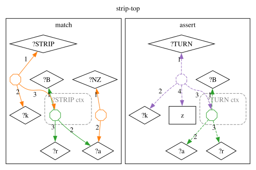
<!-- /rule -->

#### `strip-none`

<!-- rule std.math.positional strip-none -->
```lisp
(rule strip-none (?STRIP ?DONE)
  :match  (?STRIP ?k z)
  :assert (?DONE ?k z)
  :why    "no digit is left: the answer is zero")
```

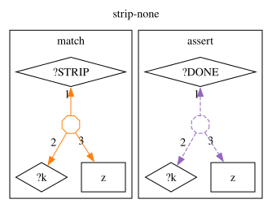
<!-- /rule -->

#### `turn-step`

<!-- rule std.math.positional turn-step -->
```lisp
(rule turn-step (?TURN ?B ?N)
  :match  (?TURN ?k (?B ?a ?r) ?acc)
  :assert (?TURN ?k ?r (?N ?acc ?a))
  :why    "the digit {?a} goes after {?acc}")
```

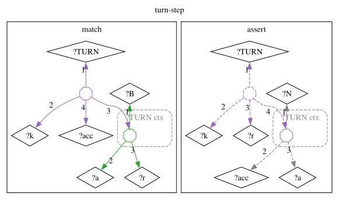
<!-- /rule -->

#### `turn-end`

<!-- rule std.math.positional turn-end -->
```lisp
(rule turn-end (?TURN ?DONE)
  :match  (?TURN ?k z ?acc)
  :assert (?DONE ?k ?acc)
  :why    "turned round: the answer is {?acc}")
```

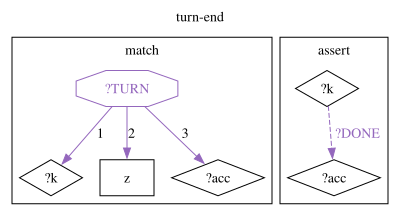
<!-- /rule -->

### Addition: the request

A request asks its first operand, then its second, then starts the walk with no carry, and the walk's answer
becomes the result fact with the operands as the request wrote them.

#### `add-ask`

<!-- rule std.math.positional add-ask -->
```lisp
(rule add-ask (?ADD ?OPERAND ?ADD-FIRST)
  :match  (?ADD ?x ?y)
  :assert (?OPERAND (?ADD-FIRST ?x ?y) ?x)
  :why    "{?x} + {?y} is asked: first, the number {?x} stands for")
```

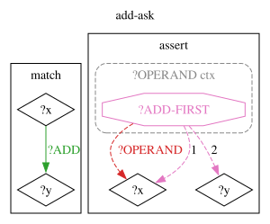
<!-- /rule -->

#### `add-ask-second`

<!-- rule std.math.positional add-ask-second -->
```lisp
(rule add-ask-second (?OPERAND-IS ?ADD-FIRST ?OPERAND ?ADD-SECOND)
  :match  (?OPERAND-IS (?ADD-FIRST ?x ?y) ?u)
  :assert (?OPERAND (?ADD-SECOND ?x ?y ?u) ?y)
  :why    "the first operand is {?u}: now the number {?y} stands for")
```

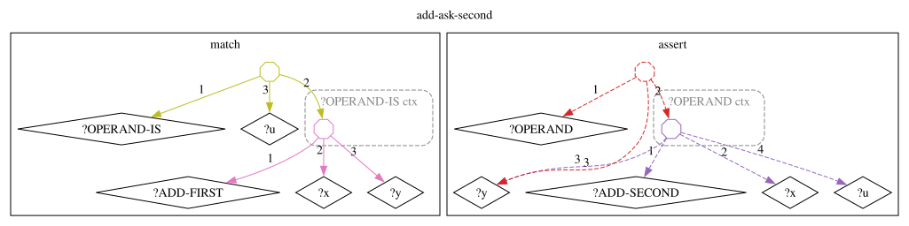
<!-- /rule -->

#### `add-start`

<!-- rule std.math.positional add-start -->
```lisp
(rule add-start (?OPERAND-IS ?ADD-SECOND ?ADD-WALK ?SUM)
  :match  (?OPERAND-IS (?ADD-SECOND ?x ?y ?u) ?v)
  :assert (?ADD-WALK (?SUM ?x ?y) ?u ?v 0 z)
  :why    "add {?u} and {?v} from the units, with no carry in")
```

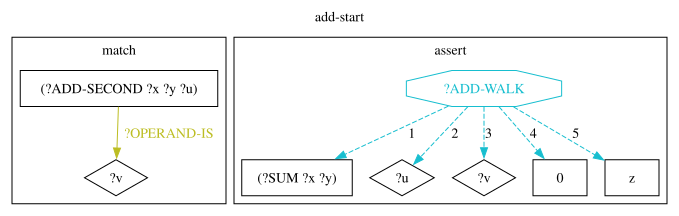
<!-- /rule -->

#### `add-answer`

<!-- rule std.math.positional add-answer -->
```lisp
(rule add-answer (?DONE ?SUM ?SUM-OF)
  :match  (?DONE (?SUM ?x ?y) ?s)
  :assert (?SUM-OF ?x ?y ?s)
  :why    "{?x} + {?y} = {?s}")
```

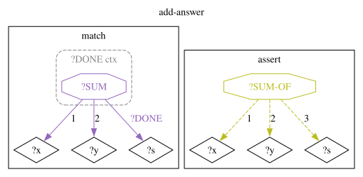
<!-- /rule -->

### Subtraction

The walk is the addition's over the subtractor's table,

$$
\begin{aligned}
x_i - y_i - e_i &= s_i - b \cdot e_{i+1} \\
e_0 &= 0
\end{aligned}
$$

with $e_i$ the borrow. Which number is the smaller is not known before the top column, so `sub-start` runs two
walks, each number from the other: the one that ends with no borrow (`sub-end`) answers, and the one that ends with
a borrow (`sub-borrow-out`) says `short`. `sub-answer` and `sub-answer-short` put the one answer in the
difference's place or in the shortfall's.

#### `sub-column`

<!-- rule std.math.positional sub-column -->
```lisp
(rule sub-column (?SUB-WALK ?N ?FS ?B)
  :match  (and (?SUB-WALK ?k (?N ?p ?a) (?N ?q ?c) ?e ?acc)
               (?FS ?a ?c ?e ?s ?f))
  :assert (?SUB-WALK ?k ?p ?q ?f (?B ?s ?acc))
  :why    "{?a} - {?c} - borrow {?e} is {?s}, borrow {?f}: {?s} goes in front of the digits so far")
```

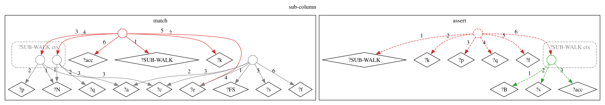
<!-- /rule -->

#### `sub-column-first`

<!-- rule std.math.positional sub-column-first -->
```lisp
(rule sub-column-first (?SUB-WALK ?N ?FS ?B)
  :match  (and (?SUB-WALK ?k (?N ?p ?a) z ?e ?acc)
               (?FS ?a 0 ?e ?s ?f))
  :assert (?SUB-WALK ?k ?p z ?f (?B ?s ?acc))
  :why    "the number taken away has run out: {?a} - borrow {?e} is {?s}, borrow {?f}")
```

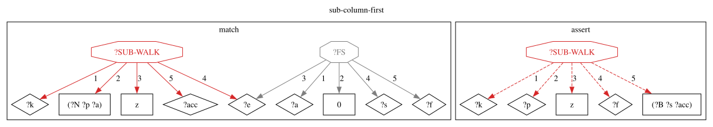
<!-- /rule -->

#### `sub-column-second`

<!-- rule std.math.positional sub-column-second -->
```lisp
(rule sub-column-second (?SUB-WALK ?N ?FS ?B)
  :match  (and (?SUB-WALK ?k z (?N ?q ?c) ?e ?acc)
               (?FS 0 ?c ?e ?s ?f))
  :assert (?SUB-WALK ?k z ?q ?f (?B ?s ?acc))
  :why    "the number taken from has run out: 0 - {?c} - borrow {?e} is {?s}, borrow {?f}")
```

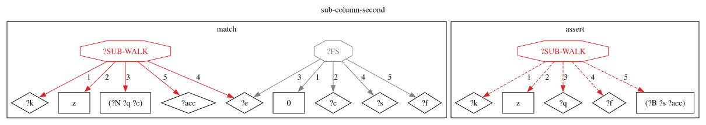
<!-- /rule -->

#### `sub-end`

<!-- rule std.math.positional sub-end -->
```lisp
(rule sub-end (?SUB-WALK ?STRIP)
  :match  (?SUB-WALK ?k z z 0 ?acc)
  :assert (?STRIP ?k ?acc)
  :why    "no column is left and no borrow: the digits are {?acc}")
```

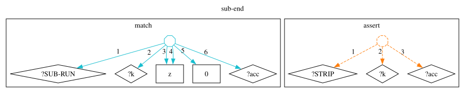
<!-- /rule -->

#### `sub-borrow-out`

<!-- rule std.math.positional sub-borrow-out -->
```lisp
(rule sub-borrow-out (?SUB-WALK ?SHORT)
  :match  (?SUB-WALK ?k z z 1 ?acc)
  :assert (?SHORT ?k)
  :why    "no column is left and a borrow is: the number taken from is the smaller")
```

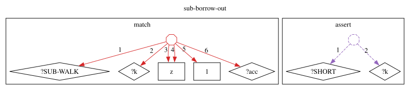
<!-- /rule -->

#### `sub-ask`

<!-- rule std.math.positional sub-ask -->
```lisp
(rule sub-ask (?SUB ?OPERAND ?SUB-FIRST)
  :match  (?SUB ?x ?y)
  :assert (?OPERAND (?SUB-FIRST ?x ?y) ?x)
  :why    "{?x} - {?y} is asked: first, the number {?x} stands for")
```

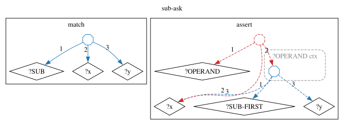
<!-- /rule -->

#### `sub-ask-second`

<!-- rule std.math.positional sub-ask-second -->
```lisp
(rule sub-ask-second (?OPERAND-IS ?SUB-FIRST ?OPERAND ?SUB-SECOND)
  :match  (?OPERAND-IS (?SUB-FIRST ?x ?y) ?u)
  :assert (?OPERAND (?SUB-SECOND ?x ?y ?u) ?y)
  :why    "the first operand is {?u}: now the number {?y} stands for")
```

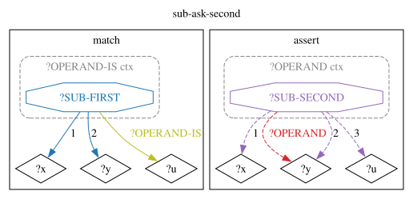
<!-- /rule -->

#### `sub-start`

<!-- rule std.math.positional sub-start -->
```lisp
(rule sub-start (?OPERAND-IS ?SUB-SECOND ?SUB-WALK ?DIFFERENCE ?SHORTFALL)
  :match  (?OPERAND-IS (?SUB-SECOND ?x ?y ?u) ?v)
  :assert (and (?SUB-WALK (?DIFFERENCE ?x ?y) ?u ?v 0 z)
               (?SUB-WALK (?SHORTFALL ?x ?y) ?v ?u 0 z))
  :why    "take {?v} from {?u}, and {?u} from {?v}, from the units, with no borrow in: one of the two has an answer")
```

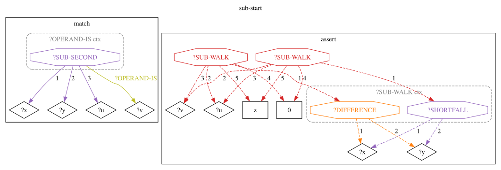
<!-- /rule -->

#### `sub-answer`

<!-- rule std.math.positional sub-answer -->
```lisp
(rule sub-answer (?DONE ?DIFFERENCE ?DIFF-OF)
  :match  (?DONE (?DIFFERENCE ?x ?y) ?d)
  :assert (?DIFF-OF ?x ?y ?d z)
  :why    "{?x} - {?y} = {?d}, and nothing is short")
```

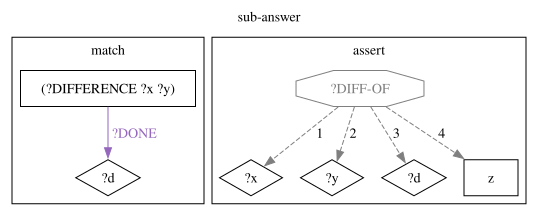
<!-- /rule -->

#### `sub-answer-short`

<!-- rule std.math.positional sub-answer-short -->
```lisp
(rule sub-answer-short (?DONE ?SHORTFALL ?DIFF-OF)
  :match  (?DONE (?SHORTFALL ?x ?y) ?r)
  :assert (?DIFF-OF ?x ?y z ?r)
  :why    "{?x} is short of {?y} by {?r}: the difference is zero")
```

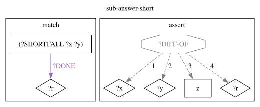
<!-- /rule -->

### Comparison

One walk over the comparator's table, which carries the order of the digits below and lets a higher differing
digit overrule it. It starts at `eq`.

#### `cmp-column`

<!-- rule std.math.positional cmp-column -->
```lisp
(rule cmp-column (?CMP-WALK ?N ?CL)
  :match  (and (?CMP-WALK ?k (?N ?p ?a) (?N ?q ?c) ?o)
               (?CL ?o ?a ?c ?t))
  :assert (?CMP-WALK ?k ?p ?q ?t)
  :why    "the order below is {?o}; {?a} against {?c} above it makes it {?t}")
```

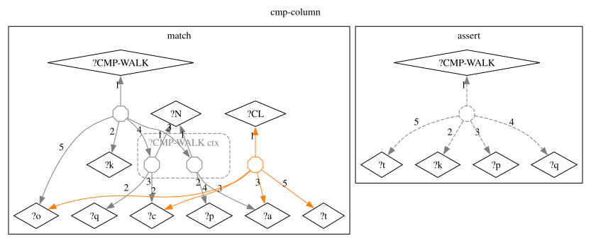
<!-- /rule -->

#### `cmp-column-first`

<!-- rule std.math.positional cmp-column-first -->
```lisp
(rule cmp-column-first (?CMP-WALK ?N ?CL)
  :match  (and (?CMP-WALK ?k (?N ?p ?a) z ?o)
               (?CL ?o ?a 0 ?t))
  :assert (?CMP-WALK ?k ?p z ?t)
  :why    "the second number has run out: the order below is {?o}, and {?a} against nothing makes it {?t}")
```

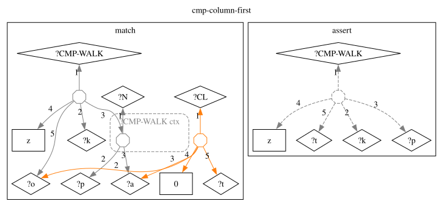
<!-- /rule -->

#### `cmp-column-second`

<!-- rule std.math.positional cmp-column-second -->
```lisp
(rule cmp-column-second (?CMP-WALK ?N ?CL)
  :match  (and (?CMP-WALK ?k z (?N ?q ?c) ?o)
               (?CL ?o 0 ?c ?t))
  :assert (?CMP-WALK ?k z ?q ?t)
  :why    "the first number has run out: the order below is {?o}, and nothing against {?c} makes it {?t}")
```

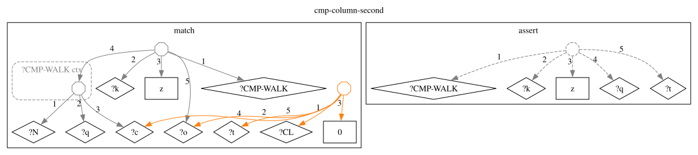
<!-- /rule -->

#### `cmp-end`

<!-- rule std.math.positional cmp-end -->
```lisp
(rule cmp-end (?CMP-WALK ?ORDER-IS)
  :match  (?CMP-WALK ?k z z ?o)
  :assert (?ORDER-IS ?k ?o)
  :why    "no column is left: the order is {?o}")
```

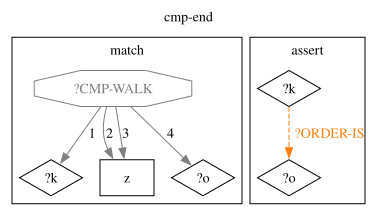
<!-- /rule -->

#### `cmp-ask`

<!-- rule std.math.positional cmp-ask -->
```lisp
(rule cmp-ask (?CMP ?OPERAND ?CMP-FIRST)
  :match  (?CMP ?x ?y)
  :assert (?OPERAND (?CMP-FIRST ?x ?y) ?x)
  :why    "{?x} compared with {?y} is asked: first, the number {?x} stands for")
```

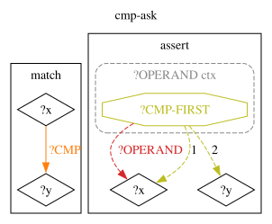
<!-- /rule -->

#### `cmp-ask-second`

<!-- rule std.math.positional cmp-ask-second -->
```lisp
(rule cmp-ask-second (?OPERAND-IS ?CMP-FIRST ?OPERAND ?CMP-SECOND)
  :match  (?OPERAND-IS (?CMP-FIRST ?x ?y) ?u)
  :assert (?OPERAND (?CMP-SECOND ?x ?y ?u) ?y)
  :why    "the first operand is {?u}: now the number {?y} stands for")
```

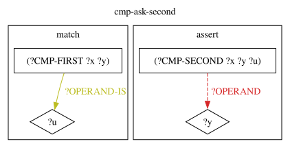
<!-- /rule -->

#### `cmp-start`

<!-- rule std.math.positional cmp-start -->
```lisp
(rule cmp-start (?OPERAND-IS ?CMP-SECOND ?CMP-WALK ?ORDER)
  :match  (?OPERAND-IS (?CMP-SECOND ?x ?y ?u) ?v)
  :assert (?CMP-WALK (?ORDER ?x ?y) ?u ?v eq)
  :why    "compare {?u} with {?v} from the units: equal so far")
```

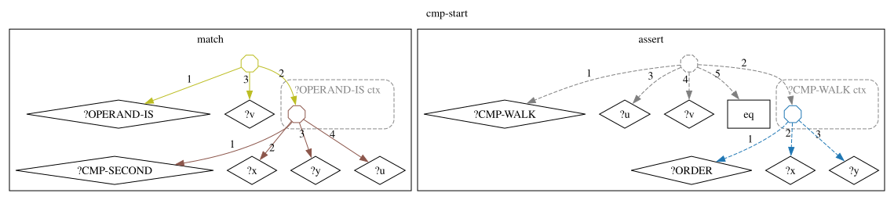
<!-- /rule -->

#### `cmp-answer`

<!-- rule std.math.positional cmp-answer -->
```lisp
(rule cmp-answer (?ORDER-IS ?ORDER ?CMP-OF)
  :match  (?ORDER-IS (?ORDER ?x ?y) ?o)
  :assert (?CMP-OF ?x ?y ?o)
  :why    "{?x} against {?y}: {?o}")
```

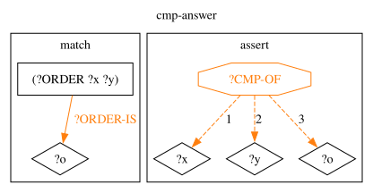
<!-- /rule -->

### Multiplication: the call

What a base shares of a product: the multiplier's digits turned round so that the top one comes first
(`top-first`), the sum so far handed from one row to the next, and the request. A row itself is the base's own:
decimal multiplies by a digit, binary adds the multiplicand or nothing.

#### `top-first-step`

<!-- rule std.math.positional top-first-step -->
```lisp
(rule top-first-step (?TOP-FIRST ?N ?B)
  :match  (?TOP-FIRST ?k (?N ?p ?a) ?acc)
  :assert (?TOP-FIRST ?k ?p (?B ?a ?acc))
  :why    "the digit {?a} goes in front of {?acc}")
```

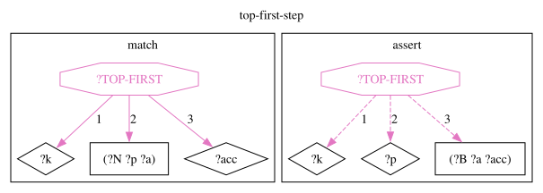
<!-- /rule -->

#### `top-first-end`

<!-- rule std.math.positional top-first-end -->
```lisp
(rule top-first-end (?TOP-FIRST ?TOP-FIRST-IS)
  :match  (?TOP-FIRST ?k z ?acc)
  :assert (?TOP-FIRST-IS ?k ?acc)
  :why    "turned round: the digits, the top one first, are {?acc}")
```

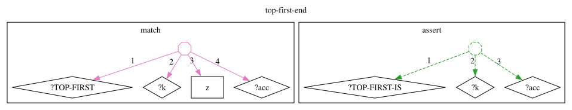
<!-- /rule -->

#### `mul-turn`

<!-- rule std.math.positional mul-turn -->
```lisp
(rule mul-turn (?MUL-CALL ?TOP-FIRST ?MUL-DIGITS)
  :match  (?MUL-CALL ?k ?u ?v)
  :assert (?TOP-FIRST (?MUL-DIGITS ?k ?u) ?v z)
  :why    "to multiply {?u} by {?v}: first {?v}'s digits, the top one first")
```

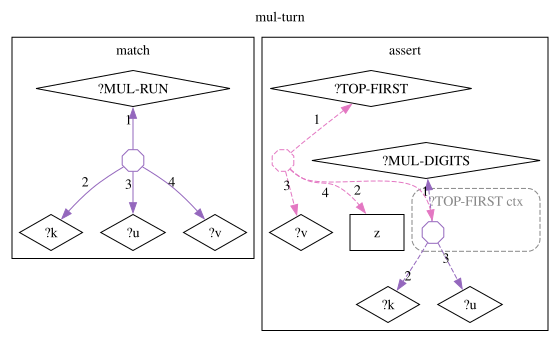
<!-- /rule -->

#### `mul-begin`

<!-- rule std.math.positional mul-begin -->
```lisp
(rule mul-begin (?TOP-FIRST-IS ?MUL-DIGITS ?MUL-STEP)
  :match  (?TOP-FIRST-IS (?MUL-DIGITS ?k ?u) ?t)
  :assert (?MUL-STEP ?k ?u ?t z)
  :why    "nothing is summed yet")
```

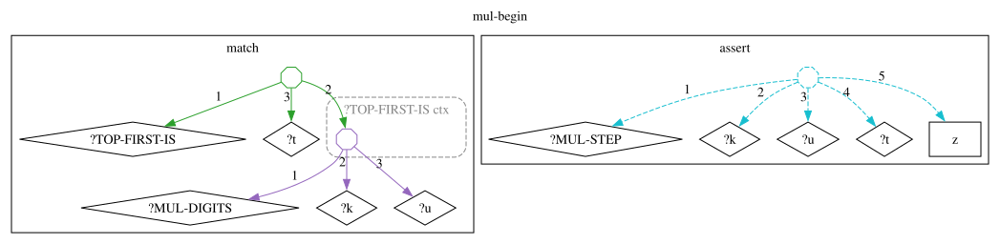
<!-- /rule -->

#### `mul-next`

<!-- rule std.math.positional mul-next -->
```lisp
(rule mul-next (?DONE ?MUL-SUM ?MUL-STEP)
  :match  (?DONE (?MUL-SUM ?k ?u ?rest) ?s)
  :assert (?MUL-STEP ?k ?u ?rest ?s)
  :why    "the sum so far is {?s}")
```

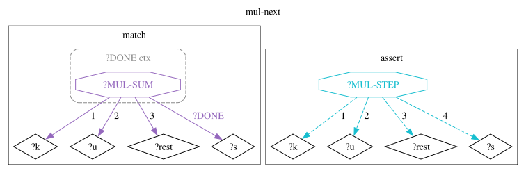
<!-- /rule -->

#### `mul-end`

<!-- rule std.math.positional mul-end -->
```lisp
(rule mul-end (?MUL-STEP ?DONE)
  :match  (?MUL-STEP ?k ?u z ?acc)
  :assert (?DONE ?k ?acc)
  :why    "no digit of the multiplier is left: the product is {?acc}")
```

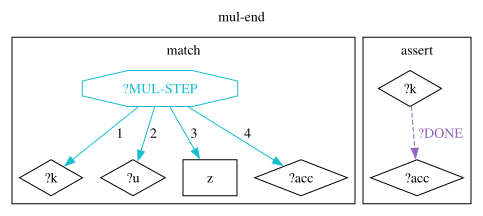
<!-- /rule -->

#### `mul-ask`

<!-- rule std.math.positional mul-ask -->
```lisp
(rule mul-ask (?MUL ?OPERAND ?MUL-FIRST)
  :match  (?MUL ?x ?y)
  :assert (?OPERAND (?MUL-FIRST ?x ?y) ?x)
  :why    "{?x} x {?y} is asked: first, the number {?x} stands for")
```

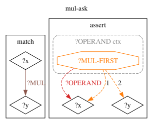
<!-- /rule -->

#### `mul-ask-second`

<!-- rule std.math.positional mul-ask-second -->
```lisp
(rule mul-ask-second (?OPERAND-IS ?MUL-FIRST ?OPERAND ?MUL-SECOND)
  :match  (?OPERAND-IS (?MUL-FIRST ?x ?y) ?u)
  :assert (?OPERAND (?MUL-SECOND ?x ?y ?u) ?y)
  :why    "the first operand is {?u}: now the number {?y} stands for")
```

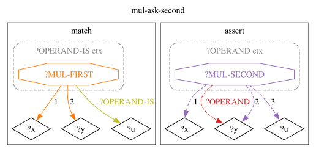
<!-- /rule -->

#### `mul-start`

<!-- rule std.math.positional mul-start -->
```lisp
(rule mul-start (?OPERAND-IS ?MUL-SECOND ?MUL-CALL ?PRODUCT)
  :match  (?OPERAND-IS (?MUL-SECOND ?x ?y ?u) ?v)
  :assert (?MUL-CALL (?PRODUCT ?x ?y) ?u ?v)
  :why    "multiply {?u} by {?v}")
```

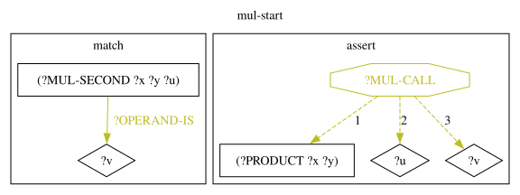
<!-- /rule -->

#### `mul-answer`

<!-- rule std.math.positional mul-answer -->
```lisp
(rule mul-answer (?DONE ?PRODUCT ?PRODUCT-OF)
  :match  (?DONE (?PRODUCT ?x ?y) ?p)
  :assert (?PRODUCT-OF ?x ?y ?p)
  :why    "{?x} x {?y} = {?p}")
```

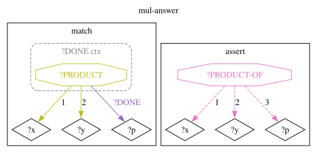
<!-- /rule -->

### Division: the call

The start and the end of a long division, and the request. The steps between, bringing a digit down and finding a
digit of the quotient, are the base's own.

#### `div-begin`

<!-- rule std.math.positional div-begin -->
```lisp
(rule div-begin (?TOP-FIRST-IS ?DIV-DIGITS ?DIV-STEP)
  :match  (?TOP-FIRST-IS (?DIV-DIGITS ?k ?ms) ?t)
  :assert (?DIV-STEP ?k ?ms ?t z z)
  :why    "start at the top digit: nothing is left over yet, and the quotient is zero")
```

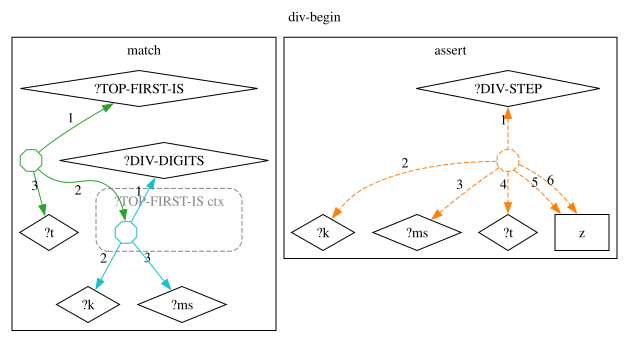
<!-- /rule -->

#### `div-end`

<!-- rule std.math.positional div-end -->
```lisp
(rule div-end (?DIV-STEP ?DIV-DONE)
  :match  (?DIV-STEP ?k ?ms z ?t ?w)
  :assert (?DIV-DONE ?k ?w ?t)
  :why    "no digit is left: the quotient is {?w} and the remainder {?t}")
```

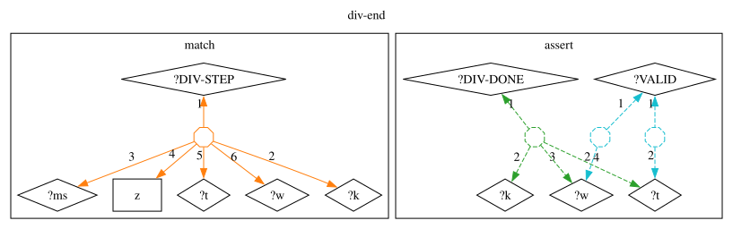
<!-- /rule -->

#### `div-ask`

<!-- rule std.math.positional div-ask -->
```lisp
(rule div-ask (?DIV ?OPERAND ?DIV-FIRST)
  :match  (?DIV ?x ?y)
  :assert (?OPERAND (?DIV-FIRST ?x ?y) ?x)
  :why    "{?x} divided by {?y} is asked: first, the number {?x} stands for")
```

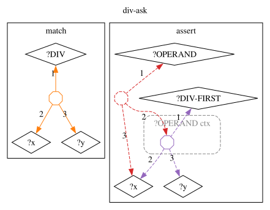
<!-- /rule -->

#### `div-ask-second`

<!-- rule std.math.positional div-ask-second -->
```lisp
(rule div-ask-second (?OPERAND-IS ?DIV-FIRST ?OPERAND ?DIV-SECOND)
  :match  (?OPERAND-IS (?DIV-FIRST ?x ?y) ?u)
  :assert (?OPERAND (?DIV-SECOND ?x ?y ?u) ?y)
  :why    "the first operand is {?u}: now the number {?y} stands for")
```

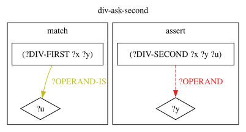
<!-- /rule -->

#### `div-start`

<!-- rule std.math.positional div-start -->
```lisp
(rule div-start (?OPERAND-IS ?DIV-SECOND ?DIV-CALL ?QUOTIENT)
  :match  (?OPERAND-IS (?DIV-SECOND ?x ?y ?u) ?v)
  :assert (?DIV-CALL (?QUOTIENT ?x ?y) ?u ?v)
  :why    "divide {?u} by {?v}")
```

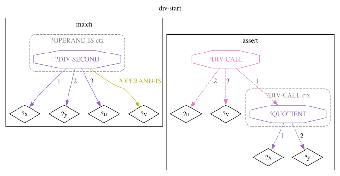
<!-- /rule -->

#### `div-answer`

<!-- rule std.math.positional div-answer -->
```lisp
(rule div-answer (?DIV-DONE ?QUOTIENT ?QUOT-OF)
  :match  (?DIV-DONE (?QUOTIENT ?x ?y) ?q ?r)
  :assert (?QUOT-OF ?x ?y ?q ?r)
  :why    "{?x} divided by {?y} = {?q}, remainder {?r}")
```


<!-- /rule -->

### Division by zero

The divisor times one is zero: the flag, at the request and at the call.

#### `div-by-zero`

<!-- rule std.math.positional div-by-zero -->
```lisp
(rule div-by-zero (?DONE ?DIV-M1 ?QUOTIENT ?DIV)
  :match  (?DONE (?DIV-M1 (?QUOTIENT ?x ?y) ?u ?v) z)
  :assert (division-by-zero (?DIV ?x ?y))
  :why    "the divisor of {?x} divided by {?y} is zero")
```


<!-- /rule -->

#### `div-call-by-zero`

<!-- rule std.math.positional div-call-by-zero -->
```lisp
(rule div-call-by-zero (?DONE ?DIV-M1 ?DIV-CALL)
  :match  (?DONE (?DIV-M1 ?k ?u ?v) z)
  :assert (division-by-zero (?DIV-CALL ?k ?u ?v))
  :why    "the divisor of {?u} divided by {?v}, wanted for {?k}, is zero")
```


<!-- /rule -->

### An operand's faults, and a `let`'s

A digit where a number goes, and a `let` that cannot be read, each found by one rule. An operand's fault is first
a fact about the operand's tag, `bad-operand`; the ten `bad-…-first` and `bad-…-second` rules carry it to the
request it belongs to, `bad-request-malformed` and `bad-request-undeclared` turn it into the flag, and the last two
rules make each flag a contradiction.

#### `operand-digit`

<!-- rule std.math.positional operand-digit -->
```lisp
(rule operand-digit (?OPERAND ?NZ ?BAD-OPERAND ?NOT-A-NUMBER ?N)
  :match  (and (?OPERAND ?k ?x) (?NZ ?x))
  :assert (?BAD-OPERAND ?k (?NOT-A-NUMBER ?x))
  :why    "the digit {?x} is not a number: the number is ({?N} z {?x})")
```


<!-- /rule -->

#### `operand-digit-zero`

<!-- rule std.math.positional operand-digit-zero -->
```lisp
(rule operand-digit-zero (?OPERAND ?BAD-OPERAND ?NOT-A-NUMBER)
  :match  (?OPERAND ?k 0)
  :assert (?BAD-OPERAND ?k (?NOT-A-NUMBER 0))
  :why    "the digit 0 is not a number: zero is z")
```


<!-- /rule -->

#### `let-twice`

<!-- rule std.math.positional let-twice -->
```lisp
(rule let-twice (?LET ?MALFORMED)
  :match  (and (?LET ?x ?v) (?LET ?x ?w) (neq ?v ?w))
  :assert (?MALFORMED (?LET ?x ?v))
  :why    "{?x} is named twice: {?v}, and {?w}")
```


<!-- /rule -->

#### `let-zero`

<!-- rule std.math.positional let-zero -->
```lisp
(rule let-zero (?LET ?MALFORMED)
  :match  (?LET z ?v)
  :assert (?MALFORMED (?LET z ?v))
  :why    "z is zero, and cannot name another number")
```


<!-- /rule -->

#### `let-digit`

<!-- rule std.math.positional let-digit -->
```lisp
(rule let-digit (?LET ?NZ ?MALFORMED)
  :match  (and (?LET ?x ?v) (?NZ ?x))
  :assert (?MALFORMED (?LET ?x ?v))
  :why    "{?x} is a digit, and cannot name a number")
```


<!-- /rule -->

#### `let-digit-zero`

<!-- rule std.math.positional let-digit-zero -->
```lisp
(rule let-digit-zero (?LET ?MALFORMED)
  :match  (?LET 0 ?v)
  :assert (?MALFORMED (?LET 0 ?v))
  :why    "0 is a digit, and cannot name a number")
```


<!-- /rule -->

#### `let-to-name`

<!-- rule std.math.positional let-to-name -->
```lisp
(rule let-to-name (?LET ?NAMED ?MALFORMED)
  :match  (and (?LET ?x ?v) (?NAMED ?v))
  :assert (?MALFORMED (?LET ?x ?v))
  :why    "{?v} is a named constant: a let names a number, not another name")
```


<!-- /rule -->

#### `let-to-digit`

<!-- rule std.math.positional let-to-digit -->
```lisp
(rule let-to-digit (?LET ?NZ ?MALFORMED ?N)
  :match  (and (?LET ?x ?v) (?NZ ?v))
  :assert (?MALFORMED (?LET ?x ?v))
  :why    "{?v} is a digit, not a number: the number is ({?N} z {?v})")
```


<!-- /rule -->

#### `let-to-digit-zero`

<!-- rule std.math.positional let-to-digit-zero -->
```lisp
(rule let-to-digit-zero (?LET ?MALFORMED)
  :match  (?LET ?x 0)
  :assert (?MALFORMED (?LET ?x 0))
  :why    "0 is a digit, not a number: zero is z")
```


<!-- /rule -->

#### `bad-add-first`

<!-- rule std.math.positional bad-add-first -->
```lisp
(rule bad-add-first (?BAD-OPERAND ?ADD-FIRST ?BAD-REQUEST ?ADD)
  :match  (?BAD-OPERAND (?ADD-FIRST ?x ?y) ?f)
  :assert (?BAD-REQUEST (?ADD ?x ?y) ?f)
  :why    "the first operand of {?x} + {?y} is at fault: {?f}")
```


<!-- /rule -->

#### `bad-add-second`

<!-- rule std.math.positional bad-add-second -->
```lisp
(rule bad-add-second (?BAD-OPERAND ?ADD-SECOND ?BAD-REQUEST ?ADD)
  :match  (?BAD-OPERAND (?ADD-SECOND ?x ?y ?u) ?f)
  :assert (?BAD-REQUEST (?ADD ?x ?y) ?f)
  :why    "the second operand of {?x} + {?y} is at fault: {?f}")
```


<!-- /rule -->

#### `bad-sub-first`

<!-- rule std.math.positional bad-sub-first -->
```lisp
(rule bad-sub-first (?BAD-OPERAND ?SUB-FIRST ?BAD-REQUEST ?SUB)
  :match  (?BAD-OPERAND (?SUB-FIRST ?x ?y) ?f)
  :assert (?BAD-REQUEST (?SUB ?x ?y) ?f)
  :why    "the first operand of {?x} - {?y} is at fault: {?f}")
```


<!-- /rule -->

#### `bad-sub-second`

<!-- rule std.math.positional bad-sub-second -->
```lisp
(rule bad-sub-second (?BAD-OPERAND ?SUB-SECOND ?BAD-REQUEST ?SUB)
  :match  (?BAD-OPERAND (?SUB-SECOND ?x ?y ?u) ?f)
  :assert (?BAD-REQUEST (?SUB ?x ?y) ?f)
  :why    "the second operand of {?x} - {?y} is at fault: {?f}")
```


<!-- /rule -->

#### `bad-cmp-first`

<!-- rule std.math.positional bad-cmp-first -->
```lisp
(rule bad-cmp-first (?BAD-OPERAND ?CMP-FIRST ?BAD-REQUEST ?CMP)
  :match  (?BAD-OPERAND (?CMP-FIRST ?x ?y) ?f)
  :assert (?BAD-REQUEST (?CMP ?x ?y) ?f)
  :why    "the first operand of {?x} compared with {?y} is at fault: {?f}")
```


<!-- /rule -->

#### `bad-cmp-second`

<!-- rule std.math.positional bad-cmp-second -->
```lisp
(rule bad-cmp-second (?BAD-OPERAND ?CMP-SECOND ?BAD-REQUEST ?CMP)
  :match  (?BAD-OPERAND (?CMP-SECOND ?x ?y ?u) ?f)
  :assert (?BAD-REQUEST (?CMP ?x ?y) ?f)
  :why    "the second operand of {?x} compared with {?y} is at fault: {?f}")
```


<!-- /rule -->

#### `bad-mul-first`

<!-- rule std.math.positional bad-mul-first -->
```lisp
(rule bad-mul-first (?BAD-OPERAND ?MUL-FIRST ?BAD-REQUEST ?MUL)
  :match  (?BAD-OPERAND (?MUL-FIRST ?x ?y) ?f)
  :assert (?BAD-REQUEST (?MUL ?x ?y) ?f)
  :why    "the first operand of {?x} x {?y} is at fault: {?f}")
```


<!-- /rule -->

#### `bad-mul-second`

<!-- rule std.math.positional bad-mul-second -->
```lisp
(rule bad-mul-second (?BAD-OPERAND ?MUL-SECOND ?BAD-REQUEST ?MUL)
  :match  (?BAD-OPERAND (?MUL-SECOND ?x ?y ?u) ?f)
  :assert (?BAD-REQUEST (?MUL ?x ?y) ?f)
  :why    "the second operand of {?x} x {?y} is at fault: {?f}")
```


<!-- /rule -->

#### `bad-div-first`

<!-- rule std.math.positional bad-div-first -->
```lisp
(rule bad-div-first (?BAD-OPERAND ?DIV-FIRST ?BAD-REQUEST ?DIV)
  :match  (?BAD-OPERAND (?DIV-FIRST ?x ?y) ?f)
  :assert (?BAD-REQUEST (?DIV ?x ?y) ?f)
  :why    "the first operand of {?x} divided by {?y} is at fault: {?f}")
```


<!-- /rule -->

#### `bad-div-second`

<!-- rule std.math.positional bad-div-second -->
```lisp
(rule bad-div-second (?BAD-OPERAND ?DIV-SECOND ?BAD-REQUEST ?DIV)
  :match  (?BAD-OPERAND (?DIV-SECOND ?x ?y ?u) ?f)
  :assert (?BAD-REQUEST (?DIV ?x ?y) ?f)
  :why    "the second operand of {?x} divided by {?y} is at fault: {?f}")
```


<!-- /rule -->

#### `bad-request-malformed`

<!-- rule std.math.positional bad-request-malformed -->
```lisp
(rule bad-request-malformed (?BAD-REQUEST ?NOT-A-NUMBER ?MALFORMED)
  :match  (?BAD-REQUEST ?request (?NOT-A-NUMBER ?thing))
  :assert (?MALFORMED ?request)
  :why    "an operand of {?request} is not a number: it holds {?thing}")
```


<!-- /rule -->

#### `bad-request-undeclared`

<!-- rule std.math.positional bad-request-undeclared -->
```lisp
(rule bad-request-undeclared (?BAD-REQUEST ?NO-LET ?UNDECLARED)
  :match  (?BAD-REQUEST ?request (?NO-LET ?x))
  :assert (?UNDECLARED ?x ?request)
  :why    "{?request} uses the name {?x}, and no let states it")
```


<!-- /rule -->

#### `malformed-is-false`

<!-- rule std.math.positional malformed-is-false -->
```lisp
(rule malformed-is-false (?MALFORMED)
  :match  (?MALFORMED ?request)
  :assert (false)
  :why    "{?request} holds something that is not a number: the theory cannot read it")
```


<!-- /rule -->

#### `undeclared-is-false`

<!-- rule std.math.positional undeclared-is-false -->
```lisp
(rule undeclared-is-false (?UNDECLARED)
  :match  (?UNDECLARED ?x ?request)
  :assert (false)
  :why    "{?request} uses the name {?x}, which names no number")
```


<!-- /rule -->
