# The integers' rules

How `std.math.int` works: every rule of the module, as it writes it and as the engine draws it. What a program
writes to use it is [the page before](11-integers-rationals-gcd.md#using-stdmathint--integers); how to read a
drawing is [the index](README.md#how-a-rule-is-shown).

None of these rules has a parameter. An integer `(int P N)` is computed on its two parts, each a natural number,
by tagged calls into [`std.math.decimal-arith`](08-natural-numbers.md#the-tagged-calls): every step below hands a
walk or a call a tag that says what the answer is for, and the next rule has that answer as its one premise. A
rule's `:why` says what one firing does, in the words a trace prints.

## The operands

An operand is an integer written out, which stands for itself, or a name, which the natural numbers' `operand`
looks up.

#### `int-operand`

<!-- rule std.math.int int-operand -->
```lisp
(rule int-operand ()
  :match  (operand ?k (int ?p ?n))
  :assert (operand-is ?k (int ?p ?n))
  :why    "an integer stands for itself")
```

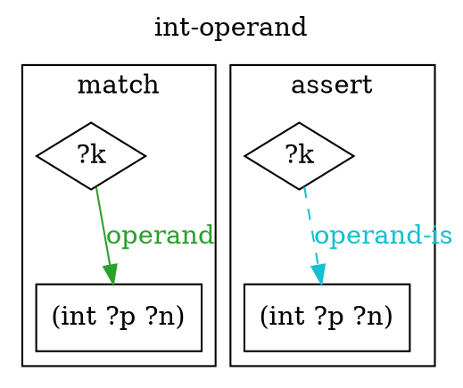
<!-- /rule -->

#### `int-operand-second`

<!-- rule std.math.int int-operand-second -->
```lisp
(rule int-operand-second ()
  :match  (operand-is (int-first ?k ?y) (int ?p ?n))
  :assert (operand (int-second ?k ?p ?n) ?y)
  :why    "the first operand is {?p} less {?n}: now the integer {?y} stands for")
```

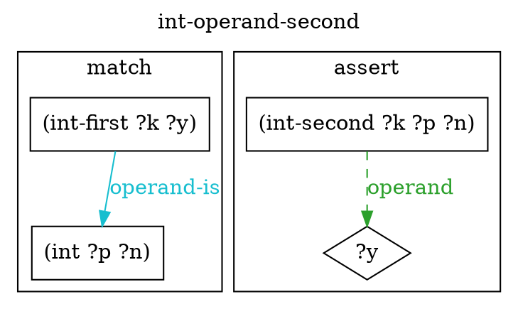
<!-- /rule -->

## The normal form

For $P$ less $N$, two subtraction walks, each part from the other, as a natural subtraction runs them: one of the
two has an answer, and it is the part that is left.

$$
\operatorname{norm}(P, N) = \begin{cases} (\mathsf{int}\ (P - N)\ \mathsf{z}) & P \ge N \\ (\mathsf{int}\ \mathsf{z}\ (N - P)) & P < N \end{cases}
$$

#### `int-norm-walks`

<!-- rule std.math.int int-norm-walks -->
```lisp
(rule int-norm-walks ()
  :match  (int-norm ?k ?p ?n)
  :assert (and (sub-walk (int-plus ?k) ?p ?n 0 z)
               (sub-walk (int-minus ?k) ?n ?p 0 z))
  :why    "take {?n} from {?p}, and {?p} from {?n}: one of the two has an answer")
```

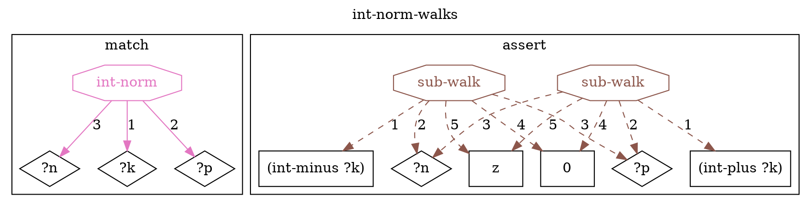
<!-- /rule -->

#### `int-norm-plus`

<!-- rule std.math.int int-norm-plus -->
```lisp
(rule int-norm-plus ()
  :match  (done (int-plus ?k) ?d)
  :assert (int-done ?k (int ?d z))
  :why    "the positive part is {?d}, and the negative part is zero")
```

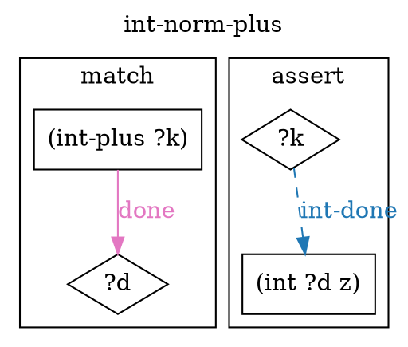
<!-- /rule -->

#### `int-norm-minus`

<!-- rule std.math.int int-norm-minus -->
```lisp
(rule int-norm-minus ()
  :match  (done (int-minus ?k) ?r)
  :assert (int-done ?k (int z ?r))
  :why    "the negative part is {?r}, and the positive part is zero")
```

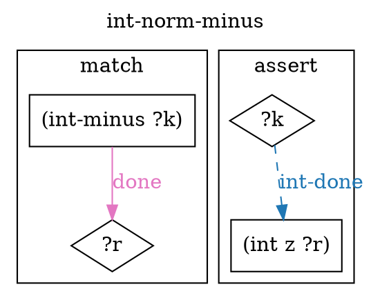
<!-- /rule -->

## Simplification, and negation

Simplifying is the normal form; negating is the normal form with the parts exchanged.

#### `int-simplify-ask`

<!-- rule std.math.int int-simplify-ask -->
```lisp
(rule int-simplify-ask ()
  :match  (int-simplify ?x)
  :assert (operand (int-only (int-simplify ?x)) ?x)
  :why    "{?x} in normal form is asked: first, the integer {?x} stands for")
```

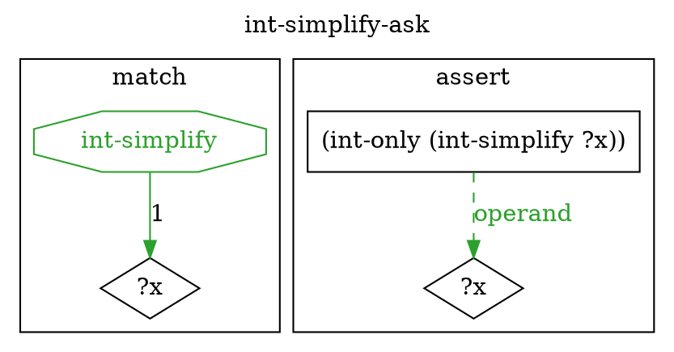
<!-- /rule -->

#### `int-simplify-start`

<!-- rule std.math.int int-simplify-start -->
```lisp
(rule int-simplify-start ()
  :match  (operand-is (int-only (int-simplify ?x)) (int ?p ?n))
  :assert (int-norm (int-simplify ?x) ?p ?n)
  :why    "simplify {?p} less {?n}")
```

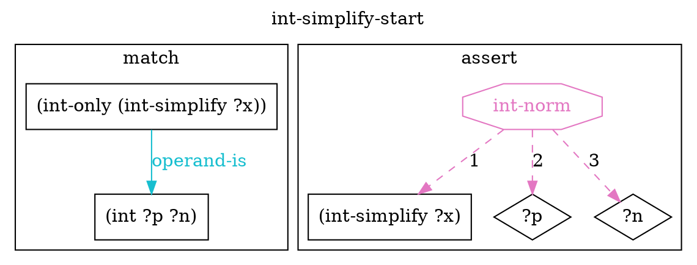
<!-- /rule -->

#### `int-simplify-answer`

<!-- rule std.math.int int-simplify-answer -->
```lisp
(rule int-simplify-answer ()
  :match  (int-done (int-simplify ?x) ?s)
  :assert (int-simple-of ?x ?s)
  :why    "{?x} is {?s}")
```

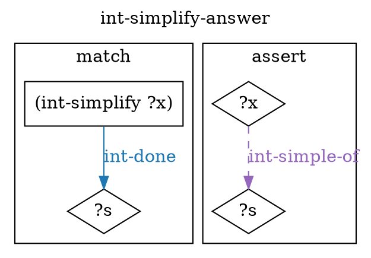
<!-- /rule -->

#### `int-neg-ask`

<!-- rule std.math.int int-neg-ask -->
```lisp
(rule int-neg-ask ()
  :match  (int-neg ?x)
  :assert (operand (int-only (int-neg ?x)) ?x)
  :why    "{?x} negated is asked: first, the integer {?x} stands for")
```

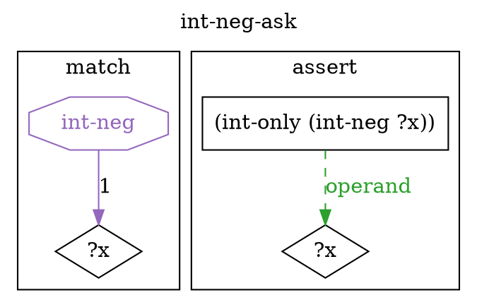
<!-- /rule -->

#### `int-neg-start`

<!-- rule std.math.int int-neg-start -->
```lisp
(rule int-neg-start ()
  :match  (operand-is (int-only (int-neg ?x)) (int ?p ?n))
  :assert (int-norm (int-neg ?x) ?n ?p)
  :why    "the parts change places: simplify {?n} less {?p}")
```

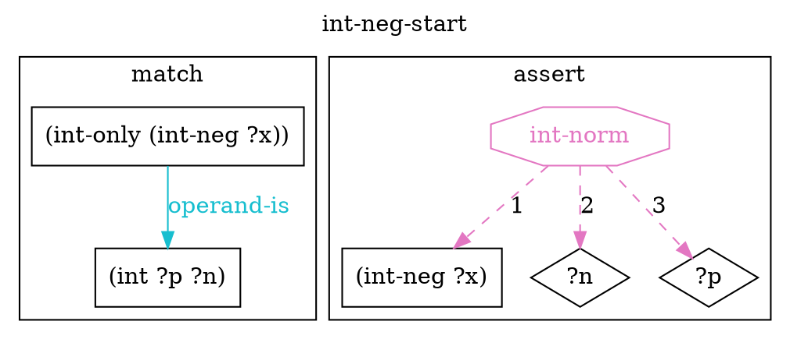
<!-- /rule -->

#### `int-neg-answer`

<!-- rule std.math.int int-neg-answer -->
```lisp
(rule int-neg-answer ()
  :match  (int-done (int-neg ?x) ?s)
  :assert (int-neg-of ?x ?s)
  :why    "{?x} negated is {?s}")
```

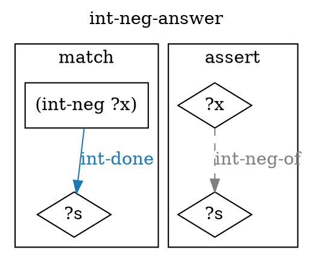
<!-- /rule -->

## Addition, and subtraction

$$
(P_1 - N_1) + (P_2 - N_2) = (P_1 + P_2) - (N_1 + N_2)
$$

The positive parts are added, then the negative parts, then the two sums are normalised. A subtraction is the
addition of the second operand with its parts exchanged.

#### `int-add-plus`

<!-- rule std.math.int int-add-plus -->
```lisp
(rule int-add-plus ()
  :match  (int-add-call ?k ?p ?n ?q ?m)
  :assert (add-walk (int-add-p ?k ?n ?m) ?p ?q 0 z)
  :why    "first the positive parts: {?p} + {?q}")
```

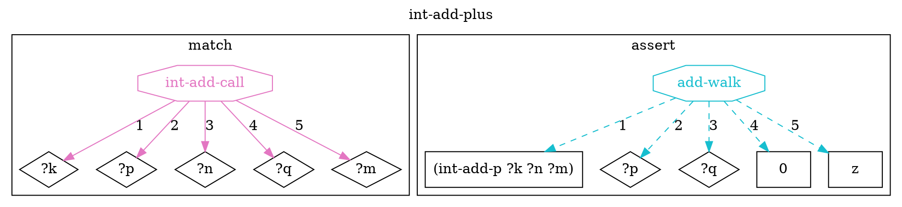
<!-- /rule -->

#### `int-add-minus`

<!-- rule std.math.int int-add-minus -->
```lisp
(rule int-add-minus ()
  :match  (done (int-add-p ?k ?n ?m) ?s)
  :assert (add-walk (int-add-n ?k ?s) ?n ?m 0 z)
  :why    "the positive parts make {?s}: now the negative parts, {?n} + {?m}")
```

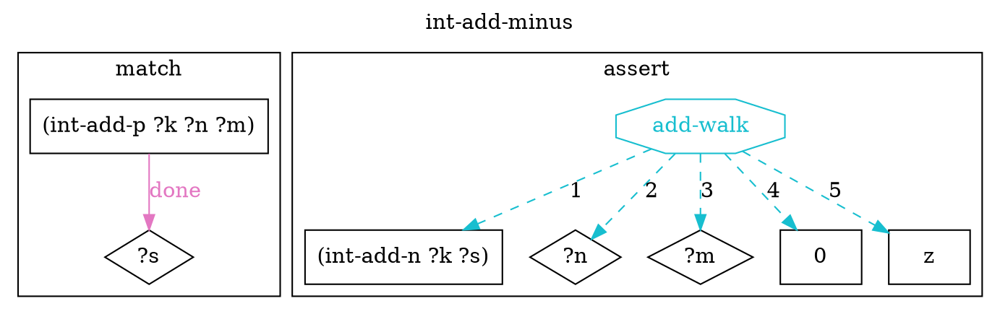
<!-- /rule -->

#### `int-add-norm`

<!-- rule std.math.int int-add-norm -->
```lisp
(rule int-add-norm ()
  :match  (done (int-add-n ?k ?s) ?t)
  :assert (int-norm ?k ?s ?t)
  :why    "the negative parts make {?t}: simplify {?s} less {?t}")
```

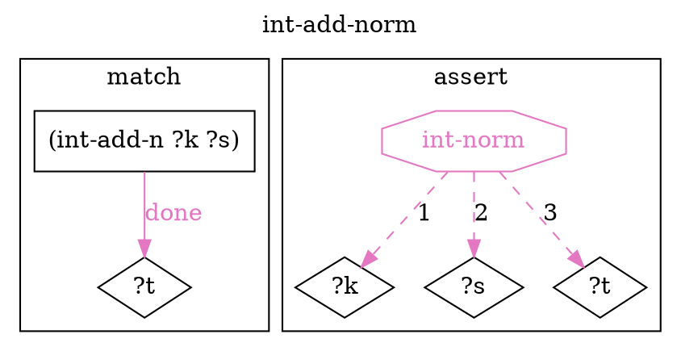
<!-- /rule -->

#### `int-add-ask`

<!-- rule std.math.int int-add-ask -->
```lisp
(rule int-add-ask ()
  :match  (int-add ?x ?y)
  :assert (operand (int-first (int-add ?x ?y) ?y) ?x)
  :why    "{?x} + {?y} is asked: first, the integer {?x} stands for")
```

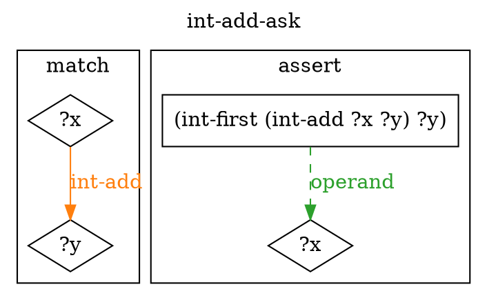
<!-- /rule -->

#### `int-add-start`

<!-- rule std.math.int int-add-start -->
```lisp
(rule int-add-start ()
  :match  (operand-is (int-second (int-add ?x ?y) ?p ?n) (int ?q ?m))
  :assert (int-add-call (int-add ?x ?y) ?p ?n ?q ?m)
  :why    "add {?p} less {?n} and {?q} less {?m}")
```


<!-- /rule -->

#### `int-add-answer`

<!-- rule std.math.int int-add-answer -->
```lisp
(rule int-add-answer ()
  :match  (int-done (int-add ?x ?y) ?s)
  :assert (int-sum-of ?x ?y ?s)
  :why    "{?x} + {?y} = {?s}")
```

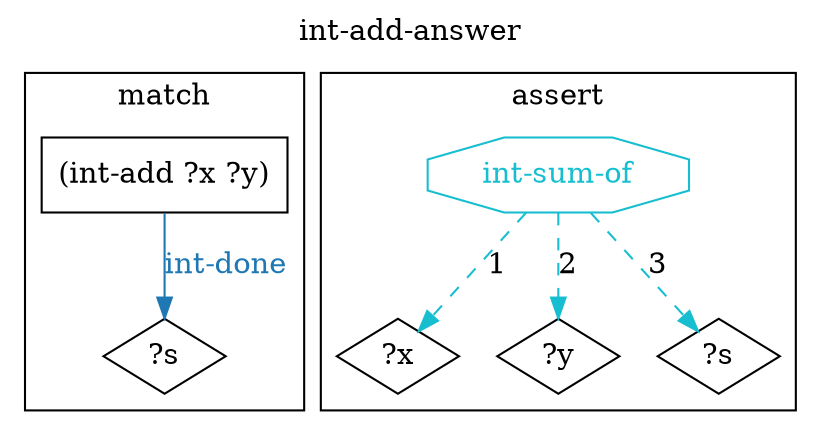
<!-- /rule -->

#### `int-sub-ask`

<!-- rule std.math.int int-sub-ask -->
```lisp
(rule int-sub-ask ()
  :match  (int-sub ?x ?y)
  :assert (operand (int-first (int-sub ?x ?y) ?y) ?x)
  :why    "{?x} - {?y} is asked: first, the integer {?x} stands for")
```

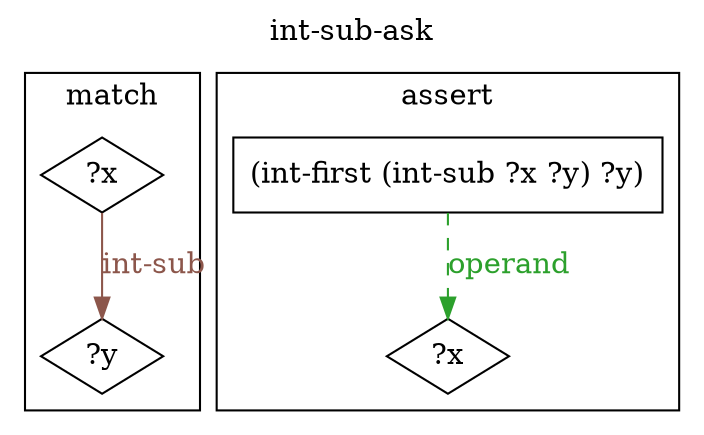
<!-- /rule -->

#### `int-sub-start`

<!-- rule std.math.int int-sub-start -->
```lisp
(rule int-sub-start ()
  :match  (operand-is (int-second (int-sub ?x ?y) ?p ?n) (int ?q ?m))
  :assert (int-add-call (int-sub ?x ?y) ?p ?n ?m ?q)
  :why    "to take {?q} less {?m} away, add {?m} less {?q}")
```

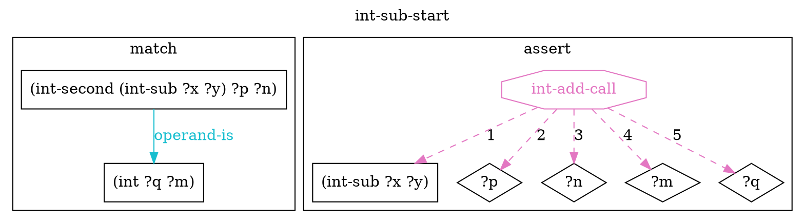
<!-- /rule -->

#### `int-sub-answer`

<!-- rule std.math.int int-sub-answer -->
```lisp
(rule int-sub-answer ()
  :match  (int-done (int-sub ?x ?y) ?s)
  :assert (int-diff-of ?x ?y ?s)
  :why    "{?x} - {?y} = {?s}")
```

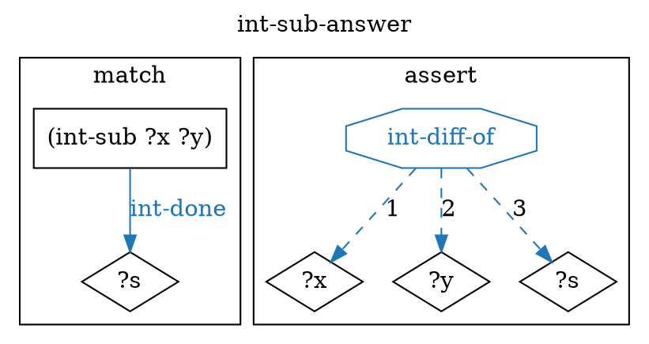
<!-- /rule -->

## Multiplication

$$
(P_1 - N_1) \cdot (P_2 - N_2) = (P_1 P_2 + N_1 N_2) - (P_1 N_2 + N_1 P_2)
$$

Four products of natural numbers and two sums, with no case on a sign, then the normal form.

#### `int-mul-first`

<!-- rule std.math.int int-mul-first -->
```lisp
(rule int-mul-first ()
  :match  (int-mul-call ?k ?p ?n ?q ?m)
  :assert (mul-call (int-mul-pp ?k ?p ?n ?q ?m) ?p ?q)
  :why    "first the positive parts: {?p} x {?q}")
```

```dot
digraph rule_int_mul_first_lhs_rhs {
  rankdir=TB;
  label="int-mul-first"; labelloc=t;
  subgraph cluster_lhs { label="match";
    "?k_L" [label="?k", shape=diamond];
    "?p_L" [label="?p", shape=diamond];
    "?n_L" [label="?n", shape=diamond];
    "?q_L" [label="?q", shape=diamond];
    "?m_L" [label="?m", shape=diamond];
    "h1_int-mul-call_L" [shape=octagon, label="int-mul-call", color="#e377c2", fontcolor="#e377c2"];
    "h1_int-mul-call_L" -> "?k_L" [label="1", color="#e377c2"];
    "h1_int-mul-call_L" -> "?p_L" [label="2", color="#e377c2"];
    "h1_int-mul-call_L" -> "?n_L" [label="3", color="#e377c2"];
    "h1_int-mul-call_L" -> "?q_L" [label="4", color="#e377c2"];
    "h1_int-mul-call_L" -> "?m_L" [label="5", color="#e377c2"];
  }
  subgraph cluster_rhs { label="assert";
    "(int-mul-pp ?k ?p ?n ?q ?m)_R" [label="(int-mul-pp ?k ?p ?n ?q ?m)", shape=rectangle];
    "?p_R" [label="?p", shape=diamond];
    "?q_R" [label="?q", shape=diamond];
    "h2_mul-call_R" [shape=octagon, label="mul-call", color="#2ca02c", fontcolor="#2ca02c"];
    "h2_mul-call_R" -> "(int-mul-pp ?k ?p ?n ?q ?m)_R" [label="1", color="#2ca02c", style=dashed];
    "h2_mul-call_R" -> "?p_R" [label="2", color="#2ca02c", style=dashed];
    "h2_mul-call_R" -> "?q_R" [label="3", color="#2ca02c", style=dashed];
  }
}
```
<!-- /rule -->

#### `int-mul-second`

<!-- rule std.math.int int-mul-second -->
```lisp
(rule int-mul-second ()
  :match  (done (int-mul-pp ?k ?p ?n ?q ?m) ?a)
  :assert (mul-call (int-mul-nn ?k ?p ?n ?q ?m ?a) ?n ?m)
  :why    "the positive parts make {?a}: now the negative parts, {?n} x {?m}")
```

```dot
digraph rule_int_mul_second_lhs_rhs {
  rankdir=TB;
  label="int-mul-second"; labelloc=t;
  subgraph cluster_lhs { label="match";
    "(int-mul-pp ?k ?p ?n ?q ?m)_L" [label="(int-mul-pp ?k ?p ?n ?q ?m)", shape=rectangle];
    "?a_L" [label="?a", shape=diamond];
    "(int-mul-pp ?k ?p ?n ?q ?m)_L" -> "?a_L" [label="done", color="#e377c2", fontcolor="#e377c2"];
  }
  subgraph cluster_rhs { label="assert";
    "(int-mul-nn ?k ?p ?n ?q ?m ?a)_R" [label="(int-mul-nn ?k ?p ?n ?q ?m ?a)", shape=rectangle];
    "?n_R" [label="?n", shape=diamond];
    "?m_R" [label="?m", shape=diamond];
    "h1_mul-call_R" [shape=octagon, label="mul-call", color="#2ca02c", fontcolor="#2ca02c"];
    "h1_mul-call_R" -> "(int-mul-nn ?k ?p ?n ?q ?m ?a)_R" [label="1", color="#2ca02c", style=dashed];
    "h1_mul-call_R" -> "?n_R" [label="2", color="#2ca02c", style=dashed];
    "h1_mul-call_R" -> "?m_R" [label="3", color="#2ca02c", style=dashed];
  }
}
```
<!-- /rule -->

#### `int-mul-plus`

<!-- rule std.math.int int-mul-plus -->
```lisp
(rule int-mul-plus ()
  :match  (done (int-mul-nn ?k ?p ?n ?q ?m ?a) ?b)
  :assert (add-walk (int-mul-pos ?k ?p ?n ?q ?m) ?a ?b 0 z)
  :why    "the negative parts make {?b}: the product's positive part is {?a} + {?b}")
```

```dot
digraph rule_int_mul_plus_lhs_rhs {
  rankdir=TB;
  label="int-mul-plus"; labelloc=t;
  subgraph cluster_lhs { label="match";
    "(int-mul-nn ?k ?p ?n ?q ?m ?a)_L" [label="(int-mul-nn ?k ?p ?n ?q ?m ?a)", shape=rectangle];
    "?b_L" [label="?b", shape=diamond];
    "(int-mul-nn ?k ?p ?n ?q ?m ?a)_L" -> "?b_L" [label="done", color="#e377c2", fontcolor="#e377c2"];
  }
  subgraph cluster_rhs { label="assert";
    "(int-mul-pos ?k ?p ?n ?q ?m)_R" [label="(int-mul-pos ?k ?p ?n ?q ?m)", shape=rectangle];
    "?a_R" [label="?a", shape=diamond];
    "?b_R" [label="?b", shape=diamond];
    "0_R" [label="0", shape=rectangle];
    "z_R" [label="z", shape=rectangle];
    "h1_add-walk_R" [shape=octagon, label="add-walk", color="#17becf", fontcolor="#17becf"];
    "h1_add-walk_R" -> "(int-mul-pos ?k ?p ?n ?q ?m)_R" [label="1", color="#17becf", style=dashed];
    "h1_add-walk_R" -> "?a_R" [label="2", color="#17becf", style=dashed];
    "h1_add-walk_R" -> "?b_R" [label="3", color="#17becf", style=dashed];
    "h1_add-walk_R" -> "0_R" [label="4", color="#17becf", style=dashed];
    "h1_add-walk_R" -> "z_R" [label="5", color="#17becf", style=dashed];
  }
}
```
<!-- /rule -->

#### `int-mul-third`

<!-- rule std.math.int int-mul-third -->
```lisp
(rule int-mul-third ()
  :match  (done (int-mul-pos ?k ?p ?n ?q ?m) ?s)
  :assert (mul-call (int-mul-pn ?k ?n ?q ?s) ?p ?m)
  :why    "the positive part is {?s}: now across, {?p} x {?m}")
```

```dot
digraph rule_int_mul_third_lhs_rhs {
  rankdir=TB;
  label="int-mul-third"; labelloc=t;
  subgraph cluster_lhs { label="match";
    "(int-mul-pos ?k ?p ?n ?q ?m)_L" [label="(int-mul-pos ?k ?p ?n ?q ?m)", shape=rectangle];
    "?s_L" [label="?s", shape=diamond];
    "(int-mul-pos ?k ?p ?n ?q ?m)_L" -> "?s_L" [label="done", color="#e377c2", fontcolor="#e377c2"];
  }
  subgraph cluster_rhs { label="assert";
    "(int-mul-pn ?k ?n ?q ?s)_R" [label="(int-mul-pn ?k ?n ?q ?s)", shape=rectangle];
    "?p_R" [label="?p", shape=diamond];
    "?m_R" [label="?m", shape=diamond];
    "h1_mul-call_R" [shape=octagon, label="mul-call", color="#2ca02c", fontcolor="#2ca02c"];
    "h1_mul-call_R" -> "(int-mul-pn ?k ?n ?q ?s)_R" [label="1", color="#2ca02c", style=dashed];
    "h1_mul-call_R" -> "?p_R" [label="2", color="#2ca02c", style=dashed];
    "h1_mul-call_R" -> "?m_R" [label="3", color="#2ca02c", style=dashed];
  }
}
```
<!-- /rule -->

#### `int-mul-fourth`

<!-- rule std.math.int int-mul-fourth -->
```lisp
(rule int-mul-fourth ()
  :match  (done (int-mul-pn ?k ?n ?q ?s) ?c)
  :assert (mul-call (int-mul-np ?k ?s ?c) ?n ?q)
  :why    "that makes {?c}: and across the other way, {?n} x {?q}")
```

```dot
digraph rule_int_mul_fourth_lhs_rhs {
  rankdir=TB;
  label="int-mul-fourth"; labelloc=t;
  subgraph cluster_lhs { label="match";
    "(int-mul-pn ?k ?n ?q ?s)_L" [label="(int-mul-pn ?k ?n ?q ?s)", shape=rectangle];
    "?c_L" [label="?c", shape=diamond];
    "(int-mul-pn ?k ?n ?q ?s)_L" -> "?c_L" [label="done", color="#e377c2", fontcolor="#e377c2"];
  }
  subgraph cluster_rhs { label="assert";
    "(int-mul-np ?k ?s ?c)_R" [label="(int-mul-np ?k ?s ?c)", shape=rectangle];
    "?n_R" [label="?n", shape=diamond];
    "?q_R" [label="?q", shape=diamond];
    "h1_mul-call_R" [shape=octagon, label="mul-call", color="#2ca02c", fontcolor="#2ca02c"];
    "h1_mul-call_R" -> "(int-mul-np ?k ?s ?c)_R" [label="1", color="#2ca02c", style=dashed];
    "h1_mul-call_R" -> "?n_R" [label="2", color="#2ca02c", style=dashed];
    "h1_mul-call_R" -> "?q_R" [label="3", color="#2ca02c", style=dashed];
  }
}
```
<!-- /rule -->

#### `int-mul-minus`

<!-- rule std.math.int int-mul-minus -->
```lisp
(rule int-mul-minus ()
  :match  (done (int-mul-np ?k ?s ?c) ?d)
  :assert (add-walk (int-mul-neg ?k ?s) ?c ?d 0 z)
  :why    "that makes {?d}: the product's negative part is {?c} + {?d}")
```

```dot
digraph rule_int_mul_minus_lhs_rhs {
  rankdir=TB;
  label="int-mul-minus"; labelloc=t;
  subgraph cluster_lhs { label="match";
    "(int-mul-np ?k ?s ?c)_L" [label="(int-mul-np ?k ?s ?c)", shape=rectangle];
    "?d_L" [label="?d", shape=diamond];
    "(int-mul-np ?k ?s ?c)_L" -> "?d_L" [label="done", color="#e377c2", fontcolor="#e377c2"];
  }
  subgraph cluster_rhs { label="assert";
    "(int-mul-neg ?k ?s)_R" [label="(int-mul-neg ?k ?s)", shape=rectangle];
    "?c_R" [label="?c", shape=diamond];
    "?d_R" [label="?d", shape=diamond];
    "0_R" [label="0", shape=rectangle];
    "z_R" [label="z", shape=rectangle];
    "h1_add-walk_R" [shape=octagon, label="add-walk", color="#17becf", fontcolor="#17becf"];
    "h1_add-walk_R" -> "(int-mul-neg ?k ?s)_R" [label="1", color="#17becf", style=dashed];
    "h1_add-walk_R" -> "?c_R" [label="2", color="#17becf", style=dashed];
    "h1_add-walk_R" -> "?d_R" [label="3", color="#17becf", style=dashed];
    "h1_add-walk_R" -> "0_R" [label="4", color="#17becf", style=dashed];
    "h1_add-walk_R" -> "z_R" [label="5", color="#17becf", style=dashed];
  }
}
```
<!-- /rule -->

#### `int-mul-norm`

<!-- rule std.math.int int-mul-norm -->
```lisp
(rule int-mul-norm ()
  :match  (done (int-mul-neg ?k ?s) ?t)
  :assert (int-norm ?k ?s ?t)
  :why    "the negative part is {?t}: simplify {?s} less {?t}")
```

```dot
digraph rule_int_mul_norm_lhs_rhs {
  rankdir=TB;
  label="int-mul-norm"; labelloc=t;
  subgraph cluster_lhs { label="match";
    "(int-mul-neg ?k ?s)_L" [label="(int-mul-neg ?k ?s)", shape=rectangle];
    "?t_L" [label="?t", shape=diamond];
    "(int-mul-neg ?k ?s)_L" -> "?t_L" [label="done", color="#e377c2", fontcolor="#e377c2"];
  }
  subgraph cluster_rhs { label="assert";
    "?k_R" [label="?k", shape=diamond];
    "?s_R" [label="?s", shape=diamond];
    "?t_R" [label="?t", shape=diamond];
    "h1_int-norm_R" [shape=octagon, label="int-norm", color="#e377c2", fontcolor="#e377c2"];
    "h1_int-norm_R" -> "?k_R" [label="1", color="#e377c2", style=dashed];
    "h1_int-norm_R" -> "?s_R" [label="2", color="#e377c2", style=dashed];
    "h1_int-norm_R" -> "?t_R" [label="3", color="#e377c2", style=dashed];
  }
}
```
<!-- /rule -->

#### `int-mul-ask`

<!-- rule std.math.int int-mul-ask -->
```lisp
(rule int-mul-ask ()
  :match  (int-mul ?x ?y)
  :assert (operand (int-first (int-mul ?x ?y) ?y) ?x)
  :why    "{?x} x {?y} is asked: first, the integer {?x} stands for")
```

```dot
digraph rule_int_mul_ask_lhs_rhs {
  rankdir=TB;
  label="int-mul-ask"; labelloc=t;
  subgraph cluster_lhs { label="match";
    "?x_L" [label="?x", shape=diamond];
    "?y_L" [label="?y", shape=diamond];
    "?x_L" -> "?y_L" [label="int-mul", color="#e377c2", fontcolor="#e377c2"];
  }
  subgraph cluster_rhs { label="assert";
    "(int-first (int-mul ?x ?y) ?y)_R" [label="(int-first (int-mul ?x ?y) ?y)", shape=rectangle];
    "?x_R" [label="?x", shape=diamond];
    "(int-first (int-mul ?x ?y) ?y)_R" -> "?x_R" [label="operand", color="#2ca02c", fontcolor="#2ca02c", style=dashed];
  }
}
```
<!-- /rule -->

#### `int-mul-start`

<!-- rule std.math.int int-mul-start -->
```lisp
(rule int-mul-start ()
  :match  (operand-is (int-second (int-mul ?x ?y) ?p ?n) (int ?q ?m))
  :assert (int-mul-call (int-mul ?x ?y) ?p ?n ?q ?m)
  :why    "multiply {?p} less {?n} by {?q} less {?m}")
```

```dot
digraph rule_int_mul_start_lhs_rhs {
  rankdir=TB;
  label="int-mul-start"; labelloc=t;
  subgraph cluster_lhs { label="match";
    "(int-second (int-mul ?x ?y) ?p ?n)_L" [label="(int-second (int-mul ?x ?y) ?p ?n)", shape=rectangle];
    "(int ?q ?m)_L" [label="(int ?q ?m)", shape=rectangle];
    "(int-second (int-mul ?x ?y) ?p ?n)_L" -> "(int ?q ?m)_L" [label="operand-is", color="#17becf", fontcolor="#17becf"];
  }
  subgraph cluster_rhs { label="assert";
    "(int-mul ?x ?y)_R" [label="(int-mul ?x ?y)", shape=rectangle];
    "?p_R" [label="?p", shape=diamond];
    "?n_R" [label="?n", shape=diamond];
    "?q_R" [label="?q", shape=diamond];
    "?m_R" [label="?m", shape=diamond];
    "h1_int-mul-call_R" [shape=octagon, label="int-mul-call", color="#e377c2", fontcolor="#e377c2"];
    "h1_int-mul-call_R" -> "(int-mul ?x ?y)_R" [label="1", color="#e377c2", style=dashed];
    "h1_int-mul-call_R" -> "?p_R" [label="2", color="#e377c2", style=dashed];
    "h1_int-mul-call_R" -> "?n_R" [label="3", color="#e377c2", style=dashed];
    "h1_int-mul-call_R" -> "?q_R" [label="4", color="#e377c2", style=dashed];
    "h1_int-mul-call_R" -> "?m_R" [label="5", color="#e377c2", style=dashed];
  }
}
```
<!-- /rule -->

#### `int-mul-answer`

<!-- rule std.math.int int-mul-answer -->
```lisp
(rule int-mul-answer ()
  :match  (int-done (int-mul ?x ?y) ?s)
  :assert (int-product-of ?x ?y ?s)
  :why    "{?x} x {?y} = {?s}")
```

```dot
digraph rule_int_mul_answer_lhs_rhs {
  rankdir=TB;
  label="int-mul-answer"; labelloc=t;
  subgraph cluster_lhs { label="match";
    "(int-mul ?x ?y)_L" [label="(int-mul ?x ?y)", shape=rectangle];
    "?s_L" [label="?s", shape=diamond];
    "(int-mul ?x ?y)_L" -> "?s_L" [label="int-done", color="#1f77b4", fontcolor="#1f77b4"];
  }
  subgraph cluster_rhs { label="assert";
    "?x_R" [label="?x", shape=diamond];
    "?y_R" [label="?y", shape=diamond];
    "?s_R" [label="?s", shape=diamond];
    "h1_int-product-of_R" [shape=octagon, label="int-product-of", color="#2ca02c", fontcolor="#2ca02c"];
    "h1_int-product-of_R" -> "?x_R" [label="1", color="#2ca02c", style=dashed];
    "h1_int-product-of_R" -> "?y_R" [label="2", color="#2ca02c", style=dashed];
    "h1_int-product-of_R" -> "?s_R" [label="3", color="#2ca02c", style=dashed];
  }
}
```
<!-- /rule -->

## Comparison

$$
P_1 - N_1 \lessgtr P_2 - N_2 \iff P_1 + N_2 \lessgtr P_2 + N_1
$$

Two sums of natural numbers, and one comparison walk between them.

#### `int-cmp-left`

<!-- rule std.math.int int-cmp-left -->
```lisp
(rule int-cmp-left ()
  :match  (int-cmp-call ?k ?p ?n ?q ?m)
  :assert (add-walk (int-cmp-l ?k ?n ?q) ?p ?m 0 z)
  :why    "add across: the left side is {?p} + {?m}")
```

```dot
digraph rule_int_cmp_left_lhs_rhs {
  rankdir=TB;
  label="int-cmp-left"; labelloc=t;
  subgraph cluster_lhs { label="match";
    "?k_L" [label="?k", shape=diamond];
    "?p_L" [label="?p", shape=diamond];
    "?n_L" [label="?n", shape=diamond];
    "?q_L" [label="?q", shape=diamond];
    "?m_L" [label="?m", shape=diamond];
    "h1_int-cmp-call_L" [shape=octagon, label="int-cmp-call", color="#1f77b4", fontcolor="#1f77b4"];
    "h1_int-cmp-call_L" -> "?k_L" [label="1", color="#1f77b4"];
    "h1_int-cmp-call_L" -> "?p_L" [label="2", color="#1f77b4"];
    "h1_int-cmp-call_L" -> "?n_L" [label="3", color="#1f77b4"];
    "h1_int-cmp-call_L" -> "?q_L" [label="4", color="#1f77b4"];
    "h1_int-cmp-call_L" -> "?m_L" [label="5", color="#1f77b4"];
  }
  subgraph cluster_rhs { label="assert";
    "(int-cmp-l ?k ?n ?q)_R" [label="(int-cmp-l ?k ?n ?q)", shape=rectangle];
    "?p_R" [label="?p", shape=diamond];
    "?m_R" [label="?m", shape=diamond];
    "0_R" [label="0", shape=rectangle];
    "z_R" [label="z", shape=rectangle];
    "h2_add-walk_R" [shape=octagon, label="add-walk", color="#17becf", fontcolor="#17becf"];
    "h2_add-walk_R" -> "(int-cmp-l ?k ?n ?q)_R" [label="1", color="#17becf", style=dashed];
    "h2_add-walk_R" -> "?p_R" [label="2", color="#17becf", style=dashed];
    "h2_add-walk_R" -> "?m_R" [label="3", color="#17becf", style=dashed];
    "h2_add-walk_R" -> "0_R" [label="4", color="#17becf", style=dashed];
    "h2_add-walk_R" -> "z_R" [label="5", color="#17becf", style=dashed];
  }
}
```
<!-- /rule -->

#### `int-cmp-right`

<!-- rule std.math.int int-cmp-right -->
```lisp
(rule int-cmp-right ()
  :match  (done (int-cmp-l ?k ?n ?q) ?l)
  :assert (add-walk (int-cmp-r ?k ?l) ?n ?q 0 z)
  :why    "the left side is {?l}: the right side is {?n} + {?q}")
```

```dot
digraph rule_int_cmp_right_lhs_rhs {
  rankdir=TB;
  label="int-cmp-right"; labelloc=t;
  subgraph cluster_lhs { label="match";
    "(int-cmp-l ?k ?n ?q)_L" [label="(int-cmp-l ?k ?n ?q)", shape=rectangle];
    "?l_L" [label="?l", shape=diamond];
    "(int-cmp-l ?k ?n ?q)_L" -> "?l_L" [label="done", color="#e377c2", fontcolor="#e377c2"];
  }
  subgraph cluster_rhs { label="assert";
    "(int-cmp-r ?k ?l)_R" [label="(int-cmp-r ?k ?l)", shape=rectangle];
    "?n_R" [label="?n", shape=diamond];
    "?q_R" [label="?q", shape=diamond];
    "0_R" [label="0", shape=rectangle];
    "z_R" [label="z", shape=rectangle];
    "h1_add-walk_R" [shape=octagon, label="add-walk", color="#17becf", fontcolor="#17becf"];
    "h1_add-walk_R" -> "(int-cmp-r ?k ?l)_R" [label="1", color="#17becf", style=dashed];
    "h1_add-walk_R" -> "?n_R" [label="2", color="#17becf", style=dashed];
    "h1_add-walk_R" -> "?q_R" [label="3", color="#17becf", style=dashed];
    "h1_add-walk_R" -> "0_R" [label="4", color="#17becf", style=dashed];
    "h1_add-walk_R" -> "z_R" [label="5", color="#17becf", style=dashed];
  }
}
```
<!-- /rule -->

#### `int-cmp-sides`

<!-- rule std.math.int int-cmp-sides -->
```lisp
(rule int-cmp-sides ()
  :match  (done (int-cmp-r ?k ?l) ?r)
  :assert (cmp-walk ?k ?l ?r eq)
  :why    "the right side is {?r}: compare {?l} with {?r}")
```

```dot
digraph rule_int_cmp_sides_lhs_rhs {
  rankdir=TB;
  label="int-cmp-sides"; labelloc=t;
  subgraph cluster_lhs { label="match";
    "(int-cmp-r ?k ?l)_L" [label="(int-cmp-r ?k ?l)", shape=rectangle];
    "?r_L" [label="?r", shape=diamond];
    "(int-cmp-r ?k ?l)_L" -> "?r_L" [label="done", color="#e377c2", fontcolor="#e377c2"];
  }
  subgraph cluster_rhs { label="assert";
    "?k_R" [label="?k", shape=diamond];
    "?l_R" [label="?l", shape=diamond];
    "?r_R" [label="?r", shape=diamond];
    "eq_R" [label="eq", shape=rectangle];
    "h1_cmp-walk_R" [shape=octagon, label="cmp-walk", color="#9467bd", fontcolor="#9467bd"];
    "h1_cmp-walk_R" -> "?k_R" [label="1", color="#9467bd", style=dashed];
    "h1_cmp-walk_R" -> "?l_R" [label="2", color="#9467bd", style=dashed];
    "h1_cmp-walk_R" -> "?r_R" [label="3", color="#9467bd", style=dashed];
    "h1_cmp-walk_R" -> "eq_R" [label="4", color="#9467bd", style=dashed];
  }
}
```
<!-- /rule -->

#### `int-cmp-ask`

<!-- rule std.math.int int-cmp-ask -->
```lisp
(rule int-cmp-ask ()
  :match  (int-cmp ?x ?y)
  :assert (operand (int-first (int-cmp ?x ?y) ?y) ?x)
  :why    "{?x} compared with {?y} is asked: first, the integer {?x} stands for")
```

```dot
digraph rule_int_cmp_ask_lhs_rhs {
  rankdir=TB;
  label="int-cmp-ask"; labelloc=t;
  subgraph cluster_lhs { label="match";
    "?x_L" [label="?x", shape=diamond];
    "?y_L" [label="?y", shape=diamond];
    "?x_L" -> "?y_L" [label="int-cmp", color="#7f7f7f", fontcolor="#7f7f7f"];
  }
  subgraph cluster_rhs { label="assert";
    "(int-first (int-cmp ?x ?y) ?y)_R" [label="(int-first (int-cmp ?x ?y) ?y)", shape=rectangle];
    "?x_R" [label="?x", shape=diamond];
    "(int-first (int-cmp ?x ?y) ?y)_R" -> "?x_R" [label="operand", color="#2ca02c", fontcolor="#2ca02c", style=dashed];
  }
}
```
<!-- /rule -->

#### `int-cmp-start`

<!-- rule std.math.int int-cmp-start -->
```lisp
(rule int-cmp-start ()
  :match  (operand-is (int-second (int-cmp ?x ?y) ?p ?n) (int ?q ?m))
  :assert (int-cmp-call (int-cmp ?x ?y) ?p ?n ?q ?m)
  :why    "compare {?p} less {?n} with {?q} less {?m}")
```

```dot
digraph rule_int_cmp_start_lhs_rhs {
  rankdir=TB;
  label="int-cmp-start"; labelloc=t;
  subgraph cluster_lhs { label="match";
    "(int-second (int-cmp ?x ?y) ?p ?n)_L" [label="(int-second (int-cmp ?x ?y) ?p ?n)", shape=rectangle];
    "(int ?q ?m)_L" [label="(int ?q ?m)", shape=rectangle];
    "(int-second (int-cmp ?x ?y) ?p ?n)_L" -> "(int ?q ?m)_L" [label="operand-is", color="#17becf", fontcolor="#17becf"];
  }
  subgraph cluster_rhs { label="assert";
    "(int-cmp ?x ?y)_R" [label="(int-cmp ?x ?y)", shape=rectangle];
    "?p_R" [label="?p", shape=diamond];
    "?n_R" [label="?n", shape=diamond];
    "?q_R" [label="?q", shape=diamond];
    "?m_R" [label="?m", shape=diamond];
    "h1_int-cmp-call_R" [shape=octagon, label="int-cmp-call", color="#1f77b4", fontcolor="#1f77b4"];
    "h1_int-cmp-call_R" -> "(int-cmp ?x ?y)_R" [label="1", color="#1f77b4", style=dashed];
    "h1_int-cmp-call_R" -> "?p_R" [label="2", color="#1f77b4", style=dashed];
    "h1_int-cmp-call_R" -> "?n_R" [label="3", color="#1f77b4", style=dashed];
    "h1_int-cmp-call_R" -> "?q_R" [label="4", color="#1f77b4", style=dashed];
    "h1_int-cmp-call_R" -> "?m_R" [label="5", color="#1f77b4", style=dashed];
  }
}
```
<!-- /rule -->

#### `int-cmp-answer`

<!-- rule std.math.int int-cmp-answer -->
```lisp
(rule int-cmp-answer ()
  :match  (order-is (int-cmp ?x ?y) ?o)
  :assert (int-cmp-of ?x ?y ?o)
  :why    "{?x} against {?y}: {?o}")
```

```dot
digraph rule_int_cmp_answer_lhs_rhs {
  rankdir=TB;
  label="int-cmp-answer"; labelloc=t;
  subgraph cluster_lhs { label="match";
    "(int-cmp ?x ?y)_L" [label="(int-cmp ?x ?y)", shape=rectangle];
    "?o_L" [label="?o", shape=diamond];
    "(int-cmp ?x ?y)_L" -> "?o_L" [label="order-is", color="#d62728", fontcolor="#d62728"];
  }
  subgraph cluster_rhs { label="assert";
    "?x_R" [label="?x", shape=diamond];
    "?y_R" [label="?y", shape=diamond];
    "?o_R" [label="?o", shape=diamond];
    "h1_int-cmp-of_R" [shape=octagon, label="int-cmp-of", color="#d62728", fontcolor="#d62728"];
    "h1_int-cmp-of_R" -> "?x_R" [label="1", color="#d62728", style=dashed];
    "h1_int-cmp-of_R" -> "?y_R" [label="2", color="#d62728", style=dashed];
    "h1_int-cmp-of_R" -> "?o_R" [label="3", color="#d62728", style=dashed];
  }
}
```
<!-- /rule -->

## Division: the sizes

All three conventions start alike. The dividend and the divisor are normalised; a divisor of zero is flagged; the
two sizes, the parts that are not zero, are divided by the natural numbers' division; and which of the four cases
of signs it was is kept in the tag (`pp`, `pn`, `np`, `nn`: the dividend's sign, then the divisor's).
`int-div-rest` asks for the divisor's size less the remainder, which the conventions that round away from zero
need.

#### `int-div-start`

<!-- rule std.math.int int-div-start -->
```lisp
(rule int-div-start ()
  :match  (operand-is (int-second (int-div-of ?k) ?p ?n) (int ?q ?m))
  :assert (int-norm (int-div-a ?k ?q ?m) ?p ?n)
  :why    "first the dividend, simplified: {?p} less {?n}")
```

```dot
digraph rule_int_div_start_lhs_rhs {
  rankdir=TB;
  label="int-div-start"; labelloc=t;
  subgraph cluster_lhs { label="match";
    "(int-second (int-div-of ?k) ?p ?n)_L" [label="(int-second (int-div-of ?k) ?p ?n)", shape=rectangle];
    "(int ?q ?m)_L" [label="(int ?q ?m)", shape=rectangle];
    "(int-second (int-div-of ?k) ?p ?n)_L" -> "(int ?q ?m)_L" [label="operand-is", color="#17becf", fontcolor="#17becf"];
  }
  subgraph cluster_rhs { label="assert";
    "(int-div-a ?k ?q ?m)_R" [label="(int-div-a ?k ?q ?m)", shape=rectangle];
    "?p_R" [label="?p", shape=diamond];
    "?n_R" [label="?n", shape=diamond];
    "h1_int-norm_R" [shape=octagon, label="int-norm", color="#e377c2", fontcolor="#e377c2"];
    "h1_int-norm_R" -> "(int-div-a ?k ?q ?m)_R" [label="1", color="#e377c2", style=dashed];
    "h1_int-norm_R" -> "?p_R" [label="2", color="#e377c2", style=dashed];
    "h1_int-norm_R" -> "?n_R" [label="3", color="#e377c2", style=dashed];
  }
}
```
<!-- /rule -->

#### `int-div-divisor`

<!-- rule std.math.int int-div-divisor -->
```lisp
(rule int-div-divisor ()
  :match  (int-done (int-div-a ?k ?q ?m) ?a)
  :assert (int-norm (int-div-b ?k ?a) ?q ?m)
  :why    "the dividend is {?a}: now the divisor, simplified, {?q} less {?m}")
```

```dot
digraph rule_int_div_divisor_lhs_rhs {
  rankdir=TB;
  label="int-div-divisor"; labelloc=t;
  subgraph cluster_lhs { label="match";
    "(int-div-a ?k ?q ?m)_L" [label="(int-div-a ?k ?q ?m)", shape=rectangle];
    "?a_L" [label="?a", shape=diamond];
    "(int-div-a ?k ?q ?m)_L" -> "?a_L" [label="int-done", color="#1f77b4", fontcolor="#1f77b4"];
  }
  subgraph cluster_rhs { label="assert";
    "(int-div-b ?k ?a)_R" [label="(int-div-b ?k ?a)", shape=rectangle];
    "?q_R" [label="?q", shape=diamond];
    "?m_R" [label="?m", shape=diamond];
    "h1_int-norm_R" [shape=octagon, label="int-norm", color="#e377c2", fontcolor="#e377c2"];
    "h1_int-norm_R" -> "(int-div-b ?k ?a)_R" [label="1", color="#e377c2", style=dashed];
    "h1_int-norm_R" -> "?q_R" [label="2", color="#e377c2", style=dashed];
    "h1_int-norm_R" -> "?m_R" [label="3", color="#e377c2", style=dashed];
  }
}
```
<!-- /rule -->

#### `int-div-by-zero`

<!-- rule std.math.int int-div-by-zero -->
```lisp
(rule int-div-by-zero ()
  :match  (int-done (int-div-b ?k ?a) (int z z))
  :assert (division-by-zero ?k)
  :why    "the divisor of {?k} is zero")
```

```dot
digraph rule_int_div_by_zero_lhs_rhs {
  rankdir=TB;
  label="int-div-by-zero"; labelloc=t;
  subgraph cluster_lhs { label="match";
    "(int-div-b ?k ?a)_L" [label="(int-div-b ?k ?a)", shape=rectangle];
    "(int z z)_L" [label="(int z z)", shape=rectangle];
    "(int-div-b ?k ?a)_L" -> "(int z z)_L" [label="int-done", color="#1f77b4", fontcolor="#1f77b4"];
  }
  subgraph cluster_rhs { label="assert";
    "?k_R" [label="?k", shape=diamond];
    "h1_division-by-zero_R" [shape=octagon, label="division-by-zero", color="#e377c2", fontcolor="#e377c2"];
    "h1_division-by-zero_R" -> "?k_R" [label="1", color="#e377c2", style=dashed];
  }
}
```
<!-- /rule -->

#### `int-div-pp`

<!-- rule std.math.int int-div-pp -->
```lisp
(rule int-div-pp ()
  :match  (int-done (int-div-b ?k (int ?a z)) (int (n ?b ?c) z))
  :assert (div-call (int-div-m ?k pos pos (n ?b ?c)) ?a (n ?b ?c))
  :why    "neither is negative: divide the sizes, {?a} by (n {?b} {?c})")
```

```dot
digraph rule_int_div_pp_lhs_rhs {
  rankdir=TB;
  label="int-div-pp"; labelloc=t;
  subgraph cluster_lhs { label="match";
    "(int-div-b ?k (int ?a z))_L" [label="(int-div-b ?k (int ?a z))", shape=rectangle];
    "(int (n ?b ?c) z)_L" [label="(int (n ?b ?c) z)", shape=rectangle];
    "(int-div-b ?k (int ?a z))_L" -> "(int (n ?b ?c) z)_L" [label="int-done", color="#1f77b4", fontcolor="#1f77b4"];
  }
  subgraph cluster_rhs { label="assert";
    "(int-div-m ?k pos pos (n ?b ?c))_R" [label="(int-div-m ?k pos pos (n ?b ?c))", shape=rectangle];
    "?a_R" [label="?a", shape=diamond];
    "(n ?b ?c)_R" [label="(n ?b ?c)", shape=rectangle];
    "h1_div-call_R" [shape=octagon, label="div-call", color="#bcbd22", fontcolor="#bcbd22"];
    "h1_div-call_R" -> "(int-div-m ?k pos pos (n ?b ?c))_R" [label="1", color="#bcbd22", style=dashed];
    "h1_div-call_R" -> "?a_R" [label="2", color="#bcbd22", style=dashed];
    "h1_div-call_R" -> "(n ?b ?c)_R" [label="3", color="#bcbd22", style=dashed];
  }
}
```
<!-- /rule -->

#### `int-div-pn`

<!-- rule std.math.int int-div-pn -->
```lisp
(rule int-div-pn ()
  :match  (int-done (int-div-b ?k (int ?a z)) (int z (n ?b ?c)))
  :assert (div-call (int-div-m ?k pos neg (n ?b ?c)) ?a (n ?b ?c))
  :why    "the divisor is negative: divide the sizes, {?a} by (n {?b} {?c})")
```

```dot
digraph rule_int_div_pn_lhs_rhs {
  rankdir=TB;
  label="int-div-pn"; labelloc=t;
  subgraph cluster_lhs { label="match";
    "(int-div-b ?k (int ?a z))_L" [label="(int-div-b ?k (int ?a z))", shape=rectangle];
    "(int z (n ?b ?c))_L" [label="(int z (n ?b ?c))", shape=rectangle];
    "(int-div-b ?k (int ?a z))_L" -> "(int z (n ?b ?c))_L" [label="int-done", color="#1f77b4", fontcolor="#1f77b4"];
  }
  subgraph cluster_rhs { label="assert";
    "(int-div-m ?k pos neg (n ?b ?c))_R" [label="(int-div-m ?k pos neg (n ?b ?c))", shape=rectangle];
    "?a_R" [label="?a", shape=diamond];
    "(n ?b ?c)_R" [label="(n ?b ?c)", shape=rectangle];
    "h1_div-call_R" [shape=octagon, label="div-call", color="#bcbd22", fontcolor="#bcbd22"];
    "h1_div-call_R" -> "(int-div-m ?k pos neg (n ?b ?c))_R" [label="1", color="#bcbd22", style=dashed];
    "h1_div-call_R" -> "?a_R" [label="2", color="#bcbd22", style=dashed];
    "h1_div-call_R" -> "(n ?b ?c)_R" [label="3", color="#bcbd22", style=dashed];
  }
}
```
<!-- /rule -->

#### `int-div-np`

<!-- rule std.math.int int-div-np -->
```lisp
(rule int-div-np ()
  :match  (int-done (int-div-b ?k (int z (n ?a ?d))) (int (n ?b ?c) z))
  :assert (div-call (int-div-m ?k neg pos (n ?b ?c)) (n ?a ?d) (n ?b ?c))
  :why    "the dividend is negative: divide the sizes, (n {?a} {?d}) by (n {?b} {?c})")
```

```dot
digraph rule_int_div_np_lhs_rhs {
  rankdir=TB;
  label="int-div-np"; labelloc=t;
  subgraph cluster_lhs { label="match";
    "(int-div-b ?k (int z (n ?a ?d)))_L" [label="(int-div-b ?k (int z (n ?a ?d)))", shape=rectangle];
    "(int (n ?b ?c) z)_L" [label="(int (n ?b ?c) z)", shape=rectangle];
    "(int-div-b ?k (int z (n ?a ?d)))_L" -> "(int (n ?b ?c) z)_L" [label="int-done", color="#1f77b4", fontcolor="#1f77b4"];
  }
  subgraph cluster_rhs { label="assert";
    "(int-div-m ?k neg pos (n ?b ?c))_R" [label="(int-div-m ?k neg pos (n ?b ?c))", shape=rectangle];
    "(n ?a ?d)_R" [label="(n ?a ?d)", shape=rectangle];
    "(n ?b ?c)_R" [label="(n ?b ?c)", shape=rectangle];
    "h1_div-call_R" [shape=octagon, label="div-call", color="#bcbd22", fontcolor="#bcbd22"];
    "h1_div-call_R" -> "(int-div-m ?k neg pos (n ?b ?c))_R" [label="1", color="#bcbd22", style=dashed];
    "h1_div-call_R" -> "(n ?a ?d)_R" [label="2", color="#bcbd22", style=dashed];
    "h1_div-call_R" -> "(n ?b ?c)_R" [label="3", color="#bcbd22", style=dashed];
  }
}
```
<!-- /rule -->

#### `int-div-nn`

<!-- rule std.math.int int-div-nn -->
```lisp
(rule int-div-nn ()
  :match  (int-done (int-div-b ?k (int z (n ?a ?d))) (int z (n ?b ?c)))
  :assert (div-call (int-div-m ?k neg neg (n ?b ?c)) (n ?a ?d) (n ?b ?c))
  :why    "both are negative: divide the sizes, (n {?a} {?d}) by (n {?b} {?c})")
```

```dot
digraph rule_int_div_nn_lhs_rhs {
  rankdir=TB;
  label="int-div-nn"; labelloc=t;
  subgraph cluster_lhs { label="match";
    "(int-div-b ?k (int z (n ?a ?d)))_L" [label="(int-div-b ?k (int z (n ?a ?d)))", shape=rectangle];
    "(int z (n ?b ?c))_L" [label="(int z (n ?b ?c))", shape=rectangle];
    "(int-div-b ?k (int z (n ?a ?d)))_L" -> "(int z (n ?b ?c))_L" [label="int-done", color="#1f77b4", fontcolor="#1f77b4"];
  }
  subgraph cluster_rhs { label="assert";
    "(int-div-m ?k neg neg (n ?b ?c))_R" [label="(int-div-m ?k neg neg (n ?b ?c))", shape=rectangle];
    "(n ?a ?d)_R" [label="(n ?a ?d)", shape=rectangle];
    "(n ?b ?c)_R" [label="(n ?b ?c)", shape=rectangle];
    "h1_div-call_R" [shape=octagon, label="div-call", color="#bcbd22", fontcolor="#bcbd22"];
    "h1_div-call_R" -> "(int-div-m ?k neg neg (n ?b ?c))_R" [label="1", color="#bcbd22", style=dashed];
    "h1_div-call_R" -> "(n ?a ?d)_R" [label="2", color="#bcbd22", style=dashed];
    "h1_div-call_R" -> "(n ?b ?c)_R" [label="3", color="#bcbd22", style=dashed];
  }
}
```
<!-- /rule -->

#### `int-div-rest`

<!-- rule std.math.int int-div-rest -->
```lisp
(rule int-div-rest ()
  :match  (done (int-div-q ?k ?s ?b ?r) ?q)
  :assert (sub-walk (int-div-r ?k ?s ?q) ?b ?r 0 z)
  :why    "the quotient's size is {?q}: now the divisor's size less the remainder, {?b} - {?r}")
```

```dot
digraph rule_int_div_rest_lhs_rhs {
  rankdir=TB;
  label="int-div-rest"; labelloc=t;
  subgraph cluster_lhs { label="match";
    "(int-div-q ?k ?s ?b ?r)_L" [label="(int-div-q ?k ?s ?b ?r)", shape=rectangle];
    "?q_L" [label="?q", shape=diamond];
    "(int-div-q ?k ?s ?b ?r)_L" -> "?q_L" [label="done", color="#e377c2", fontcolor="#e377c2"];
  }
  subgraph cluster_rhs { label="assert";
    "(int-div-r ?k ?s ?q)_R" [label="(int-div-r ?k ?s ?q)", shape=rectangle];
    "?b_R" [label="?b", shape=diamond];
    "?r_R" [label="?r", shape=diamond];
    "0_R" [label="0", shape=rectangle];
    "z_R" [label="z", shape=rectangle];
    "h1_sub-walk_R" [shape=octagon, label="sub-walk", color="#8c564b", fontcolor="#8c564b"];
    "h1_sub-walk_R" -> "(int-div-r ?k ?s ?q)_R" [label="1", color="#8c564b", style=dashed];
    "h1_sub-walk_R" -> "?b_R" [label="2", color="#8c564b", style=dashed];
    "h1_sub-walk_R" -> "?r_R" [label="3", color="#8c564b", style=dashed];
    "h1_sub-walk_R" -> "0_R" [label="4", color="#8c564b", style=dashed];
    "h1_sub-walk_R" -> "z_R" [label="5", color="#8c564b", style=dashed];
  }
}
```
<!-- /rule -->

## Division: the Euclidean convention

$$
X = Q \cdot Y + R, \qquad 0 \le R < \lvert Y \rvert
$$

Where the dividend is negative and a remainder is left, the quotient's size is one more and the remainder is the
divisor's size less the sizes' remainder.

#### `int-div-euclid-ask`

<!-- rule std.math.int int-div-euclid-ask -->
```lisp
(rule int-div-euclid-ask ()
  :match  (int-div-euclid ?x ?y)
  :assert (operand (int-first (int-div-of (int-div-euclid ?x ?y)) ?y) ?x)
  :why    "{?x} divided by {?y}, the remainder never negative, is asked: first, the integer {?x} stands for")
```

```dot
digraph rule_int_div_euclid_ask_lhs_rhs {
  rankdir=TB;
  label="int-div-euclid-ask"; labelloc=t;
  subgraph cluster_lhs { label="match";
    "?x_L" [label="?x", shape=diamond];
    "?y_L" [label="?y", shape=diamond];
    "?x_L" -> "?y_L" [label="int-div-euclid", color="#e377c2", fontcolor="#e377c2"];
  }
  subgraph cluster_rhs { label="assert";
    "(int-first (int-div-of (int-div-euclid ?x ?y)) ?y)_R" [label="(int-first (int-div-of (int-div-euclid ?x ?y)) ?y)", shape=rectangle];
    "?x_R" [label="?x", shape=diamond];
    "(int-first (int-div-of (int-div-euclid ?x ?y)) ?y)_R" -> "?x_R" [label="operand", color="#2ca02c", fontcolor="#2ca02c", style=dashed];
  }
}
```
<!-- /rule -->

#### `int-div-euclid-pp`

<!-- rule std.math.int int-div-euclid-pp -->
```lisp
(rule int-div-euclid-pp ()
  :match  (div-done (int-div-m (int-div-euclid ?x ?y) pos pos ?b) ?q ?r)
  :assert (int-div-done (int-div-euclid ?x ?y) (int ?q z) ?r)
  :why    "neither is negative: the sizes' quotient {?q} and remainder {?r} are the answer")
```

```dot
digraph rule_int_div_euclid_pp_lhs_rhs {
  rankdir=TB;
  label="int-div-euclid-pp"; labelloc=t;
  subgraph cluster_lhs { label="match";
    "(int-div-m (int-div-euclid ?x ?y) pos pos ?b)_L" [label="(int-div-m (int-div-euclid ?x ?y) pos pos ?b)", shape=rectangle];
    "?q_L" [label="?q", shape=diamond];
    "?r_L" [label="?r", shape=diamond];
    "h1_div-done_L" [shape=octagon, label="div-done", color="#8c564b", fontcolor="#8c564b"];
    "h1_div-done_L" -> "(int-div-m (int-div-euclid ?x ?y) pos pos ?b)_L" [label="1", color="#8c564b"];
    "h1_div-done_L" -> "?q_L" [label="2", color="#8c564b"];
    "h1_div-done_L" -> "?r_L" [label="3", color="#8c564b"];
  }
  subgraph cluster_rhs { label="assert";
    "(int-div-euclid ?x ?y)_R" [label="(int-div-euclid ?x ?y)", shape=rectangle];
    "(int ?q z)_R" [label="(int ?q z)", shape=rectangle];
    "?r_R" [label="?r", shape=diamond];
    "h2_int-div-done_R" [shape=octagon, label="int-div-done", color="#2ca02c", fontcolor="#2ca02c"];
    "h2_int-div-done_R" -> "(int-div-euclid ?x ?y)_R" [label="1", color="#2ca02c", style=dashed];
    "h2_int-div-done_R" -> "(int ?q z)_R" [label="2", color="#2ca02c", style=dashed];
    "h2_int-div-done_R" -> "?r_R" [label="3", color="#2ca02c", style=dashed];
  }
}
```
<!-- /rule -->

#### `int-div-euclid-pn`

<!-- rule std.math.int int-div-euclid-pn -->
```lisp
(rule int-div-euclid-pn ()
  :match  (div-done (int-div-m (int-div-euclid ?x ?y) pos neg ?b) ?q ?r)
  :assert (int-div-done (int-div-euclid ?x ?y) (int z ?q) ?r)
  :why    "the divisor is negative: the quotient is {?q} negated, and the remainder {?r} stays")
```

```dot
digraph rule_int_div_euclid_pn_lhs_rhs {
  rankdir=TB;
  label="int-div-euclid-pn"; labelloc=t;
  subgraph cluster_lhs { label="match";
    "(int-div-m (int-div-euclid ?x ?y) pos neg ?b)_L" [label="(int-div-m (int-div-euclid ?x ?y) pos neg ?b)", shape=rectangle];
    "?q_L" [label="?q", shape=diamond];
    "?r_L" [label="?r", shape=diamond];
    "h1_div-done_L" [shape=octagon, label="div-done", color="#8c564b", fontcolor="#8c564b"];
    "h1_div-done_L" -> "(int-div-m (int-div-euclid ?x ?y) pos neg ?b)_L" [label="1", color="#8c564b"];
    "h1_div-done_L" -> "?q_L" [label="2", color="#8c564b"];
    "h1_div-done_L" -> "?r_L" [label="3", color="#8c564b"];
  }
  subgraph cluster_rhs { label="assert";
    "(int-div-euclid ?x ?y)_R" [label="(int-div-euclid ?x ?y)", shape=rectangle];
    "(int z ?q)_R" [label="(int z ?q)", shape=rectangle];
    "?r_R" [label="?r", shape=diamond];
    "h2_int-div-done_R" [shape=octagon, label="int-div-done", color="#2ca02c", fontcolor="#2ca02c"];
    "h2_int-div-done_R" -> "(int-div-euclid ?x ?y)_R" [label="1", color="#2ca02c", style=dashed];
    "h2_int-div-done_R" -> "(int z ?q)_R" [label="2", color="#2ca02c", style=dashed];
    "h2_int-div-done_R" -> "?r_R" [label="3", color="#2ca02c", style=dashed];
  }
}
```
<!-- /rule -->

#### `int-div-euclid-np-exact`

<!-- rule std.math.int int-div-euclid-np-exact -->
```lisp
(rule int-div-euclid-np-exact ()
  :match  (div-done (int-div-m (int-div-euclid ?x ?y) neg pos ?b) ?q z)
  :assert (int-div-done (int-div-euclid ?x ?y) (int z ?q) z)
  :why    "the dividend is negative and nothing is left: the quotient is {?q} negated")
```

```dot
digraph rule_int_div_euclid_np_exact_lhs_rhs {
  rankdir=TB;
  label="int-div-euclid-np-exact"; labelloc=t;
  subgraph cluster_lhs { label="match";
    "(int-div-m (int-div-euclid ?x ?y) neg pos ?b)_L" [label="(int-div-m (int-div-euclid ?x ?y) neg pos ?b)", shape=rectangle];
    "?q_L" [label="?q", shape=diamond];
    "z_L" [label="z", shape=rectangle];
    "h1_div-done_L" [shape=octagon, label="div-done", color="#8c564b", fontcolor="#8c564b"];
    "h1_div-done_L" -> "(int-div-m (int-div-euclid ?x ?y) neg pos ?b)_L" [label="1", color="#8c564b"];
    "h1_div-done_L" -> "?q_L" [label="2", color="#8c564b"];
    "h1_div-done_L" -> "z_L" [label="3", color="#8c564b"];
  }
  subgraph cluster_rhs { label="assert";
    "(int-div-euclid ?x ?y)_R" [label="(int-div-euclid ?x ?y)", shape=rectangle];
    "(int z ?q)_R" [label="(int z ?q)", shape=rectangle];
    "z_R" [label="z", shape=rectangle];
    "h2_int-div-done_R" [shape=octagon, label="int-div-done", color="#2ca02c", fontcolor="#2ca02c"];
    "h2_int-div-done_R" -> "(int-div-euclid ?x ?y)_R" [label="1", color="#2ca02c", style=dashed];
    "h2_int-div-done_R" -> "(int z ?q)_R" [label="2", color="#2ca02c", style=dashed];
    "h2_int-div-done_R" -> "z_R" [label="3", color="#2ca02c", style=dashed];
  }
}
```
<!-- /rule -->

#### `int-div-euclid-nn-exact`

<!-- rule std.math.int int-div-euclid-nn-exact -->
```lisp
(rule int-div-euclid-nn-exact ()
  :match  (div-done (int-div-m (int-div-euclid ?x ?y) neg neg ?b) ?q z)
  :assert (int-div-done (int-div-euclid ?x ?y) (int ?q z) z)
  :why    "both are negative and nothing is left: the quotient is {?q}")
```

```dot
digraph rule_int_div_euclid_nn_exact_lhs_rhs {
  rankdir=TB;
  label="int-div-euclid-nn-exact"; labelloc=t;
  subgraph cluster_lhs { label="match";
    "(int-div-m (int-div-euclid ?x ?y) neg neg ?b)_L" [label="(int-div-m (int-div-euclid ?x ?y) neg neg ?b)", shape=rectangle];
    "?q_L" [label="?q", shape=diamond];
    "z_L" [label="z", shape=rectangle];
    "h1_div-done_L" [shape=octagon, label="div-done", color="#8c564b", fontcolor="#8c564b"];
    "h1_div-done_L" -> "(int-div-m (int-div-euclid ?x ?y) neg neg ?b)_L" [label="1", color="#8c564b"];
    "h1_div-done_L" -> "?q_L" [label="2", color="#8c564b"];
    "h1_div-done_L" -> "z_L" [label="3", color="#8c564b"];
  }
  subgraph cluster_rhs { label="assert";
    "(int-div-euclid ?x ?y)_R" [label="(int-div-euclid ?x ?y)", shape=rectangle];
    "(int ?q z)_R" [label="(int ?q z)", shape=rectangle];
    "z_R" [label="z", shape=rectangle];
    "h2_int-div-done_R" [shape=octagon, label="int-div-done", color="#2ca02c", fontcolor="#2ca02c"];
    "h2_int-div-done_R" -> "(int-div-euclid ?x ?y)_R" [label="1", color="#2ca02c", style=dashed];
    "h2_int-div-done_R" -> "(int ?q z)_R" [label="2", color="#2ca02c", style=dashed];
    "h2_int-div-done_R" -> "z_R" [label="3", color="#2ca02c", style=dashed];
  }
}
```
<!-- /rule -->

#### `int-div-euclid-np-more`

<!-- rule std.math.int int-div-euclid-np-more -->
```lisp
(rule int-div-euclid-np-more ()
  :match  (div-done (int-div-m (int-div-euclid ?x ?y) neg pos ?b) ?q (n ?r ?d))
  :assert (add-walk (int-div-q (int-div-euclid ?x ?y) neg ?b (n ?r ?d)) ?q (n z 1) 0 z)
  :why    "a remainder is left, (n {?r} {?d}): one more in the quotient's size, {?q} + 1")
```

```dot
digraph rule_int_div_euclid_np_more_lhs_rhs {
  rankdir=TB;
  label="int-div-euclid-np-more"; labelloc=t;
  subgraph cluster_lhs { label="match";
    "(int-div-m (int-div-euclid ?x ?y) neg pos ?b)_L" [label="(int-div-m (int-div-euclid ?x ?y) neg pos ?b)", shape=rectangle];
    "?q_L" [label="?q", shape=diamond];
    "(n ?r ?d)_L" [label="(n ?r ?d)", shape=rectangle];
    "h1_div-done_L" [shape=octagon, label="div-done", color="#8c564b", fontcolor="#8c564b"];
    "h1_div-done_L" -> "(int-div-m (int-div-euclid ?x ?y) neg pos ?b)_L" [label="1", color="#8c564b"];
    "h1_div-done_L" -> "?q_L" [label="2", color="#8c564b"];
    "h1_div-done_L" -> "(n ?r ?d)_L" [label="3", color="#8c564b"];
  }
  subgraph cluster_rhs { label="assert";
    "(int-div-q (int-div-euclid ?x ?y) neg ?b (n ?r ?d))_R" [label="(int-div-q (int-div-euclid ?x ?y) neg ?b (n ?r ?d))", shape=rectangle];
    "?q_R" [label="?q", shape=diamond];
    "(n z 1)_R" [label="(n z 1)", shape=rectangle];
    "0_R" [label="0", shape=rectangle];
    "z_R" [label="z", shape=rectangle];
    "h2_add-walk_R" [shape=octagon, label="add-walk", color="#17becf", fontcolor="#17becf"];
    "h2_add-walk_R" -> "(int-div-q (int-div-euclid ?x ?y) neg ?b (n ?r ?d))_R" [label="1", color="#17becf", style=dashed];
    "h2_add-walk_R" -> "?q_R" [label="2", color="#17becf", style=dashed];
    "h2_add-walk_R" -> "(n z 1)_R" [label="3", color="#17becf", style=dashed];
    "h2_add-walk_R" -> "0_R" [label="4", color="#17becf", style=dashed];
    "h2_add-walk_R" -> "z_R" [label="5", color="#17becf", style=dashed];
  }
}
```
<!-- /rule -->

#### `int-div-euclid-nn-more`

<!-- rule std.math.int int-div-euclid-nn-more -->
```lisp
(rule int-div-euclid-nn-more ()
  :match  (div-done (int-div-m (int-div-euclid ?x ?y) neg neg ?b) ?q (n ?r ?d))
  :assert (add-walk (int-div-q (int-div-euclid ?x ?y) pos ?b (n ?r ?d)) ?q (n z 1) 0 z)
  :why    "a remainder is left, (n {?r} {?d}): one more in the quotient's size, {?q} + 1")
```

```dot
digraph rule_int_div_euclid_nn_more_lhs_rhs {
  rankdir=TB;
  label="int-div-euclid-nn-more"; labelloc=t;
  subgraph cluster_lhs { label="match";
    "(int-div-m (int-div-euclid ?x ?y) neg neg ?b)_L" [label="(int-div-m (int-div-euclid ?x ?y) neg neg ?b)", shape=rectangle];
    "?q_L" [label="?q", shape=diamond];
    "(n ?r ?d)_L" [label="(n ?r ?d)", shape=rectangle];
    "h1_div-done_L" [shape=octagon, label="div-done", color="#8c564b", fontcolor="#8c564b"];
    "h1_div-done_L" -> "(int-div-m (int-div-euclid ?x ?y) neg neg ?b)_L" [label="1", color="#8c564b"];
    "h1_div-done_L" -> "?q_L" [label="2", color="#8c564b"];
    "h1_div-done_L" -> "(n ?r ?d)_L" [label="3", color="#8c564b"];
  }
  subgraph cluster_rhs { label="assert";
    "(int-div-q (int-div-euclid ?x ?y) pos ?b (n ?r ?d))_R" [label="(int-div-q (int-div-euclid ?x ?y) pos ?b (n ?r ?d))", shape=rectangle];
    "?q_R" [label="?q", shape=diamond];
    "(n z 1)_R" [label="(n z 1)", shape=rectangle];
    "0_R" [label="0", shape=rectangle];
    "z_R" [label="z", shape=rectangle];
    "h2_add-walk_R" [shape=octagon, label="add-walk", color="#17becf", fontcolor="#17becf"];
    "h2_add-walk_R" -> "(int-div-q (int-div-euclid ?x ?y) pos ?b (n ?r ?d))_R" [label="1", color="#17becf", style=dashed];
    "h2_add-walk_R" -> "?q_R" [label="2", color="#17becf", style=dashed];
    "h2_add-walk_R" -> "(n z 1)_R" [label="3", color="#17becf", style=dashed];
    "h2_add-walk_R" -> "0_R" [label="4", color="#17becf", style=dashed];
    "h2_add-walk_R" -> "z_R" [label="5", color="#17becf", style=dashed];
  }
}
```
<!-- /rule -->

#### `int-div-euclid-neg`

<!-- rule std.math.int int-div-euclid-neg -->
```lisp
(rule int-div-euclid-neg ()
  :match  (done (int-div-r (int-div-euclid ?x ?y) neg ?q) ?t)
  :assert (int-div-done (int-div-euclid ?x ?y) (int z ?q) ?t)
  :why    "the quotient is {?q} negated, and the remainder is {?t}")
```

```dot
digraph rule_int_div_euclid_neg_lhs_rhs {
  rankdir=TB;
  label="int-div-euclid-neg"; labelloc=t;
  subgraph cluster_lhs { label="match";
    "(int-div-r (int-div-euclid ?x ?y) neg ?q)_L" [label="(int-div-r (int-div-euclid ?x ?y) neg ?q)", shape=rectangle];
    "?t_L" [label="?t", shape=diamond];
    "(int-div-r (int-div-euclid ?x ?y) neg ?q)_L" -> "?t_L" [label="done", color="#e377c2", fontcolor="#e377c2"];
  }
  subgraph cluster_rhs { label="assert";
    "(int-div-euclid ?x ?y)_R" [label="(int-div-euclid ?x ?y)", shape=rectangle];
    "(int z ?q)_R" [label="(int z ?q)", shape=rectangle];
    "?t_R" [label="?t", shape=diamond];
    "h1_int-div-done_R" [shape=octagon, label="int-div-done", color="#2ca02c", fontcolor="#2ca02c"];
    "h1_int-div-done_R" -> "(int-div-euclid ?x ?y)_R" [label="1", color="#2ca02c", style=dashed];
    "h1_int-div-done_R" -> "(int z ?q)_R" [label="2", color="#2ca02c", style=dashed];
    "h1_int-div-done_R" -> "?t_R" [label="3", color="#2ca02c", style=dashed];
  }
}
```
<!-- /rule -->

#### `int-div-euclid-pos`

<!-- rule std.math.int int-div-euclid-pos -->
```lisp
(rule int-div-euclid-pos ()
  :match  (done (int-div-r (int-div-euclid ?x ?y) pos ?q) ?t)
  :assert (int-div-done (int-div-euclid ?x ?y) (int ?q z) ?t)
  :why    "the quotient is {?q}, and the remainder is {?t}")
```

```dot
digraph rule_int_div_euclid_pos_lhs_rhs {
  rankdir=TB;
  label="int-div-euclid-pos"; labelloc=t;
  subgraph cluster_lhs { label="match";
    "(int-div-r (int-div-euclid ?x ?y) pos ?q)_L" [label="(int-div-r (int-div-euclid ?x ?y) pos ?q)", shape=rectangle];
    "?t_L" [label="?t", shape=diamond];
    "(int-div-r (int-div-euclid ?x ?y) pos ?q)_L" -> "?t_L" [label="done", color="#e377c2", fontcolor="#e377c2"];
  }
  subgraph cluster_rhs { label="assert";
    "(int-div-euclid ?x ?y)_R" [label="(int-div-euclid ?x ?y)", shape=rectangle];
    "(int ?q z)_R" [label="(int ?q z)", shape=rectangle];
    "?t_R" [label="?t", shape=diamond];
    "h1_int-div-done_R" [shape=octagon, label="int-div-done", color="#2ca02c", fontcolor="#2ca02c"];
    "h1_int-div-done_R" -> "(int-div-euclid ?x ?y)_R" [label="1", color="#2ca02c", style=dashed];
    "h1_int-div-done_R" -> "(int ?q z)_R" [label="2", color="#2ca02c", style=dashed];
    "h1_int-div-done_R" -> "?t_R" [label="3", color="#2ca02c", style=dashed];
  }
}
```
<!-- /rule -->

#### `int-div-euclid-answer`

<!-- rule std.math.int int-div-euclid-answer -->
```lisp
(rule int-div-euclid-answer ()
  :match  (int-div-done (int-div-euclid ?x ?y) ?q ?r)
  :assert (int-quot-euclid-of ?x ?y ?q ?r)
  :why    "{?x} divided by {?y} = {?q}, remainder {?r}")
```

```dot
digraph rule_int_div_euclid_answer_lhs_rhs {
  rankdir=TB;
  label="int-div-euclid-answer"; labelloc=t;
  subgraph cluster_lhs { label="match";
    "(int-div-euclid ?x ?y)_L" [label="(int-div-euclid ?x ?y)", shape=rectangle];
    "?q_L" [label="?q", shape=diamond];
    "?r_L" [label="?r", shape=diamond];
    "h1_int-div-done_L" [shape=octagon, label="int-div-done", color="#2ca02c", fontcolor="#2ca02c"];
    "h1_int-div-done_L" -> "(int-div-euclid ?x ?y)_L" [label="1", color="#2ca02c"];
    "h1_int-div-done_L" -> "?q_L" [label="2", color="#2ca02c"];
    "h1_int-div-done_L" -> "?r_L" [label="3", color="#2ca02c"];
  }
  subgraph cluster_rhs { label="assert";
    "?x_R" [label="?x", shape=diamond];
    "?y_R" [label="?y", shape=diamond];
    "?q_R" [label="?q", shape=diamond];
    "?r_R" [label="?r", shape=diamond];
    "h2_int-quot-euclid-of_R" [shape=octagon, label="int-quot-euclid-of", color="#7f7f7f", fontcolor="#7f7f7f"];
    "h2_int-quot-euclid-of_R" -> "?x_R" [label="1", color="#7f7f7f", style=dashed];
    "h2_int-quot-euclid-of_R" -> "?y_R" [label="2", color="#7f7f7f", style=dashed];
    "h2_int-quot-euclid-of_R" -> "?q_R" [label="3", color="#7f7f7f", style=dashed];
    "h2_int-quot-euclid-of_R" -> "?r_R" [label="4", color="#7f7f7f", style=dashed];
  }
}
```
<!-- /rule -->

## Division: the truncated convention

The quotient is the sizes' quotient with the sign of the two signs' product, and the remainder has the dividend's
sign.

#### `int-div-trunc-ask`

<!-- rule std.math.int int-div-trunc-ask -->
```lisp
(rule int-div-trunc-ask ()
  :match  (int-div-trunc ?x ?y)
  :assert (operand (int-first (int-div-of (int-div-trunc ?x ?y)) ?y) ?x)
  :why    "{?x} divided by {?y}, rounded toward zero, is asked: first, the integer {?x} stands for")
```

```dot
digraph rule_int_div_trunc_ask_lhs_rhs {
  rankdir=TB;
  label="int-div-trunc-ask"; labelloc=t;
  subgraph cluster_lhs { label="match";
    "?x_L" [label="?x", shape=diamond];
    "?y_L" [label="?y", shape=diamond];
    "?x_L" -> "?y_L" [label="int-div-trunc", color="#9467bd", fontcolor="#9467bd"];
  }
  subgraph cluster_rhs { label="assert";
    "(int-first (int-div-of (int-div-trunc ?x ?y)) ?y)_R" [label="(int-first (int-div-of (int-div-trunc ?x ?y)) ?y)", shape=rectangle];
    "?x_R" [label="?x", shape=diamond];
    "(int-first (int-div-of (int-div-trunc ?x ?y)) ?y)_R" -> "?x_R" [label="operand", color="#2ca02c", fontcolor="#2ca02c", style=dashed];
  }
}
```
<!-- /rule -->

#### `int-div-trunc-pp`

<!-- rule std.math.int int-div-trunc-pp -->
```lisp
(rule int-div-trunc-pp ()
  :match  (div-done (int-div-m (int-div-trunc ?x ?y) pos pos ?b) ?q ?r)
  :assert (int-div-done (int-div-trunc ?x ?y) (int ?q z) (int ?r z))
  :why    "neither is negative: the sizes' quotient {?q} and remainder {?r} are the answer")
```

```dot
digraph rule_int_div_trunc_pp_lhs_rhs {
  rankdir=TB;
  label="int-div-trunc-pp"; labelloc=t;
  subgraph cluster_lhs { label="match";
    "(int-div-m (int-div-trunc ?x ?y) pos pos ?b)_L" [label="(int-div-m (int-div-trunc ?x ?y) pos pos ?b)", shape=rectangle];
    "?q_L" [label="?q", shape=diamond];
    "?r_L" [label="?r", shape=diamond];
    "h1_div-done_L" [shape=octagon, label="div-done", color="#8c564b", fontcolor="#8c564b"];
    "h1_div-done_L" -> "(int-div-m (int-div-trunc ?x ?y) pos pos ?b)_L" [label="1", color="#8c564b"];
    "h1_div-done_L" -> "?q_L" [label="2", color="#8c564b"];
    "h1_div-done_L" -> "?r_L" [label="3", color="#8c564b"];
  }
  subgraph cluster_rhs { label="assert";
    "(int-div-trunc ?x ?y)_R" [label="(int-div-trunc ?x ?y)", shape=rectangle];
    "(int ?q z)_R" [label="(int ?q z)", shape=rectangle];
    "(int ?r z)_R" [label="(int ?r z)", shape=rectangle];
    "h2_int-div-done_R" [shape=octagon, label="int-div-done", color="#2ca02c", fontcolor="#2ca02c"];
    "h2_int-div-done_R" -> "(int-div-trunc ?x ?y)_R" [label="1", color="#2ca02c", style=dashed];
    "h2_int-div-done_R" -> "(int ?q z)_R" [label="2", color="#2ca02c", style=dashed];
    "h2_int-div-done_R" -> "(int ?r z)_R" [label="3", color="#2ca02c", style=dashed];
  }
}
```
<!-- /rule -->

#### `int-div-trunc-pn`

<!-- rule std.math.int int-div-trunc-pn -->
```lisp
(rule int-div-trunc-pn ()
  :match  (div-done (int-div-m (int-div-trunc ?x ?y) pos neg ?b) ?q ?r)
  :assert (int-div-done (int-div-trunc ?x ?y) (int z ?q) (int ?r z))
  :why    "the divisor is negative: the quotient is {?q} negated, and the remainder {?r} stays")
```

```dot
digraph rule_int_div_trunc_pn_lhs_rhs {
  rankdir=TB;
  label="int-div-trunc-pn"; labelloc=t;
  subgraph cluster_lhs { label="match";
    "(int-div-m (int-div-trunc ?x ?y) pos neg ?b)_L" [label="(int-div-m (int-div-trunc ?x ?y) pos neg ?b)", shape=rectangle];
    "?q_L" [label="?q", shape=diamond];
    "?r_L" [label="?r", shape=diamond];
    "h1_div-done_L" [shape=octagon, label="div-done", color="#8c564b", fontcolor="#8c564b"];
    "h1_div-done_L" -> "(int-div-m (int-div-trunc ?x ?y) pos neg ?b)_L" [label="1", color="#8c564b"];
    "h1_div-done_L" -> "?q_L" [label="2", color="#8c564b"];
    "h1_div-done_L" -> "?r_L" [label="3", color="#8c564b"];
  }
  subgraph cluster_rhs { label="assert";
    "(int-div-trunc ?x ?y)_R" [label="(int-div-trunc ?x ?y)", shape=rectangle];
    "(int z ?q)_R" [label="(int z ?q)", shape=rectangle];
    "(int ?r z)_R" [label="(int ?r z)", shape=rectangle];
    "h2_int-div-done_R" [shape=octagon, label="int-div-done", color="#2ca02c", fontcolor="#2ca02c"];
    "h2_int-div-done_R" -> "(int-div-trunc ?x ?y)_R" [label="1", color="#2ca02c", style=dashed];
    "h2_int-div-done_R" -> "(int z ?q)_R" [label="2", color="#2ca02c", style=dashed];
    "h2_int-div-done_R" -> "(int ?r z)_R" [label="3", color="#2ca02c", style=dashed];
  }
}
```
<!-- /rule -->

#### `int-div-trunc-np`

<!-- rule std.math.int int-div-trunc-np -->
```lisp
(rule int-div-trunc-np ()
  :match  (div-done (int-div-m (int-div-trunc ?x ?y) neg pos ?b) ?q ?r)
  :assert (int-div-done (int-div-trunc ?x ?y) (int z ?q) (int z ?r))
  :why    "the dividend is negative: the quotient is {?q} negated, and the remainder {?r} negated")
```

```dot
digraph rule_int_div_trunc_np_lhs_rhs {
  rankdir=TB;
  label="int-div-trunc-np"; labelloc=t;
  subgraph cluster_lhs { label="match";
    "(int-div-m (int-div-trunc ?x ?y) neg pos ?b)_L" [label="(int-div-m (int-div-trunc ?x ?y) neg pos ?b)", shape=rectangle];
    "?q_L" [label="?q", shape=diamond];
    "?r_L" [label="?r", shape=diamond];
    "h1_div-done_L" [shape=octagon, label="div-done", color="#8c564b", fontcolor="#8c564b"];
    "h1_div-done_L" -> "(int-div-m (int-div-trunc ?x ?y) neg pos ?b)_L" [label="1", color="#8c564b"];
    "h1_div-done_L" -> "?q_L" [label="2", color="#8c564b"];
    "h1_div-done_L" -> "?r_L" [label="3", color="#8c564b"];
  }
  subgraph cluster_rhs { label="assert";
    "(int-div-trunc ?x ?y)_R" [label="(int-div-trunc ?x ?y)", shape=rectangle];
    "(int z ?q)_R" [label="(int z ?q)", shape=rectangle];
    "(int z ?r)_R" [label="(int z ?r)", shape=rectangle];
    "h2_int-div-done_R" [shape=octagon, label="int-div-done", color="#2ca02c", fontcolor="#2ca02c"];
    "h2_int-div-done_R" -> "(int-div-trunc ?x ?y)_R" [label="1", color="#2ca02c", style=dashed];
    "h2_int-div-done_R" -> "(int z ?q)_R" [label="2", color="#2ca02c", style=dashed];
    "h2_int-div-done_R" -> "(int z ?r)_R" [label="3", color="#2ca02c", style=dashed];
  }
}
```
<!-- /rule -->

#### `int-div-trunc-nn`

<!-- rule std.math.int int-div-trunc-nn -->
```lisp
(rule int-div-trunc-nn ()
  :match  (div-done (int-div-m (int-div-trunc ?x ?y) neg neg ?b) ?q ?r)
  :assert (int-div-done (int-div-trunc ?x ?y) (int ?q z) (int z ?r))
  :why    "both are negative: the quotient is {?q}, and the remainder {?r} negated")
```

```dot
digraph rule_int_div_trunc_nn_lhs_rhs {
  rankdir=TB;
  label="int-div-trunc-nn"; labelloc=t;
  subgraph cluster_lhs { label="match";
    "(int-div-m (int-div-trunc ?x ?y) neg neg ?b)_L" [label="(int-div-m (int-div-trunc ?x ?y) neg neg ?b)", shape=rectangle];
    "?q_L" [label="?q", shape=diamond];
    "?r_L" [label="?r", shape=diamond];
    "h1_div-done_L" [shape=octagon, label="div-done", color="#8c564b", fontcolor="#8c564b"];
    "h1_div-done_L" -> "(int-div-m (int-div-trunc ?x ?y) neg neg ?b)_L" [label="1", color="#8c564b"];
    "h1_div-done_L" -> "?q_L" [label="2", color="#8c564b"];
    "h1_div-done_L" -> "?r_L" [label="3", color="#8c564b"];
  }
  subgraph cluster_rhs { label="assert";
    "(int-div-trunc ?x ?y)_R" [label="(int-div-trunc ?x ?y)", shape=rectangle];
    "(int ?q z)_R" [label="(int ?q z)", shape=rectangle];
    "(int z ?r)_R" [label="(int z ?r)", shape=rectangle];
    "h2_int-div-done_R" [shape=octagon, label="int-div-done", color="#2ca02c", fontcolor="#2ca02c"];
    "h2_int-div-done_R" -> "(int-div-trunc ?x ?y)_R" [label="1", color="#2ca02c", style=dashed];
    "h2_int-div-done_R" -> "(int ?q z)_R" [label="2", color="#2ca02c", style=dashed];
    "h2_int-div-done_R" -> "(int z ?r)_R" [label="3", color="#2ca02c", style=dashed];
  }
}
```
<!-- /rule -->

#### `int-div-trunc-answer`

<!-- rule std.math.int int-div-trunc-answer -->
```lisp
(rule int-div-trunc-answer ()
  :match  (int-div-done (int-div-trunc ?x ?y) ?q ?r)
  :assert (int-quot-trunc-of ?x ?y ?q ?r)
  :why    "{?x} divided by {?y} = {?q}, remainder {?r}")
```

```dot
digraph rule_int_div_trunc_answer_lhs_rhs {
  rankdir=TB;
  label="int-div-trunc-answer"; labelloc=t;
  subgraph cluster_lhs { label="match";
    "(int-div-trunc ?x ?y)_L" [label="(int-div-trunc ?x ?y)", shape=rectangle];
    "?q_L" [label="?q", shape=diamond];
    "?r_L" [label="?r", shape=diamond];
    "h1_int-div-done_L" [shape=octagon, label="int-div-done", color="#2ca02c", fontcolor="#2ca02c"];
    "h1_int-div-done_L" -> "(int-div-trunc ?x ?y)_L" [label="1", color="#2ca02c"];
    "h1_int-div-done_L" -> "?q_L" [label="2", color="#2ca02c"];
    "h1_int-div-done_L" -> "?r_L" [label="3", color="#2ca02c"];
  }
  subgraph cluster_rhs { label="assert";
    "?x_R" [label="?x", shape=diamond];
    "?y_R" [label="?y", shape=diamond];
    "?q_R" [label="?q", shape=diamond];
    "?r_R" [label="?r", shape=diamond];
    "h2_int-quot-trunc-of_R" [shape=octagon, label="int-quot-trunc-of", color="#d62728", fontcolor="#d62728"];
    "h2_int-quot-trunc-of_R" -> "?x_R" [label="1", color="#d62728", style=dashed];
    "h2_int-quot-trunc-of_R" -> "?y_R" [label="2", color="#d62728", style=dashed];
    "h2_int-quot-trunc-of_R" -> "?q_R" [label="3", color="#d62728", style=dashed];
    "h2_int-quot-trunc-of_R" -> "?r_R" [label="4", color="#d62728", style=dashed];
  }
}
```
<!-- /rule -->

## Division: the floored convention

The quotient is rounded down, so where the signs differ and a remainder is left its size is one more; the
remainder has the divisor's sign.

#### `int-div-floor-ask`

<!-- rule std.math.int int-div-floor-ask -->
```lisp
(rule int-div-floor-ask ()
  :match  (int-div-floor ?x ?y)
  :assert (operand (int-first (int-div-of (int-div-floor ?x ?y)) ?y) ?x)
  :why    "{?x} divided by {?y}, rounded down, is asked: first, the integer {?x} stands for")
```

```dot
digraph rule_int_div_floor_ask_lhs_rhs {
  rankdir=TB;
  label="int-div-floor-ask"; labelloc=t;
  subgraph cluster_lhs { label="match";
    "?x_L" [label="?x", shape=diamond];
    "?y_L" [label="?y", shape=diamond];
    "?x_L" -> "?y_L" [label="int-div-floor", color="#7f7f7f", fontcolor="#7f7f7f"];
  }
  subgraph cluster_rhs { label="assert";
    "(int-first (int-div-of (int-div-floor ?x ?y)) ?y)_R" [label="(int-first (int-div-of (int-div-floor ?x ?y)) ?y)", shape=rectangle];
    "?x_R" [label="?x", shape=diamond];
    "(int-first (int-div-of (int-div-floor ?x ?y)) ?y)_R" -> "?x_R" [label="operand", color="#2ca02c", fontcolor="#2ca02c", style=dashed];
  }
}
```
<!-- /rule -->

#### `int-div-floor-pp`

<!-- rule std.math.int int-div-floor-pp -->
```lisp
(rule int-div-floor-pp ()
  :match  (div-done (int-div-m (int-div-floor ?x ?y) pos pos ?b) ?q ?r)
  :assert (int-div-done (int-div-floor ?x ?y) (int ?q z) (int ?r z))
  :why    "neither is negative: the sizes' quotient {?q} and remainder {?r} are the answer")
```

```dot
digraph rule_int_div_floor_pp_lhs_rhs {
  rankdir=TB;
  label="int-div-floor-pp"; labelloc=t;
  subgraph cluster_lhs { label="match";
    "(int-div-m (int-div-floor ?x ?y) pos pos ?b)_L" [label="(int-div-m (int-div-floor ?x ?y) pos pos ?b)", shape=rectangle];
    "?q_L" [label="?q", shape=diamond];
    "?r_L" [label="?r", shape=diamond];
    "h1_div-done_L" [shape=octagon, label="div-done", color="#8c564b", fontcolor="#8c564b"];
    "h1_div-done_L" -> "(int-div-m (int-div-floor ?x ?y) pos pos ?b)_L" [label="1", color="#8c564b"];
    "h1_div-done_L" -> "?q_L" [label="2", color="#8c564b"];
    "h1_div-done_L" -> "?r_L" [label="3", color="#8c564b"];
  }
  subgraph cluster_rhs { label="assert";
    "(int-div-floor ?x ?y)_R" [label="(int-div-floor ?x ?y)", shape=rectangle];
    "(int ?q z)_R" [label="(int ?q z)", shape=rectangle];
    "(int ?r z)_R" [label="(int ?r z)", shape=rectangle];
    "h2_int-div-done_R" [shape=octagon, label="int-div-done", color="#2ca02c", fontcolor="#2ca02c"];
    "h2_int-div-done_R" -> "(int-div-floor ?x ?y)_R" [label="1", color="#2ca02c", style=dashed];
    "h2_int-div-done_R" -> "(int ?q z)_R" [label="2", color="#2ca02c", style=dashed];
    "h2_int-div-done_R" -> "(int ?r z)_R" [label="3", color="#2ca02c", style=dashed];
  }
}
```
<!-- /rule -->

#### `int-div-floor-nn`

<!-- rule std.math.int int-div-floor-nn -->
```lisp
(rule int-div-floor-nn ()
  :match  (div-done (int-div-m (int-div-floor ?x ?y) neg neg ?b) ?q ?r)
  :assert (int-div-done (int-div-floor ?x ?y) (int ?q z) (int z ?r))
  :why    "both are negative: the quotient is {?q}, and the remainder {?r} negated")
```

```dot
digraph rule_int_div_floor_nn_lhs_rhs {
  rankdir=TB;
  label="int-div-floor-nn"; labelloc=t;
  subgraph cluster_lhs { label="match";
    "(int-div-m (int-div-floor ?x ?y) neg neg ?b)_L" [label="(int-div-m (int-div-floor ?x ?y) neg neg ?b)", shape=rectangle];
    "?q_L" [label="?q", shape=diamond];
    "?r_L" [label="?r", shape=diamond];
    "h1_div-done_L" [shape=octagon, label="div-done", color="#8c564b", fontcolor="#8c564b"];
    "h1_div-done_L" -> "(int-div-m (int-div-floor ?x ?y) neg neg ?b)_L" [label="1", color="#8c564b"];
    "h1_div-done_L" -> "?q_L" [label="2", color="#8c564b"];
    "h1_div-done_L" -> "?r_L" [label="3", color="#8c564b"];
  }
  subgraph cluster_rhs { label="assert";
    "(int-div-floor ?x ?y)_R" [label="(int-div-floor ?x ?y)", shape=rectangle];
    "(int ?q z)_R" [label="(int ?q z)", shape=rectangle];
    "(int z ?r)_R" [label="(int z ?r)", shape=rectangle];
    "h2_int-div-done_R" [shape=octagon, label="int-div-done", color="#2ca02c", fontcolor="#2ca02c"];
    "h2_int-div-done_R" -> "(int-div-floor ?x ?y)_R" [label="1", color="#2ca02c", style=dashed];
    "h2_int-div-done_R" -> "(int ?q z)_R" [label="2", color="#2ca02c", style=dashed];
    "h2_int-div-done_R" -> "(int z ?r)_R" [label="3", color="#2ca02c", style=dashed];
  }
}
```
<!-- /rule -->

#### `int-div-floor-pn-exact`

<!-- rule std.math.int int-div-floor-pn-exact -->
```lisp
(rule int-div-floor-pn-exact ()
  :match  (div-done (int-div-m (int-div-floor ?x ?y) pos neg ?b) ?q z)
  :assert (int-div-done (int-div-floor ?x ?y) (int z ?q) (int z z))
  :why    "the divisor is negative and nothing is left: the quotient is {?q} negated")
```

```dot
digraph rule_int_div_floor_pn_exact_lhs_rhs {
  rankdir=TB;
  label="int-div-floor-pn-exact"; labelloc=t;
  subgraph cluster_lhs { label="match";
    "(int-div-m (int-div-floor ?x ?y) pos neg ?b)_L" [label="(int-div-m (int-div-floor ?x ?y) pos neg ?b)", shape=rectangle];
    "?q_L" [label="?q", shape=diamond];
    "z_L" [label="z", shape=rectangle];
    "h1_div-done_L" [shape=octagon, label="div-done", color="#8c564b", fontcolor="#8c564b"];
    "h1_div-done_L" -> "(int-div-m (int-div-floor ?x ?y) pos neg ?b)_L" [label="1", color="#8c564b"];
    "h1_div-done_L" -> "?q_L" [label="2", color="#8c564b"];
    "h1_div-done_L" -> "z_L" [label="3", color="#8c564b"];
  }
  subgraph cluster_rhs { label="assert";
    "(int-div-floor ?x ?y)_R" [label="(int-div-floor ?x ?y)", shape=rectangle];
    "(int z ?q)_R" [label="(int z ?q)", shape=rectangle];
    "(int z z)_R" [label="(int z z)", shape=rectangle];
    "h2_int-div-done_R" [shape=octagon, label="int-div-done", color="#2ca02c", fontcolor="#2ca02c"];
    "h2_int-div-done_R" -> "(int-div-floor ?x ?y)_R" [label="1", color="#2ca02c", style=dashed];
    "h2_int-div-done_R" -> "(int z ?q)_R" [label="2", color="#2ca02c", style=dashed];
    "h2_int-div-done_R" -> "(int z z)_R" [label="3", color="#2ca02c", style=dashed];
  }
}
```
<!-- /rule -->

#### `int-div-floor-np-exact`

<!-- rule std.math.int int-div-floor-np-exact -->
```lisp
(rule int-div-floor-np-exact ()
  :match  (div-done (int-div-m (int-div-floor ?x ?y) neg pos ?b) ?q z)
  :assert (int-div-done (int-div-floor ?x ?y) (int z ?q) (int z z))
  :why    "the dividend is negative and nothing is left: the quotient is {?q} negated")
```

```dot
digraph rule_int_div_floor_np_exact_lhs_rhs {
  rankdir=TB;
  label="int-div-floor-np-exact"; labelloc=t;
  subgraph cluster_lhs { label="match";
    "(int-div-m (int-div-floor ?x ?y) neg pos ?b)_L" [label="(int-div-m (int-div-floor ?x ?y) neg pos ?b)", shape=rectangle];
    "?q_L" [label="?q", shape=diamond];
    "z_L" [label="z", shape=rectangle];
    "h1_div-done_L" [shape=octagon, label="div-done", color="#8c564b", fontcolor="#8c564b"];
    "h1_div-done_L" -> "(int-div-m (int-div-floor ?x ?y) neg pos ?b)_L" [label="1", color="#8c564b"];
    "h1_div-done_L" -> "?q_L" [label="2", color="#8c564b"];
    "h1_div-done_L" -> "z_L" [label="3", color="#8c564b"];
  }
  subgraph cluster_rhs { label="assert";
    "(int-div-floor ?x ?y)_R" [label="(int-div-floor ?x ?y)", shape=rectangle];
    "(int z ?q)_R" [label="(int z ?q)", shape=rectangle];
    "(int z z)_R" [label="(int z z)", shape=rectangle];
    "h2_int-div-done_R" [shape=octagon, label="int-div-done", color="#2ca02c", fontcolor="#2ca02c"];
    "h2_int-div-done_R" -> "(int-div-floor ?x ?y)_R" [label="1", color="#2ca02c", style=dashed];
    "h2_int-div-done_R" -> "(int z ?q)_R" [label="2", color="#2ca02c", style=dashed];
    "h2_int-div-done_R" -> "(int z z)_R" [label="3", color="#2ca02c", style=dashed];
  }
}
```
<!-- /rule -->

#### `int-div-floor-pn-more`

<!-- rule std.math.int int-div-floor-pn-more -->
```lisp
(rule int-div-floor-pn-more ()
  :match  (div-done (int-div-m (int-div-floor ?x ?y) pos neg ?b) ?q (n ?r ?d))
  :assert (add-walk (int-div-q (int-div-floor ?x ?y) neg ?b (n ?r ?d)) ?q (n z 1) 0 z)
  :why    "a remainder is left, (n {?r} {?d}): one more in the quotient's size, {?q} + 1")
```

```dot
digraph rule_int_div_floor_pn_more_lhs_rhs {
  rankdir=TB;
  label="int-div-floor-pn-more"; labelloc=t;
  subgraph cluster_lhs { label="match";
    "(int-div-m (int-div-floor ?x ?y) pos neg ?b)_L" [label="(int-div-m (int-div-floor ?x ?y) pos neg ?b)", shape=rectangle];
    "?q_L" [label="?q", shape=diamond];
    "(n ?r ?d)_L" [label="(n ?r ?d)", shape=rectangle];
    "h1_div-done_L" [shape=octagon, label="div-done", color="#8c564b", fontcolor="#8c564b"];
    "h1_div-done_L" -> "(int-div-m (int-div-floor ?x ?y) pos neg ?b)_L" [label="1", color="#8c564b"];
    "h1_div-done_L" -> "?q_L" [label="2", color="#8c564b"];
    "h1_div-done_L" -> "(n ?r ?d)_L" [label="3", color="#8c564b"];
  }
  subgraph cluster_rhs { label="assert";
    "(int-div-q (int-div-floor ?x ?y) neg ?b (n ?r ?d))_R" [label="(int-div-q (int-div-floor ?x ?y) neg ?b (n ?r ?d))", shape=rectangle];
    "?q_R" [label="?q", shape=diamond];
    "(n z 1)_R" [label="(n z 1)", shape=rectangle];
    "0_R" [label="0", shape=rectangle];
    "z_R" [label="z", shape=rectangle];
    "h2_add-walk_R" [shape=octagon, label="add-walk", color="#17becf", fontcolor="#17becf"];
    "h2_add-walk_R" -> "(int-div-q (int-div-floor ?x ?y) neg ?b (n ?r ?d))_R" [label="1", color="#17becf", style=dashed];
    "h2_add-walk_R" -> "?q_R" [label="2", color="#17becf", style=dashed];
    "h2_add-walk_R" -> "(n z 1)_R" [label="3", color="#17becf", style=dashed];
    "h2_add-walk_R" -> "0_R" [label="4", color="#17becf", style=dashed];
    "h2_add-walk_R" -> "z_R" [label="5", color="#17becf", style=dashed];
  }
}
```
<!-- /rule -->

#### `int-div-floor-np-more`

<!-- rule std.math.int int-div-floor-np-more -->
```lisp
(rule int-div-floor-np-more ()
  :match  (div-done (int-div-m (int-div-floor ?x ?y) neg pos ?b) ?q (n ?r ?d))
  :assert (add-walk (int-div-q (int-div-floor ?x ?y) pos ?b (n ?r ?d)) ?q (n z 1) 0 z)
  :why    "a remainder is left, (n {?r} {?d}): one more in the quotient's size, {?q} + 1")
```

```dot
digraph rule_int_div_floor_np_more_lhs_rhs {
  rankdir=TB;
  label="int-div-floor-np-more"; labelloc=t;
  subgraph cluster_lhs { label="match";
    "(int-div-m (int-div-floor ?x ?y) neg pos ?b)_L" [label="(int-div-m (int-div-floor ?x ?y) neg pos ?b)", shape=rectangle];
    "?q_L" [label="?q", shape=diamond];
    "(n ?r ?d)_L" [label="(n ?r ?d)", shape=rectangle];
    "h1_div-done_L" [shape=octagon, label="div-done", color="#8c564b", fontcolor="#8c564b"];
    "h1_div-done_L" -> "(int-div-m (int-div-floor ?x ?y) neg pos ?b)_L" [label="1", color="#8c564b"];
    "h1_div-done_L" -> "?q_L" [label="2", color="#8c564b"];
    "h1_div-done_L" -> "(n ?r ?d)_L" [label="3", color="#8c564b"];
  }
  subgraph cluster_rhs { label="assert";
    "(int-div-q (int-div-floor ?x ?y) pos ?b (n ?r ?d))_R" [label="(int-div-q (int-div-floor ?x ?y) pos ?b (n ?r ?d))", shape=rectangle];
    "?q_R" [label="?q", shape=diamond];
    "(n z 1)_R" [label="(n z 1)", shape=rectangle];
    "0_R" [label="0", shape=rectangle];
    "z_R" [label="z", shape=rectangle];
    "h2_add-walk_R" [shape=octagon, label="add-walk", color="#17becf", fontcolor="#17becf"];
    "h2_add-walk_R" -> "(int-div-q (int-div-floor ?x ?y) pos ?b (n ?r ?d))_R" [label="1", color="#17becf", style=dashed];
    "h2_add-walk_R" -> "?q_R" [label="2", color="#17becf", style=dashed];
    "h2_add-walk_R" -> "(n z 1)_R" [label="3", color="#17becf", style=dashed];
    "h2_add-walk_R" -> "0_R" [label="4", color="#17becf", style=dashed];
    "h2_add-walk_R" -> "z_R" [label="5", color="#17becf", style=dashed];
  }
}
```
<!-- /rule -->

#### `int-div-floor-neg`

<!-- rule std.math.int int-div-floor-neg -->
```lisp
(rule int-div-floor-neg ()
  :match  (done (int-div-r (int-div-floor ?x ?y) neg ?q) ?t)
  :assert (int-div-done (int-div-floor ?x ?y) (int z ?q) (int z ?t))
  :why    "the quotient is {?q} negated, and the remainder is {?t} negated")
```

```dot
digraph rule_int_div_floor_neg_lhs_rhs {
  rankdir=TB;
  label="int-div-floor-neg"; labelloc=t;
  subgraph cluster_lhs { label="match";
    "(int-div-r (int-div-floor ?x ?y) neg ?q)_L" [label="(int-div-r (int-div-floor ?x ?y) neg ?q)", shape=rectangle];
    "?t_L" [label="?t", shape=diamond];
    "(int-div-r (int-div-floor ?x ?y) neg ?q)_L" -> "?t_L" [label="done", color="#e377c2", fontcolor="#e377c2"];
  }
  subgraph cluster_rhs { label="assert";
    "(int-div-floor ?x ?y)_R" [label="(int-div-floor ?x ?y)", shape=rectangle];
    "(int z ?q)_R" [label="(int z ?q)", shape=rectangle];
    "(int z ?t)_R" [label="(int z ?t)", shape=rectangle];
    "h1_int-div-done_R" [shape=octagon, label="int-div-done", color="#2ca02c", fontcolor="#2ca02c"];
    "h1_int-div-done_R" -> "(int-div-floor ?x ?y)_R" [label="1", color="#2ca02c", style=dashed];
    "h1_int-div-done_R" -> "(int z ?q)_R" [label="2", color="#2ca02c", style=dashed];
    "h1_int-div-done_R" -> "(int z ?t)_R" [label="3", color="#2ca02c", style=dashed];
  }
}
```
<!-- /rule -->

#### `int-div-floor-pos`

<!-- rule std.math.int int-div-floor-pos -->
```lisp
(rule int-div-floor-pos ()
  :match  (done (int-div-r (int-div-floor ?x ?y) pos ?q) ?t)
  :assert (int-div-done (int-div-floor ?x ?y) (int z ?q) (int ?t z))
  :why    "the quotient is {?q} negated, and the remainder is {?t}")
```

```dot
digraph rule_int_div_floor_pos_lhs_rhs {
  rankdir=TB;
  label="int-div-floor-pos"; labelloc=t;
  subgraph cluster_lhs { label="match";
    "(int-div-r (int-div-floor ?x ?y) pos ?q)_L" [label="(int-div-r (int-div-floor ?x ?y) pos ?q)", shape=rectangle];
    "?t_L" [label="?t", shape=diamond];
    "(int-div-r (int-div-floor ?x ?y) pos ?q)_L" -> "?t_L" [label="done", color="#e377c2", fontcolor="#e377c2"];
  }
  subgraph cluster_rhs { label="assert";
    "(int-div-floor ?x ?y)_R" [label="(int-div-floor ?x ?y)", shape=rectangle];
    "(int z ?q)_R" [label="(int z ?q)", shape=rectangle];
    "(int ?t z)_R" [label="(int ?t z)", shape=rectangle];
    "h1_int-div-done_R" [shape=octagon, label="int-div-done", color="#2ca02c", fontcolor="#2ca02c"];
    "h1_int-div-done_R" -> "(int-div-floor ?x ?y)_R" [label="1", color="#2ca02c", style=dashed];
    "h1_int-div-done_R" -> "(int z ?q)_R" [label="2", color="#2ca02c", style=dashed];
    "h1_int-div-done_R" -> "(int ?t z)_R" [label="3", color="#2ca02c", style=dashed];
  }
}
```
<!-- /rule -->

#### `int-div-floor-answer`

<!-- rule std.math.int int-div-floor-answer -->
```lisp
(rule int-div-floor-answer ()
  :match  (int-div-done (int-div-floor ?x ?y) ?q ?r)
  :assert (int-quot-floor-of ?x ?y ?q ?r)
  :why    "{?x} divided by {?y} = {?q}, remainder {?r}")
```

```dot
digraph rule_int_div_floor_answer_lhs_rhs {
  rankdir=TB;
  label="int-div-floor-answer"; labelloc=t;
  subgraph cluster_lhs { label="match";
    "(int-div-floor ?x ?y)_L" [label="(int-div-floor ?x ?y)", shape=rectangle];
    "?q_L" [label="?q", shape=diamond];
    "?r_L" [label="?r", shape=diamond];
    "h1_int-div-done_L" [shape=octagon, label="int-div-done", color="#2ca02c", fontcolor="#2ca02c"];
    "h1_int-div-done_L" -> "(int-div-floor ?x ?y)_L" [label="1", color="#2ca02c"];
    "h1_int-div-done_L" -> "?q_L" [label="2", color="#2ca02c"];
    "h1_int-div-done_L" -> "?r_L" [label="3", color="#2ca02c"];
  }
  subgraph cluster_rhs { label="assert";
    "?x_R" [label="?x", shape=diamond];
    "?y_R" [label="?y", shape=diamond];
    "?q_R" [label="?q", shape=diamond];
    "?r_R" [label="?r", shape=diamond];
    "h2_int-quot-floor-of_R" [shape=octagon, label="int-quot-floor-of", color="#1f77b4", fontcolor="#1f77b4"];
    "h2_int-quot-floor-of_R" -> "?x_R" [label="1", color="#1f77b4", style=dashed];
    "h2_int-quot-floor-of_R" -> "?y_R" [label="2", color="#1f77b4", style=dashed];
    "h2_int-quot-floor-of_R" -> "?q_R" [label="3", color="#1f77b4", style=dashed];
    "h2_int-quot-floor-of_R" -> "?r_R" [label="4", color="#1f77b4", style=dashed];
  }
}
```
<!-- /rule -->

## An operand's faults

An operand's fault is found by the natural numbers' rules, as a fact about the tag the operand was asked under.
These four carry it from this module's tags to the request, where the shared rules turn it into the flag.

#### `int-bad-only`

<!-- rule std.math.int int-bad-only -->
```lisp
(rule int-bad-only ()
  :match  (bad-operand (int-only ?request) ?f)
  :assert (bad-request ?request ?f)
  :why    "the operand of {?request} is at fault: {?f}")
```

```dot
digraph rule_int_bad_only_lhs_rhs {
  rankdir=TB;
  label="int-bad-only"; labelloc=t;
  subgraph cluster_lhs { label="match";
    "(int-only ?request)_L" [label="(int-only ?request)", shape=rectangle];
    "?f_L" [label="?f", shape=diamond];
    "(int-only ?request)_L" -> "?f_L" [label="bad-operand", color="#1f77b4", fontcolor="#1f77b4"];
  }
  subgraph cluster_rhs { label="assert";
    "?request_R" [label="?request", shape=diamond];
    "?f_R" [label="?f", shape=diamond];
    "?request_R" -> "?f_R" [label="bad-request", color="#e377c2", fontcolor="#e377c2", style=dashed];
  }
}
```
<!-- /rule -->

#### `int-bad-first`

<!-- rule std.math.int int-bad-first -->
```lisp
(rule int-bad-first ()
  :match  (bad-operand (int-first ?request ?y) ?f)
  :assert (bad-request ?request ?f)
  :why    "the first operand of {?request} is at fault: {?f}")
```

```dot
digraph rule_int_bad_first_lhs_rhs {
  rankdir=TB;
  label="int-bad-first"; labelloc=t;
  subgraph cluster_lhs { label="match";
    "(int-first ?request ?y)_L" [label="(int-first ?request ?y)", shape=rectangle];
    "?f_L" [label="?f", shape=diamond];
    "(int-first ?request ?y)_L" -> "?f_L" [label="bad-operand", color="#1f77b4", fontcolor="#1f77b4"];
  }
  subgraph cluster_rhs { label="assert";
    "?request_R" [label="?request", shape=diamond];
    "?f_R" [label="?f", shape=diamond];
    "?request_R" -> "?f_R" [label="bad-request", color="#e377c2", fontcolor="#e377c2", style=dashed];
  }
}
```
<!-- /rule -->

#### `int-bad-second`

<!-- rule std.math.int int-bad-second -->
```lisp
(rule int-bad-second ()
  :match  (bad-operand (int-second ?request ?p ?n) ?f)
  :assert (bad-request ?request ?f)
  :why    "the second operand of {?request} is at fault: {?f}")
```

```dot
digraph rule_int_bad_second_lhs_rhs {
  rankdir=TB;
  label="int-bad-second"; labelloc=t;
  subgraph cluster_lhs { label="match";
    "(int-second ?request ?p ?n)_L" [label="(int-second ?request ?p ?n)", shape=rectangle];
    "?f_L" [label="?f", shape=diamond];
    "(int-second ?request ?p ?n)_L" -> "?f_L" [label="bad-operand", color="#1f77b4", fontcolor="#1f77b4"];
  }
  subgraph cluster_rhs { label="assert";
    "?request_R" [label="?request", shape=diamond];
    "?f_R" [label="?f", shape=diamond];
    "?request_R" -> "?f_R" [label="bad-request", color="#e377c2", fontcolor="#e377c2", style=dashed];
  }
}
```
<!-- /rule -->

#### `int-bad-div`

<!-- rule std.math.int int-bad-div -->
```lisp
(rule int-bad-div ()
  :match  (bad-request (int-div-of ?request) ?f)
  :assert (bad-request ?request ?f)
  :why    "the division {?request} is at fault: {?f}")
```

```dot
digraph rule_int_bad_div_lhs_rhs {
  rankdir=TB;
  label="int-bad-div"; labelloc=t;
  subgraph cluster_lhs { label="match";
    "(int-div-of ?request)_L" [label="(int-div-of ?request)", shape=rectangle];
    "?f_L" [label="?f", shape=diamond];
    "(int-div-of ?request)_L" -> "?f_L" [label="bad-request", color="#e377c2", fontcolor="#e377c2"];
  }
  subgraph cluster_rhs { label="assert";
    "?request_R" [label="?request", shape=diamond];
    "?f_R" [label="?f", shape=diamond];
    "?request_R" -> "?f_R" [label="bad-request", color="#e377c2", fontcolor="#e377c2", style=dashed];
  }
}
```
<!-- /rule -->

## An integer's own shape

A digit or a named constant where a part goes, checked where the integer is written: each rule has one premise,
`(written (int P N))`, and a row of `nz` or of `named`.

#### `int-p-digit`

<!-- rule std.math.int int-p-digit -->
```lisp
(rule int-p-digit ()
  :match  (and (written (int ?x ?n)) (nz ?x))
  :assert (not-integer (int ?x ?n) ?x)
  :why    "the digit {?x} stands where a natural number goes: it is (n z {?x})")
```

```dot
digraph rule_int_p_digit_lhs_rhs {
  rankdir=TB;
  label="int-p-digit"; labelloc=t;
  subgraph cluster_lhs { label="match";
    "(int ?x ?n)_L" [label="(int ?x ?n)", shape=rectangle];
    "?x_L" [label="?x", shape=diamond];
    "h1_written_L" [shape=octagon, label="written", color="#d62728", fontcolor="#d62728"];
    "h1_written_L" -> "(int ?x ?n)_L" [label="1", color="#d62728"];
    "h2_nz_L" [shape=octagon, label="nz", color="#2ca02c", fontcolor="#2ca02c"];
    "h2_nz_L" -> "?x_L" [label="1", color="#2ca02c"];
  }
  subgraph cluster_rhs { label="assert";
    "(int ?x ?n)_R" [label="(int ?x ?n)", shape=rectangle];
    "?x_R" [label="?x", shape=diamond];
    "(int ?x ?n)_R" -> "?x_R" [label="not-integer", color="#2ca02c", fontcolor="#2ca02c", style=dashed];
  }
}
```
<!-- /rule -->

#### `int-p-zero`

<!-- rule std.math.int int-p-zero -->
```lisp
(rule int-p-zero ()
  :match  (written (int 0 ?n))
  :assert (not-integer (int 0 ?n) 0)
  :why    "the digit 0 stands where a natural number goes: zero is z")
```

```dot
digraph rule_int_p_zero_lhs_rhs {
  rankdir=TB;
  label="int-p-zero"; labelloc=t;
  subgraph cluster_lhs { label="match";
    "(int 0 ?n)_L" [label="(int 0 ?n)", shape=rectangle];
    "h1_written_L" [shape=octagon, label="written", color="#d62728", fontcolor="#d62728"];
    "h1_written_L" -> "(int 0 ?n)_L" [label="1", color="#d62728"];
  }
  subgraph cluster_rhs { label="assert";
    "(int 0 ?n)_R" [label="(int 0 ?n)", shape=rectangle];
    "0_R" [label="0", shape=rectangle];
    "(int 0 ?n)_R" -> "0_R" [label="not-integer", color="#2ca02c", fontcolor="#2ca02c", style=dashed];
  }
}
```
<!-- /rule -->

#### `int-p-named`

<!-- rule std.math.int int-p-named -->
```lisp
(rule int-p-named ()
  :match  (and (written (int ?x ?n)) (named ?x))
  :assert (not-integer (int ?x ?n) ?x)
  :why    "the name {?x} stands where a natural number goes: a name stands for a number as an operand, not inside one")
```

```dot
digraph rule_int_p_named_lhs_rhs {
  rankdir=TB;
  label="int-p-named"; labelloc=t;
  subgraph cluster_lhs { label="match";
    "(int ?x ?n)_L" [label="(int ?x ?n)", shape=rectangle];
    "?x_L" [label="?x", shape=diamond];
    "h1_written_L" [shape=octagon, label="written", color="#d62728", fontcolor="#d62728"];
    "h1_written_L" -> "(int ?x ?n)_L" [label="1", color="#d62728"];
    "h2_named_L" [shape=octagon, label="named", color="#d62728", fontcolor="#d62728"];
    "h2_named_L" -> "?x_L" [label="1", color="#d62728"];
  }
  subgraph cluster_rhs { label="assert";
    "(int ?x ?n)_R" [label="(int ?x ?n)", shape=rectangle];
    "?x_R" [label="?x", shape=diamond];
    "(int ?x ?n)_R" -> "?x_R" [label="not-integer", color="#2ca02c", fontcolor="#2ca02c", style=dashed];
  }
}
```
<!-- /rule -->

#### `int-n-digit`

<!-- rule std.math.int int-n-digit -->
```lisp
(rule int-n-digit ()
  :match  (and (written (int ?p ?x)) (nz ?x))
  :assert (not-integer (int ?p ?x) ?x)
  :why    "the digit {?x} stands where a natural number goes: it is (n z {?x})")
```

```dot
digraph rule_int_n_digit_lhs_rhs {
  rankdir=TB;
  label="int-n-digit"; labelloc=t;
  subgraph cluster_lhs { label="match";
    "(int ?p ?x)_L" [label="(int ?p ?x)", shape=rectangle];
    "?x_L" [label="?x", shape=diamond];
    "h1_written_L" [shape=octagon, label="written", color="#d62728", fontcolor="#d62728"];
    "h1_written_L" -> "(int ?p ?x)_L" [label="1", color="#d62728"];
    "h2_nz_L" [shape=octagon, label="nz", color="#2ca02c", fontcolor="#2ca02c"];
    "h2_nz_L" -> "?x_L" [label="1", color="#2ca02c"];
  }
  subgraph cluster_rhs { label="assert";
    "(int ?p ?x)_R" [label="(int ?p ?x)", shape=rectangle];
    "?x_R" [label="?x", shape=diamond];
    "(int ?p ?x)_R" -> "?x_R" [label="not-integer", color="#2ca02c", fontcolor="#2ca02c", style=dashed];
  }
}
```
<!-- /rule -->

#### `int-n-zero`

<!-- rule std.math.int int-n-zero -->
```lisp
(rule int-n-zero ()
  :match  (written (int ?p 0))
  :assert (not-integer (int ?p 0) 0)
  :why    "the digit 0 stands where a natural number goes: zero is z")
```

```dot
digraph rule_int_n_zero_lhs_rhs {
  rankdir=TB;
  label="int-n-zero"; labelloc=t;
  subgraph cluster_lhs { label="match";
    "(int ?p 0)_L" [label="(int ?p 0)", shape=rectangle];
    "h1_written_L" [shape=octagon, label="written", color="#d62728", fontcolor="#d62728"];
    "h1_written_L" -> "(int ?p 0)_L" [label="1", color="#d62728"];
  }
  subgraph cluster_rhs { label="assert";
    "(int ?p 0)_R" [label="(int ?p 0)", shape=rectangle];
    "0_R" [label="0", shape=rectangle];
    "(int ?p 0)_R" -> "0_R" [label="not-integer", color="#2ca02c", fontcolor="#2ca02c", style=dashed];
  }
}
```
<!-- /rule -->

#### `int-n-named`

<!-- rule std.math.int int-n-named -->
```lisp
(rule int-n-named ()
  :match  (and (written (int ?p ?x)) (named ?x))
  :assert (not-integer (int ?p ?x) ?x)
  :why    "the name {?x} stands where a natural number goes: a name stands for a number as an operand, not inside one")
```

```dot
digraph rule_int_n_named_lhs_rhs {
  rankdir=TB;
  label="int-n-named"; labelloc=t;
  subgraph cluster_lhs { label="match";
    "(int ?p ?x)_L" [label="(int ?p ?x)", shape=rectangle];
    "?x_L" [label="?x", shape=diamond];
    "h1_written_L" [shape=octagon, label="written", color="#d62728", fontcolor="#d62728"];
    "h1_written_L" -> "(int ?p ?x)_L" [label="1", color="#d62728"];
    "h2_named_L" [shape=octagon, label="named", color="#d62728", fontcolor="#d62728"];
    "h2_named_L" -> "?x_L" [label="1", color="#d62728"];
  }
  subgraph cluster_rhs { label="assert";
    "(int ?p ?x)_R" [label="(int ?p ?x)", shape=rectangle];
    "?x_R" [label="?x", shape=diamond];
    "(int ?p ?x)_R" -> "?x_R" [label="not-integer", color="#2ca02c", fontcolor="#2ca02c", style=dashed];
  }
}
```
<!-- /rule -->

#### `not-integer-is-false`

<!-- rule std.math.int not-integer-is-false -->
```lisp
(rule not-integer-is-false ()
  :match  (not-integer ?x ?thing)
  :assert (false)
  :why    "{?x} is not an integer: the program cannot hold it")
```

```dot
digraph rule_not_integer_is_false_lhs_rhs {
  rankdir=TB;
  label="not-integer-is-false"; labelloc=t;
  subgraph cluster_lhs { label="match";
    "?x_L" [label="?x", shape=diamond];
    "?thing_L" [label="?thing", shape=diamond];
    "?x_L" -> "?thing_L" [label="not-integer", color="#2ca02c", fontcolor="#2ca02c"];
  }
  subgraph cluster_rhs { label="assert";
    "h1_false_R" [shape=octagon, label="false", color="#2ca02c", fontcolor="#2ca02c"];
  }
}
```
<!-- /rule -->

## The entry

The closing rule: it closes every relation of the module, names each rule above, and names the entries
`decimal-arith`, `decimal` and `arith`. Its drawing is not shown: it has a node for each of those facts.

#### `int-arith`

<!-- rule std.math.int int-arith -->
```lisp
(rule int-arith ()
  :match  ()
  :assert (and (__closed__ int) (__closed__ nz) (__closed__ not-integer)
               (__closed__ int-simplify) (__closed__ int-simple-of)
               (__closed__ int-neg) (__closed__ int-neg-of)
               (__closed__ int-add) (__closed__ int-sum-of)
               (__closed__ int-sub) (__closed__ int-diff-of)
               (__closed__ int-mul) (__closed__ int-product-of)
               (__closed__ int-cmp) (__closed__ int-cmp-of)
               (__closed__ int-norm) (__closed__ int-done)
               (__closed__ int-add-call) (__closed__ int-mul-call)
               (__closed__ int-cmp-call)
               (__closed__ int-only) (__closed__ int-first)
               (__closed__ int-second)
               (__closed__ int-plus) (__closed__ int-minus)
               (__closed__ int-add-p) (__closed__ int-add-n)
               (__closed__ int-mul-pp) (__closed__ int-mul-nn)
               (__closed__ int-mul-pos) (__closed__ int-mul-pn)
               (__closed__ int-mul-np) (__closed__ int-mul-neg)
               (__closed__ int-cmp-l) (__closed__ int-cmp-r)
               (__closed__ int-div-euclid) (__closed__ int-quot-euclid-of)
               (__closed__ int-div-trunc) (__closed__ int-quot-trunc-of)
               (__closed__ int-div-floor) (__closed__ int-quot-floor-of)
               (__closed__ int-div-done) (__closed__ int-div-of)
               (__closed__ int-div-a) (__closed__ int-div-b)
               (__closed__ int-div-m) (__closed__ int-div-q)
               (__closed__ int-div-r)
               (__closed__ int-rule)
               (int-rule decimal-arith) (int-rule decimal) (int-rule arith)
               (int-rule int-operand) (int-rule int-operand-second)
               (int-rule int-norm-walks) (int-rule int-norm-plus)
               (int-rule int-norm-minus)
               (int-rule int-simplify-ask) (int-rule int-simplify-start)
               (int-rule int-simplify-answer)
               (int-rule int-neg-ask) (int-rule int-neg-start)
               (int-rule int-neg-answer)
               (int-rule int-add-plus) (int-rule int-add-minus)
               (int-rule int-add-norm)
               (int-rule int-add-ask) (int-rule int-add-start)
               (int-rule int-add-answer)
               (int-rule int-sub-ask) (int-rule int-sub-start)
               (int-rule int-sub-answer)
               (int-rule int-mul-first) (int-rule int-mul-second)
               (int-rule int-mul-plus) (int-rule int-mul-third)
               (int-rule int-mul-fourth) (int-rule int-mul-minus)
               (int-rule int-mul-norm)
               (int-rule int-mul-ask) (int-rule int-mul-start)
               (int-rule int-mul-answer)
               (int-rule int-cmp-left) (int-rule int-cmp-right)
               (int-rule int-cmp-sides)
               (int-rule int-cmp-ask) (int-rule int-cmp-start)
               (int-rule int-cmp-answer)
               (int-rule int-div-start) (int-rule int-div-divisor)
               (int-rule int-div-by-zero) (int-rule int-div-pp)
               (int-rule int-div-pn) (int-rule int-div-np)
               (int-rule int-div-nn) (int-rule int-div-rest)
               (int-rule int-div-euclid-ask) (int-rule int-div-euclid-pp)
               (int-rule int-div-euclid-pn)
               (int-rule int-div-euclid-np-exact)
               (int-rule int-div-euclid-nn-exact)
               (int-rule int-div-euclid-np-more)
               (int-rule int-div-euclid-nn-more)
               (int-rule int-div-euclid-neg) (int-rule int-div-euclid-pos)
               (int-rule int-div-euclid-answer) (int-rule int-div-trunc-ask)
               (int-rule int-div-trunc-pp) (int-rule int-div-trunc-pn)
               (int-rule int-div-trunc-np) (int-rule int-div-trunc-nn)
               (int-rule int-div-trunc-answer) (int-rule int-div-floor-ask)
               (int-rule int-div-floor-pp) (int-rule int-div-floor-nn)
               (int-rule int-div-floor-pn-exact)
               (int-rule int-div-floor-np-exact)
               (int-rule int-div-floor-pn-more)
               (int-rule int-div-floor-np-more) (int-rule int-div-floor-neg)
               (int-rule int-div-floor-pos) (int-rule int-div-floor-answer)
               (int-rule int-bad-only) (int-rule int-bad-first)
               (int-rule int-bad-second) (int-rule int-bad-div)
               (int-rule int-p-digit) (int-rule int-p-zero) (int-rule int-p-named)
               (int-rule int-n-digit) (int-rule int-n-zero) (int-rule int-n-named)
               (int-rule not-integer-is-false))
  :why    "integers are computed and never guessed: every relation of the theory is closed")
```
<!-- /rule -->
