# The rationals' and the divisor's rules

How `std.math.rat` and `std.math.gcd` work: every rule of the two, as the module writes it and as the engine
draws it. What a program writes to use them is [the page before the integers' rules](11-integers-rationals-gcd.md);
how to read a drawing is [the index](README.md#how-a-rule-is-shown).

None of these rules has a parameter. Both modules are circuits of tagged calls: a rule hands a call of the module
below a tag that says what the answer is for, and the next rule has that answer as its one premise. A rule's `:why`
says what one firing does, in the words a trace prints.

## `std.math.rat`

A rational `(rat (int P N) D)` is computed on three natural numbers, the two parts of its integer and its
denominator, by the tagged calls of [`std.math.int`](11-integers-rationals-gcd.md#the-tagged-calls) and of
[`std.math.decimal-arith`](08-natural-numbers.md#the-tagged-calls).

### The operands

An operand is a rational written out or a name. Each is checked for a denominator of zero, by one comparison
walk against `z`, before anything is computed.

#### `rat-operand`

<!-- rule std.math.rat rat-operand -->
```lisp
(rule rat-operand ()
  :match  (operand ?k (rat ?i ?d))
  :assert (operand-is ?k (rat ?i ?d))
  :why    "a rational stands for itself")
```

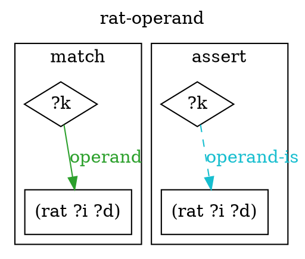
<!-- /rule -->

#### `rat-operand-check`

<!-- rule std.math.rat rat-operand-check -->
```lisp
(rule rat-operand-check ()
  :match  (operand-is (rat-of ?k) (rat (int ?p ?n) ?d))
  :assert (cmp-walk (rat-den ?k ?p ?n ?d) ?d z eq)
  :why    "the operand is {?p} less {?n}, over {?d}: is the denominator zero?")
```

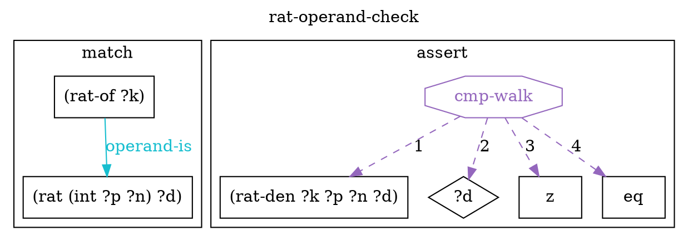
<!-- /rule -->

#### `rat-operand-found`

<!-- rule std.math.rat rat-operand-found -->
```lisp
(rule rat-operand-found ()
  :match  (order-is (rat-den ?k ?p ?n ?d) gt)
  :assert (rat-operand-is ?k ?p ?n ?d)
  :why    "the denominator {?d} is not zero")
```

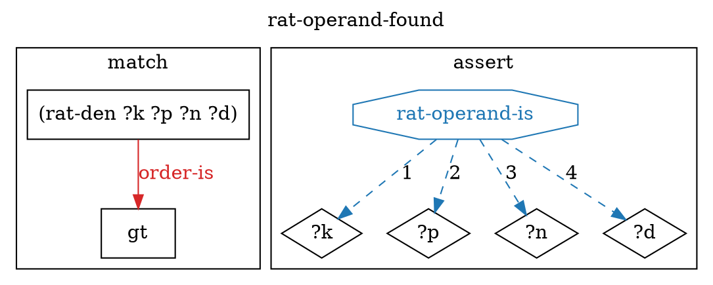
<!-- /rule -->

#### `rat-operand-zero`

<!-- rule std.math.rat rat-operand-zero -->
```lisp
(rule rat-operand-zero ()
  :match  (order-is (rat-den ?k ?p ?n ?d) eq)
  :assert (rat-zero-den ?k)
  :why    "the denominator {?d} is zero")
```

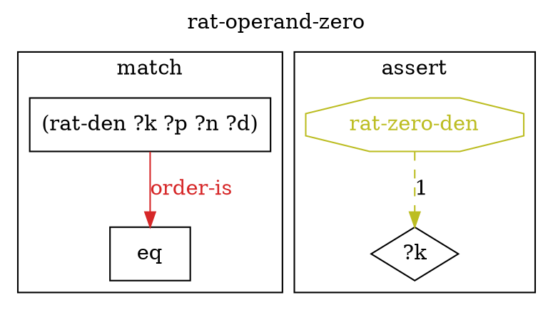
<!-- /rule -->

#### `rat-operand-second`

<!-- rule std.math.rat rat-operand-second -->
```lisp
(rule rat-operand-second ()
  :match  (rat-operand-is (rat-first ?k ?y) ?p ?n ?d)
  :assert (operand (rat-of (rat-second ?k ?p ?n ?d)) ?y)
  :why    "the first operand is {?p} less {?n}, over {?d}: now the rational {?y} stands for")
```

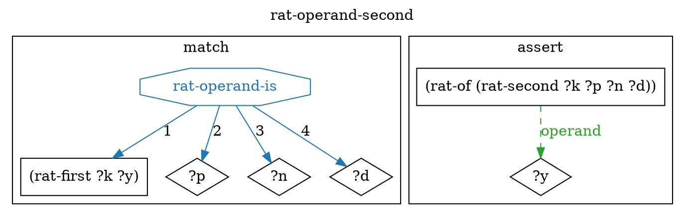
<!-- /rule -->

### A zero denominator

The flag is `std.math.arith`'s `division-by-zero`, on the request.

#### `rat-zero-only`

<!-- rule std.math.rat rat-zero-only -->
```lisp
(rule rat-zero-only ()
  :match  (rat-zero-den (rat-only ?request))
  :assert (division-by-zero ?request)
  :why    "the operand of {?request} has a denominator of zero")
```

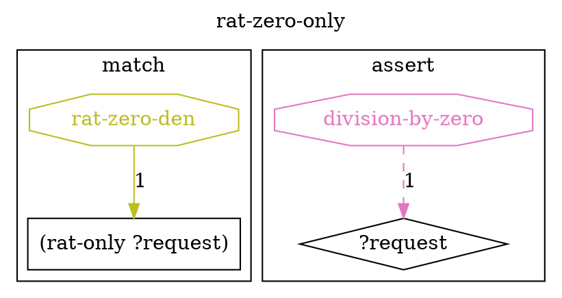
<!-- /rule -->

#### `rat-zero-first`

<!-- rule std.math.rat rat-zero-first -->
```lisp
(rule rat-zero-first ()
  :match  (rat-zero-den (rat-first ?request ?y))
  :assert (division-by-zero ?request)
  :why    "the first operand of {?request} has a denominator of zero")
```

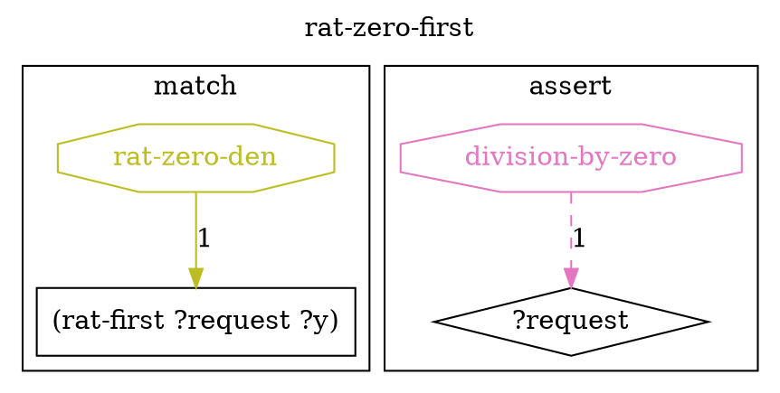
<!-- /rule -->

#### `rat-zero-second`

<!-- rule std.math.rat rat-zero-second -->
```lisp
(rule rat-zero-second ()
  :match  (rat-zero-den (rat-second ?request ?p ?n ?d))
  :assert (division-by-zero ?request)
  :why    "the second operand of {?request} has a denominator of zero")
```

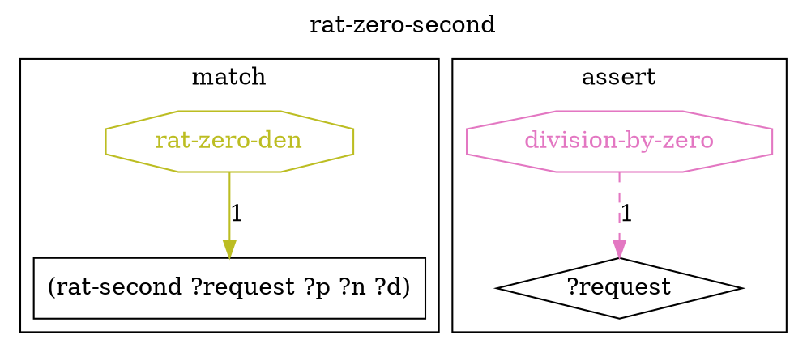
<!-- /rule -->

### An answer, not reduced

The numerator in the integers' normal form, the denominator with no high zero, and nothing divided.

#### `rat-norm-numerator`

<!-- rule std.math.rat rat-norm-numerator -->
```lisp
(rule rat-norm-numerator ()
  :match  (rat-norm ?k ?p ?n ?d)
  :assert (int-norm (rat-num ?k ?d) ?p ?n)
  :why    "first the numerator, {?p} less {?n}, simplified")
```

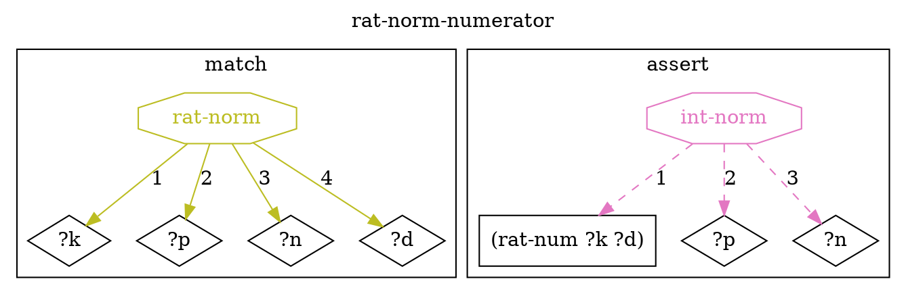
<!-- /rule -->

#### `rat-norm-denominator`

<!-- rule std.math.rat rat-norm-denominator -->
```lisp
(rule rat-norm-denominator ()
  :match  (int-done (rat-num ?k ?d) ?i)
  :assert (add-walk (rat-den-norm ?k ?i) ?d z 0 z)
  :why    "the numerator is {?i}: now {?d} with no high zero")
```

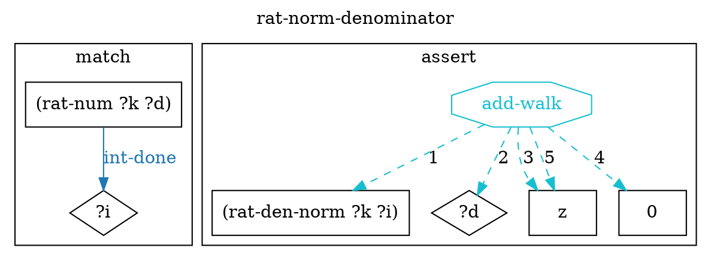
<!-- /rule -->

#### `rat-norm-done`

<!-- rule std.math.rat rat-norm-done -->
```lisp
(rule rat-norm-done ()
  :match  (done (rat-den-norm ?k ?i) ?e)
  :assert (rat-done ?k (rat ?i ?e))
  :why    "{?i} over {?e}, not reduced")
```

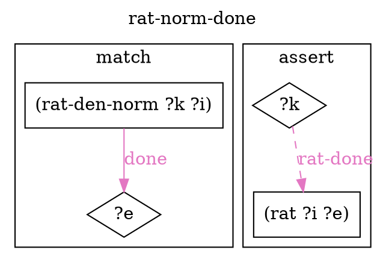
<!-- /rule -->

### Lowest terms, on request

$$
\frac{a}{d} = \frac{a / g}{d / g}, \qquad g = \gcd(\lvert a \rvert, d)
$$

The greatest common divisor is `std.math.gcd`'s tagged call, and the two quotients are the natural numbers'
divisions.

#### `rat-simplify-pos`

<!-- rule std.math.rat rat-simplify-pos -->
```lisp
(rule rat-simplify-pos ()
  :match  (int-done (rat-low ?k ?d) (int ?a z))
  :assert (gcd-call (rat-g ?k pos ?a ?d) ?a ?d)
  :why    "the numerator is not negative: the greatest common divisor of {?a} and {?d}")
```

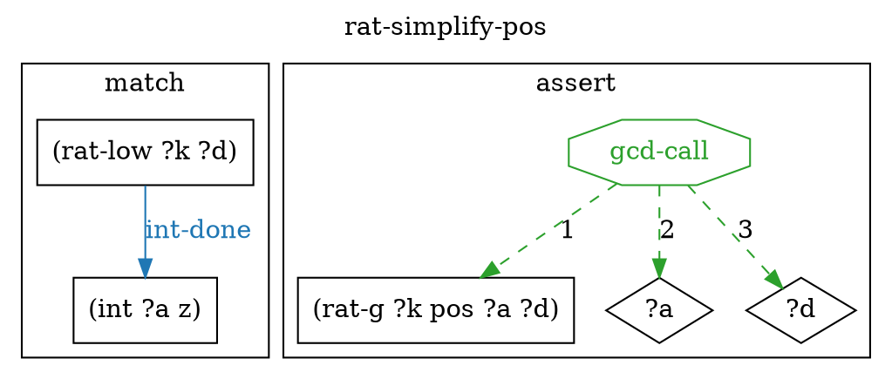
<!-- /rule -->

#### `rat-simplify-neg`

<!-- rule std.math.rat rat-simplify-neg -->
```lisp
(rule rat-simplify-neg ()
  :match  (int-done (rat-low ?k ?d) (int z (n ?b ?c)))
  :assert (gcd-call (rat-g ?k neg (n ?b ?c) ?d) (n ?b ?c) ?d)
  :why    "the numerator is negative: the greatest common divisor of its size and {?d}")
```

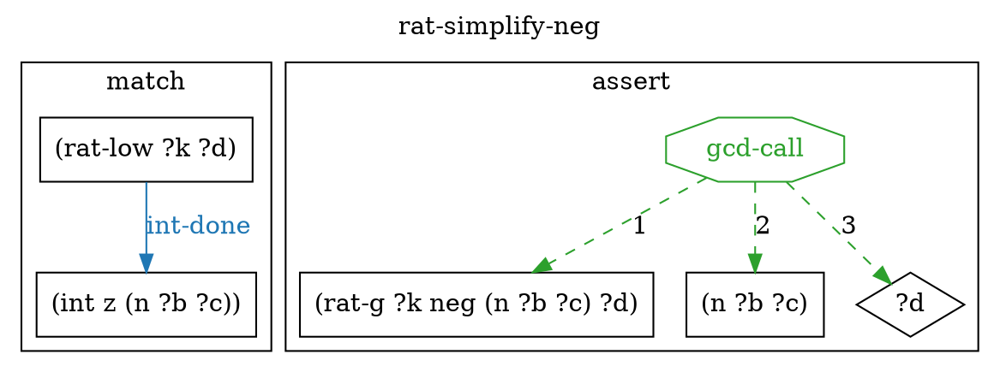
<!-- /rule -->

#### `rat-lowest-numerator`

<!-- rule std.math.rat rat-lowest-numerator -->
```lisp
(rule rat-lowest-numerator ()
  :match  (gcd-done (rat-g ?k ?s ?a ?d) ?g)
  :assert (div-call (rat-q-num ?k ?s ?d ?g) ?a ?g)
  :why    "the common divisor is {?g}: divide the numerator's size, {?a}, by it")
```

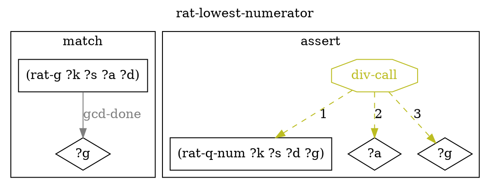
<!-- /rule -->

#### `rat-lowest-denominator`

<!-- rule std.math.rat rat-lowest-denominator -->
```lisp
(rule rat-lowest-denominator ()
  :match  (div-done (rat-q-num ?k ?s ?d ?g) ?q ?r)
  :assert (div-call (rat-q-den ?k ?s ?q) ?d ?g)
  :why    "that makes {?q}: divide the denominator, {?d}, by {?g}")
```

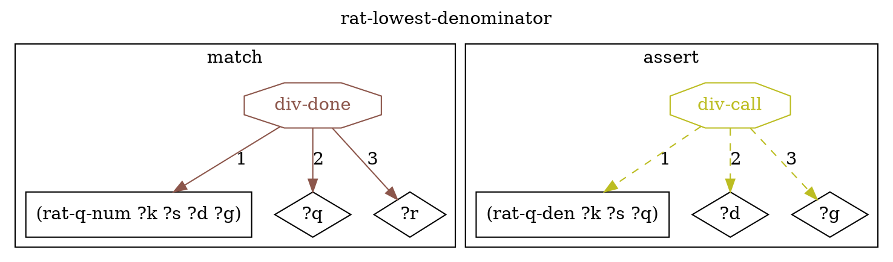
<!-- /rule -->

#### `rat-lowest-pos`

<!-- rule std.math.rat rat-lowest-pos -->
```lisp
(rule rat-lowest-pos ()
  :match  (div-done (rat-q-den ?k pos ?q) ?e ?r)
  :assert (rat-done ?k (rat (int ?q z) ?e))
  :why    "in lowest terms: {?q} over {?e}")
```

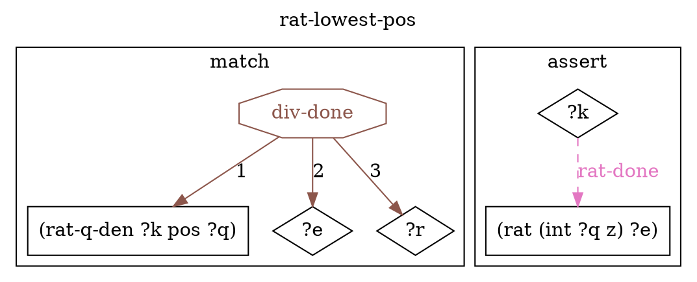
<!-- /rule -->

#### `rat-lowest-neg`

<!-- rule std.math.rat rat-lowest-neg -->
```lisp
(rule rat-lowest-neg ()
  :match  (div-done (rat-q-den ?k neg ?q) ?e ?r)
  :assert (rat-done ?k (rat (int z ?q) ?e))
  :why    "in lowest terms: {?q} over {?e}, negative")
```


<!-- /rule -->

### The cross products

For $(P_1 - N_1)/D_1$ and $(P_2 - N_2)/D_2$, the numerator of the sum, as a positive and a negative part:

$$
(P_1 D_2 + P_2 D_1) - (N_1 D_2 + N_2 D_1)
$$

Four products and two sums of natural numbers. A sum, a difference and a comparison all read them.

#### `rat-cross-first`

<!-- rule std.math.rat rat-cross-first -->
```lisp
(rule rat-cross-first ()
  :match  (rat-cross ?k ?p ?n ?d ?q ?m ?e)
  :assert (mul-call (rat-x1 ?k ?n ?d ?q ?m ?e) ?p ?e)
  :why    "the first cross product: {?p} x {?e}")
```

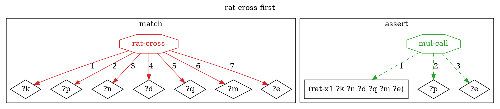
<!-- /rule -->

#### `rat-cross-second`

<!-- rule std.math.rat rat-cross-second -->
```lisp
(rule rat-cross-second ()
  :match  (done (rat-x1 ?k ?n ?d ?q ?m ?e) ?a)
  :assert (mul-call (rat-x2 ?k ?n ?d ?m ?e ?a) ?q ?d)
  :why    "that makes {?a}: the second, {?q} x {?d}")
```

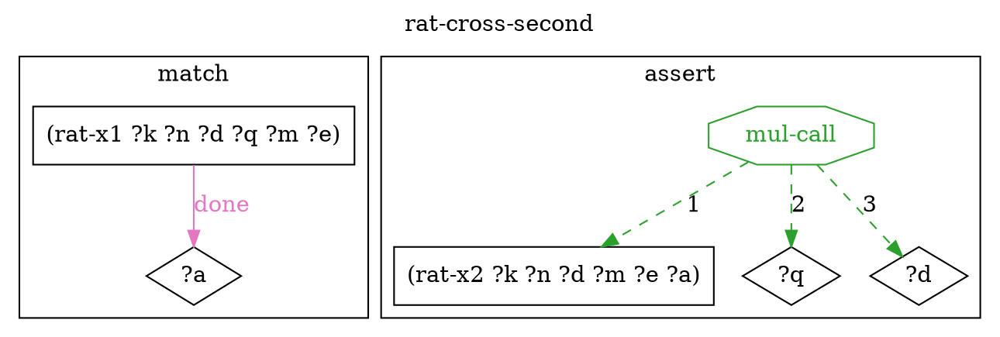
<!-- /rule -->

#### `rat-cross-plus`

<!-- rule std.math.rat rat-cross-plus -->
```lisp
(rule rat-cross-plus ()
  :match  (done (rat-x2 ?k ?n ?d ?m ?e ?a) ?b)
  :assert (add-walk (rat-x3 ?k ?n ?d ?m ?e) ?a ?b 0 z)
  :why    "that makes {?b}: the positive part is {?a} + {?b}")
```

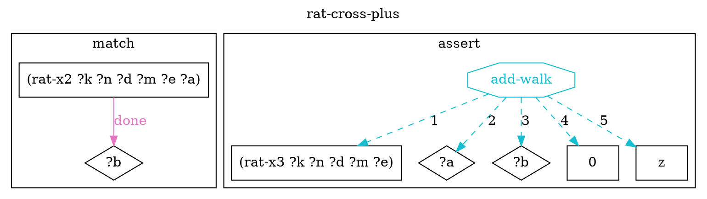
<!-- /rule -->

#### `rat-cross-third`

<!-- rule std.math.rat rat-cross-third -->
```lisp
(rule rat-cross-third ()
  :match  (done (rat-x3 ?k ?n ?d ?m ?e) ?s)
  :assert (mul-call (rat-x4 ?k ?d ?m ?s) ?n ?e)
  :why    "the positive part is {?s}: the third cross product, {?n} x {?e}")
```

```dot
digraph rule_rat_cross_third_lhs_rhs {
  rankdir=TB;
  label="rat-cross-third"; labelloc=t;
  subgraph cluster_lhs { label="match";
    "(rat-x3 ?k ?n ?d ?m ?e)_L" [label="(rat-x3 ?k ?n ?d ?m ?e)", shape=rectangle];
    "?s_L" [label="?s", shape=diamond];
    "(rat-x3 ?k ?n ?d ?m ?e)_L" -> "?s_L" [label="done", color="#e377c2", fontcolor="#e377c2"];
  }
  subgraph cluster_rhs { label="assert";
    "(rat-x4 ?k ?d ?m ?s)_R" [label="(rat-x4 ?k ?d ?m ?s)", shape=rectangle];
    "?n_R" [label="?n", shape=diamond];
    "?e_R" [label="?e", shape=diamond];
    "h1_mul-call_R" [shape=octagon, label="mul-call", color="#2ca02c", fontcolor="#2ca02c"];
    "h1_mul-call_R" -> "(rat-x4 ?k ?d ?m ?s)_R" [label="1", color="#2ca02c", style=dashed];
    "h1_mul-call_R" -> "?n_R" [label="2", color="#2ca02c", style=dashed];
    "h1_mul-call_R" -> "?e_R" [label="3", color="#2ca02c", style=dashed];
  }
}
```
<!-- /rule -->

#### `rat-cross-fourth`

<!-- rule std.math.rat rat-cross-fourth -->
```lisp
(rule rat-cross-fourth ()
  :match  (done (rat-x4 ?k ?d ?m ?s) ?a)
  :assert (mul-call (rat-x5 ?k ?s ?a) ?m ?d)
  :why    "that makes {?a}: the fourth, {?m} x {?d}")
```

```dot
digraph rule_rat_cross_fourth_lhs_rhs {
  rankdir=TB;
  label="rat-cross-fourth"; labelloc=t;
  subgraph cluster_lhs { label="match";
    "(rat-x4 ?k ?d ?m ?s)_L" [label="(rat-x4 ?k ?d ?m ?s)", shape=rectangle];
    "?a_L" [label="?a", shape=diamond];
    "(rat-x4 ?k ?d ?m ?s)_L" -> "?a_L" [label="done", color="#e377c2", fontcolor="#e377c2"];
  }
  subgraph cluster_rhs { label="assert";
    "(rat-x5 ?k ?s ?a)_R" [label="(rat-x5 ?k ?s ?a)", shape=rectangle];
    "?m_R" [label="?m", shape=diamond];
    "?d_R" [label="?d", shape=diamond];
    "h1_mul-call_R" [shape=octagon, label="mul-call", color="#2ca02c", fontcolor="#2ca02c"];
    "h1_mul-call_R" -> "(rat-x5 ?k ?s ?a)_R" [label="1", color="#2ca02c", style=dashed];
    "h1_mul-call_R" -> "?m_R" [label="2", color="#2ca02c", style=dashed];
    "h1_mul-call_R" -> "?d_R" [label="3", color="#2ca02c", style=dashed];
  }
}
```
<!-- /rule -->

#### `rat-cross-minus`

<!-- rule std.math.rat rat-cross-minus -->
```lisp
(rule rat-cross-minus ()
  :match  (done (rat-x5 ?k ?s ?a) ?b)
  :assert (add-walk (rat-x6 ?k ?s) ?a ?b 0 z)
  :why    "that makes {?b}: the negative part is {?a} + {?b}")
```

```dot
digraph rule_rat_cross_minus_lhs_rhs {
  rankdir=TB;
  label="rat-cross-minus"; labelloc=t;
  subgraph cluster_lhs { label="match";
    "(rat-x5 ?k ?s ?a)_L" [label="(rat-x5 ?k ?s ?a)", shape=rectangle];
    "?b_L" [label="?b", shape=diamond];
    "(rat-x5 ?k ?s ?a)_L" -> "?b_L" [label="done", color="#e377c2", fontcolor="#e377c2"];
  }
  subgraph cluster_rhs { label="assert";
    "(rat-x6 ?k ?s)_R" [label="(rat-x6 ?k ?s)", shape=rectangle];
    "?a_R" [label="?a", shape=diamond];
    "?b_R" [label="?b", shape=diamond];
    "0_R" [label="0", shape=rectangle];
    "z_R" [label="z", shape=rectangle];
    "h1_add-walk_R" [shape=octagon, label="add-walk", color="#17becf", fontcolor="#17becf"];
    "h1_add-walk_R" -> "(rat-x6 ?k ?s)_R" [label="1", color="#17becf", style=dashed];
    "h1_add-walk_R" -> "?a_R" [label="2", color="#17becf", style=dashed];
    "h1_add-walk_R" -> "?b_R" [label="3", color="#17becf", style=dashed];
    "h1_add-walk_R" -> "0_R" [label="4", color="#17becf", style=dashed];
    "h1_add-walk_R" -> "z_R" [label="5", color="#17becf", style=dashed];
  }
}
```
<!-- /rule -->

#### `rat-cross-end`

<!-- rule std.math.rat rat-cross-end -->
```lisp
(rule rat-cross-end ()
  :match  (done (rat-x6 ?k ?s) ?t)
  :assert (rat-cross-is ?k ?s ?t)
  :why    "the cross products make {?s} less {?t}")
```

```dot
digraph rule_rat_cross_end_lhs_rhs {
  rankdir=TB;
  label="rat-cross-end"; labelloc=t;
  subgraph cluster_lhs { label="match";
    "(rat-x6 ?k ?s)_L" [label="(rat-x6 ?k ?s)", shape=rectangle];
    "?t_L" [label="?t", shape=diamond];
    "(rat-x6 ?k ?s)_L" -> "?t_L" [label="done", color="#e377c2", fontcolor="#e377c2"];
  }
  subgraph cluster_rhs { label="assert";
    "?k_R" [label="?k", shape=diamond];
    "?s_R" [label="?s", shape=diamond];
    "?t_R" [label="?t", shape=diamond];
    "h1_rat-cross-is_R" [shape=octagon, label="rat-cross-is", color="#17becf", fontcolor="#17becf"];
    "h1_rat-cross-is_R" -> "?k_R" [label="1", color="#17becf", style=dashed];
    "h1_rat-cross-is_R" -> "?s_R" [label="2", color="#17becf", style=dashed];
    "h1_rat-cross-is_R" -> "?t_R" [label="3", color="#17becf", style=dashed];
  }
}
```
<!-- /rule -->

### Simplification, and negation

#### `rat-simplify-ask`

<!-- rule std.math.rat rat-simplify-ask -->
```lisp
(rule rat-simplify-ask ()
  :match  (rat-simplify ?x)
  :assert (operand (rat-of (rat-only (rat-simplify ?x))) ?x)
  :why    "{?x} in lowest terms is asked: first, the rational {?x} stands for")
```

```dot
digraph rule_rat_simplify_ask_lhs_rhs {
  rankdir=TB;
  label="rat-simplify-ask"; labelloc=t;
  subgraph cluster_lhs { label="match";
    "?x_L" [label="?x", shape=diamond];
    "h1_rat-simplify_L" [shape=octagon, label="rat-simplify", color="#7f7f7f", fontcolor="#7f7f7f"];
    "h1_rat-simplify_L" -> "?x_L" [label="1", color="#7f7f7f"];
  }
  subgraph cluster_rhs { label="assert";
    "(rat-of (rat-only (rat-simplify ?x)))_R" [label="(rat-of (rat-only (rat-simplify ?x)))", shape=rectangle];
    "?x_R" [label="?x", shape=diamond];
    "(rat-of (rat-only (rat-simplify ?x)))_R" -> "?x_R" [label="operand", color="#2ca02c", fontcolor="#2ca02c", style=dashed];
  }
}
```
<!-- /rule -->

#### `rat-simplify-start`

<!-- rule std.math.rat rat-simplify-start -->
```lisp
(rule rat-simplify-start ()
  :match  (rat-operand-is (rat-only (rat-simplify ?x)) ?p ?n ?d)
  :assert (int-norm (rat-low (rat-simplify ?x) ?d) ?p ?n)
  :why    "{?p} less {?n}, over {?d}, in lowest terms: first the numerator, simplified")
```

```dot
digraph rule_rat_simplify_start_lhs_rhs {
  rankdir=TB;
  label="rat-simplify-start"; labelloc=t;
  subgraph cluster_lhs { label="match";
    "(rat-only (rat-simplify ?x))_L" [label="(rat-only (rat-simplify ?x))", shape=rectangle];
    "?p_L" [label="?p", shape=diamond];
    "?n_L" [label="?n", shape=diamond];
    "?d_L" [label="?d", shape=diamond];
    "h1_rat-operand-is_L" [shape=octagon, label="rat-operand-is", color="#1f77b4", fontcolor="#1f77b4"];
    "h1_rat-operand-is_L" -> "(rat-only (rat-simplify ?x))_L" [label="1", color="#1f77b4"];
    "h1_rat-operand-is_L" -> "?p_L" [label="2", color="#1f77b4"];
    "h1_rat-operand-is_L" -> "?n_L" [label="3", color="#1f77b4"];
    "h1_rat-operand-is_L" -> "?d_L" [label="4", color="#1f77b4"];
  }
  subgraph cluster_rhs { label="assert";
    "(rat-low (rat-simplify ?x) ?d)_R" [label="(rat-low (rat-simplify ?x) ?d)", shape=rectangle];
    "?p_R" [label="?p", shape=diamond];
    "?n_R" [label="?n", shape=diamond];
    "h2_int-norm_R" [shape=octagon, label="int-norm", color="#e377c2", fontcolor="#e377c2"];
    "h2_int-norm_R" -> "(rat-low (rat-simplify ?x) ?d)_R" [label="1", color="#e377c2", style=dashed];
    "h2_int-norm_R" -> "?p_R" [label="2", color="#e377c2", style=dashed];
    "h2_int-norm_R" -> "?n_R" [label="3", color="#e377c2", style=dashed];
  }
}
```
<!-- /rule -->

#### `rat-simplify-answer`

<!-- rule std.math.rat rat-simplify-answer -->
```lisp
(rule rat-simplify-answer ()
  :match  (rat-done (rat-simplify ?x) ?s)
  :assert (rat-simple-of ?x ?s)
  :why    "{?x} is {?s}")
```

```dot
digraph rule_rat_simplify_answer_lhs_rhs {
  rankdir=TB;
  label="rat-simplify-answer"; labelloc=t;
  subgraph cluster_lhs { label="match";
    "(rat-simplify ?x)_L" [label="(rat-simplify ?x)", shape=rectangle];
    "?s_L" [label="?s", shape=diamond];
    "(rat-simplify ?x)_L" -> "?s_L" [label="rat-done", color="#e377c2", fontcolor="#e377c2"];
  }
  subgraph cluster_rhs { label="assert";
    "?x_R" [label="?x", shape=diamond];
    "?s_R" [label="?s", shape=diamond];
    "?x_R" -> "?s_R" [label="rat-simple-of", color="#8c564b", fontcolor="#8c564b", style=dashed];
  }
}
```
<!-- /rule -->

#### `rat-neg-ask`

<!-- rule std.math.rat rat-neg-ask -->
```lisp
(rule rat-neg-ask ()
  :match  (rat-neg ?x)
  :assert (operand (rat-of (rat-only (rat-neg ?x))) ?x)
  :why    "{?x} negated is asked: first, the rational {?x} stands for")
```

```dot
digraph rule_rat_neg_ask_lhs_rhs {
  rankdir=TB;
  label="rat-neg-ask"; labelloc=t;
  subgraph cluster_lhs { label="match";
    "?x_L" [label="?x", shape=diamond];
    "h1_rat-neg_L" [shape=octagon, label="rat-neg", color="#2ca02c", fontcolor="#2ca02c"];
    "h1_rat-neg_L" -> "?x_L" [label="1", color="#2ca02c"];
  }
  subgraph cluster_rhs { label="assert";
    "(rat-of (rat-only (rat-neg ?x)))_R" [label="(rat-of (rat-only (rat-neg ?x)))", shape=rectangle];
    "?x_R" [label="?x", shape=diamond];
    "(rat-of (rat-only (rat-neg ?x)))_R" -> "?x_R" [label="operand", color="#2ca02c", fontcolor="#2ca02c", style=dashed];
  }
}
```
<!-- /rule -->

#### `rat-neg-start`

<!-- rule std.math.rat rat-neg-start -->
```lisp
(rule rat-neg-start ()
  :match  (rat-operand-is (rat-only (rat-neg ?x)) ?p ?n ?d)
  :assert (rat-norm (rat-neg ?x) ?n ?p ?d)
  :why    "the numerator's parts change places: {?n} less {?p}, over {?d}")
```

```dot
digraph rule_rat_neg_start_lhs_rhs {
  rankdir=TB;
  label="rat-neg-start"; labelloc=t;
  subgraph cluster_lhs { label="match";
    "(rat-only (rat-neg ?x))_L" [label="(rat-only (rat-neg ?x))", shape=rectangle];
    "?p_L" [label="?p", shape=diamond];
    "?n_L" [label="?n", shape=diamond];
    "?d_L" [label="?d", shape=diamond];
    "h1_rat-operand-is_L" [shape=octagon, label="rat-operand-is", color="#1f77b4", fontcolor="#1f77b4"];
    "h1_rat-operand-is_L" -> "(rat-only (rat-neg ?x))_L" [label="1", color="#1f77b4"];
    "h1_rat-operand-is_L" -> "?p_L" [label="2", color="#1f77b4"];
    "h1_rat-operand-is_L" -> "?n_L" [label="3", color="#1f77b4"];
    "h1_rat-operand-is_L" -> "?d_L" [label="4", color="#1f77b4"];
  }
  subgraph cluster_rhs { label="assert";
    "(rat-neg ?x)_R" [label="(rat-neg ?x)", shape=rectangle];
    "?n_R" [label="?n", shape=diamond];
    "?p_R" [label="?p", shape=diamond];
    "?d_R" [label="?d", shape=diamond];
    "h2_rat-norm_R" [shape=octagon, label="rat-norm", color="#bcbd22", fontcolor="#bcbd22"];
    "h2_rat-norm_R" -> "(rat-neg ?x)_R" [label="1", color="#bcbd22", style=dashed];
    "h2_rat-norm_R" -> "?n_R" [label="2", color="#bcbd22", style=dashed];
    "h2_rat-norm_R" -> "?p_R" [label="3", color="#bcbd22", style=dashed];
    "h2_rat-norm_R" -> "?d_R" [label="4", color="#bcbd22", style=dashed];
  }
}
```
<!-- /rule -->

#### `rat-neg-answer`

<!-- rule std.math.rat rat-neg-answer -->
```lisp
(rule rat-neg-answer ()
  :match  (rat-done (rat-neg ?x) ?s)
  :assert (rat-neg-of ?x ?s)
  :why    "{?x} negated is {?s}")
```

```dot
digraph rule_rat_neg_answer_lhs_rhs {
  rankdir=TB;
  label="rat-neg-answer"; labelloc=t;
  subgraph cluster_lhs { label="match";
    "(rat-neg ?x)_L" [label="(rat-neg ?x)", shape=rectangle];
    "?s_L" [label="?s", shape=diamond];
    "(rat-neg ?x)_L" -> "?s_L" [label="rat-done", color="#e377c2", fontcolor="#e377c2"];
  }
  subgraph cluster_rhs { label="assert";
    "?x_R" [label="?x", shape=diamond];
    "?s_R" [label="?s", shape=diamond];
    "?x_R" -> "?s_R" [label="rat-neg-of", color="#d62728", fontcolor="#d62728", style=dashed];
  }
}
```
<!-- /rule -->

### Addition, and subtraction

The cross products over the product of the denominators. A subtraction is the addition of the second operand
with its numerator's parts exchanged.

#### `rat-sum-denominator`

<!-- rule std.math.rat rat-sum-denominator -->
```lisp
(rule rat-sum-denominator ()
  :match  (rat-cross-is (rat-sum-num ?k ?d ?e) ?s ?t)
  :assert (mul-call (rat-sum-den ?k ?s ?t) ?d ?e)
  :why    "the numerator is {?s} less {?t}: the denominator is {?d} x {?e}")
```

```dot
digraph rule_rat_sum_denominator_lhs_rhs {
  rankdir=TB;
  label="rat-sum-denominator"; labelloc=t;
  subgraph cluster_lhs { label="match";
    "(rat-sum-num ?k ?d ?e)_L" [label="(rat-sum-num ?k ?d ?e)", shape=rectangle];
    "?s_L" [label="?s", shape=diamond];
    "?t_L" [label="?t", shape=diamond];
    "h1_rat-cross-is_L" [shape=octagon, label="rat-cross-is", color="#17becf", fontcolor="#17becf"];
    "h1_rat-cross-is_L" -> "(rat-sum-num ?k ?d ?e)_L" [label="1", color="#17becf"];
    "h1_rat-cross-is_L" -> "?s_L" [label="2", color="#17becf"];
    "h1_rat-cross-is_L" -> "?t_L" [label="3", color="#17becf"];
  }
  subgraph cluster_rhs { label="assert";
    "(rat-sum-den ?k ?s ?t)_R" [label="(rat-sum-den ?k ?s ?t)", shape=rectangle];
    "?d_R" [label="?d", shape=diamond];
    "?e_R" [label="?e", shape=diamond];
    "h2_mul-call_R" [shape=octagon, label="mul-call", color="#2ca02c", fontcolor="#2ca02c"];
    "h2_mul-call_R" -> "(rat-sum-den ?k ?s ?t)_R" [label="1", color="#2ca02c", style=dashed];
    "h2_mul-call_R" -> "?d_R" [label="2", color="#2ca02c", style=dashed];
    "h2_mul-call_R" -> "?e_R" [label="3", color="#2ca02c", style=dashed];
  }
}
```
<!-- /rule -->

#### `rat-sum-norm`

<!-- rule std.math.rat rat-sum-norm -->
```lisp
(rule rat-sum-norm ()
  :match  (done (rat-sum-den ?k ?s ?t) ?f)
  :assert (rat-norm ?k ?s ?t ?f)
  :why    "the denominator is {?f}: now the numerator, {?s} less {?t}, simplified")
```

```dot
digraph rule_rat_sum_norm_lhs_rhs {
  rankdir=TB;
  label="rat-sum-norm"; labelloc=t;
  subgraph cluster_lhs { label="match";
    "(rat-sum-den ?k ?s ?t)_L" [label="(rat-sum-den ?k ?s ?t)", shape=rectangle];
    "?f_L" [label="?f", shape=diamond];
    "(rat-sum-den ?k ?s ?t)_L" -> "?f_L" [label="done", color="#e377c2", fontcolor="#e377c2"];
  }
  subgraph cluster_rhs { label="assert";
    "?k_R" [label="?k", shape=diamond];
    "?s_R" [label="?s", shape=diamond];
    "?t_R" [label="?t", shape=diamond];
    "?f_R" [label="?f", shape=diamond];
    "h1_rat-norm_R" [shape=octagon, label="rat-norm", color="#bcbd22", fontcolor="#bcbd22"];
    "h1_rat-norm_R" -> "?k_R" [label="1", color="#bcbd22", style=dashed];
    "h1_rat-norm_R" -> "?s_R" [label="2", color="#bcbd22", style=dashed];
    "h1_rat-norm_R" -> "?t_R" [label="3", color="#bcbd22", style=dashed];
    "h1_rat-norm_R" -> "?f_R" [label="4", color="#bcbd22", style=dashed];
  }
}
```
<!-- /rule -->

#### `rat-add-ask`

<!-- rule std.math.rat rat-add-ask -->
```lisp
(rule rat-add-ask ()
  :match  (rat-add ?x ?y)
  :assert (operand (rat-of (rat-first (rat-add ?x ?y) ?y)) ?x)
  :why    "{?x} + {?y} is asked: first, the rational {?x} stands for")
```

```dot
digraph rule_rat_add_ask_lhs_rhs {
  rankdir=TB;
  label="rat-add-ask"; labelloc=t;
  subgraph cluster_lhs { label="match";
    "?x_L" [label="?x", shape=diamond];
    "?y_L" [label="?y", shape=diamond];
    "?x_L" -> "?y_L" [label="rat-add", color="#bcbd22", fontcolor="#bcbd22"];
  }
  subgraph cluster_rhs { label="assert";
    "(rat-of (rat-first (rat-add ?x ?y) ?y))_R" [label="(rat-of (rat-first (rat-add ?x ?y) ?y))", shape=rectangle];
    "?x_R" [label="?x", shape=diamond];
    "(rat-of (rat-first (rat-add ?x ?y) ?y))_R" -> "?x_R" [label="operand", color="#2ca02c", fontcolor="#2ca02c", style=dashed];
  }
}
```
<!-- /rule -->

#### `rat-add-start`

<!-- rule std.math.rat rat-add-start -->
```lisp
(rule rat-add-start ()
  :match  (rat-operand-is (rat-second (rat-add ?x ?y) ?p ?n ?d) ?q ?m ?e)
  :assert (rat-cross (rat-sum-num (rat-add ?x ?y) ?d ?e) ?p ?n ?d ?q ?m ?e)
  :why    "add {?p} less {?n} over {?d} and {?q} less {?m} over {?e}: first the cross products")
```

```dot
digraph rule_rat_add_start_lhs_rhs {
  rankdir=TB;
  label="rat-add-start"; labelloc=t;
  subgraph cluster_lhs { label="match";
    "(rat-second (rat-add ?x ?y) ?p ?n ?d)_L" [label="(rat-second (rat-add ?x ?y) ?p ?n ?d)", shape=rectangle];
    "?q_L" [label="?q", shape=diamond];
    "?m_L" [label="?m", shape=diamond];
    "?e_L" [label="?e", shape=diamond];
    "h1_rat-operand-is_L" [shape=octagon, label="rat-operand-is", color="#1f77b4", fontcolor="#1f77b4"];
    "h1_rat-operand-is_L" -> "(rat-second (rat-add ?x ?y) ?p ?n ?d)_L" [label="1", color="#1f77b4"];
    "h1_rat-operand-is_L" -> "?q_L" [label="2", color="#1f77b4"];
    "h1_rat-operand-is_L" -> "?m_L" [label="3", color="#1f77b4"];
    "h1_rat-operand-is_L" -> "?e_L" [label="4", color="#1f77b4"];
  }
  subgraph cluster_rhs { label="assert";
    "(rat-sum-num (rat-add ?x ?y) ?d ?e)_R" [label="(rat-sum-num (rat-add ?x ?y) ?d ?e)", shape=rectangle];
    "?p_R" [label="?p", shape=diamond];
    "?n_R" [label="?n", shape=diamond];
    "?d_R" [label="?d", shape=diamond];
    "?q_R" [label="?q", shape=diamond];
    "?m_R" [label="?m", shape=diamond];
    "?e_R" [label="?e", shape=diamond];
    "h2_rat-cross_R" [shape=octagon, label="rat-cross", color="#d62728", fontcolor="#d62728"];
    "h2_rat-cross_R" -> "(rat-sum-num (rat-add ?x ?y) ?d ?e)_R" [label="1", color="#d62728", style=dashed];
    "h2_rat-cross_R" -> "?p_R" [label="2", color="#d62728", style=dashed];
    "h2_rat-cross_R" -> "?n_R" [label="3", color="#d62728", style=dashed];
    "h2_rat-cross_R" -> "?d_R" [label="4", color="#d62728", style=dashed];
    "h2_rat-cross_R" -> "?q_R" [label="5", color="#d62728", style=dashed];
    "h2_rat-cross_R" -> "?m_R" [label="6", color="#d62728", style=dashed];
    "h2_rat-cross_R" -> "?e_R" [label="7", color="#d62728", style=dashed];
  }
}
```
<!-- /rule -->

#### `rat-add-answer`

<!-- rule std.math.rat rat-add-answer -->
```lisp
(rule rat-add-answer ()
  :match  (rat-done (rat-add ?x ?y) ?s)
  :assert (rat-sum-of ?x ?y ?s)
  :why    "{?x} + {?y} = {?s}")
```

```dot
digraph rule_rat_add_answer_lhs_rhs {
  rankdir=TB;
  label="rat-add-answer"; labelloc=t;
  subgraph cluster_lhs { label="match";
    "(rat-add ?x ?y)_L" [label="(rat-add ?x ?y)", shape=rectangle];
    "?s_L" [label="?s", shape=diamond];
    "(rat-add ?x ?y)_L" -> "?s_L" [label="rat-done", color="#e377c2", fontcolor="#e377c2"];
  }
  subgraph cluster_rhs { label="assert";
    "?x_R" [label="?x", shape=diamond];
    "?y_R" [label="?y", shape=diamond];
    "?s_R" [label="?s", shape=diamond];
    "h1_rat-sum-of_R" [shape=octagon, label="rat-sum-of", color="#9467bd", fontcolor="#9467bd"];
    "h1_rat-sum-of_R" -> "?x_R" [label="1", color="#9467bd", style=dashed];
    "h1_rat-sum-of_R" -> "?y_R" [label="2", color="#9467bd", style=dashed];
    "h1_rat-sum-of_R" -> "?s_R" [label="3", color="#9467bd", style=dashed];
  }
}
```
<!-- /rule -->

#### `rat-sub-ask`

<!-- rule std.math.rat rat-sub-ask -->
```lisp
(rule rat-sub-ask ()
  :match  (rat-sub ?x ?y)
  :assert (operand (rat-of (rat-first (rat-sub ?x ?y) ?y)) ?x)
  :why    "{?x} - {?y} is asked: first, the rational {?x} stands for")
```

```dot
digraph rule_rat_sub_ask_lhs_rhs {
  rankdir=TB;
  label="rat-sub-ask"; labelloc=t;
  subgraph cluster_lhs { label="match";
    "?x_L" [label="?x", shape=diamond];
    "?y_L" [label="?y", shape=diamond];
    "?x_L" -> "?y_L" [label="rat-sub", color="#7f7f7f", fontcolor="#7f7f7f"];
  }
  subgraph cluster_rhs { label="assert";
    "(rat-of (rat-first (rat-sub ?x ?y) ?y))_R" [label="(rat-of (rat-first (rat-sub ?x ?y) ?y))", shape=rectangle];
    "?x_R" [label="?x", shape=diamond];
    "(rat-of (rat-first (rat-sub ?x ?y) ?y))_R" -> "?x_R" [label="operand", color="#2ca02c", fontcolor="#2ca02c", style=dashed];
  }
}
```
<!-- /rule -->

#### `rat-sub-start`

<!-- rule std.math.rat rat-sub-start -->
```lisp
(rule rat-sub-start ()
  :match  (rat-operand-is (rat-second (rat-sub ?x ?y) ?p ?n ?d) ?q ?m ?e)
  :assert (rat-cross (rat-sum-num (rat-sub ?x ?y) ?d ?e) ?p ?n ?d ?m ?q ?e)
  :why    "to take {?q} less {?m} over {?e} away, add {?m} less {?q} over {?e}")
```

```dot
digraph rule_rat_sub_start_lhs_rhs {
  rankdir=TB;
  label="rat-sub-start"; labelloc=t;
  subgraph cluster_lhs { label="match";
    "(rat-second (rat-sub ?x ?y) ?p ?n ?d)_L" [label="(rat-second (rat-sub ?x ?y) ?p ?n ?d)", shape=rectangle];
    "?q_L" [label="?q", shape=diamond];
    "?m_L" [label="?m", shape=diamond];
    "?e_L" [label="?e", shape=diamond];
    "h1_rat-operand-is_L" [shape=octagon, label="rat-operand-is", color="#1f77b4", fontcolor="#1f77b4"];
    "h1_rat-operand-is_L" -> "(rat-second (rat-sub ?x ?y) ?p ?n ?d)_L" [label="1", color="#1f77b4"];
    "h1_rat-operand-is_L" -> "?q_L" [label="2", color="#1f77b4"];
    "h1_rat-operand-is_L" -> "?m_L" [label="3", color="#1f77b4"];
    "h1_rat-operand-is_L" -> "?e_L" [label="4", color="#1f77b4"];
  }
  subgraph cluster_rhs { label="assert";
    "(rat-sum-num (rat-sub ?x ?y) ?d ?e)_R" [label="(rat-sum-num (rat-sub ?x ?y) ?d ?e)", shape=rectangle];
    "?p_R" [label="?p", shape=diamond];
    "?n_R" [label="?n", shape=diamond];
    "?d_R" [label="?d", shape=diamond];
    "?m_R" [label="?m", shape=diamond];
    "?q_R" [label="?q", shape=diamond];
    "?e_R" [label="?e", shape=diamond];
    "h2_rat-cross_R" [shape=octagon, label="rat-cross", color="#d62728", fontcolor="#d62728"];
    "h2_rat-cross_R" -> "(rat-sum-num (rat-sub ?x ?y) ?d ?e)_R" [label="1", color="#d62728", style=dashed];
    "h2_rat-cross_R" -> "?p_R" [label="2", color="#d62728", style=dashed];
    "h2_rat-cross_R" -> "?n_R" [label="3", color="#d62728", style=dashed];
    "h2_rat-cross_R" -> "?d_R" [label="4", color="#d62728", style=dashed];
    "h2_rat-cross_R" -> "?m_R" [label="5", color="#d62728", style=dashed];
    "h2_rat-cross_R" -> "?q_R" [label="6", color="#d62728", style=dashed];
    "h2_rat-cross_R" -> "?e_R" [label="7", color="#d62728", style=dashed];
  }
}
```
<!-- /rule -->

#### `rat-sub-answer`

<!-- rule std.math.rat rat-sub-answer -->
```lisp
(rule rat-sub-answer ()
  :match  (rat-done (rat-sub ?x ?y) ?s)
  :assert (rat-diff-of ?x ?y ?s)
  :why    "{?x} - {?y} = {?s}")
```

```dot
digraph rule_rat_sub_answer_lhs_rhs {
  rankdir=TB;
  label="rat-sub-answer"; labelloc=t;
  subgraph cluster_lhs { label="match";
    "(rat-sub ?x ?y)_L" [label="(rat-sub ?x ?y)", shape=rectangle];
    "?s_L" [label="?s", shape=diamond];
    "(rat-sub ?x ?y)_L" -> "?s_L" [label="rat-done", color="#e377c2", fontcolor="#e377c2"];
  }
  subgraph cluster_rhs { label="assert";
    "?x_R" [label="?x", shape=diamond];
    "?y_R" [label="?y", shape=diamond];
    "?s_R" [label="?s", shape=diamond];
    "h1_rat-diff-of_R" [shape=octagon, label="rat-diff-of", color="#bcbd22", fontcolor="#bcbd22"];
    "h1_rat-diff-of_R" -> "?x_R" [label="1", color="#bcbd22", style=dashed];
    "h1_rat-diff-of_R" -> "?y_R" [label="2", color="#bcbd22", style=dashed];
    "h1_rat-diff-of_R" -> "?s_R" [label="3", color="#bcbd22", style=dashed];
  }
}
```
<!-- /rule -->

### Comparison

Since no denominator is negative, the order of two rationals is the order of the two parts of their difference's
numerator, one comparison walk. Nothing is reduced for it.

#### `rat-cmp-sides`

<!-- rule std.math.rat rat-cmp-sides -->
```lisp
(rule rat-cmp-sides ()
  :match  (rat-cross-is (rat-cmp-num ?k) ?s ?t)
  :assert (cmp-walk ?k ?s ?t eq)
  :why    "compare {?s} with {?t}")
```

```dot
digraph rule_rat_cmp_sides_lhs_rhs {
  rankdir=TB;
  label="rat-cmp-sides"; labelloc=t;
  subgraph cluster_lhs { label="match";
    "(rat-cmp-num ?k)_L" [label="(rat-cmp-num ?k)", shape=rectangle];
    "?s_L" [label="?s", shape=diamond];
    "?t_L" [label="?t", shape=diamond];
    "h1_rat-cross-is_L" [shape=octagon, label="rat-cross-is", color="#17becf", fontcolor="#17becf"];
    "h1_rat-cross-is_L" -> "(rat-cmp-num ?k)_L" [label="1", color="#17becf"];
    "h1_rat-cross-is_L" -> "?s_L" [label="2", color="#17becf"];
    "h1_rat-cross-is_L" -> "?t_L" [label="3", color="#17becf"];
  }
  subgraph cluster_rhs { label="assert";
    "?k_R" [label="?k", shape=diamond];
    "?s_R" [label="?s", shape=diamond];
    "?t_R" [label="?t", shape=diamond];
    "eq_R" [label="eq", shape=rectangle];
    "h2_cmp-walk_R" [shape=octagon, label="cmp-walk", color="#9467bd", fontcolor="#9467bd"];
    "h2_cmp-walk_R" -> "?k_R" [label="1", color="#9467bd", style=dashed];
    "h2_cmp-walk_R" -> "?s_R" [label="2", color="#9467bd", style=dashed];
    "h2_cmp-walk_R" -> "?t_R" [label="3", color="#9467bd", style=dashed];
    "h2_cmp-walk_R" -> "eq_R" [label="4", color="#9467bd", style=dashed];
  }
}
```
<!-- /rule -->

#### `rat-cmp-ask`

<!-- rule std.math.rat rat-cmp-ask -->
```lisp
(rule rat-cmp-ask ()
  :match  (rat-cmp ?x ?y)
  :assert (operand (rat-of (rat-first (rat-cmp ?x ?y) ?y)) ?x)
  :why    "{?x} compared with {?y} is asked: first, the rational {?x} stands for")
```

```dot
digraph rule_rat_cmp_ask_lhs_rhs {
  rankdir=TB;
  label="rat-cmp-ask"; labelloc=t;
  subgraph cluster_lhs { label="match";
    "?x_L" [label="?x", shape=diamond];
    "?y_L" [label="?y", shape=diamond];
    "?x_L" -> "?y_L" [label="rat-cmp", color="#1f77b4", fontcolor="#1f77b4"];
  }
  subgraph cluster_rhs { label="assert";
    "(rat-of (rat-first (rat-cmp ?x ?y) ?y))_R" [label="(rat-of (rat-first (rat-cmp ?x ?y) ?y))", shape=rectangle];
    "?x_R" [label="?x", shape=diamond];
    "(rat-of (rat-first (rat-cmp ?x ?y) ?y))_R" -> "?x_R" [label="operand", color="#2ca02c", fontcolor="#2ca02c", style=dashed];
  }
}
```
<!-- /rule -->

#### `rat-cmp-start`

<!-- rule std.math.rat rat-cmp-start -->
```lisp
(rule rat-cmp-start ()
  :match  (rat-operand-is (rat-second (rat-cmp ?x ?y) ?p ?n ?d) ?q ?m ?e)
  :assert (rat-cross (rat-cmp-num (rat-cmp ?x ?y)) ?p ?n ?d ?m ?q ?e)
  :why    "compare {?p} less {?n} over {?d} with {?q} less {?m} over {?e}: the cross products of their difference")
```

```dot
digraph rule_rat_cmp_start_lhs_rhs {
  rankdir=TB;
  label="rat-cmp-start"; labelloc=t;
  subgraph cluster_lhs { label="match";
    "(rat-second (rat-cmp ?x ?y) ?p ?n ?d)_L" [label="(rat-second (rat-cmp ?x ?y) ?p ?n ?d)", shape=rectangle];
    "?q_L" [label="?q", shape=diamond];
    "?m_L" [label="?m", shape=diamond];
    "?e_L" [label="?e", shape=diamond];
    "h1_rat-operand-is_L" [shape=octagon, label="rat-operand-is", color="#1f77b4", fontcolor="#1f77b4"];
    "h1_rat-operand-is_L" -> "(rat-second (rat-cmp ?x ?y) ?p ?n ?d)_L" [label="1", color="#1f77b4"];
    "h1_rat-operand-is_L" -> "?q_L" [label="2", color="#1f77b4"];
    "h1_rat-operand-is_L" -> "?m_L" [label="3", color="#1f77b4"];
    "h1_rat-operand-is_L" -> "?e_L" [label="4", color="#1f77b4"];
  }
  subgraph cluster_rhs { label="assert";
    "(rat-cmp-num (rat-cmp ?x ?y))_R" [label="(rat-cmp-num (rat-cmp ?x ?y))", shape=rectangle];
    "?p_R" [label="?p", shape=diamond];
    "?n_R" [label="?n", shape=diamond];
    "?d_R" [label="?d", shape=diamond];
    "?m_R" [label="?m", shape=diamond];
    "?q_R" [label="?q", shape=diamond];
    "?e_R" [label="?e", shape=diamond];
    "h2_rat-cross_R" [shape=octagon, label="rat-cross", color="#d62728", fontcolor="#d62728"];
    "h2_rat-cross_R" -> "(rat-cmp-num (rat-cmp ?x ?y))_R" [label="1", color="#d62728", style=dashed];
    "h2_rat-cross_R" -> "?p_R" [label="2", color="#d62728", style=dashed];
    "h2_rat-cross_R" -> "?n_R" [label="3", color="#d62728", style=dashed];
    "h2_rat-cross_R" -> "?d_R" [label="4", color="#d62728", style=dashed];
    "h2_rat-cross_R" -> "?m_R" [label="5", color="#d62728", style=dashed];
    "h2_rat-cross_R" -> "?q_R" [label="6", color="#d62728", style=dashed];
    "h2_rat-cross_R" -> "?e_R" [label="7", color="#d62728", style=dashed];
  }
}
```
<!-- /rule -->

#### `rat-cmp-answer`

<!-- rule std.math.rat rat-cmp-answer -->
```lisp
(rule rat-cmp-answer ()
  :match  (order-is (rat-cmp ?x ?y) ?o)
  :assert (rat-cmp-of ?x ?y ?o)
  :why    "{?x} against {?y}: {?o}")
```

```dot
digraph rule_rat_cmp_answer_lhs_rhs {
  rankdir=TB;
  label="rat-cmp-answer"; labelloc=t;
  subgraph cluster_lhs { label="match";
    "(rat-cmp ?x ?y)_L" [label="(rat-cmp ?x ?y)", shape=rectangle];
    "?o_L" [label="?o", shape=diamond];
    "(rat-cmp ?x ?y)_L" -> "?o_L" [label="order-is", color="#d62728", fontcolor="#d62728"];
  }
  subgraph cluster_rhs { label="assert";
    "?x_R" [label="?x", shape=diamond];
    "?y_R" [label="?y", shape=diamond];
    "?o_R" [label="?o", shape=diamond];
    "h1_rat-cmp-of_R" [shape=octagon, label="rat-cmp-of", color="#d62728", fontcolor="#d62728"];
    "h1_rat-cmp-of_R" -> "?x_R" [label="1", color="#d62728", style=dashed];
    "h1_rat-cmp-of_R" -> "?y_R" [label="2", color="#d62728", style=dashed];
    "h1_rat-cmp-of_R" -> "?o_R" [label="3", color="#d62728", style=dashed];
  }
}
```
<!-- /rule -->

### Multiplication

The numerators' product, an integer product, over the denominators' product.

#### `rat-mul-numerator`

<!-- rule std.math.rat rat-mul-numerator -->
```lisp
(rule rat-mul-numerator ()
  :match  (rat-mul-call ?k ?p ?n ?d ?q ?m ?e)
  :assert (int-mul-call (rat-mul-num ?k ?d ?e) ?p ?n ?q ?m)
  :why    "first the numerators: {?p} less {?n}, times {?q} less {?m}")
```

```dot
digraph rule_rat_mul_numerator_lhs_rhs {
  rankdir=TB;
  label="rat-mul-numerator"; labelloc=t;
  subgraph cluster_lhs { label="match";
    "?k_L" [label="?k", shape=diamond];
    "?p_L" [label="?p", shape=diamond];
    "?n_L" [label="?n", shape=diamond];
    "?d_L" [label="?d", shape=diamond];
    "?q_L" [label="?q", shape=diamond];
    "?m_L" [label="?m", shape=diamond];
    "?e_L" [label="?e", shape=diamond];
    "h1_rat-mul-call_L" [shape=octagon, label="rat-mul-call", color="#8c564b", fontcolor="#8c564b"];
    "h1_rat-mul-call_L" -> "?k_L" [label="1", color="#8c564b"];
    "h1_rat-mul-call_L" -> "?p_L" [label="2", color="#8c564b"];
    "h1_rat-mul-call_L" -> "?n_L" [label="3", color="#8c564b"];
    "h1_rat-mul-call_L" -> "?d_L" [label="4", color="#8c564b"];
    "h1_rat-mul-call_L" -> "?q_L" [label="5", color="#8c564b"];
    "h1_rat-mul-call_L" -> "?m_L" [label="6", color="#8c564b"];
    "h1_rat-mul-call_L" -> "?e_L" [label="7", color="#8c564b"];
  }
  subgraph cluster_rhs { label="assert";
    "(rat-mul-num ?k ?d ?e)_R" [label="(rat-mul-num ?k ?d ?e)", shape=rectangle];
    "?p_R" [label="?p", shape=diamond];
    "?n_R" [label="?n", shape=diamond];
    "?q_R" [label="?q", shape=diamond];
    "?m_R" [label="?m", shape=diamond];
    "h2_int-mul-call_R" [shape=octagon, label="int-mul-call", color="#e377c2", fontcolor="#e377c2"];
    "h2_int-mul-call_R" -> "(rat-mul-num ?k ?d ?e)_R" [label="1", color="#e377c2", style=dashed];
    "h2_int-mul-call_R" -> "?p_R" [label="2", color="#e377c2", style=dashed];
    "h2_int-mul-call_R" -> "?n_R" [label="3", color="#e377c2", style=dashed];
    "h2_int-mul-call_R" -> "?q_R" [label="4", color="#e377c2", style=dashed];
    "h2_int-mul-call_R" -> "?m_R" [label="5", color="#e377c2", style=dashed];
  }
}
```
<!-- /rule -->

#### `rat-mul-denominator`

<!-- rule std.math.rat rat-mul-denominator -->
```lisp
(rule rat-mul-denominator ()
  :match  (int-done (rat-mul-num ?k ?d ?e) ?i)
  :assert (mul-call (rat-mul-den ?k ?i) ?d ?e)
  :why    "the numerator is {?i}: the denominator is {?d} x {?e}")
```

```dot
digraph rule_rat_mul_denominator_lhs_rhs {
  rankdir=TB;
  label="rat-mul-denominator"; labelloc=t;
  subgraph cluster_lhs { label="match";
    "(rat-mul-num ?k ?d ?e)_L" [label="(rat-mul-num ?k ?d ?e)", shape=rectangle];
    "?i_L" [label="?i", shape=diamond];
    "(rat-mul-num ?k ?d ?e)_L" -> "?i_L" [label="int-done", color="#1f77b4", fontcolor="#1f77b4"];
  }
  subgraph cluster_rhs { label="assert";
    "(rat-mul-den ?k ?i)_R" [label="(rat-mul-den ?k ?i)", shape=rectangle];
    "?d_R" [label="?d", shape=diamond];
    "?e_R" [label="?e", shape=diamond];
    "h1_mul-call_R" [shape=octagon, label="mul-call", color="#2ca02c", fontcolor="#2ca02c"];
    "h1_mul-call_R" -> "(rat-mul-den ?k ?i)_R" [label="1", color="#2ca02c", style=dashed];
    "h1_mul-call_R" -> "?d_R" [label="2", color="#2ca02c", style=dashed];
    "h1_mul-call_R" -> "?e_R" [label="3", color="#2ca02c", style=dashed];
  }
}
```
<!-- /rule -->

#### `rat-mul-done`

<!-- rule std.math.rat rat-mul-done -->
```lisp
(rule rat-mul-done ()
  :match  (done (rat-mul-den ?k ?i) ?f)
  :assert (rat-done ?k (rat ?i ?f))
  :why    "the denominator is {?f}: {?i} over {?f}, not reduced")
```

```dot
digraph rule_rat_mul_done_lhs_rhs {
  rankdir=TB;
  label="rat-mul-done"; labelloc=t;
  subgraph cluster_lhs { label="match";
    "(rat-mul-den ?k ?i)_L" [label="(rat-mul-den ?k ?i)", shape=rectangle];
    "?f_L" [label="?f", shape=diamond];
    "(rat-mul-den ?k ?i)_L" -> "?f_L" [label="done", color="#e377c2", fontcolor="#e377c2"];
  }
  subgraph cluster_rhs { label="assert";
    "?k_R" [label="?k", shape=diamond];
    "(rat ?i ?f)_R" [label="(rat ?i ?f)", shape=rectangle];
    "?k_R" -> "(rat ?i ?f)_R" [label="rat-done", color="#e377c2", fontcolor="#e377c2", style=dashed];
  }
}
```
<!-- /rule -->

#### `rat-mul-ask`

<!-- rule std.math.rat rat-mul-ask -->
```lisp
(rule rat-mul-ask ()
  :match  (rat-mul ?x ?y)
  :assert (operand (rat-of (rat-first (rat-mul ?x ?y) ?y)) ?x)
  :why    "{?x} x {?y} is asked: first, the rational {?x} stands for")
```

```dot
digraph rule_rat_mul_ask_lhs_rhs {
  rankdir=TB;
  label="rat-mul-ask"; labelloc=t;
  subgraph cluster_lhs { label="match";
    "?x_L" [label="?x", shape=diamond];
    "?y_L" [label="?y", shape=diamond];
    "?x_L" -> "?y_L" [label="rat-mul", color="#17becf", fontcolor="#17becf"];
  }
  subgraph cluster_rhs { label="assert";
    "(rat-of (rat-first (rat-mul ?x ?y) ?y))_R" [label="(rat-of (rat-first (rat-mul ?x ?y) ?y))", shape=rectangle];
    "?x_R" [label="?x", shape=diamond];
    "(rat-of (rat-first (rat-mul ?x ?y) ?y))_R" -> "?x_R" [label="operand", color="#2ca02c", fontcolor="#2ca02c", style=dashed];
  }
}
```
<!-- /rule -->

#### `rat-mul-start`

<!-- rule std.math.rat rat-mul-start -->
```lisp
(rule rat-mul-start ()
  :match  (rat-operand-is (rat-second (rat-mul ?x ?y) ?p ?n ?d) ?q ?m ?e)
  :assert (rat-mul-call (rat-mul ?x ?y) ?p ?n ?d ?q ?m ?e)
  :why    "multiply {?p} less {?n} over {?d} by {?q} less {?m} over {?e}")
```

```dot
digraph rule_rat_mul_start_lhs_rhs {
  rankdir=TB;
  label="rat-mul-start"; labelloc=t;
  subgraph cluster_lhs { label="match";
    "(rat-second (rat-mul ?x ?y) ?p ?n ?d)_L" [label="(rat-second (rat-mul ?x ?y) ?p ?n ?d)", shape=rectangle];
    "?q_L" [label="?q", shape=diamond];
    "?m_L" [label="?m", shape=diamond];
    "?e_L" [label="?e", shape=diamond];
    "h1_rat-operand-is_L" [shape=octagon, label="rat-operand-is", color="#1f77b4", fontcolor="#1f77b4"];
    "h1_rat-operand-is_L" -> "(rat-second (rat-mul ?x ?y) ?p ?n ?d)_L" [label="1", color="#1f77b4"];
    "h1_rat-operand-is_L" -> "?q_L" [label="2", color="#1f77b4"];
    "h1_rat-operand-is_L" -> "?m_L" [label="3", color="#1f77b4"];
    "h1_rat-operand-is_L" -> "?e_L" [label="4", color="#1f77b4"];
  }
  subgraph cluster_rhs { label="assert";
    "(rat-mul ?x ?y)_R" [label="(rat-mul ?x ?y)", shape=rectangle];
    "?p_R" [label="?p", shape=diamond];
    "?n_R" [label="?n", shape=diamond];
    "?d_R" [label="?d", shape=diamond];
    "?q_R" [label="?q", shape=diamond];
    "?m_R" [label="?m", shape=diamond];
    "?e_R" [label="?e", shape=diamond];
    "h2_rat-mul-call_R" [shape=octagon, label="rat-mul-call", color="#8c564b", fontcolor="#8c564b"];
    "h2_rat-mul-call_R" -> "(rat-mul ?x ?y)_R" [label="1", color="#8c564b", style=dashed];
    "h2_rat-mul-call_R" -> "?p_R" [label="2", color="#8c564b", style=dashed];
    "h2_rat-mul-call_R" -> "?n_R" [label="3", color="#8c564b", style=dashed];
    "h2_rat-mul-call_R" -> "?d_R" [label="4", color="#8c564b", style=dashed];
    "h2_rat-mul-call_R" -> "?q_R" [label="5", color="#8c564b", style=dashed];
    "h2_rat-mul-call_R" -> "?m_R" [label="6", color="#8c564b", style=dashed];
    "h2_rat-mul-call_R" -> "?e_R" [label="7", color="#8c564b", style=dashed];
  }
}
```
<!-- /rule -->

#### `rat-mul-answer`

<!-- rule std.math.rat rat-mul-answer -->
```lisp
(rule rat-mul-answer ()
  :match  (rat-done (rat-mul ?x ?y) ?s)
  :assert (rat-product-of ?x ?y ?s)
  :why    "{?x} x {?y} = {?s}")
```

```dot
digraph rule_rat_mul_answer_lhs_rhs {
  rankdir=TB;
  label="rat-mul-answer"; labelloc=t;
  subgraph cluster_lhs { label="match";
    "(rat-mul ?x ?y)_L" [label="(rat-mul ?x ?y)", shape=rectangle];
    "?s_L" [label="?s", shape=diamond];
    "(rat-mul ?x ?y)_L" -> "?s_L" [label="rat-done", color="#e377c2", fontcolor="#e377c2"];
  }
  subgraph cluster_rhs { label="assert";
    "?x_R" [label="?x", shape=diamond];
    "?y_R" [label="?y", shape=diamond];
    "?s_R" [label="?s", shape=diamond];
    "h1_rat-product-of_R" [shape=octagon, label="rat-product-of", color="#8c564b", fontcolor="#8c564b"];
    "h1_rat-product-of_R" -> "?x_R" [label="1", color="#8c564b", style=dashed];
    "h1_rat-product-of_R" -> "?y_R" [label="2", color="#8c564b", style=dashed];
    "h1_rat-product-of_R" -> "?s_R" [label="3", color="#8c564b", style=dashed];
  }
}
```
<!-- /rule -->

### Division

A multiplication by the divisor turned over, its sign kept in the numerator. A divisor whose numerator is zero is
flagged.

#### `rat-div-ask`

<!-- rule std.math.rat rat-div-ask -->
```lisp
(rule rat-div-ask ()
  :match  (rat-div ?x ?y)
  :assert (operand (rat-of (rat-first (rat-div ?x ?y) ?y)) ?x)
  :why    "{?x} divided by {?y} is asked: first, the rational {?x} stands for")
```

```dot
digraph rule_rat_div_ask_lhs_rhs {
  rankdir=TB;
  label="rat-div-ask"; labelloc=t;
  subgraph cluster_lhs { label="match";
    "?x_L" [label="?x", shape=diamond];
    "?y_L" [label="?y", shape=diamond];
    "?x_L" -> "?y_L" [label="rat-div", color="#d62728", fontcolor="#d62728"];
  }
  subgraph cluster_rhs { label="assert";
    "(rat-of (rat-first (rat-div ?x ?y) ?y))_R" [label="(rat-of (rat-first (rat-div ?x ?y) ?y))", shape=rectangle];
    "?x_R" [label="?x", shape=diamond];
    "(rat-of (rat-first (rat-div ?x ?y) ?y))_R" -> "?x_R" [label="operand", color="#2ca02c", fontcolor="#2ca02c", style=dashed];
  }
}
```
<!-- /rule -->

#### `rat-div-start`

<!-- rule std.math.rat rat-div-start -->
```lisp
(rule rat-div-start ()
  :match  (rat-operand-is (rat-second (rat-div ?x ?y) ?p ?n ?d) ?q ?m ?e)
  :assert (int-norm (rat-div-by (rat-div ?x ?y) ?p ?n ?d ?e) ?q ?m)
  :why    "to divide by {?q} less {?m} over {?e}: first its numerator, simplified")
```

```dot
digraph rule_rat_div_start_lhs_rhs {
  rankdir=TB;
  label="rat-div-start"; labelloc=t;
  subgraph cluster_lhs { label="match";
    "(rat-second (rat-div ?x ?y) ?p ?n ?d)_L" [label="(rat-second (rat-div ?x ?y) ?p ?n ?d)", shape=rectangle];
    "?q_L" [label="?q", shape=diamond];
    "?m_L" [label="?m", shape=diamond];
    "?e_L" [label="?e", shape=diamond];
    "h1_rat-operand-is_L" [shape=octagon, label="rat-operand-is", color="#1f77b4", fontcolor="#1f77b4"];
    "h1_rat-operand-is_L" -> "(rat-second (rat-div ?x ?y) ?p ?n ?d)_L" [label="1", color="#1f77b4"];
    "h1_rat-operand-is_L" -> "?q_L" [label="2", color="#1f77b4"];
    "h1_rat-operand-is_L" -> "?m_L" [label="3", color="#1f77b4"];
    "h1_rat-operand-is_L" -> "?e_L" [label="4", color="#1f77b4"];
  }
  subgraph cluster_rhs { label="assert";
    "(rat-div-by (rat-div ?x ?y) ?p ?n ?d ?e)_R" [label="(rat-div-by (rat-div ?x ?y) ?p ?n ?d ?e)", shape=rectangle];
    "?q_R" [label="?q", shape=diamond];
    "?m_R" [label="?m", shape=diamond];
    "h2_int-norm_R" [shape=octagon, label="int-norm", color="#e377c2", fontcolor="#e377c2"];
    "h2_int-norm_R" -> "(rat-div-by (rat-div ?x ?y) ?p ?n ?d ?e)_R" [label="1", color="#e377c2", style=dashed];
    "h2_int-norm_R" -> "?q_R" [label="2", color="#e377c2", style=dashed];
    "h2_int-norm_R" -> "?m_R" [label="3", color="#e377c2", style=dashed];
  }
}
```
<!-- /rule -->

#### `rat-div-pos`

<!-- rule std.math.rat rat-div-pos -->
```lisp
(rule rat-div-pos ()
  :match  (int-done (rat-div-by ?k ?p ?n ?d ?e) (int (n ?a ?b) z))
  :assert (rat-mul-call ?k ?p ?n ?d ?e z (n ?a ?b))
  :why    "the divisor is positive: multiply by {?e} over {?a}{?b}")
```

```dot
digraph rule_rat_div_pos_lhs_rhs {
  rankdir=TB;
  label="rat-div-pos"; labelloc=t;
  subgraph cluster_lhs { label="match";
    "(rat-div-by ?k ?p ?n ?d ?e)_L" [label="(rat-div-by ?k ?p ?n ?d ?e)", shape=rectangle];
    "(int (n ?a ?b) z)_L" [label="(int (n ?a ?b) z)", shape=rectangle];
    "(rat-div-by ?k ?p ?n ?d ?e)_L" -> "(int (n ?a ?b) z)_L" [label="int-done", color="#1f77b4", fontcolor="#1f77b4"];
  }
  subgraph cluster_rhs { label="assert";
    "?k_R" [label="?k", shape=diamond];
    "?p_R" [label="?p", shape=diamond];
    "?n_R" [label="?n", shape=diamond];
    "?d_R" [label="?d", shape=diamond];
    "?e_R" [label="?e", shape=diamond];
    "z_R" [label="z", shape=rectangle];
    "(n ?a ?b)_R" [label="(n ?a ?b)", shape=rectangle];
    "h1_rat-mul-call_R" [shape=octagon, label="rat-mul-call", color="#8c564b", fontcolor="#8c564b"];
    "h1_rat-mul-call_R" -> "?k_R" [label="1", color="#8c564b", style=dashed];
    "h1_rat-mul-call_R" -> "?p_R" [label="2", color="#8c564b", style=dashed];
    "h1_rat-mul-call_R" -> "?n_R" [label="3", color="#8c564b", style=dashed];
    "h1_rat-mul-call_R" -> "?d_R" [label="4", color="#8c564b", style=dashed];
    "h1_rat-mul-call_R" -> "?e_R" [label="5", color="#8c564b", style=dashed];
    "h1_rat-mul-call_R" -> "z_R" [label="6", color="#8c564b", style=dashed];
    "h1_rat-mul-call_R" -> "(n ?a ?b)_R" [label="7", color="#8c564b", style=dashed];
  }
}
```
<!-- /rule -->

#### `rat-div-neg`

<!-- rule std.math.rat rat-div-neg -->
```lisp
(rule rat-div-neg ()
  :match  (int-done (rat-div-by ?k ?p ?n ?d ?e) (int z (n ?a ?b)))
  :assert (rat-mul-call ?k ?p ?n ?d z ?e (n ?a ?b))
  :why    "the divisor is negative: multiply by {?e} negated, over {?a}{?b}")
```

```dot
digraph rule_rat_div_neg_lhs_rhs {
  rankdir=TB;
  label="rat-div-neg"; labelloc=t;
  subgraph cluster_lhs { label="match";
    "(rat-div-by ?k ?p ?n ?d ?e)_L" [label="(rat-div-by ?k ?p ?n ?d ?e)", shape=rectangle];
    "(int z (n ?a ?b))_L" [label="(int z (n ?a ?b))", shape=rectangle];
    "(rat-div-by ?k ?p ?n ?d ?e)_L" -> "(int z (n ?a ?b))_L" [label="int-done", color="#1f77b4", fontcolor="#1f77b4"];
  }
  subgraph cluster_rhs { label="assert";
    "?k_R" [label="?k", shape=diamond];
    "?p_R" [label="?p", shape=diamond];
    "?n_R" [label="?n", shape=diamond];
    "?d_R" [label="?d", shape=diamond];
    "z_R" [label="z", shape=rectangle];
    "?e_R" [label="?e", shape=diamond];
    "(n ?a ?b)_R" [label="(n ?a ?b)", shape=rectangle];
    "h1_rat-mul-call_R" [shape=octagon, label="rat-mul-call", color="#8c564b", fontcolor="#8c564b"];
    "h1_rat-mul-call_R" -> "?k_R" [label="1", color="#8c564b", style=dashed];
    "h1_rat-mul-call_R" -> "?p_R" [label="2", color="#8c564b", style=dashed];
    "h1_rat-mul-call_R" -> "?n_R" [label="3", color="#8c564b", style=dashed];
    "h1_rat-mul-call_R" -> "?d_R" [label="4", color="#8c564b", style=dashed];
    "h1_rat-mul-call_R" -> "z_R" [label="5", color="#8c564b", style=dashed];
    "h1_rat-mul-call_R" -> "?e_R" [label="6", color="#8c564b", style=dashed];
    "h1_rat-mul-call_R" -> "(n ?a ?b)_R" [label="7", color="#8c564b", style=dashed];
  }
}
```
<!-- /rule -->

#### `rat-div-zero`

<!-- rule std.math.rat rat-div-zero -->
```lisp
(rule rat-div-zero ()
  :match  (int-done (rat-div-by ?request ?p ?n ?d ?e) (int z z))
  :assert (division-by-zero ?request)
  :why    "the divisor of {?request} is zero")
```

```dot
digraph rule_rat_div_zero_lhs_rhs {
  rankdir=TB;
  label="rat-div-zero"; labelloc=t;
  subgraph cluster_lhs { label="match";
    "(rat-div-by ?request ?p ?n ?d ?e)_L" [label="(rat-div-by ?request ?p ?n ?d ?e)", shape=rectangle];
    "(int z z)_L" [label="(int z z)", shape=rectangle];
    "(rat-div-by ?request ?p ?n ?d ?e)_L" -> "(int z z)_L" [label="int-done", color="#1f77b4", fontcolor="#1f77b4"];
  }
  subgraph cluster_rhs { label="assert";
    "?request_R" [label="?request", shape=diamond];
    "h1_division-by-zero_R" [shape=octagon, label="division-by-zero", color="#e377c2", fontcolor="#e377c2"];
    "h1_division-by-zero_R" -> "?request_R" [label="1", color="#e377c2", style=dashed];
  }
}
```
<!-- /rule -->

#### `rat-div-answer`

<!-- rule std.math.rat rat-div-answer -->
```lisp
(rule rat-div-answer ()
  :match  (rat-done (rat-div ?x ?y) ?s)
  :assert (rat-quot-of ?x ?y ?s)
  :why    "{?x} divided by {?y} = {?s}")
```

```dot
digraph rule_rat_div_answer_lhs_rhs {
  rankdir=TB;
  label="rat-div-answer"; labelloc=t;
  subgraph cluster_lhs { label="match";
    "(rat-div ?x ?y)_L" [label="(rat-div ?x ?y)", shape=rectangle];
    "?s_L" [label="?s", shape=diamond];
    "(rat-div ?x ?y)_L" -> "?s_L" [label="rat-done", color="#e377c2", fontcolor="#e377c2"];
  }
  subgraph cluster_rhs { label="assert";
    "?x_R" [label="?x", shape=diamond];
    "?y_R" [label="?y", shape=diamond];
    "?s_R" [label="?s", shape=diamond];
    "h1_rat-quot-of_R" [shape=octagon, label="rat-quot-of", color="#1f77b4", fontcolor="#1f77b4"];
    "h1_rat-quot-of_R" -> "?x_R" [label="1", color="#1f77b4", style=dashed];
    "h1_rat-quot-of_R" -> "?y_R" [label="2", color="#1f77b4", style=dashed];
    "h1_rat-quot-of_R" -> "?s_R" [label="3", color="#1f77b4", style=dashed];
  }
}
```
<!-- /rule -->

### An operand's faults

The rules that carry a fault found below from this module's tags to the request.

#### `rat-bad-only`

<!-- rule std.math.rat rat-bad-only -->
```lisp
(rule rat-bad-only ()
  :match  (bad-operand (rat-of (rat-only ?request)) ?f)
  :assert (bad-request ?request ?f)
  :why    "the operand of {?request} is at fault: {?f}")
```

```dot
digraph rule_rat_bad_only_lhs_rhs {
  rankdir=TB;
  label="rat-bad-only"; labelloc=t;
  subgraph cluster_lhs { label="match";
    "(rat-of (rat-only ?request))_L" [label="(rat-of (rat-only ?request))", shape=rectangle];
    "?f_L" [label="?f", shape=diamond];
    "(rat-of (rat-only ?request))_L" -> "?f_L" [label="bad-operand", color="#1f77b4", fontcolor="#1f77b4"];
  }
  subgraph cluster_rhs { label="assert";
    "?request_R" [label="?request", shape=diamond];
    "?f_R" [label="?f", shape=diamond];
    "?request_R" -> "?f_R" [label="bad-request", color="#e377c2", fontcolor="#e377c2", style=dashed];
  }
}
```
<!-- /rule -->

#### `rat-bad-first`

<!-- rule std.math.rat rat-bad-first -->
```lisp
(rule rat-bad-first ()
  :match  (bad-operand (rat-of (rat-first ?request ?y)) ?f)
  :assert (bad-request ?request ?f)
  :why    "the first operand of {?request} is at fault: {?f}")
```

```dot
digraph rule_rat_bad_first_lhs_rhs {
  rankdir=TB;
  label="rat-bad-first"; labelloc=t;
  subgraph cluster_lhs { label="match";
    "(rat-of (rat-first ?request ?y))_L" [label="(rat-of (rat-first ?request ?y))", shape=rectangle];
    "?f_L" [label="?f", shape=diamond];
    "(rat-of (rat-first ?request ?y))_L" -> "?f_L" [label="bad-operand", color="#1f77b4", fontcolor="#1f77b4"];
  }
  subgraph cluster_rhs { label="assert";
    "?request_R" [label="?request", shape=diamond];
    "?f_R" [label="?f", shape=diamond];
    "?request_R" -> "?f_R" [label="bad-request", color="#e377c2", fontcolor="#e377c2", style=dashed];
  }
}
```
<!-- /rule -->

#### `rat-bad-second`

<!-- rule std.math.rat rat-bad-second -->
```lisp
(rule rat-bad-second ()
  :match  (bad-operand (rat-of (rat-second ?request ?p ?n ?d)) ?f)
  :assert (bad-request ?request ?f)
  :why    "the second operand of {?request} is at fault: {?f}")
```

```dot
digraph rule_rat_bad_second_lhs_rhs {
  rankdir=TB;
  label="rat-bad-second"; labelloc=t;
  subgraph cluster_lhs { label="match";
    "(rat-of (rat-second ?request ?p ?n ?d))_L" [label="(rat-of (rat-second ?request ?p ?n ?d))", shape=rectangle];
    "?f_L" [label="?f", shape=diamond];
    "(rat-of (rat-second ?request ?p ?n ?d))_L" -> "?f_L" [label="bad-operand", color="#1f77b4", fontcolor="#1f77b4"];
  }
  subgraph cluster_rhs { label="assert";
    "?request_R" [label="?request", shape=diamond];
    "?f_R" [label="?f", shape=diamond];
    "?request_R" -> "?f_R" [label="bad-request", color="#e377c2", fontcolor="#e377c2", style=dashed];
  }
}
```
<!-- /rule -->

### A rational's own shape

A digit or a named constant where the integer or the denominator goes, checked where the rational is written.

#### `rat-z-digit`

<!-- rule std.math.rat rat-z-digit -->
```lisp
(rule rat-z-digit ()
  :match  (and (written (rat ?x ?d)) (nz ?x))
  :assert (not-rational (rat ?x ?d) ?x)
  :why    "the digit {?x} stands where an integer goes: it is (int (n z {?x}) z)")
```

```dot
digraph rule_rat_z_digit_lhs_rhs {
  rankdir=TB;
  label="rat-z-digit"; labelloc=t;
  subgraph cluster_lhs { label="match";
    "(rat ?x ?d)_L" [label="(rat ?x ?d)", shape=rectangle];
    "?x_L" [label="?x", shape=diamond];
    "h1_written_L" [shape=octagon, label="written", color="#d62728", fontcolor="#d62728"];
    "h1_written_L" -> "(rat ?x ?d)_L" [label="1", color="#d62728"];
    "h2_nz_L" [shape=octagon, label="nz", color="#2ca02c", fontcolor="#2ca02c"];
    "h2_nz_L" -> "?x_L" [label="1", color="#2ca02c"];
  }
  subgraph cluster_rhs { label="assert";
    "(rat ?x ?d)_R" [label="(rat ?x ?d)", shape=rectangle];
    "?x_R" [label="?x", shape=diamond];
    "(rat ?x ?d)_R" -> "?x_R" [label="not-rational", color="#1f77b4", fontcolor="#1f77b4", style=dashed];
  }
}
```
<!-- /rule -->

#### `rat-z-zero`

<!-- rule std.math.rat rat-z-zero -->
```lisp
(rule rat-z-zero ()
  :match  (written (rat 0 ?d))
  :assert (not-rational (rat 0 ?d) 0)
  :why    "the digit 0 stands where an integer goes: zero is (int z z)")
```

```dot
digraph rule_rat_z_zero_lhs_rhs {
  rankdir=TB;
  label="rat-z-zero"; labelloc=t;
  subgraph cluster_lhs { label="match";
    "(rat 0 ?d)_L" [label="(rat 0 ?d)", shape=rectangle];
    "h1_written_L" [shape=octagon, label="written", color="#d62728", fontcolor="#d62728"];
    "h1_written_L" -> "(rat 0 ?d)_L" [label="1", color="#d62728"];
  }
  subgraph cluster_rhs { label="assert";
    "(rat 0 ?d)_R" [label="(rat 0 ?d)", shape=rectangle];
    "0_R" [label="0", shape=rectangle];
    "(rat 0 ?d)_R" -> "0_R" [label="not-rational", color="#1f77b4", fontcolor="#1f77b4", style=dashed];
  }
}
```
<!-- /rule -->

#### `rat-z-named`

<!-- rule std.math.rat rat-z-named -->
```lisp
(rule rat-z-named ()
  :match  (and (written (rat ?x ?d)) (named ?x))
  :assert (not-rational (rat ?x ?d) ?x)
  :why    "the name {?x} stands where an integer goes: a name stands for a number as an operand, not inside one")
```

```dot
digraph rule_rat_z_named_lhs_rhs {
  rankdir=TB;
  label="rat-z-named"; labelloc=t;
  subgraph cluster_lhs { label="match";
    "(rat ?x ?d)_L" [label="(rat ?x ?d)", shape=rectangle];
    "?x_L" [label="?x", shape=diamond];
    "h1_written_L" [shape=octagon, label="written", color="#d62728", fontcolor="#d62728"];
    "h1_written_L" -> "(rat ?x ?d)_L" [label="1", color="#d62728"];
    "h2_named_L" [shape=octagon, label="named", color="#d62728", fontcolor="#d62728"];
    "h2_named_L" -> "?x_L" [label="1", color="#d62728"];
  }
  subgraph cluster_rhs { label="assert";
    "(rat ?x ?d)_R" [label="(rat ?x ?d)", shape=rectangle];
    "?x_R" [label="?x", shape=diamond];
    "(rat ?x ?d)_R" -> "?x_R" [label="not-rational", color="#1f77b4", fontcolor="#1f77b4", style=dashed];
  }
}
```
<!-- /rule -->

#### `rat-d-digit`

<!-- rule std.math.rat rat-d-digit -->
```lisp
(rule rat-d-digit ()
  :match  (and (written (rat ?i ?x)) (nz ?x))
  :assert (not-rational (rat ?i ?x) ?x)
  :why    "the digit {?x} stands where a natural number goes: it is (n z {?x})")
```

```dot
digraph rule_rat_d_digit_lhs_rhs {
  rankdir=TB;
  label="rat-d-digit"; labelloc=t;
  subgraph cluster_lhs { label="match";
    "(rat ?i ?x)_L" [label="(rat ?i ?x)", shape=rectangle];
    "?x_L" [label="?x", shape=diamond];
    "h1_written_L" [shape=octagon, label="written", color="#d62728", fontcolor="#d62728"];
    "h1_written_L" -> "(rat ?i ?x)_L" [label="1", color="#d62728"];
    "h2_nz_L" [shape=octagon, label="nz", color="#2ca02c", fontcolor="#2ca02c"];
    "h2_nz_L" -> "?x_L" [label="1", color="#2ca02c"];
  }
  subgraph cluster_rhs { label="assert";
    "(rat ?i ?x)_R" [label="(rat ?i ?x)", shape=rectangle];
    "?x_R" [label="?x", shape=diamond];
    "(rat ?i ?x)_R" -> "?x_R" [label="not-rational", color="#1f77b4", fontcolor="#1f77b4", style=dashed];
  }
}
```
<!-- /rule -->

#### `rat-d-zero`

<!-- rule std.math.rat rat-d-zero -->
```lisp
(rule rat-d-zero ()
  :match  (written (rat ?i 0))
  :assert (not-rational (rat ?i 0) 0)
  :why    "the digit 0 stands where a natural number goes: zero is z")
```

```dot
digraph rule_rat_d_zero_lhs_rhs {
  rankdir=TB;
  label="rat-d-zero"; labelloc=t;
  subgraph cluster_lhs { label="match";
    "(rat ?i 0)_L" [label="(rat ?i 0)", shape=rectangle];
    "h1_written_L" [shape=octagon, label="written", color="#d62728", fontcolor="#d62728"];
    "h1_written_L" -> "(rat ?i 0)_L" [label="1", color="#d62728"];
  }
  subgraph cluster_rhs { label="assert";
    "(rat ?i 0)_R" [label="(rat ?i 0)", shape=rectangle];
    "0_R" [label="0", shape=rectangle];
    "(rat ?i 0)_R" -> "0_R" [label="not-rational", color="#1f77b4", fontcolor="#1f77b4", style=dashed];
  }
}
```
<!-- /rule -->

#### `rat-d-named`

<!-- rule std.math.rat rat-d-named -->
```lisp
(rule rat-d-named ()
  :match  (and (written (rat ?i ?x)) (named ?x))
  :assert (not-rational (rat ?i ?x) ?x)
  :why    "the name {?x} stands where a natural number goes: a name stands for a number as an operand, not inside one")
```

```dot
digraph rule_rat_d_named_lhs_rhs {
  rankdir=TB;
  label="rat-d-named"; labelloc=t;
  subgraph cluster_lhs { label="match";
    "(rat ?i ?x)_L" [label="(rat ?i ?x)", shape=rectangle];
    "?x_L" [label="?x", shape=diamond];
    "h1_written_L" [shape=octagon, label="written", color="#d62728", fontcolor="#d62728"];
    "h1_written_L" -> "(rat ?i ?x)_L" [label="1", color="#d62728"];
    "h2_named_L" [shape=octagon, label="named", color="#d62728", fontcolor="#d62728"];
    "h2_named_L" -> "?x_L" [label="1", color="#d62728"];
  }
  subgraph cluster_rhs { label="assert";
    "(rat ?i ?x)_R" [label="(rat ?i ?x)", shape=rectangle];
    "?x_R" [label="?x", shape=diamond];
    "(rat ?i ?x)_R" -> "?x_R" [label="not-rational", color="#1f77b4", fontcolor="#1f77b4", style=dashed];
  }
}
```
<!-- /rule -->

#### `not-rational-is-false`

<!-- rule std.math.rat not-rational-is-false -->
```lisp
(rule not-rational-is-false ()
  :match  (not-rational ?x ?thing)
  :assert (false)
  :why    "{?x} is not a rational: the program cannot hold it")
```

```dot
digraph rule_not_rational_is_false_lhs_rhs {
  rankdir=TB;
  label="not-rational-is-false"; labelloc=t;
  subgraph cluster_lhs { label="match";
    "?x_L" [label="?x", shape=diamond];
    "?thing_L" [label="?thing", shape=diamond];
    "?x_L" -> "?thing_L" [label="not-rational", color="#1f77b4", fontcolor="#1f77b4"];
  }
  subgraph cluster_rhs { label="assert";
    "h1_false_R" [shape=octagon, label="false", color="#2ca02c", fontcolor="#2ca02c"];
  }
}
```
<!-- /rule -->

### The entry

The closing rule: it closes every relation of the module, names each rule above, and names the entries
`int-arith`, `decimal-arith`, `decimal`, `arith` and `gcd`. Its drawing is not shown.

#### `rat-arith`

<!-- rule std.math.rat rat-arith -->
```lisp
(rule rat-arith ()
  :match  ()
  :assert (and (__closed__ rat) (__closed__ nz) (__closed__ not-rational)
               (__closed__ rat-simplify)
               (__closed__ rat-simple-of) (__closed__ rat-neg)
               (__closed__ rat-neg-of) (__closed__ rat-add)
               (__closed__ rat-sum-of) (__closed__ rat-sub)
               (__closed__ rat-diff-of) (__closed__ rat-mul)
               (__closed__ rat-product-of) (__closed__ rat-div)
               (__closed__ rat-quot-of) (__closed__ rat-cmp)
               (__closed__ rat-cmp-of) (__closed__ rat-operand-is)
               (__closed__ rat-zero-den) (__closed__ rat-cross)
               (__closed__ rat-cross-is) (__closed__ rat-mul-call)
               (__closed__ rat-norm)
               (__closed__ rat-done) (__closed__ rat-of) (__closed__ rat-den)
               (__closed__ rat-only) (__closed__ rat-first)
               (__closed__ rat-second) (__closed__ rat-x1)
               (__closed__ rat-x2) (__closed__ rat-x3) (__closed__ rat-x4)
               (__closed__ rat-x5) (__closed__ rat-x6)
               (__closed__ rat-sum-num) (__closed__ rat-sum-den)
               (__closed__ rat-cmp-num) (__closed__ rat-mul-num)
               (__closed__ rat-mul-den) (__closed__ rat-div-by)
               (__closed__ rat-num) (__closed__ rat-den-norm)
               (__closed__ rat-low) (__closed__ rat-g) (__closed__ rat-q-num)
               (__closed__ rat-q-den) (__closed__ rat-rule) (rat-rule decimal-arith)
               (rat-rule int-arith) (rat-rule decimal) (rat-rule arith) (rat-rule gcd)
               (rat-rule rat-operand)
               (rat-rule rat-operand-check) (rat-rule rat-operand-found)
               (rat-rule rat-operand-zero) (rat-rule rat-operand-second)
               (rat-rule rat-zero-only) (rat-rule rat-zero-first)
               (rat-rule rat-zero-second) (rat-rule rat-norm-numerator)
               (rat-rule rat-norm-denominator) (rat-rule rat-norm-done)
               (rat-rule rat-simplify-pos) (rat-rule rat-simplify-neg)
               (rat-rule rat-lowest-numerator)
               (rat-rule rat-lowest-denominator) (rat-rule rat-lowest-pos)
               (rat-rule rat-lowest-neg) (rat-rule rat-cross-first)
               (rat-rule rat-cross-second) (rat-rule rat-cross-plus)
               (rat-rule rat-cross-third) (rat-rule rat-cross-fourth)
               (rat-rule rat-cross-minus) (rat-rule rat-cross-end)
               (rat-rule rat-simplify-ask) (rat-rule rat-simplify-start)
               (rat-rule rat-simplify-answer) (rat-rule rat-neg-ask)
               (rat-rule rat-neg-start) (rat-rule rat-neg-answer)
               (rat-rule rat-sum-denominator) (rat-rule rat-sum-norm)
               (rat-rule rat-add-ask) (rat-rule rat-add-start)
               (rat-rule rat-add-answer) (rat-rule rat-sub-ask)
               (rat-rule rat-sub-start) (rat-rule rat-sub-answer)
               (rat-rule rat-cmp-sides) (rat-rule rat-cmp-ask)
               (rat-rule rat-cmp-start) (rat-rule rat-cmp-answer)
               (rat-rule rat-mul-numerator) (rat-rule rat-mul-denominator)
               (rat-rule rat-mul-done) (rat-rule rat-mul-ask)
               (rat-rule rat-mul-start) (rat-rule rat-mul-answer)
               (rat-rule rat-div-ask) (rat-rule rat-div-start)
               (rat-rule rat-div-pos) (rat-rule rat-div-neg)
               (rat-rule rat-div-zero) (rat-rule rat-div-answer)
               (rat-rule rat-bad-only) (rat-rule rat-bad-first)
               (rat-rule rat-bad-second)
               (rat-rule rat-z-digit) (rat-rule rat-z-zero) (rat-rule rat-z-named)
               (rat-rule rat-d-digit) (rat-rule rat-d-zero) (rat-rule rat-d-named)
               (rat-rule not-rational-is-false))
  :why    "rationals are computed and never guessed: every relation of the theory is closed")
```
<!-- /rule -->

## `std.math.gcd`

### The call: Euclid's chain

$$
\gcd(a, b) = \begin{cases} a & b = 0 \\ \gcd(b,\ a \bmod b) & b \neq 0 \end{cases}
$$

Both numbers are first put in normal form, so that a zero is `z` and the chain can tell it by its shape. Each step
is one tagged division, whose remainder goes on.

#### `gcd-call-first`

<!-- rule std.math.gcd gcd-call-first -->
```lisp
(rule gcd-call-first ()
  :match  (gcd-call ?k ?x ?y)
  :assert (add-walk (gcd-norm ?k ?y) ?x z 0 z)
  :why    "the greatest common divisor of {?x} and {?y} is wanted: first {?x} in normal form")
```

```dot
digraph rule_gcd_call_first_lhs_rhs {
  rankdir=TB;
  label="gcd-call-first"; labelloc=t;
  subgraph cluster_lhs { label="match";
    "?k_L" [label="?k", shape=diamond];
    "?x_L" [label="?x", shape=diamond];
    "?y_L" [label="?y", shape=diamond];
    "h1_gcd-call_L" [shape=octagon, label="gcd-call", color="#2ca02c", fontcolor="#2ca02c"];
    "h1_gcd-call_L" -> "?k_L" [label="1", color="#2ca02c"];
    "h1_gcd-call_L" -> "?x_L" [label="2", color="#2ca02c"];
    "h1_gcd-call_L" -> "?y_L" [label="3", color="#2ca02c"];
  }
  subgraph cluster_rhs { label="assert";
    "(gcd-norm ?k ?y)_R" [label="(gcd-norm ?k ?y)", shape=rectangle];
    "?x_R" [label="?x", shape=diamond];
    "z_R" [label="z", shape=rectangle];
    "0_R" [label="0", shape=rectangle];
    "h2_add-walk_R" [shape=octagon, label="add-walk", color="#17becf", fontcolor="#17becf"];
    "h2_add-walk_R" -> "(gcd-norm ?k ?y)_R" [label="1", color="#17becf", style=dashed];
    "h2_add-walk_R" -> "?x_R" [label="2", color="#17becf", style=dashed];
    "h2_add-walk_R" -> "z_R" [label="3", color="#17becf", style=dashed];
    "h2_add-walk_R" -> "0_R" [label="4", color="#17becf", style=dashed];
    "h2_add-walk_R" -> "z_R" [label="5", color="#17becf", style=dashed];
  }
}
```
<!-- /rule -->

#### `gcd-call-second`

<!-- rule std.math.gcd gcd-call-second -->
```lisp
(rule gcd-call-second ()
  :match  (done (gcd-norm ?k ?y) ?a)
  :assert (add-walk (gcd-norm-of ?k ?a) ?y z 0 z)
  :why    "the first is {?a}: now {?y} in normal form")
```

```dot
digraph rule_gcd_call_second_lhs_rhs {
  rankdir=TB;
  label="gcd-call-second"; labelloc=t;
  subgraph cluster_lhs { label="match";
    "(gcd-norm ?k ?y)_L" [label="(gcd-norm ?k ?y)", shape=rectangle];
    "?a_L" [label="?a", shape=diamond];
    "(gcd-norm ?k ?y)_L" -> "?a_L" [label="done", color="#e377c2", fontcolor="#e377c2"];
  }
  subgraph cluster_rhs { label="assert";
    "(gcd-norm-of ?k ?a)_R" [label="(gcd-norm-of ?k ?a)", shape=rectangle];
    "?y_R" [label="?y", shape=diamond];
    "z_R" [label="z", shape=rectangle];
    "0_R" [label="0", shape=rectangle];
    "h1_add-walk_R" [shape=octagon, label="add-walk", color="#17becf", fontcolor="#17becf"];
    "h1_add-walk_R" -> "(gcd-norm-of ?k ?a)_R" [label="1", color="#17becf", style=dashed];
    "h1_add-walk_R" -> "?y_R" [label="2", color="#17becf", style=dashed];
    "h1_add-walk_R" -> "z_R" [label="3", color="#17becf", style=dashed];
    "h1_add-walk_R" -> "0_R" [label="4", color="#17becf", style=dashed];
    "h1_add-walk_R" -> "z_R" [label="5", color="#17becf", style=dashed];
  }
}
```
<!-- /rule -->

#### `gcd-call-chain`

<!-- rule std.math.gcd gcd-call-chain -->
```lisp
(rule gcd-call-chain ()
  :match  (done (gcd-norm-of ?k ?a) ?b)
  :assert (gcd-chain ?k ?a ?b)
  :why    "the second is {?b}: Euclid's chain on {?a} and {?b}")
```

```dot
digraph rule_gcd_call_chain_lhs_rhs {
  rankdir=TB;
  label="gcd-call-chain"; labelloc=t;
  subgraph cluster_lhs { label="match";
    "(gcd-norm-of ?k ?a)_L" [label="(gcd-norm-of ?k ?a)", shape=rectangle];
    "?b_L" [label="?b", shape=diamond];
    "(gcd-norm-of ?k ?a)_L" -> "?b_L" [label="done", color="#e377c2", fontcolor="#e377c2"];
  }
  subgraph cluster_rhs { label="assert";
    "?k_R" [label="?k", shape=diamond];
    "?a_R" [label="?a", shape=diamond];
    "?b_R" [label="?b", shape=diamond];
    "h1_gcd-chain_R" [shape=octagon, label="gcd-chain", color="#7f7f7f", fontcolor="#7f7f7f"];
    "h1_gcd-chain_R" -> "?k_R" [label="1", color="#7f7f7f", style=dashed];
    "h1_gcd-chain_R" -> "?a_R" [label="2", color="#7f7f7f", style=dashed];
    "h1_gcd-chain_R" -> "?b_R" [label="3", color="#7f7f7f", style=dashed];
  }
}
```
<!-- /rule -->

#### `gcd-step`

<!-- rule std.math.gcd gcd-step -->
```lisp
(rule gcd-step ()
  :match  (gcd-chain ?k ?a (n ?b ?c))
  :assert (div-call (gcd-rem ?k (n ?b ?c)) ?a (n ?b ?c))
  :why    "{?b}{?c} is not zero: divide {?a} by it, and the remainder is what goes on")
```

```dot
digraph rule_gcd_step_lhs_rhs {
  rankdir=TB;
  label="gcd-step"; labelloc=t;
  subgraph cluster_lhs { label="match";
    "?k_L" [label="?k", shape=diamond];
    "?a_L" [label="?a", shape=diamond];
    "(n ?b ?c)_L" [label="(n ?b ?c)", shape=rectangle];
    "h1_gcd-chain_L" [shape=octagon, label="gcd-chain", color="#7f7f7f", fontcolor="#7f7f7f"];
    "h1_gcd-chain_L" -> "?k_L" [label="1", color="#7f7f7f"];
    "h1_gcd-chain_L" -> "?a_L" [label="2", color="#7f7f7f"];
    "h1_gcd-chain_L" -> "(n ?b ?c)_L" [label="3", color="#7f7f7f"];
  }
  subgraph cluster_rhs { label="assert";
    "(gcd-rem ?k (n ?b ?c))_R" [label="(gcd-rem ?k (n ?b ?c))", shape=rectangle];
    "?a_R" [label="?a", shape=diamond];
    "(n ?b ?c)_R" [label="(n ?b ?c)", shape=rectangle];
    "h2_div-call_R" [shape=octagon, label="div-call", color="#bcbd22", fontcolor="#bcbd22"];
    "h2_div-call_R" -> "(gcd-rem ?k (n ?b ?c))_R" [label="1", color="#bcbd22", style=dashed];
    "h2_div-call_R" -> "?a_R" [label="2", color="#bcbd22", style=dashed];
    "h2_div-call_R" -> "(n ?b ?c)_R" [label="3", color="#bcbd22", style=dashed];
  }
}
```
<!-- /rule -->

#### `gcd-next`

<!-- rule std.math.gcd gcd-next -->
```lisp
(rule gcd-next ()
  :match  (div-done (gcd-rem ?k ?b) ?q ?r)
  :assert (gcd-chain ?k ?b ?r)
  :why    "the remainder is {?r}: now the greatest common divisor of {?b} and {?r}")
```

```dot
digraph rule_gcd_next_lhs_rhs {
  rankdir=TB;
  label="gcd-next"; labelloc=t;
  subgraph cluster_lhs { label="match";
    "(gcd-rem ?k ?b)_L" [label="(gcd-rem ?k ?b)", shape=rectangle];
    "?q_L" [label="?q", shape=diamond];
    "?r_L" [label="?r", shape=diamond];
    "h1_div-done_L" [shape=octagon, label="div-done", color="#8c564b", fontcolor="#8c564b"];
    "h1_div-done_L" -> "(gcd-rem ?k ?b)_L" [label="1", color="#8c564b"];
    "h1_div-done_L" -> "?q_L" [label="2", color="#8c564b"];
    "h1_div-done_L" -> "?r_L" [label="3", color="#8c564b"];
  }
  subgraph cluster_rhs { label="assert";
    "?k_R" [label="?k", shape=diamond];
    "?b_R" [label="?b", shape=diamond];
    "?r_R" [label="?r", shape=diamond];
    "h2_gcd-chain_R" [shape=octagon, label="gcd-chain", color="#7f7f7f", fontcolor="#7f7f7f"];
    "h2_gcd-chain_R" -> "?k_R" [label="1", color="#7f7f7f", style=dashed];
    "h2_gcd-chain_R" -> "?b_R" [label="2", color="#7f7f7f", style=dashed];
    "h2_gcd-chain_R" -> "?r_R" [label="3", color="#7f7f7f", style=dashed];
  }
}
```
<!-- /rule -->

#### `gcd-end`

<!-- rule std.math.gcd gcd-end -->
```lisp
(rule gcd-end ()
  :match  (gcd-chain ?k ?a z)
  :assert (gcd-done ?k ?a)
  :why    "nothing is left over: the greatest common divisor is {?a}")
```

```dot
digraph rule_gcd_end_lhs_rhs {
  rankdir=TB;
  label="gcd-end"; labelloc=t;
  subgraph cluster_lhs { label="match";
    "?k_L" [label="?k", shape=diamond];
    "?a_L" [label="?a", shape=diamond];
    "z_L" [label="z", shape=rectangle];
    "h1_gcd-chain_L" [shape=octagon, label="gcd-chain", color="#7f7f7f", fontcolor="#7f7f7f"];
    "h1_gcd-chain_L" -> "?k_L" [label="1", color="#7f7f7f"];
    "h1_gcd-chain_L" -> "?a_L" [label="2", color="#7f7f7f"];
    "h1_gcd-chain_L" -> "z_L" [label="3", color="#7f7f7f"];
  }
  subgraph cluster_rhs { label="assert";
    "?k_R" [label="?k", shape=diamond];
    "?a_R" [label="?a", shape=diamond];
    "?k_R" -> "?a_R" [label="gcd-done", color="#7f7f7f", fontcolor="#7f7f7f", style=dashed];
  }
}
```
<!-- /rule -->

### The requests

The operands are looked up, then the call. The least common multiple is the product divided by the greatest
common divisor,

$$
\operatorname{lcm}(x, y) = \frac{x \cdot y}{\gcd(x, y)}
$$

and zero where the divisor is zero, which is where both operands are.

#### `gcd-ask`

<!-- rule std.math.gcd gcd-ask -->
```lisp
(rule gcd-ask ()
  :match  (gcd ?x ?y)
  :assert (operand (gcd-first (gcd ?x ?y) ?y) ?x)
  :why    "the greatest common divisor of {?x} and {?y} is asked: first, the number {?x} stands for")
```

```dot
digraph rule_gcd_ask_lhs_rhs {
  rankdir=TB;
  label="gcd-ask"; labelloc=t;
  subgraph cluster_lhs { label="match";
    "?x_L" [label="?x", shape=diamond];
    "?y_L" [label="?y", shape=diamond];
    "?x_L" -> "?y_L" [label="gcd", color="#2ca02c", fontcolor="#2ca02c"];
  }
  subgraph cluster_rhs { label="assert";
    "(gcd-first (gcd ?x ?y) ?y)_R" [label="(gcd-first (gcd ?x ?y) ?y)", shape=rectangle];
    "?x_R" [label="?x", shape=diamond];
    "(gcd-first (gcd ?x ?y) ?y)_R" -> "?x_R" [label="operand", color="#2ca02c", fontcolor="#2ca02c", style=dashed];
  }
}
```
<!-- /rule -->

#### `lcm-ask`

<!-- rule std.math.gcd lcm-ask -->
```lisp
(rule lcm-ask ()
  :match  (lcm ?x ?y)
  :assert (operand (gcd-first (lcm ?x ?y) ?y) ?x)
  :why    "the least common multiple of {?x} and {?y} is asked: first, the number {?x} stands for")
```

```dot
digraph rule_lcm_ask_lhs_rhs {
  rankdir=TB;
  label="lcm-ask"; labelloc=t;
  subgraph cluster_lhs { label="match";
    "?x_L" [label="?x", shape=diamond];
    "?y_L" [label="?y", shape=diamond];
    "?x_L" -> "?y_L" [label="lcm", color="#1f77b4", fontcolor="#1f77b4"];
  }
  subgraph cluster_rhs { label="assert";
    "(gcd-first (lcm ?x ?y) ?y)_R" [label="(gcd-first (lcm ?x ?y) ?y)", shape=rectangle];
    "?x_R" [label="?x", shape=diamond];
    "(gcd-first (lcm ?x ?y) ?y)_R" -> "?x_R" [label="operand", color="#2ca02c", fontcolor="#2ca02c", style=dashed];
  }
}
```
<!-- /rule -->

#### `gcd-ask-second`

<!-- rule std.math.gcd gcd-ask-second -->
```lisp
(rule gcd-ask-second ()
  :match  (operand-is (gcd-first ?r ?y) ?u)
  :assert (operand (gcd-second ?r ?u) ?y)
  :why    "the first operand is {?u}: now the number {?y} stands for")
```

```dot
digraph rule_gcd_ask_second_lhs_rhs {
  rankdir=TB;
  label="gcd-ask-second"; labelloc=t;
  subgraph cluster_lhs { label="match";
    "(gcd-first ?r ?y)_L" [label="(gcd-first ?r ?y)", shape=rectangle];
    "?u_L" [label="?u", shape=diamond];
    "(gcd-first ?r ?y)_L" -> "?u_L" [label="operand-is", color="#17becf", fontcolor="#17becf"];
  }
  subgraph cluster_rhs { label="assert";
    "(gcd-second ?r ?u)_R" [label="(gcd-second ?r ?u)", shape=rectangle];
    "?y_R" [label="?y", shape=diamond];
    "(gcd-second ?r ?u)_R" -> "?y_R" [label="operand", color="#2ca02c", fontcolor="#2ca02c", style=dashed];
  }
}
```
<!-- /rule -->

#### `gcd-start`

<!-- rule std.math.gcd gcd-start -->
```lisp
(rule gcd-start ()
  :match  (operand-is (gcd-second (gcd ?x ?y) ?u) ?v)
  :assert (gcd-call (gcd ?x ?y) ?u ?v)
  :why    "the greatest common divisor of {?u} and {?v}")
```

```dot
digraph rule_gcd_start_lhs_rhs {
  rankdir=TB;
  label="gcd-start"; labelloc=t;
  subgraph cluster_lhs { label="match";
    "(gcd-second (gcd ?x ?y) ?u)_L" [label="(gcd-second (gcd ?x ?y) ?u)", shape=rectangle];
    "?v_L" [label="?v", shape=diamond];
    "(gcd-second (gcd ?x ?y) ?u)_L" -> "?v_L" [label="operand-is", color="#17becf", fontcolor="#17becf"];
  }
  subgraph cluster_rhs { label="assert";
    "(gcd ?x ?y)_R" [label="(gcd ?x ?y)", shape=rectangle];
    "?u_R" [label="?u", shape=diamond];
    "?v_R" [label="?v", shape=diamond];
    "h1_gcd-call_R" [shape=octagon, label="gcd-call", color="#2ca02c", fontcolor="#2ca02c"];
    "h1_gcd-call_R" -> "(gcd ?x ?y)_R" [label="1", color="#2ca02c", style=dashed];
    "h1_gcd-call_R" -> "?u_R" [label="2", color="#2ca02c", style=dashed];
    "h1_gcd-call_R" -> "?v_R" [label="3", color="#2ca02c", style=dashed];
  }
}
```
<!-- /rule -->

#### `gcd-answer`

<!-- rule std.math.gcd gcd-answer -->
```lisp
(rule gcd-answer ()
  :match  (gcd-done (gcd ?x ?y) ?g)
  :assert (gcd-of ?x ?y ?g)
  :why    "the greatest common divisor of {?x} and {?y} is {?g}")
```

```dot
digraph rule_gcd_answer_lhs_rhs {
  rankdir=TB;
  label="gcd-answer"; labelloc=t;
  subgraph cluster_lhs { label="match";
    "(gcd ?x ?y)_L" [label="(gcd ?x ?y)", shape=rectangle];
    "?g_L" [label="?g", shape=diamond];
    "(gcd ?x ?y)_L" -> "?g_L" [label="gcd-done", color="#7f7f7f", fontcolor="#7f7f7f"];
  }
  subgraph cluster_rhs { label="assert";
    "?x_R" [label="?x", shape=diamond];
    "?y_R" [label="?y", shape=diamond];
    "?g_R" [label="?g", shape=diamond];
    "h1_gcd-of_R" [shape=octagon, label="gcd-of", color="#17becf", fontcolor="#17becf"];
    "h1_gcd-of_R" -> "?x_R" [label="1", color="#17becf", style=dashed];
    "h1_gcd-of_R" -> "?y_R" [label="2", color="#17becf", style=dashed];
    "h1_gcd-of_R" -> "?g_R" [label="3", color="#17becf", style=dashed];
  }
}
```
<!-- /rule -->

#### `lcm-start`

<!-- rule std.math.gcd lcm-start -->
```lisp
(rule lcm-start ()
  :match  (operand-is (gcd-second (lcm ?x ?y) ?u) ?v)
  :assert (gcd-call (lcm-g ?x ?y ?u ?v) ?u ?v)
  :why    "first the greatest common divisor of {?u} and {?v}")
```

```dot
digraph rule_lcm_start_lhs_rhs {
  rankdir=TB;
  label="lcm-start"; labelloc=t;
  subgraph cluster_lhs { label="match";
    "(gcd-second (lcm ?x ?y) ?u)_L" [label="(gcd-second (lcm ?x ?y) ?u)", shape=rectangle];
    "?v_L" [label="?v", shape=diamond];
    "(gcd-second (lcm ?x ?y) ?u)_L" -> "?v_L" [label="operand-is", color="#17becf", fontcolor="#17becf"];
  }
  subgraph cluster_rhs { label="assert";
    "(lcm-g ?x ?y ?u ?v)_R" [label="(lcm-g ?x ?y ?u ?v)", shape=rectangle];
    "?u_R" [label="?u", shape=diamond];
    "?v_R" [label="?v", shape=diamond];
    "h1_gcd-call_R" [shape=octagon, label="gcd-call", color="#2ca02c", fontcolor="#2ca02c"];
    "h1_gcd-call_R" -> "(lcm-g ?x ?y ?u ?v)_R" [label="1", color="#2ca02c", style=dashed];
    "h1_gcd-call_R" -> "?u_R" [label="2", color="#2ca02c", style=dashed];
    "h1_gcd-call_R" -> "?v_R" [label="3", color="#2ca02c", style=dashed];
  }
}
```
<!-- /rule -->

#### `lcm-zero`

<!-- rule std.math.gcd lcm-zero -->
```lisp
(rule lcm-zero ()
  :match  (gcd-done (lcm-g ?x ?y ?u ?v) z)
  :assert (lcm-of ?x ?y z)
  :why    "the greatest common divisor is zero, so both are: the least common multiple of {?x} and {?y} is zero")
```

```dot
digraph rule_lcm_zero_lhs_rhs {
  rankdir=TB;
  label="lcm-zero"; labelloc=t;
  subgraph cluster_lhs { label="match";
    "(lcm-g ?x ?y ?u ?v)_L" [label="(lcm-g ?x ?y ?u ?v)", shape=rectangle];
    "z_L" [label="z", shape=rectangle];
    "(lcm-g ?x ?y ?u ?v)_L" -> "z_L" [label="gcd-done", color="#7f7f7f", fontcolor="#7f7f7f"];
  }
  subgraph cluster_rhs { label="assert";
    "?x_R" [label="?x", shape=diamond];
    "?y_R" [label="?y", shape=diamond];
    "z_R" [label="z", shape=rectangle];
    "h1_lcm-of_R" [shape=octagon, label="lcm-of", color="#1f77b4", fontcolor="#1f77b4"];
    "h1_lcm-of_R" -> "?x_R" [label="1", color="#1f77b4", style=dashed];
    "h1_lcm-of_R" -> "?y_R" [label="2", color="#1f77b4", style=dashed];
    "h1_lcm-of_R" -> "z_R" [label="3", color="#1f77b4", style=dashed];
  }
}
```
<!-- /rule -->

#### `lcm-product`

<!-- rule std.math.gcd lcm-product -->
```lisp
(rule lcm-product ()
  :match  (gcd-done (lcm-g ?x ?y ?u ?v) (n ?p ?d))
  :assert (mul-call (lcm-p ?x ?y (n ?p ?d)) ?u ?v)
  :why    "the greatest common divisor is {?p}{?d}: multiply {?u} by {?v}")
```

```dot
digraph rule_lcm_product_lhs_rhs {
  rankdir=TB;
  label="lcm-product"; labelloc=t;
  subgraph cluster_lhs { label="match";
    "(lcm-g ?x ?y ?u ?v)_L" [label="(lcm-g ?x ?y ?u ?v)", shape=rectangle];
    "(n ?p ?d)_L" [label="(n ?p ?d)", shape=rectangle];
    "(lcm-g ?x ?y ?u ?v)_L" -> "(n ?p ?d)_L" [label="gcd-done", color="#7f7f7f", fontcolor="#7f7f7f"];
  }
  subgraph cluster_rhs { label="assert";
    "(lcm-p ?x ?y (n ?p ?d))_R" [label="(lcm-p ?x ?y (n ?p ?d))", shape=rectangle];
    "?u_R" [label="?u", shape=diamond];
    "?v_R" [label="?v", shape=diamond];
    "h1_mul-call_R" [shape=octagon, label="mul-call", color="#2ca02c", fontcolor="#2ca02c"];
    "h1_mul-call_R" -> "(lcm-p ?x ?y (n ?p ?d))_R" [label="1", color="#2ca02c", style=dashed];
    "h1_mul-call_R" -> "?u_R" [label="2", color="#2ca02c", style=dashed];
    "h1_mul-call_R" -> "?v_R" [label="3", color="#2ca02c", style=dashed];
  }
}
```
<!-- /rule -->

#### `lcm-divide`

<!-- rule std.math.gcd lcm-divide -->
```lisp
(rule lcm-divide ()
  :match  (done (lcm-p ?x ?y ?g) ?m)
  :assert (div-call (lcm-q ?x ?y) ?m ?g)
  :why    "the product is {?m}: divide it by {?g}, which is not zero")
```

```dot
digraph rule_lcm_divide_lhs_rhs {
  rankdir=TB;
  label="lcm-divide"; labelloc=t;
  subgraph cluster_lhs { label="match";
    "(lcm-p ?x ?y ?g)_L" [label="(lcm-p ?x ?y ?g)", shape=rectangle];
    "?m_L" [label="?m", shape=diamond];
    "(lcm-p ?x ?y ?g)_L" -> "?m_L" [label="done", color="#e377c2", fontcolor="#e377c2"];
  }
  subgraph cluster_rhs { label="assert";
    "(lcm-q ?x ?y)_R" [label="(lcm-q ?x ?y)", shape=rectangle];
    "?m_R" [label="?m", shape=diamond];
    "?g_R" [label="?g", shape=diamond];
    "h1_div-call_R" [shape=octagon, label="div-call", color="#bcbd22", fontcolor="#bcbd22"];
    "h1_div-call_R" -> "(lcm-q ?x ?y)_R" [label="1", color="#bcbd22", style=dashed];
    "h1_div-call_R" -> "?m_R" [label="2", color="#bcbd22", style=dashed];
    "h1_div-call_R" -> "?g_R" [label="3", color="#bcbd22", style=dashed];
  }
}
```
<!-- /rule -->

#### `lcm-answer`

<!-- rule std.math.gcd lcm-answer -->
```lisp
(rule lcm-answer ()
  :match  (div-done (lcm-q ?x ?y) ?l ?r)
  :assert (lcm-of ?x ?y ?l)
  :why    "the least common multiple of {?x} and {?y} is {?l}")
```

```dot
digraph rule_lcm_answer_lhs_rhs {
  rankdir=TB;
  label="lcm-answer"; labelloc=t;
  subgraph cluster_lhs { label="match";
    "(lcm-q ?x ?y)_L" [label="(lcm-q ?x ?y)", shape=rectangle];
    "?l_L" [label="?l", shape=diamond];
    "?r_L" [label="?r", shape=diamond];
    "h1_div-done_L" [shape=octagon, label="div-done", color="#8c564b", fontcolor="#8c564b"];
    "h1_div-done_L" -> "(lcm-q ?x ?y)_L" [label="1", color="#8c564b"];
    "h1_div-done_L" -> "?l_L" [label="2", color="#8c564b"];
    "h1_div-done_L" -> "?r_L" [label="3", color="#8c564b"];
  }
  subgraph cluster_rhs { label="assert";
    "?x_R" [label="?x", shape=diamond];
    "?y_R" [label="?y", shape=diamond];
    "?l_R" [label="?l", shape=diamond];
    "h2_lcm-of_R" [shape=octagon, label="lcm-of", color="#1f77b4", fontcolor="#1f77b4"];
    "h2_lcm-of_R" -> "?x_R" [label="1", color="#1f77b4", style=dashed];
    "h2_lcm-of_R" -> "?y_R" [label="2", color="#1f77b4", style=dashed];
    "h2_lcm-of_R" -> "?l_R" [label="3", color="#1f77b4", style=dashed];
  }
}
```
<!-- /rule -->

### An operand's faults

#### `gcd-bad-first`

<!-- rule std.math.gcd gcd-bad-first -->
```lisp
(rule gcd-bad-first ()
  :match  (bad-operand (gcd-first ?request ?y) ?f)
  :assert (bad-request ?request ?f)
  :why    "the first operand of {?request} is at fault: {?f}")
```

```dot
digraph rule_gcd_bad_first_lhs_rhs {
  rankdir=TB;
  label="gcd-bad-first"; labelloc=t;
  subgraph cluster_lhs { label="match";
    "(gcd-first ?request ?y)_L" [label="(gcd-first ?request ?y)", shape=rectangle];
    "?f_L" [label="?f", shape=diamond];
    "(gcd-first ?request ?y)_L" -> "?f_L" [label="bad-operand", color="#1f77b4", fontcolor="#1f77b4"];
  }
  subgraph cluster_rhs { label="assert";
    "?request_R" [label="?request", shape=diamond];
    "?f_R" [label="?f", shape=diamond];
    "?request_R" -> "?f_R" [label="bad-request", color="#e377c2", fontcolor="#e377c2", style=dashed];
  }
}
```
<!-- /rule -->

#### `gcd-bad-second`

<!-- rule std.math.gcd gcd-bad-second -->
```lisp
(rule gcd-bad-second ()
  :match  (bad-operand (gcd-second ?request ?u) ?f)
  :assert (bad-request ?request ?f)
  :why    "the second operand of {?request} is at fault: {?f}")
```

```dot
digraph rule_gcd_bad_second_lhs_rhs {
  rankdir=TB;
  label="gcd-bad-second"; labelloc=t;
  subgraph cluster_lhs { label="match";
    "(gcd-second ?request ?u)_L" [label="(gcd-second ?request ?u)", shape=rectangle];
    "?f_L" [label="?f", shape=diamond];
    "(gcd-second ?request ?u)_L" -> "?f_L" [label="bad-operand", color="#1f77b4", fontcolor="#1f77b4"];
  }
  subgraph cluster_rhs { label="assert";
    "?request_R" [label="?request", shape=diamond];
    "?f_R" [label="?f", shape=diamond];
    "?request_R" -> "?f_R" [label="bad-request", color="#e377c2", fontcolor="#e377c2", style=dashed];
  }
}
```
<!-- /rule -->

### The entry

The closing rule, which is also the request's name: it closes every relation of the module, names each rule
above, and names the entries `decimal-arith`, `decimal` and `arith`.

#### `gcd`

<!-- rule std.math.gcd gcd -->
```lisp
(rule gcd ()
  :match  ()
  :assert (and (__closed__ gcd) (__closed__ gcd-of) (__closed__ lcm) (__closed__ lcm-of)
               (__closed__ gcd-call) (__closed__ gcd-done) (__closed__ gcd-chain)
               (__closed__ gcd-first) (__closed__ gcd-second) (__closed__ gcd-norm)
               (__closed__ gcd-norm-of) (__closed__ gcd-rem) (__closed__ lcm-g)
               (__closed__ lcm-p) (__closed__ lcm-q) (__closed__ gcd-rule)
               (gcd-rule decimal-arith) (gcd-rule decimal) (gcd-rule arith)
               (gcd-rule gcd-call-first) (gcd-rule gcd-call-second) (gcd-rule gcd-call-chain)
               (gcd-rule gcd-step) (gcd-rule gcd-next) (gcd-rule gcd-end)
               (gcd-rule gcd-ask) (gcd-rule lcm-ask) (gcd-rule gcd-ask-second)
               (gcd-rule gcd-start) (gcd-rule gcd-answer)
               (gcd-rule lcm-start) (gcd-rule lcm-zero) (gcd-rule lcm-product)
               (gcd-rule lcm-divide) (gcd-rule lcm-answer)
               (gcd-rule gcd-bad-first) (gcd-rule gcd-bad-second))
  :why    "a greatest common divisor is computed and never guessed: every relation of the module is closed")
```

```dot
digraph rule_gcd_lhs_rhs {
  rankdir=TB;
  label="gcd"; labelloc=t;
  subgraph cluster_lhs { label="match";
    "h1_#empty_L" [shape=octagon, label="#empty", color="#17becf", fontcolor="#17becf"];
  }
  subgraph cluster_rhs { label="assert";
    "gcd_R" [label="gcd", shape=rectangle];
    "gcd-of_R" [label="gcd-of", shape=rectangle];
    "lcm_R" [label="lcm", shape=rectangle];
    "lcm-of_R" [label="lcm-of", shape=rectangle];
    "gcd-call_R" [label="gcd-call", shape=rectangle];
    "gcd-done_R" [label="gcd-done", shape=rectangle];
    "gcd-chain_R" [label="gcd-chain", shape=rectangle];
    "gcd-first_R" [label="gcd-first", shape=rectangle];
    "gcd-second_R" [label="gcd-second", shape=rectangle];
    "gcd-norm_R" [label="gcd-norm", shape=rectangle];
    "gcd-norm-of_R" [label="gcd-norm-of", shape=rectangle];
    "gcd-rem_R" [label="gcd-rem", shape=rectangle];
    "lcm-g_R" [label="lcm-g", shape=rectangle];
    "lcm-p_R" [label="lcm-p", shape=rectangle];
    "lcm-q_R" [label="lcm-q", shape=rectangle];
    "gcd-rule_R" [label="gcd-rule", shape=rectangle];
    "decimal-arith_R" [label="decimal-arith", shape=rectangle];
    "decimal_R" [label="decimal", shape=rectangle];
    "arith_R" [label="arith", shape=rectangle];
    "gcd-call-first_R" [label="gcd-call-first", shape=rectangle];
    "gcd-call-second_R" [label="gcd-call-second", shape=rectangle];
    "gcd-call-chain_R" [label="gcd-call-chain", shape=rectangle];
    "gcd-step_R" [label="gcd-step", shape=rectangle];
    "gcd-next_R" [label="gcd-next", shape=rectangle];
    "gcd-end_R" [label="gcd-end", shape=rectangle];
    "gcd-ask_R" [label="gcd-ask", shape=rectangle];
    "lcm-ask_R" [label="lcm-ask", shape=rectangle];
    "gcd-ask-second_R" [label="gcd-ask-second", shape=rectangle];
    "gcd-start_R" [label="gcd-start", shape=rectangle];
    "gcd-answer_R" [label="gcd-answer", shape=rectangle];
    "lcm-start_R" [label="lcm-start", shape=rectangle];
    "lcm-zero_R" [label="lcm-zero", shape=rectangle];
    "lcm-product_R" [label="lcm-product", shape=rectangle];
    "lcm-divide_R" [label="lcm-divide", shape=rectangle];
    "lcm-answer_R" [label="lcm-answer", shape=rectangle];
    "gcd-bad-first_R" [label="gcd-bad-first", shape=rectangle];
    "gcd-bad-second_R" [label="gcd-bad-second", shape=rectangle];
    "h2___closed___R" [shape=octagon, label="__closed__", color="#e377c2", fontcolor="#e377c2"];
    "h2___closed___R" -> "gcd_R" [label="1", color="#e377c2", style=dashed];
    "h3___closed___R" [shape=octagon, label="__closed__", color="#e377c2", fontcolor="#e377c2"];
    "h3___closed___R" -> "gcd-of_R" [label="1", color="#e377c2", style=dashed];
    "h4___closed___R" [shape=octagon, label="__closed__", color="#e377c2", fontcolor="#e377c2"];
    "h4___closed___R" -> "lcm_R" [label="1", color="#e377c2", style=dashed];
    "h5___closed___R" [shape=octagon, label="__closed__", color="#e377c2", fontcolor="#e377c2"];
    "h5___closed___R" -> "lcm-of_R" [label="1", color="#e377c2", style=dashed];
    "h6___closed___R" [shape=octagon, label="__closed__", color="#e377c2", fontcolor="#e377c2"];
    "h6___closed___R" -> "gcd-call_R" [label="1", color="#e377c2", style=dashed];
    "h7___closed___R" [shape=octagon, label="__closed__", color="#e377c2", fontcolor="#e377c2"];
    "h7___closed___R" -> "gcd-done_R" [label="1", color="#e377c2", style=dashed];
    "h8___closed___R" [shape=octagon, label="__closed__", color="#e377c2", fontcolor="#e377c2"];
    "h8___closed___R" -> "gcd-chain_R" [label="1", color="#e377c2", style=dashed];
    "h9___closed___R" [shape=octagon, label="__closed__", color="#e377c2", fontcolor="#e377c2"];
    "h9___closed___R" -> "gcd-first_R" [label="1", color="#e377c2", style=dashed];
    "h10___closed___R" [shape=octagon, label="__closed__", color="#e377c2", fontcolor="#e377c2"];
    "h10___closed___R" -> "gcd-second_R" [label="1", color="#e377c2", style=dashed];
    "h11___closed___R" [shape=octagon, label="__closed__", color="#e377c2", fontcolor="#e377c2"];
    "h11___closed___R" -> "gcd-norm_R" [label="1", color="#e377c2", style=dashed];
    "h12___closed___R" [shape=octagon, label="__closed__", color="#e377c2", fontcolor="#e377c2"];
    "h12___closed___R" -> "gcd-norm-of_R" [label="1", color="#e377c2", style=dashed];
    "h13___closed___R" [shape=octagon, label="__closed__", color="#e377c2", fontcolor="#e377c2"];
    "h13___closed___R" -> "gcd-rem_R" [label="1", color="#e377c2", style=dashed];
    "h14___closed___R" [shape=octagon, label="__closed__", color="#e377c2", fontcolor="#e377c2"];
    "h14___closed___R" -> "lcm-g_R" [label="1", color="#e377c2", style=dashed];
    "h15___closed___R" [shape=octagon, label="__closed__", color="#e377c2", fontcolor="#e377c2"];
    "h15___closed___R" -> "lcm-p_R" [label="1", color="#e377c2", style=dashed];
    "h16___closed___R" [shape=octagon, label="__closed__", color="#e377c2", fontcolor="#e377c2"];
    "h16___closed___R" -> "lcm-q_R" [label="1", color="#e377c2", style=dashed];
    "h17___closed___R" [shape=octagon, label="__closed__", color="#e377c2", fontcolor="#e377c2"];
    "h17___closed___R" -> "gcd-rule_R" [label="1", color="#e377c2", style=dashed];
    "h18_gcd-rule_R" [shape=octagon, label="gcd-rule", color="#bcbd22", fontcolor="#bcbd22"];
    "h18_gcd-rule_R" -> "decimal-arith_R" [label="1", color="#bcbd22", style=dashed];
    "h19_gcd-rule_R" [shape=octagon, label="gcd-rule", color="#bcbd22", fontcolor="#bcbd22"];
    "h19_gcd-rule_R" -> "decimal_R" [label="1", color="#bcbd22", style=dashed];
    "h20_gcd-rule_R" [shape=octagon, label="gcd-rule", color="#bcbd22", fontcolor="#bcbd22"];
    "h20_gcd-rule_R" -> "arith_R" [label="1", color="#bcbd22", style=dashed];
    "h21_gcd-rule_R" [shape=octagon, label="gcd-rule", color="#bcbd22", fontcolor="#bcbd22"];
    "h21_gcd-rule_R" -> "gcd-call-first_R" [label="1", color="#bcbd22", style=dashed];
    "h22_gcd-rule_R" [shape=octagon, label="gcd-rule", color="#bcbd22", fontcolor="#bcbd22"];
    "h22_gcd-rule_R" -> "gcd-call-second_R" [label="1", color="#bcbd22", style=dashed];
    "h23_gcd-rule_R" [shape=octagon, label="gcd-rule", color="#bcbd22", fontcolor="#bcbd22"];
    "h23_gcd-rule_R" -> "gcd-call-chain_R" [label="1", color="#bcbd22", style=dashed];
    "h24_gcd-rule_R" [shape=octagon, label="gcd-rule", color="#bcbd22", fontcolor="#bcbd22"];
    "h24_gcd-rule_R" -> "gcd-step_R" [label="1", color="#bcbd22", style=dashed];
    "h25_gcd-rule_R" [shape=octagon, label="gcd-rule", color="#bcbd22", fontcolor="#bcbd22"];
    "h25_gcd-rule_R" -> "gcd-next_R" [label="1", color="#bcbd22", style=dashed];
    "h26_gcd-rule_R" [shape=octagon, label="gcd-rule", color="#bcbd22", fontcolor="#bcbd22"];
    "h26_gcd-rule_R" -> "gcd-end_R" [label="1", color="#bcbd22", style=dashed];
    "h27_gcd-rule_R" [shape=octagon, label="gcd-rule", color="#bcbd22", fontcolor="#bcbd22"];
    "h27_gcd-rule_R" -> "gcd-ask_R" [label="1", color="#bcbd22", style=dashed];
    "h28_gcd-rule_R" [shape=octagon, label="gcd-rule", color="#bcbd22", fontcolor="#bcbd22"];
    "h28_gcd-rule_R" -> "lcm-ask_R" [label="1", color="#bcbd22", style=dashed];
    "h29_gcd-rule_R" [shape=octagon, label="gcd-rule", color="#bcbd22", fontcolor="#bcbd22"];
    "h29_gcd-rule_R" -> "gcd-ask-second_R" [label="1", color="#bcbd22", style=dashed];
    "h30_gcd-rule_R" [shape=octagon, label="gcd-rule", color="#bcbd22", fontcolor="#bcbd22"];
    "h30_gcd-rule_R" -> "gcd-start_R" [label="1", color="#bcbd22", style=dashed];
    "h31_gcd-rule_R" [shape=octagon, label="gcd-rule", color="#bcbd22", fontcolor="#bcbd22"];
    "h31_gcd-rule_R" -> "gcd-answer_R" [label="1", color="#bcbd22", style=dashed];
    "h32_gcd-rule_R" [shape=octagon, label="gcd-rule", color="#bcbd22", fontcolor="#bcbd22"];
    "h32_gcd-rule_R" -> "lcm-start_R" [label="1", color="#bcbd22", style=dashed];
    "h33_gcd-rule_R" [shape=octagon, label="gcd-rule", color="#bcbd22", fontcolor="#bcbd22"];
    "h33_gcd-rule_R" -> "lcm-zero_R" [label="1", color="#bcbd22", style=dashed];
    "h34_gcd-rule_R" [shape=octagon, label="gcd-rule", color="#bcbd22", fontcolor="#bcbd22"];
    "h34_gcd-rule_R" -> "lcm-product_R" [label="1", color="#bcbd22", style=dashed];
    "h35_gcd-rule_R" [shape=octagon, label="gcd-rule", color="#bcbd22", fontcolor="#bcbd22"];
    "h35_gcd-rule_R" -> "lcm-divide_R" [label="1", color="#bcbd22", style=dashed];
    "h36_gcd-rule_R" [shape=octagon, label="gcd-rule", color="#bcbd22", fontcolor="#bcbd22"];
    "h36_gcd-rule_R" -> "lcm-answer_R" [label="1", color="#bcbd22", style=dashed];
    "h37_gcd-rule_R" [shape=octagon, label="gcd-rule", color="#bcbd22", fontcolor="#bcbd22"];
    "h37_gcd-rule_R" -> "gcd-bad-first_R" [label="1", color="#bcbd22", style=dashed];
    "h38_gcd-rule_R" [shape=octagon, label="gcd-rule", color="#bcbd22", fontcolor="#bcbd22"];
    "h38_gcd-rule_R" -> "gcd-bad-second_R" [label="1", color="#bcbd22", style=dashed];
  }
}
```
<!-- /rule -->
