# The rationals' and the divisor's rules

How `std.math.rat` and `std.math.gcd` work: every rule of the two, as the module writes it and as the engine
draws it. What a program writes to use them is [the page before the integers' rules](11-integers-rationals-gcd.md);
how to read a drawing is [the index](README.md#how-a-rule-is-shown).

None of these rules has a parameter. Both modules are circuits of tagged calls: a rule hands a call of the module
below a tag that says what the answer is for, and the next rule has that answer as its one premise. A rule's `:why`
says what one firing does, in the words a trace prints.

## `std.math.rat`

A rational `(rat (int P N) D)` is computed on three natural numbers, the two parts of its integer and its
denominator, by the tagged calls of [`std.math.int`](11-integers-rationals-gcd.md#the-tagged-calls) and of
[`std.math.decimal-arith`](08-natural-numbers.md#the-tagged-calls).

### The operands

An operand is a rational written out or a name. Each is checked for a denominator of zero, by one comparison
walk against `z`, before anything is computed.

#### `rat-operand`

<!-- rule std.math.rat rat-operand -->
```lisp
(rule rat-operand ()
  :match  (operand ?k (rat ?i ?d))
  :assert (operand-is ?k (rat ?i ?d))
  :why    "a rational stands for itself")
```

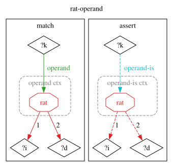
<!-- /rule -->

#### `rat-operand-check`

<!-- rule std.math.rat rat-operand-check -->
```lisp
(rule rat-operand-check ()
  :match  (operand-is (rat-of ?k) (rat (int ?p ?n) ?d))
  :assert (cmp-run (rat-den ?k ?p ?n ?d) ?d z eq)
  :why    "the operand is {?p} less {?n}, over {?d}: is the denominator zero?")
```

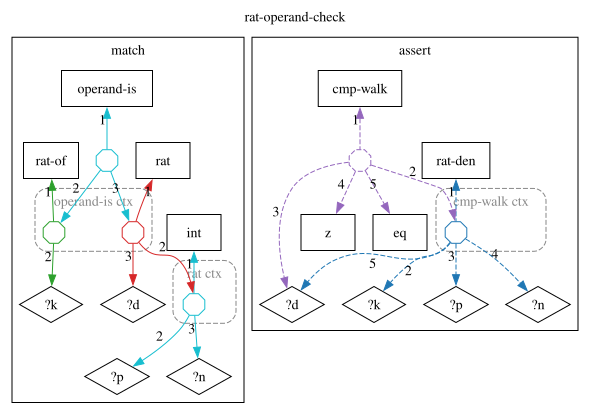
<!-- /rule -->

#### `rat-operand-found`

<!-- rule std.math.rat rat-operand-found -->
```lisp
(rule rat-operand-found ()
  :match  (order-is (rat-den ?k ?p ?n ?d) gt)
  :assert (rat-operand-is ?k ?p ?n ?d)
  :why    "the denominator {?d} is not zero")
```

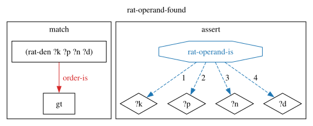
<!-- /rule -->

#### `rat-operand-zero`

<!-- rule std.math.rat rat-operand-zero -->
```lisp
(rule rat-operand-zero ()
  :match  (order-is (rat-den ?k ?p ?n ?d) eq)
  :assert (rat-zero-den ?k)
  :why    "the denominator {?d} is zero")
```

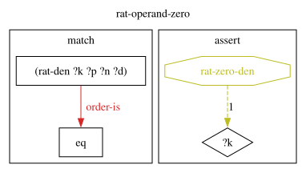
<!-- /rule -->

#### `rat-operand-second`

<!-- rule std.math.rat rat-operand-second -->
```lisp
(rule rat-operand-second ()
  :match  (rat-operand-is (rat-first ?k ?y) ?p ?n ?d)
  :assert (operand (rat-of (rat-second ?k ?p ?n ?d)) ?y)
  :why    "the first operand is {?p} less {?n}, over {?d}: now the rational {?y} stands for")
```

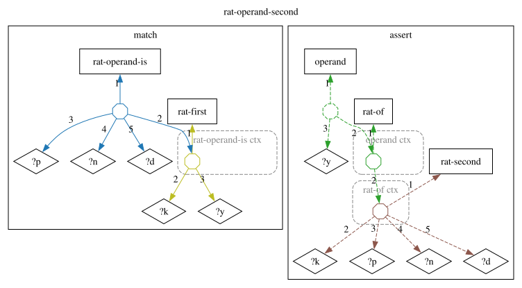
<!-- /rule -->

#### `rat-check-ask`

The rational an operand stands for is asked for its check, `(rat-check Q)`, once whatever reads it
([Q-M1f.404](../../../../decisions/stdlib/math/Q-M1f.404-a-numeral-is-checked-where-an-operation-takes-it.md)).

<!-- rule std.math.rat rat-check-ask -->
```lisp
(rule rat-check-ask ()
  :match  (operand-is ?k (rat ?i ?d))
  :assert (rat-check (rat ?i ?d))
  :why    "the operand found for {?k} is {?i} over {?d}: it is checked, once, as a rational")
```

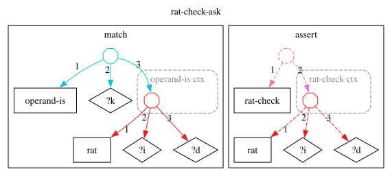
<!-- /rule -->

### A zero denominator

The flag is `std.math.arith`'s `division-by-zero`, on the request.

#### `rat-zero-only`

<!-- rule std.math.rat rat-zero-only -->
```lisp
(rule rat-zero-only ()
  :match  (rat-zero-den (rat-only ?request))
  :assert (division-by-zero ?request)
  :why    "the operand of {?request} has a denominator of zero")
```

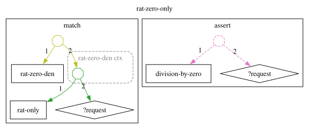
<!-- /rule -->

#### `rat-zero-first`

<!-- rule std.math.rat rat-zero-first -->
```lisp
(rule rat-zero-first ()
  :match  (rat-zero-den (rat-first ?request ?y))
  :assert (division-by-zero ?request)
  :why    "the first operand of {?request} has a denominator of zero")
```

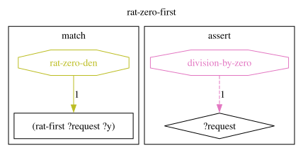
<!-- /rule -->

#### `rat-zero-second`

<!-- rule std.math.rat rat-zero-second -->
```lisp
(rule rat-zero-second ()
  :match  (rat-zero-den (rat-second ?request ?p ?n ?d))
  :assert (division-by-zero ?request)
  :why    "the second operand of {?request} has a denominator of zero")
```

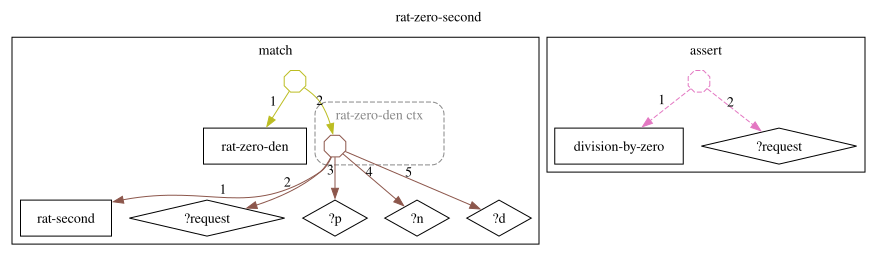
<!-- /rule -->

### A call: what it is handed checked, then handed on

The three calls are an interface
([Q-M1f.189](../../../../decisions/stdlib/math/Q-M1f.189-the-decimal-arithmetics-tagged-calls-are.md)): a module
over this one, or a rule of a program's own, asks `(rat-norm TAG P N D)`, `(rat-mul-call TAG P1 N1 D1 P2 N2 D2)` or
`(rat-cross …)`. A part an operation made from valid numbers is valid as it was made, and every other one is
checked, whoever made the call
([Q-M1f.404](../../../../decisions/stdlib/math/Q-M1f.404-a-numeral-is-checked-where-an-operation-takes-it.md)):
each rule asks `(rat-check (rat (int P N) D))` of each rational its parts make, [below](#a-rationals-own-shape),
and hands the call on to the module's own computation, `rat-norm-run`, `rat-mul-run` or `rat-cross-run`, which
checks nothing and which the module calls itself.

#### `rat-norm-runs`

<!-- rule std.math.rat rat-norm-runs -->
```lisp
(rule rat-norm-runs ()
  :match  (rat-norm ?k ?p ?n ?d)
  :assert (and (rat-norm-run ?k ?p ?n ?d) (rat-check (rat (int ?p ?n) ?d)))
  :why    "{?p} less {?n}, over {?d}, is called for {?k}: it is checked as a rational, and its numerator simplified")
```

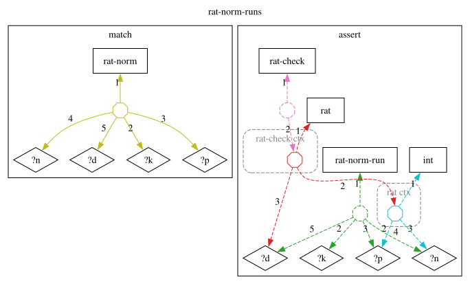
<!-- /rule -->

#### `rat-mul-call-runs`

<!-- rule std.math.rat rat-mul-call-runs -->
```lisp
(rule rat-mul-call-runs ()
  :match  (rat-mul-call ?k ?p ?n ?d ?q ?m ?e)
  :assert (and (rat-mul-run ?k ?p ?n ?d ?q ?m ?e)
               (rat-check (rat (int ?p ?n) ?d)) (rat-check (rat (int ?q ?m) ?e)))
  :why    "{?p} less {?n} over {?d}, times {?q} less {?m} over {?e}, is called for {?k}: each is checked as a rational, and multiplied")
```

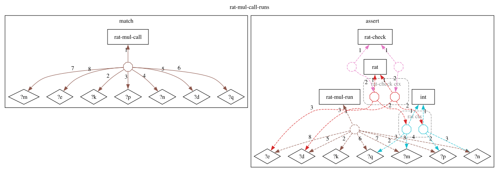
<!-- /rule -->

#### `rat-cross-runs`

<!-- rule std.math.rat rat-cross-runs -->
```lisp
(rule rat-cross-runs ()
  :match  (rat-cross ?k ?p ?n ?d ?q ?m ?e)
  :assert (and (rat-cross-run ?k ?p ?n ?d ?q ?m ?e)
               (rat-check (rat (int ?p ?n) ?d)) (rat-check (rat (int ?q ?m) ?e)))
  :why    "the cross products of {?p} less {?n} over {?d} and {?q} less {?m} over {?e} are called for {?k}: each is checked as a rational, and crossed")
```

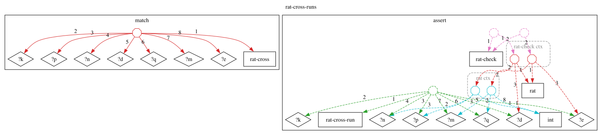
<!-- /rule -->

### An answer, not reduced

The numerator in the integers' normal form, the denominator with no high zero, and nothing divided.

#### `rat-norm-numerator`

<!-- rule std.math.rat rat-norm-numerator -->
```lisp
(rule rat-norm-numerator ()
  :match  (rat-norm-run ?k ?p ?n ?d)
  :assert (int-norm-run (rat-num ?k ?d) ?p ?n)
  :why    "first the numerator, {?p} less {?n}, simplified")
```

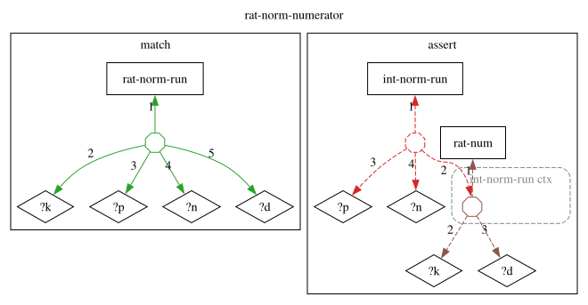
<!-- /rule -->

#### `rat-norm-denominator`

<!-- rule std.math.rat rat-norm-denominator -->
```lisp
(rule rat-norm-denominator ()
  :match  (int-done (rat-num ?k ?d) ?i)
  :assert (add-run (rat-den-norm ?k ?i) ?d z 0 z)
  :why    "the numerator is {?i}: now {?d} with no high zero")
```

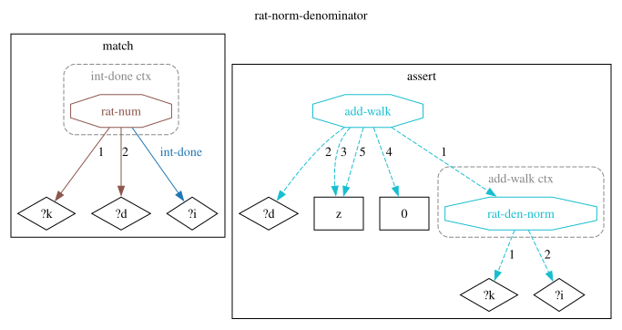
<!-- /rule -->

#### `rat-norm-done`

<!-- rule std.math.rat rat-norm-done -->
```lisp
(rule rat-norm-done ()
  :match  (done (rat-den-norm ?k ?i) ?e)
  :assert (rat-done ?k (rat ?i ?e))
  :why    "{?i} over {?e}, not reduced")
```

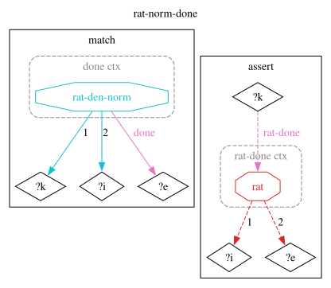
<!-- /rule -->

### Lowest terms, on request

$$
\begin{aligned}
\frac{a}{d} &= \frac{a / g}{d / g} \\
g &= \gcd(\lvert a \rvert, d)
\end{aligned}
$$

The greatest common divisor is `std.math.gcd`'s tagged call, and the two quotients are the natural numbers'
divisions.

#### `rat-simplify-pos`

<!-- rule std.math.rat rat-simplify-pos -->
```lisp
(rule rat-simplify-pos ()
  :match  (int-done (rat-low ?k ?d) (int ?a z))
  :assert (gcd-run (rat-g ?k pos ?a ?d) ?a ?d)
  :why    "the numerator is not negative: the greatest common divisor of {?a} and {?d}")
```

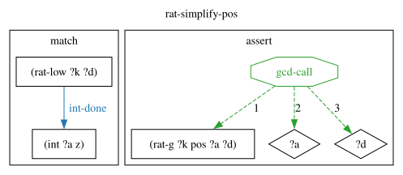
<!-- /rule -->

#### `rat-simplify-neg`

<!-- rule std.math.rat rat-simplify-neg -->
```lisp
(rule rat-simplify-neg ()
  :match  (int-done (rat-low ?k ?d) (int z (n ?b ?c)))
  :assert (gcd-run (rat-g ?k neg (n ?b ?c) ?d) (n ?b ?c) ?d)
  :why    "the numerator is negative: the greatest common divisor of its size and {?d}")
```

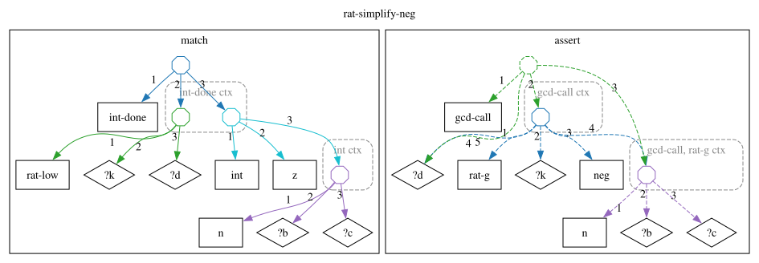
<!-- /rule -->

#### `rat-lowest-numerator`

<!-- rule std.math.rat rat-lowest-numerator -->
```lisp
(rule rat-lowest-numerator ()
  :match  (gcd-done (rat-g ?k ?s ?a ?d) ?g)
  :assert (div-run (rat-q-num ?k ?s ?d ?g) ?a ?g)
  :why    "the common divisor is {?g}: divide the numerator's size, {?a}, by it")
```

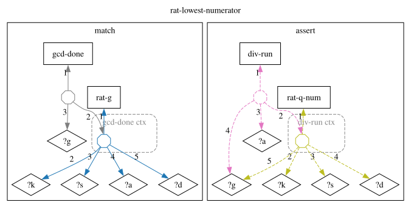
<!-- /rule -->

#### `rat-lowest-denominator`

<!-- rule std.math.rat rat-lowest-denominator -->
```lisp
(rule rat-lowest-denominator ()
  :match  (div-done (rat-q-num ?k ?s ?d ?g) ?q ?r)
  :assert (div-run (rat-q-den ?k ?s ?q) ?d ?g)
  :why    "that makes {?q}: divide the denominator, {?d}, by {?g}")
```

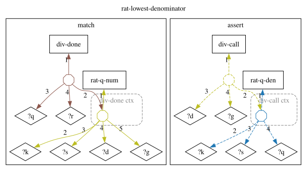
<!-- /rule -->

#### `rat-lowest-pos`

<!-- rule std.math.rat rat-lowest-pos -->
```lisp
(rule rat-lowest-pos ()
  :match  (div-done (rat-q-den ?k pos ?q) ?e ?r)
  :assert (rat-done ?k (rat (int ?q z) ?e))
  :why    "in lowest terms: {?q} over {?e}")
```

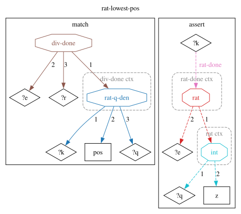
<!-- /rule -->

#### `rat-lowest-neg`

<!-- rule std.math.rat rat-lowest-neg -->
```lisp
(rule rat-lowest-neg ()
  :match  (div-done (rat-q-den ?k neg ?q) ?e ?r)
  :assert (rat-done ?k (rat (int z ?q) ?e))
  :why    "in lowest terms: {?q} over {?e}, negative")
```

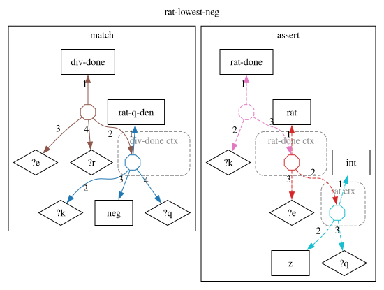
<!-- /rule -->

### The cross products

For $(P_1 - N_1)/D_1$ and $(P_2 - N_2)/D_2$, the numerator of the sum, as a positive and a negative part:

$$
(P_1 D_2 + P_2 D_1) - (N_1 D_2 + N_2 D_1)
$$

Four products and two sums of natural numbers. A sum, a difference and a comparison all read them.

#### `rat-cross-first`

<!-- rule std.math.rat rat-cross-first -->
```lisp
(rule rat-cross-first ()
  :match  (rat-cross-run ?k ?p ?n ?d ?q ?m ?e)
  :assert (mul-run (rat-x1 ?k ?n ?d ?q ?m ?e) ?p ?e)
  :why    "the first cross product: {?p} x {?e}")
```

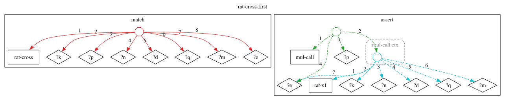
<!-- /rule -->

#### `rat-cross-second`

<!-- rule std.math.rat rat-cross-second -->
```lisp
(rule rat-cross-second ()
  :match  (done (rat-x1 ?k ?n ?d ?q ?m ?e) ?a)
  :assert (mul-run (rat-x2 ?k ?n ?d ?m ?e ?a) ?q ?d)
  :why    "that makes {?a}: the second, {?q} x {?d}")
```

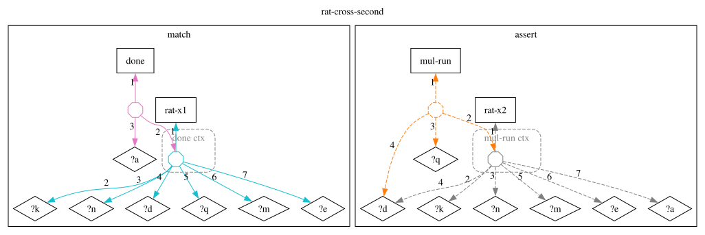
<!-- /rule -->

#### `rat-cross-plus`

<!-- rule std.math.rat rat-cross-plus -->
```lisp
(rule rat-cross-plus ()
  :match  (done (rat-x2 ?k ?n ?d ?m ?e ?a) ?b)
  :assert (add-run (rat-x3 ?k ?n ?d ?m ?e) ?a ?b 0 z)
  :why    "that makes {?b}: the positive part is {?a} + {?b}")
```

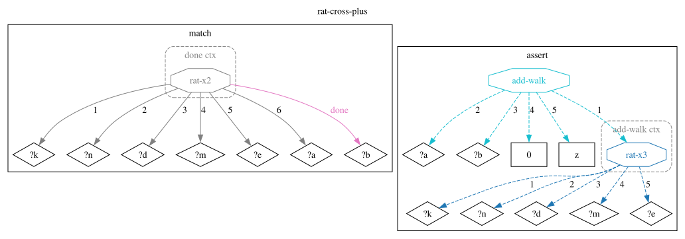
<!-- /rule -->

#### `rat-cross-third`

<!-- rule std.math.rat rat-cross-third -->
```lisp
(rule rat-cross-third ()
  :match  (done (rat-x3 ?k ?n ?d ?m ?e) ?s)
  :assert (mul-run (rat-x4 ?k ?d ?m ?s) ?n ?e)
  :why    "the positive part is {?s}: the third cross product, {?n} x {?e}")
```

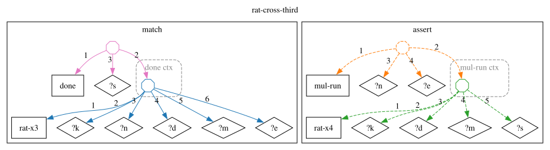
<!-- /rule -->

#### `rat-cross-fourth`

<!-- rule std.math.rat rat-cross-fourth -->
```lisp
(rule rat-cross-fourth ()
  :match  (done (rat-x4 ?k ?d ?m ?s) ?a)
  :assert (mul-run (rat-x5 ?k ?s ?a) ?m ?d)
  :why    "that makes {?a}: the fourth, {?m} x {?d}")
```

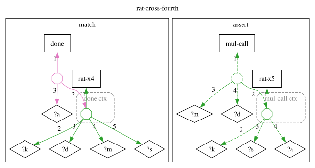
<!-- /rule -->

#### `rat-cross-minus`

<!-- rule std.math.rat rat-cross-minus -->
```lisp
(rule rat-cross-minus ()
  :match  (done (rat-x5 ?k ?s ?a) ?b)
  :assert (add-run (rat-x6 ?k ?s) ?a ?b 0 z)
  :why    "that makes {?b}: the negative part is {?a} + {?b}")
```

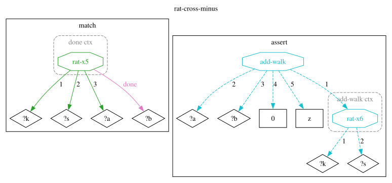
<!-- /rule -->

#### `rat-cross-end`

<!-- rule std.math.rat rat-cross-end -->
```lisp
(rule rat-cross-end ()
  :match  (done (rat-x6 ?k ?s) ?t)
  :assert (rat-cross-is ?k ?s ?t)
  :why    "the cross products make {?s} less {?t}")
```

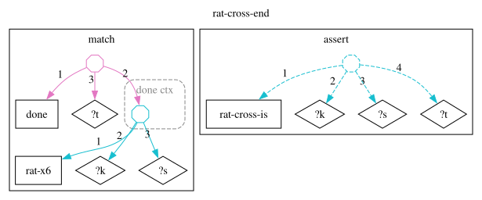
<!-- /rule -->

### Simplification, and negation

#### `rat-simplify-ask`

<!-- rule std.math.rat rat-simplify-ask -->
```lisp
(rule rat-simplify-ask ()
  :match  (rat-simplify ?x)
  :assert (operand (rat-of (rat-only (rat-simplify ?x))) ?x)
  :why    "{?x} in lowest terms is asked: first, the rational {?x} stands for")
```

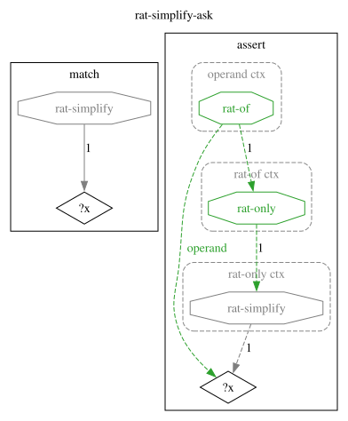
<!-- /rule -->

#### `rat-simplify-start`

<!-- rule std.math.rat rat-simplify-start -->
```lisp
(rule rat-simplify-start ()
  :match  (rat-operand-is (rat-only (rat-simplify ?x)) ?p ?n ?d)
  :assert (int-norm-run (rat-low (rat-simplify ?x) ?d) ?p ?n)
  :why    "{?p} less {?n}, over {?d}, in lowest terms: first the numerator, simplified")
```

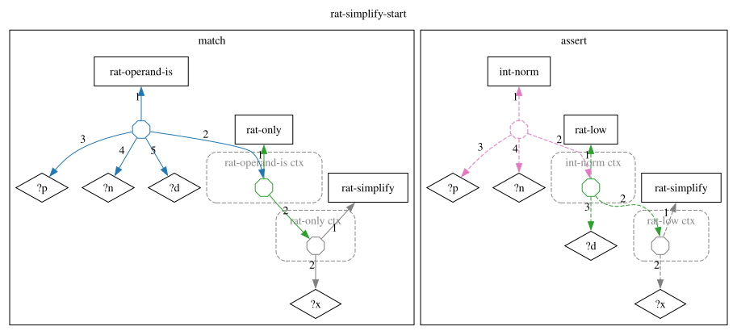
<!-- /rule -->

#### `rat-simplify-answer`

<!-- rule std.math.rat rat-simplify-answer -->
```lisp
(rule rat-simplify-answer ()
  :match  (rat-done (rat-simplify ?x) ?s)
  :assert (rat-simple-of ?x ?s)
  :why    "{?x} is {?s}")
```

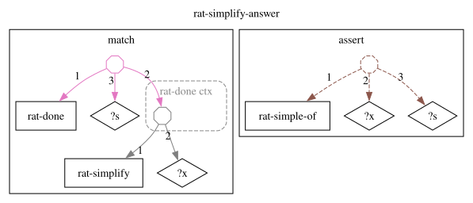
<!-- /rule -->

#### `rat-neg-ask`

<!-- rule std.math.rat rat-neg-ask -->
```lisp
(rule rat-neg-ask ()
  :match  (rat-neg ?x)
  :assert (operand (rat-of (rat-only (rat-neg ?x))) ?x)
  :why    "{?x} negated is asked: first, the rational {?x} stands for")
```

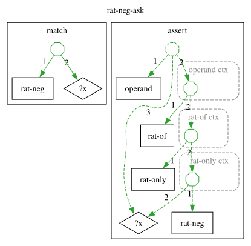
<!-- /rule -->

#### `rat-neg-start`

<!-- rule std.math.rat rat-neg-start -->
```lisp
(rule rat-neg-start ()
  :match  (rat-operand-is (rat-only (rat-neg ?x)) ?p ?n ?d)
  :assert (rat-norm-run (rat-neg ?x) ?n ?p ?d)
  :why    "the numerator's parts change places: {?n} less {?p}, over {?d}")
```

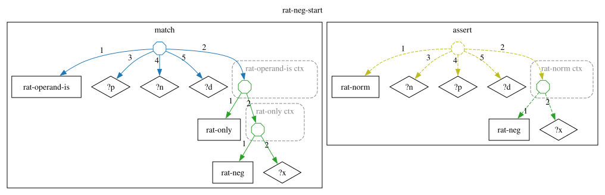
<!-- /rule -->

#### `rat-neg-answer`

<!-- rule std.math.rat rat-neg-answer -->
```lisp
(rule rat-neg-answer ()
  :match  (rat-done (rat-neg ?x) ?s)
  :assert (rat-neg-of ?x ?s)
  :why    "{?x} negated is {?s}")
```

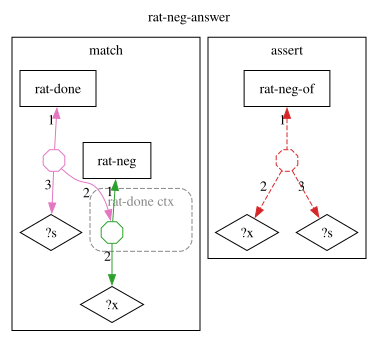
<!-- /rule -->

### Addition, and subtraction

The cross products over the product of the denominators. A subtraction is the addition of the second operand
with its numerator's parts exchanged.

#### `rat-sum-denominator`

<!-- rule std.math.rat rat-sum-denominator -->
```lisp
(rule rat-sum-denominator ()
  :match  (rat-cross-is (rat-sum-num ?k ?d ?e) ?s ?t)
  :assert (mul-run (rat-sum-den ?k ?s ?t) ?d ?e)
  :why    "the numerator is {?s} less {?t}: the denominator is {?d} x {?e}")
```

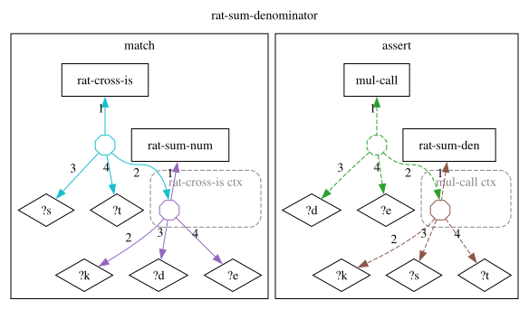
<!-- /rule -->

#### `rat-sum-norm`

<!-- rule std.math.rat rat-sum-norm -->
```lisp
(rule rat-sum-norm ()
  :match  (done (rat-sum-den ?k ?s ?t) ?f)
  :assert (rat-norm-run ?k ?s ?t ?f)
  :why    "the denominator is {?f}: now the numerator, {?s} less {?t}, simplified")
```

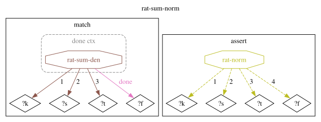
<!-- /rule -->

#### `rat-add-ask`

<!-- rule std.math.rat rat-add-ask -->
```lisp
(rule rat-add-ask ()
  :match  (rat-add ?x ?y)
  :assert (operand (rat-of (rat-first (rat-add ?x ?y) ?y)) ?x)
  :why    "{?x} + {?y} is asked: first, the rational {?x} stands for")
```

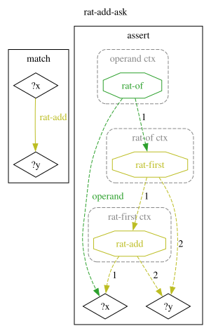
<!-- /rule -->

#### `rat-add-start`

<!-- rule std.math.rat rat-add-start -->
```lisp
(rule rat-add-start ()
  :match  (rat-operand-is (rat-second (rat-add ?x ?y) ?p ?n ?d) ?q ?m ?e)
  :assert (rat-cross-run (rat-sum-num (rat-add ?x ?y) ?d ?e) ?p ?n ?d ?q ?m ?e)
  :why    "add {?p} less {?n} over {?d} and {?q} less {?m} over {?e}: first the cross products")
```

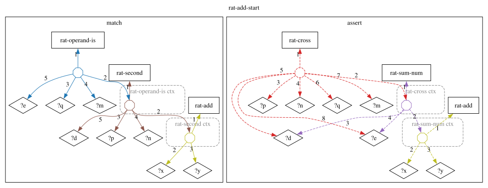
<!-- /rule -->

#### `rat-add-answer`

<!-- rule std.math.rat rat-add-answer -->
```lisp
(rule rat-add-answer ()
  :match  (rat-done (rat-add ?x ?y) ?s)
  :assert (rat-sum-of ?x ?y ?s)
  :why    "{?x} + {?y} = {?s}")
```

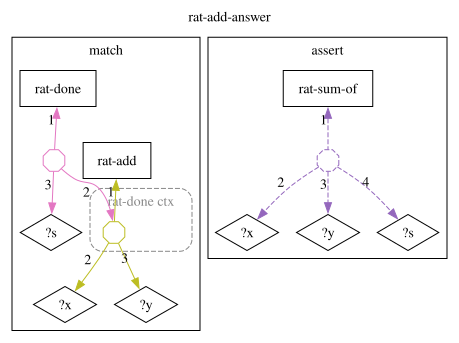
<!-- /rule -->

#### `rat-sub-ask`

<!-- rule std.math.rat rat-sub-ask -->
```lisp
(rule rat-sub-ask ()
  :match  (rat-sub ?x ?y)
  :assert (operand (rat-of (rat-first (rat-sub ?x ?y) ?y)) ?x)
  :why    "{?x} - {?y} is asked: first, the rational {?x} stands for")
```

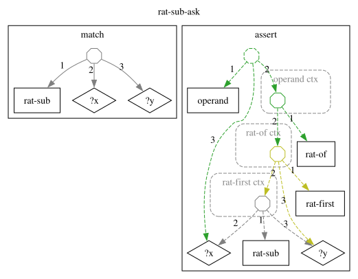
<!-- /rule -->

#### `rat-sub-start`

<!-- rule std.math.rat rat-sub-start -->
```lisp
(rule rat-sub-start ()
  :match  (rat-operand-is (rat-second (rat-sub ?x ?y) ?p ?n ?d) ?q ?m ?e)
  :assert (rat-cross-run (rat-sum-num (rat-sub ?x ?y) ?d ?e) ?p ?n ?d ?m ?q ?e)
  :why    "to take {?q} less {?m} over {?e} away, add {?m} less {?q} over {?e}")
```

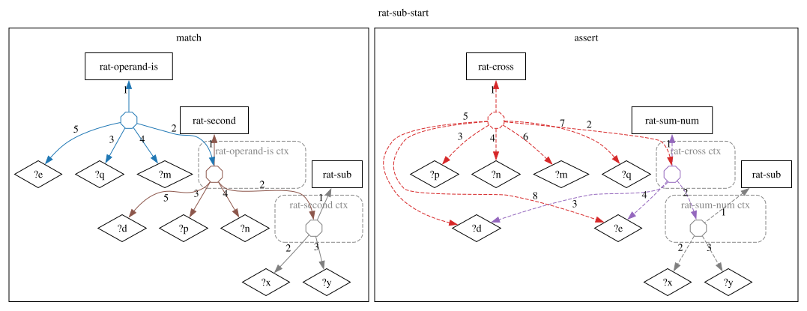
<!-- /rule -->

#### `rat-sub-answer`

<!-- rule std.math.rat rat-sub-answer -->
```lisp
(rule rat-sub-answer ()
  :match  (rat-done (rat-sub ?x ?y) ?s)
  :assert (rat-diff-of ?x ?y ?s)
  :why    "{?x} - {?y} = {?s}")
```

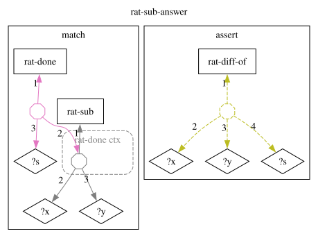
<!-- /rule -->

### Comparison

Since no denominator is negative, the order of two rationals is the order of the two parts of their difference's
numerator, one comparison walk. Nothing is reduced for it.

#### `rat-cmp-sides`

<!-- rule std.math.rat rat-cmp-sides -->
```lisp
(rule rat-cmp-sides ()
  :match  (rat-cross-is (rat-cmp-num ?k) ?s ?t)
  :assert (cmp-run ?k ?s ?t eq)
  :why    "compare {?s} with {?t}")
```

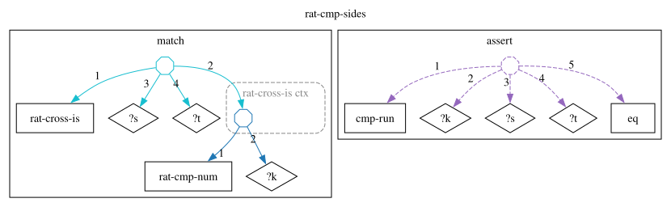
<!-- /rule -->

#### `rat-cmp-ask`

<!-- rule std.math.rat rat-cmp-ask -->
```lisp
(rule rat-cmp-ask ()
  :match  (rat-cmp ?x ?y)
  :assert (operand (rat-of (rat-first (rat-cmp ?x ?y) ?y)) ?x)
  :why    "{?x} compared with {?y} is asked: first, the rational {?x} stands for")
```

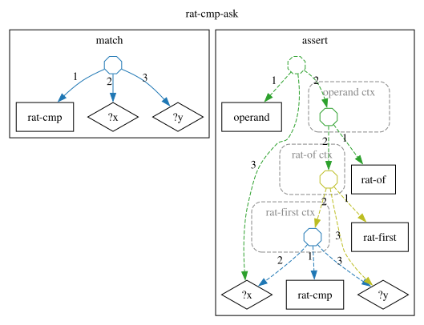
<!-- /rule -->

#### `rat-cmp-start`

<!-- rule std.math.rat rat-cmp-start -->
```lisp
(rule rat-cmp-start ()
  :match  (rat-operand-is (rat-second (rat-cmp ?x ?y) ?p ?n ?d) ?q ?m ?e)
  :assert (rat-cross-run (rat-cmp-num (rat-cmp ?x ?y)) ?p ?n ?d ?m ?q ?e)
  :why    "compare {?p} less {?n} over {?d} with {?q} less {?m} over {?e}: the cross products of their difference")
```

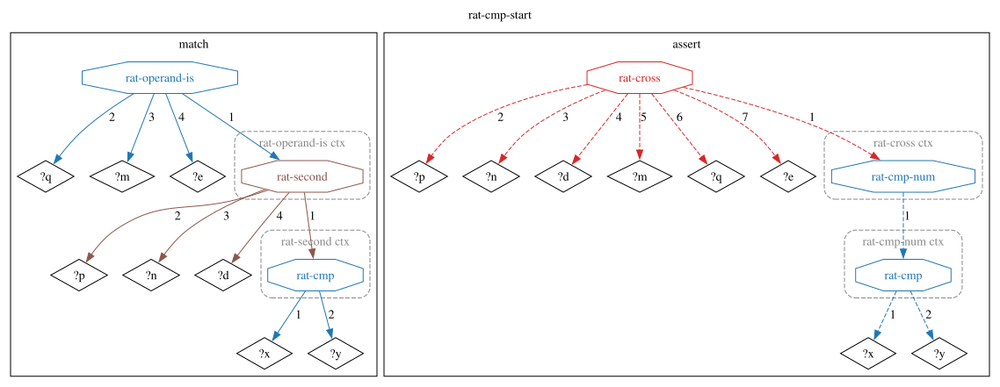
<!-- /rule -->

#### `rat-cmp-answer`

<!-- rule std.math.rat rat-cmp-answer -->
```lisp
(rule rat-cmp-answer ()
  :match  (order-is (rat-cmp ?x ?y) ?o)
  :assert (rat-cmp-of ?x ?y ?o)
  :why    "{?x} against {?y}: {?o}")
```

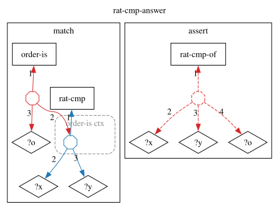
<!-- /rule -->

### Multiplication

The numerators' product, an integer product, over the denominators' product.

#### `rat-mul-numerator`

<!-- rule std.math.rat rat-mul-numerator -->
```lisp
(rule rat-mul-numerator ()
  :match  (rat-mul-run ?k ?p ?n ?d ?q ?m ?e)
  :assert (int-mul-run (rat-mul-num ?k ?d ?e) ?p ?n ?q ?m)
  :why    "first the numerators: {?p} less {?n}, times {?q} less {?m}")
```

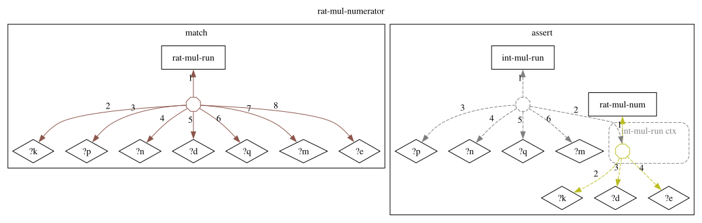
<!-- /rule -->

#### `rat-mul-denominator`

<!-- rule std.math.rat rat-mul-denominator -->
```lisp
(rule rat-mul-denominator ()
  :match  (int-done (rat-mul-num ?k ?d ?e) ?i)
  :assert (mul-run (rat-mul-den ?k ?i) ?d ?e)
  :why    "the numerator is {?i}: the denominator is {?d} x {?e}")
```

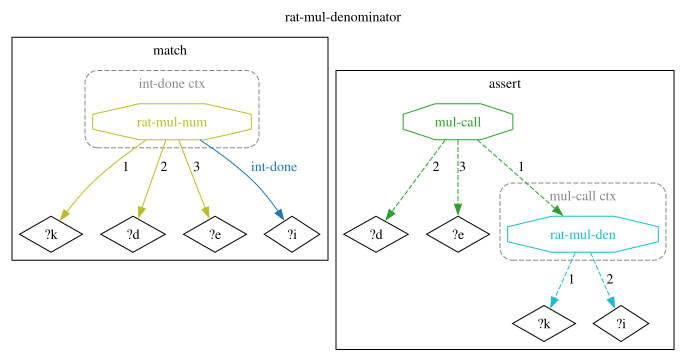
<!-- /rule -->

#### `rat-mul-done`

<!-- rule std.math.rat rat-mul-done -->
```lisp
(rule rat-mul-done ()
  :match  (done (rat-mul-den ?k ?i) ?f)
  :assert (rat-done ?k (rat ?i ?f))
  :why    "the denominator is {?f}: {?i} over {?f}, not reduced")
```

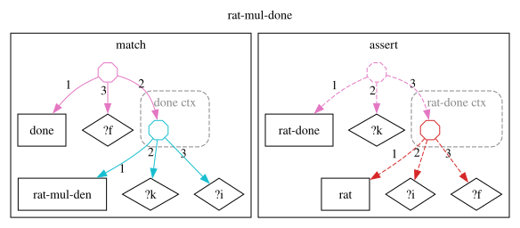
<!-- /rule -->

#### `rat-mul-ask`

<!-- rule std.math.rat rat-mul-ask -->
```lisp
(rule rat-mul-ask ()
  :match  (rat-mul ?x ?y)
  :assert (operand (rat-of (rat-first (rat-mul ?x ?y) ?y)) ?x)
  :why    "{?x} x {?y} is asked: first, the rational {?x} stands for")
```

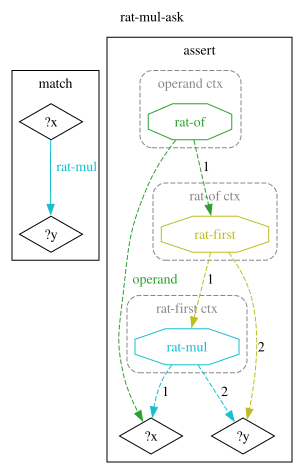
<!-- /rule -->

#### `rat-mul-start`

<!-- rule std.math.rat rat-mul-start -->
```lisp
(rule rat-mul-start ()
  :match  (rat-operand-is (rat-second (rat-mul ?x ?y) ?p ?n ?d) ?q ?m ?e)
  :assert (rat-mul-run (rat-mul ?x ?y) ?p ?n ?d ?q ?m ?e)
  :why    "multiply {?p} less {?n} over {?d} by {?q} less {?m} over {?e}")
```


<!-- /rule -->

#### `rat-mul-answer`

<!-- rule std.math.rat rat-mul-answer -->
```lisp
(rule rat-mul-answer ()
  :match  (rat-done (rat-mul ?x ?y) ?s)
  :assert (rat-product-of ?x ?y ?s)
  :why    "{?x} x {?y} = {?s}")
```


<!-- /rule -->

### Division

A multiplication by the divisor turned over, its sign kept in the numerator. A divisor whose numerator is zero is
flagged.

#### `rat-div-ask`

<!-- rule std.math.rat rat-div-ask -->
```lisp
(rule rat-div-ask ()
  :match  (rat-div ?x ?y)
  :assert (operand (rat-of (rat-first (rat-div ?x ?y) ?y)) ?x)
  :why    "{?x} divided by {?y} is asked: first, the rational {?x} stands for")
```


<!-- /rule -->

#### `rat-div-start`

<!-- rule std.math.rat rat-div-start -->
```lisp
(rule rat-div-start ()
  :match  (rat-operand-is (rat-second (rat-div ?x ?y) ?p ?n ?d) ?q ?m ?e)
  :assert (int-norm-run (rat-div-by (rat-div ?x ?y) ?p ?n ?d ?e) ?q ?m)
  :why    "to divide by {?q} less {?m} over {?e}: first its numerator, simplified")
```


<!-- /rule -->

#### `rat-div-pos`

<!-- rule std.math.rat rat-div-pos -->
```lisp
(rule rat-div-pos ()
  :match  (int-done (rat-div-by ?k ?p ?n ?d ?e) (int (n ?a ?b) z))
  :assert (rat-mul-run ?k ?p ?n ?d ?e z (n ?a ?b))
  :why    "the divisor is positive: multiply by {?e} over {?a}{?b}")
```


<!-- /rule -->

#### `rat-div-neg`

<!-- rule std.math.rat rat-div-neg -->
```lisp
(rule rat-div-neg ()
  :match  (int-done (rat-div-by ?k ?p ?n ?d ?e) (int z (n ?a ?b)))
  :assert (rat-mul-run ?k ?p ?n ?d z ?e (n ?a ?b))
  :why    "the divisor is negative: multiply by {?e} negated, over {?a}{?b}")
```


<!-- /rule -->

#### `rat-div-zero`

<!-- rule std.math.rat rat-div-zero -->
```lisp
(rule rat-div-zero ()
  :match  (int-done (rat-div-by ?request ?p ?n ?d ?e) (int z z))
  :assert (division-by-zero ?request)
  :why    "the divisor of {?request} is zero")
```


<!-- /rule -->

#### `rat-div-answer`

<!-- rule std.math.rat rat-div-answer -->
```lisp
(rule rat-div-answer ()
  :match  (rat-done (rat-div ?x ?y) ?s)
  :assert (rat-quot-of ?x ?y ?s)
  :why    "{?x} divided by {?y} = {?s}")
```


<!-- /rule -->

### An operand's faults

The rules that carry a fault found below from this module's tags to the request.

#### `rat-bad-only`

<!-- rule std.math.rat rat-bad-only -->
```lisp
(rule rat-bad-only ()
  :match  (bad-operand (rat-of (rat-only ?request)) ?f)
  :assert (bad-request ?request ?f)
  :why    "the operand of {?request} is at fault: {?f}")
```


<!-- /rule -->

#### `rat-bad-first`

<!-- rule std.math.rat rat-bad-first -->
```lisp
(rule rat-bad-first ()
  :match  (bad-operand (rat-of (rat-first ?request ?y)) ?f)
  :assert (bad-request ?request ?f)
  :why    "the first operand of {?request} is at fault: {?f}")
```


<!-- /rule -->

#### `rat-bad-second`

<!-- rule std.math.rat rat-bad-second -->
```lisp
(rule rat-bad-second ()
  :match  (bad-operand (rat-of (rat-second ?request ?p ?n ?d)) ?f)
  :assert (bad-request ?request ?f)
  :why    "the second operand of {?request} is at fault: {?f}")
```


<!-- /rule -->

### A rational's own shape

A digit or a named constant where the integer or the denominator goes, checked where an operation takes the
rational or a call is handed its parts: each rule reads `(rat-check (rat Z D))`. **A rational built from invalid
integers is invalid**: `rat-check-z` asks `std.math.int`'s check of an integer numerator and `rat-check-d`
`std.math.decimal`'s of a denominator that is a numeral, a rule a shape. **A rational built from something else
verifies it as an operation verifies its operands**: `rat-check-z-natural` asks `std.math.decimal`'s check of a
numerator that is a natural number, which the operations then answer by silence
([Q-M1f.277](../../../../decisions/stdlib/math/Q-M1f.277-an-operand-of-another-kind-of-number-is-answered.md)),
so a malformed one is flagged
([Q-M1f.404](../../../../decisions/stdlib/math/Q-M1f.404-a-numeral-is-checked-where-an-operation-takes-it.md)).

#### `rat-check-z`

<!-- rule std.math.rat rat-check-z -->
```lisp
(rule rat-check-z ()
  :match  (rat-check (rat (int ?p ?n) ?d))
  :assert (int-check (int ?p ?n))
  :why    "the numerator of {?p} less {?n}, over {?d}, is checked as an integer")
```


<!-- /rule -->

#### `rat-check-z-natural`

<!-- rule std.math.rat rat-check-z-natural -->
```lisp
(rule rat-check-z-natural ()
  :match  (rat-check (rat (n ?q ?a) ?d))
  :assert (check (n ?q ?a) (n ?q ?a))
  :why    "the numerator (n {?q} {?a}) over {?d} is a natural number: it is checked as a number")
```


<!-- /rule -->

#### `rat-check-d`

<!-- rule std.math.rat rat-check-d -->
```lisp
(rule rat-check-d ()
  :match  (rat-check (rat ?i (n ?q ?a)))
  :assert (check (n ?q ?a) (n ?q ?a))
  :why    "the denominator of {?i} over (n {?q} {?a}) is checked as a number")
```


<!-- /rule -->

#### `rat-z-digit`

<!-- rule std.math.rat rat-z-digit -->
```lisp
(rule rat-z-digit ()
  :match  (and (rat-check (rat ?x ?d)) (nz ?x))
  :assert (not-rational (rat ?x ?d) ?x)
  :why    "the digit {?x} stands where an integer goes: it is (int (n z {?x}) z)")
```


<!-- /rule -->

#### `rat-z-zero`

<!-- rule std.math.rat rat-z-zero -->
```lisp
(rule rat-z-zero ()
  :match  (rat-check (rat 0 ?d))
  :assert (not-rational (rat 0 ?d) 0)
  :why    "the digit 0 stands where an integer goes: zero is (int z z)")
```


<!-- /rule -->

#### `rat-z-named`

<!-- rule std.math.rat rat-z-named -->
```lisp
(rule rat-z-named ()
  :match  (and (rat-check (rat ?x ?d)) (named ?x))
  :assert (not-rational (rat ?x ?d) ?x)
  :why    "the name {?x} stands where an integer goes: a name stands for a number as an operand, not inside one")
```


<!-- /rule -->

#### `rat-d-digit`

<!-- rule std.math.rat rat-d-digit -->
```lisp
(rule rat-d-digit ()
  :match  (and (rat-check (rat ?i ?x)) (nz ?x))
  :assert (not-rational (rat ?i ?x) ?x)
  :why    "the digit {?x} stands where a natural number goes: it is (n z {?x})")
```


<!-- /rule -->

#### `rat-d-zero`

<!-- rule std.math.rat rat-d-zero -->
```lisp
(rule rat-d-zero ()
  :match  (rat-check (rat ?i 0))
  :assert (not-rational (rat ?i 0) 0)
  :why    "the digit 0 stands where a natural number goes: zero is z")
```


<!-- /rule -->

#### `rat-d-named`

<!-- rule std.math.rat rat-d-named -->
```lisp
(rule rat-d-named ()
  :match  (and (rat-check (rat ?i ?x)) (named ?x))
  :assert (not-rational (rat ?i ?x) ?x)
  :why    "the name {?x} stands where a natural number goes: a name stands for a number as an operand, not inside one")
```


<!-- /rule -->

#### `not-rational-is-false`

<!-- rule std.math.rat not-rational-is-false -->
```lisp
(rule not-rational-is-false ()
  :match  (not-rational ?x ?thing)
  :assert (false)
  :why    "{?x} is not a rational: the program cannot hold it")
```


<!-- /rule -->

### The entry

The closing rule: it closes the held extent of every relation of the module, names each rule above, and names the entries
`int-arith`, `decimal-arith`, `decimal`, `arith` and `gcd`. Its drawing is not shown.

#### `rat-arith`

<!-- rule std.math.rat rat-arith -->
```lisp
(rule rat-arith ()
  :match  ()
  :assert (and (__closed__ rat) (__closed__ nz) (__closed__ rat-check)
               (__closed__ not-rational)
               (__closed__ rat-simplify)
               (__closed__ rat-simple-of) (__closed__ rat-neg)
               (__closed__ rat-neg-of) (__closed__ rat-add)
               (__closed__ rat-sum-of) (__closed__ rat-sub)
               (__closed__ rat-diff-of) (__closed__ rat-mul)
               (__closed__ rat-product-of) (__closed__ rat-div)
               (__closed__ rat-quot-of) (__closed__ rat-cmp)
               (__closed__ rat-cmp-of) (__closed__ rat-operand-is)
               (__closed__ rat-zero-den) (__closed__ rat-cross)
               (__closed__ rat-cross-is) (__closed__ rat-mul-call)
               (__closed__ rat-norm) (__closed__ rat-norm-run)
               (__closed__ rat-mul-run) (__closed__ rat-cross-run)
               (__closed__ rat-done) (__closed__ rat-of) (__closed__ rat-den)
               (__closed__ rat-only) (__closed__ rat-first)
               (__closed__ rat-second) (__closed__ rat-x1)
               (__closed__ rat-x2) (__closed__ rat-x3) (__closed__ rat-x4)
               (__closed__ rat-x5) (__closed__ rat-x6)
               (__closed__ rat-sum-num) (__closed__ rat-sum-den)
               (__closed__ rat-cmp-num) (__closed__ rat-mul-num)
               (__closed__ rat-mul-den) (__closed__ rat-div-by)
               (__closed__ rat-num) (__closed__ rat-den-norm)
               (__closed__ rat-low) (__closed__ rat-g) (__closed__ rat-q-num)
               (__closed__ rat-q-den) (__closed__ rat-rule) (rat-rule decimal-arith)
               (rat-rule int-arith) (rat-rule decimal) (rat-rule arith) (rat-rule gcd)
               (rat-rule rat-operand)
               (rat-rule rat-norm-runs) (rat-rule rat-mul-call-runs) (rat-rule rat-cross-runs)
               (rat-rule rat-operand-check) (rat-rule rat-operand-found)
               (rat-rule rat-operand-zero) (rat-rule rat-check-ask)
               (rat-rule rat-operand-second)
               (rat-rule rat-zero-only) (rat-rule rat-zero-first)
               (rat-rule rat-zero-second) (rat-rule rat-norm-numerator)
               (rat-rule rat-norm-denominator) (rat-rule rat-norm-done)
               (rat-rule rat-simplify-pos) (rat-rule rat-simplify-neg)
               (rat-rule rat-lowest-numerator)
               (rat-rule rat-lowest-denominator) (rat-rule rat-lowest-pos)
               (rat-rule rat-lowest-neg) (rat-rule rat-cross-first)
               (rat-rule rat-cross-second) (rat-rule rat-cross-plus)
               (rat-rule rat-cross-third) (rat-rule rat-cross-fourth)
               (rat-rule rat-cross-minus) (rat-rule rat-cross-end)
               (rat-rule rat-simplify-ask) (rat-rule rat-simplify-start)
               (rat-rule rat-simplify-answer) (rat-rule rat-neg-ask)
               (rat-rule rat-neg-start) (rat-rule rat-neg-answer)
               (rat-rule rat-sum-denominator) (rat-rule rat-sum-norm)
               (rat-rule rat-add-ask) (rat-rule rat-add-start)
               (rat-rule rat-add-answer) (rat-rule rat-sub-ask)
               (rat-rule rat-sub-start) (rat-rule rat-sub-answer)
               (rat-rule rat-cmp-sides) (rat-rule rat-cmp-ask)
               (rat-rule rat-cmp-start) (rat-rule rat-cmp-answer)
               (rat-rule rat-mul-numerator) (rat-rule rat-mul-denominator)
               (rat-rule rat-mul-done) (rat-rule rat-mul-ask)
               (rat-rule rat-mul-start) (rat-rule rat-mul-answer)
               (rat-rule rat-div-ask) (rat-rule rat-div-start)
               (rat-rule rat-div-pos) (rat-rule rat-div-neg)
               (rat-rule rat-div-zero) (rat-rule rat-div-answer)
               (rat-rule rat-bad-only) (rat-rule rat-bad-first)
               (rat-rule rat-bad-second)
               (rat-rule rat-check-z) (rat-rule rat-check-z-natural) (rat-rule rat-check-d)
               (rat-rule rat-z-digit) (rat-rule rat-z-zero) (rat-rule rat-z-named)
               (rat-rule rat-d-digit) (rat-rule rat-d-zero) (rat-rule rat-d-named)
               (rat-rule not-rational-is-false))
  :why    "rationals are computed and never guessed: every relation of the theory is closed")
```
<!-- /rule -->

## `std.math.gcd`

### The call: Euclid's chain

$$
\gcd(a, b) = \begin{cases} a & b = 0 \\ \gcd(b,\ a \bmod b) & b \neq 0 \end{cases}
$$

The call `(gcd-call TAG X Y)` is an interface
([Q-M1f.300](../../../../decisions/stdlib/math/gcd/Q-M1f.300-the-greatest-common-divisors-tagged-call-is.md)): it
asks `std.math.decimal`'s check of a numeral in either place, whoever made it, and hands itself on to `(gcd-run
TAG X Y)`, which checks nothing and which the requests and `std.math.rat` call themselves
([Q-M1f.404](../../../../decisions/stdlib/math/Q-M1f.404-a-numeral-is-checked-where-an-operation-takes-it.md)).

#### `gcd-call-runs`

<!-- rule std.math.gcd gcd-call-runs -->
```lisp
(rule gcd-call-runs ()
  :match  (gcd-call ?k ?x ?y)
  :assert (gcd-run ?k ?x ?y)
  :why    "the greatest common divisor of {?x} and {?y} is called for {?k}: it runs")
```


<!-- /rule -->

#### `gcd-call-check-x`

<!-- rule std.math.gcd gcd-call-check-x -->
```lisp
(rule gcd-call-check-x ()
  :match  (gcd-call ?k (n ?p ?a) ?y)
  :assert (check (n ?p ?a) (n ?p ?a))
  :why    "the call for {?k} is handed (n {?p} {?a}): it is checked, once, as a number")
```


<!-- /rule -->

#### `gcd-call-check-y`

<!-- rule std.math.gcd gcd-call-check-y -->
```lisp
(rule gcd-call-check-y ()
  :match  (gcd-call ?k ?x (n ?q ?b))
  :assert (check (n ?q ?b) (n ?q ?b))
  :why    "the call for {?k} is handed (n {?q} {?b}): it is checked, once, as a number")
```


<!-- /rule -->

Both numbers are then put in normal form, so that a zero is `z` and the chain can tell it by its shape. Each step
is one division of the calculator's own, whose remainder goes on.

#### `gcd-call-first`

<!-- rule std.math.gcd gcd-call-first -->
```lisp
(rule gcd-call-first ()
  :match  (gcd-run ?k ?x ?y)
  :assert (add-run (gcd-norm ?k ?y) ?x z 0 z)
  :why    "the greatest common divisor of {?x} and {?y} is wanted: first {?x} in normal form")
```


<!-- /rule -->

#### `gcd-call-second`

<!-- rule std.math.gcd gcd-call-second -->
```lisp
(rule gcd-call-second ()
  :match  (done (gcd-norm ?k ?y) ?a)
  :assert (add-run (gcd-norm-of ?k ?a) ?y z 0 z)
  :why    "the first is {?a}: now {?y} in normal form")
```


<!-- /rule -->

#### `gcd-call-chain`

<!-- rule std.math.gcd gcd-call-chain -->
```lisp
(rule gcd-call-chain ()
  :match  (done (gcd-norm-of ?k ?a) ?b)
  :assert (gcd-chain ?k ?a ?b)
  :why    "the second is {?b}: Euclid's chain on {?a} and {?b}")
```


<!-- /rule -->

#### `gcd-step`

<!-- rule std.math.gcd gcd-step -->
```lisp
(rule gcd-step ()
  :match  (gcd-chain ?k ?a (n ?b ?c))
  :assert (div-run (gcd-rem ?k (n ?b ?c)) ?a (n ?b ?c))
  :why    "{?b}{?c} is not zero: divide {?a} by it, and the remainder is what goes on")
```


<!-- /rule -->

#### `gcd-next`

<!-- rule std.math.gcd gcd-next -->
```lisp
(rule gcd-next ()
  :match  (div-done (gcd-rem ?k ?b) ?q ?r)
  :assert (gcd-chain ?k ?b ?r)
  :why    "the remainder is {?r}: now the greatest common divisor of {?b} and {?r}")
```


<!-- /rule -->

#### `gcd-end`

<!-- rule std.math.gcd gcd-end -->
```lisp
(rule gcd-end ()
  :match  (gcd-chain ?k ?a z)
  :assert (gcd-done ?k ?a)
  :why    "nothing is left over: the greatest common divisor is {?a}")
```


<!-- /rule -->

### The requests

The operands are looked up, then the call. The least common multiple is the product divided by the greatest
common divisor,

$$
\operatorname{lcm}(x, y) = \frac{x \cdot y}{\gcd(x, y)}
$$

and zero where the divisor is zero, which is where both operands are.

#### `gcd-ask`

<!-- rule std.math.gcd gcd-ask -->
```lisp
(rule gcd-ask ()
  :match  (gcd ?x ?y)
  :assert (operand (gcd-first (gcd ?x ?y) ?y) ?x)
  :why    "the greatest common divisor of {?x} and {?y} is asked: first, the number {?x} stands for")
```


<!-- /rule -->

#### `lcm-ask`

<!-- rule std.math.gcd lcm-ask -->
```lisp
(rule lcm-ask ()
  :match  (lcm ?x ?y)
  :assert (operand (gcd-first (lcm ?x ?y) ?y) ?x)
  :why    "the least common multiple of {?x} and {?y} is asked: first, the number {?x} stands for")
```


<!-- /rule -->

#### `gcd-ask-second`

<!-- rule std.math.gcd gcd-ask-second -->
```lisp
(rule gcd-ask-second ()
  :match  (operand-is (gcd-first ?r ?y) ?u)
  :assert (operand (gcd-second ?r ?u) ?y)
  :why    "the first operand is {?u}: now the number {?y} stands for")
```


<!-- /rule -->

#### `gcd-start`

<!-- rule std.math.gcd gcd-start -->
```lisp
(rule gcd-start ()
  :match  (operand-is (gcd-second (gcd ?x ?y) ?u) ?v)
  :assert (gcd-run (gcd ?x ?y) ?u ?v)
  :why    "the greatest common divisor of {?u} and {?v}")
```


<!-- /rule -->

#### `gcd-answer`

<!-- rule std.math.gcd gcd-answer -->
```lisp
(rule gcd-answer ()
  :match  (gcd-done (gcd ?x ?y) ?g)
  :assert (gcd-of ?x ?y ?g)
  :why    "the greatest common divisor of {?x} and {?y} is {?g}")
```


<!-- /rule -->

#### `lcm-start`

<!-- rule std.math.gcd lcm-start -->
```lisp
(rule lcm-start ()
  :match  (operand-is (gcd-second (lcm ?x ?y) ?u) ?v)
  :assert (gcd-run (lcm-g ?x ?y ?u ?v) ?u ?v)
  :why    "first the greatest common divisor of {?u} and {?v}")
```


<!-- /rule -->

#### `lcm-zero`

<!-- rule std.math.gcd lcm-zero -->
```lisp
(rule lcm-zero ()
  :match  (gcd-done (lcm-g ?x ?y ?u ?v) z)
  :assert (lcm-of ?x ?y z)
  :why    "the greatest common divisor is zero, so both are: the least common multiple of {?x} and {?y} is zero")
```


<!-- /rule -->

#### `lcm-product`

<!-- rule std.math.gcd lcm-product -->
```lisp
(rule lcm-product ()
  :match  (gcd-done (lcm-g ?x ?y ?u ?v) (n ?p ?d))
  :assert (mul-run (lcm-p ?x ?y (n ?p ?d)) ?u ?v)
  :why    "the greatest common divisor is {?p}{?d}: multiply {?u} by {?v}")
```


<!-- /rule -->

#### `lcm-divide`

<!-- rule std.math.gcd lcm-divide -->
```lisp
(rule lcm-divide ()
  :match  (done (lcm-p ?x ?y ?g) ?m)
  :assert (div-run (lcm-q ?x ?y) ?m ?g)
  :why    "the product is {?m}: divide it by {?g}, which is not zero")
```


<!-- /rule -->

#### `lcm-answer`

<!-- rule std.math.gcd lcm-answer -->
```lisp
(rule lcm-answer ()
  :match  (div-done (lcm-q ?x ?y) ?l ?r)
  :assert (lcm-of ?x ?y ?l)
  :why    "the least common multiple of {?x} and {?y} is {?l}")
```


<!-- /rule -->

### An operand's faults

#### `gcd-bad-first`

<!-- rule std.math.gcd gcd-bad-first -->
```lisp
(rule gcd-bad-first ()
  :match  (bad-operand (gcd-first ?request ?y) ?f)
  :assert (bad-request ?request ?f)
  :why    "the first operand of {?request} is at fault: {?f}")
```


<!-- /rule -->

#### `gcd-bad-second`

<!-- rule std.math.gcd gcd-bad-second -->
```lisp
(rule gcd-bad-second ()
  :match  (bad-operand (gcd-second ?request ?u) ?f)
  :assert (bad-request ?request ?f)
  :why    "the second operand of {?request} is at fault: {?f}")
```


<!-- /rule -->

### The entry

The closing rule, which is also the request's name: it closes the held extent of every relation of the module, names each rule
above, and names the entries `decimal-arith`, `decimal` and `arith`.

#### `gcd`

<!-- rule std.math.gcd gcd -->
```lisp
(rule gcd ()
  :match  ()
  :assert (and (__closed__ gcd) (__closed__ gcd-of) (__closed__ lcm) (__closed__ lcm-of)
               (__closed__ gcd-call) (__closed__ gcd-done) (__closed__ gcd-run)
               (__closed__ gcd-chain)
               (__closed__ gcd-first) (__closed__ gcd-second) (__closed__ gcd-norm)
               (__closed__ gcd-norm-of) (__closed__ gcd-rem) (__closed__ lcm-g)
               (__closed__ lcm-p) (__closed__ lcm-q) (__closed__ gcd-rule)
               (gcd-rule decimal-arith) (gcd-rule decimal) (gcd-rule arith)
               (gcd-rule gcd-call-runs) (gcd-rule gcd-call-check-x) (gcd-rule gcd-call-check-y)
               (gcd-rule gcd-call-first) (gcd-rule gcd-call-second) (gcd-rule gcd-call-chain)
               (gcd-rule gcd-step) (gcd-rule gcd-next) (gcd-rule gcd-end)
               (gcd-rule gcd-ask) (gcd-rule lcm-ask) (gcd-rule gcd-ask-second)
               (gcd-rule gcd-start) (gcd-rule gcd-answer)
               (gcd-rule lcm-start) (gcd-rule lcm-zero) (gcd-rule lcm-product)
               (gcd-rule lcm-divide) (gcd-rule lcm-answer)
               (gcd-rule gcd-bad-first) (gcd-rule gcd-bad-second))
  :why    "a greatest common divisor is computed and never guessed: every relation of the module is closed")
```


<!-- /rule -->
