# Binary's and the conversion's rules

How `std.math.binary`, `std.math.binary-arith` and `std.math.convert` work: every rule of the three, as the module
writes it and as the engine draws it. What a program writes to use them is [the page before](14-binary.md); how
to read a drawing is [the index](README.md#how-a-rule-is-shown).

None of these rules has a parameter. The walks over columns, the requests and their answers, and the operands'
faults are not here: they are [the rules every base shares](10-positional-rules.md), which `binary-arith`'s
closing rule connects with binary's relations. A rule's `:why` says what one firing does, in the words a trace
prints.

## `std.math.binary`

The numeral's check, `std.math.decimal`'s twin: each rule has one premise, a written numeral.

#### `bin-numeral-bit`

<!-- rule std.math.binary bin-numeral-bit -->
```lisp
(rule bin-numeral-bit ()
  :match  (and (written (b2 ?p ?a)) (neq ?a 0) (neq ?a 1))
  :assert (not-binary (b2 ?p ?a) ?a)
  :why    "{?a} stands where a bit goes and is neither of the two")
```

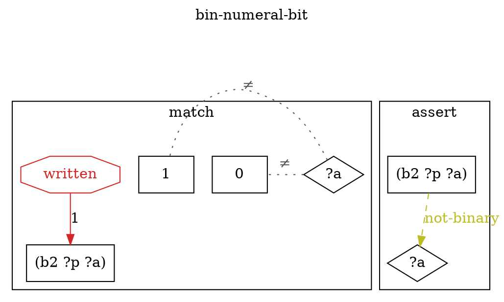
<!-- /rule -->

#### `bin-numeral-prefix-bit`

<!-- rule std.math.binary bin-numeral-prefix-bit -->
```lisp
(rule bin-numeral-prefix-bit ()
  :match  (and (written (b2 ?m ?a)) (bin-nz ?m))
  :assert (not-binary (b2 ?m ?a) ?m)
  :why    "the bit {?m} stands where a number goes: a number ends in z")
```

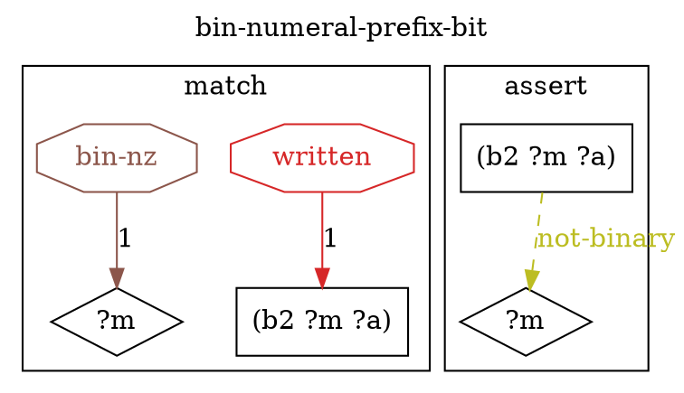
<!-- /rule -->

#### `bin-numeral-prefix-zero`

<!-- rule std.math.binary bin-numeral-prefix-zero -->
```lisp
(rule bin-numeral-prefix-zero ()
  :match  (written (b2 0 ?a))
  :assert (not-binary (b2 0 ?a) 0)
  :why    "the bit 0 stands where a number goes: a number ends in z")
```

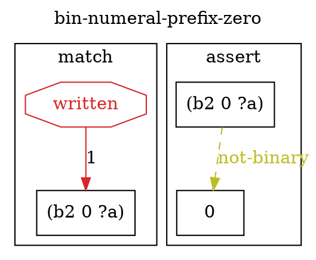
<!-- /rule -->

#### `bin-numeral-prefix-named`

<!-- rule std.math.binary bin-numeral-prefix-named -->
```lisp
(rule bin-numeral-prefix-named ()
  :match  (and (written (b2 ?m ?a)) (neq ?m z) (bin-named ?m))
  :assert (not-binary (b2 ?m ?a) ?m)
  :why    "the name {?m} stands where a number goes: a name stands for a number as an operand, not inside one")
```

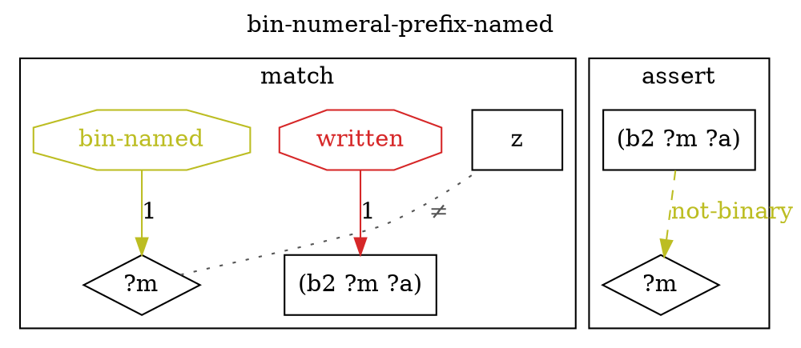
<!-- /rule -->

#### `not-binary-is-false`

<!-- rule std.math.binary not-binary-is-false -->
```lisp
(rule not-binary-is-false ()
  :match  (not-binary ?x ?thing)
  :assert (false)
  :why    "{?x} is not a binary number: the program cannot hold it")
```

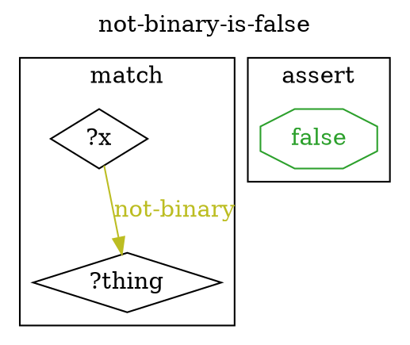
<!-- /rule -->

#### `binary`

<!-- rule std.math.binary binary -->
```lisp
(rule binary ()
  :match  ()
  :assert (and (__closed__ bin-nz)
               (__closed__ b2) (__closed__ bin-named) (__closed__ not-binary)
               (__closed__ binary-rule)
               (binary-rule arith)
               (binary-rule bin-numeral-bit) (binary-rule bin-numeral-prefix-bit)
               (binary-rule bin-numeral-prefix-zero)
               (binary-rule bin-numeral-prefix-named)
               (binary-rule not-binary-is-false))
  :why    "a numeral is written, and never guessed: every relation of the module is closed")
```

```dot
digraph rule_binary_lhs_rhs {
  rankdir=TB;
  label="binary"; labelloc=t;
  subgraph cluster_lhs { label="match";
    "h1_#empty_L" [shape=octagon, label="#empty", color="#17becf", fontcolor="#17becf"];
  }
  subgraph cluster_rhs { label="assert";
    "bin-nz_R" [label="bin-nz", shape=rectangle];
    "b2_R" [label="b2", shape=rectangle];
    "bin-named_R" [label="bin-named", shape=rectangle];
    "not-binary_R" [label="not-binary", shape=rectangle];
    "binary-rule_R" [label="binary-rule", shape=rectangle];
    "arith_R" [label="arith", shape=rectangle];
    "bin-numeral-bit_R" [label="bin-numeral-bit", shape=rectangle];
    "bin-numeral-prefix-bit_R" [label="bin-numeral-prefix-bit", shape=rectangle];
    "bin-numeral-prefix-zero_R" [label="bin-numeral-prefix-zero", shape=rectangle];
    "bin-numeral-prefix-named_R" [label="bin-numeral-prefix-named", shape=rectangle];
    "not-binary-is-false_R" [label="not-binary-is-false", shape=rectangle];
    "h2___closed___R" [shape=octagon, label="__closed__", color="#e377c2", fontcolor="#e377c2"];
    "h2___closed___R" -> "bin-nz_R" [label="1", color="#e377c2", style=dashed];
    "h3___closed___R" [shape=octagon, label="__closed__", color="#e377c2", fontcolor="#e377c2"];
    "h3___closed___R" -> "b2_R" [label="1", color="#e377c2", style=dashed];
    "h4___closed___R" [shape=octagon, label="__closed__", color="#e377c2", fontcolor="#e377c2"];
    "h4___closed___R" -> "bin-named_R" [label="1", color="#e377c2", style=dashed];
    "h5___closed___R" [shape=octagon, label="__closed__", color="#e377c2", fontcolor="#e377c2"];
    "h5___closed___R" -> "not-binary_R" [label="1", color="#e377c2", style=dashed];
    "h6___closed___R" [shape=octagon, label="__closed__", color="#e377c2", fontcolor="#e377c2"];
    "h6___closed___R" -> "binary-rule_R" [label="1", color="#e377c2", style=dashed];
    "h7_binary-rule_R" [shape=octagon, label="binary-rule", color="#ff7f0e", fontcolor="#ff7f0e"];
    "h7_binary-rule_R" -> "arith_R" [label="1", color="#ff7f0e", style=dashed];
    "h8_binary-rule_R" [shape=octagon, label="binary-rule", color="#ff7f0e", fontcolor="#ff7f0e"];
    "h8_binary-rule_R" -> "bin-numeral-bit_R" [label="1", color="#ff7f0e", style=dashed];
    "h9_binary-rule_R" [shape=octagon, label="binary-rule", color="#ff7f0e", fontcolor="#ff7f0e"];
    "h9_binary-rule_R" -> "bin-numeral-prefix-bit_R" [label="1", color="#ff7f0e", style=dashed];
    "h10_binary-rule_R" [shape=octagon, label="binary-rule", color="#ff7f0e", fontcolor="#ff7f0e"];
    "h10_binary-rule_R" -> "bin-numeral-prefix-zero_R" [label="1", color="#ff7f0e", style=dashed];
    "h11_binary-rule_R" [shape=octagon, label="binary-rule", color="#ff7f0e", fontcolor="#ff7f0e"];
    "h11_binary-rule_R" -> "bin-numeral-prefix-named_R" [label="1", color="#ff7f0e", style=dashed];
    "h12_binary-rule_R" [shape=octagon, label="binary-rule", color="#ff7f0e", fontcolor="#ff7f0e"];
    "h12_binary-rule_R" -> "not-binary-is-false_R" [label="1", color="#ff7f0e", style=dashed];
  }
}
```
<!-- /rule -->

## `std.math.binary-arith`

### Multiplication: a row is nothing or the multiplicand

From the multiplier's top bit: twice the sum so far, plus the multiplicand where the bit is `1`. Twice a number is
one addition walk of the number with itself.

#### `bin-mul-one`

<!-- rule std.math.binary-arith bin-mul-one -->
```lisp
(rule bin-mul-one ()
  :match  (bin-mul-step ?k ?u (bin-b 1 ?rest) (b2 ?p ?a))
  :assert (bin-add-walk (bin-mul-sum ?k ?u ?rest) (b2 (b2 ?p ?a) 0) ?u 0 z)
  :why    "the next bit of the multiplier is 1: twice the sum so far, plus {?u}")
```

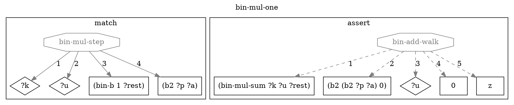
<!-- /rule -->

#### `bin-mul-one-first`

<!-- rule std.math.binary-arith bin-mul-one-first -->
```lisp
(rule bin-mul-one-first ()
  :match  (bin-mul-step ?k ?u (bin-b 1 ?rest) z)
  :assert (bin-add-walk (bin-mul-sum ?k ?u ?rest) z ?u 0 z)
  :why    "the next bit of the multiplier is 1 and nothing is summed yet: the sum is {?u}, in normal form")
```

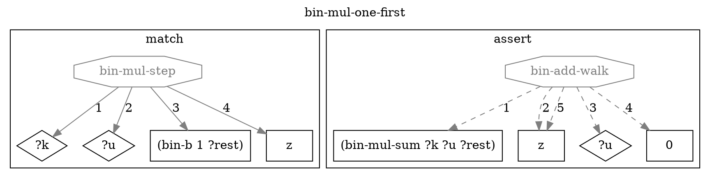
<!-- /rule -->

#### `bin-mul-zero`

<!-- rule std.math.binary-arith bin-mul-zero -->
```lisp
(rule bin-mul-zero ()
  :match  (bin-mul-step ?k ?u (bin-b 0 ?rest) (b2 ?p ?a))
  :assert (bin-mul-step ?k ?u ?rest (b2 (b2 ?p ?a) 0))
  :why    "the next bit of the multiplier is 0: twice the sum so far")
```

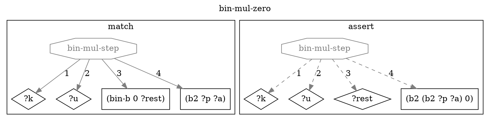
<!-- /rule -->

#### `bin-mul-zero-first`

<!-- rule std.math.binary-arith bin-mul-zero-first -->
```lisp
(rule bin-mul-zero-first ()
  :match  (bin-mul-step ?k ?u (bin-b 0 ?rest) z)
  :assert (bin-mul-step ?k ?u ?rest z)
  :why    "the next bit of the multiplier is 0 and nothing is summed yet")
```

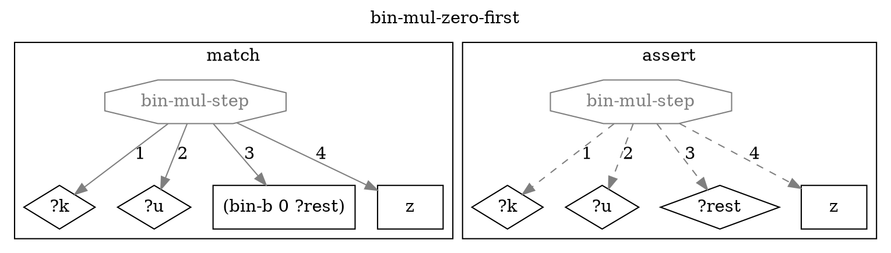
<!-- /rule -->

### Division: one subtraction a bit

Each bit of the dividend, from the top, is brought down beside what is left over, and one subtraction walk tries
to take the divisor from it: it fits, and the quotient's next bit is `1`, or it does not, and the bit is `0`.

#### `bin-div-multiples`

<!-- rule std.math.binary-arith bin-div-multiples -->
```lisp
(rule bin-div-multiples ()
  :match  (bin-div-call ?k ?u ?v)
  :assert (bin-add-walk (bin-div-m1 ?k ?u ?v) z ?v 0 z)
  :why    "to divide {?u} by {?v}: first the divisor in normal form, zero plus {?v}")
```

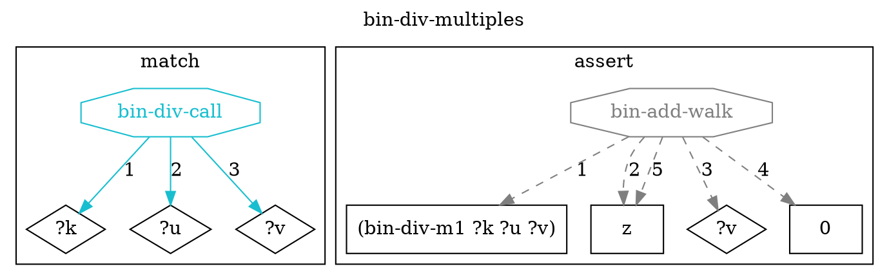
<!-- /rule -->

#### `bin-div-turn`

<!-- rule std.math.binary-arith bin-div-turn -->
```lisp
(rule bin-div-turn ()
  :match  (bin-done (bin-div-m1 ?k ?u ?v) (b2 ?p ?a))
  :assert (bin-top-first (bin-div-digits ?k (b2 ?p ?a)) ?u z)
  :why    "the divisor is not zero. Now the bits of {?u}, the top one first")
```

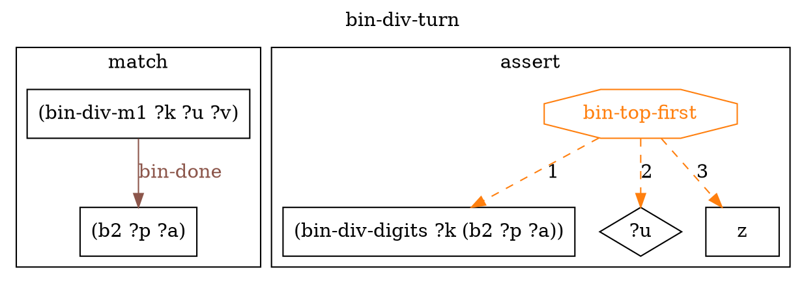
<!-- /rule -->

#### `bin-div-bring`

<!-- rule std.math.binary-arith bin-div-bring -->
```lisp
(rule bin-div-bring ()
  :match  (bin-div-step ?k ?d (bin-b ?a ?rest) (b2 ?p ?c) ?w)
  :assert (bin-sub-walk (bin-div-trial ?k ?d ?rest ?w (b2 (b2 ?p ?c) ?a)) (b2 (b2 ?p ?c) ?a) ?d 0 z)
  :why    "bring down {?a} beside what is left over, and try to take the divisor from it")
```

```dot
digraph rule_bin_div_bring_lhs_rhs {
  rankdir=TB;
  label="bin-div-bring"; labelloc=t;
  subgraph cluster_lhs { label="match";
    "?k_L" [label="?k", shape=diamond];
    "?d_L" [label="?d", shape=diamond];
    "(bin-b ?a ?rest)_L" [label="(bin-b ?a ?rest)", shape=rectangle];
    "(b2 ?p ?c)_L" [label="(b2 ?p ?c)", shape=rectangle];
    "?w_L" [label="?w", shape=diamond];
    "h1_bin-div-step_L" [shape=octagon, label="bin-div-step", color="#9467bd", fontcolor="#9467bd"];
    "h1_bin-div-step_L" -> "?k_L" [label="1", color="#9467bd"];
    "h1_bin-div-step_L" -> "?d_L" [label="2", color="#9467bd"];
    "h1_bin-div-step_L" -> "(bin-b ?a ?rest)_L" [label="3", color="#9467bd"];
    "h1_bin-div-step_L" -> "(b2 ?p ?c)_L" [label="4", color="#9467bd"];
    "h1_bin-div-step_L" -> "?w_L" [label="5", color="#9467bd"];
  }
  subgraph cluster_rhs { label="assert";
    "(bin-div-trial ?k ?d ?rest ?w (b2 (b2 ?p ?c) ?a))_R" [label="(bin-div-trial ?k ?d ?rest ?w (b2 (b2 ?p ?c) ?a))", shape=rectangle];
    "(b2 (b2 ?p ?c) ?a)_R" [label="(b2 (b2 ?p ?c) ?a)", shape=rectangle];
    "?d_R" [label="?d", shape=diamond];
    "0_R" [label="0", shape=rectangle];
    "z_R" [label="z", shape=rectangle];
    "h2_bin-sub-walk_R" [shape=octagon, label="bin-sub-walk", color="#9467bd", fontcolor="#9467bd"];
    "h2_bin-sub-walk_R" -> "(bin-div-trial ?k ?d ?rest ?w (b2 (b2 ?p ?c) ?a))_R" [label="1", color="#9467bd", style=dashed];
    "h2_bin-sub-walk_R" -> "(b2 (b2 ?p ?c) ?a)_R" [label="2", color="#9467bd", style=dashed];
    "h2_bin-sub-walk_R" -> "?d_R" [label="3", color="#9467bd", style=dashed];
    "h2_bin-sub-walk_R" -> "0_R" [label="4", color="#9467bd", style=dashed];
    "h2_bin-sub-walk_R" -> "z_R" [label="5", color="#9467bd", style=dashed];
  }
}
```
<!-- /rule -->

#### `bin-div-bring-first`

<!-- rule std.math.binary-arith bin-div-bring-first -->
```lisp
(rule bin-div-bring-first ()
  :match  (bin-div-step ?k ?d (bin-b 1 ?rest) z ?w)
  :assert (bin-sub-walk (bin-div-trial ?k ?d ?rest ?w (b2 z 1)) (b2 z 1) ?d 0 z)
  :why    "nothing was left over: bring down 1, and try to take the divisor from it")
```

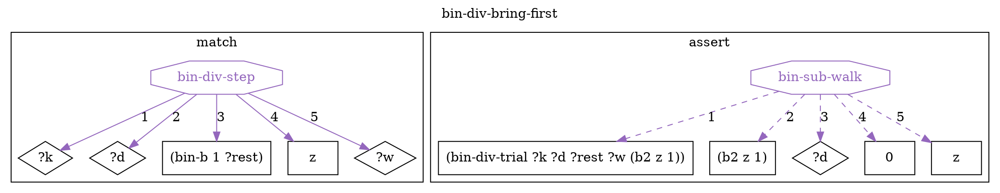
<!-- /rule -->

#### `bin-div-bring-zero`

<!-- rule std.math.binary-arith bin-div-bring-zero -->
```lisp
(rule bin-div-bring-zero ()
  :match  (bin-div-step ?k ?d (bin-b 0 ?rest) z (b2 ?p ?c))
  :assert (bin-div-step ?k ?d ?rest z (b2 (b2 ?p ?c) 0))
  :why    "nothing was left over and the bit brought down is 0: the next bit of the quotient is 0")
```

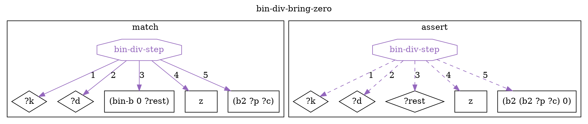
<!-- /rule -->

#### `bin-div-bring-zero-none`

<!-- rule std.math.binary-arith bin-div-bring-zero-none -->
```lisp
(rule bin-div-bring-zero-none ()
  :match  (bin-div-step ?k ?d (bin-b 0 ?rest) z z)
  :assert (bin-div-step ?k ?d ?rest z z)
  :why    "nothing was left over, the bit brought down is 0 and the quotient so far is zero: no high zero is written")
```

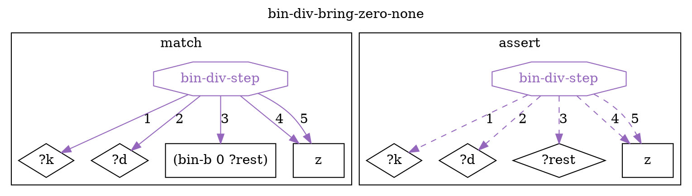
<!-- /rule -->

#### `bin-div-fits`

<!-- rule std.math.binary-arith bin-div-fits -->
```lisp
(rule bin-div-fits ()
  :match  (bin-done (bin-div-trial ?k ?d ?rest ?w ?u) ?t)
  :assert (bin-div-step ?k ?d ?rest ?t (b2 ?w 1))
  :why    "the divisor fits, and leaves {?t}: the next bit of the quotient is 1")
```

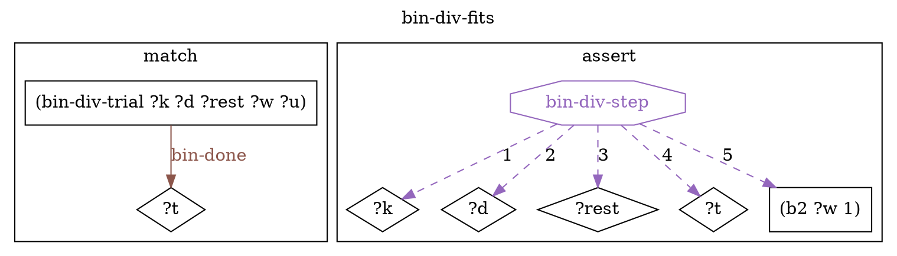
<!-- /rule -->

#### `bin-div-too-big`

<!-- rule std.math.binary-arith bin-div-too-big -->
```lisp
(rule bin-div-too-big ()
  :match  (bin-short (bin-div-trial ?k ?d ?rest (b2 ?p ?c) ?u))
  :assert (bin-div-step ?k ?d ?rest ?u (b2 (b2 ?p ?c) 0))
  :why    "the divisor does not fit: the next bit of the quotient is 0")
```

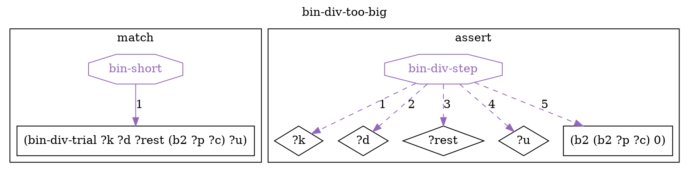
<!-- /rule -->

#### `bin-div-too-big-none`

<!-- rule std.math.binary-arith bin-div-too-big-none -->
```lisp
(rule bin-div-too-big-none ()
  :match  (bin-short (bin-div-trial ?k ?d ?rest z ?u))
  :assert (bin-div-step ?k ?d ?rest ?u z)
  :why    "the divisor does not fit and the quotient so far is zero: no high zero is written")
```

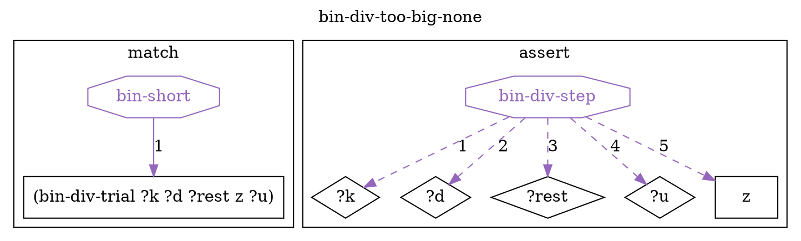
<!-- /rule -->

### An operand that is a name no `bin-let` states

The one `absent` of the theory, over its own `bin-let`.

#### `bin-operand-undeclared`

<!-- rule std.math.binary-arith bin-operand-undeclared -->
```lisp
(rule bin-operand-undeclared ()
  :match  (and (bin-operand ?k ?x)
               (neq ?v z) (eq ?v ?x)
               (neq ?x 0) (neq ?x 1)
               (absent (bin-let ?x ?w)))
  :assert (bin-bad-operand ?k (bin-no-let ?x))
  :why    "{?x} is a name, and no let states it")
```

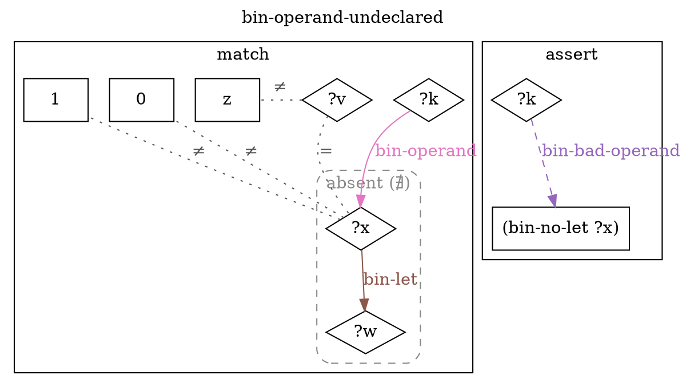
<!-- /rule -->

### The entry

The closing rule: it closes every relation of the module and the tables of `std.math.bits`, names the entries
`arith` and `binary` and each rule above, and calls the macro `positional` once with binary's relations. Its
drawing is not shown.

#### `binary-arith`

<!-- rule std.math.binary-arith binary-arith -->
```lisp
(rule binary-arith ()
  :match  ()
  :assert (and (__closed__ bin-fa) (__closed__ bin-fs) (__closed__ bin-cl) (__closed__ bin-nz)
               (__closed__ bin-b)
               (__closed__ bin-let) (__closed__ bin-add) (__closed__ bin-sum-of)
               (__closed__ bin-sub) (__closed__ bin-diff-of)
               (__closed__ bin-cmp) (__closed__ bin-cmp-of)
               (__closed__ bin-mul) (__closed__ bin-product-of)
               (__closed__ bin-div) (__closed__ bin-quot-of)
               (__closed__ bin-operand) (__closed__ bin-operand-is)
               (__closed__ bin-add-walk) (__closed__ bin-strip) (__closed__ bin-turn)
               (__closed__ bin-done)
               (__closed__ bin-sub-walk) (__closed__ bin-short)
               (__closed__ bin-cmp-walk) (__closed__ bin-order-is)
               (__closed__ bin-top-first) (__closed__ bin-top-first-is)
               (__closed__ bin-mul-call) (__closed__ bin-mul-step)
               (__closed__ bin-div-call) (__closed__ bin-div-done) (__closed__ bin-div-step)
               (__closed__ bin-sum) (__closed__ bin-add-first) (__closed__ bin-add-second)
               (__closed__ bin-difference) (__closed__ bin-shortfall)
               (__closed__ bin-sub-first) (__closed__ bin-sub-second)
               (__closed__ bin-order) (__closed__ bin-cmp-first) (__closed__ bin-cmp-second)
               (__closed__ bin-product) (__closed__ bin-mul-first) (__closed__ bin-mul-second)
               (__closed__ bin-mul-digits) (__closed__ bin-mul-sum)
               (__closed__ bin-quotient) (__closed__ bin-div-first) (__closed__ bin-div-second)
               (__closed__ bin-div-m1) (__closed__ bin-div-digits) (__closed__ bin-div-trial)
               (__closed__ bin-malformed) (__closed__ bin-undeclared)
               (__closed__ bin-bad-operand) (__closed__ bin-bad-request)
               (__closed__ bin-not-a-number) (__closed__ bin-no-let)
               (__closed__ bin-arith-rule)
               (bin-arith-rule arith) (bin-arith-rule binary)
               (bin-arith-rule bin-mul-one) (bin-arith-rule bin-mul-one-first)
               (bin-arith-rule bin-mul-zero) (bin-arith-rule bin-mul-zero-first)
               (bin-arith-rule bin-div-multiples) (bin-arith-rule bin-div-turn)
               (bin-arith-rule bin-div-bring) (bin-arith-rule bin-div-bring-first)
               (bin-arith-rule bin-div-bring-zero) (bin-arith-rule bin-div-bring-zero-none)
               (bin-arith-rule bin-div-fits) (bin-arith-rule bin-div-too-big)
               (bin-arith-rule bin-div-too-big-none)
               (bin-arith-rule bin-operand-undeclared)
               (positional bin-operand bin-operand-is b2 bin-let bin-named bin-add-walk bin-fa bin-b
                           bin-strip bin-turn bin-nz bin-done
                           bin-add bin-add-first bin-add-second bin-sum bin-sum-of
                           bin-sub-walk bin-fs bin-short bin-sub bin-sub-first bin-sub-second
                           bin-difference bin-shortfall bin-diff-of
                           bin-cmp-walk bin-cl bin-order-is bin-cmp bin-cmp-first bin-cmp-second
                           bin-order bin-cmp-of
                           bin-top-first bin-top-first-is bin-mul-call bin-mul-digits bin-mul-step
                           bin-mul-sum bin-mul bin-mul-first bin-mul-second bin-product bin-product-of
                           bin-div-digits bin-div-step bin-div-done bin-div bin-div-first bin-div-second
                           bin-div-call bin-quotient bin-quot-of bin-div-m1
                           bin-bad-operand bin-not-a-number bin-malformed bin-bad-request bin-no-let
                           bin-undeclared))
  :why    "binary arithmetic is computed and never guessed: every relation of the theory is closed")
```
<!-- /rule -->

## `std.math.convert`

### Decimal to binary

X is halved by decimal's tagged division until nothing is left; each remainder is a bit, put in front of the bits
so far.

#### `to-bin-ask`

<!-- rule std.math.convert to-bin-ask -->
```lisp
(rule to-bin-ask ()
  :match  (to-bin ?x)
  :assert (to-bin-go ?x ?x z)
  :why    "{?x} in binary is asked: halve it until nothing is left")
```

```dot
digraph rule_to_bin_ask_lhs_rhs {
  rankdir=TB;
  label="to-bin-ask"; labelloc=t;
  subgraph cluster_lhs { label="match";
    "?x_L" [label="?x", shape=diamond];
    "h1_to-bin_L" [shape=octagon, label="to-bin", color="#e377c2", fontcolor="#e377c2"];
    "h1_to-bin_L" -> "?x_L" [label="1", color="#e377c2"];
  }
  subgraph cluster_rhs { label="assert";
    "?x_R" [label="?x", shape=diamond];
    "z_R" [label="z", shape=rectangle];
    "h2_to-bin-go_R" [shape=octagon, label="to-bin-go", color="#17becf", fontcolor="#17becf"];
    "h2_to-bin-go_R" -> "?x_R" [label="1", color="#17becf", style=dashed];
    "h2_to-bin-go_R" -> "?x_R" [label="2", color="#17becf", style=dashed];
    "h2_to-bin-go_R" -> "z_R" [label="3", color="#17becf", style=dashed];
  }
}
```
<!-- /rule -->

#### `to-bin-halve`

<!-- rule std.math.convert to-bin-halve -->
```lisp
(rule to-bin-halve ()
  :match  (to-bin-go ?x (n ?p ?a) ?acc)
  :assert (div-call (halving ?x ?acc) (n ?p ?a) (n z 2))
  :why    "divide {?p}{?a} by two: the remainder is the next bit")
```

```dot
digraph rule_to_bin_halve_lhs_rhs {
  rankdir=TB;
  label="to-bin-halve"; labelloc=t;
  subgraph cluster_lhs { label="match";
    "?x_L" [label="?x", shape=diamond];
    "(n ?p ?a)_L" [label="(n ?p ?a)", shape=rectangle];
    "?acc_L" [label="?acc", shape=diamond];
    "h1_to-bin-go_L" [shape=octagon, label="to-bin-go", color="#17becf", fontcolor="#17becf"];
    "h1_to-bin-go_L" -> "?x_L" [label="1", color="#17becf"];
    "h1_to-bin-go_L" -> "(n ?p ?a)_L" [label="2", color="#17becf"];
    "h1_to-bin-go_L" -> "?acc_L" [label="3", color="#17becf"];
  }
  subgraph cluster_rhs { label="assert";
    "(halving ?x ?acc)_R" [label="(halving ?x ?acc)", shape=rectangle];
    "(n ?p ?a)_R" [label="(n ?p ?a)", shape=rectangle];
    "(n z 2)_R" [label="(n z 2)", shape=rectangle];
    "h2_div-call_R" [shape=octagon, label="div-call", color="#bcbd22", fontcolor="#bcbd22"];
    "h2_div-call_R" -> "(halving ?x ?acc)_R" [label="1", color="#bcbd22", style=dashed];
    "h2_div-call_R" -> "(n ?p ?a)_R" [label="2", color="#bcbd22", style=dashed];
    "h2_div-call_R" -> "(n z 2)_R" [label="3", color="#bcbd22", style=dashed];
  }
}
```
<!-- /rule -->

#### `to-bin-bit-0`

<!-- rule std.math.convert to-bin-bit-0 -->
```lisp
(rule to-bin-bit-0 ()
  :match  (div-done (halving ?x ?acc) ?q z)
  :assert (to-bin-go ?x ?q (bin-b 0 ?acc))
  :why    "the remainder is nothing: the bit 0 goes in front of the bits so far")
```

```dot
digraph rule_to_bin_bit_0_lhs_rhs {
  rankdir=TB;
  label="to-bin-bit-0"; labelloc=t;
  subgraph cluster_lhs { label="match";
    "(halving ?x ?acc)_L" [label="(halving ?x ?acc)", shape=rectangle];
    "?q_L" [label="?q", shape=diamond];
    "z_L" [label="z", shape=rectangle];
    "h1_div-done_L" [shape=octagon, label="div-done", color="#8c564b", fontcolor="#8c564b"];
    "h1_div-done_L" -> "(halving ?x ?acc)_L" [label="1", color="#8c564b"];
    "h1_div-done_L" -> "?q_L" [label="2", color="#8c564b"];
    "h1_div-done_L" -> "z_L" [label="3", color="#8c564b"];
  }
  subgraph cluster_rhs { label="assert";
    "?x_R" [label="?x", shape=diamond];
    "?q_R" [label="?q", shape=diamond];
    "(bin-b 0 ?acc)_R" [label="(bin-b 0 ?acc)", shape=rectangle];
    "h2_to-bin-go_R" [shape=octagon, label="to-bin-go", color="#17becf", fontcolor="#17becf"];
    "h2_to-bin-go_R" -> "?x_R" [label="1", color="#17becf", style=dashed];
    "h2_to-bin-go_R" -> "?q_R" [label="2", color="#17becf", style=dashed];
    "h2_to-bin-go_R" -> "(bin-b 0 ?acc)_R" [label="3", color="#17becf", style=dashed];
  }
}
```
<!-- /rule -->

#### `to-bin-bit-1`

<!-- rule std.math.convert to-bin-bit-1 -->
```lisp
(rule to-bin-bit-1 ()
  :match  (div-done (halving ?x ?acc) ?q (n z 1))
  :assert (to-bin-go ?x ?q (bin-b 1 ?acc))
  :why    "the remainder is 1: the bit 1 goes in front of the bits so far")
```

```dot
digraph rule_to_bin_bit_1_lhs_rhs {
  rankdir=TB;
  label="to-bin-bit-1"; labelloc=t;
  subgraph cluster_lhs { label="match";
    "(halving ?x ?acc)_L" [label="(halving ?x ?acc)", shape=rectangle];
    "?q_L" [label="?q", shape=diamond];
    "(n z 1)_L" [label="(n z 1)", shape=rectangle];
    "h1_div-done_L" [shape=octagon, label="div-done", color="#8c564b", fontcolor="#8c564b"];
    "h1_div-done_L" -> "(halving ?x ?acc)_L" [label="1", color="#8c564b"];
    "h1_div-done_L" -> "?q_L" [label="2", color="#8c564b"];
    "h1_div-done_L" -> "(n z 1)_L" [label="3", color="#8c564b"];
  }
  subgraph cluster_rhs { label="assert";
    "?x_R" [label="?x", shape=diamond];
    "?q_R" [label="?q", shape=diamond];
    "(bin-b 1 ?acc)_R" [label="(bin-b 1 ?acc)", shape=rectangle];
    "h2_to-bin-go_R" [shape=octagon, label="to-bin-go", color="#17becf", fontcolor="#17becf"];
    "h2_to-bin-go_R" -> "?x_R" [label="1", color="#17becf", style=dashed];
    "h2_to-bin-go_R" -> "?q_R" [label="2", color="#17becf", style=dashed];
    "h2_to-bin-go_R" -> "(bin-b 1 ?acc)_R" [label="3", color="#17becf", style=dashed];
  }
}
```
<!-- /rule -->

#### `to-bin-end`

<!-- rule std.math.convert to-bin-end -->
```lisp
(rule to-bin-end ()
  :match  (to-bin-go ?x z ?acc)
  :assert (bin-strip (bits ?x) ?acc)
  :why    "nothing is left to halve: the bits are {?acc}, the top one first")
```

```dot
digraph rule_to_bin_end_lhs_rhs {
  rankdir=TB;
  label="to-bin-end"; labelloc=t;
  subgraph cluster_lhs { label="match";
    "?x_L" [label="?x", shape=diamond];
    "z_L" [label="z", shape=rectangle];
    "?acc_L" [label="?acc", shape=diamond];
    "h1_to-bin-go_L" [shape=octagon, label="to-bin-go", color="#17becf", fontcolor="#17becf"];
    "h1_to-bin-go_L" -> "?x_L" [label="1", color="#17becf"];
    "h1_to-bin-go_L" -> "z_L" [label="2", color="#17becf"];
    "h1_to-bin-go_L" -> "?acc_L" [label="3", color="#17becf"];
  }
  subgraph cluster_rhs { label="assert";
    "(bits ?x)_R" [label="(bits ?x)", shape=rectangle];
    "?acc_R" [label="?acc", shape=diamond];
    "(bits ?x)_R" -> "?acc_R" [label="bin-strip", color="#2ca02c", fontcolor="#2ca02c", style=dashed];
  }
}
```
<!-- /rule -->

#### `to-bin-answer`

<!-- rule std.math.convert to-bin-answer -->
```lisp
(rule to-bin-answer ()
  :match  (bin-done (bits ?x) ?b)
  :assert (bin-of ?x ?b)
  :why    "{?x} is {?b} in binary")
```

```dot
digraph rule_to_bin_answer_lhs_rhs {
  rankdir=TB;
  label="to-bin-answer"; labelloc=t;
  subgraph cluster_lhs { label="match";
    "(bits ?x)_L" [label="(bits ?x)", shape=rectangle];
    "?b_L" [label="?b", shape=diamond];
    "(bits ?x)_L" -> "?b_L" [label="bin-done", color="#8c564b", fontcolor="#8c564b"];
  }
  subgraph cluster_rhs { label="assert";
    "?x_R" [label="?x", shape=diamond];
    "?b_R" [label="?b", shape=diamond];
    "?x_R" -> "?b_R" [label="bin-of", color="#7f7f7f", fontcolor="#7f7f7f", style=dashed];
  }
}
```
<!-- /rule -->

### Binary to decimal

B's bits are turned round so that the top one comes first; the number so far, a decimal number, is doubled by one
addition walk with itself, the next bit as its carry in.

#### `to-dec-ask`

<!-- rule std.math.convert to-dec-ask -->
```lisp
(rule to-dec-ask ()
  :match  (to-dec ?b)
  :assert (bin-top-first (dec-bits ?b) ?b z)
  :why    "{?b} in decimal is asked: first its bits, the top one first")
```

```dot
digraph rule_to_dec_ask_lhs_rhs {
  rankdir=TB;
  label="to-dec-ask"; labelloc=t;
  subgraph cluster_lhs { label="match";
    "?b_L" [label="?b", shape=diamond];
    "h1_to-dec_L" [shape=octagon, label="to-dec", color="#1f77b4", fontcolor="#1f77b4"];
    "h1_to-dec_L" -> "?b_L" [label="1", color="#1f77b4"];
  }
  subgraph cluster_rhs { label="assert";
    "(dec-bits ?b)_R" [label="(dec-bits ?b)", shape=rectangle];
    "?b_R" [label="?b", shape=diamond];
    "z_R" [label="z", shape=rectangle];
    "h2_bin-top-first_R" [shape=octagon, label="bin-top-first", color="#ff7f0e", fontcolor="#ff7f0e"];
    "h2_bin-top-first_R" -> "(dec-bits ?b)_R" [label="1", color="#ff7f0e", style=dashed];
    "h2_bin-top-first_R" -> "?b_R" [label="2", color="#ff7f0e", style=dashed];
    "h2_bin-top-first_R" -> "z_R" [label="3", color="#ff7f0e", style=dashed];
  }
}
```
<!-- /rule -->

#### `to-dec-begin`

<!-- rule std.math.convert to-dec-begin -->
```lisp
(rule to-dec-begin ()
  :match  (bin-top-first-is (dec-bits ?b) ?t)
  :assert (to-dec-go ?b ?t z)
  :why    "start from the top bit: the number so far is zero")
```

```dot
digraph rule_to_dec_begin_lhs_rhs {
  rankdir=TB;
  label="to-dec-begin"; labelloc=t;
  subgraph cluster_lhs { label="match";
    "(dec-bits ?b)_L" [label="(dec-bits ?b)", shape=rectangle];
    "?t_L" [label="?t", shape=diamond];
    "(dec-bits ?b)_L" -> "?t_L" [label="bin-top-first-is", color="#2ca02c", fontcolor="#2ca02c"];
  }
  subgraph cluster_rhs { label="assert";
    "?b_R" [label="?b", shape=diamond];
    "?t_R" [label="?t", shape=diamond];
    "z_R" [label="z", shape=rectangle];
    "h1_to-dec-go_R" [shape=octagon, label="to-dec-go", color="#bcbd22", fontcolor="#bcbd22"];
    "h1_to-dec-go_R" -> "?b_R" [label="1", color="#bcbd22", style=dashed];
    "h1_to-dec-go_R" -> "?t_R" [label="2", color="#bcbd22", style=dashed];
    "h1_to-dec-go_R" -> "z_R" [label="3", color="#bcbd22", style=dashed];
  }
}
```
<!-- /rule -->

#### `to-dec-double`

<!-- rule std.math.convert to-dec-double -->
```lisp
(rule to-dec-double ()
  :match  (to-dec-go ?b (bin-b ?bit ?rest) ?acc)
  :assert (add-walk (doubling ?b ?rest) ?acc ?acc ?bit z)
  :why    "the next bit is {?bit}: the number so far, plus itself, plus the bit as the carry in")
```

```dot
digraph rule_to_dec_double_lhs_rhs {
  rankdir=TB;
  label="to-dec-double"; labelloc=t;
  subgraph cluster_lhs { label="match";
    "?b_L" [label="?b", shape=diamond];
    "(bin-b ?bit ?rest)_L" [label="(bin-b ?bit ?rest)", shape=rectangle];
    "?acc_L" [label="?acc", shape=diamond];
    "h1_to-dec-go_L" [shape=octagon, label="to-dec-go", color="#bcbd22", fontcolor="#bcbd22"];
    "h1_to-dec-go_L" -> "?b_L" [label="1", color="#bcbd22"];
    "h1_to-dec-go_L" -> "(bin-b ?bit ?rest)_L" [label="2", color="#bcbd22"];
    "h1_to-dec-go_L" -> "?acc_L" [label="3", color="#bcbd22"];
  }
  subgraph cluster_rhs { label="assert";
    "(doubling ?b ?rest)_R" [label="(doubling ?b ?rest)", shape=rectangle];
    "?acc_R" [label="?acc", shape=diamond];
    "?bit_R" [label="?bit", shape=diamond];
    "z_R" [label="z", shape=rectangle];
    "h2_add-walk_R" [shape=octagon, label="add-walk", color="#17becf", fontcolor="#17becf"];
    "h2_add-walk_R" -> "(doubling ?b ?rest)_R" [label="1", color="#17becf", style=dashed];
    "h2_add-walk_R" -> "?acc_R" [label="2", color="#17becf", style=dashed];
    "h2_add-walk_R" -> "?acc_R" [label="3", color="#17becf", style=dashed];
    "h2_add-walk_R" -> "?bit_R" [label="4", color="#17becf", style=dashed];
    "h2_add-walk_R" -> "z_R" [label="5", color="#17becf", style=dashed];
  }
}
```
<!-- /rule -->

#### `to-dec-next`

<!-- rule std.math.convert to-dec-next -->
```lisp
(rule to-dec-next ()
  :match  (done (doubling ?b ?rest) ?s)
  :assert (to-dec-go ?b ?rest ?s)
  :why    "the number so far is {?s}")
```

```dot
digraph rule_to_dec_next_lhs_rhs {
  rankdir=TB;
  label="to-dec-next"; labelloc=t;
  subgraph cluster_lhs { label="match";
    "(doubling ?b ?rest)_L" [label="(doubling ?b ?rest)", shape=rectangle];
    "?s_L" [label="?s", shape=diamond];
    "(doubling ?b ?rest)_L" -> "?s_L" [label="done", color="#e377c2", fontcolor="#e377c2"];
  }
  subgraph cluster_rhs { label="assert";
    "?b_R" [label="?b", shape=diamond];
    "?rest_R" [label="?rest", shape=diamond];
    "?s_R" [label="?s", shape=diamond];
    "h1_to-dec-go_R" [shape=octagon, label="to-dec-go", color="#bcbd22", fontcolor="#bcbd22"];
    "h1_to-dec-go_R" -> "?b_R" [label="1", color="#bcbd22", style=dashed];
    "h1_to-dec-go_R" -> "?rest_R" [label="2", color="#bcbd22", style=dashed];
    "h1_to-dec-go_R" -> "?s_R" [label="3", color="#bcbd22", style=dashed];
  }
}
```
<!-- /rule -->

#### `to-dec-answer`

<!-- rule std.math.convert to-dec-answer -->
```lisp
(rule to-dec-answer ()
  :match  (to-dec-go ?b z ?acc)
  :assert (dec-of ?b ?acc)
  :why    "{?b} in binary is {?acc}")
```

```dot
digraph rule_to_dec_answer_lhs_rhs {
  rankdir=TB;
  label="to-dec-answer"; labelloc=t;
  subgraph cluster_lhs { label="match";
    "?b_L" [label="?b", shape=diamond];
    "z_L" [label="z", shape=rectangle];
    "?acc_L" [label="?acc", shape=diamond];
    "h1_to-dec-go_L" [shape=octagon, label="to-dec-go", color="#bcbd22", fontcolor="#bcbd22"];
    "h1_to-dec-go_L" -> "?b_L" [label="1", color="#bcbd22"];
    "h1_to-dec-go_L" -> "z_L" [label="2", color="#bcbd22"];
    "h1_to-dec-go_L" -> "?acc_L" [label="3", color="#bcbd22"];
  }
  subgraph cluster_rhs { label="assert";
    "?b_R" [label="?b", shape=diamond];
    "?acc_R" [label="?acc", shape=diamond];
    "?b_R" -> "?acc_R" [label="dec-of", color="#7f7f7f", fontcolor="#7f7f7f", style=dashed];
  }
}
```
<!-- /rule -->

### The entry

#### `convert`

<!-- rule std.math.convert convert -->
```lisp
(rule convert ()
  :match  ()
  :assert (and (__closed__ to-bin) (__closed__ bin-of) (__closed__ to-dec) (__closed__ dec-of)
               (__closed__ to-bin-go) (__closed__ to-dec-go) (__closed__ halving) (__closed__ bits)
               (__closed__ dec-bits) (__closed__ doubling) (__closed__ convert-rule)
               (convert-rule decimal-arith) (convert-rule binary-arith)
               (convert-rule to-bin-ask) (convert-rule to-bin-halve) (convert-rule to-bin-bit-0)
               (convert-rule to-bin-bit-1) (convert-rule to-bin-end) (convert-rule to-bin-answer)
               (convert-rule to-dec-ask) (convert-rule to-dec-begin) (convert-rule to-dec-double)
               (convert-rule to-dec-next) (convert-rule to-dec-answer))
  :why    "a conversion is computed and never guessed: every relation of the module is closed")
```

```dot
digraph rule_convert_lhs_rhs {
  rankdir=TB;
  label="convert"; labelloc=t;
  subgraph cluster_lhs { label="match";
    "h1_#empty_L" [shape=octagon, label="#empty", color="#17becf", fontcolor="#17becf"];
  }
  subgraph cluster_rhs { label="assert";
    "to-bin_R" [label="to-bin", shape=rectangle];
    "bin-of_R" [label="bin-of", shape=rectangle];
    "to-dec_R" [label="to-dec", shape=rectangle];
    "dec-of_R" [label="dec-of", shape=rectangle];
    "to-bin-go_R" [label="to-bin-go", shape=rectangle];
    "to-dec-go_R" [label="to-dec-go", shape=rectangle];
    "halving_R" [label="halving", shape=rectangle];
    "bits_R" [label="bits", shape=rectangle];
    "dec-bits_R" [label="dec-bits", shape=rectangle];
    "doubling_R" [label="doubling", shape=rectangle];
    "convert-rule_R" [label="convert-rule", shape=rectangle];
    "decimal-arith_R" [label="decimal-arith", shape=rectangle];
    "binary-arith_R" [label="binary-arith", shape=rectangle];
    "to-bin-ask_R" [label="to-bin-ask", shape=rectangle];
    "to-bin-halve_R" [label="to-bin-halve", shape=rectangle];
    "to-bin-bit-0_R" [label="to-bin-bit-0", shape=rectangle];
    "to-bin-bit-1_R" [label="to-bin-bit-1", shape=rectangle];
    "to-bin-end_R" [label="to-bin-end", shape=rectangle];
    "to-bin-answer_R" [label="to-bin-answer", shape=rectangle];
    "to-dec-ask_R" [label="to-dec-ask", shape=rectangle];
    "to-dec-begin_R" [label="to-dec-begin", shape=rectangle];
    "to-dec-double_R" [label="to-dec-double", shape=rectangle];
    "to-dec-next_R" [label="to-dec-next", shape=rectangle];
    "to-dec-answer_R" [label="to-dec-answer", shape=rectangle];
    "h2___closed___R" [shape=octagon, label="__closed__", color="#e377c2", fontcolor="#e377c2"];
    "h2___closed___R" -> "to-bin_R" [label="1", color="#e377c2", style=dashed];
    "h3___closed___R" [shape=octagon, label="__closed__", color="#e377c2", fontcolor="#e377c2"];
    "h3___closed___R" -> "bin-of_R" [label="1", color="#e377c2", style=dashed];
    "h4___closed___R" [shape=octagon, label="__closed__", color="#e377c2", fontcolor="#e377c2"];
    "h4___closed___R" -> "to-dec_R" [label="1", color="#e377c2", style=dashed];
    "h5___closed___R" [shape=octagon, label="__closed__", color="#e377c2", fontcolor="#e377c2"];
    "h5___closed___R" -> "dec-of_R" [label="1", color="#e377c2", style=dashed];
    "h6___closed___R" [shape=octagon, label="__closed__", color="#e377c2", fontcolor="#e377c2"];
    "h6___closed___R" -> "to-bin-go_R" [label="1", color="#e377c2", style=dashed];
    "h7___closed___R" [shape=octagon, label="__closed__", color="#e377c2", fontcolor="#e377c2"];
    "h7___closed___R" -> "to-dec-go_R" [label="1", color="#e377c2", style=dashed];
    "h8___closed___R" [shape=octagon, label="__closed__", color="#e377c2", fontcolor="#e377c2"];
    "h8___closed___R" -> "halving_R" [label="1", color="#e377c2", style=dashed];
    "h9___closed___R" [shape=octagon, label="__closed__", color="#e377c2", fontcolor="#e377c2"];
    "h9___closed___R" -> "bits_R" [label="1", color="#e377c2", style=dashed];
    "h10___closed___R" [shape=octagon, label="__closed__", color="#e377c2", fontcolor="#e377c2"];
    "h10___closed___R" -> "dec-bits_R" [label="1", color="#e377c2", style=dashed];
    "h11___closed___R" [shape=octagon, label="__closed__", color="#e377c2", fontcolor="#e377c2"];
    "h11___closed___R" -> "doubling_R" [label="1", color="#e377c2", style=dashed];
    "h12___closed___R" [shape=octagon, label="__closed__", color="#e377c2", fontcolor="#e377c2"];
    "h12___closed___R" -> "convert-rule_R" [label="1", color="#e377c2", style=dashed];
    "h13_convert-rule_R" [shape=octagon, label="convert-rule", color="#d62728", fontcolor="#d62728"];
    "h13_convert-rule_R" -> "decimal-arith_R" [label="1", color="#d62728", style=dashed];
    "h14_convert-rule_R" [shape=octagon, label="convert-rule", color="#d62728", fontcolor="#d62728"];
    "h14_convert-rule_R" -> "binary-arith_R" [label="1", color="#d62728", style=dashed];
    "h15_convert-rule_R" [shape=octagon, label="convert-rule", color="#d62728", fontcolor="#d62728"];
    "h15_convert-rule_R" -> "to-bin-ask_R" [label="1", color="#d62728", style=dashed];
    "h16_convert-rule_R" [shape=octagon, label="convert-rule", color="#d62728", fontcolor="#d62728"];
    "h16_convert-rule_R" -> "to-bin-halve_R" [label="1", color="#d62728", style=dashed];
    "h17_convert-rule_R" [shape=octagon, label="convert-rule", color="#d62728", fontcolor="#d62728"];
    "h17_convert-rule_R" -> "to-bin-bit-0_R" [label="1", color="#d62728", style=dashed];
    "h18_convert-rule_R" [shape=octagon, label="convert-rule", color="#d62728", fontcolor="#d62728"];
    "h18_convert-rule_R" -> "to-bin-bit-1_R" [label="1", color="#d62728", style=dashed];
    "h19_convert-rule_R" [shape=octagon, label="convert-rule", color="#d62728", fontcolor="#d62728"];
    "h19_convert-rule_R" -> "to-bin-end_R" [label="1", color="#d62728", style=dashed];
    "h20_convert-rule_R" [shape=octagon, label="convert-rule", color="#d62728", fontcolor="#d62728"];
    "h20_convert-rule_R" -> "to-bin-answer_R" [label="1", color="#d62728", style=dashed];
    "h21_convert-rule_R" [shape=octagon, label="convert-rule", color="#d62728", fontcolor="#d62728"];
    "h21_convert-rule_R" -> "to-dec-ask_R" [label="1", color="#d62728", style=dashed];
    "h22_convert-rule_R" [shape=octagon, label="convert-rule", color="#d62728", fontcolor="#d62728"];
    "h22_convert-rule_R" -> "to-dec-begin_R" [label="1", color="#d62728", style=dashed];
    "h23_convert-rule_R" [shape=octagon, label="convert-rule", color="#d62728", fontcolor="#d62728"];
    "h23_convert-rule_R" -> "to-dec-double_R" [label="1", color="#d62728", style=dashed];
    "h24_convert-rule_R" [shape=octagon, label="convert-rule", color="#d62728", fontcolor="#d62728"];
    "h24_convert-rule_R" -> "to-dec-next_R" [label="1", color="#d62728", style=dashed];
    "h25_convert-rule_R" [shape=octagon, label="convert-rule", color="#d62728", fontcolor="#d62728"];
    "h25_convert-rule_R" -> "to-dec-answer_R" [label="1", color="#d62728", style=dashed];
  }
}
```
<!-- /rule -->
