# Binary's and the conversion's rules

How `std.math.binary`, `std.math.binary-arith` and `std.math.convert` work: every rule of the three, as the module
writes it and as the engine draws it. What a program writes to use them is [the page before](14-binary.md); how
to read a drawing is [the index](README.md#how-a-rule-is-shown).

None of these rules has a parameter. The walks over columns, the requests and their answers, and the operands'
faults are not here: they are [the rules every base shares](10-positional-rules.md), which `binary-arith`'s
closing rule connects with binary's relations. A rule's `:why` says what one firing does, in the words a trace
prints.

## `std.math.binary`

The numeral's check, `std.math.decimal`'s twin, which an operation asks of a numeral it takes, `(bin-check N N)`
([Q-M1f.404](../../../../decisions/stdlib/math/Q-M1f.404-a-numeral-is-checked-where-an-operation-takes-it.md)): each rule has one premise that holds a number, `(bin-check N REST)`.

#### `bin-numeral-step`

The place holds the bit 1: the walk goes on to the prefix.

<!-- rule std.math.binary bin-numeral-step -->
```lisp
(rule bin-numeral-step ()
  :match  (and (bin-check ?w (b2 ?p ?a)) (bin-nz ?a))
  :assert (bin-check ?w ?p)
  :why    "the bit {?a} is one: {?p} is still to check")
```

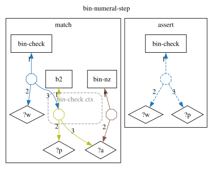
<!-- /rule -->

#### `bin-numeral-step-zero`

The place holds the bit 0: the walk goes on to the prefix.

<!-- rule std.math.binary bin-numeral-step-zero -->
```lisp
(rule bin-numeral-step-zero ()
  :match  (bin-check ?w (b2 ?p 0))
  :assert (bin-check ?w ?p)
  :why    "the bit 0 is one: {?p} is still to check")
```

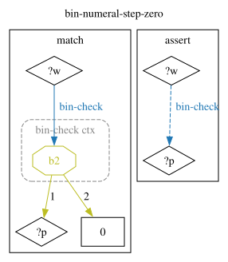
<!-- /rule -->

#### `bin-numeral-valid`

The walk reached `z`: every place held a bit, and the numeral is labelled `(bin-valid N)`.

<!-- rule std.math.binary bin-numeral-valid -->
```lisp
(rule bin-numeral-valid ()
  :match  (bin-check ?w z)
  :assert (bin-valid ?w)
  :why    "every place of {?w} holds a bit, and it ends in z: it is a binary number")
```

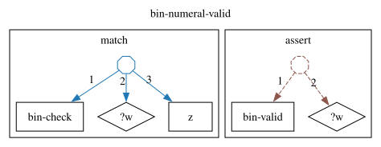
<!-- /rule -->

#### `bin-numeral-bit`

<!-- rule std.math.binary bin-numeral-bit -->
```lisp
(rule bin-numeral-bit ()
  :match  (and (bin-check ?w (b2 ?p ?a)) (neq ?a 0) (neq ?a 1))
  :assert (not-binary (b2 ?p ?a) ?a)
  :why    "{?a} stands where a bit goes and is neither of the two")
```

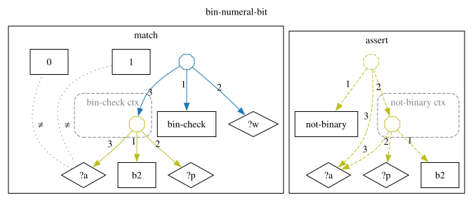
<!-- /rule -->

#### `bin-numeral-prefix-bit`

<!-- rule std.math.binary bin-numeral-prefix-bit -->
```lisp
(rule bin-numeral-prefix-bit ()
  :match  (and (bin-check ?w (b2 ?m ?a)) (bin-nz ?m))
  :assert (not-binary (b2 ?m ?a) ?m)
  :why    "the bit {?m} stands where a number goes: a number ends in z")
```

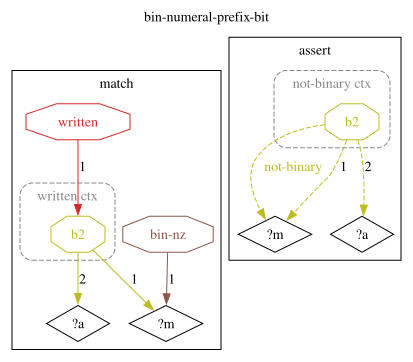
<!-- /rule -->

#### `bin-numeral-prefix-zero`

<!-- rule std.math.binary bin-numeral-prefix-zero -->
```lisp
(rule bin-numeral-prefix-zero ()
  :match  (bin-check ?w (b2 0 ?a))
  :assert (not-binary (b2 0 ?a) 0)
  :why    "the bit 0 stands where a number goes: a number ends in z")
```

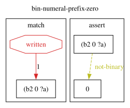
<!-- /rule -->

#### `bin-numeral-prefix-named`

<!-- rule std.math.binary bin-numeral-prefix-named -->
```lisp
(rule bin-numeral-prefix-named ()
  :match  (and (bin-check ?w (b2 ?m ?a)) (neq ?m z) (bin-named ?m))
  :assert (not-binary (b2 ?m ?a) ?m)
  :why    "the name {?m} stands where a number goes: a name stands for a number as an operand, not inside one")
```

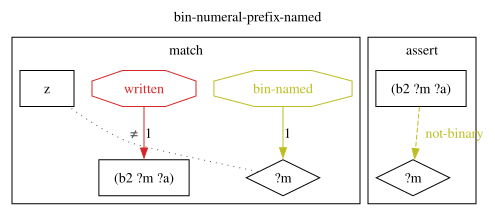
<!-- /rule -->

#### `not-binary-is-false`

<!-- rule std.math.binary not-binary-is-false -->
```lisp
(rule not-binary-is-false ()
  :match  (not-binary ?x ?thing)
  :assert (false)
  :why    "{?x} is not a binary number: the program cannot hold it")
```

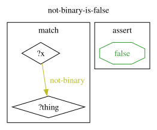
<!-- /rule -->

#### `binary`

<!-- rule std.math.binary binary -->
```lisp
(rule binary ()
  :match  ()
  :assert (and (__closed__ bin-nz)
               (__closed__ b2) (__closed__ bin-named) (__closed__ bin-check)
               (__closed__ bin-valid) (__closed__ not-binary)
               (__closed__ binary-rule)
               (bin-valid z)
               (binary-rule arith)
               (binary-rule bin-numeral-step) (binary-rule bin-numeral-step-zero)
               (binary-rule bin-numeral-valid)
               (binary-rule bin-numeral-bit) (binary-rule bin-numeral-prefix-bit)
               (binary-rule bin-numeral-prefix-zero)
               (binary-rule bin-numeral-prefix-named)
               (binary-rule not-binary-is-false))
  :why    "a numeral is written, and never guessed: every relation of the module is closed")
```

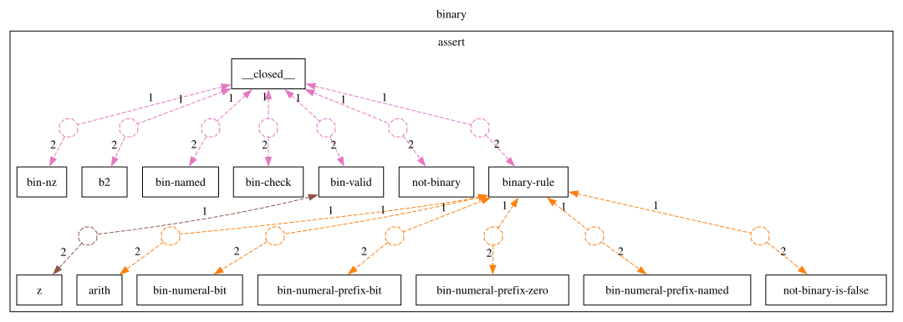
<!-- /rule -->

## `std.math.binary-arith`

### Multiplication: a row is nothing or the multiplicand

From the multiplier's top bit: twice the sum so far, plus the multiplicand where the bit is `1`. Twice a number is
one addition walk of the number with itself.

#### `bin-mul-one`

<!-- rule std.math.binary-arith bin-mul-one -->
```lisp
(rule bin-mul-one ()
  :match  (bin-mul-step ?k ?u (bin-b 1 ?rest) (b2 ?p ?a))
  :assert (bin-add-walk (bin-mul-sum ?k ?u ?rest) (b2 (b2 ?p ?a) 0) ?u 0 z)
  :why    "the next bit of the multiplier is 1: twice the sum so far, plus {?u}")
```

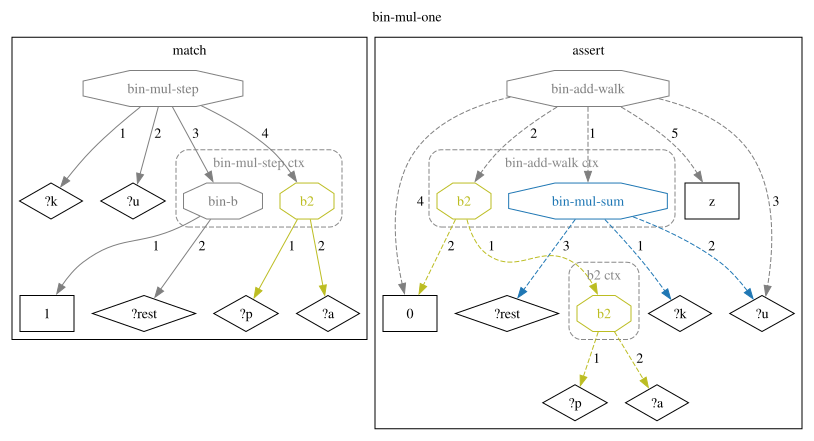
<!-- /rule -->

#### `bin-mul-one-first`

<!-- rule std.math.binary-arith bin-mul-one-first -->
```lisp
(rule bin-mul-one-first ()
  :match  (bin-mul-step ?k ?u (bin-b 1 ?rest) z)
  :assert (bin-add-walk (bin-mul-sum ?k ?u ?rest) z ?u 0 z)
  :why    "the next bit of the multiplier is 1 and nothing is summed yet: the sum is {?u}, in normal form")
```

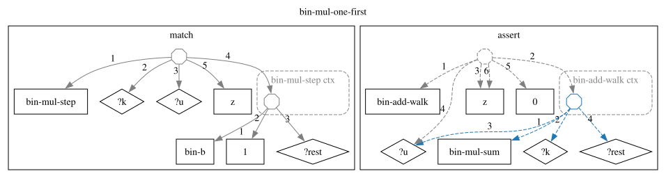
<!-- /rule -->

#### `bin-mul-zero`

<!-- rule std.math.binary-arith bin-mul-zero -->
```lisp
(rule bin-mul-zero ()
  :match  (bin-mul-step ?k ?u (bin-b 0 ?rest) (b2 ?p ?a))
  :assert (bin-mul-step ?k ?u ?rest (b2 (b2 ?p ?a) 0))
  :why    "the next bit of the multiplier is 0: twice the sum so far")
```

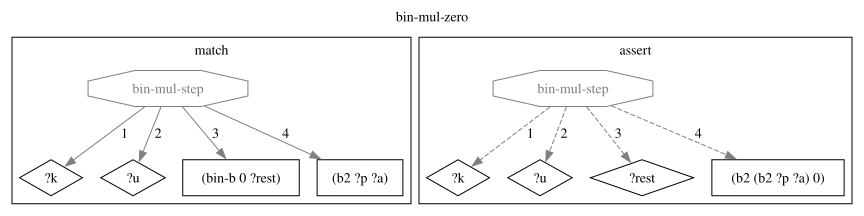
<!-- /rule -->

#### `bin-mul-zero-first`

<!-- rule std.math.binary-arith bin-mul-zero-first -->
```lisp
(rule bin-mul-zero-first ()
  :match  (bin-mul-step ?k ?u (bin-b 0 ?rest) z)
  :assert (bin-mul-step ?k ?u ?rest z)
  :why    "the next bit of the multiplier is 0 and nothing is summed yet")
```

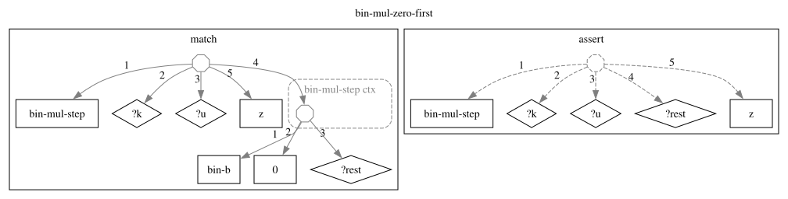
<!-- /rule -->

### Division: one subtraction a bit

Each bit of the dividend, from the top, is brought down beside what is left over, and one subtraction walk tries
to take the divisor from it: it fits, and the quotient's next bit is `1`, or it does not, and the bit is `0`.

#### `bin-div-multiples`

<!-- rule std.math.binary-arith bin-div-multiples -->
```lisp
(rule bin-div-multiples ()
  :match  (bin-div-call ?k ?u ?v)
  :assert (bin-add-walk (bin-div-m1 ?k ?u ?v) z ?v 0 z)
  :why    "to divide {?u} by {?v}: first the divisor in normal form, zero plus {?v}")
```

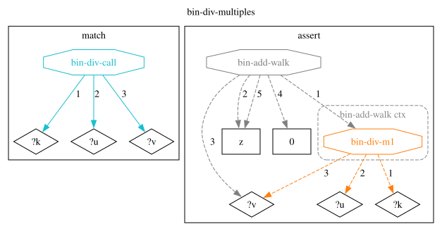
<!-- /rule -->

#### `bin-div-turn`

<!-- rule std.math.binary-arith bin-div-turn -->
```lisp
(rule bin-div-turn ()
  :match  (bin-done (bin-div-m1 ?k ?u ?v) (b2 ?p ?a))
  :assert (bin-top-first (bin-div-digits ?k (b2 ?p ?a)) ?u z)
  :why    "the divisor is not zero. Now the bits of {?u}, the top one first")
```

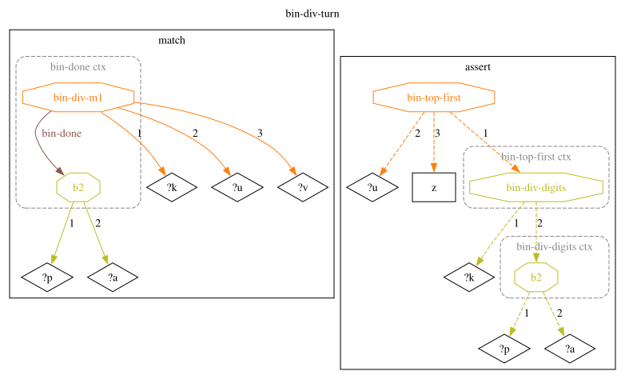
<!-- /rule -->

#### `bin-div-bring`

<!-- rule std.math.binary-arith bin-div-bring -->
```lisp
(rule bin-div-bring ()
  :match  (bin-div-step ?k ?d (bin-b ?a ?rest) (b2 ?p ?c) ?w)
  :assert (bin-sub-walk (bin-div-trial ?k ?d ?rest ?w (b2 (b2 ?p ?c) ?a)) (b2 (b2 ?p ?c) ?a) ?d 0 z)
  :why    "bring down {?a} beside what is left over, and try to take the divisor from it")
```

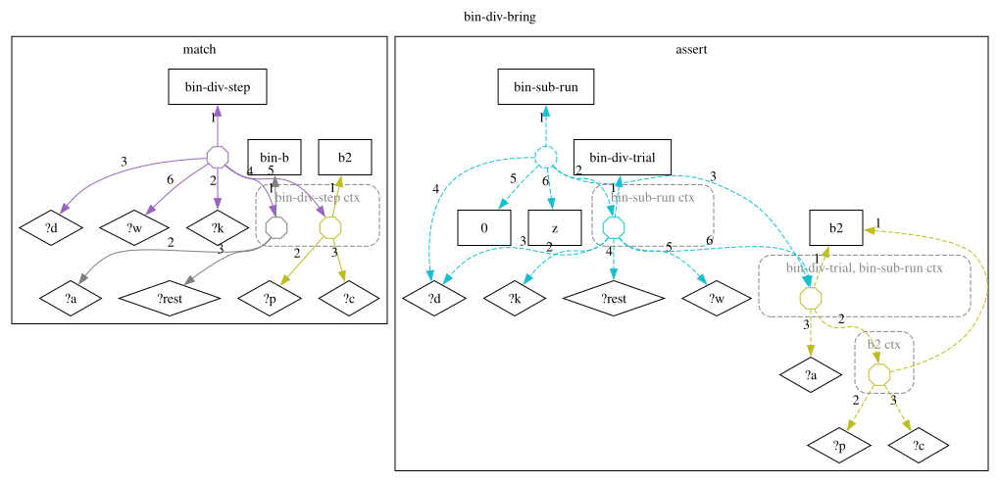
<!-- /rule -->

#### `bin-div-bring-first`

<!-- rule std.math.binary-arith bin-div-bring-first -->
```lisp
(rule bin-div-bring-first ()
  :match  (bin-div-step ?k ?d (bin-b 1 ?rest) z ?w)
  :assert (bin-sub-walk (bin-div-trial ?k ?d ?rest ?w (b2 z 1)) (b2 z 1) ?d 0 z)
  :why    "nothing was left over: bring down 1, and try to take the divisor from it")
```

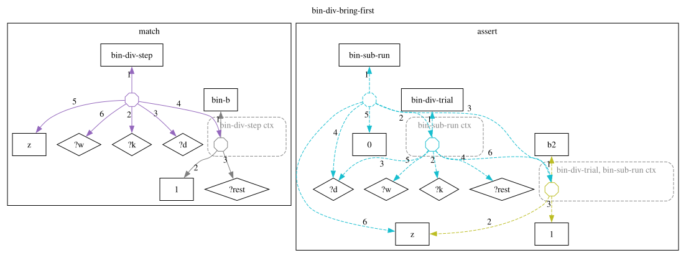
<!-- /rule -->

#### `bin-div-bring-zero`

<!-- rule std.math.binary-arith bin-div-bring-zero -->
```lisp
(rule bin-div-bring-zero ()
  :match  (bin-div-step ?k ?d (bin-b 0 ?rest) z (b2 ?p ?c))
  :assert (bin-div-step ?k ?d ?rest z (b2 (b2 ?p ?c) 0))
  :why    "nothing was left over and the bit brought down is 0: the next bit of the quotient is 0")
```

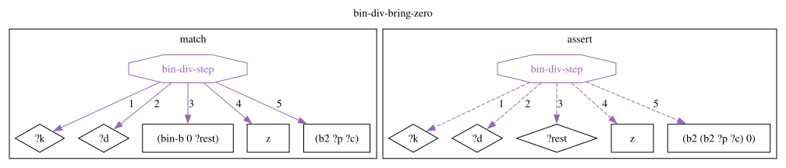
<!-- /rule -->

#### `bin-div-bring-zero-none`

<!-- rule std.math.binary-arith bin-div-bring-zero-none -->
```lisp
(rule bin-div-bring-zero-none ()
  :match  (bin-div-step ?k ?d (bin-b 0 ?rest) z z)
  :assert (bin-div-step ?k ?d ?rest z z)
  :why    "nothing was left over, the bit brought down is 0 and the quotient so far is zero: no high zero is written")
```

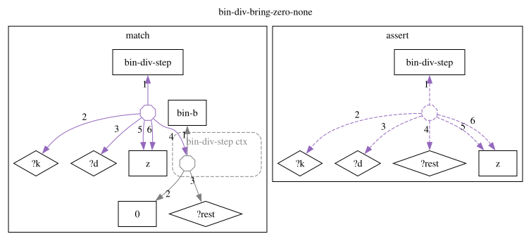
<!-- /rule -->

#### `bin-div-fits`

<!-- rule std.math.binary-arith bin-div-fits -->
```lisp
(rule bin-div-fits ()
  :match  (bin-done (bin-div-trial ?k ?d ?rest ?w ?u) ?t)
  :assert (bin-div-step ?k ?d ?rest ?t (b2 ?w 1))
  :why    "the divisor fits, and leaves {?t}: the next bit of the quotient is 1")
```

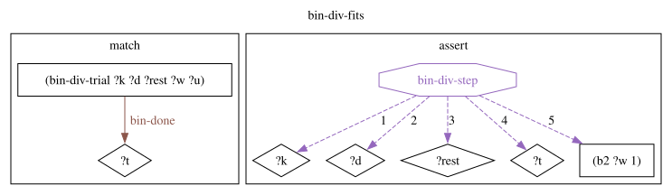
<!-- /rule -->

#### `bin-div-too-big`

<!-- rule std.math.binary-arith bin-div-too-big -->
```lisp
(rule bin-div-too-big ()
  :match  (bin-short (bin-div-trial ?k ?d ?rest (b2 ?p ?c) ?u))
  :assert (bin-div-step ?k ?d ?rest ?u (b2 (b2 ?p ?c) 0))
  :why    "the divisor does not fit: the next bit of the quotient is 0")
```

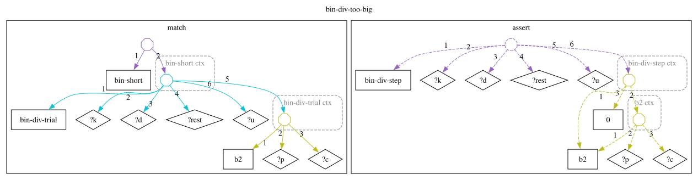
<!-- /rule -->

#### `bin-div-too-big-none`

<!-- rule std.math.binary-arith bin-div-too-big-none -->
```lisp
(rule bin-div-too-big-none ()
  :match  (bin-short (bin-div-trial ?k ?d ?rest z ?u))
  :assert (bin-div-step ?k ?d ?rest ?u z)
  :why    "the divisor does not fit and the quotient so far is zero: no high zero is written")
```

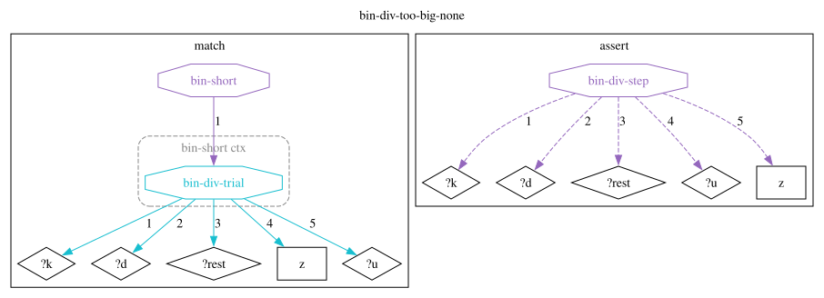
<!-- /rule -->

### An operand that is a name no `bin-let` states

The one `absent` of the theory, over its own `bin-let`.

#### `bin-operand-undeclared`

<!-- rule std.math.binary-arith bin-operand-undeclared -->
```lisp
(rule bin-operand-undeclared ()
  :match  (and (bin-operand ?k ?x)
               (neq ?v z) (eq ?v ?x)
               (neq ?x 0) (neq ?x 1)
               (absent (bin-let ?x ?w)))
  :assert (bin-bad-operand ?k (bin-no-let ?x))
  :why    "{?x} is a name, and no let states it")
```

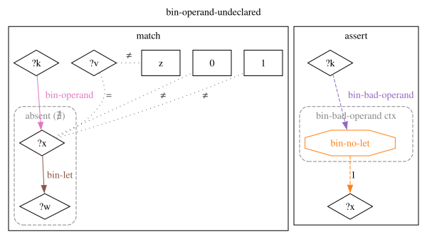
<!-- /rule -->

### The entry

The closing rule: it closes the held extent of every relation of the module and of the tables of `std.math.bits`, names the entries
`arith` and `binary` and each rule above, and calls the macro `positional` once with binary's relations. Its
drawing is not shown.

#### `binary-arith`

<!-- rule std.math.binary-arith binary-arith -->
```lisp
(rule binary-arith ()
  :match  ()
  :assert (and (__closed__ bin-fa) (__closed__ bin-fs) (__closed__ bin-cl) (__closed__ bin-nz)
               (__closed__ bin-b)
               (__closed__ bin-let) (__closed__ bin-add) (__closed__ bin-sum-of)
               (__closed__ bin-sub) (__closed__ bin-diff-of)
               (__closed__ bin-cmp) (__closed__ bin-cmp-of)
               (__closed__ bin-mul) (__closed__ bin-product-of)
               (__closed__ bin-div) (__closed__ bin-quot-of)
               (__closed__ bin-operand) (__closed__ bin-operand-is)
               (__closed__ bin-add-walk) (__closed__ bin-strip) (__closed__ bin-turn)
               (__closed__ bin-done)
               (__closed__ bin-sub-walk) (__closed__ bin-short)
               (__closed__ bin-cmp-walk) (__closed__ bin-order-is)
               (__closed__ bin-top-first) (__closed__ bin-top-first-is)
               (__closed__ bin-mul-call) (__closed__ bin-mul-step)
               (__closed__ bin-div-call) (__closed__ bin-div-done) (__closed__ bin-div-step)
               (__closed__ bin-sum) (__closed__ bin-add-first) (__closed__ bin-add-second)
               (__closed__ bin-difference) (__closed__ bin-shortfall)
               (__closed__ bin-sub-first) (__closed__ bin-sub-second)
               (__closed__ bin-order) (__closed__ bin-cmp-first) (__closed__ bin-cmp-second)
               (__closed__ bin-product) (__closed__ bin-mul-first) (__closed__ bin-mul-second)
               (__closed__ bin-mul-digits) (__closed__ bin-mul-sum)
               (__closed__ bin-quotient) (__closed__ bin-div-first) (__closed__ bin-div-second)
               (__closed__ bin-div-m1) (__closed__ bin-div-digits) (__closed__ bin-div-trial)
               (__closed__ bin-malformed) (__closed__ bin-undeclared)
               (__closed__ bin-bad-operand) (__closed__ bin-bad-request)
               (__closed__ bin-not-a-number) (__closed__ bin-no-let)
               (__closed__ bin-arith-rule)
               (bin-arith-rule arith) (bin-arith-rule binary)
               (bin-arith-rule bin-mul-one) (bin-arith-rule bin-mul-one-first)
               (bin-arith-rule bin-mul-zero) (bin-arith-rule bin-mul-zero-first)
               (bin-arith-rule bin-div-multiples) (bin-arith-rule bin-div-turn)
               (bin-arith-rule bin-div-bring) (bin-arith-rule bin-div-bring-first)
               (bin-arith-rule bin-div-bring-zero) (bin-arith-rule bin-div-bring-zero-none)
               (bin-arith-rule bin-div-fits) (bin-arith-rule bin-div-too-big)
               (bin-arith-rule bin-div-too-big-none)
               (bin-arith-rule bin-operand-undeclared)
               (positional bin-operand bin-operand-is b2 bin-let bin-named bin-check bin-add-walk
                           bin-fa bin-b bin-strip bin-turn bin-nz bin-done bin-valid bin-add
                           bin-add-first bin-add-second bin-sum bin-sum-of bin-sub-walk bin-fs
                           bin-short bin-sub bin-sub-first bin-sub-second bin-difference
                           bin-shortfall bin-diff-of bin-cmp-walk bin-cl bin-order-is bin-cmp
                           bin-cmp-first bin-cmp-second bin-order bin-cmp-of bin-top-first
                           bin-top-first-is bin-mul-call bin-mul-digits bin-mul-step bin-mul-sum
                           bin-mul bin-mul-first bin-mul-second bin-product bin-product-of
                           bin-div-digits bin-div-step bin-div-done bin-div bin-div-first
                           bin-div-second bin-div-call bin-quotient bin-quot-of bin-div-m1
                           bin-bad-operand bin-not-a-number bin-malformed bin-bad-request bin-no-let
                           bin-undeclared))
  :why    "binary arithmetic is computed and never guessed: every relation of the theory is closed")
```
<!-- /rule -->

## `std.math.convert`

### Decimal to binary

X is halved by decimal's tagged division until nothing is left; each remainder is a bit, put in front of the bits
so far.

#### `to-bin-ask`

<!-- rule std.math.convert to-bin-ask -->
```lisp
(rule to-bin-ask ()
  :match  (to-bin ?x)
  :assert (and (check ?x ?x) (to-bin-go ?x ?x z))
  :why    "{?x} in binary is asked: it is checked as a number, and halved until nothing is left")
```

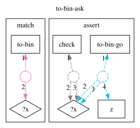
<!-- /rule -->

#### `to-bin-halve`

<!-- rule std.math.convert to-bin-halve -->
```lisp
(rule to-bin-halve ()
  :match  (to-bin-go ?x (n ?p ?a) ?acc)
  :assert (div-call (halving ?x ?acc) (n ?p ?a) (n z 2))
  :why    "divide {?p}{?a} by two: the remainder is the next bit")
```

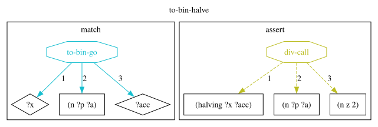
<!-- /rule -->

#### `to-bin-bit-0`

<!-- rule std.math.convert to-bin-bit-0 -->
```lisp
(rule to-bin-bit-0 ()
  :match  (div-done (halving ?x ?acc) ?q z)
  :assert (to-bin-go ?x ?q (bin-b 0 ?acc))
  :why    "the remainder is nothing: the bit 0 goes in front of the bits so far")
```

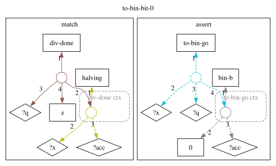
<!-- /rule -->

#### `to-bin-bit-1`

<!-- rule std.math.convert to-bin-bit-1 -->
```lisp
(rule to-bin-bit-1 ()
  :match  (div-done (halving ?x ?acc) ?q (n z 1))
  :assert (to-bin-go ?x ?q (bin-b 1 ?acc))
  :why    "the remainder is 1: the bit 1 goes in front of the bits so far")
```

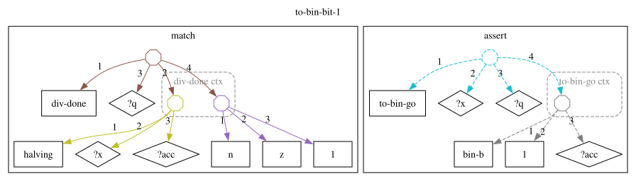
<!-- /rule -->

#### `to-bin-end`

<!-- rule std.math.convert to-bin-end -->
```lisp
(rule to-bin-end ()
  :match  (to-bin-go ?x z ?acc)
  :assert (bin-strip (bits ?x) ?acc)
  :why    "nothing is left to halve: the bits are {?acc}, the top one first")
```

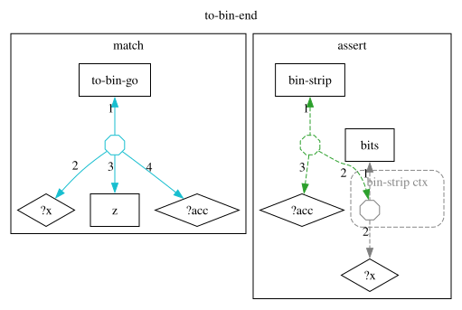
<!-- /rule -->

#### `to-bin-answer`

<!-- rule std.math.convert to-bin-answer -->
```lisp
(rule to-bin-answer ()
  :match  (bin-done (bits ?x) ?b)
  :assert (bin-of ?x ?b)
  :why    "{?x} is {?b} in binary")
```

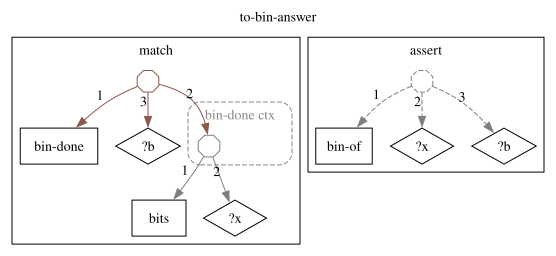
<!-- /rule -->

### Binary to decimal

B's bits are turned round so that the top one comes first; the number so far, a decimal number, is doubled by one
addition walk with itself, the next bit as its carry in.

#### `to-dec-ask`

<!-- rule std.math.convert to-dec-ask -->
```lisp
(rule to-dec-ask ()
  :match  (to-dec ?b)
  :assert (and (bin-check ?b ?b) (bin-top-first (dec-bits ?b) ?b z))
  :why    "{?b} in decimal is asked: it is checked as a binary number, and its bits are read, the top one first")
```

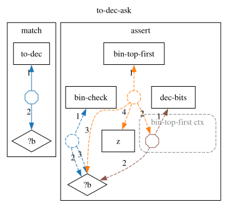
<!-- /rule -->

#### `to-dec-begin`

<!-- rule std.math.convert to-dec-begin -->
```lisp
(rule to-dec-begin ()
  :match  (bin-top-first-is (dec-bits ?b) ?t)
  :assert (to-dec-go ?b ?t z)
  :why    "start from the top bit: the number so far is zero")
```

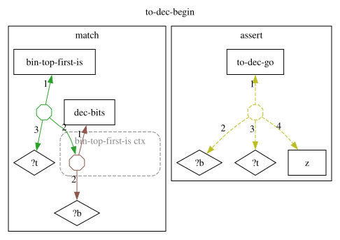
<!-- /rule -->

#### `to-dec-double`

<!-- rule std.math.convert to-dec-double -->
```lisp
(rule to-dec-double ()
  :match  (to-dec-go ?b (bin-b ?bit ?rest) ?acc)
  :assert (add-walk (doubling ?b ?rest) ?acc ?acc ?bit z)
  :why    "the next bit is {?bit}: the number so far, plus itself, plus the bit as the carry in")
```

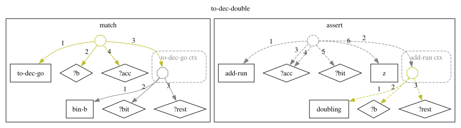
<!-- /rule -->

#### `to-dec-next`

<!-- rule std.math.convert to-dec-next -->
```lisp
(rule to-dec-next ()
  :match  (done (doubling ?b ?rest) ?s)
  :assert (to-dec-go ?b ?rest ?s)
  :why    "the number so far is {?s}")
```

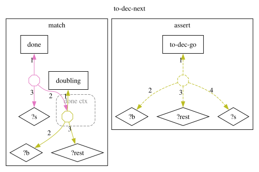
<!-- /rule -->

#### `to-dec-answer`

<!-- rule std.math.convert to-dec-answer -->
```lisp
(rule to-dec-answer ()
  :match  (to-dec-go ?b z ?acc)
  :assert (dec-of ?b ?acc)
  :why    "{?b} in binary is {?acc}")
```

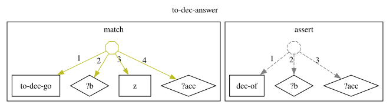
<!-- /rule -->

### The entry

#### `convert`

<!-- rule std.math.convert convert -->
```lisp
(rule convert ()
  :match  ()
  :assert (and (__closed__ to-bin) (__closed__ bin-of) (__closed__ to-dec) (__closed__ dec-of)
               (__closed__ to-bin-go) (__closed__ to-dec-go) (__closed__ halving) (__closed__ bits)
               (__closed__ dec-bits) (__closed__ doubling) (__closed__ convert-rule)
               (convert-rule decimal-arith) (convert-rule binary-arith)
               (convert-rule to-bin-ask) (convert-rule to-bin-halve) (convert-rule to-bin-bit-0)
               (convert-rule to-bin-bit-1) (convert-rule to-bin-end) (convert-rule to-bin-answer)
               (convert-rule to-dec-ask) (convert-rule to-dec-begin) (convert-rule to-dec-double)
               (convert-rule to-dec-next) (convert-rule to-dec-answer))
  :why    "a conversion is computed and never guessed: every relation of the module is closed")
```

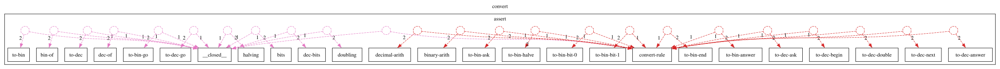
<!-- /rule -->
