# The nine-digit numbers' rules

How `std.math.num9` works: every rule of the module, as it writes it and as the engine draws it. What a program
writes to use it is [the page before](16-nine-digit-numbers.md); how to read a drawing is
[the index](README.md#how-a-rule-is-shown).

None of these rules has a parameter. They are wide: a rule states every column of a number in one `:match`, a
row of a table a column, with the carries as variables two neighbouring rows share. So a drawing here is a rank
of octagons, one a row, over the digits they share, and a rule's `:why` says what the whole firing does. The
module's file is generated, and so is every rule below.

## Addition

One rule a sum: nine rows of `fa`, the units first. The carry out of the top column is `0` in the one and `1` in
the other, which derives `overflow`.

#### `add9-fits`

<!-- rule std.math.num9 add9-fits -->
```lisp
(rule add9-fits ()
  :match  (and (add9 (num9 ?x8 ?x7 ?x6 ?x5 ?x4 ?x3 ?x2 ?x1 ?x0) (num9 ?y8 ?y7 ?y6 ?y5 ?y4 ?y3 ?y2 ?y1 ?y0))
               (fa ?x0 ?y0 0 ?s0 ?c1)
               (fa ?x1 ?y1 ?c1 ?s1 ?c2)
               (fa ?x2 ?y2 ?c2 ?s2 ?c3)
               (fa ?x3 ?y3 ?c3 ?s3 ?c4)
               (fa ?x4 ?y4 ?c4 ?s4 ?c5)
               (fa ?x5 ?y5 ?c5 ?s5 ?c6)
               (fa ?x6 ?y6 ?c6 ?s6 ?c7)
               (fa ?x7 ?y7 ?c7 ?s7 ?c8)
               (fa ?x8 ?y8 ?c8 ?s8 0))
  :assert (sum9-of (num9 ?x8 ?x7 ?x6 ?x5 ?x4 ?x3 ?x2 ?x1 ?x0) (num9 ?y8 ?y7 ?y6 ?y5 ?y4 ?y3 ?y2 ?y1 ?y0) (num9 ?s8 ?s7 ?s6 ?s5 ?s4 ?s3 ?s2 ?s1 ?s0))
  :why    "each column's digit and carry from the table, the units first; no carry out of the top column")
```

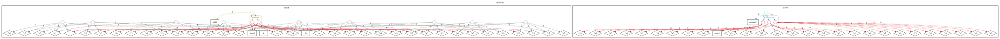
<!-- /rule -->

#### `add9-overflows`

<!-- rule std.math.num9 add9-overflows -->
```lisp
(rule add9-overflows ()
  :match  (and (add9 (num9 ?x8 ?x7 ?x6 ?x5 ?x4 ?x3 ?x2 ?x1 ?x0) (num9 ?y8 ?y7 ?y6 ?y5 ?y4 ?y3 ?y2 ?y1 ?y0))
               (fa ?x0 ?y0 0 ?s0 ?c1)
               (fa ?x1 ?y1 ?c1 ?s1 ?c2)
               (fa ?x2 ?y2 ?c2 ?s2 ?c3)
               (fa ?x3 ?y3 ?c3 ?s3 ?c4)
               (fa ?x4 ?y4 ?c4 ?s4 ?c5)
               (fa ?x5 ?y5 ?c5 ?s5 ?c6)
               (fa ?x6 ?y6 ?c6 ?s6 ?c7)
               (fa ?x7 ?y7 ?c7 ?s7 ?c8)
               (fa ?x8 ?y8 ?c8 ?s8 1))
  :assert (overflow (add9 (num9 ?x8 ?x7 ?x6 ?x5 ?x4 ?x3 ?x2 ?x1 ?x0) (num9 ?y8 ?y7 ?y6 ?y5 ?y4 ?y3 ?y2 ?y1 ?y0)))
  :why    "each column's digit and carry from the table: a carry out of the top column, so the sum has 10 digits")
```

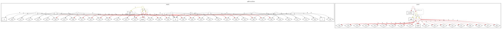
<!-- /rule -->

## Subtraction

Two subtractors, nine rows of `fs` each way, and the one that does not borrow out of the top answers.

#### `sub9-fits`

<!-- rule std.math.num9 sub9-fits -->
```lisp
(rule sub9-fits ()
  :match  (and (sub9 (num9 ?x8 ?x7 ?x6 ?x5 ?x4 ?x3 ?x2 ?x1 ?x0) (num9 ?y8 ?y7 ?y6 ?y5 ?y4 ?y3 ?y2 ?y1 ?y0))
               (fs ?x0 ?y0 0 ?d0 ?c1)
               (fs ?x1 ?y1 ?c1 ?d1 ?c2)
               (fs ?x2 ?y2 ?c2 ?d2 ?c3)
               (fs ?x3 ?y3 ?c3 ?d3 ?c4)
               (fs ?x4 ?y4 ?c4 ?d4 ?c5)
               (fs ?x5 ?y5 ?c5 ?d5 ?c6)
               (fs ?x6 ?y6 ?c6 ?d6 ?c7)
               (fs ?x7 ?y7 ?c7 ?d7 ?c8)
               (fs ?x8 ?y8 ?c8 ?d8 0))
  :assert (diff9-of (num9 ?x8 ?x7 ?x6 ?x5 ?x4 ?x3 ?x2 ?x1 ?x0) (num9 ?y8 ?y7 ?y6 ?y5 ?y4 ?y3 ?y2 ?y1 ?y0) (num9 ?d8 ?d7 ?d6 ?d5 ?d4 ?d3 ?d2 ?d1 ?d0) (num9 0 0 0 0 0 0 0 0 0))
  :why    "the second taken from the first, a column at a time: no borrow out of the top, so the first is not the smaller")
```

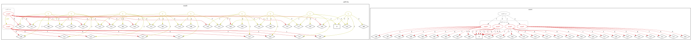
<!-- /rule -->

#### `sub9-short`

<!-- rule std.math.num9 sub9-short -->
```lisp
(rule sub9-short ()
  :match  (and (sub9 (num9 ?x8 ?x7 ?x6 ?x5 ?x4 ?x3 ?x2 ?x1 ?x0) (num9 ?y8 ?y7 ?y6 ?y5 ?y4 ?y3 ?y2 ?y1 ?y0))
               (fs ?y0 ?x0 0 ?r0 ?c1)
               (fs ?y1 ?x1 ?c1 ?r1 ?c2)
               (fs ?y2 ?x2 ?c2 ?r2 ?c3)
               (fs ?y3 ?x3 ?c3 ?r3 ?c4)
               (fs ?y4 ?x4 ?c4 ?r4 ?c5)
               (fs ?y5 ?x5 ?c5 ?r5 ?c6)
               (fs ?y6 ?x6 ?c6 ?r6 ?c7)
               (fs ?y7 ?x7 ?c7 ?r7 ?c8)
               (fs ?y8 ?x8 ?c8 ?r8 0))
  :assert (diff9-of (num9 ?x8 ?x7 ?x6 ?x5 ?x4 ?x3 ?x2 ?x1 ?x0) (num9 ?y8 ?y7 ?y6 ?y5 ?y4 ?y3 ?y2 ?y1 ?y0) (num9 0 0 0 0 0 0 0 0 0) (num9 ?r8 ?r7 ?r6 ?r5 ?r4 ?r3 ?r2 ?r1 ?r0))
  :why    "the first taken from the second, a column at a time: no borrow out of the top, so the first is short by what is left")
```

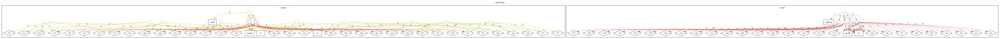
<!-- /rule -->

## Comparison

Nine rows of `cl`, from the units: a higher column overrules the order below.

#### `cmp9-columns`

<!-- rule std.math.num9 cmp9-columns -->
```lisp
(rule cmp9-columns ()
  :match  (and (cmp9 (num9 ?x8 ?x7 ?x6 ?x5 ?x4 ?x3 ?x2 ?x1 ?x0) (num9 ?y8 ?y7 ?y6 ?y5 ?y4 ?y3 ?y2 ?y1 ?y0))
               (cl eq ?x0 ?y0 ?o1)
               (cl ?o1 ?x1 ?y1 ?o2)
               (cl ?o2 ?x2 ?y2 ?o3)
               (cl ?o3 ?x3 ?y3 ?o4)
               (cl ?o4 ?x4 ?y4 ?o5)
               (cl ?o5 ?x5 ?y5 ?o6)
               (cl ?o6 ?x6 ?y6 ?o7)
               (cl ?o7 ?x7 ?y7 ?o8)
               (cl ?o8 ?x8 ?y8 ?o))
  :assert (cmp9-of (num9 ?x8 ?x7 ?x6 ?x5 ?x4 ?x3 ?x2 ?x1 ?x0) (num9 ?y8 ?y7 ?y6 ?y5 ?y4 ?y3 ?y2 ?y1 ?y0) ?o)
  :why    "the comparator's table, a column at a time from the units: a higher column overrules the order below")
```

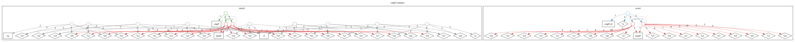
<!-- /rule -->

## Multiplication

The school method from the multiplier's top digit. A step shifts the sum so far one place, multiplies the
multiplicand by the digit through nine rows of `md`, and adds the row through nine rows of `fa`. Three rules say
where a product does not fit: the shift loses a top digit, the row carries out, or the addition does.

#### `mul9-start`

<!-- rule std.math.num9 mul9-start -->
```lisp
(rule mul9-start ()
  :match  (mul9 (num9 ?x8 ?x7 ?x6 ?x5 ?x4 ?x3 ?x2 ?x1 ?x0) (num9 ?y8 ?y7 ?y6 ?y5 ?y4 ?y3 ?y2 ?y1 ?y0))
  :assert (mul9-at (num9 ?x8 ?x7 ?x6 ?x5 ?x4 ?x3 ?x2 ?x1 ?x0) (num9 ?y8 ?y7 ?y6 ?y5 ?y4 ?y3 ?y2 ?y1 ?y0) 9 (num9 ?y8 ?y7 ?y6 ?y5 ?y4 ?y3 ?y2 ?y1 ?y0) (num9 0 0 0 0 0 0 0 0 0))
  :why    "start at the multiplier's top digit: 9 digits to go, and nothing summed yet")
```

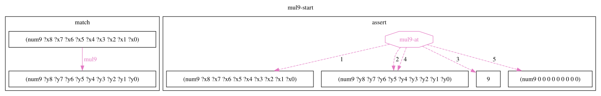
<!-- /rule -->

#### `mul9-step`

<!-- rule std.math.num9 mul9-step -->
```lisp
(rule mul9-step ()
  :match  (and (mul9-at (num9 ?x8 ?x7 ?x6 ?x5 ?x4 ?x3 ?x2 ?x1 ?x0) ?y ?k (num9 ?y8 ?y7 ?y6 ?y5 ?y4 ?y3 ?y2 ?y1 ?y0) (num9 0 ?a7 ?a6 ?a5 ?a4 ?a3 ?a2 ?a1 ?a0))
               (nz ?y8)
               (adj ?j ?k)
               (md ?x0 ?y8 0 ?p0 ?m1)
               (md ?x1 ?y8 ?m1 ?p1 ?m2)
               (md ?x2 ?y8 ?m2 ?p2 ?m3)
               (md ?x3 ?y8 ?m3 ?p3 ?m4)
               (md ?x4 ?y8 ?m4 ?p4 ?m5)
               (md ?x5 ?y8 ?m5 ?p5 ?m6)
               (md ?x6 ?y8 ?m6 ?p6 ?m7)
               (md ?x7 ?y8 ?m7 ?p7 ?m8)
               (md ?x8 ?y8 ?m8 ?p8 0)
               (fa 0 ?p0 0 ?s0 ?c1)
               (fa ?a0 ?p1 ?c1 ?s1 ?c2)
               (fa ?a1 ?p2 ?c2 ?s2 ?c3)
               (fa ?a2 ?p3 ?c3 ?s3 ?c4)
               (fa ?a3 ?p4 ?c4 ?s4 ?c5)
               (fa ?a4 ?p5 ?c5 ?s5 ?c6)
               (fa ?a5 ?p6 ?c6 ?s6 ?c7)
               (fa ?a6 ?p7 ?c7 ?s7 ?c8)
               (fa ?a7 ?p8 ?c8 ?s8 0))
  :assert (mul9-at (num9 ?x8 ?x7 ?x6 ?x5 ?x4 ?x3 ?x2 ?x1 ?x0) ?y ?j (num9 ?y7 ?y6 ?y5 ?y4 ?y3 ?y2 ?y1 ?y0 0) (num9 ?s8 ?s7 ?s6 ?s5 ?s4 ?s3 ?s2 ?s1 ?s0))
  :why    "the multiplicand times the digit {?y8}, a column at a time, added to the sum so far shifted one place")
```

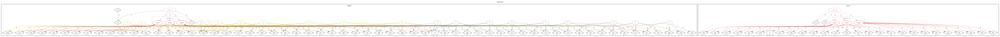
<!-- /rule -->

#### `mul9-step-zero`

<!-- rule std.math.num9 mul9-step-zero -->
```lisp
(rule mul9-step-zero ()
  :match  (and (mul9-at ?x ?y ?k (num9 0 ?y7 ?y6 ?y5 ?y4 ?y3 ?y2 ?y1 ?y0) (num9 0 ?a7 ?a6 ?a5 ?a4 ?a3 ?a2 ?a1 ?a0))
               (adj ?j ?k))
  :assert (mul9-at ?x ?y ?j (num9 ?y7 ?y6 ?y5 ?y4 ?y3 ?y2 ?y1 ?y0 0) (num9 ?a7 ?a6 ?a5 ?a4 ?a3 ?a2 ?a1 ?a0 0))
  :why    "the multiplier's next digit is 0: the sum so far shifts one place, and nothing is added")
```

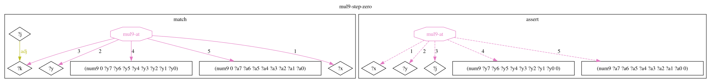
<!-- /rule -->

#### `mul9-done`

<!-- rule std.math.num9 mul9-done -->
```lisp
(rule mul9-done ()
  :match  (mul9-at ?x ?y 0 ?left ?p)
  :assert (product9-of ?x ?y ?p)
  :why    "no digit of the multiplier is left: the sum is the product")
```

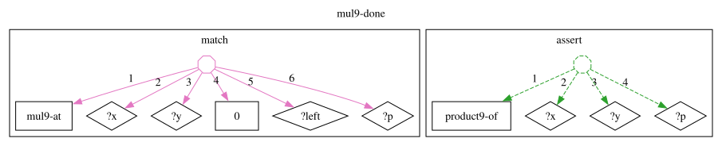
<!-- /rule -->

#### `mul9-overflows-shift`

<!-- rule std.math.num9 mul9-overflows-shift -->
```lisp
(rule mul9-overflows-shift ()
  :match  (and (mul9-at ?x ?y ?k ?left (num9 ?a8 ?a7 ?a6 ?a5 ?a4 ?a3 ?a2 ?a1 ?a0))
               (adj ?j ?k)
               (nz ?a8))
  :assert (overflow (mul9 ?x ?y))
  :why    "the sum so far has a top digit, {?a8}, and must still shift one place")
```

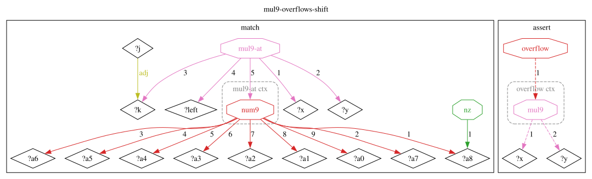
<!-- /rule -->

#### `mul9-overflows-row`

<!-- rule std.math.num9 mul9-overflows-row -->
```lisp
(rule mul9-overflows-row ()
  :match  (and (mul9-at (num9 ?x8 ?x7 ?x6 ?x5 ?x4 ?x3 ?x2 ?x1 ?x0) ?y ?k (num9 ?y8 ?y7 ?y6 ?y5 ?y4 ?y3 ?y2 ?y1 ?y0) ?acc)
               (nz ?y8)
               (md ?x0 ?y8 0 ?p0 ?m1)
               (md ?x1 ?y8 ?m1 ?p1 ?m2)
               (md ?x2 ?y8 ?m2 ?p2 ?m3)
               (md ?x3 ?y8 ?m3 ?p3 ?m4)
               (md ?x4 ?y8 ?m4 ?p4 ?m5)
               (md ?x5 ?y8 ?m5 ?p5 ?m6)
               (md ?x6 ?y8 ?m6 ?p6 ?m7)
               (md ?x7 ?y8 ?m7 ?p7 ?m8)
               (md ?x8 ?y8 ?m8 ?p8 ?c)
               (nz ?c))
  :assert (overflow (mul9 (num9 ?x8 ?x7 ?x6 ?x5 ?x4 ?x3 ?x2 ?x1 ?x0) ?y))
  :why    "the multiplicand times the digit {?y8} carries {?c} out of the top column")
```

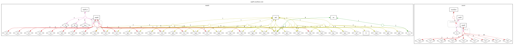
<!-- /rule -->

#### `mul9-overflows-add`

<!-- rule std.math.num9 mul9-overflows-add -->
```lisp
(rule mul9-overflows-add ()
  :match  (and (mul9-at (num9 ?x8 ?x7 ?x6 ?x5 ?x4 ?x3 ?x2 ?x1 ?x0) ?y ?k (num9 ?y8 ?y7 ?y6 ?y5 ?y4 ?y3 ?y2 ?y1 ?y0) (num9 0 ?a7 ?a6 ?a5 ?a4 ?a3 ?a2 ?a1 ?a0))
               (nz ?y8)
               (md ?x0 ?y8 0 ?p0 ?m1)
               (md ?x1 ?y8 ?m1 ?p1 ?m2)
               (md ?x2 ?y8 ?m2 ?p2 ?m3)
               (md ?x3 ?y8 ?m3 ?p3 ?m4)
               (md ?x4 ?y8 ?m4 ?p4 ?m5)
               (md ?x5 ?y8 ?m5 ?p5 ?m6)
               (md ?x6 ?y8 ?m6 ?p6 ?m7)
               (md ?x7 ?y8 ?m7 ?p7 ?m8)
               (md ?x8 ?y8 ?m8 ?p8 0)
               (fa 0 ?p0 0 ?s0 ?c1)
               (fa ?a0 ?p1 ?c1 ?s1 ?c2)
               (fa ?a1 ?p2 ?c2 ?s2 ?c3)
               (fa ?a2 ?p3 ?c3 ?s3 ?c4)
               (fa ?a3 ?p4 ?c4 ?s4 ?c5)
               (fa ?a4 ?p5 ?c5 ?s5 ?c6)
               (fa ?a5 ?p6 ?c6 ?s6 ?c7)
               (fa ?a6 ?p7 ?c7 ?s7 ?c8)
               (fa ?a7 ?p8 ?c8 ?s8 1))
  :assert (overflow (mul9 (num9 ?x8 ?x7 ?x6 ?x5 ?x4 ?x3 ?x2 ?x1 ?x0) ?y))
  :why    "adding the row to the sum so far carries out of the top column")
```

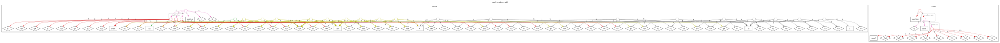
<!-- /rule -->

## Division

School long division. `div9-start` computes the divisor's multiples by one to nine once, and is
shown as Ein alone: its drawing has more nodes than a page can show. A step brings a digit down and finds the
quotient's digit as the one multiple that goes into the number with no borrow and leaves less than the divisor,
one rule a digit.

#### `div9-start`

<!-- rule std.math.num9 div9-start -->
```lisp
(rule div9-start ()
  :match  (and (div9 (num9 ?n8 ?n7 ?n6 ?n5 ?n4 ?n3 ?n2 ?n1 ?n0) (num9 ?d8 ?d7 ?d6 ?d5 ?d4 ?d3 ?d2 ?d1 ?d0))
               (md ?d0 2 0 ?m2p0 ?m2c1)
               (md ?d1 2 ?m2c1 ?m2p1 ?m2c2)
               (md ?d2 2 ?m2c2 ?m2p2 ?m2c3)
               (md ?d3 2 ?m2c3 ?m2p3 ?m2c4)
               (md ?d4 2 ?m2c4 ?m2p4 ?m2c5)
               (md ?d5 2 ?m2c5 ?m2p5 ?m2c6)
               (md ?d6 2 ?m2c6 ?m2p6 ?m2c7)
               (md ?d7 2 ?m2c7 ?m2p7 ?m2c8)
               (md ?d8 2 ?m2c8 ?m2p8 ?m2c)
               (md ?d0 3 0 ?m3p0 ?m3c1)
               (md ?d1 3 ?m3c1 ?m3p1 ?m3c2)
               (md ?d2 3 ?m3c2 ?m3p2 ?m3c3)
               (md ?d3 3 ?m3c3 ?m3p3 ?m3c4)
               (md ?d4 3 ?m3c4 ?m3p4 ?m3c5)
               (md ?d5 3 ?m3c5 ?m3p5 ?m3c6)
               (md ?d6 3 ?m3c6 ?m3p6 ?m3c7)
               (md ?d7 3 ?m3c7 ?m3p7 ?m3c8)
               (md ?d8 3 ?m3c8 ?m3p8 ?m3c)
               (md ?d0 4 0 ?m4p0 ?m4c1)
               (md ?d1 4 ?m4c1 ?m4p1 ?m4c2)
               (md ?d2 4 ?m4c2 ?m4p2 ?m4c3)
               (md ?d3 4 ?m4c3 ?m4p3 ?m4c4)
               (md ?d4 4 ?m4c4 ?m4p4 ?m4c5)
               (md ?d5 4 ?m4c5 ?m4p5 ?m4c6)
               (md ?d6 4 ?m4c6 ?m4p6 ?m4c7)
               (md ?d7 4 ?m4c7 ?m4p7 ?m4c8)
               (md ?d8 4 ?m4c8 ?m4p8 ?m4c)
               (md ?d0 5 0 ?m5p0 ?m5c1)
               (md ?d1 5 ?m5c1 ?m5p1 ?m5c2)
               (md ?d2 5 ?m5c2 ?m5p2 ?m5c3)
               (md ?d3 5 ?m5c3 ?m5p3 ?m5c4)
               (md ?d4 5 ?m5c4 ?m5p4 ?m5c5)
               (md ?d5 5 ?m5c5 ?m5p5 ?m5c6)
               (md ?d6 5 ?m5c6 ?m5p6 ?m5c7)
               (md ?d7 5 ?m5c7 ?m5p7 ?m5c8)
               (md ?d8 5 ?m5c8 ?m5p8 ?m5c)
               (md ?d0 6 0 ?m6p0 ?m6c1)
               (md ?d1 6 ?m6c1 ?m6p1 ?m6c2)
               (md ?d2 6 ?m6c2 ?m6p2 ?m6c3)
               (md ?d3 6 ?m6c3 ?m6p3 ?m6c4)
               (md ?d4 6 ?m6c4 ?m6p4 ?m6c5)
               (md ?d5 6 ?m6c5 ?m6p5 ?m6c6)
               (md ?d6 6 ?m6c6 ?m6p6 ?m6c7)
               (md ?d7 6 ?m6c7 ?m6p7 ?m6c8)
               (md ?d8 6 ?m6c8 ?m6p8 ?m6c)
               (md ?d0 7 0 ?m7p0 ?m7c1)
               (md ?d1 7 ?m7c1 ?m7p1 ?m7c2)
               (md ?d2 7 ?m7c2 ?m7p2 ?m7c3)
               (md ?d3 7 ?m7c3 ?m7p3 ?m7c4)
               (md ?d4 7 ?m7c4 ?m7p4 ?m7c5)
               (md ?d5 7 ?m7c5 ?m7p5 ?m7c6)
               (md ?d6 7 ?m7c6 ?m7p6 ?m7c7)
               (md ?d7 7 ?m7c7 ?m7p7 ?m7c8)
               (md ?d8 7 ?m7c8 ?m7p8 ?m7c)
               (md ?d0 8 0 ?m8p0 ?m8c1)
               (md ?d1 8 ?m8c1 ?m8p1 ?m8c2)
               (md ?d2 8 ?m8c2 ?m8p2 ?m8c3)
               (md ?d3 8 ?m8c3 ?m8p3 ?m8c4)
               (md ?d4 8 ?m8c4 ?m8p4 ?m8c5)
               (md ?d5 8 ?m8c5 ?m8p5 ?m8c6)
               (md ?d6 8 ?m8c6 ?m8p6 ?m8c7)
               (md ?d7 8 ?m8c7 ?m8p7 ?m8c8)
               (md ?d8 8 ?m8c8 ?m8p8 ?m8c)
               (md ?d0 9 0 ?m9p0 ?m9c1)
               (md ?d1 9 ?m9c1 ?m9p1 ?m9c2)
               (md ?d2 9 ?m9c2 ?m9p2 ?m9c3)
               (md ?d3 9 ?m9c3 ?m9p3 ?m9c4)
               (md ?d4 9 ?m9c4 ?m9p4 ?m9c5)
               (md ?d5 9 ?m9c5 ?m9p5 ?m9c6)
               (md ?d6 9 ?m9c6 ?m9p6 ?m9c7)
               (md ?d7 9 ?m9c7 ?m9p7 ?m9c8)
               (md ?d8 9 ?m9c8 ?m9p8 ?m9c))
  :assert (div9-at (num9 ?n8 ?n7 ?n6 ?n5 ?n4 ?n3 ?n2 ?n1 ?n0) (num9 ?d8 ?d7 ?d6 ?d5 ?d4 ?d3 ?d2 ?d1 ?d0) (multiples9 (row9 0 ?d8 ?d7 ?d6 ?d5 ?d4 ?d3 ?d2 ?d1 ?d0) (row9 ?m2c ?m2p8 ?m2p7 ?m2p6 ?m2p5 ?m2p4 ?m2p3 ?m2p2 ?m2p1 ?m2p0) (row9 ?m3c ?m3p8 ?m3p7 ?m3p6 ?m3p5 ?m3p4 ?m3p3 ?m3p2 ?m3p1 ?m3p0) (row9 ?m4c ?m4p8 ?m4p7 ?m4p6 ?m4p5 ?m4p4 ?m4p3 ?m4p2 ?m4p1 ?m4p0) (row9 ?m5c ?m5p8 ?m5p7 ?m5p6 ?m5p5 ?m5p4 ?m5p3 ?m5p2 ?m5p1 ?m5p0) (row9 ?m6c ?m6p8 ?m6p7 ?m6p6 ?m6p5 ?m6p4 ?m6p3 ?m6p2 ?m6p1 ?m6p0) (row9 ?m7c ?m7p8 ?m7p7 ?m7p6 ?m7p5 ?m7p4 ?m7p3 ?m7p2 ?m7p1 ?m7p0) (row9 ?m8c ?m8p8 ?m8p7 ?m8p6 ?m8p5 ?m8p4 ?m8p3 ?m8p2 ?m8p1 ?m8p0) (row9 ?m9c ?m9p8 ?m9p7 ?m9p6 ?m9p5 ?m9p4 ?m9p3 ?m9p2 ?m9p1 ?m9p0)) 9 (num9 ?n8 ?n7 ?n6 ?n5 ?n4 ?n3 ?n2 ?n1 ?n0) (num9 0 0 0 0 0 0 0 0 0) (num9 0 0 0 0 0 0 0 0 0))
  :why    "the divisor's multiples by 2 to 9, each a column at a time from the table. Start at the dividend's top digit: 9 digits to go, nothing left over, the quotient zero")
```
<!-- /rule -->

#### `div9-step-0`

<!-- rule std.math.num9 div9-step-0 -->
```lisp
(rule div9-step-0 ()
  :match  (and (div9-at ?n (num9 ?d8 ?d7 ?d6 ?d5 ?d4 ?d3 ?d2 ?d1 ?d0) ?ms ?k (num9 ?n8 ?n7 ?n6 ?n5 ?n4 ?n3 ?n2 ?n1 ?n0) (num9 0 ?r7 ?r6 ?r5 ?r4 ?r3 ?r2 ?r1 ?r0) (num9 ?qq ?q7 ?q6 ?q5 ?q4 ?q3 ?q2 ?q1 ?q0))
               (adj ?j ?k)
               (fs ?n8 ?d0 0 ?u0 ?e1)
               (fs ?r0 ?d1 ?e1 ?u1 ?e2)
               (fs ?r1 ?d2 ?e2 ?u2 ?e3)
               (fs ?r2 ?d3 ?e3 ?u3 ?e4)
               (fs ?r3 ?d4 ?e4 ?u4 ?e5)
               (fs ?r4 ?d5 ?e5 ?u5 ?e6)
               (fs ?r5 ?d6 ?e6 ?u6 ?e7)
               (fs ?r6 ?d7 ?e7 ?u7 ?e8)
               (fs ?r7 ?d8 ?e8 ?u8 1))
  :assert (div9-at ?n (num9 ?d8 ?d7 ?d6 ?d5 ?d4 ?d3 ?d2 ?d1 ?d0) ?ms ?j (num9 ?n7 ?n6 ?n5 ?n4 ?n3 ?n2 ?n1 ?n0 0) (num9 ?r7 ?r6 ?r5 ?r4 ?r3 ?r2 ?r1 ?r0 ?n8) (num9 ?q7 ?q6 ?q5 ?q4 ?q3 ?q2 ?q1 ?q0 0))
  :why    "bring down {?n8}: the number is less than the divisor, since taking the divisor from it borrows out of the top. The quotient's next digit is 0")
```

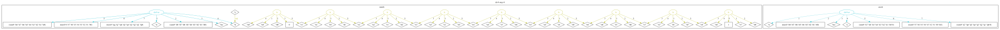
<!-- /rule -->

#### `div9-step-1`

<!-- rule std.math.num9 div9-step-1 -->
```lisp
(rule div9-step-1 ()
  :match  (and (div9-at ?n (num9 ?d8 ?d7 ?d6 ?d5 ?d4 ?d3 ?d2 ?d1 ?d0) (multiples9 (row9 ?pc ?p8 ?p7 ?p6 ?p5 ?p4 ?p3 ?p2 ?p1 ?p0) ?m2 ?m3 ?m4 ?m5 ?m6 ?m7 ?m8 ?m9) ?k (num9 ?n8 ?n7 ?n6 ?n5 ?n4 ?n3 ?n2 ?n1 ?n0) (num9 ?r8 ?r7 ?r6 ?r5 ?r4 ?r3 ?r2 ?r1 ?r0) (num9 ?qq ?q7 ?q6 ?q5 ?q4 ?q3 ?q2 ?q1 ?q0))
               (adj ?j ?k)
               (fs ?n8 ?p0 0 ?t0 ?b1)
               (fs ?r0 ?p1 ?b1 ?t1 ?b2)
               (fs ?r1 ?p2 ?b2 ?t2 ?b3)
               (fs ?r2 ?p3 ?b3 ?t3 ?b4)
               (fs ?r3 ?p4 ?b4 ?t4 ?b5)
               (fs ?r4 ?p5 ?b5 ?t5 ?b6)
               (fs ?r5 ?p6 ?b6 ?t6 ?b7)
               (fs ?r6 ?p7 ?b7 ?t7 ?b8)
               (fs ?r7 ?p8 ?b8 ?t8 ?b9)
               (fs ?r8 ?pc ?b9 0 0)
               (fs ?t0 ?d0 0 ?u0 ?e1)
               (fs ?t1 ?d1 ?e1 ?u1 ?e2)
               (fs ?t2 ?d2 ?e2 ?u2 ?e3)
               (fs ?t3 ?d3 ?e3 ?u3 ?e4)
               (fs ?t4 ?d4 ?e4 ?u4 ?e5)
               (fs ?t5 ?d5 ?e5 ?u5 ?e6)
               (fs ?t6 ?d6 ?e6 ?u6 ?e7)
               (fs ?t7 ?d7 ?e7 ?u7 ?e8)
               (fs ?t8 ?d8 ?e8 ?u8 1))
  :assert (div9-at ?n (num9 ?d8 ?d7 ?d6 ?d5 ?d4 ?d3 ?d2 ?d1 ?d0) (multiples9 (row9 ?pc ?p8 ?p7 ?p6 ?p5 ?p4 ?p3 ?p2 ?p1 ?p0) ?m2 ?m3 ?m4 ?m5 ?m6 ?m7 ?m8 ?m9) ?j (num9 ?n7 ?n6 ?n5 ?n4 ?n3 ?n2 ?n1 ?n0 0) (num9 ?t8 ?t7 ?t6 ?t5 ?t4 ?t3 ?t2 ?t1 ?t0) (num9 ?q7 ?q6 ?q5 ?q4 ?q3 ?q2 ?q1 ?q0 1))
  :why    "bring down {?n8}: 1 times the divisor goes into the number, with no borrow, and what is left is less than the divisor. The quotient's next digit is 1")
```
<!-- /rule -->

#### `div9-step-2`

<!-- rule std.math.num9 div9-step-2 -->
```lisp
(rule div9-step-2 ()
  :match  (and (div9-at ?n (num9 ?d8 ?d7 ?d6 ?d5 ?d4 ?d3 ?d2 ?d1 ?d0) (multiples9 ?m1 (row9 ?pc ?p8 ?p7 ?p6 ?p5 ?p4 ?p3 ?p2 ?p1 ?p0) ?m3 ?m4 ?m5 ?m6 ?m7 ?m8 ?m9) ?k (num9 ?n8 ?n7 ?n6 ?n5 ?n4 ?n3 ?n2 ?n1 ?n0) (num9 ?r8 ?r7 ?r6 ?r5 ?r4 ?r3 ?r2 ?r1 ?r0) (num9 ?qq ?q7 ?q6 ?q5 ?q4 ?q3 ?q2 ?q1 ?q0))
               (adj ?j ?k)
               (fs ?n8 ?p0 0 ?t0 ?b1)
               (fs ?r0 ?p1 ?b1 ?t1 ?b2)
               (fs ?r1 ?p2 ?b2 ?t2 ?b3)
               (fs ?r2 ?p3 ?b3 ?t3 ?b4)
               (fs ?r3 ?p4 ?b4 ?t4 ?b5)
               (fs ?r4 ?p5 ?b5 ?t5 ?b6)
               (fs ?r5 ?p6 ?b6 ?t6 ?b7)
               (fs ?r6 ?p7 ?b7 ?t7 ?b8)
               (fs ?r7 ?p8 ?b8 ?t8 ?b9)
               (fs ?r8 ?pc ?b9 0 0)
               (fs ?t0 ?d0 0 ?u0 ?e1)
               (fs ?t1 ?d1 ?e1 ?u1 ?e2)
               (fs ?t2 ?d2 ?e2 ?u2 ?e3)
               (fs ?t3 ?d3 ?e3 ?u3 ?e4)
               (fs ?t4 ?d4 ?e4 ?u4 ?e5)
               (fs ?t5 ?d5 ?e5 ?u5 ?e6)
               (fs ?t6 ?d6 ?e6 ?u6 ?e7)
               (fs ?t7 ?d7 ?e7 ?u7 ?e8)
               (fs ?t8 ?d8 ?e8 ?u8 1))
  :assert (div9-at ?n (num9 ?d8 ?d7 ?d6 ?d5 ?d4 ?d3 ?d2 ?d1 ?d0) (multiples9 ?m1 (row9 ?pc ?p8 ?p7 ?p6 ?p5 ?p4 ?p3 ?p2 ?p1 ?p0) ?m3 ?m4 ?m5 ?m6 ?m7 ?m8 ?m9) ?j (num9 ?n7 ?n6 ?n5 ?n4 ?n3 ?n2 ?n1 ?n0 0) (num9 ?t8 ?t7 ?t6 ?t5 ?t4 ?t3 ?t2 ?t1 ?t0) (num9 ?q7 ?q6 ?q5 ?q4 ?q3 ?q2 ?q1 ?q0 2))
  :why    "bring down {?n8}: 2 times the divisor goes into the number, with no borrow, and what is left is less than the divisor. The quotient's next digit is 2")
```
<!-- /rule -->

#### `div9-step-3`

<!-- rule std.math.num9 div9-step-3 -->
```lisp
(rule div9-step-3 ()
  :match  (and (div9-at ?n (num9 ?d8 ?d7 ?d6 ?d5 ?d4 ?d3 ?d2 ?d1 ?d0) (multiples9 ?m1 ?m2 (row9 ?pc ?p8 ?p7 ?p6 ?p5 ?p4 ?p3 ?p2 ?p1 ?p0) ?m4 ?m5 ?m6 ?m7 ?m8 ?m9) ?k (num9 ?n8 ?n7 ?n6 ?n5 ?n4 ?n3 ?n2 ?n1 ?n0) (num9 ?r8 ?r7 ?r6 ?r5 ?r4 ?r3 ?r2 ?r1 ?r0) (num9 ?qq ?q7 ?q6 ?q5 ?q4 ?q3 ?q2 ?q1 ?q0))
               (adj ?j ?k)
               (fs ?n8 ?p0 0 ?t0 ?b1)
               (fs ?r0 ?p1 ?b1 ?t1 ?b2)
               (fs ?r1 ?p2 ?b2 ?t2 ?b3)
               (fs ?r2 ?p3 ?b3 ?t3 ?b4)
               (fs ?r3 ?p4 ?b4 ?t4 ?b5)
               (fs ?r4 ?p5 ?b5 ?t5 ?b6)
               (fs ?r5 ?p6 ?b6 ?t6 ?b7)
               (fs ?r6 ?p7 ?b7 ?t7 ?b8)
               (fs ?r7 ?p8 ?b8 ?t8 ?b9)
               (fs ?r8 ?pc ?b9 0 0)
               (fs ?t0 ?d0 0 ?u0 ?e1)
               (fs ?t1 ?d1 ?e1 ?u1 ?e2)
               (fs ?t2 ?d2 ?e2 ?u2 ?e3)
               (fs ?t3 ?d3 ?e3 ?u3 ?e4)
               (fs ?t4 ?d4 ?e4 ?u4 ?e5)
               (fs ?t5 ?d5 ?e5 ?u5 ?e6)
               (fs ?t6 ?d6 ?e6 ?u6 ?e7)
               (fs ?t7 ?d7 ?e7 ?u7 ?e8)
               (fs ?t8 ?d8 ?e8 ?u8 1))
  :assert (div9-at ?n (num9 ?d8 ?d7 ?d6 ?d5 ?d4 ?d3 ?d2 ?d1 ?d0) (multiples9 ?m1 ?m2 (row9 ?pc ?p8 ?p7 ?p6 ?p5 ?p4 ?p3 ?p2 ?p1 ?p0) ?m4 ?m5 ?m6 ?m7 ?m8 ?m9) ?j (num9 ?n7 ?n6 ?n5 ?n4 ?n3 ?n2 ?n1 ?n0 0) (num9 ?t8 ?t7 ?t6 ?t5 ?t4 ?t3 ?t2 ?t1 ?t0) (num9 ?q7 ?q6 ?q5 ?q4 ?q3 ?q2 ?q1 ?q0 3))
  :why    "bring down {?n8}: 3 times the divisor goes into the number, with no borrow, and what is left is less than the divisor. The quotient's next digit is 3")
```
<!-- /rule -->

#### `div9-step-4`

<!-- rule std.math.num9 div9-step-4 -->
```lisp
(rule div9-step-4 ()
  :match  (and (div9-at ?n (num9 ?d8 ?d7 ?d6 ?d5 ?d4 ?d3 ?d2 ?d1 ?d0) (multiples9 ?m1 ?m2 ?m3 (row9 ?pc ?p8 ?p7 ?p6 ?p5 ?p4 ?p3 ?p2 ?p1 ?p0) ?m5 ?m6 ?m7 ?m8 ?m9) ?k (num9 ?n8 ?n7 ?n6 ?n5 ?n4 ?n3 ?n2 ?n1 ?n0) (num9 ?r8 ?r7 ?r6 ?r5 ?r4 ?r3 ?r2 ?r1 ?r0) (num9 ?qq ?q7 ?q6 ?q5 ?q4 ?q3 ?q2 ?q1 ?q0))
               (adj ?j ?k)
               (fs ?n8 ?p0 0 ?t0 ?b1)
               (fs ?r0 ?p1 ?b1 ?t1 ?b2)
               (fs ?r1 ?p2 ?b2 ?t2 ?b3)
               (fs ?r2 ?p3 ?b3 ?t3 ?b4)
               (fs ?r3 ?p4 ?b4 ?t4 ?b5)
               (fs ?r4 ?p5 ?b5 ?t5 ?b6)
               (fs ?r5 ?p6 ?b6 ?t6 ?b7)
               (fs ?r6 ?p7 ?b7 ?t7 ?b8)
               (fs ?r7 ?p8 ?b8 ?t8 ?b9)
               (fs ?r8 ?pc ?b9 0 0)
               (fs ?t0 ?d0 0 ?u0 ?e1)
               (fs ?t1 ?d1 ?e1 ?u1 ?e2)
               (fs ?t2 ?d2 ?e2 ?u2 ?e3)
               (fs ?t3 ?d3 ?e3 ?u3 ?e4)
               (fs ?t4 ?d4 ?e4 ?u4 ?e5)
               (fs ?t5 ?d5 ?e5 ?u5 ?e6)
               (fs ?t6 ?d6 ?e6 ?u6 ?e7)
               (fs ?t7 ?d7 ?e7 ?u7 ?e8)
               (fs ?t8 ?d8 ?e8 ?u8 1))
  :assert (div9-at ?n (num9 ?d8 ?d7 ?d6 ?d5 ?d4 ?d3 ?d2 ?d1 ?d0) (multiples9 ?m1 ?m2 ?m3 (row9 ?pc ?p8 ?p7 ?p6 ?p5 ?p4 ?p3 ?p2 ?p1 ?p0) ?m5 ?m6 ?m7 ?m8 ?m9) ?j (num9 ?n7 ?n6 ?n5 ?n4 ?n3 ?n2 ?n1 ?n0 0) (num9 ?t8 ?t7 ?t6 ?t5 ?t4 ?t3 ?t2 ?t1 ?t0) (num9 ?q7 ?q6 ?q5 ?q4 ?q3 ?q2 ?q1 ?q0 4))
  :why    "bring down {?n8}: 4 times the divisor goes into the number, with no borrow, and what is left is less than the divisor. The quotient's next digit is 4")
```
<!-- /rule -->

#### `div9-step-5`

<!-- rule std.math.num9 div9-step-5 -->
```lisp
(rule div9-step-5 ()
  :match  (and (div9-at ?n (num9 ?d8 ?d7 ?d6 ?d5 ?d4 ?d3 ?d2 ?d1 ?d0) (multiples9 ?m1 ?m2 ?m3 ?m4 (row9 ?pc ?p8 ?p7 ?p6 ?p5 ?p4 ?p3 ?p2 ?p1 ?p0) ?m6 ?m7 ?m8 ?m9) ?k (num9 ?n8 ?n7 ?n6 ?n5 ?n4 ?n3 ?n2 ?n1 ?n0) (num9 ?r8 ?r7 ?r6 ?r5 ?r4 ?r3 ?r2 ?r1 ?r0) (num9 ?qq ?q7 ?q6 ?q5 ?q4 ?q3 ?q2 ?q1 ?q0))
               (adj ?j ?k)
               (fs ?n8 ?p0 0 ?t0 ?b1)
               (fs ?r0 ?p1 ?b1 ?t1 ?b2)
               (fs ?r1 ?p2 ?b2 ?t2 ?b3)
               (fs ?r2 ?p3 ?b3 ?t3 ?b4)
               (fs ?r3 ?p4 ?b4 ?t4 ?b5)
               (fs ?r4 ?p5 ?b5 ?t5 ?b6)
               (fs ?r5 ?p6 ?b6 ?t6 ?b7)
               (fs ?r6 ?p7 ?b7 ?t7 ?b8)
               (fs ?r7 ?p8 ?b8 ?t8 ?b9)
               (fs ?r8 ?pc ?b9 0 0)
               (fs ?t0 ?d0 0 ?u0 ?e1)
               (fs ?t1 ?d1 ?e1 ?u1 ?e2)
               (fs ?t2 ?d2 ?e2 ?u2 ?e3)
               (fs ?t3 ?d3 ?e3 ?u3 ?e4)
               (fs ?t4 ?d4 ?e4 ?u4 ?e5)
               (fs ?t5 ?d5 ?e5 ?u5 ?e6)
               (fs ?t6 ?d6 ?e6 ?u6 ?e7)
               (fs ?t7 ?d7 ?e7 ?u7 ?e8)
               (fs ?t8 ?d8 ?e8 ?u8 1))
  :assert (div9-at ?n (num9 ?d8 ?d7 ?d6 ?d5 ?d4 ?d3 ?d2 ?d1 ?d0) (multiples9 ?m1 ?m2 ?m3 ?m4 (row9 ?pc ?p8 ?p7 ?p6 ?p5 ?p4 ?p3 ?p2 ?p1 ?p0) ?m6 ?m7 ?m8 ?m9) ?j (num9 ?n7 ?n6 ?n5 ?n4 ?n3 ?n2 ?n1 ?n0 0) (num9 ?t8 ?t7 ?t6 ?t5 ?t4 ?t3 ?t2 ?t1 ?t0) (num9 ?q7 ?q6 ?q5 ?q4 ?q3 ?q2 ?q1 ?q0 5))
  :why    "bring down {?n8}: 5 times the divisor goes into the number, with no borrow, and what is left is less than the divisor. The quotient's next digit is 5")
```
<!-- /rule -->

#### `div9-step-6`

<!-- rule std.math.num9 div9-step-6 -->
```lisp
(rule div9-step-6 ()
  :match  (and (div9-at ?n (num9 ?d8 ?d7 ?d6 ?d5 ?d4 ?d3 ?d2 ?d1 ?d0) (multiples9 ?m1 ?m2 ?m3 ?m4 ?m5 (row9 ?pc ?p8 ?p7 ?p6 ?p5 ?p4 ?p3 ?p2 ?p1 ?p0) ?m7 ?m8 ?m9) ?k (num9 ?n8 ?n7 ?n6 ?n5 ?n4 ?n3 ?n2 ?n1 ?n0) (num9 ?r8 ?r7 ?r6 ?r5 ?r4 ?r3 ?r2 ?r1 ?r0) (num9 ?qq ?q7 ?q6 ?q5 ?q4 ?q3 ?q2 ?q1 ?q0))
               (adj ?j ?k)
               (fs ?n8 ?p0 0 ?t0 ?b1)
               (fs ?r0 ?p1 ?b1 ?t1 ?b2)
               (fs ?r1 ?p2 ?b2 ?t2 ?b3)
               (fs ?r2 ?p3 ?b3 ?t3 ?b4)
               (fs ?r3 ?p4 ?b4 ?t4 ?b5)
               (fs ?r4 ?p5 ?b5 ?t5 ?b6)
               (fs ?r5 ?p6 ?b6 ?t6 ?b7)
               (fs ?r6 ?p7 ?b7 ?t7 ?b8)
               (fs ?r7 ?p8 ?b8 ?t8 ?b9)
               (fs ?r8 ?pc ?b9 0 0)
               (fs ?t0 ?d0 0 ?u0 ?e1)
               (fs ?t1 ?d1 ?e1 ?u1 ?e2)
               (fs ?t2 ?d2 ?e2 ?u2 ?e3)
               (fs ?t3 ?d3 ?e3 ?u3 ?e4)
               (fs ?t4 ?d4 ?e4 ?u4 ?e5)
               (fs ?t5 ?d5 ?e5 ?u5 ?e6)
               (fs ?t6 ?d6 ?e6 ?u6 ?e7)
               (fs ?t7 ?d7 ?e7 ?u7 ?e8)
               (fs ?t8 ?d8 ?e8 ?u8 1))
  :assert (div9-at ?n (num9 ?d8 ?d7 ?d6 ?d5 ?d4 ?d3 ?d2 ?d1 ?d0) (multiples9 ?m1 ?m2 ?m3 ?m4 ?m5 (row9 ?pc ?p8 ?p7 ?p6 ?p5 ?p4 ?p3 ?p2 ?p1 ?p0) ?m7 ?m8 ?m9) ?j (num9 ?n7 ?n6 ?n5 ?n4 ?n3 ?n2 ?n1 ?n0 0) (num9 ?t8 ?t7 ?t6 ?t5 ?t4 ?t3 ?t2 ?t1 ?t0) (num9 ?q7 ?q6 ?q5 ?q4 ?q3 ?q2 ?q1 ?q0 6))
  :why    "bring down {?n8}: 6 times the divisor goes into the number, with no borrow, and what is left is less than the divisor. The quotient's next digit is 6")
```
<!-- /rule -->

#### `div9-step-7`

<!-- rule std.math.num9 div9-step-7 -->
```lisp
(rule div9-step-7 ()
  :match  (and (div9-at ?n (num9 ?d8 ?d7 ?d6 ?d5 ?d4 ?d3 ?d2 ?d1 ?d0) (multiples9 ?m1 ?m2 ?m3 ?m4 ?m5 ?m6 (row9 ?pc ?p8 ?p7 ?p6 ?p5 ?p4 ?p3 ?p2 ?p1 ?p0) ?m8 ?m9) ?k (num9 ?n8 ?n7 ?n6 ?n5 ?n4 ?n3 ?n2 ?n1 ?n0) (num9 ?r8 ?r7 ?r6 ?r5 ?r4 ?r3 ?r2 ?r1 ?r0) (num9 ?qq ?q7 ?q6 ?q5 ?q4 ?q3 ?q2 ?q1 ?q0))
               (adj ?j ?k)
               (fs ?n8 ?p0 0 ?t0 ?b1)
               (fs ?r0 ?p1 ?b1 ?t1 ?b2)
               (fs ?r1 ?p2 ?b2 ?t2 ?b3)
               (fs ?r2 ?p3 ?b3 ?t3 ?b4)
               (fs ?r3 ?p4 ?b4 ?t4 ?b5)
               (fs ?r4 ?p5 ?b5 ?t5 ?b6)
               (fs ?r5 ?p6 ?b6 ?t6 ?b7)
               (fs ?r6 ?p7 ?b7 ?t7 ?b8)
               (fs ?r7 ?p8 ?b8 ?t8 ?b9)
               (fs ?r8 ?pc ?b9 0 0)
               (fs ?t0 ?d0 0 ?u0 ?e1)
               (fs ?t1 ?d1 ?e1 ?u1 ?e2)
               (fs ?t2 ?d2 ?e2 ?u2 ?e3)
               (fs ?t3 ?d3 ?e3 ?u3 ?e4)
               (fs ?t4 ?d4 ?e4 ?u4 ?e5)
               (fs ?t5 ?d5 ?e5 ?u5 ?e6)
               (fs ?t6 ?d6 ?e6 ?u6 ?e7)
               (fs ?t7 ?d7 ?e7 ?u7 ?e8)
               (fs ?t8 ?d8 ?e8 ?u8 1))
  :assert (div9-at ?n (num9 ?d8 ?d7 ?d6 ?d5 ?d4 ?d3 ?d2 ?d1 ?d0) (multiples9 ?m1 ?m2 ?m3 ?m4 ?m5 ?m6 (row9 ?pc ?p8 ?p7 ?p6 ?p5 ?p4 ?p3 ?p2 ?p1 ?p0) ?m8 ?m9) ?j (num9 ?n7 ?n6 ?n5 ?n4 ?n3 ?n2 ?n1 ?n0 0) (num9 ?t8 ?t7 ?t6 ?t5 ?t4 ?t3 ?t2 ?t1 ?t0) (num9 ?q7 ?q6 ?q5 ?q4 ?q3 ?q2 ?q1 ?q0 7))
  :why    "bring down {?n8}: 7 times the divisor goes into the number, with no borrow, and what is left is less than the divisor. The quotient's next digit is 7")
```
<!-- /rule -->

#### `div9-step-8`

<!-- rule std.math.num9 div9-step-8 -->
```lisp
(rule div9-step-8 ()
  :match  (and (div9-at ?n (num9 ?d8 ?d7 ?d6 ?d5 ?d4 ?d3 ?d2 ?d1 ?d0) (multiples9 ?m1 ?m2 ?m3 ?m4 ?m5 ?m6 ?m7 (row9 ?pc ?p8 ?p7 ?p6 ?p5 ?p4 ?p3 ?p2 ?p1 ?p0) ?m9) ?k (num9 ?n8 ?n7 ?n6 ?n5 ?n4 ?n3 ?n2 ?n1 ?n0) (num9 ?r8 ?r7 ?r6 ?r5 ?r4 ?r3 ?r2 ?r1 ?r0) (num9 ?qq ?q7 ?q6 ?q5 ?q4 ?q3 ?q2 ?q1 ?q0))
               (adj ?j ?k)
               (fs ?n8 ?p0 0 ?t0 ?b1)
               (fs ?r0 ?p1 ?b1 ?t1 ?b2)
               (fs ?r1 ?p2 ?b2 ?t2 ?b3)
               (fs ?r2 ?p3 ?b3 ?t3 ?b4)
               (fs ?r3 ?p4 ?b4 ?t4 ?b5)
               (fs ?r4 ?p5 ?b5 ?t5 ?b6)
               (fs ?r5 ?p6 ?b6 ?t6 ?b7)
               (fs ?r6 ?p7 ?b7 ?t7 ?b8)
               (fs ?r7 ?p8 ?b8 ?t8 ?b9)
               (fs ?r8 ?pc ?b9 0 0)
               (fs ?t0 ?d0 0 ?u0 ?e1)
               (fs ?t1 ?d1 ?e1 ?u1 ?e2)
               (fs ?t2 ?d2 ?e2 ?u2 ?e3)
               (fs ?t3 ?d3 ?e3 ?u3 ?e4)
               (fs ?t4 ?d4 ?e4 ?u4 ?e5)
               (fs ?t5 ?d5 ?e5 ?u5 ?e6)
               (fs ?t6 ?d6 ?e6 ?u6 ?e7)
               (fs ?t7 ?d7 ?e7 ?u7 ?e8)
               (fs ?t8 ?d8 ?e8 ?u8 1))
  :assert (div9-at ?n (num9 ?d8 ?d7 ?d6 ?d5 ?d4 ?d3 ?d2 ?d1 ?d0) (multiples9 ?m1 ?m2 ?m3 ?m4 ?m5 ?m6 ?m7 (row9 ?pc ?p8 ?p7 ?p6 ?p5 ?p4 ?p3 ?p2 ?p1 ?p0) ?m9) ?j (num9 ?n7 ?n6 ?n5 ?n4 ?n3 ?n2 ?n1 ?n0 0) (num9 ?t8 ?t7 ?t6 ?t5 ?t4 ?t3 ?t2 ?t1 ?t0) (num9 ?q7 ?q6 ?q5 ?q4 ?q3 ?q2 ?q1 ?q0 8))
  :why    "bring down {?n8}: 8 times the divisor goes into the number, with no borrow, and what is left is less than the divisor. The quotient's next digit is 8")
```
<!-- /rule -->

#### `div9-step-9`

<!-- rule std.math.num9 div9-step-9 -->
```lisp
(rule div9-step-9 ()
  :match  (and (div9-at ?n (num9 ?d8 ?d7 ?d6 ?d5 ?d4 ?d3 ?d2 ?d1 ?d0) (multiples9 ?m1 ?m2 ?m3 ?m4 ?m5 ?m6 ?m7 ?m8 (row9 ?pc ?p8 ?p7 ?p6 ?p5 ?p4 ?p3 ?p2 ?p1 ?p0)) ?k (num9 ?n8 ?n7 ?n6 ?n5 ?n4 ?n3 ?n2 ?n1 ?n0) (num9 ?r8 ?r7 ?r6 ?r5 ?r4 ?r3 ?r2 ?r1 ?r0) (num9 ?qq ?q7 ?q6 ?q5 ?q4 ?q3 ?q2 ?q1 ?q0))
               (adj ?j ?k)
               (fs ?n8 ?p0 0 ?t0 ?b1)
               (fs ?r0 ?p1 ?b1 ?t1 ?b2)
               (fs ?r1 ?p2 ?b2 ?t2 ?b3)
               (fs ?r2 ?p3 ?b3 ?t3 ?b4)
               (fs ?r3 ?p4 ?b4 ?t4 ?b5)
               (fs ?r4 ?p5 ?b5 ?t5 ?b6)
               (fs ?r5 ?p6 ?b6 ?t6 ?b7)
               (fs ?r6 ?p7 ?b7 ?t7 ?b8)
               (fs ?r7 ?p8 ?b8 ?t8 ?b9)
               (fs ?r8 ?pc ?b9 0 0)
               (fs ?t0 ?d0 0 ?u0 ?e1)
               (fs ?t1 ?d1 ?e1 ?u1 ?e2)
               (fs ?t2 ?d2 ?e2 ?u2 ?e3)
               (fs ?t3 ?d3 ?e3 ?u3 ?e4)
               (fs ?t4 ?d4 ?e4 ?u4 ?e5)
               (fs ?t5 ?d5 ?e5 ?u5 ?e6)
               (fs ?t6 ?d6 ?e6 ?u6 ?e7)
               (fs ?t7 ?d7 ?e7 ?u7 ?e8)
               (fs ?t8 ?d8 ?e8 ?u8 1))
  :assert (div9-at ?n (num9 ?d8 ?d7 ?d6 ?d5 ?d4 ?d3 ?d2 ?d1 ?d0) (multiples9 ?m1 ?m2 ?m3 ?m4 ?m5 ?m6 ?m7 ?m8 (row9 ?pc ?p8 ?p7 ?p6 ?p5 ?p4 ?p3 ?p2 ?p1 ?p0)) ?j (num9 ?n7 ?n6 ?n5 ?n4 ?n3 ?n2 ?n1 ?n0 0) (num9 ?t8 ?t7 ?t6 ?t5 ?t4 ?t3 ?t2 ?t1 ?t0) (num9 ?q7 ?q6 ?q5 ?q4 ?q3 ?q2 ?q1 ?q0 9))
  :why    "bring down {?n8}: 9 times the divisor goes into the number, with no borrow, and what is left is less than the divisor. The quotient's next digit is 9")
```
<!-- /rule -->

#### `div9-done`

<!-- rule std.math.num9 div9-done -->
```lisp
(rule div9-done ()
  :match  (div9-at ?n ?d ?ms 0 ?left ?r ?q)
  :assert (quot9-of ?n ?d ?q ?r)
  :why    "no digit of the dividend is left: the quotient is {?q} and the remainder {?r}")
```

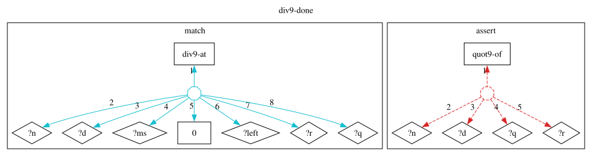
<!-- /rule -->

#### `div9-by-zero`

<!-- rule std.math.num9 div9-by-zero -->
```lisp
(rule div9-by-zero ()
  :match  (div9 ?n (num9 0 0 0 0 0 0 0 0 0))
  :assert (division-by-zero (div9 ?n (num9 0 0 0 0 0 0 0 0 0)))
  :why    "the divisor of {?n} divided by zero is zero")
```

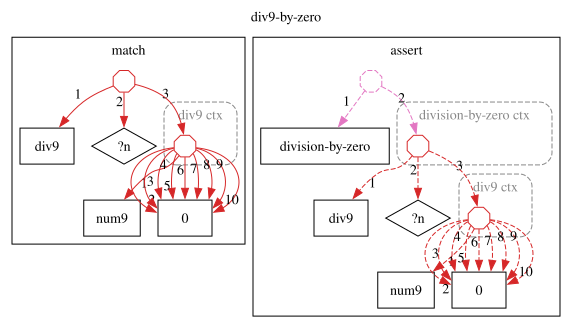
<!-- /rule -->

## Conversions

To and from `std.math.decimal`'s numbers, a request each way and a rule a length: a number written with $k$ digits
gets $9 - k$ zeros in front, and the other way the zeros in front of the top digit that is not zero are dropped.

#### `to9-zero`

<!-- rule std.math.num9 to9-zero -->
```lisp
(rule to9-zero ()
  :match  (to9 z)
  :assert (as9 z (num9 0 0 0 0 0 0 0 0 0))
  :why    "zero is written with zeros")
```

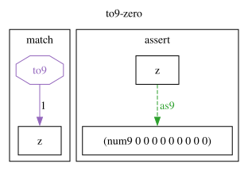
<!-- /rule -->

#### `to9-1`

<!-- rule std.math.num9 to9-1 -->
```lisp
(rule to9-1 ()
  :match  (to9 (n z ?a1))
  :assert (as9 (n z ?a1) (num9 0 0 0 0 0 0 0 0 ?a1))
  :why    "a number written with 1 digit: 8 zeros in front")
```

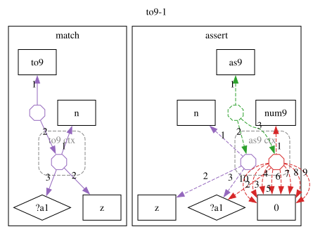
<!-- /rule -->

#### `to9-2`

<!-- rule std.math.num9 to9-2 -->
```lisp
(rule to9-2 ()
  :match  (to9 (n (n z ?a2) ?a1))
  :assert (as9 (n (n z ?a2) ?a1) (num9 0 0 0 0 0 0 0 ?a2 ?a1))
  :why    "a number written with 2 digits: 7 zeros in front")
```

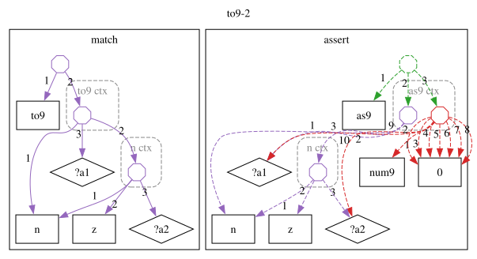
<!-- /rule -->

#### `to9-3`

<!-- rule std.math.num9 to9-3 -->
```lisp
(rule to9-3 ()
  :match  (to9 (n (n (n z ?a3) ?a2) ?a1))
  :assert (as9 (n (n (n z ?a3) ?a2) ?a1) (num9 0 0 0 0 0 0 ?a3 ?a2 ?a1))
  :why    "a number written with 3 digits: 6 zeros in front")
```

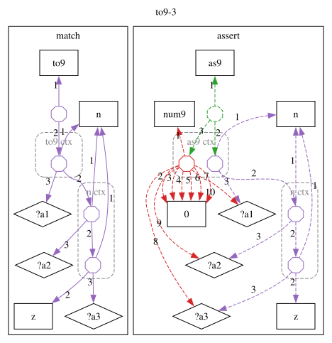
<!-- /rule -->

#### `to9-4`

<!-- rule std.math.num9 to9-4 -->
```lisp
(rule to9-4 ()
  :match  (to9 (n (n (n (n z ?a4) ?a3) ?a2) ?a1))
  :assert (as9 (n (n (n (n z ?a4) ?a3) ?a2) ?a1) (num9 0 0 0 0 0 ?a4 ?a3 ?a2 ?a1))
  :why    "a number written with 4 digits: 5 zeros in front")
```

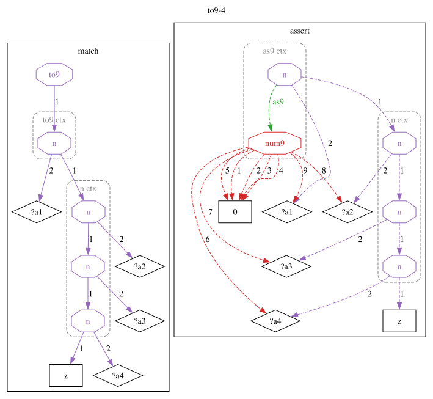
<!-- /rule -->

#### `to9-5`

<!-- rule std.math.num9 to9-5 -->
```lisp
(rule to9-5 ()
  :match  (to9 (n (n (n (n (n z ?a5) ?a4) ?a3) ?a2) ?a1))
  :assert (as9 (n (n (n (n (n z ?a5) ?a4) ?a3) ?a2) ?a1) (num9 0 0 0 0 ?a5 ?a4 ?a3 ?a2 ?a1))
  :why    "a number written with 5 digits: 4 zeros in front")
```

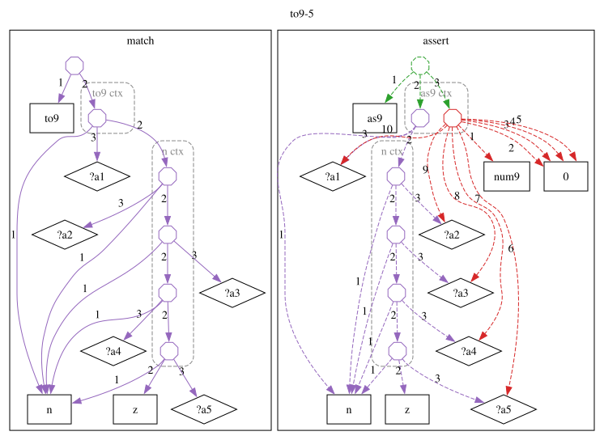
<!-- /rule -->

#### `to9-6`

<!-- rule std.math.num9 to9-6 -->
```lisp
(rule to9-6 ()
  :match  (to9 (n (n (n (n (n (n z ?a6) ?a5) ?a4) ?a3) ?a2) ?a1))
  :assert (as9 (n (n (n (n (n (n z ?a6) ?a5) ?a4) ?a3) ?a2) ?a1) (num9 0 0 0 ?a6 ?a5 ?a4 ?a3 ?a2 ?a1))
  :why    "a number written with 6 digits: 3 zeros in front")
```

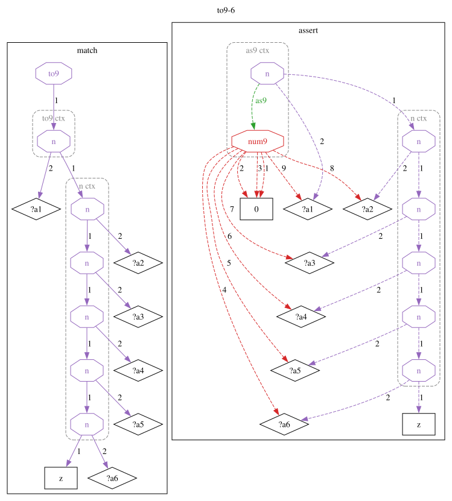
<!-- /rule -->

#### `to9-7`

<!-- rule std.math.num9 to9-7 -->
```lisp
(rule to9-7 ()
  :match  (to9 (n (n (n (n (n (n (n z ?a7) ?a6) ?a5) ?a4) ?a3) ?a2) ?a1))
  :assert (as9 (n (n (n (n (n (n (n z ?a7) ?a6) ?a5) ?a4) ?a3) ?a2) ?a1) (num9 0 0 ?a7 ?a6 ?a5 ?a4 ?a3 ?a2 ?a1))
  :why    "a number written with 7 digits: 2 zeros in front")
```

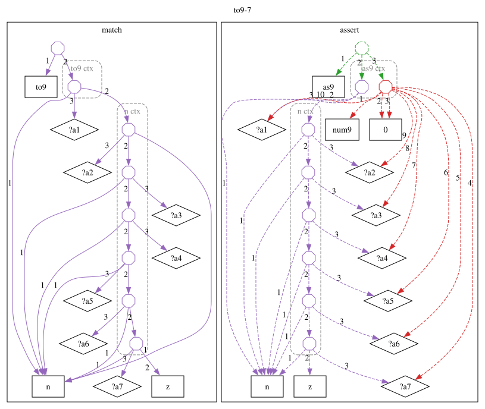
<!-- /rule -->

#### `to9-8`

<!-- rule std.math.num9 to9-8 -->
```lisp
(rule to9-8 ()
  :match  (to9 (n (n (n (n (n (n (n (n z ?a8) ?a7) ?a6) ?a5) ?a4) ?a3) ?a2) ?a1))
  :assert (as9 (n (n (n (n (n (n (n (n z ?a8) ?a7) ?a6) ?a5) ?a4) ?a3) ?a2) ?a1) (num9 0 ?a8 ?a7 ?a6 ?a5 ?a4 ?a3 ?a2 ?a1))
  :why    "a number written with 8 digits: 1 zero in front")
```

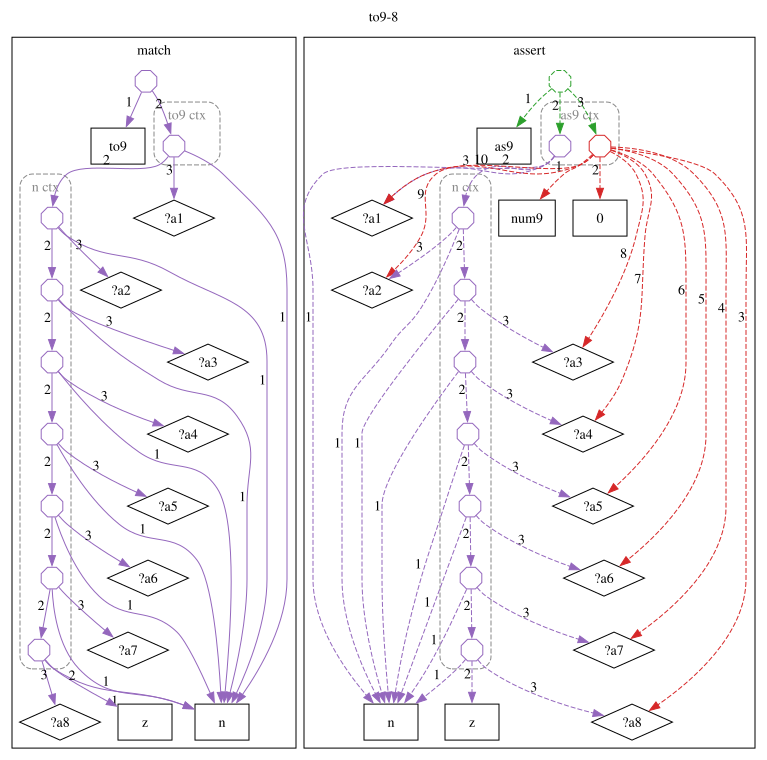
<!-- /rule -->

#### `to9-9`

<!-- rule std.math.num9 to9-9 -->
```lisp
(rule to9-9 ()
  :match  (to9 (n (n (n (n (n (n (n (n (n z ?a9) ?a8) ?a7) ?a6) ?a5) ?a4) ?a3) ?a2) ?a1))
  :assert (as9 (n (n (n (n (n (n (n (n (n z ?a9) ?a8) ?a7) ?a6) ?a5) ?a4) ?a3) ?a2) ?a1) (num9 ?a9 ?a8 ?a7 ?a6 ?a5 ?a4 ?a3 ?a2 ?a1))
  :why    "a number written with 9 digits: as it stands")
```

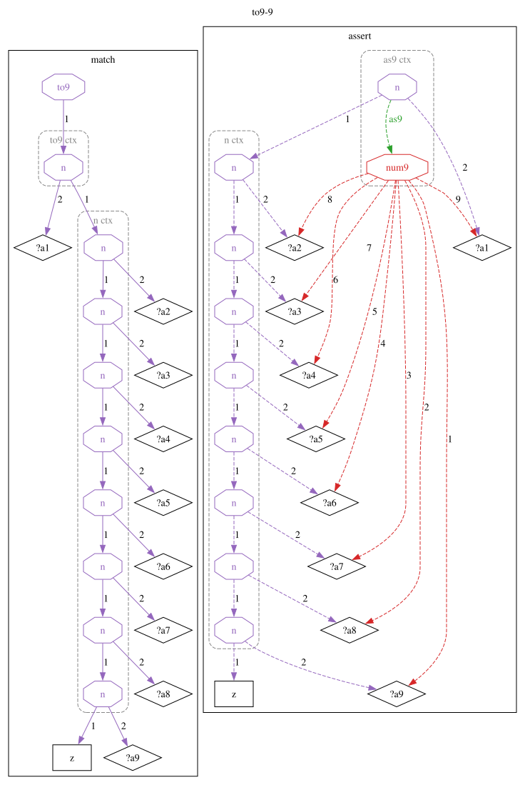
<!-- /rule -->

#### `to9-big`

<!-- rule std.math.num9 to9-big -->
```lisp
(rule to9-big ()
  :match  (to9 (n (n (n (n (n (n (n (n (n (n ?rest ?a10) ?a9) ?a8) ?a7) ?a6) ?a5) ?a4) ?a3) ?a2) ?a1))
  :assert (big (n (n (n (n (n (n (n (n (n (n ?rest ?a10) ?a9) ?a8) ?a7) ?a6) ?a5) ?a4) ?a3) ?a2) ?a1))
  :why    "a number written with more than 9 digits has no number of 9")
```

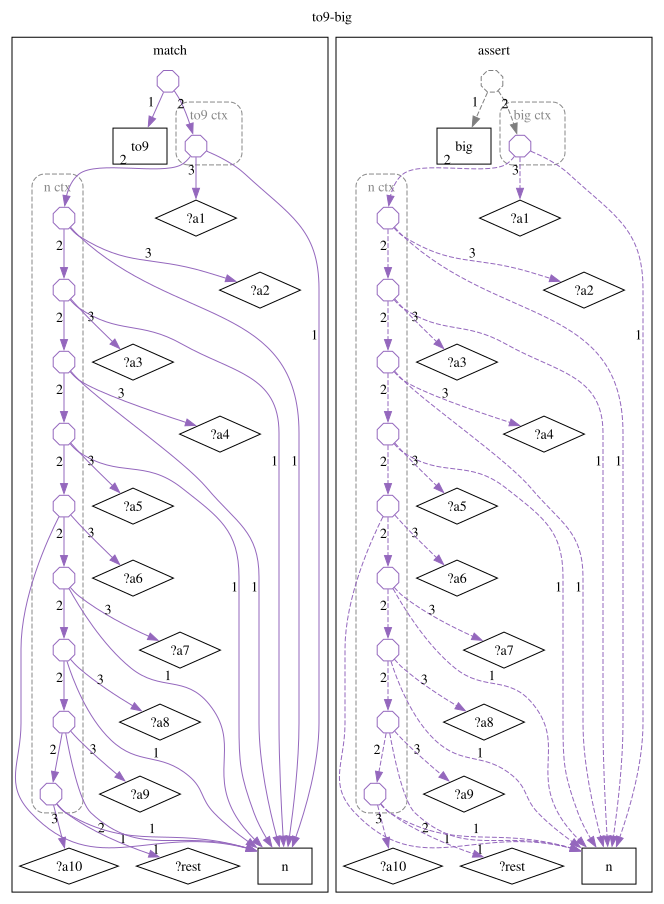
<!-- /rule -->

#### `from9-zero`

<!-- rule std.math.num9 from9-zero -->
```lisp
(rule from9-zero ()
  :match  (from9 (num9 0 0 0 0 0 0 0 0 0))
  :assert (of9 (num9 0 0 0 0 0 0 0 0 0) z)
  :why    "every digit is 0: zero")
```

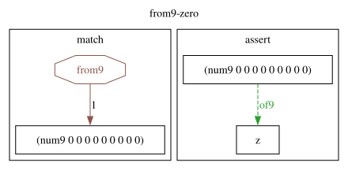
<!-- /rule -->

#### `from9-9`

<!-- rule std.math.num9 from9-9 -->
```lisp
(rule from9-9 ()
  :match  (and (from9 (num9 ?a9 ?a8 ?a7 ?a6 ?a5 ?a4 ?a3 ?a2 ?a1))
               (nz ?a9))
  :assert (of9 (num9 ?a9 ?a8 ?a7 ?a6 ?a5 ?a4 ?a3 ?a2 ?a1) (n (n (n (n (n (n (n (n (n z ?a9) ?a8) ?a7) ?a6) ?a5) ?a4) ?a3) ?a2) ?a1))
  :why    "the top digit that is not zero is {?a9}: a number of 9 digits, with no high zero")
```

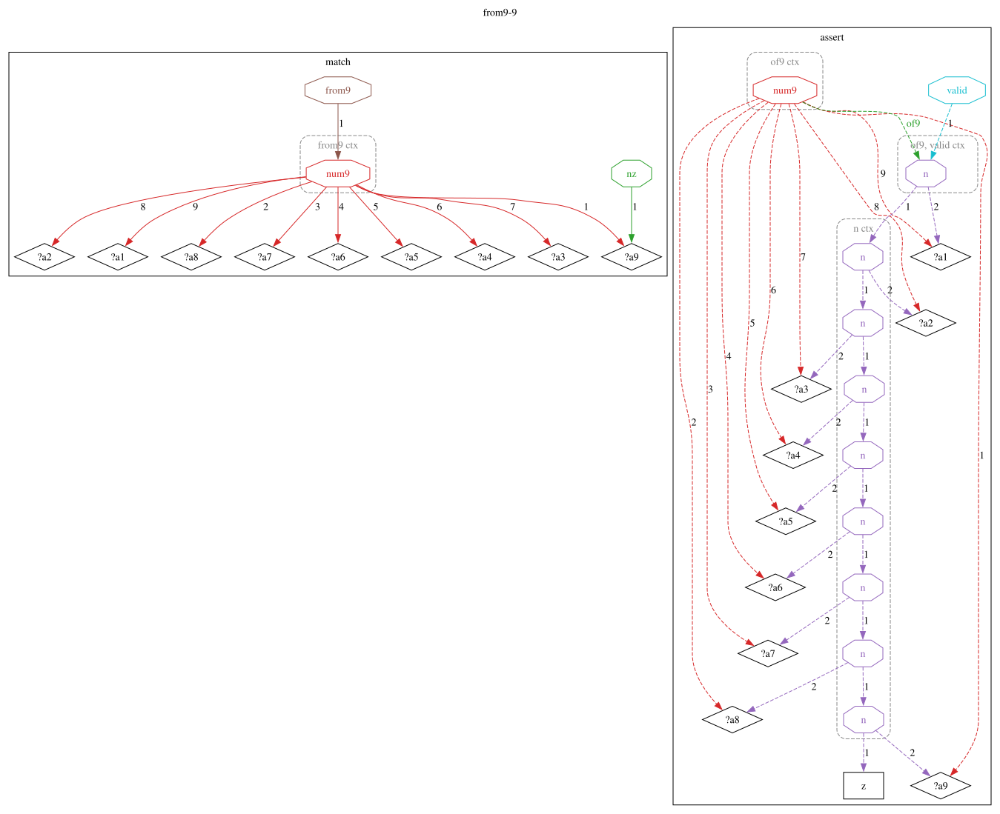
<!-- /rule -->

#### `from9-8`

<!-- rule std.math.num9 from9-8 -->
```lisp
(rule from9-8 ()
  :match  (and (from9 (num9 0 ?a8 ?a7 ?a6 ?a5 ?a4 ?a3 ?a2 ?a1))
               (nz ?a8))
  :assert (of9 (num9 0 ?a8 ?a7 ?a6 ?a5 ?a4 ?a3 ?a2 ?a1) (n (n (n (n (n (n (n (n z ?a8) ?a7) ?a6) ?a5) ?a4) ?a3) ?a2) ?a1))
  :why    "the top digit that is not zero is {?a8}: a number of 8 digits, with no high zero")
```

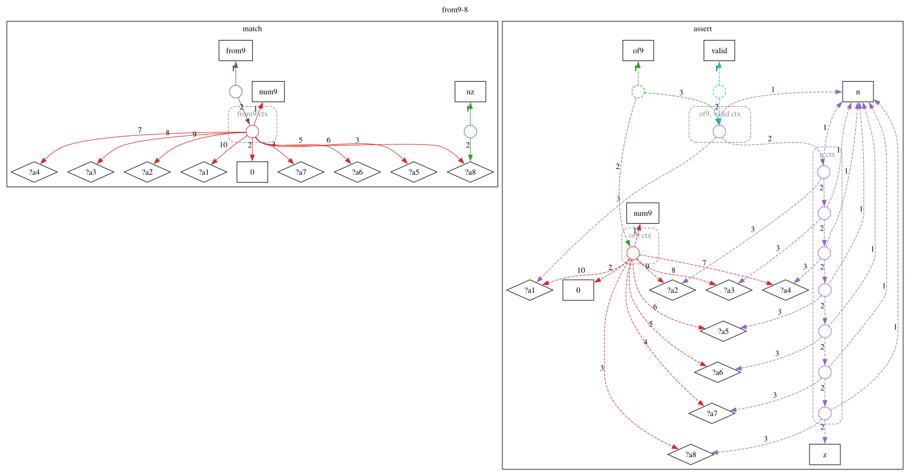
<!-- /rule -->

#### `from9-7`

<!-- rule std.math.num9 from9-7 -->
```lisp
(rule from9-7 ()
  :match  (and (from9 (num9 0 0 ?a7 ?a6 ?a5 ?a4 ?a3 ?a2 ?a1))
               (nz ?a7))
  :assert (of9 (num9 0 0 ?a7 ?a6 ?a5 ?a4 ?a3 ?a2 ?a1) (n (n (n (n (n (n (n z ?a7) ?a6) ?a5) ?a4) ?a3) ?a2) ?a1))
  :why    "the top digit that is not zero is {?a7}: a number of 7 digits, with no high zero")
```

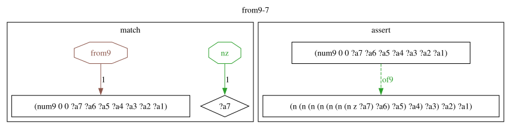
<!-- /rule -->

#### `from9-6`

<!-- rule std.math.num9 from9-6 -->
```lisp
(rule from9-6 ()
  :match  (and (from9 (num9 0 0 0 ?a6 ?a5 ?a4 ?a3 ?a2 ?a1))
               (nz ?a6))
  :assert (of9 (num9 0 0 0 ?a6 ?a5 ?a4 ?a3 ?a2 ?a1) (n (n (n (n (n (n z ?a6) ?a5) ?a4) ?a3) ?a2) ?a1))
  :why    "the top digit that is not zero is {?a6}: a number of 6 digits, with no high zero")
```

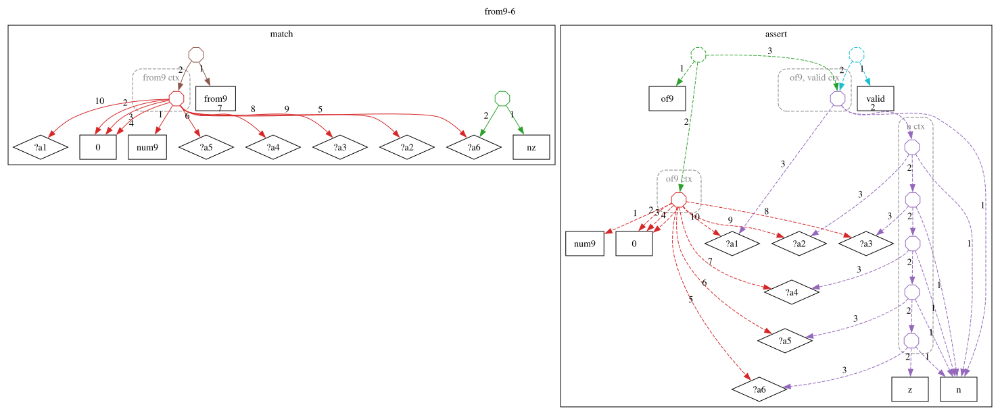
<!-- /rule -->

#### `from9-5`

<!-- rule std.math.num9 from9-5 -->
```lisp
(rule from9-5 ()
  :match  (and (from9 (num9 0 0 0 0 ?a5 ?a4 ?a3 ?a2 ?a1))
               (nz ?a5))
  :assert (of9 (num9 0 0 0 0 ?a5 ?a4 ?a3 ?a2 ?a1) (n (n (n (n (n z ?a5) ?a4) ?a3) ?a2) ?a1))
  :why    "the top digit that is not zero is {?a5}: a number of 5 digits, with no high zero")
```

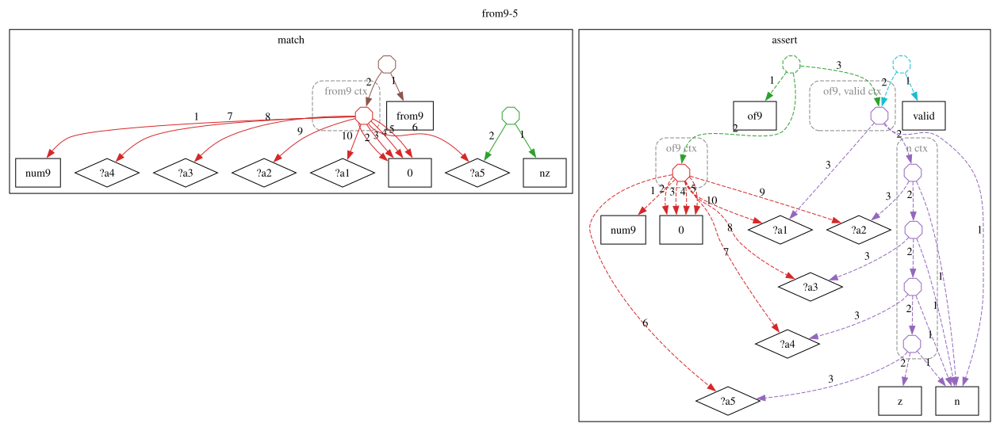
<!-- /rule -->

#### `from9-4`

<!-- rule std.math.num9 from9-4 -->
```lisp
(rule from9-4 ()
  :match  (and (from9 (num9 0 0 0 0 0 ?a4 ?a3 ?a2 ?a1))
               (nz ?a4))
  :assert (of9 (num9 0 0 0 0 0 ?a4 ?a3 ?a2 ?a1) (n (n (n (n z ?a4) ?a3) ?a2) ?a1))
  :why    "the top digit that is not zero is {?a4}: a number of 4 digits, with no high zero")
```

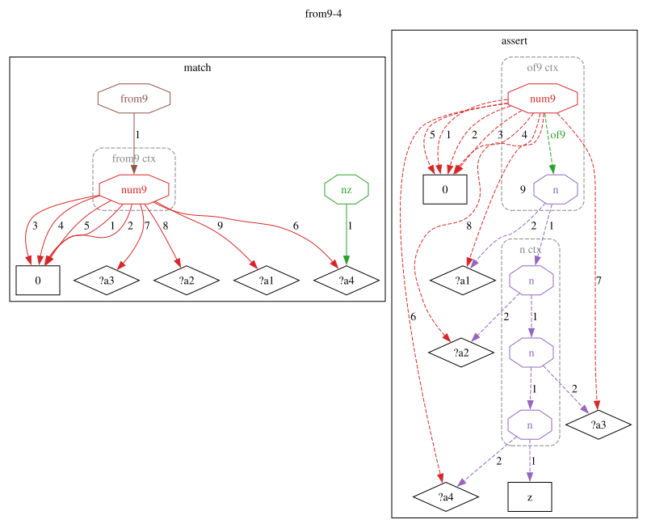
<!-- /rule -->

#### `from9-3`

<!-- rule std.math.num9 from9-3 -->
```lisp
(rule from9-3 ()
  :match  (and (from9 (num9 0 0 0 0 0 0 ?a3 ?a2 ?a1))
               (nz ?a3))
  :assert (of9 (num9 0 0 0 0 0 0 ?a3 ?a2 ?a1) (n (n (n z ?a3) ?a2) ?a1))
  :why    "the top digit that is not zero is {?a3}: a number of 3 digits, with no high zero")
```

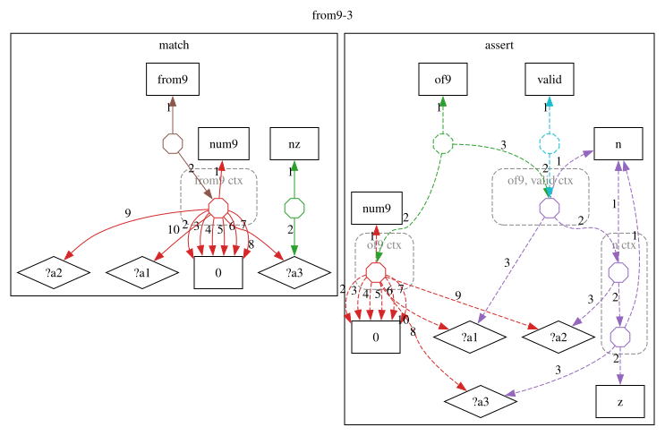
<!-- /rule -->

#### `from9-2`

<!-- rule std.math.num9 from9-2 -->
```lisp
(rule from9-2 ()
  :match  (and (from9 (num9 0 0 0 0 0 0 0 ?a2 ?a1))
               (nz ?a2))
  :assert (of9 (num9 0 0 0 0 0 0 0 ?a2 ?a1) (n (n z ?a2) ?a1))
  :why    "the top digit that is not zero is {?a2}: a number of 2 digits, with no high zero")
```

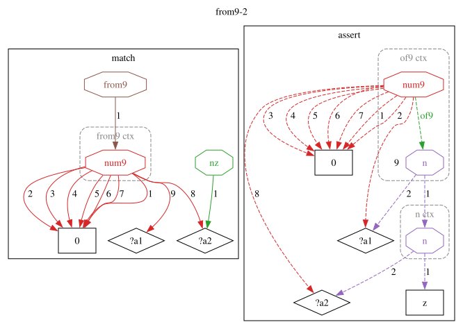
<!-- /rule -->

#### `from9-1`

<!-- rule std.math.num9 from9-1 -->
```lisp
(rule from9-1 ()
  :match  (and (from9 (num9 0 0 0 0 0 0 0 0 ?a1))
               (nz ?a1))
  :assert (of9 (num9 0 0 0 0 0 0 0 0 ?a1) (n z ?a1))
  :why    "the top digit that is not zero is {?a1}: a number of 1 digit, with no high zero")
```

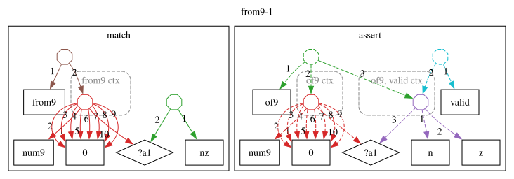
<!-- /rule -->

## The entry

The closing rule: it closes the held extent of each of the module's relations and names each rule above. Its
drawing is not shown.

#### `arith9`

<!-- rule std.math.num9 arith9 -->
```lisp
(rule arith9 ()
  :match  ()
  :assert (and (__closed__ fa) (__closed__ fs) (__closed__ md) (__closed__ cl)
               (__closed__ nz) (__closed__ adj) (__closed__ n)
               (__closed__ division-by-zero) (__closed__ num9)
               (__closed__ add9) (__closed__ sum9-of) (__closed__ sub9)
               (__closed__ diff9-of) (__closed__ cmp9) (__closed__ cmp9-of)
               (__closed__ mul9) (__closed__ product9-of) (__closed__ div9)
               (__closed__ quot9-of) (__closed__ overflow) (__closed__ to9)
               (__closed__ as9) (__closed__ big) (__closed__ from9)
               (__closed__ of9) (__closed__ mul9-at) (__closed__ row9)
               (__closed__ multiples9) (__closed__ div9-at)
               (__closed__ num9-rule)
               (num9-rule add9-fits) (num9-rule add9-overflows)
               (num9-rule sub9-fits) (num9-rule sub9-short)
               (num9-rule cmp9-columns) (num9-rule mul9-start)
               (num9-rule mul9-step) (num9-rule mul9-step-zero)
               (num9-rule mul9-done) (num9-rule mul9-overflows-shift)
               (num9-rule mul9-overflows-row) (num9-rule mul9-overflows-add)
               (num9-rule div9-start) (num9-rule div9-step-0)
               (num9-rule div9-step-1) (num9-rule div9-step-2)
               (num9-rule div9-step-3) (num9-rule div9-step-4)
               (num9-rule div9-step-5) (num9-rule div9-step-6)
               (num9-rule div9-step-7) (num9-rule div9-step-8)
               (num9-rule div9-step-9) (num9-rule div9-done)
               (num9-rule div9-by-zero) (num9-rule to9-zero) (num9-rule to9-1)
               (num9-rule to9-2) (num9-rule to9-3) (num9-rule to9-4)
               (num9-rule to9-5) (num9-rule to9-6) (num9-rule to9-7)
               (num9-rule to9-8) (num9-rule to9-9) (num9-rule to9-big)
               (num9-rule from9-zero) (num9-rule from9-9) (num9-rule from9-8)
               (num9-rule from9-7) (num9-rule from9-6) (num9-rule from9-5)
               (num9-rule from9-4) (num9-rule from9-3) (num9-rule from9-2)
               (num9-rule from9-1) (num9-rule division-by-zero-is-false))
  :why    "arithmetic is computed and never guessed: every relation of the theory is closed")
```
<!-- /rule -->
