# The nine-digit numbers' rules

How `std.math.num9` works: every rule of the module, as it writes it and as the engine draws it. What a program
writes to use it is [the page before](16-nine-digit-numbers.md); how to read a drawing is
[the index](README.md#how-a-rule-is-shown).

None of these rules has a parameter. They are wide: a rule states every column of a number in one `:match`, a
row of a table a column, with the carries as variables two neighbouring rows share. So a drawing here is a rank
of octagons, one a row, over the digits they share, and a rule's `:why` says what the whole firing does. The
module's file is generated, and so is every rule below.

## Addition

One rule a sum: nine rows of `fa`, the units first. The carry out of the top column is `0` in the one and `1` in
the other, which derives `overflow`.

#### `add9-fits`

<!-- rule std.math.num9 add9-fits -->
```lisp
(rule add9-fits ()
  :match  (and (add9 (num9 ?x8 ?x7 ?x6 ?x5 ?x4 ?x3 ?x2 ?x1 ?x0) (num9 ?y8 ?y7 ?y6 ?y5 ?y4 ?y3 ?y2 ?y1 ?y0))
               (fa ?x0 ?y0 0 ?s0 ?c1)
               (fa ?x1 ?y1 ?c1 ?s1 ?c2)
               (fa ?x2 ?y2 ?c2 ?s2 ?c3)
               (fa ?x3 ?y3 ?c3 ?s3 ?c4)
               (fa ?x4 ?y4 ?c4 ?s4 ?c5)
               (fa ?x5 ?y5 ?c5 ?s5 ?c6)
               (fa ?x6 ?y6 ?c6 ?s6 ?c7)
               (fa ?x7 ?y7 ?c7 ?s7 ?c8)
               (fa ?x8 ?y8 ?c8 ?s8 0))
  :assert (sum9-of (num9 ?x8 ?x7 ?x6 ?x5 ?x4 ?x3 ?x2 ?x1 ?x0) (num9 ?y8 ?y7 ?y6 ?y5 ?y4 ?y3 ?y2 ?y1 ?y0) (num9 ?s8 ?s7 ?s6 ?s5 ?s4 ?s3 ?s2 ?s1 ?s0))
  :why    "each column's digit and carry from the table, the units first; no carry out of the top column")
```

```dot
digraph rule_add9_fits_lhs_rhs {
  rankdir=TB;
  label="add9-fits"; labelloc=t;
  subgraph cluster_lhs { label="match";
    "(num9 ?x8 ?x7 ?x6 ?x5 ?x4 ?x3 ?x2 ?x1 ?x0)_L" [label="(num9 ?x8 ?x7 ?x6 ?x5 ?x4 ?x3 ?x2 ?x1 ?x0)", shape=rectangle];
    "(num9 ?y8 ?y7 ?y6 ?y5 ?y4 ?y3 ?y2 ?y1 ?y0)_L" [label="(num9 ?y8 ?y7 ?y6 ?y5 ?y4 ?y3 ?y2 ?y1 ?y0)", shape=rectangle];
    "?x0_L" [label="?x0", shape=diamond];
    "?y0_L" [label="?y0", shape=diamond];
    "0_L" [label="0", shape=rectangle];
    "?s0_L" [label="?s0", shape=diamond];
    "?c1_L" [label="?c1", shape=diamond];
    "?x1_L" [label="?x1", shape=diamond];
    "?y1_L" [label="?y1", shape=diamond];
    "?s1_L" [label="?s1", shape=diamond];
    "?c2_L" [label="?c2", shape=diamond];
    "?x2_L" [label="?x2", shape=diamond];
    "?y2_L" [label="?y2", shape=diamond];
    "?s2_L" [label="?s2", shape=diamond];
    "?c3_L" [label="?c3", shape=diamond];
    "?x3_L" [label="?x3", shape=diamond];
    "?y3_L" [label="?y3", shape=diamond];
    "?s3_L" [label="?s3", shape=diamond];
    "?c4_L" [label="?c4", shape=diamond];
    "?x4_L" [label="?x4", shape=diamond];
    "?y4_L" [label="?y4", shape=diamond];
    "?s4_L" [label="?s4", shape=diamond];
    "?c5_L" [label="?c5", shape=diamond];
    "?x5_L" [label="?x5", shape=diamond];
    "?y5_L" [label="?y5", shape=diamond];
    "?s5_L" [label="?s5", shape=diamond];
    "?c6_L" [label="?c6", shape=diamond];
    "?x6_L" [label="?x6", shape=diamond];
    "?y6_L" [label="?y6", shape=diamond];
    "?s6_L" [label="?s6", shape=diamond];
    "?c7_L" [label="?c7", shape=diamond];
    "?x7_L" [label="?x7", shape=diamond];
    "?y7_L" [label="?y7", shape=diamond];
    "?s7_L" [label="?s7", shape=diamond];
    "?c8_L" [label="?c8", shape=diamond];
    "?x8_L" [label="?x8", shape=diamond];
    "?y8_L" [label="?y8", shape=diamond];
    "?s8_L" [label="?s8", shape=diamond];
    "(num9 ?x8 ?x7 ?x6 ?x5 ?x4 ?x3 ?x2 ?x1 ?x0)_L" -> "(num9 ?y8 ?y7 ?y6 ?y5 ?y4 ?y3 ?y2 ?y1 ?y0)_L" [label="add9", color="#bcbd22", fontcolor="#bcbd22"];
    "h1_fa_L" [shape=octagon, label="fa", color="#7f7f7f", fontcolor="#7f7f7f"];
    "h1_fa_L" -> "?x0_L" [label="1", color="#7f7f7f"];
    "h1_fa_L" -> "?y0_L" [label="2", color="#7f7f7f"];
    "h1_fa_L" -> "0_L" [label="3", color="#7f7f7f"];
    "h1_fa_L" -> "?s0_L" [label="4", color="#7f7f7f"];
    "h1_fa_L" -> "?c1_L" [label="5", color="#7f7f7f"];
    "h2_fa_L" [shape=octagon, label="fa", color="#7f7f7f", fontcolor="#7f7f7f"];
    "h2_fa_L" -> "?x1_L" [label="1", color="#7f7f7f"];
    "h2_fa_L" -> "?y1_L" [label="2", color="#7f7f7f"];
    "h2_fa_L" -> "?c1_L" [label="3", color="#7f7f7f"];
    "h2_fa_L" -> "?s1_L" [label="4", color="#7f7f7f"];
    "h2_fa_L" -> "?c2_L" [label="5", color="#7f7f7f"];
    "h3_fa_L" [shape=octagon, label="fa", color="#7f7f7f", fontcolor="#7f7f7f"];
    "h3_fa_L" -> "?x2_L" [label="1", color="#7f7f7f"];
    "h3_fa_L" -> "?y2_L" [label="2", color="#7f7f7f"];
    "h3_fa_L" -> "?c2_L" [label="3", color="#7f7f7f"];
    "h3_fa_L" -> "?s2_L" [label="4", color="#7f7f7f"];
    "h3_fa_L" -> "?c3_L" [label="5", color="#7f7f7f"];
    "h4_fa_L" [shape=octagon, label="fa", color="#7f7f7f", fontcolor="#7f7f7f"];
    "h4_fa_L" -> "?x3_L" [label="1", color="#7f7f7f"];
    "h4_fa_L" -> "?y3_L" [label="2", color="#7f7f7f"];
    "h4_fa_L" -> "?c3_L" [label="3", color="#7f7f7f"];
    "h4_fa_L" -> "?s3_L" [label="4", color="#7f7f7f"];
    "h4_fa_L" -> "?c4_L" [label="5", color="#7f7f7f"];
    "h5_fa_L" [shape=octagon, label="fa", color="#7f7f7f", fontcolor="#7f7f7f"];
    "h5_fa_L" -> "?x4_L" [label="1", color="#7f7f7f"];
    "h5_fa_L" -> "?y4_L" [label="2", color="#7f7f7f"];
    "h5_fa_L" -> "?c4_L" [label="3", color="#7f7f7f"];
    "h5_fa_L" -> "?s4_L" [label="4", color="#7f7f7f"];
    "h5_fa_L" -> "?c5_L" [label="5", color="#7f7f7f"];
    "h6_fa_L" [shape=octagon, label="fa", color="#7f7f7f", fontcolor="#7f7f7f"];
    "h6_fa_L" -> "?x5_L" [label="1", color="#7f7f7f"];
    "h6_fa_L" -> "?y5_L" [label="2", color="#7f7f7f"];
    "h6_fa_L" -> "?c5_L" [label="3", color="#7f7f7f"];
    "h6_fa_L" -> "?s5_L" [label="4", color="#7f7f7f"];
    "h6_fa_L" -> "?c6_L" [label="5", color="#7f7f7f"];
    "h7_fa_L" [shape=octagon, label="fa", color="#7f7f7f", fontcolor="#7f7f7f"];
    "h7_fa_L" -> "?x6_L" [label="1", color="#7f7f7f"];
    "h7_fa_L" -> "?y6_L" [label="2", color="#7f7f7f"];
    "h7_fa_L" -> "?c6_L" [label="3", color="#7f7f7f"];
    "h7_fa_L" -> "?s6_L" [label="4", color="#7f7f7f"];
    "h7_fa_L" -> "?c7_L" [label="5", color="#7f7f7f"];
    "h8_fa_L" [shape=octagon, label="fa", color="#7f7f7f", fontcolor="#7f7f7f"];
    "h8_fa_L" -> "?x7_L" [label="1", color="#7f7f7f"];
    "h8_fa_L" -> "?y7_L" [label="2", color="#7f7f7f"];
    "h8_fa_L" -> "?c7_L" [label="3", color="#7f7f7f"];
    "h8_fa_L" -> "?s7_L" [label="4", color="#7f7f7f"];
    "h8_fa_L" -> "?c8_L" [label="5", color="#7f7f7f"];
    "h9_fa_L" [shape=octagon, label="fa", color="#7f7f7f", fontcolor="#7f7f7f"];
    "h9_fa_L" -> "?x8_L" [label="1", color="#7f7f7f"];
    "h9_fa_L" -> "?y8_L" [label="2", color="#7f7f7f"];
    "h9_fa_L" -> "?c8_L" [label="3", color="#7f7f7f"];
    "h9_fa_L" -> "?s8_L" [label="4", color="#7f7f7f"];
    "h9_fa_L" -> "0_L" [label="5", color="#7f7f7f"];
  }
  subgraph cluster_rhs { label="assert";
    "(num9 ?x8 ?x7 ?x6 ?x5 ?x4 ?x3 ?x2 ?x1 ?x0)_R" [label="(num9 ?x8 ?x7 ?x6 ?x5 ?x4 ?x3 ?x2 ?x1 ?x0)", shape=rectangle];
    "(num9 ?y8 ?y7 ?y6 ?y5 ?y4 ?y3 ?y2 ?y1 ?y0)_R" [label="(num9 ?y8 ?y7 ?y6 ?y5 ?y4 ?y3 ?y2 ?y1 ?y0)", shape=rectangle];
    "(num9 ?s8 ?s7 ?s6 ?s5 ?s4 ?s3 ?s2 ?s1 ?s0)_R" [label="(num9 ?s8 ?s7 ?s6 ?s5 ?s4 ?s3 ?s2 ?s1 ?s0)", shape=rectangle];
    "h10_sum9-of_R" [shape=octagon, label="sum9-of", color="#17becf", fontcolor="#17becf"];
    "h10_sum9-of_R" -> "(num9 ?x8 ?x7 ?x6 ?x5 ?x4 ?x3 ?x2 ?x1 ?x0)_R" [label="1", color="#17becf", style=dashed];
    "h10_sum9-of_R" -> "(num9 ?y8 ?y7 ?y6 ?y5 ?y4 ?y3 ?y2 ?y1 ?y0)_R" [label="2", color="#17becf", style=dashed];
    "h10_sum9-of_R" -> "(num9 ?s8 ?s7 ?s6 ?s5 ?s4 ?s3 ?s2 ?s1 ?s0)_R" [label="3", color="#17becf", style=dashed];
  }
}
```
<!-- /rule -->

#### `add9-overflows`

<!-- rule std.math.num9 add9-overflows -->
```lisp
(rule add9-overflows ()
  :match  (and (add9 (num9 ?x8 ?x7 ?x6 ?x5 ?x4 ?x3 ?x2 ?x1 ?x0) (num9 ?y8 ?y7 ?y6 ?y5 ?y4 ?y3 ?y2 ?y1 ?y0))
               (fa ?x0 ?y0 0 ?s0 ?c1)
               (fa ?x1 ?y1 ?c1 ?s1 ?c2)
               (fa ?x2 ?y2 ?c2 ?s2 ?c3)
               (fa ?x3 ?y3 ?c3 ?s3 ?c4)
               (fa ?x4 ?y4 ?c4 ?s4 ?c5)
               (fa ?x5 ?y5 ?c5 ?s5 ?c6)
               (fa ?x6 ?y6 ?c6 ?s6 ?c7)
               (fa ?x7 ?y7 ?c7 ?s7 ?c8)
               (fa ?x8 ?y8 ?c8 ?s8 1))
  :assert (overflow (add9 (num9 ?x8 ?x7 ?x6 ?x5 ?x4 ?x3 ?x2 ?x1 ?x0) (num9 ?y8 ?y7 ?y6 ?y5 ?y4 ?y3 ?y2 ?y1 ?y0)))
  :why    "each column's digit and carry from the table: a carry out of the top column, so the sum has 10 digits")
```

```dot
digraph rule_add9_overflows_lhs_rhs {
  rankdir=TB;
  label="add9-overflows"; labelloc=t;
  subgraph cluster_lhs { label="match";
    "(num9 ?x8 ?x7 ?x6 ?x5 ?x4 ?x3 ?x2 ?x1 ?x0)_L" [label="(num9 ?x8 ?x7 ?x6 ?x5 ?x4 ?x3 ?x2 ?x1 ?x0)", shape=rectangle];
    "(num9 ?y8 ?y7 ?y6 ?y5 ?y4 ?y3 ?y2 ?y1 ?y0)_L" [label="(num9 ?y8 ?y7 ?y6 ?y5 ?y4 ?y3 ?y2 ?y1 ?y0)", shape=rectangle];
    "?x0_L" [label="?x0", shape=diamond];
    "?y0_L" [label="?y0", shape=diamond];
    "0_L" [label="0", shape=rectangle];
    "?s0_L" [label="?s0", shape=diamond];
    "?c1_L" [label="?c1", shape=diamond];
    "?x1_L" [label="?x1", shape=diamond];
    "?y1_L" [label="?y1", shape=diamond];
    "?s1_L" [label="?s1", shape=diamond];
    "?c2_L" [label="?c2", shape=diamond];
    "?x2_L" [label="?x2", shape=diamond];
    "?y2_L" [label="?y2", shape=diamond];
    "?s2_L" [label="?s2", shape=diamond];
    "?c3_L" [label="?c3", shape=diamond];
    "?x3_L" [label="?x3", shape=diamond];
    "?y3_L" [label="?y3", shape=diamond];
    "?s3_L" [label="?s3", shape=diamond];
    "?c4_L" [label="?c4", shape=diamond];
    "?x4_L" [label="?x4", shape=diamond];
    "?y4_L" [label="?y4", shape=diamond];
    "?s4_L" [label="?s4", shape=diamond];
    "?c5_L" [label="?c5", shape=diamond];
    "?x5_L" [label="?x5", shape=diamond];
    "?y5_L" [label="?y5", shape=diamond];
    "?s5_L" [label="?s5", shape=diamond];
    "?c6_L" [label="?c6", shape=diamond];
    "?x6_L" [label="?x6", shape=diamond];
    "?y6_L" [label="?y6", shape=diamond];
    "?s6_L" [label="?s6", shape=diamond];
    "?c7_L" [label="?c7", shape=diamond];
    "?x7_L" [label="?x7", shape=diamond];
    "?y7_L" [label="?y7", shape=diamond];
    "?s7_L" [label="?s7", shape=diamond];
    "?c8_L" [label="?c8", shape=diamond];
    "?x8_L" [label="?x8", shape=diamond];
    "?y8_L" [label="?y8", shape=diamond];
    "?s8_L" [label="?s8", shape=diamond];
    "1_L" [label="1", shape=rectangle];
    "(num9 ?x8 ?x7 ?x6 ?x5 ?x4 ?x3 ?x2 ?x1 ?x0)_L" -> "(num9 ?y8 ?y7 ?y6 ?y5 ?y4 ?y3 ?y2 ?y1 ?y0)_L" [label="add9", color="#bcbd22", fontcolor="#bcbd22"];
    "h1_fa_L" [shape=octagon, label="fa", color="#7f7f7f", fontcolor="#7f7f7f"];
    "h1_fa_L" -> "?x0_L" [label="1", color="#7f7f7f"];
    "h1_fa_L" -> "?y0_L" [label="2", color="#7f7f7f"];
    "h1_fa_L" -> "0_L" [label="3", color="#7f7f7f"];
    "h1_fa_L" -> "?s0_L" [label="4", color="#7f7f7f"];
    "h1_fa_L" -> "?c1_L" [label="5", color="#7f7f7f"];
    "h2_fa_L" [shape=octagon, label="fa", color="#7f7f7f", fontcolor="#7f7f7f"];
    "h2_fa_L" -> "?x1_L" [label="1", color="#7f7f7f"];
    "h2_fa_L" -> "?y1_L" [label="2", color="#7f7f7f"];
    "h2_fa_L" -> "?c1_L" [label="3", color="#7f7f7f"];
    "h2_fa_L" -> "?s1_L" [label="4", color="#7f7f7f"];
    "h2_fa_L" -> "?c2_L" [label="5", color="#7f7f7f"];
    "h3_fa_L" [shape=octagon, label="fa", color="#7f7f7f", fontcolor="#7f7f7f"];
    "h3_fa_L" -> "?x2_L" [label="1", color="#7f7f7f"];
    "h3_fa_L" -> "?y2_L" [label="2", color="#7f7f7f"];
    "h3_fa_L" -> "?c2_L" [label="3", color="#7f7f7f"];
    "h3_fa_L" -> "?s2_L" [label="4", color="#7f7f7f"];
    "h3_fa_L" -> "?c3_L" [label="5", color="#7f7f7f"];
    "h4_fa_L" [shape=octagon, label="fa", color="#7f7f7f", fontcolor="#7f7f7f"];
    "h4_fa_L" -> "?x3_L" [label="1", color="#7f7f7f"];
    "h4_fa_L" -> "?y3_L" [label="2", color="#7f7f7f"];
    "h4_fa_L" -> "?c3_L" [label="3", color="#7f7f7f"];
    "h4_fa_L" -> "?s3_L" [label="4", color="#7f7f7f"];
    "h4_fa_L" -> "?c4_L" [label="5", color="#7f7f7f"];
    "h5_fa_L" [shape=octagon, label="fa", color="#7f7f7f", fontcolor="#7f7f7f"];
    "h5_fa_L" -> "?x4_L" [label="1", color="#7f7f7f"];
    "h5_fa_L" -> "?y4_L" [label="2", color="#7f7f7f"];
    "h5_fa_L" -> "?c4_L" [label="3", color="#7f7f7f"];
    "h5_fa_L" -> "?s4_L" [label="4", color="#7f7f7f"];
    "h5_fa_L" -> "?c5_L" [label="5", color="#7f7f7f"];
    "h6_fa_L" [shape=octagon, label="fa", color="#7f7f7f", fontcolor="#7f7f7f"];
    "h6_fa_L" -> "?x5_L" [label="1", color="#7f7f7f"];
    "h6_fa_L" -> "?y5_L" [label="2", color="#7f7f7f"];
    "h6_fa_L" -> "?c5_L" [label="3", color="#7f7f7f"];
    "h6_fa_L" -> "?s5_L" [label="4", color="#7f7f7f"];
    "h6_fa_L" -> "?c6_L" [label="5", color="#7f7f7f"];
    "h7_fa_L" [shape=octagon, label="fa", color="#7f7f7f", fontcolor="#7f7f7f"];
    "h7_fa_L" -> "?x6_L" [label="1", color="#7f7f7f"];
    "h7_fa_L" -> "?y6_L" [label="2", color="#7f7f7f"];
    "h7_fa_L" -> "?c6_L" [label="3", color="#7f7f7f"];
    "h7_fa_L" -> "?s6_L" [label="4", color="#7f7f7f"];
    "h7_fa_L" -> "?c7_L" [label="5", color="#7f7f7f"];
    "h8_fa_L" [shape=octagon, label="fa", color="#7f7f7f", fontcolor="#7f7f7f"];
    "h8_fa_L" -> "?x7_L" [label="1", color="#7f7f7f"];
    "h8_fa_L" -> "?y7_L" [label="2", color="#7f7f7f"];
    "h8_fa_L" -> "?c7_L" [label="3", color="#7f7f7f"];
    "h8_fa_L" -> "?s7_L" [label="4", color="#7f7f7f"];
    "h8_fa_L" -> "?c8_L" [label="5", color="#7f7f7f"];
    "h9_fa_L" [shape=octagon, label="fa", color="#7f7f7f", fontcolor="#7f7f7f"];
    "h9_fa_L" -> "?x8_L" [label="1", color="#7f7f7f"];
    "h9_fa_L" -> "?y8_L" [label="2", color="#7f7f7f"];
    "h9_fa_L" -> "?c8_L" [label="3", color="#7f7f7f"];
    "h9_fa_L" -> "?s8_L" [label="4", color="#7f7f7f"];
    "h9_fa_L" -> "1_L" [label="5", color="#7f7f7f"];
  }
  subgraph cluster_rhs { label="assert";
    "(add9 (num9 ?x8 ?x7 ?x6 ?x5 ?x4 ?x3 ?x2 ?x1 ?x0) (num9 ?y8 ?y7 ?y6 ?y5 ?y4 ?y3 ?y2 ?y1 ?y0))_R" [label="(add9 (num9 ?x8 ?x7 ?x6 ?x5 ?x4 ?x3 ?x2 ?x1 ?x0) (num9 ?y8 ?y7 ?y6 ?y5 ?y4 ?y3 ?y2 ?y1 ?y0))", shape=rectangle];
    "h10_overflow_R" [shape=octagon, label="overflow", color="#d62728", fontcolor="#d62728"];
    "h10_overflow_R" -> "(add9 (num9 ?x8 ?x7 ?x6 ?x5 ?x4 ?x3 ?x2 ?x1 ?x0) (num9 ?y8 ?y7 ?y6 ?y5 ?y4 ?y3 ?y2 ?y1 ?y0))_R" [label="1", color="#d62728", style=dashed];
  }
}
```
<!-- /rule -->

## Subtraction

Two subtractors, nine rows of `fs` each way, and the one that does not borrow out of the top answers.

#### `sub9-fits`

<!-- rule std.math.num9 sub9-fits -->
```lisp
(rule sub9-fits ()
  :match  (and (sub9 (num9 ?x8 ?x7 ?x6 ?x5 ?x4 ?x3 ?x2 ?x1 ?x0) (num9 ?y8 ?y7 ?y6 ?y5 ?y4 ?y3 ?y2 ?y1 ?y0))
               (fs ?x0 ?y0 0 ?d0 ?c1)
               (fs ?x1 ?y1 ?c1 ?d1 ?c2)
               (fs ?x2 ?y2 ?c2 ?d2 ?c3)
               (fs ?x3 ?y3 ?c3 ?d3 ?c4)
               (fs ?x4 ?y4 ?c4 ?d4 ?c5)
               (fs ?x5 ?y5 ?c5 ?d5 ?c6)
               (fs ?x6 ?y6 ?c6 ?d6 ?c7)
               (fs ?x7 ?y7 ?c7 ?d7 ?c8)
               (fs ?x8 ?y8 ?c8 ?d8 0))
  :assert (diff9-of (num9 ?x8 ?x7 ?x6 ?x5 ?x4 ?x3 ?x2 ?x1 ?x0) (num9 ?y8 ?y7 ?y6 ?y5 ?y4 ?y3 ?y2 ?y1 ?y0) (num9 ?d8 ?d7 ?d6 ?d5 ?d4 ?d3 ?d2 ?d1 ?d0) (num9 0 0 0 0 0 0 0 0 0))
  :why    "the second taken from the first, a column at a time: no borrow out of the top, so the first is not the smaller")
```

```dot
digraph rule_sub9_fits_lhs_rhs {
  rankdir=TB;
  label="sub9-fits"; labelloc=t;
  subgraph cluster_lhs { label="match";
    "(num9 ?x8 ?x7 ?x6 ?x5 ?x4 ?x3 ?x2 ?x1 ?x0)_L" [label="(num9 ?x8 ?x7 ?x6 ?x5 ?x4 ?x3 ?x2 ?x1 ?x0)", shape=rectangle];
    "(num9 ?y8 ?y7 ?y6 ?y5 ?y4 ?y3 ?y2 ?y1 ?y0)_L" [label="(num9 ?y8 ?y7 ?y6 ?y5 ?y4 ?y3 ?y2 ?y1 ?y0)", shape=rectangle];
    "?x0_L" [label="?x0", shape=diamond];
    "?y0_L" [label="?y0", shape=diamond];
    "0_L" [label="0", shape=rectangle];
    "?d0_L" [label="?d0", shape=diamond];
    "?c1_L" [label="?c1", shape=diamond];
    "?x1_L" [label="?x1", shape=diamond];
    "?y1_L" [label="?y1", shape=diamond];
    "?d1_L" [label="?d1", shape=diamond];
    "?c2_L" [label="?c2", shape=diamond];
    "?x2_L" [label="?x2", shape=diamond];
    "?y2_L" [label="?y2", shape=diamond];
    "?d2_L" [label="?d2", shape=diamond];
    "?c3_L" [label="?c3", shape=diamond];
    "?x3_L" [label="?x3", shape=diamond];
    "?y3_L" [label="?y3", shape=diamond];
    "?d3_L" [label="?d3", shape=diamond];
    "?c4_L" [label="?c4", shape=diamond];
    "?x4_L" [label="?x4", shape=diamond];
    "?y4_L" [label="?y4", shape=diamond];
    "?d4_L" [label="?d4", shape=diamond];
    "?c5_L" [label="?c5", shape=diamond];
    "?x5_L" [label="?x5", shape=diamond];
    "?y5_L" [label="?y5", shape=diamond];
    "?d5_L" [label="?d5", shape=diamond];
    "?c6_L" [label="?c6", shape=diamond];
    "?x6_L" [label="?x6", shape=diamond];
    "?y6_L" [label="?y6", shape=diamond];
    "?d6_L" [label="?d6", shape=diamond];
    "?c7_L" [label="?c7", shape=diamond];
    "?x7_L" [label="?x7", shape=diamond];
    "?y7_L" [label="?y7", shape=diamond];
    "?d7_L" [label="?d7", shape=diamond];
    "?c8_L" [label="?c8", shape=diamond];
    "?x8_L" [label="?x8", shape=diamond];
    "?y8_L" [label="?y8", shape=diamond];
    "?d8_L" [label="?d8", shape=diamond];
    "(num9 ?x8 ?x7 ?x6 ?x5 ?x4 ?x3 ?x2 ?x1 ?x0)_L" -> "(num9 ?y8 ?y7 ?y6 ?y5 ?y4 ?y3 ?y2 ?y1 ?y0)_L" [label="sub9", color="#bcbd22", fontcolor="#bcbd22"];
    "h1_fs_L" [shape=octagon, label="fs", color="#bcbd22", fontcolor="#bcbd22"];
    "h1_fs_L" -> "?x0_L" [label="1", color="#bcbd22"];
    "h1_fs_L" -> "?y0_L" [label="2", color="#bcbd22"];
    "h1_fs_L" -> "0_L" [label="3", color="#bcbd22"];
    "h1_fs_L" -> "?d0_L" [label="4", color="#bcbd22"];
    "h1_fs_L" -> "?c1_L" [label="5", color="#bcbd22"];
    "h2_fs_L" [shape=octagon, label="fs", color="#bcbd22", fontcolor="#bcbd22"];
    "h2_fs_L" -> "?x1_L" [label="1", color="#bcbd22"];
    "h2_fs_L" -> "?y1_L" [label="2", color="#bcbd22"];
    "h2_fs_L" -> "?c1_L" [label="3", color="#bcbd22"];
    "h2_fs_L" -> "?d1_L" [label="4", color="#bcbd22"];
    "h2_fs_L" -> "?c2_L" [label="5", color="#bcbd22"];
    "h3_fs_L" [shape=octagon, label="fs", color="#bcbd22", fontcolor="#bcbd22"];
    "h3_fs_L" -> "?x2_L" [label="1", color="#bcbd22"];
    "h3_fs_L" -> "?y2_L" [label="2", color="#bcbd22"];
    "h3_fs_L" -> "?c2_L" [label="3", color="#bcbd22"];
    "h3_fs_L" -> "?d2_L" [label="4", color="#bcbd22"];
    "h3_fs_L" -> "?c3_L" [label="5", color="#bcbd22"];
    "h4_fs_L" [shape=octagon, label="fs", color="#bcbd22", fontcolor="#bcbd22"];
    "h4_fs_L" -> "?x3_L" [label="1", color="#bcbd22"];
    "h4_fs_L" -> "?y3_L" [label="2", color="#bcbd22"];
    "h4_fs_L" -> "?c3_L" [label="3", color="#bcbd22"];
    "h4_fs_L" -> "?d3_L" [label="4", color="#bcbd22"];
    "h4_fs_L" -> "?c4_L" [label="5", color="#bcbd22"];
    "h5_fs_L" [shape=octagon, label="fs", color="#bcbd22", fontcolor="#bcbd22"];
    "h5_fs_L" -> "?x4_L" [label="1", color="#bcbd22"];
    "h5_fs_L" -> "?y4_L" [label="2", color="#bcbd22"];
    "h5_fs_L" -> "?c4_L" [label="3", color="#bcbd22"];
    "h5_fs_L" -> "?d4_L" [label="4", color="#bcbd22"];
    "h5_fs_L" -> "?c5_L" [label="5", color="#bcbd22"];
    "h6_fs_L" [shape=octagon, label="fs", color="#bcbd22", fontcolor="#bcbd22"];
    "h6_fs_L" -> "?x5_L" [label="1", color="#bcbd22"];
    "h6_fs_L" -> "?y5_L" [label="2", color="#bcbd22"];
    "h6_fs_L" -> "?c5_L" [label="3", color="#bcbd22"];
    "h6_fs_L" -> "?d5_L" [label="4", color="#bcbd22"];
    "h6_fs_L" -> "?c6_L" [label="5", color="#bcbd22"];
    "h7_fs_L" [shape=octagon, label="fs", color="#bcbd22", fontcolor="#bcbd22"];
    "h7_fs_L" -> "?x6_L" [label="1", color="#bcbd22"];
    "h7_fs_L" -> "?y6_L" [label="2", color="#bcbd22"];
    "h7_fs_L" -> "?c6_L" [label="3", color="#bcbd22"];
    "h7_fs_L" -> "?d6_L" [label="4", color="#bcbd22"];
    "h7_fs_L" -> "?c7_L" [label="5", color="#bcbd22"];
    "h8_fs_L" [shape=octagon, label="fs", color="#bcbd22", fontcolor="#bcbd22"];
    "h8_fs_L" -> "?x7_L" [label="1", color="#bcbd22"];
    "h8_fs_L" -> "?y7_L" [label="2", color="#bcbd22"];
    "h8_fs_L" -> "?c7_L" [label="3", color="#bcbd22"];
    "h8_fs_L" -> "?d7_L" [label="4", color="#bcbd22"];
    "h8_fs_L" -> "?c8_L" [label="5", color="#bcbd22"];
    "h9_fs_L" [shape=octagon, label="fs", color="#bcbd22", fontcolor="#bcbd22"];
    "h9_fs_L" -> "?x8_L" [label="1", color="#bcbd22"];
    "h9_fs_L" -> "?y8_L" [label="2", color="#bcbd22"];
    "h9_fs_L" -> "?c8_L" [label="3", color="#bcbd22"];
    "h9_fs_L" -> "?d8_L" [label="4", color="#bcbd22"];
    "h9_fs_L" -> "0_L" [label="5", color="#bcbd22"];
  }
  subgraph cluster_rhs { label="assert";
    "(num9 ?x8 ?x7 ?x6 ?x5 ?x4 ?x3 ?x2 ?x1 ?x0)_R" [label="(num9 ?x8 ?x7 ?x6 ?x5 ?x4 ?x3 ?x2 ?x1 ?x0)", shape=rectangle];
    "(num9 ?y8 ?y7 ?y6 ?y5 ?y4 ?y3 ?y2 ?y1 ?y0)_R" [label="(num9 ?y8 ?y7 ?y6 ?y5 ?y4 ?y3 ?y2 ?y1 ?y0)", shape=rectangle];
    "(num9 ?d8 ?d7 ?d6 ?d5 ?d4 ?d3 ?d2 ?d1 ?d0)_R" [label="(num9 ?d8 ?d7 ?d6 ?d5 ?d4 ?d3 ?d2 ?d1 ?d0)", shape=rectangle];
    "(num9 0 0 0 0 0 0 0 0 0)_R" [label="(num9 0 0 0 0 0 0 0 0 0)", shape=rectangle];
    "h10_diff9-of_R" [shape=octagon, label="diff9-of", color="#7f7f7f", fontcolor="#7f7f7f"];
    "h10_diff9-of_R" -> "(num9 ?x8 ?x7 ?x6 ?x5 ?x4 ?x3 ?x2 ?x1 ?x0)_R" [label="1", color="#7f7f7f", style=dashed];
    "h10_diff9-of_R" -> "(num9 ?y8 ?y7 ?y6 ?y5 ?y4 ?y3 ?y2 ?y1 ?y0)_R" [label="2", color="#7f7f7f", style=dashed];
    "h10_diff9-of_R" -> "(num9 ?d8 ?d7 ?d6 ?d5 ?d4 ?d3 ?d2 ?d1 ?d0)_R" [label="3", color="#7f7f7f", style=dashed];
    "h10_diff9-of_R" -> "(num9 0 0 0 0 0 0 0 0 0)_R" [label="4", color="#7f7f7f", style=dashed];
  }
}
```
<!-- /rule -->

#### `sub9-short`

<!-- rule std.math.num9 sub9-short -->
```lisp
(rule sub9-short ()
  :match  (and (sub9 (num9 ?x8 ?x7 ?x6 ?x5 ?x4 ?x3 ?x2 ?x1 ?x0) (num9 ?y8 ?y7 ?y6 ?y5 ?y4 ?y3 ?y2 ?y1 ?y0))
               (fs ?y0 ?x0 0 ?r0 ?c1)
               (fs ?y1 ?x1 ?c1 ?r1 ?c2)
               (fs ?y2 ?x2 ?c2 ?r2 ?c3)
               (fs ?y3 ?x3 ?c3 ?r3 ?c4)
               (fs ?y4 ?x4 ?c4 ?r4 ?c5)
               (fs ?y5 ?x5 ?c5 ?r5 ?c6)
               (fs ?y6 ?x6 ?c6 ?r6 ?c7)
               (fs ?y7 ?x7 ?c7 ?r7 ?c8)
               (fs ?y8 ?x8 ?c8 ?r8 0))
  :assert (diff9-of (num9 ?x8 ?x7 ?x6 ?x5 ?x4 ?x3 ?x2 ?x1 ?x0) (num9 ?y8 ?y7 ?y6 ?y5 ?y4 ?y3 ?y2 ?y1 ?y0) (num9 0 0 0 0 0 0 0 0 0) (num9 ?r8 ?r7 ?r6 ?r5 ?r4 ?r3 ?r2 ?r1 ?r0))
  :why    "the first taken from the second, a column at a time: no borrow out of the top, so the first is short by what is left")
```

```dot
digraph rule_sub9_short_lhs_rhs {
  rankdir=TB;
  label="sub9-short"; labelloc=t;
  subgraph cluster_lhs { label="match";
    "(num9 ?x8 ?x7 ?x6 ?x5 ?x4 ?x3 ?x2 ?x1 ?x0)_L" [label="(num9 ?x8 ?x7 ?x6 ?x5 ?x4 ?x3 ?x2 ?x1 ?x0)", shape=rectangle];
    "(num9 ?y8 ?y7 ?y6 ?y5 ?y4 ?y3 ?y2 ?y1 ?y0)_L" [label="(num9 ?y8 ?y7 ?y6 ?y5 ?y4 ?y3 ?y2 ?y1 ?y0)", shape=rectangle];
    "?y0_L" [label="?y0", shape=diamond];
    "?x0_L" [label="?x0", shape=diamond];
    "0_L" [label="0", shape=rectangle];
    "?r0_L" [label="?r0", shape=diamond];
    "?c1_L" [label="?c1", shape=diamond];
    "?y1_L" [label="?y1", shape=diamond];
    "?x1_L" [label="?x1", shape=diamond];
    "?r1_L" [label="?r1", shape=diamond];
    "?c2_L" [label="?c2", shape=diamond];
    "?y2_L" [label="?y2", shape=diamond];
    "?x2_L" [label="?x2", shape=diamond];
    "?r2_L" [label="?r2", shape=diamond];
    "?c3_L" [label="?c3", shape=diamond];
    "?y3_L" [label="?y3", shape=diamond];
    "?x3_L" [label="?x3", shape=diamond];
    "?r3_L" [label="?r3", shape=diamond];
    "?c4_L" [label="?c4", shape=diamond];
    "?y4_L" [label="?y4", shape=diamond];
    "?x4_L" [label="?x4", shape=diamond];
    "?r4_L" [label="?r4", shape=diamond];
    "?c5_L" [label="?c5", shape=diamond];
    "?y5_L" [label="?y5", shape=diamond];
    "?x5_L" [label="?x5", shape=diamond];
    "?r5_L" [label="?r5", shape=diamond];
    "?c6_L" [label="?c6", shape=diamond];
    "?y6_L" [label="?y6", shape=diamond];
    "?x6_L" [label="?x6", shape=diamond];
    "?r6_L" [label="?r6", shape=diamond];
    "?c7_L" [label="?c7", shape=diamond];
    "?y7_L" [label="?y7", shape=diamond];
    "?x7_L" [label="?x7", shape=diamond];
    "?r7_L" [label="?r7", shape=diamond];
    "?c8_L" [label="?c8", shape=diamond];
    "?y8_L" [label="?y8", shape=diamond];
    "?x8_L" [label="?x8", shape=diamond];
    "?r8_L" [label="?r8", shape=diamond];
    "(num9 ?x8 ?x7 ?x6 ?x5 ?x4 ?x3 ?x2 ?x1 ?x0)_L" -> "(num9 ?y8 ?y7 ?y6 ?y5 ?y4 ?y3 ?y2 ?y1 ?y0)_L" [label="sub9", color="#bcbd22", fontcolor="#bcbd22"];
    "h1_fs_L" [shape=octagon, label="fs", color="#bcbd22", fontcolor="#bcbd22"];
    "h1_fs_L" -> "?y0_L" [label="1", color="#bcbd22"];
    "h1_fs_L" -> "?x0_L" [label="2", color="#bcbd22"];
    "h1_fs_L" -> "0_L" [label="3", color="#bcbd22"];
    "h1_fs_L" -> "?r0_L" [label="4", color="#bcbd22"];
    "h1_fs_L" -> "?c1_L" [label="5", color="#bcbd22"];
    "h2_fs_L" [shape=octagon, label="fs", color="#bcbd22", fontcolor="#bcbd22"];
    "h2_fs_L" -> "?y1_L" [label="1", color="#bcbd22"];
    "h2_fs_L" -> "?x1_L" [label="2", color="#bcbd22"];
    "h2_fs_L" -> "?c1_L" [label="3", color="#bcbd22"];
    "h2_fs_L" -> "?r1_L" [label="4", color="#bcbd22"];
    "h2_fs_L" -> "?c2_L" [label="5", color="#bcbd22"];
    "h3_fs_L" [shape=octagon, label="fs", color="#bcbd22", fontcolor="#bcbd22"];
    "h3_fs_L" -> "?y2_L" [label="1", color="#bcbd22"];
    "h3_fs_L" -> "?x2_L" [label="2", color="#bcbd22"];
    "h3_fs_L" -> "?c2_L" [label="3", color="#bcbd22"];
    "h3_fs_L" -> "?r2_L" [label="4", color="#bcbd22"];
    "h3_fs_L" -> "?c3_L" [label="5", color="#bcbd22"];
    "h4_fs_L" [shape=octagon, label="fs", color="#bcbd22", fontcolor="#bcbd22"];
    "h4_fs_L" -> "?y3_L" [label="1", color="#bcbd22"];
    "h4_fs_L" -> "?x3_L" [label="2", color="#bcbd22"];
    "h4_fs_L" -> "?c3_L" [label="3", color="#bcbd22"];
    "h4_fs_L" -> "?r3_L" [label="4", color="#bcbd22"];
    "h4_fs_L" -> "?c4_L" [label="5", color="#bcbd22"];
    "h5_fs_L" [shape=octagon, label="fs", color="#bcbd22", fontcolor="#bcbd22"];
    "h5_fs_L" -> "?y4_L" [label="1", color="#bcbd22"];
    "h5_fs_L" -> "?x4_L" [label="2", color="#bcbd22"];
    "h5_fs_L" -> "?c4_L" [label="3", color="#bcbd22"];
    "h5_fs_L" -> "?r4_L" [label="4", color="#bcbd22"];
    "h5_fs_L" -> "?c5_L" [label="5", color="#bcbd22"];
    "h6_fs_L" [shape=octagon, label="fs", color="#bcbd22", fontcolor="#bcbd22"];
    "h6_fs_L" -> "?y5_L" [label="1", color="#bcbd22"];
    "h6_fs_L" -> "?x5_L" [label="2", color="#bcbd22"];
    "h6_fs_L" -> "?c5_L" [label="3", color="#bcbd22"];
    "h6_fs_L" -> "?r5_L" [label="4", color="#bcbd22"];
    "h6_fs_L" -> "?c6_L" [label="5", color="#bcbd22"];
    "h7_fs_L" [shape=octagon, label="fs", color="#bcbd22", fontcolor="#bcbd22"];
    "h7_fs_L" -> "?y6_L" [label="1", color="#bcbd22"];
    "h7_fs_L" -> "?x6_L" [label="2", color="#bcbd22"];
    "h7_fs_L" -> "?c6_L" [label="3", color="#bcbd22"];
    "h7_fs_L" -> "?r6_L" [label="4", color="#bcbd22"];
    "h7_fs_L" -> "?c7_L" [label="5", color="#bcbd22"];
    "h8_fs_L" [shape=octagon, label="fs", color="#bcbd22", fontcolor="#bcbd22"];
    "h8_fs_L" -> "?y7_L" [label="1", color="#bcbd22"];
    "h8_fs_L" -> "?x7_L" [label="2", color="#bcbd22"];
    "h8_fs_L" -> "?c7_L" [label="3", color="#bcbd22"];
    "h8_fs_L" -> "?r7_L" [label="4", color="#bcbd22"];
    "h8_fs_L" -> "?c8_L" [label="5", color="#bcbd22"];
    "h9_fs_L" [shape=octagon, label="fs", color="#bcbd22", fontcolor="#bcbd22"];
    "h9_fs_L" -> "?y8_L" [label="1", color="#bcbd22"];
    "h9_fs_L" -> "?x8_L" [label="2", color="#bcbd22"];
    "h9_fs_L" -> "?c8_L" [label="3", color="#bcbd22"];
    "h9_fs_L" -> "?r8_L" [label="4", color="#bcbd22"];
    "h9_fs_L" -> "0_L" [label="5", color="#bcbd22"];
  }
  subgraph cluster_rhs { label="assert";
    "(num9 ?x8 ?x7 ?x6 ?x5 ?x4 ?x3 ?x2 ?x1 ?x0)_R" [label="(num9 ?x8 ?x7 ?x6 ?x5 ?x4 ?x3 ?x2 ?x1 ?x0)", shape=rectangle];
    "(num9 ?y8 ?y7 ?y6 ?y5 ?y4 ?y3 ?y2 ?y1 ?y0)_R" [label="(num9 ?y8 ?y7 ?y6 ?y5 ?y4 ?y3 ?y2 ?y1 ?y0)", shape=rectangle];
    "(num9 0 0 0 0 0 0 0 0 0)_R" [label="(num9 0 0 0 0 0 0 0 0 0)", shape=rectangle];
    "(num9 ?r8 ?r7 ?r6 ?r5 ?r4 ?r3 ?r2 ?r1 ?r0)_R" [label="(num9 ?r8 ?r7 ?r6 ?r5 ?r4 ?r3 ?r2 ?r1 ?r0)", shape=rectangle];
    "h10_diff9-of_R" [shape=octagon, label="diff9-of", color="#7f7f7f", fontcolor="#7f7f7f"];
    "h10_diff9-of_R" -> "(num9 ?x8 ?x7 ?x6 ?x5 ?x4 ?x3 ?x2 ?x1 ?x0)_R" [label="1", color="#7f7f7f", style=dashed];
    "h10_diff9-of_R" -> "(num9 ?y8 ?y7 ?y6 ?y5 ?y4 ?y3 ?y2 ?y1 ?y0)_R" [label="2", color="#7f7f7f", style=dashed];
    "h10_diff9-of_R" -> "(num9 0 0 0 0 0 0 0 0 0)_R" [label="3", color="#7f7f7f", style=dashed];
    "h10_diff9-of_R" -> "(num9 ?r8 ?r7 ?r6 ?r5 ?r4 ?r3 ?r2 ?r1 ?r0)_R" [label="4", color="#7f7f7f", style=dashed];
  }
}
```
<!-- /rule -->

## Comparison

Nine rows of `cl`, from the units: a higher column overrules the order below.

#### `cmp9-columns`

<!-- rule std.math.num9 cmp9-columns -->
```lisp
(rule cmp9-columns ()
  :match  (and (cmp9 (num9 ?x8 ?x7 ?x6 ?x5 ?x4 ?x3 ?x2 ?x1 ?x0) (num9 ?y8 ?y7 ?y6 ?y5 ?y4 ?y3 ?y2 ?y1 ?y0))
               (cl eq ?x0 ?y0 ?o1)
               (cl ?o1 ?x1 ?y1 ?o2)
               (cl ?o2 ?x2 ?y2 ?o3)
               (cl ?o3 ?x3 ?y3 ?o4)
               (cl ?o4 ?x4 ?y4 ?o5)
               (cl ?o5 ?x5 ?y5 ?o6)
               (cl ?o6 ?x6 ?y6 ?o7)
               (cl ?o7 ?x7 ?y7 ?o8)
               (cl ?o8 ?x8 ?y8 ?o))
  :assert (cmp9-of (num9 ?x8 ?x7 ?x6 ?x5 ?x4 ?x3 ?x2 ?x1 ?x0) (num9 ?y8 ?y7 ?y6 ?y5 ?y4 ?y3 ?y2 ?y1 ?y0) ?o)
  :why    "the comparator's table, a column at a time from the units: a higher column overrules the order below")
```

```dot
digraph rule_cmp9_columns_lhs_rhs {
  rankdir=TB;
  label="cmp9-columns"; labelloc=t;
  subgraph cluster_lhs { label="match";
    "(num9 ?x8 ?x7 ?x6 ?x5 ?x4 ?x3 ?x2 ?x1 ?x0)_L" [label="(num9 ?x8 ?x7 ?x6 ?x5 ?x4 ?x3 ?x2 ?x1 ?x0)", shape=rectangle];
    "(num9 ?y8 ?y7 ?y6 ?y5 ?y4 ?y3 ?y2 ?y1 ?y0)_L" [label="(num9 ?y8 ?y7 ?y6 ?y5 ?y4 ?y3 ?y2 ?y1 ?y0)", shape=rectangle];
    "eq_L" [label="eq", shape=rectangle];
    "?x0_L" [label="?x0", shape=diamond];
    "?y0_L" [label="?y0", shape=diamond];
    "?o1_L" [label="?o1", shape=diamond];
    "?x1_L" [label="?x1", shape=diamond];
    "?y1_L" [label="?y1", shape=diamond];
    "?o2_L" [label="?o2", shape=diamond];
    "?x2_L" [label="?x2", shape=diamond];
    "?y2_L" [label="?y2", shape=diamond];
    "?o3_L" [label="?o3", shape=diamond];
    "?x3_L" [label="?x3", shape=diamond];
    "?y3_L" [label="?y3", shape=diamond];
    "?o4_L" [label="?o4", shape=diamond];
    "?x4_L" [label="?x4", shape=diamond];
    "?y4_L" [label="?y4", shape=diamond];
    "?o5_L" [label="?o5", shape=diamond];
    "?x5_L" [label="?x5", shape=diamond];
    "?y5_L" [label="?y5", shape=diamond];
    "?o6_L" [label="?o6", shape=diamond];
    "?x6_L" [label="?x6", shape=diamond];
    "?y6_L" [label="?y6", shape=diamond];
    "?o7_L" [label="?o7", shape=diamond];
    "?x7_L" [label="?x7", shape=diamond];
    "?y7_L" [label="?y7", shape=diamond];
    "?o8_L" [label="?o8", shape=diamond];
    "?x8_L" [label="?x8", shape=diamond];
    "?y8_L" [label="?y8", shape=diamond];
    "?o_L" [label="?o", shape=diamond];
    "(num9 ?x8 ?x7 ?x6 ?x5 ?x4 ?x3 ?x2 ?x1 ?x0)_L" -> "(num9 ?y8 ?y7 ?y6 ?y5 ?y4 ?y3 ?y2 ?y1 ?y0)_L" [label="cmp9", color="#2ca02c", fontcolor="#2ca02c"];
    "h1_cl_L" [shape=octagon, label="cl", color="#7f7f7f", fontcolor="#7f7f7f"];
    "h1_cl_L" -> "eq_L" [label="1", color="#7f7f7f"];
    "h1_cl_L" -> "?x0_L" [label="2", color="#7f7f7f"];
    "h1_cl_L" -> "?y0_L" [label="3", color="#7f7f7f"];
    "h1_cl_L" -> "?o1_L" [label="4", color="#7f7f7f"];
    "h2_cl_L" [shape=octagon, label="cl", color="#7f7f7f", fontcolor="#7f7f7f"];
    "h2_cl_L" -> "?o1_L" [label="1", color="#7f7f7f"];
    "h2_cl_L" -> "?x1_L" [label="2", color="#7f7f7f"];
    "h2_cl_L" -> "?y1_L" [label="3", color="#7f7f7f"];
    "h2_cl_L" -> "?o2_L" [label="4", color="#7f7f7f"];
    "h3_cl_L" [shape=octagon, label="cl", color="#7f7f7f", fontcolor="#7f7f7f"];
    "h3_cl_L" -> "?o2_L" [label="1", color="#7f7f7f"];
    "h3_cl_L" -> "?x2_L" [label="2", color="#7f7f7f"];
    "h3_cl_L" -> "?y2_L" [label="3", color="#7f7f7f"];
    "h3_cl_L" -> "?o3_L" [label="4", color="#7f7f7f"];
    "h4_cl_L" [shape=octagon, label="cl", color="#7f7f7f", fontcolor="#7f7f7f"];
    "h4_cl_L" -> "?o3_L" [label="1", color="#7f7f7f"];
    "h4_cl_L" -> "?x3_L" [label="2", color="#7f7f7f"];
    "h4_cl_L" -> "?y3_L" [label="3", color="#7f7f7f"];
    "h4_cl_L" -> "?o4_L" [label="4", color="#7f7f7f"];
    "h5_cl_L" [shape=octagon, label="cl", color="#7f7f7f", fontcolor="#7f7f7f"];
    "h5_cl_L" -> "?o4_L" [label="1", color="#7f7f7f"];
    "h5_cl_L" -> "?x4_L" [label="2", color="#7f7f7f"];
    "h5_cl_L" -> "?y4_L" [label="3", color="#7f7f7f"];
    "h5_cl_L" -> "?o5_L" [label="4", color="#7f7f7f"];
    "h6_cl_L" [shape=octagon, label="cl", color="#7f7f7f", fontcolor="#7f7f7f"];
    "h6_cl_L" -> "?o5_L" [label="1", color="#7f7f7f"];
    "h6_cl_L" -> "?x5_L" [label="2", color="#7f7f7f"];
    "h6_cl_L" -> "?y5_L" [label="3", color="#7f7f7f"];
    "h6_cl_L" -> "?o6_L" [label="4", color="#7f7f7f"];
    "h7_cl_L" [shape=octagon, label="cl", color="#7f7f7f", fontcolor="#7f7f7f"];
    "h7_cl_L" -> "?o6_L" [label="1", color="#7f7f7f"];
    "h7_cl_L" -> "?x6_L" [label="2", color="#7f7f7f"];
    "h7_cl_L" -> "?y6_L" [label="3", color="#7f7f7f"];
    "h7_cl_L" -> "?o7_L" [label="4", color="#7f7f7f"];
    "h8_cl_L" [shape=octagon, label="cl", color="#7f7f7f", fontcolor="#7f7f7f"];
    "h8_cl_L" -> "?o7_L" [label="1", color="#7f7f7f"];
    "h8_cl_L" -> "?x7_L" [label="2", color="#7f7f7f"];
    "h8_cl_L" -> "?y7_L" [label="3", color="#7f7f7f"];
    "h8_cl_L" -> "?o8_L" [label="4", color="#7f7f7f"];
    "h9_cl_L" [shape=octagon, label="cl", color="#7f7f7f", fontcolor="#7f7f7f"];
    "h9_cl_L" -> "?o8_L" [label="1", color="#7f7f7f"];
    "h9_cl_L" -> "?x8_L" [label="2", color="#7f7f7f"];
    "h9_cl_L" -> "?y8_L" [label="3", color="#7f7f7f"];
    "h9_cl_L" -> "?o_L" [label="4", color="#7f7f7f"];
  }
  subgraph cluster_rhs { label="assert";
    "(num9 ?x8 ?x7 ?x6 ?x5 ?x4 ?x3 ?x2 ?x1 ?x0)_R" [label="(num9 ?x8 ?x7 ?x6 ?x5 ?x4 ?x3 ?x2 ?x1 ?x0)", shape=rectangle];
    "(num9 ?y8 ?y7 ?y6 ?y5 ?y4 ?y3 ?y2 ?y1 ?y0)_R" [label="(num9 ?y8 ?y7 ?y6 ?y5 ?y4 ?y3 ?y2 ?y1 ?y0)", shape=rectangle];
    "?o_R" [label="?o", shape=diamond];
    "h10_cmp9-of_R" [shape=octagon, label="cmp9-of", color="#1f77b4", fontcolor="#1f77b4"];
    "h10_cmp9-of_R" -> "(num9 ?x8 ?x7 ?x6 ?x5 ?x4 ?x3 ?x2 ?x1 ?x0)_R" [label="1", color="#1f77b4", style=dashed];
    "h10_cmp9-of_R" -> "(num9 ?y8 ?y7 ?y6 ?y5 ?y4 ?y3 ?y2 ?y1 ?y0)_R" [label="2", color="#1f77b4", style=dashed];
    "h10_cmp9-of_R" -> "?o_R" [label="3", color="#1f77b4", style=dashed];
  }
}
```
<!-- /rule -->

## Multiplication

The school method from the multiplier's top digit. A step shifts the sum so far one place, multiplies the
multiplicand by the digit through nine rows of `md`, and adds the row through nine rows of `fa`. Three rules say
where a product does not fit: the shift loses a top digit, the row carries out, or the addition does.

#### `mul9-start`

<!-- rule std.math.num9 mul9-start -->
```lisp
(rule mul9-start ()
  :match  (mul9 (num9 ?x8 ?x7 ?x6 ?x5 ?x4 ?x3 ?x2 ?x1 ?x0) (num9 ?y8 ?y7 ?y6 ?y5 ?y4 ?y3 ?y2 ?y1 ?y0))
  :assert (mul9-at (num9 ?x8 ?x7 ?x6 ?x5 ?x4 ?x3 ?x2 ?x1 ?x0) (num9 ?y8 ?y7 ?y6 ?y5 ?y4 ?y3 ?y2 ?y1 ?y0) 9 (num9 ?y8 ?y7 ?y6 ?y5 ?y4 ?y3 ?y2 ?y1 ?y0) (num9 0 0 0 0 0 0 0 0 0))
  :why    "start at the multiplier's top digit: 9 digits to go, and nothing summed yet")
```

```dot
digraph rule_mul9_start_lhs_rhs {
  rankdir=TB;
  label="mul9-start"; labelloc=t;
  subgraph cluster_lhs { label="match";
    "(num9 ?x8 ?x7 ?x6 ?x5 ?x4 ?x3 ?x2 ?x1 ?x0)_L" [label="(num9 ?x8 ?x7 ?x6 ?x5 ?x4 ?x3 ?x2 ?x1 ?x0)", shape=rectangle];
    "(num9 ?y8 ?y7 ?y6 ?y5 ?y4 ?y3 ?y2 ?y1 ?y0)_L" [label="(num9 ?y8 ?y7 ?y6 ?y5 ?y4 ?y3 ?y2 ?y1 ?y0)", shape=rectangle];
    "(num9 ?x8 ?x7 ?x6 ?x5 ?x4 ?x3 ?x2 ?x1 ?x0)_L" -> "(num9 ?y8 ?y7 ?y6 ?y5 ?y4 ?y3 ?y2 ?y1 ?y0)_L" [label="mul9", color="#e377c2", fontcolor="#e377c2"];
  }
  subgraph cluster_rhs { label="assert";
    "(num9 ?x8 ?x7 ?x6 ?x5 ?x4 ?x3 ?x2 ?x1 ?x0)_R" [label="(num9 ?x8 ?x7 ?x6 ?x5 ?x4 ?x3 ?x2 ?x1 ?x0)", shape=rectangle];
    "(num9 ?y8 ?y7 ?y6 ?y5 ?y4 ?y3 ?y2 ?y1 ?y0)_R" [label="(num9 ?y8 ?y7 ?y6 ?y5 ?y4 ?y3 ?y2 ?y1 ?y0)", shape=rectangle];
    "9_R" [label="9", shape=rectangle];
    "(num9 0 0 0 0 0 0 0 0 0)_R" [label="(num9 0 0 0 0 0 0 0 0 0)", shape=rectangle];
    "h1_mul9-at_R" [shape=octagon, label="mul9-at", color="#e377c2", fontcolor="#e377c2"];
    "h1_mul9-at_R" -> "(num9 ?x8 ?x7 ?x6 ?x5 ?x4 ?x3 ?x2 ?x1 ?x0)_R" [label="1", color="#e377c2", style=dashed];
    "h1_mul9-at_R" -> "(num9 ?y8 ?y7 ?y6 ?y5 ?y4 ?y3 ?y2 ?y1 ?y0)_R" [label="2", color="#e377c2", style=dashed];
    "h1_mul9-at_R" -> "9_R" [label="3", color="#e377c2", style=dashed];
    "h1_mul9-at_R" -> "(num9 ?y8 ?y7 ?y6 ?y5 ?y4 ?y3 ?y2 ?y1 ?y0)_R" [label="4", color="#e377c2", style=dashed];
    "h1_mul9-at_R" -> "(num9 0 0 0 0 0 0 0 0 0)_R" [label="5", color="#e377c2", style=dashed];
  }
}
```
<!-- /rule -->

#### `mul9-step`

<!-- rule std.math.num9 mul9-step -->
```lisp
(rule mul9-step ()
  :match  (and (mul9-at (num9 ?x8 ?x7 ?x6 ?x5 ?x4 ?x3 ?x2 ?x1 ?x0) ?y ?k (num9 ?y8 ?y7 ?y6 ?y5 ?y4 ?y3 ?y2 ?y1 ?y0) (num9 0 ?a7 ?a6 ?a5 ?a4 ?a3 ?a2 ?a1 ?a0))
               (nz ?y8)
               (adj ?j ?k)
               (md ?x0 ?y8 0 ?p0 ?m1)
               (md ?x1 ?y8 ?m1 ?p1 ?m2)
               (md ?x2 ?y8 ?m2 ?p2 ?m3)
               (md ?x3 ?y8 ?m3 ?p3 ?m4)
               (md ?x4 ?y8 ?m4 ?p4 ?m5)
               (md ?x5 ?y8 ?m5 ?p5 ?m6)
               (md ?x6 ?y8 ?m6 ?p6 ?m7)
               (md ?x7 ?y8 ?m7 ?p7 ?m8)
               (md ?x8 ?y8 ?m8 ?p8 0)
               (fa 0 ?p0 0 ?s0 ?c1)
               (fa ?a0 ?p1 ?c1 ?s1 ?c2)
               (fa ?a1 ?p2 ?c2 ?s2 ?c3)
               (fa ?a2 ?p3 ?c3 ?s3 ?c4)
               (fa ?a3 ?p4 ?c4 ?s4 ?c5)
               (fa ?a4 ?p5 ?c5 ?s5 ?c6)
               (fa ?a5 ?p6 ?c6 ?s6 ?c7)
               (fa ?a6 ?p7 ?c7 ?s7 ?c8)
               (fa ?a7 ?p8 ?c8 ?s8 0))
  :assert (mul9-at (num9 ?x8 ?x7 ?x6 ?x5 ?x4 ?x3 ?x2 ?x1 ?x0) ?y ?j (num9 ?y7 ?y6 ?y5 ?y4 ?y3 ?y2 ?y1 ?y0 0) (num9 ?s8 ?s7 ?s6 ?s5 ?s4 ?s3 ?s2 ?s1 ?s0))
  :why    "the multiplicand times the digit {?y8}, a column at a time, added to the sum so far shifted one place")
```

```dot
digraph rule_mul9_step_lhs_rhs {
  rankdir=TB;
  label="mul9-step"; labelloc=t;
  subgraph cluster_lhs { label="match";
    "(num9 ?x8 ?x7 ?x6 ?x5 ?x4 ?x3 ?x2 ?x1 ?x0)_L" [label="(num9 ?x8 ?x7 ?x6 ?x5 ?x4 ?x3 ?x2 ?x1 ?x0)", shape=rectangle];
    "?y_L" [label="?y", shape=diamond];
    "?k_L" [label="?k", shape=diamond];
    "(num9 ?y8 ?y7 ?y6 ?y5 ?y4 ?y3 ?y2 ?y1 ?y0)_L" [label="(num9 ?y8 ?y7 ?y6 ?y5 ?y4 ?y3 ?y2 ?y1 ?y0)", shape=rectangle];
    "(num9 0 ?a7 ?a6 ?a5 ?a4 ?a3 ?a2 ?a1 ?a0)_L" [label="(num9 0 ?a7 ?a6 ?a5 ?a4 ?a3 ?a2 ?a1 ?a0)", shape=rectangle];
    "?y8_L" [label="?y8", shape=diamond];
    "?j_L" [label="?j", shape=diamond];
    "?x0_L" [label="?x0", shape=diamond];
    "0_L" [label="0", shape=rectangle];
    "?p0_L" [label="?p0", shape=diamond];
    "?m1_L" [label="?m1", shape=diamond];
    "?x1_L" [label="?x1", shape=diamond];
    "?p1_L" [label="?p1", shape=diamond];
    "?m2_L" [label="?m2", shape=diamond];
    "?x2_L" [label="?x2", shape=diamond];
    "?p2_L" [label="?p2", shape=diamond];
    "?m3_L" [label="?m3", shape=diamond];
    "?x3_L" [label="?x3", shape=diamond];
    "?p3_L" [label="?p3", shape=diamond];
    "?m4_L" [label="?m4", shape=diamond];
    "?x4_L" [label="?x4", shape=diamond];
    "?p4_L" [label="?p4", shape=diamond];
    "?m5_L" [label="?m5", shape=diamond];
    "?x5_L" [label="?x5", shape=diamond];
    "?p5_L" [label="?p5", shape=diamond];
    "?m6_L" [label="?m6", shape=diamond];
    "?x6_L" [label="?x6", shape=diamond];
    "?p6_L" [label="?p6", shape=diamond];
    "?m7_L" [label="?m7", shape=diamond];
    "?x7_L" [label="?x7", shape=diamond];
    "?p7_L" [label="?p7", shape=diamond];
    "?m8_L" [label="?m8", shape=diamond];
    "?x8_L" [label="?x8", shape=diamond];
    "?p8_L" [label="?p8", shape=diamond];
    "?s0_L" [label="?s0", shape=diamond];
    "?c1_L" [label="?c1", shape=diamond];
    "?a0_L" [label="?a0", shape=diamond];
    "?s1_L" [label="?s1", shape=diamond];
    "?c2_L" [label="?c2", shape=diamond];
    "?a1_L" [label="?a1", shape=diamond];
    "?s2_L" [label="?s2", shape=diamond];
    "?c3_L" [label="?c3", shape=diamond];
    "?a2_L" [label="?a2", shape=diamond];
    "?s3_L" [label="?s3", shape=diamond];
    "?c4_L" [label="?c4", shape=diamond];
    "?a3_L" [label="?a3", shape=diamond];
    "?s4_L" [label="?s4", shape=diamond];
    "?c5_L" [label="?c5", shape=diamond];
    "?a4_L" [label="?a4", shape=diamond];
    "?s5_L" [label="?s5", shape=diamond];
    "?c6_L" [label="?c6", shape=diamond];
    "?a5_L" [label="?a5", shape=diamond];
    "?s6_L" [label="?s6", shape=diamond];
    "?c7_L" [label="?c7", shape=diamond];
    "?a6_L" [label="?a6", shape=diamond];
    "?s7_L" [label="?s7", shape=diamond];
    "?c8_L" [label="?c8", shape=diamond];
    "?a7_L" [label="?a7", shape=diamond];
    "?s8_L" [label="?s8", shape=diamond];
    "h1_mul9-at_L" [shape=octagon, label="mul9-at", color="#e377c2", fontcolor="#e377c2"];
    "h1_mul9-at_L" -> "(num9 ?x8 ?x7 ?x6 ?x5 ?x4 ?x3 ?x2 ?x1 ?x0)_L" [label="1", color="#e377c2"];
    "h1_mul9-at_L" -> "?y_L" [label="2", color="#e377c2"];
    "h1_mul9-at_L" -> "?k_L" [label="3", color="#e377c2"];
    "h1_mul9-at_L" -> "(num9 ?y8 ?y7 ?y6 ?y5 ?y4 ?y3 ?y2 ?y1 ?y0)_L" [label="4", color="#e377c2"];
    "h1_mul9-at_L" -> "(num9 0 ?a7 ?a6 ?a5 ?a4 ?a3 ?a2 ?a1 ?a0)_L" [label="5", color="#e377c2"];
    "h2_nz_L" [shape=octagon, label="nz", color="#2ca02c", fontcolor="#2ca02c"];
    "h2_nz_L" -> "?y8_L" [label="1", color="#2ca02c"];
    "?j_L" -> "?k_L" [label="adj", color="#bcbd22", fontcolor="#bcbd22"];
    "h3_md_L" [shape=octagon, label="md", color="#bcbd22", fontcolor="#bcbd22"];
    "h3_md_L" -> "?x0_L" [label="1", color="#bcbd22"];
    "h3_md_L" -> "?y8_L" [label="2", color="#bcbd22"];
    "h3_md_L" -> "0_L" [label="3", color="#bcbd22"];
    "h3_md_L" -> "?p0_L" [label="4", color="#bcbd22"];
    "h3_md_L" -> "?m1_L" [label="5", color="#bcbd22"];
    "h4_md_L" [shape=octagon, label="md", color="#bcbd22", fontcolor="#bcbd22"];
    "h4_md_L" -> "?x1_L" [label="1", color="#bcbd22"];
    "h4_md_L" -> "?y8_L" [label="2", color="#bcbd22"];
    "h4_md_L" -> "?m1_L" [label="3", color="#bcbd22"];
    "h4_md_L" -> "?p1_L" [label="4", color="#bcbd22"];
    "h4_md_L" -> "?m2_L" [label="5", color="#bcbd22"];
    "h5_md_L" [shape=octagon, label="md", color="#bcbd22", fontcolor="#bcbd22"];
    "h5_md_L" -> "?x2_L" [label="1", color="#bcbd22"];
    "h5_md_L" -> "?y8_L" [label="2", color="#bcbd22"];
    "h5_md_L" -> "?m2_L" [label="3", color="#bcbd22"];
    "h5_md_L" -> "?p2_L" [label="4", color="#bcbd22"];
    "h5_md_L" -> "?m3_L" [label="5", color="#bcbd22"];
    "h6_md_L" [shape=octagon, label="md", color="#bcbd22", fontcolor="#bcbd22"];
    "h6_md_L" -> "?x3_L" [label="1", color="#bcbd22"];
    "h6_md_L" -> "?y8_L" [label="2", color="#bcbd22"];
    "h6_md_L" -> "?m3_L" [label="3", color="#bcbd22"];
    "h6_md_L" -> "?p3_L" [label="4", color="#bcbd22"];
    "h6_md_L" -> "?m4_L" [label="5", color="#bcbd22"];
    "h7_md_L" [shape=octagon, label="md", color="#bcbd22", fontcolor="#bcbd22"];
    "h7_md_L" -> "?x4_L" [label="1", color="#bcbd22"];
    "h7_md_L" -> "?y8_L" [label="2", color="#bcbd22"];
    "h7_md_L" -> "?m4_L" [label="3", color="#bcbd22"];
    "h7_md_L" -> "?p4_L" [label="4", color="#bcbd22"];
    "h7_md_L" -> "?m5_L" [label="5", color="#bcbd22"];
    "h8_md_L" [shape=octagon, label="md", color="#bcbd22", fontcolor="#bcbd22"];
    "h8_md_L" -> "?x5_L" [label="1", color="#bcbd22"];
    "h8_md_L" -> "?y8_L" [label="2", color="#bcbd22"];
    "h8_md_L" -> "?m5_L" [label="3", color="#bcbd22"];
    "h8_md_L" -> "?p5_L" [label="4", color="#bcbd22"];
    "h8_md_L" -> "?m6_L" [label="5", color="#bcbd22"];
    "h9_md_L" [shape=octagon, label="md", color="#bcbd22", fontcolor="#bcbd22"];
    "h9_md_L" -> "?x6_L" [label="1", color="#bcbd22"];
    "h9_md_L" -> "?y8_L" [label="2", color="#bcbd22"];
    "h9_md_L" -> "?m6_L" [label="3", color="#bcbd22"];
    "h9_md_L" -> "?p6_L" [label="4", color="#bcbd22"];
    "h9_md_L" -> "?m7_L" [label="5", color="#bcbd22"];
    "h10_md_L" [shape=octagon, label="md", color="#bcbd22", fontcolor="#bcbd22"];
    "h10_md_L" -> "?x7_L" [label="1", color="#bcbd22"];
    "h10_md_L" -> "?y8_L" [label="2", color="#bcbd22"];
    "h10_md_L" -> "?m7_L" [label="3", color="#bcbd22"];
    "h10_md_L" -> "?p7_L" [label="4", color="#bcbd22"];
    "h10_md_L" -> "?m8_L" [label="5", color="#bcbd22"];
    "h11_md_L" [shape=octagon, label="md", color="#bcbd22", fontcolor="#bcbd22"];
    "h11_md_L" -> "?x8_L" [label="1", color="#bcbd22"];
    "h11_md_L" -> "?y8_L" [label="2", color="#bcbd22"];
    "h11_md_L" -> "?m8_L" [label="3", color="#bcbd22"];
    "h11_md_L" -> "?p8_L" [label="4", color="#bcbd22"];
    "h11_md_L" -> "0_L" [label="5", color="#bcbd22"];
    "h12_fa_L" [shape=octagon, label="fa", color="#7f7f7f", fontcolor="#7f7f7f"];
    "h12_fa_L" -> "0_L" [label="1", color="#7f7f7f"];
    "h12_fa_L" -> "?p0_L" [label="2", color="#7f7f7f"];
    "h12_fa_L" -> "0_L" [label="3", color="#7f7f7f"];
    "h12_fa_L" -> "?s0_L" [label="4", color="#7f7f7f"];
    "h12_fa_L" -> "?c1_L" [label="5", color="#7f7f7f"];
    "h13_fa_L" [shape=octagon, label="fa", color="#7f7f7f", fontcolor="#7f7f7f"];
    "h13_fa_L" -> "?a0_L" [label="1", color="#7f7f7f"];
    "h13_fa_L" -> "?p1_L" [label="2", color="#7f7f7f"];
    "h13_fa_L" -> "?c1_L" [label="3", color="#7f7f7f"];
    "h13_fa_L" -> "?s1_L" [label="4", color="#7f7f7f"];
    "h13_fa_L" -> "?c2_L" [label="5", color="#7f7f7f"];
    "h14_fa_L" [shape=octagon, label="fa", color="#7f7f7f", fontcolor="#7f7f7f"];
    "h14_fa_L" -> "?a1_L" [label="1", color="#7f7f7f"];
    "h14_fa_L" -> "?p2_L" [label="2", color="#7f7f7f"];
    "h14_fa_L" -> "?c2_L" [label="3", color="#7f7f7f"];
    "h14_fa_L" -> "?s2_L" [label="4", color="#7f7f7f"];
    "h14_fa_L" -> "?c3_L" [label="5", color="#7f7f7f"];
    "h15_fa_L" [shape=octagon, label="fa", color="#7f7f7f", fontcolor="#7f7f7f"];
    "h15_fa_L" -> "?a2_L" [label="1", color="#7f7f7f"];
    "h15_fa_L" -> "?p3_L" [label="2", color="#7f7f7f"];
    "h15_fa_L" -> "?c3_L" [label="3", color="#7f7f7f"];
    "h15_fa_L" -> "?s3_L" [label="4", color="#7f7f7f"];
    "h15_fa_L" -> "?c4_L" [label="5", color="#7f7f7f"];
    "h16_fa_L" [shape=octagon, label="fa", color="#7f7f7f", fontcolor="#7f7f7f"];
    "h16_fa_L" -> "?a3_L" [label="1", color="#7f7f7f"];
    "h16_fa_L" -> "?p4_L" [label="2", color="#7f7f7f"];
    "h16_fa_L" -> "?c4_L" [label="3", color="#7f7f7f"];
    "h16_fa_L" -> "?s4_L" [label="4", color="#7f7f7f"];
    "h16_fa_L" -> "?c5_L" [label="5", color="#7f7f7f"];
    "h17_fa_L" [shape=octagon, label="fa", color="#7f7f7f", fontcolor="#7f7f7f"];
    "h17_fa_L" -> "?a4_L" [label="1", color="#7f7f7f"];
    "h17_fa_L" -> "?p5_L" [label="2", color="#7f7f7f"];
    "h17_fa_L" -> "?c5_L" [label="3", color="#7f7f7f"];
    "h17_fa_L" -> "?s5_L" [label="4", color="#7f7f7f"];
    "h17_fa_L" -> "?c6_L" [label="5", color="#7f7f7f"];
    "h18_fa_L" [shape=octagon, label="fa", color="#7f7f7f", fontcolor="#7f7f7f"];
    "h18_fa_L" -> "?a5_L" [label="1", color="#7f7f7f"];
    "h18_fa_L" -> "?p6_L" [label="2", color="#7f7f7f"];
    "h18_fa_L" -> "?c6_L" [label="3", color="#7f7f7f"];
    "h18_fa_L" -> "?s6_L" [label="4", color="#7f7f7f"];
    "h18_fa_L" -> "?c7_L" [label="5", color="#7f7f7f"];
    "h19_fa_L" [shape=octagon, label="fa", color="#7f7f7f", fontcolor="#7f7f7f"];
    "h19_fa_L" -> "?a6_L" [label="1", color="#7f7f7f"];
    "h19_fa_L" -> "?p7_L" [label="2", color="#7f7f7f"];
    "h19_fa_L" -> "?c7_L" [label="3", color="#7f7f7f"];
    "h19_fa_L" -> "?s7_L" [label="4", color="#7f7f7f"];
    "h19_fa_L" -> "?c8_L" [label="5", color="#7f7f7f"];
    "h20_fa_L" [shape=octagon, label="fa", color="#7f7f7f", fontcolor="#7f7f7f"];
    "h20_fa_L" -> "?a7_L" [label="1", color="#7f7f7f"];
    "h20_fa_L" -> "?p8_L" [label="2", color="#7f7f7f"];
    "h20_fa_L" -> "?c8_L" [label="3", color="#7f7f7f"];
    "h20_fa_L" -> "?s8_L" [label="4", color="#7f7f7f"];
    "h20_fa_L" -> "0_L" [label="5", color="#7f7f7f"];
  }
  subgraph cluster_rhs { label="assert";
    "(num9 ?x8 ?x7 ?x6 ?x5 ?x4 ?x3 ?x2 ?x1 ?x0)_R" [label="(num9 ?x8 ?x7 ?x6 ?x5 ?x4 ?x3 ?x2 ?x1 ?x0)", shape=rectangle];
    "?y_R" [label="?y", shape=diamond];
    "?j_R" [label="?j", shape=diamond];
    "(num9 ?y7 ?y6 ?y5 ?y4 ?y3 ?y2 ?y1 ?y0 0)_R" [label="(num9 ?y7 ?y6 ?y5 ?y4 ?y3 ?y2 ?y1 ?y0 0)", shape=rectangle];
    "(num9 ?s8 ?s7 ?s6 ?s5 ?s4 ?s3 ?s2 ?s1 ?s0)_R" [label="(num9 ?s8 ?s7 ?s6 ?s5 ?s4 ?s3 ?s2 ?s1 ?s0)", shape=rectangle];
    "h21_mul9-at_R" [shape=octagon, label="mul9-at", color="#e377c2", fontcolor="#e377c2"];
    "h21_mul9-at_R" -> "(num9 ?x8 ?x7 ?x6 ?x5 ?x4 ?x3 ?x2 ?x1 ?x0)_R" [label="1", color="#e377c2", style=dashed];
    "h21_mul9-at_R" -> "?y_R" [label="2", color="#e377c2", style=dashed];
    "h21_mul9-at_R" -> "?j_R" [label="3", color="#e377c2", style=dashed];
    "h21_mul9-at_R" -> "(num9 ?y7 ?y6 ?y5 ?y4 ?y3 ?y2 ?y1 ?y0 0)_R" [label="4", color="#e377c2", style=dashed];
    "h21_mul9-at_R" -> "(num9 ?s8 ?s7 ?s6 ?s5 ?s4 ?s3 ?s2 ?s1 ?s0)_R" [label="5", color="#e377c2", style=dashed];
  }
}
```
<!-- /rule -->

#### `mul9-step-zero`

<!-- rule std.math.num9 mul9-step-zero -->
```lisp
(rule mul9-step-zero ()
  :match  (and (mul9-at ?x ?y ?k (num9 0 ?y7 ?y6 ?y5 ?y4 ?y3 ?y2 ?y1 ?y0) (num9 0 ?a7 ?a6 ?a5 ?a4 ?a3 ?a2 ?a1 ?a0))
               (adj ?j ?k))
  :assert (mul9-at ?x ?y ?j (num9 ?y7 ?y6 ?y5 ?y4 ?y3 ?y2 ?y1 ?y0 0) (num9 ?a7 ?a6 ?a5 ?a4 ?a3 ?a2 ?a1 ?a0 0))
  :why    "the multiplier's next digit is 0: the sum so far shifts one place, and nothing is added")
```

```dot
digraph rule_mul9_step_zero_lhs_rhs {
  rankdir=TB;
  label="mul9-step-zero"; labelloc=t;
  subgraph cluster_lhs { label="match";
    "?x_L" [label="?x", shape=diamond];
    "?y_L" [label="?y", shape=diamond];
    "?k_L" [label="?k", shape=diamond];
    "(num9 0 ?y7 ?y6 ?y5 ?y4 ?y3 ?y2 ?y1 ?y0)_L" [label="(num9 0 ?y7 ?y6 ?y5 ?y4 ?y3 ?y2 ?y1 ?y0)", shape=rectangle];
    "(num9 0 ?a7 ?a6 ?a5 ?a4 ?a3 ?a2 ?a1 ?a0)_L" [label="(num9 0 ?a7 ?a6 ?a5 ?a4 ?a3 ?a2 ?a1 ?a0)", shape=rectangle];
    "?j_L" [label="?j", shape=diamond];
    "h1_mul9-at_L" [shape=octagon, label="mul9-at", color="#e377c2", fontcolor="#e377c2"];
    "h1_mul9-at_L" -> "?x_L" [label="1", color="#e377c2"];
    "h1_mul9-at_L" -> "?y_L" [label="2", color="#e377c2"];
    "h1_mul9-at_L" -> "?k_L" [label="3", color="#e377c2"];
    "h1_mul9-at_L" -> "(num9 0 ?y7 ?y6 ?y5 ?y4 ?y3 ?y2 ?y1 ?y0)_L" [label="4", color="#e377c2"];
    "h1_mul9-at_L" -> "(num9 0 ?a7 ?a6 ?a5 ?a4 ?a3 ?a2 ?a1 ?a0)_L" [label="5", color="#e377c2"];
    "?j_L" -> "?k_L" [label="adj", color="#bcbd22", fontcolor="#bcbd22"];
  }
  subgraph cluster_rhs { label="assert";
    "?x_R" [label="?x", shape=diamond];
    "?y_R" [label="?y", shape=diamond];
    "?j_R" [label="?j", shape=diamond];
    "(num9 ?y7 ?y6 ?y5 ?y4 ?y3 ?y2 ?y1 ?y0 0)_R" [label="(num9 ?y7 ?y6 ?y5 ?y4 ?y3 ?y2 ?y1 ?y0 0)", shape=rectangle];
    "(num9 ?a7 ?a6 ?a5 ?a4 ?a3 ?a2 ?a1 ?a0 0)_R" [label="(num9 ?a7 ?a6 ?a5 ?a4 ?a3 ?a2 ?a1 ?a0 0)", shape=rectangle];
    "h2_mul9-at_R" [shape=octagon, label="mul9-at", color="#e377c2", fontcolor="#e377c2"];
    "h2_mul9-at_R" -> "?x_R" [label="1", color="#e377c2", style=dashed];
    "h2_mul9-at_R" -> "?y_R" [label="2", color="#e377c2", style=dashed];
    "h2_mul9-at_R" -> "?j_R" [label="3", color="#e377c2", style=dashed];
    "h2_mul9-at_R" -> "(num9 ?y7 ?y6 ?y5 ?y4 ?y3 ?y2 ?y1 ?y0 0)_R" [label="4", color="#e377c2", style=dashed];
    "h2_mul9-at_R" -> "(num9 ?a7 ?a6 ?a5 ?a4 ?a3 ?a2 ?a1 ?a0 0)_R" [label="5", color="#e377c2", style=dashed];
  }
}
```
<!-- /rule -->

#### `mul9-done`

<!-- rule std.math.num9 mul9-done -->
```lisp
(rule mul9-done ()
  :match  (mul9-at ?x ?y 0 ?left ?p)
  :assert (product9-of ?x ?y ?p)
  :why    "no digit of the multiplier is left: the sum is the product")
```

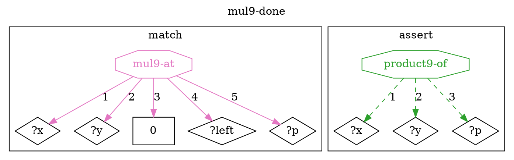
<!-- /rule -->

#### `mul9-overflows-shift`

<!-- rule std.math.num9 mul9-overflows-shift -->
```lisp
(rule mul9-overflows-shift ()
  :match  (and (mul9-at ?x ?y ?k ?left (num9 ?a8 ?a7 ?a6 ?a5 ?a4 ?a3 ?a2 ?a1 ?a0))
               (adj ?j ?k)
               (nz ?a8))
  :assert (overflow (mul9 ?x ?y))
  :why    "the sum so far has a top digit, {?a8}, and must still shift one place")
```

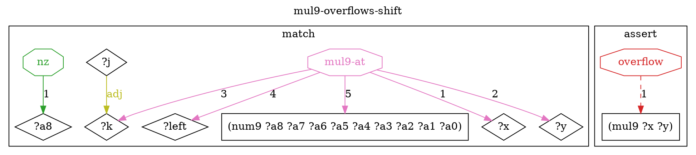
<!-- /rule -->

#### `mul9-overflows-row`

<!-- rule std.math.num9 mul9-overflows-row -->
```lisp
(rule mul9-overflows-row ()
  :match  (and (mul9-at (num9 ?x8 ?x7 ?x6 ?x5 ?x4 ?x3 ?x2 ?x1 ?x0) ?y ?k (num9 ?y8 ?y7 ?y6 ?y5 ?y4 ?y3 ?y2 ?y1 ?y0) ?acc)
               (nz ?y8)
               (md ?x0 ?y8 0 ?p0 ?m1)
               (md ?x1 ?y8 ?m1 ?p1 ?m2)
               (md ?x2 ?y8 ?m2 ?p2 ?m3)
               (md ?x3 ?y8 ?m3 ?p3 ?m4)
               (md ?x4 ?y8 ?m4 ?p4 ?m5)
               (md ?x5 ?y8 ?m5 ?p5 ?m6)
               (md ?x6 ?y8 ?m6 ?p6 ?m7)
               (md ?x7 ?y8 ?m7 ?p7 ?m8)
               (md ?x8 ?y8 ?m8 ?p8 ?c)
               (nz ?c))
  :assert (overflow (mul9 (num9 ?x8 ?x7 ?x6 ?x5 ?x4 ?x3 ?x2 ?x1 ?x0) ?y))
  :why    "the multiplicand times the digit {?y8} carries {?c} out of the top column")
```

```dot
digraph rule_mul9_overflows_row_lhs_rhs {
  rankdir=TB;
  label="mul9-overflows-row"; labelloc=t;
  subgraph cluster_lhs { label="match";
    "(num9 ?x8 ?x7 ?x6 ?x5 ?x4 ?x3 ?x2 ?x1 ?x0)_L" [label="(num9 ?x8 ?x7 ?x6 ?x5 ?x4 ?x3 ?x2 ?x1 ?x0)", shape=rectangle];
    "?y_L" [label="?y", shape=diamond];
    "?k_L" [label="?k", shape=diamond];
    "(num9 ?y8 ?y7 ?y6 ?y5 ?y4 ?y3 ?y2 ?y1 ?y0)_L" [label="(num9 ?y8 ?y7 ?y6 ?y5 ?y4 ?y3 ?y2 ?y1 ?y0)", shape=rectangle];
    "?acc_L" [label="?acc", shape=diamond];
    "?y8_L" [label="?y8", shape=diamond];
    "?x0_L" [label="?x0", shape=diamond];
    "0_L" [label="0", shape=rectangle];
    "?p0_L" [label="?p0", shape=diamond];
    "?m1_L" [label="?m1", shape=diamond];
    "?x1_L" [label="?x1", shape=diamond];
    "?p1_L" [label="?p1", shape=diamond];
    "?m2_L" [label="?m2", shape=diamond];
    "?x2_L" [label="?x2", shape=diamond];
    "?p2_L" [label="?p2", shape=diamond];
    "?m3_L" [label="?m3", shape=diamond];
    "?x3_L" [label="?x3", shape=diamond];
    "?p3_L" [label="?p3", shape=diamond];
    "?m4_L" [label="?m4", shape=diamond];
    "?x4_L" [label="?x4", shape=diamond];
    "?p4_L" [label="?p4", shape=diamond];
    "?m5_L" [label="?m5", shape=diamond];
    "?x5_L" [label="?x5", shape=diamond];
    "?p5_L" [label="?p5", shape=diamond];
    "?m6_L" [label="?m6", shape=diamond];
    "?x6_L" [label="?x6", shape=diamond];
    "?p6_L" [label="?p6", shape=diamond];
    "?m7_L" [label="?m7", shape=diamond];
    "?x7_L" [label="?x7", shape=diamond];
    "?p7_L" [label="?p7", shape=diamond];
    "?m8_L" [label="?m8", shape=diamond];
    "?x8_L" [label="?x8", shape=diamond];
    "?p8_L" [label="?p8", shape=diamond];
    "?c_L" [label="?c", shape=diamond];
    "h1_mul9-at_L" [shape=octagon, label="mul9-at", color="#e377c2", fontcolor="#e377c2"];
    "h1_mul9-at_L" -> "(num9 ?x8 ?x7 ?x6 ?x5 ?x4 ?x3 ?x2 ?x1 ?x0)_L" [label="1", color="#e377c2"];
    "h1_mul9-at_L" -> "?y_L" [label="2", color="#e377c2"];
    "h1_mul9-at_L" -> "?k_L" [label="3", color="#e377c2"];
    "h1_mul9-at_L" -> "(num9 ?y8 ?y7 ?y6 ?y5 ?y4 ?y3 ?y2 ?y1 ?y0)_L" [label="4", color="#e377c2"];
    "h1_mul9-at_L" -> "?acc_L" [label="5", color="#e377c2"];
    "h2_nz_L" [shape=octagon, label="nz", color="#2ca02c", fontcolor="#2ca02c"];
    "h2_nz_L" -> "?y8_L" [label="1", color="#2ca02c"];
    "h3_md_L" [shape=octagon, label="md", color="#bcbd22", fontcolor="#bcbd22"];
    "h3_md_L" -> "?x0_L" [label="1", color="#bcbd22"];
    "h3_md_L" -> "?y8_L" [label="2", color="#bcbd22"];
    "h3_md_L" -> "0_L" [label="3", color="#bcbd22"];
    "h3_md_L" -> "?p0_L" [label="4", color="#bcbd22"];
    "h3_md_L" -> "?m1_L" [label="5", color="#bcbd22"];
    "h4_md_L" [shape=octagon, label="md", color="#bcbd22", fontcolor="#bcbd22"];
    "h4_md_L" -> "?x1_L" [label="1", color="#bcbd22"];
    "h4_md_L" -> "?y8_L" [label="2", color="#bcbd22"];
    "h4_md_L" -> "?m1_L" [label="3", color="#bcbd22"];
    "h4_md_L" -> "?p1_L" [label="4", color="#bcbd22"];
    "h4_md_L" -> "?m2_L" [label="5", color="#bcbd22"];
    "h5_md_L" [shape=octagon, label="md", color="#bcbd22", fontcolor="#bcbd22"];
    "h5_md_L" -> "?x2_L" [label="1", color="#bcbd22"];
    "h5_md_L" -> "?y8_L" [label="2", color="#bcbd22"];
    "h5_md_L" -> "?m2_L" [label="3", color="#bcbd22"];
    "h5_md_L" -> "?p2_L" [label="4", color="#bcbd22"];
    "h5_md_L" -> "?m3_L" [label="5", color="#bcbd22"];
    "h6_md_L" [shape=octagon, label="md", color="#bcbd22", fontcolor="#bcbd22"];
    "h6_md_L" -> "?x3_L" [label="1", color="#bcbd22"];
    "h6_md_L" -> "?y8_L" [label="2", color="#bcbd22"];
    "h6_md_L" -> "?m3_L" [label="3", color="#bcbd22"];
    "h6_md_L" -> "?p3_L" [label="4", color="#bcbd22"];
    "h6_md_L" -> "?m4_L" [label="5", color="#bcbd22"];
    "h7_md_L" [shape=octagon, label="md", color="#bcbd22", fontcolor="#bcbd22"];
    "h7_md_L" -> "?x4_L" [label="1", color="#bcbd22"];
    "h7_md_L" -> "?y8_L" [label="2", color="#bcbd22"];
    "h7_md_L" -> "?m4_L" [label="3", color="#bcbd22"];
    "h7_md_L" -> "?p4_L" [label="4", color="#bcbd22"];
    "h7_md_L" -> "?m5_L" [label="5", color="#bcbd22"];
    "h8_md_L" [shape=octagon, label="md", color="#bcbd22", fontcolor="#bcbd22"];
    "h8_md_L" -> "?x5_L" [label="1", color="#bcbd22"];
    "h8_md_L" -> "?y8_L" [label="2", color="#bcbd22"];
    "h8_md_L" -> "?m5_L" [label="3", color="#bcbd22"];
    "h8_md_L" -> "?p5_L" [label="4", color="#bcbd22"];
    "h8_md_L" -> "?m6_L" [label="5", color="#bcbd22"];
    "h9_md_L" [shape=octagon, label="md", color="#bcbd22", fontcolor="#bcbd22"];
    "h9_md_L" -> "?x6_L" [label="1", color="#bcbd22"];
    "h9_md_L" -> "?y8_L" [label="2", color="#bcbd22"];
    "h9_md_L" -> "?m6_L" [label="3", color="#bcbd22"];
    "h9_md_L" -> "?p6_L" [label="4", color="#bcbd22"];
    "h9_md_L" -> "?m7_L" [label="5", color="#bcbd22"];
    "h10_md_L" [shape=octagon, label="md", color="#bcbd22", fontcolor="#bcbd22"];
    "h10_md_L" -> "?x7_L" [label="1", color="#bcbd22"];
    "h10_md_L" -> "?y8_L" [label="2", color="#bcbd22"];
    "h10_md_L" -> "?m7_L" [label="3", color="#bcbd22"];
    "h10_md_L" -> "?p7_L" [label="4", color="#bcbd22"];
    "h10_md_L" -> "?m8_L" [label="5", color="#bcbd22"];
    "h11_md_L" [shape=octagon, label="md", color="#bcbd22", fontcolor="#bcbd22"];
    "h11_md_L" -> "?x8_L" [label="1", color="#bcbd22"];
    "h11_md_L" -> "?y8_L" [label="2", color="#bcbd22"];
    "h11_md_L" -> "?m8_L" [label="3", color="#bcbd22"];
    "h11_md_L" -> "?p8_L" [label="4", color="#bcbd22"];
    "h11_md_L" -> "?c_L" [label="5", color="#bcbd22"];
    "h12_nz_L" [shape=octagon, label="nz", color="#2ca02c", fontcolor="#2ca02c"];
    "h12_nz_L" -> "?c_L" [label="1", color="#2ca02c"];
  }
  subgraph cluster_rhs { label="assert";
    "(mul9 (num9 ?x8 ?x7 ?x6 ?x5 ?x4 ?x3 ?x2 ?x1 ?x0) ?y)_R" [label="(mul9 (num9 ?x8 ?x7 ?x6 ?x5 ?x4 ?x3 ?x2 ?x1 ?x0) ?y)", shape=rectangle];
    "h13_overflow_R" [shape=octagon, label="overflow", color="#d62728", fontcolor="#d62728"];
    "h13_overflow_R" -> "(mul9 (num9 ?x8 ?x7 ?x6 ?x5 ?x4 ?x3 ?x2 ?x1 ?x0) ?y)_R" [label="1", color="#d62728", style=dashed];
  }
}
```
<!-- /rule -->

#### `mul9-overflows-add`

<!-- rule std.math.num9 mul9-overflows-add -->
```lisp
(rule mul9-overflows-add ()
  :match  (and (mul9-at (num9 ?x8 ?x7 ?x6 ?x5 ?x4 ?x3 ?x2 ?x1 ?x0) ?y ?k (num9 ?y8 ?y7 ?y6 ?y5 ?y4 ?y3 ?y2 ?y1 ?y0) (num9 0 ?a7 ?a6 ?a5 ?a4 ?a3 ?a2 ?a1 ?a0))
               (nz ?y8)
               (md ?x0 ?y8 0 ?p0 ?m1)
               (md ?x1 ?y8 ?m1 ?p1 ?m2)
               (md ?x2 ?y8 ?m2 ?p2 ?m3)
               (md ?x3 ?y8 ?m3 ?p3 ?m4)
               (md ?x4 ?y8 ?m4 ?p4 ?m5)
               (md ?x5 ?y8 ?m5 ?p5 ?m6)
               (md ?x6 ?y8 ?m6 ?p6 ?m7)
               (md ?x7 ?y8 ?m7 ?p7 ?m8)
               (md ?x8 ?y8 ?m8 ?p8 0)
               (fa 0 ?p0 0 ?s0 ?c1)
               (fa ?a0 ?p1 ?c1 ?s1 ?c2)
               (fa ?a1 ?p2 ?c2 ?s2 ?c3)
               (fa ?a2 ?p3 ?c3 ?s3 ?c4)
               (fa ?a3 ?p4 ?c4 ?s4 ?c5)
               (fa ?a4 ?p5 ?c5 ?s5 ?c6)
               (fa ?a5 ?p6 ?c6 ?s6 ?c7)
               (fa ?a6 ?p7 ?c7 ?s7 ?c8)
               (fa ?a7 ?p8 ?c8 ?s8 1))
  :assert (overflow (mul9 (num9 ?x8 ?x7 ?x6 ?x5 ?x4 ?x3 ?x2 ?x1 ?x0) ?y))
  :why    "adding the row to the sum so far carries out of the top column")
```

```dot
digraph rule_mul9_overflows_add_lhs_rhs {
  rankdir=TB;
  label="mul9-overflows-add"; labelloc=t;
  subgraph cluster_lhs { label="match";
    "(num9 ?x8 ?x7 ?x6 ?x5 ?x4 ?x3 ?x2 ?x1 ?x0)_L" [label="(num9 ?x8 ?x7 ?x6 ?x5 ?x4 ?x3 ?x2 ?x1 ?x0)", shape=rectangle];
    "?y_L" [label="?y", shape=diamond];
    "?k_L" [label="?k", shape=diamond];
    "(num9 ?y8 ?y7 ?y6 ?y5 ?y4 ?y3 ?y2 ?y1 ?y0)_L" [label="(num9 ?y8 ?y7 ?y6 ?y5 ?y4 ?y3 ?y2 ?y1 ?y0)", shape=rectangle];
    "(num9 0 ?a7 ?a6 ?a5 ?a4 ?a3 ?a2 ?a1 ?a0)_L" [label="(num9 0 ?a7 ?a6 ?a5 ?a4 ?a3 ?a2 ?a1 ?a0)", shape=rectangle];
    "?y8_L" [label="?y8", shape=diamond];
    "?x0_L" [label="?x0", shape=diamond];
    "0_L" [label="0", shape=rectangle];
    "?p0_L" [label="?p0", shape=diamond];
    "?m1_L" [label="?m1", shape=diamond];
    "?x1_L" [label="?x1", shape=diamond];
    "?p1_L" [label="?p1", shape=diamond];
    "?m2_L" [label="?m2", shape=diamond];
    "?x2_L" [label="?x2", shape=diamond];
    "?p2_L" [label="?p2", shape=diamond];
    "?m3_L" [label="?m3", shape=diamond];
    "?x3_L" [label="?x3", shape=diamond];
    "?p3_L" [label="?p3", shape=diamond];
    "?m4_L" [label="?m4", shape=diamond];
    "?x4_L" [label="?x4", shape=diamond];
    "?p4_L" [label="?p4", shape=diamond];
    "?m5_L" [label="?m5", shape=diamond];
    "?x5_L" [label="?x5", shape=diamond];
    "?p5_L" [label="?p5", shape=diamond];
    "?m6_L" [label="?m6", shape=diamond];
    "?x6_L" [label="?x6", shape=diamond];
    "?p6_L" [label="?p6", shape=diamond];
    "?m7_L" [label="?m7", shape=diamond];
    "?x7_L" [label="?x7", shape=diamond];
    "?p7_L" [label="?p7", shape=diamond];
    "?m8_L" [label="?m8", shape=diamond];
    "?x8_L" [label="?x8", shape=diamond];
    "?p8_L" [label="?p8", shape=diamond];
    "?s0_L" [label="?s0", shape=diamond];
    "?c1_L" [label="?c1", shape=diamond];
    "?a0_L" [label="?a0", shape=diamond];
    "?s1_L" [label="?s1", shape=diamond];
    "?c2_L" [label="?c2", shape=diamond];
    "?a1_L" [label="?a1", shape=diamond];
    "?s2_L" [label="?s2", shape=diamond];
    "?c3_L" [label="?c3", shape=diamond];
    "?a2_L" [label="?a2", shape=diamond];
    "?s3_L" [label="?s3", shape=diamond];
    "?c4_L" [label="?c4", shape=diamond];
    "?a3_L" [label="?a3", shape=diamond];
    "?s4_L" [label="?s4", shape=diamond];
    "?c5_L" [label="?c5", shape=diamond];
    "?a4_L" [label="?a4", shape=diamond];
    "?s5_L" [label="?s5", shape=diamond];
    "?c6_L" [label="?c6", shape=diamond];
    "?a5_L" [label="?a5", shape=diamond];
    "?s6_L" [label="?s6", shape=diamond];
    "?c7_L" [label="?c7", shape=diamond];
    "?a6_L" [label="?a6", shape=diamond];
    "?s7_L" [label="?s7", shape=diamond];
    "?c8_L" [label="?c8", shape=diamond];
    "?a7_L" [label="?a7", shape=diamond];
    "?s8_L" [label="?s8", shape=diamond];
    "1_L" [label="1", shape=rectangle];
    "h1_mul9-at_L" [shape=octagon, label="mul9-at", color="#e377c2", fontcolor="#e377c2"];
    "h1_mul9-at_L" -> "(num9 ?x8 ?x7 ?x6 ?x5 ?x4 ?x3 ?x2 ?x1 ?x0)_L" [label="1", color="#e377c2"];
    "h1_mul9-at_L" -> "?y_L" [label="2", color="#e377c2"];
    "h1_mul9-at_L" -> "?k_L" [label="3", color="#e377c2"];
    "h1_mul9-at_L" -> "(num9 ?y8 ?y7 ?y6 ?y5 ?y4 ?y3 ?y2 ?y1 ?y0)_L" [label="4", color="#e377c2"];
    "h1_mul9-at_L" -> "(num9 0 ?a7 ?a6 ?a5 ?a4 ?a3 ?a2 ?a1 ?a0)_L" [label="5", color="#e377c2"];
    "h2_nz_L" [shape=octagon, label="nz", color="#2ca02c", fontcolor="#2ca02c"];
    "h2_nz_L" -> "?y8_L" [label="1", color="#2ca02c"];
    "h3_md_L" [shape=octagon, label="md", color="#bcbd22", fontcolor="#bcbd22"];
    "h3_md_L" -> "?x0_L" [label="1", color="#bcbd22"];
    "h3_md_L" -> "?y8_L" [label="2", color="#bcbd22"];
    "h3_md_L" -> "0_L" [label="3", color="#bcbd22"];
    "h3_md_L" -> "?p0_L" [label="4", color="#bcbd22"];
    "h3_md_L" -> "?m1_L" [label="5", color="#bcbd22"];
    "h4_md_L" [shape=octagon, label="md", color="#bcbd22", fontcolor="#bcbd22"];
    "h4_md_L" -> "?x1_L" [label="1", color="#bcbd22"];
    "h4_md_L" -> "?y8_L" [label="2", color="#bcbd22"];
    "h4_md_L" -> "?m1_L" [label="3", color="#bcbd22"];
    "h4_md_L" -> "?p1_L" [label="4", color="#bcbd22"];
    "h4_md_L" -> "?m2_L" [label="5", color="#bcbd22"];
    "h5_md_L" [shape=octagon, label="md", color="#bcbd22", fontcolor="#bcbd22"];
    "h5_md_L" -> "?x2_L" [label="1", color="#bcbd22"];
    "h5_md_L" -> "?y8_L" [label="2", color="#bcbd22"];
    "h5_md_L" -> "?m2_L" [label="3", color="#bcbd22"];
    "h5_md_L" -> "?p2_L" [label="4", color="#bcbd22"];
    "h5_md_L" -> "?m3_L" [label="5", color="#bcbd22"];
    "h6_md_L" [shape=octagon, label="md", color="#bcbd22", fontcolor="#bcbd22"];
    "h6_md_L" -> "?x3_L" [label="1", color="#bcbd22"];
    "h6_md_L" -> "?y8_L" [label="2", color="#bcbd22"];
    "h6_md_L" -> "?m3_L" [label="3", color="#bcbd22"];
    "h6_md_L" -> "?p3_L" [label="4", color="#bcbd22"];
    "h6_md_L" -> "?m4_L" [label="5", color="#bcbd22"];
    "h7_md_L" [shape=octagon, label="md", color="#bcbd22", fontcolor="#bcbd22"];
    "h7_md_L" -> "?x4_L" [label="1", color="#bcbd22"];
    "h7_md_L" -> "?y8_L" [label="2", color="#bcbd22"];
    "h7_md_L" -> "?m4_L" [label="3", color="#bcbd22"];
    "h7_md_L" -> "?p4_L" [label="4", color="#bcbd22"];
    "h7_md_L" -> "?m5_L" [label="5", color="#bcbd22"];
    "h8_md_L" [shape=octagon, label="md", color="#bcbd22", fontcolor="#bcbd22"];
    "h8_md_L" -> "?x5_L" [label="1", color="#bcbd22"];
    "h8_md_L" -> "?y8_L" [label="2", color="#bcbd22"];
    "h8_md_L" -> "?m5_L" [label="3", color="#bcbd22"];
    "h8_md_L" -> "?p5_L" [label="4", color="#bcbd22"];
    "h8_md_L" -> "?m6_L" [label="5", color="#bcbd22"];
    "h9_md_L" [shape=octagon, label="md", color="#bcbd22", fontcolor="#bcbd22"];
    "h9_md_L" -> "?x6_L" [label="1", color="#bcbd22"];
    "h9_md_L" -> "?y8_L" [label="2", color="#bcbd22"];
    "h9_md_L" -> "?m6_L" [label="3", color="#bcbd22"];
    "h9_md_L" -> "?p6_L" [label="4", color="#bcbd22"];
    "h9_md_L" -> "?m7_L" [label="5", color="#bcbd22"];
    "h10_md_L" [shape=octagon, label="md", color="#bcbd22", fontcolor="#bcbd22"];
    "h10_md_L" -> "?x7_L" [label="1", color="#bcbd22"];
    "h10_md_L" -> "?y8_L" [label="2", color="#bcbd22"];
    "h10_md_L" -> "?m7_L" [label="3", color="#bcbd22"];
    "h10_md_L" -> "?p7_L" [label="4", color="#bcbd22"];
    "h10_md_L" -> "?m8_L" [label="5", color="#bcbd22"];
    "h11_md_L" [shape=octagon, label="md", color="#bcbd22", fontcolor="#bcbd22"];
    "h11_md_L" -> "?x8_L" [label="1", color="#bcbd22"];
    "h11_md_L" -> "?y8_L" [label="2", color="#bcbd22"];
    "h11_md_L" -> "?m8_L" [label="3", color="#bcbd22"];
    "h11_md_L" -> "?p8_L" [label="4", color="#bcbd22"];
    "h11_md_L" -> "0_L" [label="5", color="#bcbd22"];
    "h12_fa_L" [shape=octagon, label="fa", color="#7f7f7f", fontcolor="#7f7f7f"];
    "h12_fa_L" -> "0_L" [label="1", color="#7f7f7f"];
    "h12_fa_L" -> "?p0_L" [label="2", color="#7f7f7f"];
    "h12_fa_L" -> "0_L" [label="3", color="#7f7f7f"];
    "h12_fa_L" -> "?s0_L" [label="4", color="#7f7f7f"];
    "h12_fa_L" -> "?c1_L" [label="5", color="#7f7f7f"];
    "h13_fa_L" [shape=octagon, label="fa", color="#7f7f7f", fontcolor="#7f7f7f"];
    "h13_fa_L" -> "?a0_L" [label="1", color="#7f7f7f"];
    "h13_fa_L" -> "?p1_L" [label="2", color="#7f7f7f"];
    "h13_fa_L" -> "?c1_L" [label="3", color="#7f7f7f"];
    "h13_fa_L" -> "?s1_L" [label="4", color="#7f7f7f"];
    "h13_fa_L" -> "?c2_L" [label="5", color="#7f7f7f"];
    "h14_fa_L" [shape=octagon, label="fa", color="#7f7f7f", fontcolor="#7f7f7f"];
    "h14_fa_L" -> "?a1_L" [label="1", color="#7f7f7f"];
    "h14_fa_L" -> "?p2_L" [label="2", color="#7f7f7f"];
    "h14_fa_L" -> "?c2_L" [label="3", color="#7f7f7f"];
    "h14_fa_L" -> "?s2_L" [label="4", color="#7f7f7f"];
    "h14_fa_L" -> "?c3_L" [label="5", color="#7f7f7f"];
    "h15_fa_L" [shape=octagon, label="fa", color="#7f7f7f", fontcolor="#7f7f7f"];
    "h15_fa_L" -> "?a2_L" [label="1", color="#7f7f7f"];
    "h15_fa_L" -> "?p3_L" [label="2", color="#7f7f7f"];
    "h15_fa_L" -> "?c3_L" [label="3", color="#7f7f7f"];
    "h15_fa_L" -> "?s3_L" [label="4", color="#7f7f7f"];
    "h15_fa_L" -> "?c4_L" [label="5", color="#7f7f7f"];
    "h16_fa_L" [shape=octagon, label="fa", color="#7f7f7f", fontcolor="#7f7f7f"];
    "h16_fa_L" -> "?a3_L" [label="1", color="#7f7f7f"];
    "h16_fa_L" -> "?p4_L" [label="2", color="#7f7f7f"];
    "h16_fa_L" -> "?c4_L" [label="3", color="#7f7f7f"];
    "h16_fa_L" -> "?s4_L" [label="4", color="#7f7f7f"];
    "h16_fa_L" -> "?c5_L" [label="5", color="#7f7f7f"];
    "h17_fa_L" [shape=octagon, label="fa", color="#7f7f7f", fontcolor="#7f7f7f"];
    "h17_fa_L" -> "?a4_L" [label="1", color="#7f7f7f"];
    "h17_fa_L" -> "?p5_L" [label="2", color="#7f7f7f"];
    "h17_fa_L" -> "?c5_L" [label="3", color="#7f7f7f"];
    "h17_fa_L" -> "?s5_L" [label="4", color="#7f7f7f"];
    "h17_fa_L" -> "?c6_L" [label="5", color="#7f7f7f"];
    "h18_fa_L" [shape=octagon, label="fa", color="#7f7f7f", fontcolor="#7f7f7f"];
    "h18_fa_L" -> "?a5_L" [label="1", color="#7f7f7f"];
    "h18_fa_L" -> "?p6_L" [label="2", color="#7f7f7f"];
    "h18_fa_L" -> "?c6_L" [label="3", color="#7f7f7f"];
    "h18_fa_L" -> "?s6_L" [label="4", color="#7f7f7f"];
    "h18_fa_L" -> "?c7_L" [label="5", color="#7f7f7f"];
    "h19_fa_L" [shape=octagon, label="fa", color="#7f7f7f", fontcolor="#7f7f7f"];
    "h19_fa_L" -> "?a6_L" [label="1", color="#7f7f7f"];
    "h19_fa_L" -> "?p7_L" [label="2", color="#7f7f7f"];
    "h19_fa_L" -> "?c7_L" [label="3", color="#7f7f7f"];
    "h19_fa_L" -> "?s7_L" [label="4", color="#7f7f7f"];
    "h19_fa_L" -> "?c8_L" [label="5", color="#7f7f7f"];
    "h20_fa_L" [shape=octagon, label="fa", color="#7f7f7f", fontcolor="#7f7f7f"];
    "h20_fa_L" -> "?a7_L" [label="1", color="#7f7f7f"];
    "h20_fa_L" -> "?p8_L" [label="2", color="#7f7f7f"];
    "h20_fa_L" -> "?c8_L" [label="3", color="#7f7f7f"];
    "h20_fa_L" -> "?s8_L" [label="4", color="#7f7f7f"];
    "h20_fa_L" -> "1_L" [label="5", color="#7f7f7f"];
  }
  subgraph cluster_rhs { label="assert";
    "(mul9 (num9 ?x8 ?x7 ?x6 ?x5 ?x4 ?x3 ?x2 ?x1 ?x0) ?y)_R" [label="(mul9 (num9 ?x8 ?x7 ?x6 ?x5 ?x4 ?x3 ?x2 ?x1 ?x0) ?y)", shape=rectangle];
    "h21_overflow_R" [shape=octagon, label="overflow", color="#d62728", fontcolor="#d62728"];
    "h21_overflow_R" -> "(mul9 (num9 ?x8 ?x7 ?x6 ?x5 ?x4 ?x3 ?x2 ?x1 ?x0) ?y)_R" [label="1", color="#d62728", style=dashed];
  }
}
```
<!-- /rule -->

## Division

School long division. `div9-start` computes the divisor's multiples by one to nine once, and is
shown as Ein alone: its drawing has more nodes than a page can show. A step brings a digit down and finds the
quotient's digit as the one multiple that goes into the number with no borrow and leaves less than the divisor,
one rule a digit.

#### `div9-start`

<!-- rule std.math.num9 div9-start -->
```lisp
(rule div9-start ()
  :match  (and (div9 (num9 ?n8 ?n7 ?n6 ?n5 ?n4 ?n3 ?n2 ?n1 ?n0) (num9 ?d8 ?d7 ?d6 ?d5 ?d4 ?d3 ?d2 ?d1 ?d0))
               (md ?d0 2 0 ?m2p0 ?m2c1)
               (md ?d1 2 ?m2c1 ?m2p1 ?m2c2)
               (md ?d2 2 ?m2c2 ?m2p2 ?m2c3)
               (md ?d3 2 ?m2c3 ?m2p3 ?m2c4)
               (md ?d4 2 ?m2c4 ?m2p4 ?m2c5)
               (md ?d5 2 ?m2c5 ?m2p5 ?m2c6)
               (md ?d6 2 ?m2c6 ?m2p6 ?m2c7)
               (md ?d7 2 ?m2c7 ?m2p7 ?m2c8)
               (md ?d8 2 ?m2c8 ?m2p8 ?m2c)
               (md ?d0 3 0 ?m3p0 ?m3c1)
               (md ?d1 3 ?m3c1 ?m3p1 ?m3c2)
               (md ?d2 3 ?m3c2 ?m3p2 ?m3c3)
               (md ?d3 3 ?m3c3 ?m3p3 ?m3c4)
               (md ?d4 3 ?m3c4 ?m3p4 ?m3c5)
               (md ?d5 3 ?m3c5 ?m3p5 ?m3c6)
               (md ?d6 3 ?m3c6 ?m3p6 ?m3c7)
               (md ?d7 3 ?m3c7 ?m3p7 ?m3c8)
               (md ?d8 3 ?m3c8 ?m3p8 ?m3c)
               (md ?d0 4 0 ?m4p0 ?m4c1)
               (md ?d1 4 ?m4c1 ?m4p1 ?m4c2)
               (md ?d2 4 ?m4c2 ?m4p2 ?m4c3)
               (md ?d3 4 ?m4c3 ?m4p3 ?m4c4)
               (md ?d4 4 ?m4c4 ?m4p4 ?m4c5)
               (md ?d5 4 ?m4c5 ?m4p5 ?m4c6)
               (md ?d6 4 ?m4c6 ?m4p6 ?m4c7)
               (md ?d7 4 ?m4c7 ?m4p7 ?m4c8)
               (md ?d8 4 ?m4c8 ?m4p8 ?m4c)
               (md ?d0 5 0 ?m5p0 ?m5c1)
               (md ?d1 5 ?m5c1 ?m5p1 ?m5c2)
               (md ?d2 5 ?m5c2 ?m5p2 ?m5c3)
               (md ?d3 5 ?m5c3 ?m5p3 ?m5c4)
               (md ?d4 5 ?m5c4 ?m5p4 ?m5c5)
               (md ?d5 5 ?m5c5 ?m5p5 ?m5c6)
               (md ?d6 5 ?m5c6 ?m5p6 ?m5c7)
               (md ?d7 5 ?m5c7 ?m5p7 ?m5c8)
               (md ?d8 5 ?m5c8 ?m5p8 ?m5c)
               (md ?d0 6 0 ?m6p0 ?m6c1)
               (md ?d1 6 ?m6c1 ?m6p1 ?m6c2)
               (md ?d2 6 ?m6c2 ?m6p2 ?m6c3)
               (md ?d3 6 ?m6c3 ?m6p3 ?m6c4)
               (md ?d4 6 ?m6c4 ?m6p4 ?m6c5)
               (md ?d5 6 ?m6c5 ?m6p5 ?m6c6)
               (md ?d6 6 ?m6c6 ?m6p6 ?m6c7)
               (md ?d7 6 ?m6c7 ?m6p7 ?m6c8)
               (md ?d8 6 ?m6c8 ?m6p8 ?m6c)
               (md ?d0 7 0 ?m7p0 ?m7c1)
               (md ?d1 7 ?m7c1 ?m7p1 ?m7c2)
               (md ?d2 7 ?m7c2 ?m7p2 ?m7c3)
               (md ?d3 7 ?m7c3 ?m7p3 ?m7c4)
               (md ?d4 7 ?m7c4 ?m7p4 ?m7c5)
               (md ?d5 7 ?m7c5 ?m7p5 ?m7c6)
               (md ?d6 7 ?m7c6 ?m7p6 ?m7c7)
               (md ?d7 7 ?m7c7 ?m7p7 ?m7c8)
               (md ?d8 7 ?m7c8 ?m7p8 ?m7c)
               (md ?d0 8 0 ?m8p0 ?m8c1)
               (md ?d1 8 ?m8c1 ?m8p1 ?m8c2)
               (md ?d2 8 ?m8c2 ?m8p2 ?m8c3)
               (md ?d3 8 ?m8c3 ?m8p3 ?m8c4)
               (md ?d4 8 ?m8c4 ?m8p4 ?m8c5)
               (md ?d5 8 ?m8c5 ?m8p5 ?m8c6)
               (md ?d6 8 ?m8c6 ?m8p6 ?m8c7)
               (md ?d7 8 ?m8c7 ?m8p7 ?m8c8)
               (md ?d8 8 ?m8c8 ?m8p8 ?m8c)
               (md ?d0 9 0 ?m9p0 ?m9c1)
               (md ?d1 9 ?m9c1 ?m9p1 ?m9c2)
               (md ?d2 9 ?m9c2 ?m9p2 ?m9c3)
               (md ?d3 9 ?m9c3 ?m9p3 ?m9c4)
               (md ?d4 9 ?m9c4 ?m9p4 ?m9c5)
               (md ?d5 9 ?m9c5 ?m9p5 ?m9c6)
               (md ?d6 9 ?m9c6 ?m9p6 ?m9c7)
               (md ?d7 9 ?m9c7 ?m9p7 ?m9c8)
               (md ?d8 9 ?m9c8 ?m9p8 ?m9c))
  :assert (div9-at (num9 ?n8 ?n7 ?n6 ?n5 ?n4 ?n3 ?n2 ?n1 ?n0) (num9 ?d8 ?d7 ?d6 ?d5 ?d4 ?d3 ?d2 ?d1 ?d0) (multiples9 (row9 0 ?d8 ?d7 ?d6 ?d5 ?d4 ?d3 ?d2 ?d1 ?d0) (row9 ?m2c ?m2p8 ?m2p7 ?m2p6 ?m2p5 ?m2p4 ?m2p3 ?m2p2 ?m2p1 ?m2p0) (row9 ?m3c ?m3p8 ?m3p7 ?m3p6 ?m3p5 ?m3p4 ?m3p3 ?m3p2 ?m3p1 ?m3p0) (row9 ?m4c ?m4p8 ?m4p7 ?m4p6 ?m4p5 ?m4p4 ?m4p3 ?m4p2 ?m4p1 ?m4p0) (row9 ?m5c ?m5p8 ?m5p7 ?m5p6 ?m5p5 ?m5p4 ?m5p3 ?m5p2 ?m5p1 ?m5p0) (row9 ?m6c ?m6p8 ?m6p7 ?m6p6 ?m6p5 ?m6p4 ?m6p3 ?m6p2 ?m6p1 ?m6p0) (row9 ?m7c ?m7p8 ?m7p7 ?m7p6 ?m7p5 ?m7p4 ?m7p3 ?m7p2 ?m7p1 ?m7p0) (row9 ?m8c ?m8p8 ?m8p7 ?m8p6 ?m8p5 ?m8p4 ?m8p3 ?m8p2 ?m8p1 ?m8p0) (row9 ?m9c ?m9p8 ?m9p7 ?m9p6 ?m9p5 ?m9p4 ?m9p3 ?m9p2 ?m9p1 ?m9p0)) 9 (num9 ?n8 ?n7 ?n6 ?n5 ?n4 ?n3 ?n2 ?n1 ?n0) (num9 0 0 0 0 0 0 0 0 0) (num9 0 0 0 0 0 0 0 0 0))
  :why    "the divisor's multiples by 2 to 9, each a column at a time from the table. Start at the dividend's top digit: 9 digits to go, nothing left over, the quotient zero")
```
<!-- /rule -->

#### `div9-step-0`

<!-- rule std.math.num9 div9-step-0 -->
```lisp
(rule div9-step-0 ()
  :match  (and (div9-at ?n (num9 ?d8 ?d7 ?d6 ?d5 ?d4 ?d3 ?d2 ?d1 ?d0) ?ms ?k (num9 ?n8 ?n7 ?n6 ?n5 ?n4 ?n3 ?n2 ?n1 ?n0) (num9 0 ?r7 ?r6 ?r5 ?r4 ?r3 ?r2 ?r1 ?r0) (num9 ?qq ?q7 ?q6 ?q5 ?q4 ?q3 ?q2 ?q1 ?q0))
               (adj ?j ?k)
               (fs ?n8 ?d0 0 ?u0 ?e1)
               (fs ?r0 ?d1 ?e1 ?u1 ?e2)
               (fs ?r1 ?d2 ?e2 ?u2 ?e3)
               (fs ?r2 ?d3 ?e3 ?u3 ?e4)
               (fs ?r3 ?d4 ?e4 ?u4 ?e5)
               (fs ?r4 ?d5 ?e5 ?u5 ?e6)
               (fs ?r5 ?d6 ?e6 ?u6 ?e7)
               (fs ?r6 ?d7 ?e7 ?u7 ?e8)
               (fs ?r7 ?d8 ?e8 ?u8 1))
  :assert (div9-at ?n (num9 ?d8 ?d7 ?d6 ?d5 ?d4 ?d3 ?d2 ?d1 ?d0) ?ms ?j (num9 ?n7 ?n6 ?n5 ?n4 ?n3 ?n2 ?n1 ?n0 0) (num9 ?r7 ?r6 ?r5 ?r4 ?r3 ?r2 ?r1 ?r0 ?n8) (num9 ?q7 ?q6 ?q5 ?q4 ?q3 ?q2 ?q1 ?q0 0))
  :why    "bring down {?n8}: the number is less than the divisor, since taking the divisor from it borrows out of the top. The quotient's next digit is 0")
```

```dot
digraph rule_div9_step_0_lhs_rhs {
  rankdir=TB;
  label="div9-step-0"; labelloc=t;
  subgraph cluster_lhs { label="match";
    "?n_L" [label="?n", shape=diamond];
    "(num9 ?d8 ?d7 ?d6 ?d5 ?d4 ?d3 ?d2 ?d1 ?d0)_L" [label="(num9 ?d8 ?d7 ?d6 ?d5 ?d4 ?d3 ?d2 ?d1 ?d0)", shape=rectangle];
    "?ms_L" [label="?ms", shape=diamond];
    "?k_L" [label="?k", shape=diamond];
    "(num9 ?n8 ?n7 ?n6 ?n5 ?n4 ?n3 ?n2 ?n1 ?n0)_L" [label="(num9 ?n8 ?n7 ?n6 ?n5 ?n4 ?n3 ?n2 ?n1 ?n0)", shape=rectangle];
    "(num9 0 ?r7 ?r6 ?r5 ?r4 ?r3 ?r2 ?r1 ?r0)_L" [label="(num9 0 ?r7 ?r6 ?r5 ?r4 ?r3 ?r2 ?r1 ?r0)", shape=rectangle];
    "(num9 ?qq ?q7 ?q6 ?q5 ?q4 ?q3 ?q2 ?q1 ?q0)_L" [label="(num9 ?qq ?q7 ?q6 ?q5 ?q4 ?q3 ?q2 ?q1 ?q0)", shape=rectangle];
    "?j_L" [label="?j", shape=diamond];
    "?n8_L" [label="?n8", shape=diamond];
    "?d0_L" [label="?d0", shape=diamond];
    "0_L" [label="0", shape=rectangle];
    "?u0_L" [label="?u0", shape=diamond];
    "?e1_L" [label="?e1", shape=diamond];
    "?r0_L" [label="?r0", shape=diamond];
    "?d1_L" [label="?d1", shape=diamond];
    "?u1_L" [label="?u1", shape=diamond];
    "?e2_L" [label="?e2", shape=diamond];
    "?r1_L" [label="?r1", shape=diamond];
    "?d2_L" [label="?d2", shape=diamond];
    "?u2_L" [label="?u2", shape=diamond];
    "?e3_L" [label="?e3", shape=diamond];
    "?r2_L" [label="?r2", shape=diamond];
    "?d3_L" [label="?d3", shape=diamond];
    "?u3_L" [label="?u3", shape=diamond];
    "?e4_L" [label="?e4", shape=diamond];
    "?r3_L" [label="?r3", shape=diamond];
    "?d4_L" [label="?d4", shape=diamond];
    "?u4_L" [label="?u4", shape=diamond];
    "?e5_L" [label="?e5", shape=diamond];
    "?r4_L" [label="?r4", shape=diamond];
    "?d5_L" [label="?d5", shape=diamond];
    "?u5_L" [label="?u5", shape=diamond];
    "?e6_L" [label="?e6", shape=diamond];
    "?r5_L" [label="?r5", shape=diamond];
    "?d6_L" [label="?d6", shape=diamond];
    "?u6_L" [label="?u6", shape=diamond];
    "?e7_L" [label="?e7", shape=diamond];
    "?r6_L" [label="?r6", shape=diamond];
    "?d7_L" [label="?d7", shape=diamond];
    "?u7_L" [label="?u7", shape=diamond];
    "?e8_L" [label="?e8", shape=diamond];
    "?r7_L" [label="?r7", shape=diamond];
    "?d8_L" [label="?d8", shape=diamond];
    "?u8_L" [label="?u8", shape=diamond];
    "1_L" [label="1", shape=rectangle];
    "h1_div9-at_L" [shape=octagon, label="div9-at", color="#17becf", fontcolor="#17becf"];
    "h1_div9-at_L" -> "?n_L" [label="1", color="#17becf"];
    "h1_div9-at_L" -> "(num9 ?d8 ?d7 ?d6 ?d5 ?d4 ?d3 ?d2 ?d1 ?d0)_L" [label="2", color="#17becf"];
    "h1_div9-at_L" -> "?ms_L" [label="3", color="#17becf"];
    "h1_div9-at_L" -> "?k_L" [label="4", color="#17becf"];
    "h1_div9-at_L" -> "(num9 ?n8 ?n7 ?n6 ?n5 ?n4 ?n3 ?n2 ?n1 ?n0)_L" [label="5", color="#17becf"];
    "h1_div9-at_L" -> "(num9 0 ?r7 ?r6 ?r5 ?r4 ?r3 ?r2 ?r1 ?r0)_L" [label="6", color="#17becf"];
    "h1_div9-at_L" -> "(num9 ?qq ?q7 ?q6 ?q5 ?q4 ?q3 ?q2 ?q1 ?q0)_L" [label="7", color="#17becf"];
    "?j_L" -> "?k_L" [label="adj", color="#bcbd22", fontcolor="#bcbd22"];
    "h2_fs_L" [shape=octagon, label="fs", color="#bcbd22", fontcolor="#bcbd22"];
    "h2_fs_L" -> "?n8_L" [label="1", color="#bcbd22"];
    "h2_fs_L" -> "?d0_L" [label="2", color="#bcbd22"];
    "h2_fs_L" -> "0_L" [label="3", color="#bcbd22"];
    "h2_fs_L" -> "?u0_L" [label="4", color="#bcbd22"];
    "h2_fs_L" -> "?e1_L" [label="5", color="#bcbd22"];
    "h3_fs_L" [shape=octagon, label="fs", color="#bcbd22", fontcolor="#bcbd22"];
    "h3_fs_L" -> "?r0_L" [label="1", color="#bcbd22"];
    "h3_fs_L" -> "?d1_L" [label="2", color="#bcbd22"];
    "h3_fs_L" -> "?e1_L" [label="3", color="#bcbd22"];
    "h3_fs_L" -> "?u1_L" [label="4", color="#bcbd22"];
    "h3_fs_L" -> "?e2_L" [label="5", color="#bcbd22"];
    "h4_fs_L" [shape=octagon, label="fs", color="#bcbd22", fontcolor="#bcbd22"];
    "h4_fs_L" -> "?r1_L" [label="1", color="#bcbd22"];
    "h4_fs_L" -> "?d2_L" [label="2", color="#bcbd22"];
    "h4_fs_L" -> "?e2_L" [label="3", color="#bcbd22"];
    "h4_fs_L" -> "?u2_L" [label="4", color="#bcbd22"];
    "h4_fs_L" -> "?e3_L" [label="5", color="#bcbd22"];
    "h5_fs_L" [shape=octagon, label="fs", color="#bcbd22", fontcolor="#bcbd22"];
    "h5_fs_L" -> "?r2_L" [label="1", color="#bcbd22"];
    "h5_fs_L" -> "?d3_L" [label="2", color="#bcbd22"];
    "h5_fs_L" -> "?e3_L" [label="3", color="#bcbd22"];
    "h5_fs_L" -> "?u3_L" [label="4", color="#bcbd22"];
    "h5_fs_L" -> "?e4_L" [label="5", color="#bcbd22"];
    "h6_fs_L" [shape=octagon, label="fs", color="#bcbd22", fontcolor="#bcbd22"];
    "h6_fs_L" -> "?r3_L" [label="1", color="#bcbd22"];
    "h6_fs_L" -> "?d4_L" [label="2", color="#bcbd22"];
    "h6_fs_L" -> "?e4_L" [label="3", color="#bcbd22"];
    "h6_fs_L" -> "?u4_L" [label="4", color="#bcbd22"];
    "h6_fs_L" -> "?e5_L" [label="5", color="#bcbd22"];
    "h7_fs_L" [shape=octagon, label="fs", color="#bcbd22", fontcolor="#bcbd22"];
    "h7_fs_L" -> "?r4_L" [label="1", color="#bcbd22"];
    "h7_fs_L" -> "?d5_L" [label="2", color="#bcbd22"];
    "h7_fs_L" -> "?e5_L" [label="3", color="#bcbd22"];
    "h7_fs_L" -> "?u5_L" [label="4", color="#bcbd22"];
    "h7_fs_L" -> "?e6_L" [label="5", color="#bcbd22"];
    "h8_fs_L" [shape=octagon, label="fs", color="#bcbd22", fontcolor="#bcbd22"];
    "h8_fs_L" -> "?r5_L" [label="1", color="#bcbd22"];
    "h8_fs_L" -> "?d6_L" [label="2", color="#bcbd22"];
    "h8_fs_L" -> "?e6_L" [label="3", color="#bcbd22"];
    "h8_fs_L" -> "?u6_L" [label="4", color="#bcbd22"];
    "h8_fs_L" -> "?e7_L" [label="5", color="#bcbd22"];
    "h9_fs_L" [shape=octagon, label="fs", color="#bcbd22", fontcolor="#bcbd22"];
    "h9_fs_L" -> "?r6_L" [label="1", color="#bcbd22"];
    "h9_fs_L" -> "?d7_L" [label="2", color="#bcbd22"];
    "h9_fs_L" -> "?e7_L" [label="3", color="#bcbd22"];
    "h9_fs_L" -> "?u7_L" [label="4", color="#bcbd22"];
    "h9_fs_L" -> "?e8_L" [label="5", color="#bcbd22"];
    "h10_fs_L" [shape=octagon, label="fs", color="#bcbd22", fontcolor="#bcbd22"];
    "h10_fs_L" -> "?r7_L" [label="1", color="#bcbd22"];
    "h10_fs_L" -> "?d8_L" [label="2", color="#bcbd22"];
    "h10_fs_L" -> "?e8_L" [label="3", color="#bcbd22"];
    "h10_fs_L" -> "?u8_L" [label="4", color="#bcbd22"];
    "h10_fs_L" -> "1_L" [label="5", color="#bcbd22"];
  }
  subgraph cluster_rhs { label="assert";
    "?n_R" [label="?n", shape=diamond];
    "(num9 ?d8 ?d7 ?d6 ?d5 ?d4 ?d3 ?d2 ?d1 ?d0)_R" [label="(num9 ?d8 ?d7 ?d6 ?d5 ?d4 ?d3 ?d2 ?d1 ?d0)", shape=rectangle];
    "?ms_R" [label="?ms", shape=diamond];
    "?j_R" [label="?j", shape=diamond];
    "(num9 ?n7 ?n6 ?n5 ?n4 ?n3 ?n2 ?n1 ?n0 0)_R" [label="(num9 ?n7 ?n6 ?n5 ?n4 ?n3 ?n2 ?n1 ?n0 0)", shape=rectangle];
    "(num9 ?r7 ?r6 ?r5 ?r4 ?r3 ?r2 ?r1 ?r0 ?n8)_R" [label="(num9 ?r7 ?r6 ?r5 ?r4 ?r3 ?r2 ?r1 ?r0 ?n8)", shape=rectangle];
    "(num9 ?q7 ?q6 ?q5 ?q4 ?q3 ?q2 ?q1 ?q0 0)_R" [label="(num9 ?q7 ?q6 ?q5 ?q4 ?q3 ?q2 ?q1 ?q0 0)", shape=rectangle];
    "h11_div9-at_R" [shape=octagon, label="div9-at", color="#17becf", fontcolor="#17becf"];
    "h11_div9-at_R" -> "?n_R" [label="1", color="#17becf", style=dashed];
    "h11_div9-at_R" -> "(num9 ?d8 ?d7 ?d6 ?d5 ?d4 ?d3 ?d2 ?d1 ?d0)_R" [label="2", color="#17becf", style=dashed];
    "h11_div9-at_R" -> "?ms_R" [label="3", color="#17becf", style=dashed];
    "h11_div9-at_R" -> "?j_R" [label="4", color="#17becf", style=dashed];
    "h11_div9-at_R" -> "(num9 ?n7 ?n6 ?n5 ?n4 ?n3 ?n2 ?n1 ?n0 0)_R" [label="5", color="#17becf", style=dashed];
    "h11_div9-at_R" -> "(num9 ?r7 ?r6 ?r5 ?r4 ?r3 ?r2 ?r1 ?r0 ?n8)_R" [label="6", color="#17becf", style=dashed];
    "h11_div9-at_R" -> "(num9 ?q7 ?q6 ?q5 ?q4 ?q3 ?q2 ?q1 ?q0 0)_R" [label="7", color="#17becf", style=dashed];
  }
}
```
<!-- /rule -->

#### `div9-step-1`

<!-- rule std.math.num9 div9-step-1 -->
```lisp
(rule div9-step-1 ()
  :match  (and (div9-at ?n (num9 ?d8 ?d7 ?d6 ?d5 ?d4 ?d3 ?d2 ?d1 ?d0) (multiples9 (row9 ?pc ?p8 ?p7 ?p6 ?p5 ?p4 ?p3 ?p2 ?p1 ?p0) ?m2 ?m3 ?m4 ?m5 ?m6 ?m7 ?m8 ?m9) ?k (num9 ?n8 ?n7 ?n6 ?n5 ?n4 ?n3 ?n2 ?n1 ?n0) (num9 ?r8 ?r7 ?r6 ?r5 ?r4 ?r3 ?r2 ?r1 ?r0) (num9 ?qq ?q7 ?q6 ?q5 ?q4 ?q3 ?q2 ?q1 ?q0))
               (adj ?j ?k)
               (fs ?n8 ?p0 0 ?t0 ?b1)
               (fs ?r0 ?p1 ?b1 ?t1 ?b2)
               (fs ?r1 ?p2 ?b2 ?t2 ?b3)
               (fs ?r2 ?p3 ?b3 ?t3 ?b4)
               (fs ?r3 ?p4 ?b4 ?t4 ?b5)
               (fs ?r4 ?p5 ?b5 ?t5 ?b6)
               (fs ?r5 ?p6 ?b6 ?t6 ?b7)
               (fs ?r6 ?p7 ?b7 ?t7 ?b8)
               (fs ?r7 ?p8 ?b8 ?t8 ?b9)
               (fs ?r8 ?pc ?b9 0 0)
               (fs ?t0 ?d0 0 ?u0 ?e1)
               (fs ?t1 ?d1 ?e1 ?u1 ?e2)
               (fs ?t2 ?d2 ?e2 ?u2 ?e3)
               (fs ?t3 ?d3 ?e3 ?u3 ?e4)
               (fs ?t4 ?d4 ?e4 ?u4 ?e5)
               (fs ?t5 ?d5 ?e5 ?u5 ?e6)
               (fs ?t6 ?d6 ?e6 ?u6 ?e7)
               (fs ?t7 ?d7 ?e7 ?u7 ?e8)
               (fs ?t8 ?d8 ?e8 ?u8 1))
  :assert (div9-at ?n (num9 ?d8 ?d7 ?d6 ?d5 ?d4 ?d3 ?d2 ?d1 ?d0) (multiples9 (row9 ?pc ?p8 ?p7 ?p6 ?p5 ?p4 ?p3 ?p2 ?p1 ?p0) ?m2 ?m3 ?m4 ?m5 ?m6 ?m7 ?m8 ?m9) ?j (num9 ?n7 ?n6 ?n5 ?n4 ?n3 ?n2 ?n1 ?n0 0) (num9 ?t8 ?t7 ?t6 ?t5 ?t4 ?t3 ?t2 ?t1 ?t0) (num9 ?q7 ?q6 ?q5 ?q4 ?q3 ?q2 ?q1 ?q0 1))
  :why    "bring down {?n8}: 1 times the divisor goes into the number, with no borrow, and what is left is less than the divisor. The quotient's next digit is 1")
```


<!-- /rule -->

#### `div9-step-2`

<!-- rule std.math.num9 div9-step-2 -->
```lisp
(rule div9-step-2 ()
  :match  (and (div9-at ?n (num9 ?d8 ?d7 ?d6 ?d5 ?d4 ?d3 ?d2 ?d1 ?d0) (multiples9 ?m1 (row9 ?pc ?p8 ?p7 ?p6 ?p5 ?p4 ?p3 ?p2 ?p1 ?p0) ?m3 ?m4 ?m5 ?m6 ?m7 ?m8 ?m9) ?k (num9 ?n8 ?n7 ?n6 ?n5 ?n4 ?n3 ?n2 ?n1 ?n0) (num9 ?r8 ?r7 ?r6 ?r5 ?r4 ?r3 ?r2 ?r1 ?r0) (num9 ?qq ?q7 ?q6 ?q5 ?q4 ?q3 ?q2 ?q1 ?q0))
               (adj ?j ?k)
               (fs ?n8 ?p0 0 ?t0 ?b1)
               (fs ?r0 ?p1 ?b1 ?t1 ?b2)
               (fs ?r1 ?p2 ?b2 ?t2 ?b3)
               (fs ?r2 ?p3 ?b3 ?t3 ?b4)
               (fs ?r3 ?p4 ?b4 ?t4 ?b5)
               (fs ?r4 ?p5 ?b5 ?t5 ?b6)
               (fs ?r5 ?p6 ?b6 ?t6 ?b7)
               (fs ?r6 ?p7 ?b7 ?t7 ?b8)
               (fs ?r7 ?p8 ?b8 ?t8 ?b9)
               (fs ?r8 ?pc ?b9 0 0)
               (fs ?t0 ?d0 0 ?u0 ?e1)
               (fs ?t1 ?d1 ?e1 ?u1 ?e2)
               (fs ?t2 ?d2 ?e2 ?u2 ?e3)
               (fs ?t3 ?d3 ?e3 ?u3 ?e4)
               (fs ?t4 ?d4 ?e4 ?u4 ?e5)
               (fs ?t5 ?d5 ?e5 ?u5 ?e6)
               (fs ?t6 ?d6 ?e6 ?u6 ?e7)
               (fs ?t7 ?d7 ?e7 ?u7 ?e8)
               (fs ?t8 ?d8 ?e8 ?u8 1))
  :assert (div9-at ?n (num9 ?d8 ?d7 ?d6 ?d5 ?d4 ?d3 ?d2 ?d1 ?d0) (multiples9 ?m1 (row9 ?pc ?p8 ?p7 ?p6 ?p5 ?p4 ?p3 ?p2 ?p1 ?p0) ?m3 ?m4 ?m5 ?m6 ?m7 ?m8 ?m9) ?j (num9 ?n7 ?n6 ?n5 ?n4 ?n3 ?n2 ?n1 ?n0 0) (num9 ?t8 ?t7 ?t6 ?t5 ?t4 ?t3 ?t2 ?t1 ?t0) (num9 ?q7 ?q6 ?q5 ?q4 ?q3 ?q2 ?q1 ?q0 2))
  :why    "bring down {?n8}: 2 times the divisor goes into the number, with no borrow, and what is left is less than the divisor. The quotient's next digit is 2")
```


<!-- /rule -->

#### `div9-step-3`

<!-- rule std.math.num9 div9-step-3 -->
```lisp
(rule div9-step-3 ()
  :match  (and (div9-at ?n (num9 ?d8 ?d7 ?d6 ?d5 ?d4 ?d3 ?d2 ?d1 ?d0) (multiples9 ?m1 ?m2 (row9 ?pc ?p8 ?p7 ?p6 ?p5 ?p4 ?p3 ?p2 ?p1 ?p0) ?m4 ?m5 ?m6 ?m7 ?m8 ?m9) ?k (num9 ?n8 ?n7 ?n6 ?n5 ?n4 ?n3 ?n2 ?n1 ?n0) (num9 ?r8 ?r7 ?r6 ?r5 ?r4 ?r3 ?r2 ?r1 ?r0) (num9 ?qq ?q7 ?q6 ?q5 ?q4 ?q3 ?q2 ?q1 ?q0))
               (adj ?j ?k)
               (fs ?n8 ?p0 0 ?t0 ?b1)
               (fs ?r0 ?p1 ?b1 ?t1 ?b2)
               (fs ?r1 ?p2 ?b2 ?t2 ?b3)
               (fs ?r2 ?p3 ?b3 ?t3 ?b4)
               (fs ?r3 ?p4 ?b4 ?t4 ?b5)
               (fs ?r4 ?p5 ?b5 ?t5 ?b6)
               (fs ?r5 ?p6 ?b6 ?t6 ?b7)
               (fs ?r6 ?p7 ?b7 ?t7 ?b8)
               (fs ?r7 ?p8 ?b8 ?t8 ?b9)
               (fs ?r8 ?pc ?b9 0 0)
               (fs ?t0 ?d0 0 ?u0 ?e1)
               (fs ?t1 ?d1 ?e1 ?u1 ?e2)
               (fs ?t2 ?d2 ?e2 ?u2 ?e3)
               (fs ?t3 ?d3 ?e3 ?u3 ?e4)
               (fs ?t4 ?d4 ?e4 ?u4 ?e5)
               (fs ?t5 ?d5 ?e5 ?u5 ?e6)
               (fs ?t6 ?d6 ?e6 ?u6 ?e7)
               (fs ?t7 ?d7 ?e7 ?u7 ?e8)
               (fs ?t8 ?d8 ?e8 ?u8 1))
  :assert (div9-at ?n (num9 ?d8 ?d7 ?d6 ?d5 ?d4 ?d3 ?d2 ?d1 ?d0) (multiples9 ?m1 ?m2 (row9 ?pc ?p8 ?p7 ?p6 ?p5 ?p4 ?p3 ?p2 ?p1 ?p0) ?m4 ?m5 ?m6 ?m7 ?m8 ?m9) ?j (num9 ?n7 ?n6 ?n5 ?n4 ?n3 ?n2 ?n1 ?n0 0) (num9 ?t8 ?t7 ?t6 ?t5 ?t4 ?t3 ?t2 ?t1 ?t0) (num9 ?q7 ?q6 ?q5 ?q4 ?q3 ?q2 ?q1 ?q0 3))
  :why    "bring down {?n8}: 3 times the divisor goes into the number, with no borrow, and what is left is less than the divisor. The quotient's next digit is 3")
```


<!-- /rule -->

#### `div9-step-4`

<!-- rule std.math.num9 div9-step-4 -->
```lisp
(rule div9-step-4 ()
  :match  (and (div9-at ?n (num9 ?d8 ?d7 ?d6 ?d5 ?d4 ?d3 ?d2 ?d1 ?d0) (multiples9 ?m1 ?m2 ?m3 (row9 ?pc ?p8 ?p7 ?p6 ?p5 ?p4 ?p3 ?p2 ?p1 ?p0) ?m5 ?m6 ?m7 ?m8 ?m9) ?k (num9 ?n8 ?n7 ?n6 ?n5 ?n4 ?n3 ?n2 ?n1 ?n0) (num9 ?r8 ?r7 ?r6 ?r5 ?r4 ?r3 ?r2 ?r1 ?r0) (num9 ?qq ?q7 ?q6 ?q5 ?q4 ?q3 ?q2 ?q1 ?q0))
               (adj ?j ?k)
               (fs ?n8 ?p0 0 ?t0 ?b1)
               (fs ?r0 ?p1 ?b1 ?t1 ?b2)
               (fs ?r1 ?p2 ?b2 ?t2 ?b3)
               (fs ?r2 ?p3 ?b3 ?t3 ?b4)
               (fs ?r3 ?p4 ?b4 ?t4 ?b5)
               (fs ?r4 ?p5 ?b5 ?t5 ?b6)
               (fs ?r5 ?p6 ?b6 ?t6 ?b7)
               (fs ?r6 ?p7 ?b7 ?t7 ?b8)
               (fs ?r7 ?p8 ?b8 ?t8 ?b9)
               (fs ?r8 ?pc ?b9 0 0)
               (fs ?t0 ?d0 0 ?u0 ?e1)
               (fs ?t1 ?d1 ?e1 ?u1 ?e2)
               (fs ?t2 ?d2 ?e2 ?u2 ?e3)
               (fs ?t3 ?d3 ?e3 ?u3 ?e4)
               (fs ?t4 ?d4 ?e4 ?u4 ?e5)
               (fs ?t5 ?d5 ?e5 ?u5 ?e6)
               (fs ?t6 ?d6 ?e6 ?u6 ?e7)
               (fs ?t7 ?d7 ?e7 ?u7 ?e8)
               (fs ?t8 ?d8 ?e8 ?u8 1))
  :assert (div9-at ?n (num9 ?d8 ?d7 ?d6 ?d5 ?d4 ?d3 ?d2 ?d1 ?d0) (multiples9 ?m1 ?m2 ?m3 (row9 ?pc ?p8 ?p7 ?p6 ?p5 ?p4 ?p3 ?p2 ?p1 ?p0) ?m5 ?m6 ?m7 ?m8 ?m9) ?j (num9 ?n7 ?n6 ?n5 ?n4 ?n3 ?n2 ?n1 ?n0 0) (num9 ?t8 ?t7 ?t6 ?t5 ?t4 ?t3 ?t2 ?t1 ?t0) (num9 ?q7 ?q6 ?q5 ?q4 ?q3 ?q2 ?q1 ?q0 4))
  :why    "bring down {?n8}: 4 times the divisor goes into the number, with no borrow, and what is left is less than the divisor. The quotient's next digit is 4")
```


<!-- /rule -->

#### `div9-step-5`

<!-- rule std.math.num9 div9-step-5 -->
```lisp
(rule div9-step-5 ()
  :match  (and (div9-at ?n (num9 ?d8 ?d7 ?d6 ?d5 ?d4 ?d3 ?d2 ?d1 ?d0) (multiples9 ?m1 ?m2 ?m3 ?m4 (row9 ?pc ?p8 ?p7 ?p6 ?p5 ?p4 ?p3 ?p2 ?p1 ?p0) ?m6 ?m7 ?m8 ?m9) ?k (num9 ?n8 ?n7 ?n6 ?n5 ?n4 ?n3 ?n2 ?n1 ?n0) (num9 ?r8 ?r7 ?r6 ?r5 ?r4 ?r3 ?r2 ?r1 ?r0) (num9 ?qq ?q7 ?q6 ?q5 ?q4 ?q3 ?q2 ?q1 ?q0))
               (adj ?j ?k)
               (fs ?n8 ?p0 0 ?t0 ?b1)
               (fs ?r0 ?p1 ?b1 ?t1 ?b2)
               (fs ?r1 ?p2 ?b2 ?t2 ?b3)
               (fs ?r2 ?p3 ?b3 ?t3 ?b4)
               (fs ?r3 ?p4 ?b4 ?t4 ?b5)
               (fs ?r4 ?p5 ?b5 ?t5 ?b6)
               (fs ?r5 ?p6 ?b6 ?t6 ?b7)
               (fs ?r6 ?p7 ?b7 ?t7 ?b8)
               (fs ?r7 ?p8 ?b8 ?t8 ?b9)
               (fs ?r8 ?pc ?b9 0 0)
               (fs ?t0 ?d0 0 ?u0 ?e1)
               (fs ?t1 ?d1 ?e1 ?u1 ?e2)
               (fs ?t2 ?d2 ?e2 ?u2 ?e3)
               (fs ?t3 ?d3 ?e3 ?u3 ?e4)
               (fs ?t4 ?d4 ?e4 ?u4 ?e5)
               (fs ?t5 ?d5 ?e5 ?u5 ?e6)
               (fs ?t6 ?d6 ?e6 ?u6 ?e7)
               (fs ?t7 ?d7 ?e7 ?u7 ?e8)
               (fs ?t8 ?d8 ?e8 ?u8 1))
  :assert (div9-at ?n (num9 ?d8 ?d7 ?d6 ?d5 ?d4 ?d3 ?d2 ?d1 ?d0) (multiples9 ?m1 ?m2 ?m3 ?m4 (row9 ?pc ?p8 ?p7 ?p6 ?p5 ?p4 ?p3 ?p2 ?p1 ?p0) ?m6 ?m7 ?m8 ?m9) ?j (num9 ?n7 ?n6 ?n5 ?n4 ?n3 ?n2 ?n1 ?n0 0) (num9 ?t8 ?t7 ?t6 ?t5 ?t4 ?t3 ?t2 ?t1 ?t0) (num9 ?q7 ?q6 ?q5 ?q4 ?q3 ?q2 ?q1 ?q0 5))
  :why    "bring down {?n8}: 5 times the divisor goes into the number, with no borrow, and what is left is less than the divisor. The quotient's next digit is 5")
```


<!-- /rule -->

#### `div9-step-6`

<!-- rule std.math.num9 div9-step-6 -->
```lisp
(rule div9-step-6 ()
  :match  (and (div9-at ?n (num9 ?d8 ?d7 ?d6 ?d5 ?d4 ?d3 ?d2 ?d1 ?d0) (multiples9 ?m1 ?m2 ?m3 ?m4 ?m5 (row9 ?pc ?p8 ?p7 ?p6 ?p5 ?p4 ?p3 ?p2 ?p1 ?p0) ?m7 ?m8 ?m9) ?k (num9 ?n8 ?n7 ?n6 ?n5 ?n4 ?n3 ?n2 ?n1 ?n0) (num9 ?r8 ?r7 ?r6 ?r5 ?r4 ?r3 ?r2 ?r1 ?r0) (num9 ?qq ?q7 ?q6 ?q5 ?q4 ?q3 ?q2 ?q1 ?q0))
               (adj ?j ?k)
               (fs ?n8 ?p0 0 ?t0 ?b1)
               (fs ?r0 ?p1 ?b1 ?t1 ?b2)
               (fs ?r1 ?p2 ?b2 ?t2 ?b3)
               (fs ?r2 ?p3 ?b3 ?t3 ?b4)
               (fs ?r3 ?p4 ?b4 ?t4 ?b5)
               (fs ?r4 ?p5 ?b5 ?t5 ?b6)
               (fs ?r5 ?p6 ?b6 ?t6 ?b7)
               (fs ?r6 ?p7 ?b7 ?t7 ?b8)
               (fs ?r7 ?p8 ?b8 ?t8 ?b9)
               (fs ?r8 ?pc ?b9 0 0)
               (fs ?t0 ?d0 0 ?u0 ?e1)
               (fs ?t1 ?d1 ?e1 ?u1 ?e2)
               (fs ?t2 ?d2 ?e2 ?u2 ?e3)
               (fs ?t3 ?d3 ?e3 ?u3 ?e4)
               (fs ?t4 ?d4 ?e4 ?u4 ?e5)
               (fs ?t5 ?d5 ?e5 ?u5 ?e6)
               (fs ?t6 ?d6 ?e6 ?u6 ?e7)
               (fs ?t7 ?d7 ?e7 ?u7 ?e8)
               (fs ?t8 ?d8 ?e8 ?u8 1))
  :assert (div9-at ?n (num9 ?d8 ?d7 ?d6 ?d5 ?d4 ?d3 ?d2 ?d1 ?d0) (multiples9 ?m1 ?m2 ?m3 ?m4 ?m5 (row9 ?pc ?p8 ?p7 ?p6 ?p5 ?p4 ?p3 ?p2 ?p1 ?p0) ?m7 ?m8 ?m9) ?j (num9 ?n7 ?n6 ?n5 ?n4 ?n3 ?n2 ?n1 ?n0 0) (num9 ?t8 ?t7 ?t6 ?t5 ?t4 ?t3 ?t2 ?t1 ?t0) (num9 ?q7 ?q6 ?q5 ?q4 ?q3 ?q2 ?q1 ?q0 6))
  :why    "bring down {?n8}: 6 times the divisor goes into the number, with no borrow, and what is left is less than the divisor. The quotient's next digit is 6")
```


<!-- /rule -->

#### `div9-step-7`

<!-- rule std.math.num9 div9-step-7 -->
```lisp
(rule div9-step-7 ()
  :match  (and (div9-at ?n (num9 ?d8 ?d7 ?d6 ?d5 ?d4 ?d3 ?d2 ?d1 ?d0) (multiples9 ?m1 ?m2 ?m3 ?m4 ?m5 ?m6 (row9 ?pc ?p8 ?p7 ?p6 ?p5 ?p4 ?p3 ?p2 ?p1 ?p0) ?m8 ?m9) ?k (num9 ?n8 ?n7 ?n6 ?n5 ?n4 ?n3 ?n2 ?n1 ?n0) (num9 ?r8 ?r7 ?r6 ?r5 ?r4 ?r3 ?r2 ?r1 ?r0) (num9 ?qq ?q7 ?q6 ?q5 ?q4 ?q3 ?q2 ?q1 ?q0))
               (adj ?j ?k)
               (fs ?n8 ?p0 0 ?t0 ?b1)
               (fs ?r0 ?p1 ?b1 ?t1 ?b2)
               (fs ?r1 ?p2 ?b2 ?t2 ?b3)
               (fs ?r2 ?p3 ?b3 ?t3 ?b4)
               (fs ?r3 ?p4 ?b4 ?t4 ?b5)
               (fs ?r4 ?p5 ?b5 ?t5 ?b6)
               (fs ?r5 ?p6 ?b6 ?t6 ?b7)
               (fs ?r6 ?p7 ?b7 ?t7 ?b8)
               (fs ?r7 ?p8 ?b8 ?t8 ?b9)
               (fs ?r8 ?pc ?b9 0 0)
               (fs ?t0 ?d0 0 ?u0 ?e1)
               (fs ?t1 ?d1 ?e1 ?u1 ?e2)
               (fs ?t2 ?d2 ?e2 ?u2 ?e3)
               (fs ?t3 ?d3 ?e3 ?u3 ?e4)
               (fs ?t4 ?d4 ?e4 ?u4 ?e5)
               (fs ?t5 ?d5 ?e5 ?u5 ?e6)
               (fs ?t6 ?d6 ?e6 ?u6 ?e7)
               (fs ?t7 ?d7 ?e7 ?u7 ?e8)
               (fs ?t8 ?d8 ?e8 ?u8 1))
  :assert (div9-at ?n (num9 ?d8 ?d7 ?d6 ?d5 ?d4 ?d3 ?d2 ?d1 ?d0) (multiples9 ?m1 ?m2 ?m3 ?m4 ?m5 ?m6 (row9 ?pc ?p8 ?p7 ?p6 ?p5 ?p4 ?p3 ?p2 ?p1 ?p0) ?m8 ?m9) ?j (num9 ?n7 ?n6 ?n5 ?n4 ?n3 ?n2 ?n1 ?n0 0) (num9 ?t8 ?t7 ?t6 ?t5 ?t4 ?t3 ?t2 ?t1 ?t0) (num9 ?q7 ?q6 ?q5 ?q4 ?q3 ?q2 ?q1 ?q0 7))
  :why    "bring down {?n8}: 7 times the divisor goes into the number, with no borrow, and what is left is less than the divisor. The quotient's next digit is 7")
```

```dot
digraph rule_div9_step_7_lhs_rhs {
  rankdir=TB;
  label="div9-step-7"; labelloc=t;
  subgraph cluster_lhs { label="match";
    "?n_L" [label="?n", shape=diamond];
    "(num9 ?d8 ?d7 ?d6 ?d5 ?d4 ?d3 ?d2 ?d1 ?d0)_L" [label="(num9 ?d8 ?d7 ?d6 ?d5 ?d4 ?d3 ?d2 ?d1 ?d0)", shape=rectangle];
    "(multiples9 ?m1 ?m2 ?m3 ?m4 ?m5 ?m6 (row9 ?pc ?p8 ?p7 ?p6 ?p5 ?p4 ?p3 ?p2 ?p1 ?p0) ?m8 ?m9)_L" [label="(multiples9 ?m1 ?m2 ?m3 ?m4 ?m5 ?m6 (row9 ?pc ?p8 ?p7 ?p6 ?p5 ?p4 ?p3 ?p2 ?p1 ?p0) ?m8 ?m9)", shape=rectangle];
    "?k_L" [label="?k", shape=diamond];
    "(num9 ?n8 ?n7 ?n6 ?n5 ?n4 ?n3 ?n2 ?n1 ?n0)_L" [label="(num9 ?n8 ?n7 ?n6 ?n5 ?n4 ?n3 ?n2 ?n1 ?n0)", shape=rectangle];
    "(num9 ?r8 ?r7 ?r6 ?r5 ?r4 ?r3 ?r2 ?r1 ?r0)_L" [label="(num9 ?r8 ?r7 ?r6 ?r5 ?r4 ?r3 ?r2 ?r1 ?r0)", shape=rectangle];
    "(num9 ?qq ?q7 ?q6 ?q5 ?q4 ?q3 ?q2 ?q1 ?q0)_L" [label="(num9 ?qq ?q7 ?q6 ?q5 ?q4 ?q3 ?q2 ?q1 ?q0)", shape=rectangle];
    "?j_L" [label="?j", shape=diamond];
    "?n8_L" [label="?n8", shape=diamond];
    "?p0_L" [label="?p0", shape=diamond];
    "0_L" [label="0", shape=rectangle];
    "?t0_L" [label="?t0", shape=diamond];
    "?b1_L" [label="?b1", shape=diamond];
    "?r0_L" [label="?r0", shape=diamond];
    "?p1_L" [label="?p1", shape=diamond];
    "?t1_L" [label="?t1", shape=diamond];
    "?b2_L" [label="?b2", shape=diamond];
    "?r1_L" [label="?r1", shape=diamond];
    "?p2_L" [label="?p2", shape=diamond];
    "?t2_L" [label="?t2", shape=diamond];
    "?b3_L" [label="?b3", shape=diamond];
    "?r2_L" [label="?r2", shape=diamond];
    "?p3_L" [label="?p3", shape=diamond];
    "?t3_L" [label="?t3", shape=diamond];
    "?b4_L" [label="?b4", shape=diamond];
    "?r3_L" [label="?r3", shape=diamond];
    "?p4_L" [label="?p4", shape=diamond];
    "?t4_L" [label="?t4", shape=diamond];
    "?b5_L" [label="?b5", shape=diamond];
    "?r4_L" [label="?r4", shape=diamond];
    "?p5_L" [label="?p5", shape=diamond];
    "?t5_L" [label="?t5", shape=diamond];
    "?b6_L" [label="?b6", shape=diamond];
    "?r5_L" [label="?r5", shape=diamond];
    "?p6_L" [label="?p6", shape=diamond];
    "?t6_L" [label="?t6", shape=diamond];
    "?b7_L" [label="?b7", shape=diamond];
    "?r6_L" [label="?r6", shape=diamond];
    "?p7_L" [label="?p7", shape=diamond];
    "?t7_L" [label="?t7", shape=diamond];
    "?b8_L" [label="?b8", shape=diamond];
    "?r7_L" [label="?r7", shape=diamond];
    "?p8_L" [label="?p8", shape=diamond];
    "?t8_L" [label="?t8", shape=diamond];
    "?b9_L" [label="?b9", shape=diamond];
    "?r8_L" [label="?r8", shape=diamond];
    "?pc_L" [label="?pc", shape=diamond];
    "?d0_L" [label="?d0", shape=diamond];
    "?u0_L" [label="?u0", shape=diamond];
    "?e1_L" [label="?e1", shape=diamond];
    "?d1_L" [label="?d1", shape=diamond];
    "?u1_L" [label="?u1", shape=diamond];
    "?e2_L" [label="?e2", shape=diamond];
    "?d2_L" [label="?d2", shape=diamond];
    "?u2_L" [label="?u2", shape=diamond];
    "?e3_L" [label="?e3", shape=diamond];
    "?d3_L" [label="?d3", shape=diamond];
    "?u3_L" [label="?u3", shape=diamond];
    "?e4_L" [label="?e4", shape=diamond];
    "?d4_L" [label="?d4", shape=diamond];
    "?u4_L" [label="?u4", shape=diamond];
    "?e5_L" [label="?e5", shape=diamond];
    "?d5_L" [label="?d5", shape=diamond];
    "?u5_L" [label="?u5", shape=diamond];
    "?e6_L" [label="?e6", shape=diamond];
    "?d6_L" [label="?d6", shape=diamond];
    "?u6_L" [label="?u6", shape=diamond];
    "?e7_L" [label="?e7", shape=diamond];
    "?d7_L" [label="?d7", shape=diamond];
    "?u7_L" [label="?u7", shape=diamond];
    "?e8_L" [label="?e8", shape=diamond];
    "?d8_L" [label="?d8", shape=diamond];
    "?u8_L" [label="?u8", shape=diamond];
    "1_L" [label="1", shape=rectangle];
    "h1_div9-at_L" [shape=octagon, label="div9-at", color="#17becf", fontcolor="#17becf"];
    "h1_div9-at_L" -> "?n_L" [label="1", color="#17becf"];
    "h1_div9-at_L" -> "(num9 ?d8 ?d7 ?d6 ?d5 ?d4 ?d3 ?d2 ?d1 ?d0)_L" [label="2", color="#17becf"];
    "h1_div9-at_L" -> "(multiples9 ?m1 ?m2 ?m3 ?m4 ?m5 ?m6 (row9 ?pc ?p8 ?p7 ?p6 ?p5 ?p4 ?p3 ?p2 ?p1 ?p0) ?m8 ?m9)_L" [label="3", color="#17becf"];
    "h1_div9-at_L" -> "?k_L" [label="4", color="#17becf"];
    "h1_div9-at_L" -> "(num9 ?n8 ?n7 ?n6 ?n5 ?n4 ?n3 ?n2 ?n1 ?n0)_L" [label="5", color="#17becf"];
    "h1_div9-at_L" -> "(num9 ?r8 ?r7 ?r6 ?r5 ?r4 ?r3 ?r2 ?r1 ?r0)_L" [label="6", color="#17becf"];
    "h1_div9-at_L" -> "(num9 ?qq ?q7 ?q6 ?q5 ?q4 ?q3 ?q2 ?q1 ?q0)_L" [label="7", color="#17becf"];
    "?j_L" -> "?k_L" [label="adj", color="#bcbd22", fontcolor="#bcbd22"];
    "h2_fs_L" [shape=octagon, label="fs", color="#bcbd22", fontcolor="#bcbd22"];
    "h2_fs_L" -> "?n8_L" [label="1", color="#bcbd22"];
    "h2_fs_L" -> "?p0_L" [label="2", color="#bcbd22"];
    "h2_fs_L" -> "0_L" [label="3", color="#bcbd22"];
    "h2_fs_L" -> "?t0_L" [label="4", color="#bcbd22"];
    "h2_fs_L" -> "?b1_L" [label="5", color="#bcbd22"];
    "h3_fs_L" [shape=octagon, label="fs", color="#bcbd22", fontcolor="#bcbd22"];
    "h3_fs_L" -> "?r0_L" [label="1", color="#bcbd22"];
    "h3_fs_L" -> "?p1_L" [label="2", color="#bcbd22"];
    "h3_fs_L" -> "?b1_L" [label="3", color="#bcbd22"];
    "h3_fs_L" -> "?t1_L" [label="4", color="#bcbd22"];
    "h3_fs_L" -> "?b2_L" [label="5", color="#bcbd22"];
    "h4_fs_L" [shape=octagon, label="fs", color="#bcbd22", fontcolor="#bcbd22"];
    "h4_fs_L" -> "?r1_L" [label="1", color="#bcbd22"];
    "h4_fs_L" -> "?p2_L" [label="2", color="#bcbd22"];
    "h4_fs_L" -> "?b2_L" [label="3", color="#bcbd22"];
    "h4_fs_L" -> "?t2_L" [label="4", color="#bcbd22"];
    "h4_fs_L" -> "?b3_L" [label="5", color="#bcbd22"];
    "h5_fs_L" [shape=octagon, label="fs", color="#bcbd22", fontcolor="#bcbd22"];
    "h5_fs_L" -> "?r2_L" [label="1", color="#bcbd22"];
    "h5_fs_L" -> "?p3_L" [label="2", color="#bcbd22"];
    "h5_fs_L" -> "?b3_L" [label="3", color="#bcbd22"];
    "h5_fs_L" -> "?t3_L" [label="4", color="#bcbd22"];
    "h5_fs_L" -> "?b4_L" [label="5", color="#bcbd22"];
    "h6_fs_L" [shape=octagon, label="fs", color="#bcbd22", fontcolor="#bcbd22"];
    "h6_fs_L" -> "?r3_L" [label="1", color="#bcbd22"];
    "h6_fs_L" -> "?p4_L" [label="2", color="#bcbd22"];
    "h6_fs_L" -> "?b4_L" [label="3", color="#bcbd22"];
    "h6_fs_L" -> "?t4_L" [label="4", color="#bcbd22"];
    "h6_fs_L" -> "?b5_L" [label="5", color="#bcbd22"];
    "h7_fs_L" [shape=octagon, label="fs", color="#bcbd22", fontcolor="#bcbd22"];
    "h7_fs_L" -> "?r4_L" [label="1", color="#bcbd22"];
    "h7_fs_L" -> "?p5_L" [label="2", color="#bcbd22"];
    "h7_fs_L" -> "?b5_L" [label="3", color="#bcbd22"];
    "h7_fs_L" -> "?t5_L" [label="4", color="#bcbd22"];
    "h7_fs_L" -> "?b6_L" [label="5", color="#bcbd22"];
    "h8_fs_L" [shape=octagon, label="fs", color="#bcbd22", fontcolor="#bcbd22"];
    "h8_fs_L" -> "?r5_L" [label="1", color="#bcbd22"];
    "h8_fs_L" -> "?p6_L" [label="2", color="#bcbd22"];
    "h8_fs_L" -> "?b6_L" [label="3", color="#bcbd22"];
    "h8_fs_L" -> "?t6_L" [label="4", color="#bcbd22"];
    "h8_fs_L" -> "?b7_L" [label="5", color="#bcbd22"];
    "h9_fs_L" [shape=octagon, label="fs", color="#bcbd22", fontcolor="#bcbd22"];
    "h9_fs_L" -> "?r6_L" [label="1", color="#bcbd22"];
    "h9_fs_L" -> "?p7_L" [label="2", color="#bcbd22"];
    "h9_fs_L" -> "?b7_L" [label="3", color="#bcbd22"];
    "h9_fs_L" -> "?t7_L" [label="4", color="#bcbd22"];
    "h9_fs_L" -> "?b8_L" [label="5", color="#bcbd22"];
    "h10_fs_L" [shape=octagon, label="fs", color="#bcbd22", fontcolor="#bcbd22"];
    "h10_fs_L" -> "?r7_L" [label="1", color="#bcbd22"];
    "h10_fs_L" -> "?p8_L" [label="2", color="#bcbd22"];
    "h10_fs_L" -> "?b8_L" [label="3", color="#bcbd22"];
    "h10_fs_L" -> "?t8_L" [label="4", color="#bcbd22"];
    "h10_fs_L" -> "?b9_L" [label="5", color="#bcbd22"];
    "h11_fs_L" [shape=octagon, label="fs", color="#bcbd22", fontcolor="#bcbd22"];
    "h11_fs_L" -> "?r8_L" [label="1", color="#bcbd22"];
    "h11_fs_L" -> "?pc_L" [label="2", color="#bcbd22"];
    "h11_fs_L" -> "?b9_L" [label="3", color="#bcbd22"];
    "h11_fs_L" -> "0_L" [label="4", color="#bcbd22"];
    "h11_fs_L" -> "0_L" [label="5", color="#bcbd22"];
    "h12_fs_L" [shape=octagon, label="fs", color="#bcbd22", fontcolor="#bcbd22"];
    "h12_fs_L" -> "?t0_L" [label="1", color="#bcbd22"];
    "h12_fs_L" -> "?d0_L" [label="2", color="#bcbd22"];
    "h12_fs_L" -> "0_L" [label="3", color="#bcbd22"];
    "h12_fs_L" -> "?u0_L" [label="4", color="#bcbd22"];
    "h12_fs_L" -> "?e1_L" [label="5", color="#bcbd22"];
    "h13_fs_L" [shape=octagon, label="fs", color="#bcbd22", fontcolor="#bcbd22"];
    "h13_fs_L" -> "?t1_L" [label="1", color="#bcbd22"];
    "h13_fs_L" -> "?d1_L" [label="2", color="#bcbd22"];
    "h13_fs_L" -> "?e1_L" [label="3", color="#bcbd22"];
    "h13_fs_L" -> "?u1_L" [label="4", color="#bcbd22"];
    "h13_fs_L" -> "?e2_L" [label="5", color="#bcbd22"];
    "h14_fs_L" [shape=octagon, label="fs", color="#bcbd22", fontcolor="#bcbd22"];
    "h14_fs_L" -> "?t2_L" [label="1", color="#bcbd22"];
    "h14_fs_L" -> "?d2_L" [label="2", color="#bcbd22"];
    "h14_fs_L" -> "?e2_L" [label="3", color="#bcbd22"];
    "h14_fs_L" -> "?u2_L" [label="4", color="#bcbd22"];
    "h14_fs_L" -> "?e3_L" [label="5", color="#bcbd22"];
    "h15_fs_L" [shape=octagon, label="fs", color="#bcbd22", fontcolor="#bcbd22"];
    "h15_fs_L" -> "?t3_L" [label="1", color="#bcbd22"];
    "h15_fs_L" -> "?d3_L" [label="2", color="#bcbd22"];
    "h15_fs_L" -> "?e3_L" [label="3", color="#bcbd22"];
    "h15_fs_L" -> "?u3_L" [label="4", color="#bcbd22"];
    "h15_fs_L" -> "?e4_L" [label="5", color="#bcbd22"];
    "h16_fs_L" [shape=octagon, label="fs", color="#bcbd22", fontcolor="#bcbd22"];
    "h16_fs_L" -> "?t4_L" [label="1", color="#bcbd22"];
    "h16_fs_L" -> "?d4_L" [label="2", color="#bcbd22"];
    "h16_fs_L" -> "?e4_L" [label="3", color="#bcbd22"];
    "h16_fs_L" -> "?u4_L" [label="4", color="#bcbd22"];
    "h16_fs_L" -> "?e5_L" [label="5", color="#bcbd22"];
    "h17_fs_L" [shape=octagon, label="fs", color="#bcbd22", fontcolor="#bcbd22"];
    "h17_fs_L" -> "?t5_L" [label="1", color="#bcbd22"];
    "h17_fs_L" -> "?d5_L" [label="2", color="#bcbd22"];
    "h17_fs_L" -> "?e5_L" [label="3", color="#bcbd22"];
    "h17_fs_L" -> "?u5_L" [label="4", color="#bcbd22"];
    "h17_fs_L" -> "?e6_L" [label="5", color="#bcbd22"];
    "h18_fs_L" [shape=octagon, label="fs", color="#bcbd22", fontcolor="#bcbd22"];
    "h18_fs_L" -> "?t6_L" [label="1", color="#bcbd22"];
    "h18_fs_L" -> "?d6_L" [label="2", color="#bcbd22"];
    "h18_fs_L" -> "?e6_L" [label="3", color="#bcbd22"];
    "h18_fs_L" -> "?u6_L" [label="4", color="#bcbd22"];
    "h18_fs_L" -> "?e7_L" [label="5", color="#bcbd22"];
    "h19_fs_L" [shape=octagon, label="fs", color="#bcbd22", fontcolor="#bcbd22"];
    "h19_fs_L" -> "?t7_L" [label="1", color="#bcbd22"];
    "h19_fs_L" -> "?d7_L" [label="2", color="#bcbd22"];
    "h19_fs_L" -> "?e7_L" [label="3", color="#bcbd22"];
    "h19_fs_L" -> "?u7_L" [label="4", color="#bcbd22"];
    "h19_fs_L" -> "?e8_L" [label="5", color="#bcbd22"];
    "h20_fs_L" [shape=octagon, label="fs", color="#bcbd22", fontcolor="#bcbd22"];
    "h20_fs_L" -> "?t8_L" [label="1", color="#bcbd22"];
    "h20_fs_L" -> "?d8_L" [label="2", color="#bcbd22"];
    "h20_fs_L" -> "?e8_L" [label="3", color="#bcbd22"];
    "h20_fs_L" -> "?u8_L" [label="4", color="#bcbd22"];
    "h20_fs_L" -> "1_L" [label="5", color="#bcbd22"];
  }
  subgraph cluster_rhs { label="assert";
    "?n_R" [label="?n", shape=diamond];
    "(num9 ?d8 ?d7 ?d6 ?d5 ?d4 ?d3 ?d2 ?d1 ?d0)_R" [label="(num9 ?d8 ?d7 ?d6 ?d5 ?d4 ?d3 ?d2 ?d1 ?d0)", shape=rectangle];
    "(multiples9 ?m1 ?m2 ?m3 ?m4 ?m5 ?m6 (row9 ?pc ?p8 ?p7 ?p6 ?p5 ?p4 ?p3 ?p2 ?p1 ?p0) ?m8 ?m9)_R" [label="(multiples9 ?m1 ?m2 ?m3 ?m4 ?m5 ?m6 (row9 ?pc ?p8 ?p7 ?p6 ?p5 ?p4 ?p3 ?p2 ?p1 ?p0) ?m8 ?m9)", shape=rectangle];
    "?j_R" [label="?j", shape=diamond];
    "(num9 ?n7 ?n6 ?n5 ?n4 ?n3 ?n2 ?n1 ?n0 0)_R" [label="(num9 ?n7 ?n6 ?n5 ?n4 ?n3 ?n2 ?n1 ?n0 0)", shape=rectangle];
    "(num9 ?t8 ?t7 ?t6 ?t5 ?t4 ?t3 ?t2 ?t1 ?t0)_R" [label="(num9 ?t8 ?t7 ?t6 ?t5 ?t4 ?t3 ?t2 ?t1 ?t0)", shape=rectangle];
    "(num9 ?q7 ?q6 ?q5 ?q4 ?q3 ?q2 ?q1 ?q0 7)_R" [label="(num9 ?q7 ?q6 ?q5 ?q4 ?q3 ?q2 ?q1 ?q0 7)", shape=rectangle];
    "h21_div9-at_R" [shape=octagon, label="div9-at", color="#17becf", fontcolor="#17becf"];
    "h21_div9-at_R" -> "?n_R" [label="1", color="#17becf", style=dashed];
    "h21_div9-at_R" -> "(num9 ?d8 ?d7 ?d6 ?d5 ?d4 ?d3 ?d2 ?d1 ?d0)_R" [label="2", color="#17becf", style=dashed];
    "h21_div9-at_R" -> "(multiples9 ?m1 ?m2 ?m3 ?m4 ?m5 ?m6 (row9 ?pc ?p8 ?p7 ?p6 ?p5 ?p4 ?p3 ?p2 ?p1 ?p0) ?m8 ?m9)_R" [label="3", color="#17becf", style=dashed];
    "h21_div9-at_R" -> "?j_R" [label="4", color="#17becf", style=dashed];
    "h21_div9-at_R" -> "(num9 ?n7 ?n6 ?n5 ?n4 ?n3 ?n2 ?n1 ?n0 0)_R" [label="5", color="#17becf", style=dashed];
    "h21_div9-at_R" -> "(num9 ?t8 ?t7 ?t6 ?t5 ?t4 ?t3 ?t2 ?t1 ?t0)_R" [label="6", color="#17becf", style=dashed];
    "h21_div9-at_R" -> "(num9 ?q7 ?q6 ?q5 ?q4 ?q3 ?q2 ?q1 ?q0 7)_R" [label="7", color="#17becf", style=dashed];
  }
}
```
<!-- /rule -->

#### `div9-step-8`

<!-- rule std.math.num9 div9-step-8 -->
```lisp
(rule div9-step-8 ()
  :match  (and (div9-at ?n (num9 ?d8 ?d7 ?d6 ?d5 ?d4 ?d3 ?d2 ?d1 ?d0) (multiples9 ?m1 ?m2 ?m3 ?m4 ?m5 ?m6 ?m7 (row9 ?pc ?p8 ?p7 ?p6 ?p5 ?p4 ?p3 ?p2 ?p1 ?p0) ?m9) ?k (num9 ?n8 ?n7 ?n6 ?n5 ?n4 ?n3 ?n2 ?n1 ?n0) (num9 ?r8 ?r7 ?r6 ?r5 ?r4 ?r3 ?r2 ?r1 ?r0) (num9 ?qq ?q7 ?q6 ?q5 ?q4 ?q3 ?q2 ?q1 ?q0))
               (adj ?j ?k)
               (fs ?n8 ?p0 0 ?t0 ?b1)
               (fs ?r0 ?p1 ?b1 ?t1 ?b2)
               (fs ?r1 ?p2 ?b2 ?t2 ?b3)
               (fs ?r2 ?p3 ?b3 ?t3 ?b4)
               (fs ?r3 ?p4 ?b4 ?t4 ?b5)
               (fs ?r4 ?p5 ?b5 ?t5 ?b6)
               (fs ?r5 ?p6 ?b6 ?t6 ?b7)
               (fs ?r6 ?p7 ?b7 ?t7 ?b8)
               (fs ?r7 ?p8 ?b8 ?t8 ?b9)
               (fs ?r8 ?pc ?b9 0 0)
               (fs ?t0 ?d0 0 ?u0 ?e1)
               (fs ?t1 ?d1 ?e1 ?u1 ?e2)
               (fs ?t2 ?d2 ?e2 ?u2 ?e3)
               (fs ?t3 ?d3 ?e3 ?u3 ?e4)
               (fs ?t4 ?d4 ?e4 ?u4 ?e5)
               (fs ?t5 ?d5 ?e5 ?u5 ?e6)
               (fs ?t6 ?d6 ?e6 ?u6 ?e7)
               (fs ?t7 ?d7 ?e7 ?u7 ?e8)
               (fs ?t8 ?d8 ?e8 ?u8 1))
  :assert (div9-at ?n (num9 ?d8 ?d7 ?d6 ?d5 ?d4 ?d3 ?d2 ?d1 ?d0) (multiples9 ?m1 ?m2 ?m3 ?m4 ?m5 ?m6 ?m7 (row9 ?pc ?p8 ?p7 ?p6 ?p5 ?p4 ?p3 ?p2 ?p1 ?p0) ?m9) ?j (num9 ?n7 ?n6 ?n5 ?n4 ?n3 ?n2 ?n1 ?n0 0) (num9 ?t8 ?t7 ?t6 ?t5 ?t4 ?t3 ?t2 ?t1 ?t0) (num9 ?q7 ?q6 ?q5 ?q4 ?q3 ?q2 ?q1 ?q0 8))
  :why    "bring down {?n8}: 8 times the divisor goes into the number, with no borrow, and what is left is less than the divisor. The quotient's next digit is 8")
```

```dot
digraph rule_div9_step_8_lhs_rhs {
  rankdir=TB;
  label="div9-step-8"; labelloc=t;
  subgraph cluster_lhs { label="match";
    "?n_L" [label="?n", shape=diamond];
    "(num9 ?d8 ?d7 ?d6 ?d5 ?d4 ?d3 ?d2 ?d1 ?d0)_L" [label="(num9 ?d8 ?d7 ?d6 ?d5 ?d4 ?d3 ?d2 ?d1 ?d0)", shape=rectangle];
    "(multiples9 ?m1 ?m2 ?m3 ?m4 ?m5 ?m6 ?m7 (row9 ?pc ?p8 ?p7 ?p6 ?p5 ?p4 ?p3 ?p2 ?p1 ?p0) ?m9)_L" [label="(multiples9 ?m1 ?m2 ?m3 ?m4 ?m5 ?m6 ?m7 (row9 ?pc ?p8 ?p7 ?p6 ?p5 ?p4 ?p3 ?p2 ?p1 ?p0) ?m9)", shape=rectangle];
    "?k_L" [label="?k", shape=diamond];
    "(num9 ?n8 ?n7 ?n6 ?n5 ?n4 ?n3 ?n2 ?n1 ?n0)_L" [label="(num9 ?n8 ?n7 ?n6 ?n5 ?n4 ?n3 ?n2 ?n1 ?n0)", shape=rectangle];
    "(num9 ?r8 ?r7 ?r6 ?r5 ?r4 ?r3 ?r2 ?r1 ?r0)_L" [label="(num9 ?r8 ?r7 ?r6 ?r5 ?r4 ?r3 ?r2 ?r1 ?r0)", shape=rectangle];
    "(num9 ?qq ?q7 ?q6 ?q5 ?q4 ?q3 ?q2 ?q1 ?q0)_L" [label="(num9 ?qq ?q7 ?q6 ?q5 ?q4 ?q3 ?q2 ?q1 ?q0)", shape=rectangle];
    "?j_L" [label="?j", shape=diamond];
    "?n8_L" [label="?n8", shape=diamond];
    "?p0_L" [label="?p0", shape=diamond];
    "0_L" [label="0", shape=rectangle];
    "?t0_L" [label="?t0", shape=diamond];
    "?b1_L" [label="?b1", shape=diamond];
    "?r0_L" [label="?r0", shape=diamond];
    "?p1_L" [label="?p1", shape=diamond];
    "?t1_L" [label="?t1", shape=diamond];
    "?b2_L" [label="?b2", shape=diamond];
    "?r1_L" [label="?r1", shape=diamond];
    "?p2_L" [label="?p2", shape=diamond];
    "?t2_L" [label="?t2", shape=diamond];
    "?b3_L" [label="?b3", shape=diamond];
    "?r2_L" [label="?r2", shape=diamond];
    "?p3_L" [label="?p3", shape=diamond];
    "?t3_L" [label="?t3", shape=diamond];
    "?b4_L" [label="?b4", shape=diamond];
    "?r3_L" [label="?r3", shape=diamond];
    "?p4_L" [label="?p4", shape=diamond];
    "?t4_L" [label="?t4", shape=diamond];
    "?b5_L" [label="?b5", shape=diamond];
    "?r4_L" [label="?r4", shape=diamond];
    "?p5_L" [label="?p5", shape=diamond];
    "?t5_L" [label="?t5", shape=diamond];
    "?b6_L" [label="?b6", shape=diamond];
    "?r5_L" [label="?r5", shape=diamond];
    "?p6_L" [label="?p6", shape=diamond];
    "?t6_L" [label="?t6", shape=diamond];
    "?b7_L" [label="?b7", shape=diamond];
    "?r6_L" [label="?r6", shape=diamond];
    "?p7_L" [label="?p7", shape=diamond];
    "?t7_L" [label="?t7", shape=diamond];
    "?b8_L" [label="?b8", shape=diamond];
    "?r7_L" [label="?r7", shape=diamond];
    "?p8_L" [label="?p8", shape=diamond];
    "?t8_L" [label="?t8", shape=diamond];
    "?b9_L" [label="?b9", shape=diamond];
    "?r8_L" [label="?r8", shape=diamond];
    "?pc_L" [label="?pc", shape=diamond];
    "?d0_L" [label="?d0", shape=diamond];
    "?u0_L" [label="?u0", shape=diamond];
    "?e1_L" [label="?e1", shape=diamond];
    "?d1_L" [label="?d1", shape=diamond];
    "?u1_L" [label="?u1", shape=diamond];
    "?e2_L" [label="?e2", shape=diamond];
    "?d2_L" [label="?d2", shape=diamond];
    "?u2_L" [label="?u2", shape=diamond];
    "?e3_L" [label="?e3", shape=diamond];
    "?d3_L" [label="?d3", shape=diamond];
    "?u3_L" [label="?u3", shape=diamond];
    "?e4_L" [label="?e4", shape=diamond];
    "?d4_L" [label="?d4", shape=diamond];
    "?u4_L" [label="?u4", shape=diamond];
    "?e5_L" [label="?e5", shape=diamond];
    "?d5_L" [label="?d5", shape=diamond];
    "?u5_L" [label="?u5", shape=diamond];
    "?e6_L" [label="?e6", shape=diamond];
    "?d6_L" [label="?d6", shape=diamond];
    "?u6_L" [label="?u6", shape=diamond];
    "?e7_L" [label="?e7", shape=diamond];
    "?d7_L" [label="?d7", shape=diamond];
    "?u7_L" [label="?u7", shape=diamond];
    "?e8_L" [label="?e8", shape=diamond];
    "?d8_L" [label="?d8", shape=diamond];
    "?u8_L" [label="?u8", shape=diamond];
    "1_L" [label="1", shape=rectangle];
    "h1_div9-at_L" [shape=octagon, label="div9-at", color="#17becf", fontcolor="#17becf"];
    "h1_div9-at_L" -> "?n_L" [label="1", color="#17becf"];
    "h1_div9-at_L" -> "(num9 ?d8 ?d7 ?d6 ?d5 ?d4 ?d3 ?d2 ?d1 ?d0)_L" [label="2", color="#17becf"];
    "h1_div9-at_L" -> "(multiples9 ?m1 ?m2 ?m3 ?m4 ?m5 ?m6 ?m7 (row9 ?pc ?p8 ?p7 ?p6 ?p5 ?p4 ?p3 ?p2 ?p1 ?p0) ?m9)_L" [label="3", color="#17becf"];
    "h1_div9-at_L" -> "?k_L" [label="4", color="#17becf"];
    "h1_div9-at_L" -> "(num9 ?n8 ?n7 ?n6 ?n5 ?n4 ?n3 ?n2 ?n1 ?n0)_L" [label="5", color="#17becf"];
    "h1_div9-at_L" -> "(num9 ?r8 ?r7 ?r6 ?r5 ?r4 ?r3 ?r2 ?r1 ?r0)_L" [label="6", color="#17becf"];
    "h1_div9-at_L" -> "(num9 ?qq ?q7 ?q6 ?q5 ?q4 ?q3 ?q2 ?q1 ?q0)_L" [label="7", color="#17becf"];
    "?j_L" -> "?k_L" [label="adj", color="#bcbd22", fontcolor="#bcbd22"];
    "h2_fs_L" [shape=octagon, label="fs", color="#bcbd22", fontcolor="#bcbd22"];
    "h2_fs_L" -> "?n8_L" [label="1", color="#bcbd22"];
    "h2_fs_L" -> "?p0_L" [label="2", color="#bcbd22"];
    "h2_fs_L" -> "0_L" [label="3", color="#bcbd22"];
    "h2_fs_L" -> "?t0_L" [label="4", color="#bcbd22"];
    "h2_fs_L" -> "?b1_L" [label="5", color="#bcbd22"];
    "h3_fs_L" [shape=octagon, label="fs", color="#bcbd22", fontcolor="#bcbd22"];
    "h3_fs_L" -> "?r0_L" [label="1", color="#bcbd22"];
    "h3_fs_L" -> "?p1_L" [label="2", color="#bcbd22"];
    "h3_fs_L" -> "?b1_L" [label="3", color="#bcbd22"];
    "h3_fs_L" -> "?t1_L" [label="4", color="#bcbd22"];
    "h3_fs_L" -> "?b2_L" [label="5", color="#bcbd22"];
    "h4_fs_L" [shape=octagon, label="fs", color="#bcbd22", fontcolor="#bcbd22"];
    "h4_fs_L" -> "?r1_L" [label="1", color="#bcbd22"];
    "h4_fs_L" -> "?p2_L" [label="2", color="#bcbd22"];
    "h4_fs_L" -> "?b2_L" [label="3", color="#bcbd22"];
    "h4_fs_L" -> "?t2_L" [label="4", color="#bcbd22"];
    "h4_fs_L" -> "?b3_L" [label="5", color="#bcbd22"];
    "h5_fs_L" [shape=octagon, label="fs", color="#bcbd22", fontcolor="#bcbd22"];
    "h5_fs_L" -> "?r2_L" [label="1", color="#bcbd22"];
    "h5_fs_L" -> "?p3_L" [label="2", color="#bcbd22"];
    "h5_fs_L" -> "?b3_L" [label="3", color="#bcbd22"];
    "h5_fs_L" -> "?t3_L" [label="4", color="#bcbd22"];
    "h5_fs_L" -> "?b4_L" [label="5", color="#bcbd22"];
    "h6_fs_L" [shape=octagon, label="fs", color="#bcbd22", fontcolor="#bcbd22"];
    "h6_fs_L" -> "?r3_L" [label="1", color="#bcbd22"];
    "h6_fs_L" -> "?p4_L" [label="2", color="#bcbd22"];
    "h6_fs_L" -> "?b4_L" [label="3", color="#bcbd22"];
    "h6_fs_L" -> "?t4_L" [label="4", color="#bcbd22"];
    "h6_fs_L" -> "?b5_L" [label="5", color="#bcbd22"];
    "h7_fs_L" [shape=octagon, label="fs", color="#bcbd22", fontcolor="#bcbd22"];
    "h7_fs_L" -> "?r4_L" [label="1", color="#bcbd22"];
    "h7_fs_L" -> "?p5_L" [label="2", color="#bcbd22"];
    "h7_fs_L" -> "?b5_L" [label="3", color="#bcbd22"];
    "h7_fs_L" -> "?t5_L" [label="4", color="#bcbd22"];
    "h7_fs_L" -> "?b6_L" [label="5", color="#bcbd22"];
    "h8_fs_L" [shape=octagon, label="fs", color="#bcbd22", fontcolor="#bcbd22"];
    "h8_fs_L" -> "?r5_L" [label="1", color="#bcbd22"];
    "h8_fs_L" -> "?p6_L" [label="2", color="#bcbd22"];
    "h8_fs_L" -> "?b6_L" [label="3", color="#bcbd22"];
    "h8_fs_L" -> "?t6_L" [label="4", color="#bcbd22"];
    "h8_fs_L" -> "?b7_L" [label="5", color="#bcbd22"];
    "h9_fs_L" [shape=octagon, label="fs", color="#bcbd22", fontcolor="#bcbd22"];
    "h9_fs_L" -> "?r6_L" [label="1", color="#bcbd22"];
    "h9_fs_L" -> "?p7_L" [label="2", color="#bcbd22"];
    "h9_fs_L" -> "?b7_L" [label="3", color="#bcbd22"];
    "h9_fs_L" -> "?t7_L" [label="4", color="#bcbd22"];
    "h9_fs_L" -> "?b8_L" [label="5", color="#bcbd22"];
    "h10_fs_L" [shape=octagon, label="fs", color="#bcbd22", fontcolor="#bcbd22"];
    "h10_fs_L" -> "?r7_L" [label="1", color="#bcbd22"];
    "h10_fs_L" -> "?p8_L" [label="2", color="#bcbd22"];
    "h10_fs_L" -> "?b8_L" [label="3", color="#bcbd22"];
    "h10_fs_L" -> "?t8_L" [label="4", color="#bcbd22"];
    "h10_fs_L" -> "?b9_L" [label="5", color="#bcbd22"];
    "h11_fs_L" [shape=octagon, label="fs", color="#bcbd22", fontcolor="#bcbd22"];
    "h11_fs_L" -> "?r8_L" [label="1", color="#bcbd22"];
    "h11_fs_L" -> "?pc_L" [label="2", color="#bcbd22"];
    "h11_fs_L" -> "?b9_L" [label="3", color="#bcbd22"];
    "h11_fs_L" -> "0_L" [label="4", color="#bcbd22"];
    "h11_fs_L" -> "0_L" [label="5", color="#bcbd22"];
    "h12_fs_L" [shape=octagon, label="fs", color="#bcbd22", fontcolor="#bcbd22"];
    "h12_fs_L" -> "?t0_L" [label="1", color="#bcbd22"];
    "h12_fs_L" -> "?d0_L" [label="2", color="#bcbd22"];
    "h12_fs_L" -> "0_L" [label="3", color="#bcbd22"];
    "h12_fs_L" -> "?u0_L" [label="4", color="#bcbd22"];
    "h12_fs_L" -> "?e1_L" [label="5", color="#bcbd22"];
    "h13_fs_L" [shape=octagon, label="fs", color="#bcbd22", fontcolor="#bcbd22"];
    "h13_fs_L" -> "?t1_L" [label="1", color="#bcbd22"];
    "h13_fs_L" -> "?d1_L" [label="2", color="#bcbd22"];
    "h13_fs_L" -> "?e1_L" [label="3", color="#bcbd22"];
    "h13_fs_L" -> "?u1_L" [label="4", color="#bcbd22"];
    "h13_fs_L" -> "?e2_L" [label="5", color="#bcbd22"];
    "h14_fs_L" [shape=octagon, label="fs", color="#bcbd22", fontcolor="#bcbd22"];
    "h14_fs_L" -> "?t2_L" [label="1", color="#bcbd22"];
    "h14_fs_L" -> "?d2_L" [label="2", color="#bcbd22"];
    "h14_fs_L" -> "?e2_L" [label="3", color="#bcbd22"];
    "h14_fs_L" -> "?u2_L" [label="4", color="#bcbd22"];
    "h14_fs_L" -> "?e3_L" [label="5", color="#bcbd22"];
    "h15_fs_L" [shape=octagon, label="fs", color="#bcbd22", fontcolor="#bcbd22"];
    "h15_fs_L" -> "?t3_L" [label="1", color="#bcbd22"];
    "h15_fs_L" -> "?d3_L" [label="2", color="#bcbd22"];
    "h15_fs_L" -> "?e3_L" [label="3", color="#bcbd22"];
    "h15_fs_L" -> "?u3_L" [label="4", color="#bcbd22"];
    "h15_fs_L" -> "?e4_L" [label="5", color="#bcbd22"];
    "h16_fs_L" [shape=octagon, label="fs", color="#bcbd22", fontcolor="#bcbd22"];
    "h16_fs_L" -> "?t4_L" [label="1", color="#bcbd22"];
    "h16_fs_L" -> "?d4_L" [label="2", color="#bcbd22"];
    "h16_fs_L" -> "?e4_L" [label="3", color="#bcbd22"];
    "h16_fs_L" -> "?u4_L" [label="4", color="#bcbd22"];
    "h16_fs_L" -> "?e5_L" [label="5", color="#bcbd22"];
    "h17_fs_L" [shape=octagon, label="fs", color="#bcbd22", fontcolor="#bcbd22"];
    "h17_fs_L" -> "?t5_L" [label="1", color="#bcbd22"];
    "h17_fs_L" -> "?d5_L" [label="2", color="#bcbd22"];
    "h17_fs_L" -> "?e5_L" [label="3", color="#bcbd22"];
    "h17_fs_L" -> "?u5_L" [label="4", color="#bcbd22"];
    "h17_fs_L" -> "?e6_L" [label="5", color="#bcbd22"];
    "h18_fs_L" [shape=octagon, label="fs", color="#bcbd22", fontcolor="#bcbd22"];
    "h18_fs_L" -> "?t6_L" [label="1", color="#bcbd22"];
    "h18_fs_L" -> "?d6_L" [label="2", color="#bcbd22"];
    "h18_fs_L" -> "?e6_L" [label="3", color="#bcbd22"];
    "h18_fs_L" -> "?u6_L" [label="4", color="#bcbd22"];
    "h18_fs_L" -> "?e7_L" [label="5", color="#bcbd22"];
    "h19_fs_L" [shape=octagon, label="fs", color="#bcbd22", fontcolor="#bcbd22"];
    "h19_fs_L" -> "?t7_L" [label="1", color="#bcbd22"];
    "h19_fs_L" -> "?d7_L" [label="2", color="#bcbd22"];
    "h19_fs_L" -> "?e7_L" [label="3", color="#bcbd22"];
    "h19_fs_L" -> "?u7_L" [label="4", color="#bcbd22"];
    "h19_fs_L" -> "?e8_L" [label="5", color="#bcbd22"];
    "h20_fs_L" [shape=octagon, label="fs", color="#bcbd22", fontcolor="#bcbd22"];
    "h20_fs_L" -> "?t8_L" [label="1", color="#bcbd22"];
    "h20_fs_L" -> "?d8_L" [label="2", color="#bcbd22"];
    "h20_fs_L" -> "?e8_L" [label="3", color="#bcbd22"];
    "h20_fs_L" -> "?u8_L" [label="4", color="#bcbd22"];
    "h20_fs_L" -> "1_L" [label="5", color="#bcbd22"];
  }
  subgraph cluster_rhs { label="assert";
    "?n_R" [label="?n", shape=diamond];
    "(num9 ?d8 ?d7 ?d6 ?d5 ?d4 ?d3 ?d2 ?d1 ?d0)_R" [label="(num9 ?d8 ?d7 ?d6 ?d5 ?d4 ?d3 ?d2 ?d1 ?d0)", shape=rectangle];
    "(multiples9 ?m1 ?m2 ?m3 ?m4 ?m5 ?m6 ?m7 (row9 ?pc ?p8 ?p7 ?p6 ?p5 ?p4 ?p3 ?p2 ?p1 ?p0) ?m9)_R" [label="(multiples9 ?m1 ?m2 ?m3 ?m4 ?m5 ?m6 ?m7 (row9 ?pc ?p8 ?p7 ?p6 ?p5 ?p4 ?p3 ?p2 ?p1 ?p0) ?m9)", shape=rectangle];
    "?j_R" [label="?j", shape=diamond];
    "(num9 ?n7 ?n6 ?n5 ?n4 ?n3 ?n2 ?n1 ?n0 0)_R" [label="(num9 ?n7 ?n6 ?n5 ?n4 ?n3 ?n2 ?n1 ?n0 0)", shape=rectangle];
    "(num9 ?t8 ?t7 ?t6 ?t5 ?t4 ?t3 ?t2 ?t1 ?t0)_R" [label="(num9 ?t8 ?t7 ?t6 ?t5 ?t4 ?t3 ?t2 ?t1 ?t0)", shape=rectangle];
    "(num9 ?q7 ?q6 ?q5 ?q4 ?q3 ?q2 ?q1 ?q0 8)_R" [label="(num9 ?q7 ?q6 ?q5 ?q4 ?q3 ?q2 ?q1 ?q0 8)", shape=rectangle];
    "h21_div9-at_R" [shape=octagon, label="div9-at", color="#17becf", fontcolor="#17becf"];
    "h21_div9-at_R" -> "?n_R" [label="1", color="#17becf", style=dashed];
    "h21_div9-at_R" -> "(num9 ?d8 ?d7 ?d6 ?d5 ?d4 ?d3 ?d2 ?d1 ?d0)_R" [label="2", color="#17becf", style=dashed];
    "h21_div9-at_R" -> "(multiples9 ?m1 ?m2 ?m3 ?m4 ?m5 ?m6 ?m7 (row9 ?pc ?p8 ?p7 ?p6 ?p5 ?p4 ?p3 ?p2 ?p1 ?p0) ?m9)_R" [label="3", color="#17becf", style=dashed];
    "h21_div9-at_R" -> "?j_R" [label="4", color="#17becf", style=dashed];
    "h21_div9-at_R" -> "(num9 ?n7 ?n6 ?n5 ?n4 ?n3 ?n2 ?n1 ?n0 0)_R" [label="5", color="#17becf", style=dashed];
    "h21_div9-at_R" -> "(num9 ?t8 ?t7 ?t6 ?t5 ?t4 ?t3 ?t2 ?t1 ?t0)_R" [label="6", color="#17becf", style=dashed];
    "h21_div9-at_R" -> "(num9 ?q7 ?q6 ?q5 ?q4 ?q3 ?q2 ?q1 ?q0 8)_R" [label="7", color="#17becf", style=dashed];
  }
}
```
<!-- /rule -->

#### `div9-step-9`

<!-- rule std.math.num9 div9-step-9 -->
```lisp
(rule div9-step-9 ()
  :match  (and (div9-at ?n (num9 ?d8 ?d7 ?d6 ?d5 ?d4 ?d3 ?d2 ?d1 ?d0) (multiples9 ?m1 ?m2 ?m3 ?m4 ?m5 ?m6 ?m7 ?m8 (row9 ?pc ?p8 ?p7 ?p6 ?p5 ?p4 ?p3 ?p2 ?p1 ?p0)) ?k (num9 ?n8 ?n7 ?n6 ?n5 ?n4 ?n3 ?n2 ?n1 ?n0) (num9 ?r8 ?r7 ?r6 ?r5 ?r4 ?r3 ?r2 ?r1 ?r0) (num9 ?qq ?q7 ?q6 ?q5 ?q4 ?q3 ?q2 ?q1 ?q0))
               (adj ?j ?k)
               (fs ?n8 ?p0 0 ?t0 ?b1)
               (fs ?r0 ?p1 ?b1 ?t1 ?b2)
               (fs ?r1 ?p2 ?b2 ?t2 ?b3)
               (fs ?r2 ?p3 ?b3 ?t3 ?b4)
               (fs ?r3 ?p4 ?b4 ?t4 ?b5)
               (fs ?r4 ?p5 ?b5 ?t5 ?b6)
               (fs ?r5 ?p6 ?b6 ?t6 ?b7)
               (fs ?r6 ?p7 ?b7 ?t7 ?b8)
               (fs ?r7 ?p8 ?b8 ?t8 ?b9)
               (fs ?r8 ?pc ?b9 0 0)
               (fs ?t0 ?d0 0 ?u0 ?e1)
               (fs ?t1 ?d1 ?e1 ?u1 ?e2)
               (fs ?t2 ?d2 ?e2 ?u2 ?e3)
               (fs ?t3 ?d3 ?e3 ?u3 ?e4)
               (fs ?t4 ?d4 ?e4 ?u4 ?e5)
               (fs ?t5 ?d5 ?e5 ?u5 ?e6)
               (fs ?t6 ?d6 ?e6 ?u6 ?e7)
               (fs ?t7 ?d7 ?e7 ?u7 ?e8)
               (fs ?t8 ?d8 ?e8 ?u8 1))
  :assert (div9-at ?n (num9 ?d8 ?d7 ?d6 ?d5 ?d4 ?d3 ?d2 ?d1 ?d0) (multiples9 ?m1 ?m2 ?m3 ?m4 ?m5 ?m6 ?m7 ?m8 (row9 ?pc ?p8 ?p7 ?p6 ?p5 ?p4 ?p3 ?p2 ?p1 ?p0)) ?j (num9 ?n7 ?n6 ?n5 ?n4 ?n3 ?n2 ?n1 ?n0 0) (num9 ?t8 ?t7 ?t6 ?t5 ?t4 ?t3 ?t2 ?t1 ?t0) (num9 ?q7 ?q6 ?q5 ?q4 ?q3 ?q2 ?q1 ?q0 9))
  :why    "bring down {?n8}: 9 times the divisor goes into the number, with no borrow, and what is left is less than the divisor. The quotient's next digit is 9")
```

```dot
digraph rule_div9_step_9_lhs_rhs {
  rankdir=TB;
  label="div9-step-9"; labelloc=t;
  subgraph cluster_lhs { label="match";
    "?n_L" [label="?n", shape=diamond];
    "(num9 ?d8 ?d7 ?d6 ?d5 ?d4 ?d3 ?d2 ?d1 ?d0)_L" [label="(num9 ?d8 ?d7 ?d6 ?d5 ?d4 ?d3 ?d2 ?d1 ?d0)", shape=rectangle];
    "(multiples9 ?m1 ?m2 ?m3 ?m4 ?m5 ?m6 ?m7 ?m8 (row9 ?pc ?p8 ?p7 ?p6 ?p5 ?p4 ?p3 ?p2 ?p1 ?p0))_L" [label="(multiples9 ?m1 ?m2 ?m3 ?m4 ?m5 ?m6 ?m7 ?m8 (row9 ?pc ?p8 ?p7 ?p6 ?p5 ?p4 ?p3 ?p2 ?p1 ?p0))", shape=rectangle];
    "?k_L" [label="?k", shape=diamond];
    "(num9 ?n8 ?n7 ?n6 ?n5 ?n4 ?n3 ?n2 ?n1 ?n0)_L" [label="(num9 ?n8 ?n7 ?n6 ?n5 ?n4 ?n3 ?n2 ?n1 ?n0)", shape=rectangle];
    "(num9 ?r8 ?r7 ?r6 ?r5 ?r4 ?r3 ?r2 ?r1 ?r0)_L" [label="(num9 ?r8 ?r7 ?r6 ?r5 ?r4 ?r3 ?r2 ?r1 ?r0)", shape=rectangle];
    "(num9 ?qq ?q7 ?q6 ?q5 ?q4 ?q3 ?q2 ?q1 ?q0)_L" [label="(num9 ?qq ?q7 ?q6 ?q5 ?q4 ?q3 ?q2 ?q1 ?q0)", shape=rectangle];
    "?j_L" [label="?j", shape=diamond];
    "?n8_L" [label="?n8", shape=diamond];
    "?p0_L" [label="?p0", shape=diamond];
    "0_L" [label="0", shape=rectangle];
    "?t0_L" [label="?t0", shape=diamond];
    "?b1_L" [label="?b1", shape=diamond];
    "?r0_L" [label="?r0", shape=diamond];
    "?p1_L" [label="?p1", shape=diamond];
    "?t1_L" [label="?t1", shape=diamond];
    "?b2_L" [label="?b2", shape=diamond];
    "?r1_L" [label="?r1", shape=diamond];
    "?p2_L" [label="?p2", shape=diamond];
    "?t2_L" [label="?t2", shape=diamond];
    "?b3_L" [label="?b3", shape=diamond];
    "?r2_L" [label="?r2", shape=diamond];
    "?p3_L" [label="?p3", shape=diamond];
    "?t3_L" [label="?t3", shape=diamond];
    "?b4_L" [label="?b4", shape=diamond];
    "?r3_L" [label="?r3", shape=diamond];
    "?p4_L" [label="?p4", shape=diamond];
    "?t4_L" [label="?t4", shape=diamond];
    "?b5_L" [label="?b5", shape=diamond];
    "?r4_L" [label="?r4", shape=diamond];
    "?p5_L" [label="?p5", shape=diamond];
    "?t5_L" [label="?t5", shape=diamond];
    "?b6_L" [label="?b6", shape=diamond];
    "?r5_L" [label="?r5", shape=diamond];
    "?p6_L" [label="?p6", shape=diamond];
    "?t6_L" [label="?t6", shape=diamond];
    "?b7_L" [label="?b7", shape=diamond];
    "?r6_L" [label="?r6", shape=diamond];
    "?p7_L" [label="?p7", shape=diamond];
    "?t7_L" [label="?t7", shape=diamond];
    "?b8_L" [label="?b8", shape=diamond];
    "?r7_L" [label="?r7", shape=diamond];
    "?p8_L" [label="?p8", shape=diamond];
    "?t8_L" [label="?t8", shape=diamond];
    "?b9_L" [label="?b9", shape=diamond];
    "?r8_L" [label="?r8", shape=diamond];
    "?pc_L" [label="?pc", shape=diamond];
    "?d0_L" [label="?d0", shape=diamond];
    "?u0_L" [label="?u0", shape=diamond];
    "?e1_L" [label="?e1", shape=diamond];
    "?d1_L" [label="?d1", shape=diamond];
    "?u1_L" [label="?u1", shape=diamond];
    "?e2_L" [label="?e2", shape=diamond];
    "?d2_L" [label="?d2", shape=diamond];
    "?u2_L" [label="?u2", shape=diamond];
    "?e3_L" [label="?e3", shape=diamond];
    "?d3_L" [label="?d3", shape=diamond];
    "?u3_L" [label="?u3", shape=diamond];
    "?e4_L" [label="?e4", shape=diamond];
    "?d4_L" [label="?d4", shape=diamond];
    "?u4_L" [label="?u4", shape=diamond];
    "?e5_L" [label="?e5", shape=diamond];
    "?d5_L" [label="?d5", shape=diamond];
    "?u5_L" [label="?u5", shape=diamond];
    "?e6_L" [label="?e6", shape=diamond];
    "?d6_L" [label="?d6", shape=diamond];
    "?u6_L" [label="?u6", shape=diamond];
    "?e7_L" [label="?e7", shape=diamond];
    "?d7_L" [label="?d7", shape=diamond];
    "?u7_L" [label="?u7", shape=diamond];
    "?e8_L" [label="?e8", shape=diamond];
    "?d8_L" [label="?d8", shape=diamond];
    "?u8_L" [label="?u8", shape=diamond];
    "1_L" [label="1", shape=rectangle];
    "h1_div9-at_L" [shape=octagon, label="div9-at", color="#17becf", fontcolor="#17becf"];
    "h1_div9-at_L" -> "?n_L" [label="1", color="#17becf"];
    "h1_div9-at_L" -> "(num9 ?d8 ?d7 ?d6 ?d5 ?d4 ?d3 ?d2 ?d1 ?d0)_L" [label="2", color="#17becf"];
    "h1_div9-at_L" -> "(multiples9 ?m1 ?m2 ?m3 ?m4 ?m5 ?m6 ?m7 ?m8 (row9 ?pc ?p8 ?p7 ?p6 ?p5 ?p4 ?p3 ?p2 ?p1 ?p0))_L" [label="3", color="#17becf"];
    "h1_div9-at_L" -> "?k_L" [label="4", color="#17becf"];
    "h1_div9-at_L" -> "(num9 ?n8 ?n7 ?n6 ?n5 ?n4 ?n3 ?n2 ?n1 ?n0)_L" [label="5", color="#17becf"];
    "h1_div9-at_L" -> "(num9 ?r8 ?r7 ?r6 ?r5 ?r4 ?r3 ?r2 ?r1 ?r0)_L" [label="6", color="#17becf"];
    "h1_div9-at_L" -> "(num9 ?qq ?q7 ?q6 ?q5 ?q4 ?q3 ?q2 ?q1 ?q0)_L" [label="7", color="#17becf"];
    "?j_L" -> "?k_L" [label="adj", color="#bcbd22", fontcolor="#bcbd22"];
    "h2_fs_L" [shape=octagon, label="fs", color="#bcbd22", fontcolor="#bcbd22"];
    "h2_fs_L" -> "?n8_L" [label="1", color="#bcbd22"];
    "h2_fs_L" -> "?p0_L" [label="2", color="#bcbd22"];
    "h2_fs_L" -> "0_L" [label="3", color="#bcbd22"];
    "h2_fs_L" -> "?t0_L" [label="4", color="#bcbd22"];
    "h2_fs_L" -> "?b1_L" [label="5", color="#bcbd22"];
    "h3_fs_L" [shape=octagon, label="fs", color="#bcbd22", fontcolor="#bcbd22"];
    "h3_fs_L" -> "?r0_L" [label="1", color="#bcbd22"];
    "h3_fs_L" -> "?p1_L" [label="2", color="#bcbd22"];
    "h3_fs_L" -> "?b1_L" [label="3", color="#bcbd22"];
    "h3_fs_L" -> "?t1_L" [label="4", color="#bcbd22"];
    "h3_fs_L" -> "?b2_L" [label="5", color="#bcbd22"];
    "h4_fs_L" [shape=octagon, label="fs", color="#bcbd22", fontcolor="#bcbd22"];
    "h4_fs_L" -> "?r1_L" [label="1", color="#bcbd22"];
    "h4_fs_L" -> "?p2_L" [label="2", color="#bcbd22"];
    "h4_fs_L" -> "?b2_L" [label="3", color="#bcbd22"];
    "h4_fs_L" -> "?t2_L" [label="4", color="#bcbd22"];
    "h4_fs_L" -> "?b3_L" [label="5", color="#bcbd22"];
    "h5_fs_L" [shape=octagon, label="fs", color="#bcbd22", fontcolor="#bcbd22"];
    "h5_fs_L" -> "?r2_L" [label="1", color="#bcbd22"];
    "h5_fs_L" -> "?p3_L" [label="2", color="#bcbd22"];
    "h5_fs_L" -> "?b3_L" [label="3", color="#bcbd22"];
    "h5_fs_L" -> "?t3_L" [label="4", color="#bcbd22"];
    "h5_fs_L" -> "?b4_L" [label="5", color="#bcbd22"];
    "h6_fs_L" [shape=octagon, label="fs", color="#bcbd22", fontcolor="#bcbd22"];
    "h6_fs_L" -> "?r3_L" [label="1", color="#bcbd22"];
    "h6_fs_L" -> "?p4_L" [label="2", color="#bcbd22"];
    "h6_fs_L" -> "?b4_L" [label="3", color="#bcbd22"];
    "h6_fs_L" -> "?t4_L" [label="4", color="#bcbd22"];
    "h6_fs_L" -> "?b5_L" [label="5", color="#bcbd22"];
    "h7_fs_L" [shape=octagon, label="fs", color="#bcbd22", fontcolor="#bcbd22"];
    "h7_fs_L" -> "?r4_L" [label="1", color="#bcbd22"];
    "h7_fs_L" -> "?p5_L" [label="2", color="#bcbd22"];
    "h7_fs_L" -> "?b5_L" [label="3", color="#bcbd22"];
    "h7_fs_L" -> "?t5_L" [label="4", color="#bcbd22"];
    "h7_fs_L" -> "?b6_L" [label="5", color="#bcbd22"];
    "h8_fs_L" [shape=octagon, label="fs", color="#bcbd22", fontcolor="#bcbd22"];
    "h8_fs_L" -> "?r5_L" [label="1", color="#bcbd22"];
    "h8_fs_L" -> "?p6_L" [label="2", color="#bcbd22"];
    "h8_fs_L" -> "?b6_L" [label="3", color="#bcbd22"];
    "h8_fs_L" -> "?t6_L" [label="4", color="#bcbd22"];
    "h8_fs_L" -> "?b7_L" [label="5", color="#bcbd22"];
    "h9_fs_L" [shape=octagon, label="fs", color="#bcbd22", fontcolor="#bcbd22"];
    "h9_fs_L" -> "?r6_L" [label="1", color="#bcbd22"];
    "h9_fs_L" -> "?p7_L" [label="2", color="#bcbd22"];
    "h9_fs_L" -> "?b7_L" [label="3", color="#bcbd22"];
    "h9_fs_L" -> "?t7_L" [label="4", color="#bcbd22"];
    "h9_fs_L" -> "?b8_L" [label="5", color="#bcbd22"];
    "h10_fs_L" [shape=octagon, label="fs", color="#bcbd22", fontcolor="#bcbd22"];
    "h10_fs_L" -> "?r7_L" [label="1", color="#bcbd22"];
    "h10_fs_L" -> "?p8_L" [label="2", color="#bcbd22"];
    "h10_fs_L" -> "?b8_L" [label="3", color="#bcbd22"];
    "h10_fs_L" -> "?t8_L" [label="4", color="#bcbd22"];
    "h10_fs_L" -> "?b9_L" [label="5", color="#bcbd22"];
    "h11_fs_L" [shape=octagon, label="fs", color="#bcbd22", fontcolor="#bcbd22"];
    "h11_fs_L" -> "?r8_L" [label="1", color="#bcbd22"];
    "h11_fs_L" -> "?pc_L" [label="2", color="#bcbd22"];
    "h11_fs_L" -> "?b9_L" [label="3", color="#bcbd22"];
    "h11_fs_L" -> "0_L" [label="4", color="#bcbd22"];
    "h11_fs_L" -> "0_L" [label="5", color="#bcbd22"];
    "h12_fs_L" [shape=octagon, label="fs", color="#bcbd22", fontcolor="#bcbd22"];
    "h12_fs_L" -> "?t0_L" [label="1", color="#bcbd22"];
    "h12_fs_L" -> "?d0_L" [label="2", color="#bcbd22"];
    "h12_fs_L" -> "0_L" [label="3", color="#bcbd22"];
    "h12_fs_L" -> "?u0_L" [label="4", color="#bcbd22"];
    "h12_fs_L" -> "?e1_L" [label="5", color="#bcbd22"];
    "h13_fs_L" [shape=octagon, label="fs", color="#bcbd22", fontcolor="#bcbd22"];
    "h13_fs_L" -> "?t1_L" [label="1", color="#bcbd22"];
    "h13_fs_L" -> "?d1_L" [label="2", color="#bcbd22"];
    "h13_fs_L" -> "?e1_L" [label="3", color="#bcbd22"];
    "h13_fs_L" -> "?u1_L" [label="4", color="#bcbd22"];
    "h13_fs_L" -> "?e2_L" [label="5", color="#bcbd22"];
    "h14_fs_L" [shape=octagon, label="fs", color="#bcbd22", fontcolor="#bcbd22"];
    "h14_fs_L" -> "?t2_L" [label="1", color="#bcbd22"];
    "h14_fs_L" -> "?d2_L" [label="2", color="#bcbd22"];
    "h14_fs_L" -> "?e2_L" [label="3", color="#bcbd22"];
    "h14_fs_L" -> "?u2_L" [label="4", color="#bcbd22"];
    "h14_fs_L" -> "?e3_L" [label="5", color="#bcbd22"];
    "h15_fs_L" [shape=octagon, label="fs", color="#bcbd22", fontcolor="#bcbd22"];
    "h15_fs_L" -> "?t3_L" [label="1", color="#bcbd22"];
    "h15_fs_L" -> "?d3_L" [label="2", color="#bcbd22"];
    "h15_fs_L" -> "?e3_L" [label="3", color="#bcbd22"];
    "h15_fs_L" -> "?u3_L" [label="4", color="#bcbd22"];
    "h15_fs_L" -> "?e4_L" [label="5", color="#bcbd22"];
    "h16_fs_L" [shape=octagon, label="fs", color="#bcbd22", fontcolor="#bcbd22"];
    "h16_fs_L" -> "?t4_L" [label="1", color="#bcbd22"];
    "h16_fs_L" -> "?d4_L" [label="2", color="#bcbd22"];
    "h16_fs_L" -> "?e4_L" [label="3", color="#bcbd22"];
    "h16_fs_L" -> "?u4_L" [label="4", color="#bcbd22"];
    "h16_fs_L" -> "?e5_L" [label="5", color="#bcbd22"];
    "h17_fs_L" [shape=octagon, label="fs", color="#bcbd22", fontcolor="#bcbd22"];
    "h17_fs_L" -> "?t5_L" [label="1", color="#bcbd22"];
    "h17_fs_L" -> "?d5_L" [label="2", color="#bcbd22"];
    "h17_fs_L" -> "?e5_L" [label="3", color="#bcbd22"];
    "h17_fs_L" -> "?u5_L" [label="4", color="#bcbd22"];
    "h17_fs_L" -> "?e6_L" [label="5", color="#bcbd22"];
    "h18_fs_L" [shape=octagon, label="fs", color="#bcbd22", fontcolor="#bcbd22"];
    "h18_fs_L" -> "?t6_L" [label="1", color="#bcbd22"];
    "h18_fs_L" -> "?d6_L" [label="2", color="#bcbd22"];
    "h18_fs_L" -> "?e6_L" [label="3", color="#bcbd22"];
    "h18_fs_L" -> "?u6_L" [label="4", color="#bcbd22"];
    "h18_fs_L" -> "?e7_L" [label="5", color="#bcbd22"];
    "h19_fs_L" [shape=octagon, label="fs", color="#bcbd22", fontcolor="#bcbd22"];
    "h19_fs_L" -> "?t7_L" [label="1", color="#bcbd22"];
    "h19_fs_L" -> "?d7_L" [label="2", color="#bcbd22"];
    "h19_fs_L" -> "?e7_L" [label="3", color="#bcbd22"];
    "h19_fs_L" -> "?u7_L" [label="4", color="#bcbd22"];
    "h19_fs_L" -> "?e8_L" [label="5", color="#bcbd22"];
    "h20_fs_L" [shape=octagon, label="fs", color="#bcbd22", fontcolor="#bcbd22"];
    "h20_fs_L" -> "?t8_L" [label="1", color="#bcbd22"];
    "h20_fs_L" -> "?d8_L" [label="2", color="#bcbd22"];
    "h20_fs_L" -> "?e8_L" [label="3", color="#bcbd22"];
    "h20_fs_L" -> "?u8_L" [label="4", color="#bcbd22"];
    "h20_fs_L" -> "1_L" [label="5", color="#bcbd22"];
  }
  subgraph cluster_rhs { label="assert";
    "?n_R" [label="?n", shape=diamond];
    "(num9 ?d8 ?d7 ?d6 ?d5 ?d4 ?d3 ?d2 ?d1 ?d0)_R" [label="(num9 ?d8 ?d7 ?d6 ?d5 ?d4 ?d3 ?d2 ?d1 ?d0)", shape=rectangle];
    "(multiples9 ?m1 ?m2 ?m3 ?m4 ?m5 ?m6 ?m7 ?m8 (row9 ?pc ?p8 ?p7 ?p6 ?p5 ?p4 ?p3 ?p2 ?p1 ?p0))_R" [label="(multiples9 ?m1 ?m2 ?m3 ?m4 ?m5 ?m6 ?m7 ?m8 (row9 ?pc ?p8 ?p7 ?p6 ?p5 ?p4 ?p3 ?p2 ?p1 ?p0))", shape=rectangle];
    "?j_R" [label="?j", shape=diamond];
    "(num9 ?n7 ?n6 ?n5 ?n4 ?n3 ?n2 ?n1 ?n0 0)_R" [label="(num9 ?n7 ?n6 ?n5 ?n4 ?n3 ?n2 ?n1 ?n0 0)", shape=rectangle];
    "(num9 ?t8 ?t7 ?t6 ?t5 ?t4 ?t3 ?t2 ?t1 ?t0)_R" [label="(num9 ?t8 ?t7 ?t6 ?t5 ?t4 ?t3 ?t2 ?t1 ?t0)", shape=rectangle];
    "(num9 ?q7 ?q6 ?q5 ?q4 ?q3 ?q2 ?q1 ?q0 9)_R" [label="(num9 ?q7 ?q6 ?q5 ?q4 ?q3 ?q2 ?q1 ?q0 9)", shape=rectangle];
    "h21_div9-at_R" [shape=octagon, label="div9-at", color="#17becf", fontcolor="#17becf"];
    "h21_div9-at_R" -> "?n_R" [label="1", color="#17becf", style=dashed];
    "h21_div9-at_R" -> "(num9 ?d8 ?d7 ?d6 ?d5 ?d4 ?d3 ?d2 ?d1 ?d0)_R" [label="2", color="#17becf", style=dashed];
    "h21_div9-at_R" -> "(multiples9 ?m1 ?m2 ?m3 ?m4 ?m5 ?m6 ?m7 ?m8 (row9 ?pc ?p8 ?p7 ?p6 ?p5 ?p4 ?p3 ?p2 ?p1 ?p0))_R" [label="3", color="#17becf", style=dashed];
    "h21_div9-at_R" -> "?j_R" [label="4", color="#17becf", style=dashed];
    "h21_div9-at_R" -> "(num9 ?n7 ?n6 ?n5 ?n4 ?n3 ?n2 ?n1 ?n0 0)_R" [label="5", color="#17becf", style=dashed];
    "h21_div9-at_R" -> "(num9 ?t8 ?t7 ?t6 ?t5 ?t4 ?t3 ?t2 ?t1 ?t0)_R" [label="6", color="#17becf", style=dashed];
    "h21_div9-at_R" -> "(num9 ?q7 ?q6 ?q5 ?q4 ?q3 ?q2 ?q1 ?q0 9)_R" [label="7", color="#17becf", style=dashed];
  }
}
```
<!-- /rule -->

#### `div9-done`

<!-- rule std.math.num9 div9-done -->
```lisp
(rule div9-done ()
  :match  (div9-at ?n ?d ?ms 0 ?left ?r ?q)
  :assert (quot9-of ?n ?d ?q ?r)
  :why    "no digit of the dividend is left: the quotient is {?q} and the remainder {?r}")
```

```dot
digraph rule_div9_done_lhs_rhs {
  rankdir=TB;
  label="div9-done"; labelloc=t;
  subgraph cluster_lhs { label="match";
    "?n_L" [label="?n", shape=diamond];
    "?d_L" [label="?d", shape=diamond];
    "?ms_L" [label="?ms", shape=diamond];
    "0_L" [label="0", shape=rectangle];
    "?left_L" [label="?left", shape=diamond];
    "?r_L" [label="?r", shape=diamond];
    "?q_L" [label="?q", shape=diamond];
    "h1_div9-at_L" [shape=octagon, label="div9-at", color="#17becf", fontcolor="#17becf"];
    "h1_div9-at_L" -> "?n_L" [label="1", color="#17becf"];
    "h1_div9-at_L" -> "?d_L" [label="2", color="#17becf"];
    "h1_div9-at_L" -> "?ms_L" [label="3", color="#17becf"];
    "h1_div9-at_L" -> "0_L" [label="4", color="#17becf"];
    "h1_div9-at_L" -> "?left_L" [label="5", color="#17becf"];
    "h1_div9-at_L" -> "?r_L" [label="6", color="#17becf"];
    "h1_div9-at_L" -> "?q_L" [label="7", color="#17becf"];
  }
  subgraph cluster_rhs { label="assert";
    "?n_R" [label="?n", shape=diamond];
    "?d_R" [label="?d", shape=diamond];
    "?q_R" [label="?q", shape=diamond];
    "?r_R" [label="?r", shape=diamond];
    "h2_quot9-of_R" [shape=octagon, label="quot9-of", color="#d62728", fontcolor="#d62728"];
    "h2_quot9-of_R" -> "?n_R" [label="1", color="#d62728", style=dashed];
    "h2_quot9-of_R" -> "?d_R" [label="2", color="#d62728", style=dashed];
    "h2_quot9-of_R" -> "?q_R" [label="3", color="#d62728", style=dashed];
    "h2_quot9-of_R" -> "?r_R" [label="4", color="#d62728", style=dashed];
  }
}
```
<!-- /rule -->

#### `div9-by-zero`

<!-- rule std.math.num9 div9-by-zero -->
```lisp
(rule div9-by-zero ()
  :match  (div9 ?n (num9 0 0 0 0 0 0 0 0 0))
  :assert (division-by-zero (div9 ?n (num9 0 0 0 0 0 0 0 0 0)))
  :why    "the divisor of {?n} divided by zero is zero")
```

```dot
digraph rule_div9_by_zero_lhs_rhs {
  rankdir=TB;
  label="div9-by-zero"; labelloc=t;
  subgraph cluster_lhs { label="match";
    "?n_L" [label="?n", shape=diamond];
    "(num9 0 0 0 0 0 0 0 0 0)_L" [label="(num9 0 0 0 0 0 0 0 0 0)", shape=rectangle];
    "?n_L" -> "(num9 0 0 0 0 0 0 0 0 0)_L" [label="div9", color="#d62728", fontcolor="#d62728"];
  }
  subgraph cluster_rhs { label="assert";
    "(div9 ?n (num9 0 0 0 0 0 0 0 0 0))_R" [label="(div9 ?n (num9 0 0 0 0 0 0 0 0 0))", shape=rectangle];
    "h1_division-by-zero_R" [shape=octagon, label="division-by-zero", color="#e377c2", fontcolor="#e377c2"];
    "h1_division-by-zero_R" -> "(div9 ?n (num9 0 0 0 0 0 0 0 0 0))_R" [label="1", color="#e377c2", style=dashed];
  }
}
```
<!-- /rule -->

## Conversions

To and from `std.math.decimal`'s numbers, a request each way and a rule a length: a number written with $k$ digits
gets $9 - k$ zeros in front, and the other way the zeros in front of the top digit that is not zero are dropped.

#### `to9-zero`

<!-- rule std.math.num9 to9-zero -->
```lisp
(rule to9-zero ()
  :match  (to9 z)
  :assert (as9 z (num9 0 0 0 0 0 0 0 0 0))
  :why    "zero is written with zeros")
```

```dot
digraph rule_to9_zero_lhs_rhs {
  rankdir=TB;
  label="to9-zero"; labelloc=t;
  subgraph cluster_lhs { label="match";
    "z_L" [label="z", shape=rectangle];
    "h1_to9_L" [shape=octagon, label="to9", color="#9467bd", fontcolor="#9467bd"];
    "h1_to9_L" -> "z_L" [label="1", color="#9467bd"];
  }
  subgraph cluster_rhs { label="assert";
    "z_R" [label="z", shape=rectangle];
    "(num9 0 0 0 0 0 0 0 0 0)_R" [label="(num9 0 0 0 0 0 0 0 0 0)", shape=rectangle];
    "z_R" -> "(num9 0 0 0 0 0 0 0 0 0)_R" [label="as9", color="#2ca02c", fontcolor="#2ca02c", style=dashed];
  }
}
```
<!-- /rule -->

#### `to9-1`

<!-- rule std.math.num9 to9-1 -->
```lisp
(rule to9-1 ()
  :match  (to9 (n z ?a1))
  :assert (as9 (n z ?a1) (num9 0 0 0 0 0 0 0 0 ?a1))
  :why    "a number written with 1 digit: 8 zeros in front")
```

```dot
digraph rule_to9_1_lhs_rhs {
  rankdir=TB;
  label="to9-1"; labelloc=t;
  subgraph cluster_lhs { label="match";
    "(n z ?a1)_L" [label="(n z ?a1)", shape=rectangle];
    "h1_to9_L" [shape=octagon, label="to9", color="#9467bd", fontcolor="#9467bd"];
    "h1_to9_L" -> "(n z ?a1)_L" [label="1", color="#9467bd"];
  }
  subgraph cluster_rhs { label="assert";
    "(n z ?a1)_R" [label="(n z ?a1)", shape=rectangle];
    "(num9 0 0 0 0 0 0 0 0 ?a1)_R" [label="(num9 0 0 0 0 0 0 0 0 ?a1)", shape=rectangle];
    "(n z ?a1)_R" -> "(num9 0 0 0 0 0 0 0 0 ?a1)_R" [label="as9", color="#2ca02c", fontcolor="#2ca02c", style=dashed];
  }
}
```
<!-- /rule -->

#### `to9-2`

<!-- rule std.math.num9 to9-2 -->
```lisp
(rule to9-2 ()
  :match  (to9 (n (n z ?a2) ?a1))
  :assert (as9 (n (n z ?a2) ?a1) (num9 0 0 0 0 0 0 0 ?a2 ?a1))
  :why    "a number written with 2 digits: 7 zeros in front")
```

```dot
digraph rule_to9_2_lhs_rhs {
  rankdir=TB;
  label="to9-2"; labelloc=t;
  subgraph cluster_lhs { label="match";
    "(n (n z ?a2) ?a1)_L" [label="(n (n z ?a2) ?a1)", shape=rectangle];
    "h1_to9_L" [shape=octagon, label="to9", color="#9467bd", fontcolor="#9467bd"];
    "h1_to9_L" -> "(n (n z ?a2) ?a1)_L" [label="1", color="#9467bd"];
  }
  subgraph cluster_rhs { label="assert";
    "(n (n z ?a2) ?a1)_R" [label="(n (n z ?a2) ?a1)", shape=rectangle];
    "(num9 0 0 0 0 0 0 0 ?a2 ?a1)_R" [label="(num9 0 0 0 0 0 0 0 ?a2 ?a1)", shape=rectangle];
    "(n (n z ?a2) ?a1)_R" -> "(num9 0 0 0 0 0 0 0 ?a2 ?a1)_R" [label="as9", color="#2ca02c", fontcolor="#2ca02c", style=dashed];
  }
}
```
<!-- /rule -->

#### `to9-3`

<!-- rule std.math.num9 to9-3 -->
```lisp
(rule to9-3 ()
  :match  (to9 (n (n (n z ?a3) ?a2) ?a1))
  :assert (as9 (n (n (n z ?a3) ?a2) ?a1) (num9 0 0 0 0 0 0 ?a3 ?a2 ?a1))
  :why    "a number written with 3 digits: 6 zeros in front")
```

```dot
digraph rule_to9_3_lhs_rhs {
  rankdir=TB;
  label="to9-3"; labelloc=t;
  subgraph cluster_lhs { label="match";
    "(n (n (n z ?a3) ?a2) ?a1)_L" [label="(n (n (n z ?a3) ?a2) ?a1)", shape=rectangle];
    "h1_to9_L" [shape=octagon, label="to9", color="#9467bd", fontcolor="#9467bd"];
    "h1_to9_L" -> "(n (n (n z ?a3) ?a2) ?a1)_L" [label="1", color="#9467bd"];
  }
  subgraph cluster_rhs { label="assert";
    "(n (n (n z ?a3) ?a2) ?a1)_R" [label="(n (n (n z ?a3) ?a2) ?a1)", shape=rectangle];
    "(num9 0 0 0 0 0 0 ?a3 ?a2 ?a1)_R" [label="(num9 0 0 0 0 0 0 ?a3 ?a2 ?a1)", shape=rectangle];
    "(n (n (n z ?a3) ?a2) ?a1)_R" -> "(num9 0 0 0 0 0 0 ?a3 ?a2 ?a1)_R" [label="as9", color="#2ca02c", fontcolor="#2ca02c", style=dashed];
  }
}
```
<!-- /rule -->

#### `to9-4`

<!-- rule std.math.num9 to9-4 -->
```lisp
(rule to9-4 ()
  :match  (to9 (n (n (n (n z ?a4) ?a3) ?a2) ?a1))
  :assert (as9 (n (n (n (n z ?a4) ?a3) ?a2) ?a1) (num9 0 0 0 0 0 ?a4 ?a3 ?a2 ?a1))
  :why    "a number written with 4 digits: 5 zeros in front")
```

```dot
digraph rule_to9_4_lhs_rhs {
  rankdir=TB;
  label="to9-4"; labelloc=t;
  subgraph cluster_lhs { label="match";
    "(n (n (n (n z ?a4) ?a3) ?a2) ?a1)_L" [label="(n (n (n (n z ?a4) ?a3) ?a2) ?a1)", shape=rectangle];
    "h1_to9_L" [shape=octagon, label="to9", color="#9467bd", fontcolor="#9467bd"];
    "h1_to9_L" -> "(n (n (n (n z ?a4) ?a3) ?a2) ?a1)_L" [label="1", color="#9467bd"];
  }
  subgraph cluster_rhs { label="assert";
    "(n (n (n (n z ?a4) ?a3) ?a2) ?a1)_R" [label="(n (n (n (n z ?a4) ?a3) ?a2) ?a1)", shape=rectangle];
    "(num9 0 0 0 0 0 ?a4 ?a3 ?a2 ?a1)_R" [label="(num9 0 0 0 0 0 ?a4 ?a3 ?a2 ?a1)", shape=rectangle];
    "(n (n (n (n z ?a4) ?a3) ?a2) ?a1)_R" -> "(num9 0 0 0 0 0 ?a4 ?a3 ?a2 ?a1)_R" [label="as9", color="#2ca02c", fontcolor="#2ca02c", style=dashed];
  }
}
```
<!-- /rule -->

#### `to9-5`

<!-- rule std.math.num9 to9-5 -->
```lisp
(rule to9-5 ()
  :match  (to9 (n (n (n (n (n z ?a5) ?a4) ?a3) ?a2) ?a1))
  :assert (as9 (n (n (n (n (n z ?a5) ?a4) ?a3) ?a2) ?a1) (num9 0 0 0 0 ?a5 ?a4 ?a3 ?a2 ?a1))
  :why    "a number written with 5 digits: 4 zeros in front")
```

```dot
digraph rule_to9_5_lhs_rhs {
  rankdir=TB;
  label="to9-5"; labelloc=t;
  subgraph cluster_lhs { label="match";
    "(n (n (n (n (n z ?a5) ?a4) ?a3) ?a2) ?a1)_L" [label="(n (n (n (n (n z ?a5) ?a4) ?a3) ?a2) ?a1)", shape=rectangle];
    "h1_to9_L" [shape=octagon, label="to9", color="#9467bd", fontcolor="#9467bd"];
    "h1_to9_L" -> "(n (n (n (n (n z ?a5) ?a4) ?a3) ?a2) ?a1)_L" [label="1", color="#9467bd"];
  }
  subgraph cluster_rhs { label="assert";
    "(n (n (n (n (n z ?a5) ?a4) ?a3) ?a2) ?a1)_R" [label="(n (n (n (n (n z ?a5) ?a4) ?a3) ?a2) ?a1)", shape=rectangle];
    "(num9 0 0 0 0 ?a5 ?a4 ?a3 ?a2 ?a1)_R" [label="(num9 0 0 0 0 ?a5 ?a4 ?a3 ?a2 ?a1)", shape=rectangle];
    "(n (n (n (n (n z ?a5) ?a4) ?a3) ?a2) ?a1)_R" -> "(num9 0 0 0 0 ?a5 ?a4 ?a3 ?a2 ?a1)_R" [label="as9", color="#2ca02c", fontcolor="#2ca02c", style=dashed];
  }
}
```
<!-- /rule -->

#### `to9-6`

<!-- rule std.math.num9 to9-6 -->
```lisp
(rule to9-6 ()
  :match  (to9 (n (n (n (n (n (n z ?a6) ?a5) ?a4) ?a3) ?a2) ?a1))
  :assert (as9 (n (n (n (n (n (n z ?a6) ?a5) ?a4) ?a3) ?a2) ?a1) (num9 0 0 0 ?a6 ?a5 ?a4 ?a3 ?a2 ?a1))
  :why    "a number written with 6 digits: 3 zeros in front")
```

```dot
digraph rule_to9_6_lhs_rhs {
  rankdir=TB;
  label="to9-6"; labelloc=t;
  subgraph cluster_lhs { label="match";
    "(n (n (n (n (n (n z ?a6) ?a5) ?a4) ?a3) ?a2) ?a1)_L" [label="(n (n (n (n (n (n z ?a6) ?a5) ?a4) ?a3) ?a2) ?a1)", shape=rectangle];
    "h1_to9_L" [shape=octagon, label="to9", color="#9467bd", fontcolor="#9467bd"];
    "h1_to9_L" -> "(n (n (n (n (n (n z ?a6) ?a5) ?a4) ?a3) ?a2) ?a1)_L" [label="1", color="#9467bd"];
  }
  subgraph cluster_rhs { label="assert";
    "(n (n (n (n (n (n z ?a6) ?a5) ?a4) ?a3) ?a2) ?a1)_R" [label="(n (n (n (n (n (n z ?a6) ?a5) ?a4) ?a3) ?a2) ?a1)", shape=rectangle];
    "(num9 0 0 0 ?a6 ?a5 ?a4 ?a3 ?a2 ?a1)_R" [label="(num9 0 0 0 ?a6 ?a5 ?a4 ?a3 ?a2 ?a1)", shape=rectangle];
    "(n (n (n (n (n (n z ?a6) ?a5) ?a4) ?a3) ?a2) ?a1)_R" -> "(num9 0 0 0 ?a6 ?a5 ?a4 ?a3 ?a2 ?a1)_R" [label="as9", color="#2ca02c", fontcolor="#2ca02c", style=dashed];
  }
}
```
<!-- /rule -->

#### `to9-7`

<!-- rule std.math.num9 to9-7 -->
```lisp
(rule to9-7 ()
  :match  (to9 (n (n (n (n (n (n (n z ?a7) ?a6) ?a5) ?a4) ?a3) ?a2) ?a1))
  :assert (as9 (n (n (n (n (n (n (n z ?a7) ?a6) ?a5) ?a4) ?a3) ?a2) ?a1) (num9 0 0 ?a7 ?a6 ?a5 ?a4 ?a3 ?a2 ?a1))
  :why    "a number written with 7 digits: 2 zeros in front")
```

```dot
digraph rule_to9_7_lhs_rhs {
  rankdir=TB;
  label="to9-7"; labelloc=t;
  subgraph cluster_lhs { label="match";
    "(n (n (n (n (n (n (n z ?a7) ?a6) ?a5) ?a4) ?a3) ?a2) ?a1)_L" [label="(n (n (n (n (n (n (n z ?a7) ?a6) ?a5) ?a4) ?a3) ?a2) ?a1)", shape=rectangle];
    "h1_to9_L" [shape=octagon, label="to9", color="#9467bd", fontcolor="#9467bd"];
    "h1_to9_L" -> "(n (n (n (n (n (n (n z ?a7) ?a6) ?a5) ?a4) ?a3) ?a2) ?a1)_L" [label="1", color="#9467bd"];
  }
  subgraph cluster_rhs { label="assert";
    "(n (n (n (n (n (n (n z ?a7) ?a6) ?a5) ?a4) ?a3) ?a2) ?a1)_R" [label="(n (n (n (n (n (n (n z ?a7) ?a6) ?a5) ?a4) ?a3) ?a2) ?a1)", shape=rectangle];
    "(num9 0 0 ?a7 ?a6 ?a5 ?a4 ?a3 ?a2 ?a1)_R" [label="(num9 0 0 ?a7 ?a6 ?a5 ?a4 ?a3 ?a2 ?a1)", shape=rectangle];
    "(n (n (n (n (n (n (n z ?a7) ?a6) ?a5) ?a4) ?a3) ?a2) ?a1)_R" -> "(num9 0 0 ?a7 ?a6 ?a5 ?a4 ?a3 ?a2 ?a1)_R" [label="as9", color="#2ca02c", fontcolor="#2ca02c", style=dashed];
  }
}
```
<!-- /rule -->

#### `to9-8`

<!-- rule std.math.num9 to9-8 -->
```lisp
(rule to9-8 ()
  :match  (to9 (n (n (n (n (n (n (n (n z ?a8) ?a7) ?a6) ?a5) ?a4) ?a3) ?a2) ?a1))
  :assert (as9 (n (n (n (n (n (n (n (n z ?a8) ?a7) ?a6) ?a5) ?a4) ?a3) ?a2) ?a1) (num9 0 ?a8 ?a7 ?a6 ?a5 ?a4 ?a3 ?a2 ?a1))
  :why    "a number written with 8 digits: 1 zero in front")
```

```dot
digraph rule_to9_8_lhs_rhs {
  rankdir=TB;
  label="to9-8"; labelloc=t;
  subgraph cluster_lhs { label="match";
    "(n (n (n (n (n (n (n (n z ?a8) ?a7) ?a6) ?a5) ?a4) ?a3) ?a2) ?a1)_L" [label="(n (n (n (n (n (n (n (n z ?a8) ?a7) ?a6) ?a5) ?a4) ?a3) ?a2) ?a1)", shape=rectangle];
    "h1_to9_L" [shape=octagon, label="to9", color="#9467bd", fontcolor="#9467bd"];
    "h1_to9_L" -> "(n (n (n (n (n (n (n (n z ?a8) ?a7) ?a6) ?a5) ?a4) ?a3) ?a2) ?a1)_L" [label="1", color="#9467bd"];
  }
  subgraph cluster_rhs { label="assert";
    "(n (n (n (n (n (n (n (n z ?a8) ?a7) ?a6) ?a5) ?a4) ?a3) ?a2) ?a1)_R" [label="(n (n (n (n (n (n (n (n z ?a8) ?a7) ?a6) ?a5) ?a4) ?a3) ?a2) ?a1)", shape=rectangle];
    "(num9 0 ?a8 ?a7 ?a6 ?a5 ?a4 ?a3 ?a2 ?a1)_R" [label="(num9 0 ?a8 ?a7 ?a6 ?a5 ?a4 ?a3 ?a2 ?a1)", shape=rectangle];
    "(n (n (n (n (n (n (n (n z ?a8) ?a7) ?a6) ?a5) ?a4) ?a3) ?a2) ?a1)_R" -> "(num9 0 ?a8 ?a7 ?a6 ?a5 ?a4 ?a3 ?a2 ?a1)_R" [label="as9", color="#2ca02c", fontcolor="#2ca02c", style=dashed];
  }
}
```
<!-- /rule -->

#### `to9-9`

<!-- rule std.math.num9 to9-9 -->
```lisp
(rule to9-9 ()
  :match  (to9 (n (n (n (n (n (n (n (n (n z ?a9) ?a8) ?a7) ?a6) ?a5) ?a4) ?a3) ?a2) ?a1))
  :assert (as9 (n (n (n (n (n (n (n (n (n z ?a9) ?a8) ?a7) ?a6) ?a5) ?a4) ?a3) ?a2) ?a1) (num9 ?a9 ?a8 ?a7 ?a6 ?a5 ?a4 ?a3 ?a2 ?a1))
  :why    "a number written with 9 digits: as it stands")
```

```dot
digraph rule_to9_9_lhs_rhs {
  rankdir=TB;
  label="to9-9"; labelloc=t;
  subgraph cluster_lhs { label="match";
    "(n (n (n (n (n (n (n (n (n z ?a9) ?a8) ?a7) ?a6) ?a5) ?a4) ?a3) ?a2) ?a1)_L" [label="(n (n (n (n (n (n (n (n (n z ?a9) ?a8) ?a7) ?a6) ?a5) ?a4) ?a3) ?a2) ?a1)", shape=rectangle];
    "h1_to9_L" [shape=octagon, label="to9", color="#9467bd", fontcolor="#9467bd"];
    "h1_to9_L" -> "(n (n (n (n (n (n (n (n (n z ?a9) ?a8) ?a7) ?a6) ?a5) ?a4) ?a3) ?a2) ?a1)_L" [label="1", color="#9467bd"];
  }
  subgraph cluster_rhs { label="assert";
    "(n (n (n (n (n (n (n (n (n z ?a9) ?a8) ?a7) ?a6) ?a5) ?a4) ?a3) ?a2) ?a1)_R" [label="(n (n (n (n (n (n (n (n (n z ?a9) ?a8) ?a7) ?a6) ?a5) ?a4) ?a3) ?a2) ?a1)", shape=rectangle];
    "(num9 ?a9 ?a8 ?a7 ?a6 ?a5 ?a4 ?a3 ?a2 ?a1)_R" [label="(num9 ?a9 ?a8 ?a7 ?a6 ?a5 ?a4 ?a3 ?a2 ?a1)", shape=rectangle];
    "(n (n (n (n (n (n (n (n (n z ?a9) ?a8) ?a7) ?a6) ?a5) ?a4) ?a3) ?a2) ?a1)_R" -> "(num9 ?a9 ?a8 ?a7 ?a6 ?a5 ?a4 ?a3 ?a2 ?a1)_R" [label="as9", color="#2ca02c", fontcolor="#2ca02c", style=dashed];
  }
}
```
<!-- /rule -->

#### `to9-big`

<!-- rule std.math.num9 to9-big -->
```lisp
(rule to9-big ()
  :match  (to9 (n (n (n (n (n (n (n (n (n (n ?rest ?a10) ?a9) ?a8) ?a7) ?a6) ?a5) ?a4) ?a3) ?a2) ?a1))
  :assert (big (n (n (n (n (n (n (n (n (n (n ?rest ?a10) ?a9) ?a8) ?a7) ?a6) ?a5) ?a4) ?a3) ?a2) ?a1))
  :why    "a number written with more than 9 digits has no number of 9")
```

```dot
digraph rule_to9_big_lhs_rhs {
  rankdir=TB;
  label="to9-big"; labelloc=t;
  subgraph cluster_lhs { label="match";
    "(n (n (n (n (n (n (n (n (n (n ?rest ?a10) ?a9) ?a8) ?a7) ?a6) ?a5) ?a4) ?a3) ?a2) ?a1)_L" [label="(n (n (n (n (n (n (n (n (n (n ?rest ?a10) ?a9) ?a8) ?a7) ?a6) ?a5) ?a4) ?a3) ?a2) ?a1)", shape=rectangle];
    "h1_to9_L" [shape=octagon, label="to9", color="#9467bd", fontcolor="#9467bd"];
    "h1_to9_L" -> "(n (n (n (n (n (n (n (n (n (n ?rest ?a10) ?a9) ?a8) ?a7) ?a6) ?a5) ?a4) ?a3) ?a2) ?a1)_L" [label="1", color="#9467bd"];
  }
  subgraph cluster_rhs { label="assert";
    "(n (n (n (n (n (n (n (n (n (n ?rest ?a10) ?a9) ?a8) ?a7) ?a6) ?a5) ?a4) ?a3) ?a2) ?a1)_R" [label="(n (n (n (n (n (n (n (n (n (n ?rest ?a10) ?a9) ?a8) ?a7) ?a6) ?a5) ?a4) ?a3) ?a2) ?a1)", shape=rectangle];
    "h2_big_R" [shape=octagon, label="big", color="#7f7f7f", fontcolor="#7f7f7f"];
    "h2_big_R" -> "(n (n (n (n (n (n (n (n (n (n ?rest ?a10) ?a9) ?a8) ?a7) ?a6) ?a5) ?a4) ?a3) ?a2) ?a1)_R" [label="1", color="#7f7f7f", style=dashed];
  }
}
```
<!-- /rule -->

#### `from9-zero`

<!-- rule std.math.num9 from9-zero -->
```lisp
(rule from9-zero ()
  :match  (from9 (num9 0 0 0 0 0 0 0 0 0))
  :assert (of9 (num9 0 0 0 0 0 0 0 0 0) z)
  :why    "every digit is 0: zero")
```

```dot
digraph rule_from9_zero_lhs_rhs {
  rankdir=TB;
  label="from9-zero"; labelloc=t;
  subgraph cluster_lhs { label="match";
    "(num9 0 0 0 0 0 0 0 0 0)_L" [label="(num9 0 0 0 0 0 0 0 0 0)", shape=rectangle];
    "h1_from9_L" [shape=octagon, label="from9", color="#8c564b", fontcolor="#8c564b"];
    "h1_from9_L" -> "(num9 0 0 0 0 0 0 0 0 0)_L" [label="1", color="#8c564b"];
  }
  subgraph cluster_rhs { label="assert";
    "(num9 0 0 0 0 0 0 0 0 0)_R" [label="(num9 0 0 0 0 0 0 0 0 0)", shape=rectangle];
    "z_R" [label="z", shape=rectangle];
    "(num9 0 0 0 0 0 0 0 0 0)_R" -> "z_R" [label="of9", color="#2ca02c", fontcolor="#2ca02c", style=dashed];
  }
}
```
<!-- /rule -->

#### `from9-9`

<!-- rule std.math.num9 from9-9 -->
```lisp
(rule from9-9 ()
  :match  (and (from9 (num9 ?a9 ?a8 ?a7 ?a6 ?a5 ?a4 ?a3 ?a2 ?a1))
               (nz ?a9))
  :assert (of9 (num9 ?a9 ?a8 ?a7 ?a6 ?a5 ?a4 ?a3 ?a2 ?a1) (n (n (n (n (n (n (n (n (n z ?a9) ?a8) ?a7) ?a6) ?a5) ?a4) ?a3) ?a2) ?a1))
  :why    "the top digit that is not zero is {?a9}: a number of 9 digits, with no high zero")
```

```dot
digraph rule_from9_9_lhs_rhs {
  rankdir=TB;
  label="from9-9"; labelloc=t;
  subgraph cluster_lhs { label="match";
    "(num9 ?a9 ?a8 ?a7 ?a6 ?a5 ?a4 ?a3 ?a2 ?a1)_L" [label="(num9 ?a9 ?a8 ?a7 ?a6 ?a5 ?a4 ?a3 ?a2 ?a1)", shape=rectangle];
    "?a9_L" [label="?a9", shape=diamond];
    "h1_from9_L" [shape=octagon, label="from9", color="#8c564b", fontcolor="#8c564b"];
    "h1_from9_L" -> "(num9 ?a9 ?a8 ?a7 ?a6 ?a5 ?a4 ?a3 ?a2 ?a1)_L" [label="1", color="#8c564b"];
    "h2_nz_L" [shape=octagon, label="nz", color="#2ca02c", fontcolor="#2ca02c"];
    "h2_nz_L" -> "?a9_L" [label="1", color="#2ca02c"];
  }
  subgraph cluster_rhs { label="assert";
    "(num9 ?a9 ?a8 ?a7 ?a6 ?a5 ?a4 ?a3 ?a2 ?a1)_R" [label="(num9 ?a9 ?a8 ?a7 ?a6 ?a5 ?a4 ?a3 ?a2 ?a1)", shape=rectangle];
    "(n (n (n (n (n (n (n (n (n z ?a9) ?a8) ?a7) ?a6) ?a5) ?a4) ?a3) ?a2) ?a1)_R" [label="(n (n (n (n (n (n (n (n (n z ?a9) ?a8) ?a7) ?a6) ?a5) ?a4) ?a3) ?a2) ?a1)", shape=rectangle];
    "(num9 ?a9 ?a8 ?a7 ?a6 ?a5 ?a4 ?a3 ?a2 ?a1)_R" -> "(n (n (n (n (n (n (n (n (n z ?a9) ?a8) ?a7) ?a6) ?a5) ?a4) ?a3) ?a2) ?a1)_R" [label="of9", color="#2ca02c", fontcolor="#2ca02c", style=dashed];
  }
}
```
<!-- /rule -->

#### `from9-8`

<!-- rule std.math.num9 from9-8 -->
```lisp
(rule from9-8 ()
  :match  (and (from9 (num9 0 ?a8 ?a7 ?a6 ?a5 ?a4 ?a3 ?a2 ?a1))
               (nz ?a8))
  :assert (of9 (num9 0 ?a8 ?a7 ?a6 ?a5 ?a4 ?a3 ?a2 ?a1) (n (n (n (n (n (n (n (n z ?a8) ?a7) ?a6) ?a5) ?a4) ?a3) ?a2) ?a1))
  :why    "the top digit that is not zero is {?a8}: a number of 8 digits, with no high zero")
```

```dot
digraph rule_from9_8_lhs_rhs {
  rankdir=TB;
  label="from9-8"; labelloc=t;
  subgraph cluster_lhs { label="match";
    "(num9 0 ?a8 ?a7 ?a6 ?a5 ?a4 ?a3 ?a2 ?a1)_L" [label="(num9 0 ?a8 ?a7 ?a6 ?a5 ?a4 ?a3 ?a2 ?a1)", shape=rectangle];
    "?a8_L" [label="?a8", shape=diamond];
    "h1_from9_L" [shape=octagon, label="from9", color="#8c564b", fontcolor="#8c564b"];
    "h1_from9_L" -> "(num9 0 ?a8 ?a7 ?a6 ?a5 ?a4 ?a3 ?a2 ?a1)_L" [label="1", color="#8c564b"];
    "h2_nz_L" [shape=octagon, label="nz", color="#2ca02c", fontcolor="#2ca02c"];
    "h2_nz_L" -> "?a8_L" [label="1", color="#2ca02c"];
  }
  subgraph cluster_rhs { label="assert";
    "(num9 0 ?a8 ?a7 ?a6 ?a5 ?a4 ?a3 ?a2 ?a1)_R" [label="(num9 0 ?a8 ?a7 ?a6 ?a5 ?a4 ?a3 ?a2 ?a1)", shape=rectangle];
    "(n (n (n (n (n (n (n (n z ?a8) ?a7) ?a6) ?a5) ?a4) ?a3) ?a2) ?a1)_R" [label="(n (n (n (n (n (n (n (n z ?a8) ?a7) ?a6) ?a5) ?a4) ?a3) ?a2) ?a1)", shape=rectangle];
    "(num9 0 ?a8 ?a7 ?a6 ?a5 ?a4 ?a3 ?a2 ?a1)_R" -> "(n (n (n (n (n (n (n (n z ?a8) ?a7) ?a6) ?a5) ?a4) ?a3) ?a2) ?a1)_R" [label="of9", color="#2ca02c", fontcolor="#2ca02c", style=dashed];
  }
}
```
<!-- /rule -->

#### `from9-7`

<!-- rule std.math.num9 from9-7 -->
```lisp
(rule from9-7 ()
  :match  (and (from9 (num9 0 0 ?a7 ?a6 ?a5 ?a4 ?a3 ?a2 ?a1))
               (nz ?a7))
  :assert (of9 (num9 0 0 ?a7 ?a6 ?a5 ?a4 ?a3 ?a2 ?a1) (n (n (n (n (n (n (n z ?a7) ?a6) ?a5) ?a4) ?a3) ?a2) ?a1))
  :why    "the top digit that is not zero is {?a7}: a number of 7 digits, with no high zero")
```

```dot
digraph rule_from9_7_lhs_rhs {
  rankdir=TB;
  label="from9-7"; labelloc=t;
  subgraph cluster_lhs { label="match";
    "(num9 0 0 ?a7 ?a6 ?a5 ?a4 ?a3 ?a2 ?a1)_L" [label="(num9 0 0 ?a7 ?a6 ?a5 ?a4 ?a3 ?a2 ?a1)", shape=rectangle];
    "?a7_L" [label="?a7", shape=diamond];
    "h1_from9_L" [shape=octagon, label="from9", color="#8c564b", fontcolor="#8c564b"];
    "h1_from9_L" -> "(num9 0 0 ?a7 ?a6 ?a5 ?a4 ?a3 ?a2 ?a1)_L" [label="1", color="#8c564b"];
    "h2_nz_L" [shape=octagon, label="nz", color="#2ca02c", fontcolor="#2ca02c"];
    "h2_nz_L" -> "?a7_L" [label="1", color="#2ca02c"];
  }
  subgraph cluster_rhs { label="assert";
    "(num9 0 0 ?a7 ?a6 ?a5 ?a4 ?a3 ?a2 ?a1)_R" [label="(num9 0 0 ?a7 ?a6 ?a5 ?a4 ?a3 ?a2 ?a1)", shape=rectangle];
    "(n (n (n (n (n (n (n z ?a7) ?a6) ?a5) ?a4) ?a3) ?a2) ?a1)_R" [label="(n (n (n (n (n (n (n z ?a7) ?a6) ?a5) ?a4) ?a3) ?a2) ?a1)", shape=rectangle];
    "(num9 0 0 ?a7 ?a6 ?a5 ?a4 ?a3 ?a2 ?a1)_R" -> "(n (n (n (n (n (n (n z ?a7) ?a6) ?a5) ?a4) ?a3) ?a2) ?a1)_R" [label="of9", color="#2ca02c", fontcolor="#2ca02c", style=dashed];
  }
}
```
<!-- /rule -->

#### `from9-6`

<!-- rule std.math.num9 from9-6 -->
```lisp
(rule from9-6 ()
  :match  (and (from9 (num9 0 0 0 ?a6 ?a5 ?a4 ?a3 ?a2 ?a1))
               (nz ?a6))
  :assert (of9 (num9 0 0 0 ?a6 ?a5 ?a4 ?a3 ?a2 ?a1) (n (n (n (n (n (n z ?a6) ?a5) ?a4) ?a3) ?a2) ?a1))
  :why    "the top digit that is not zero is {?a6}: a number of 6 digits, with no high zero")
```

```dot
digraph rule_from9_6_lhs_rhs {
  rankdir=TB;
  label="from9-6"; labelloc=t;
  subgraph cluster_lhs { label="match";
    "(num9 0 0 0 ?a6 ?a5 ?a4 ?a3 ?a2 ?a1)_L" [label="(num9 0 0 0 ?a6 ?a5 ?a4 ?a3 ?a2 ?a1)", shape=rectangle];
    "?a6_L" [label="?a6", shape=diamond];
    "h1_from9_L" [shape=octagon, label="from9", color="#8c564b", fontcolor="#8c564b"];
    "h1_from9_L" -> "(num9 0 0 0 ?a6 ?a5 ?a4 ?a3 ?a2 ?a1)_L" [label="1", color="#8c564b"];
    "h2_nz_L" [shape=octagon, label="nz", color="#2ca02c", fontcolor="#2ca02c"];
    "h2_nz_L" -> "?a6_L" [label="1", color="#2ca02c"];
  }
  subgraph cluster_rhs { label="assert";
    "(num9 0 0 0 ?a6 ?a5 ?a4 ?a3 ?a2 ?a1)_R" [label="(num9 0 0 0 ?a6 ?a5 ?a4 ?a3 ?a2 ?a1)", shape=rectangle];
    "(n (n (n (n (n (n z ?a6) ?a5) ?a4) ?a3) ?a2) ?a1)_R" [label="(n (n (n (n (n (n z ?a6) ?a5) ?a4) ?a3) ?a2) ?a1)", shape=rectangle];
    "(num9 0 0 0 ?a6 ?a5 ?a4 ?a3 ?a2 ?a1)_R" -> "(n (n (n (n (n (n z ?a6) ?a5) ?a4) ?a3) ?a2) ?a1)_R" [label="of9", color="#2ca02c", fontcolor="#2ca02c", style=dashed];
  }
}
```
<!-- /rule -->

#### `from9-5`

<!-- rule std.math.num9 from9-5 -->
```lisp
(rule from9-5 ()
  :match  (and (from9 (num9 0 0 0 0 ?a5 ?a4 ?a3 ?a2 ?a1))
               (nz ?a5))
  :assert (of9 (num9 0 0 0 0 ?a5 ?a4 ?a3 ?a2 ?a1) (n (n (n (n (n z ?a5) ?a4) ?a3) ?a2) ?a1))
  :why    "the top digit that is not zero is {?a5}: a number of 5 digits, with no high zero")
```

```dot
digraph rule_from9_5_lhs_rhs {
  rankdir=TB;
  label="from9-5"; labelloc=t;
  subgraph cluster_lhs { label="match";
    "(num9 0 0 0 0 ?a5 ?a4 ?a3 ?a2 ?a1)_L" [label="(num9 0 0 0 0 ?a5 ?a4 ?a3 ?a2 ?a1)", shape=rectangle];
    "?a5_L" [label="?a5", shape=diamond];
    "h1_from9_L" [shape=octagon, label="from9", color="#8c564b", fontcolor="#8c564b"];
    "h1_from9_L" -> "(num9 0 0 0 0 ?a5 ?a4 ?a3 ?a2 ?a1)_L" [label="1", color="#8c564b"];
    "h2_nz_L" [shape=octagon, label="nz", color="#2ca02c", fontcolor="#2ca02c"];
    "h2_nz_L" -> "?a5_L" [label="1", color="#2ca02c"];
  }
  subgraph cluster_rhs { label="assert";
    "(num9 0 0 0 0 ?a5 ?a4 ?a3 ?a2 ?a1)_R" [label="(num9 0 0 0 0 ?a5 ?a4 ?a3 ?a2 ?a1)", shape=rectangle];
    "(n (n (n (n (n z ?a5) ?a4) ?a3) ?a2) ?a1)_R" [label="(n (n (n (n (n z ?a5) ?a4) ?a3) ?a2) ?a1)", shape=rectangle];
    "(num9 0 0 0 0 ?a5 ?a4 ?a3 ?a2 ?a1)_R" -> "(n (n (n (n (n z ?a5) ?a4) ?a3) ?a2) ?a1)_R" [label="of9", color="#2ca02c", fontcolor="#2ca02c", style=dashed];
  }
}
```
<!-- /rule -->

#### `from9-4`

<!-- rule std.math.num9 from9-4 -->
```lisp
(rule from9-4 ()
  :match  (and (from9 (num9 0 0 0 0 0 ?a4 ?a3 ?a2 ?a1))
               (nz ?a4))
  :assert (of9 (num9 0 0 0 0 0 ?a4 ?a3 ?a2 ?a1) (n (n (n (n z ?a4) ?a3) ?a2) ?a1))
  :why    "the top digit that is not zero is {?a4}: a number of 4 digits, with no high zero")
```

```dot
digraph rule_from9_4_lhs_rhs {
  rankdir=TB;
  label="from9-4"; labelloc=t;
  subgraph cluster_lhs { label="match";
    "(num9 0 0 0 0 0 ?a4 ?a3 ?a2 ?a1)_L" [label="(num9 0 0 0 0 0 ?a4 ?a3 ?a2 ?a1)", shape=rectangle];
    "?a4_L" [label="?a4", shape=diamond];
    "h1_from9_L" [shape=octagon, label="from9", color="#8c564b", fontcolor="#8c564b"];
    "h1_from9_L" -> "(num9 0 0 0 0 0 ?a4 ?a3 ?a2 ?a1)_L" [label="1", color="#8c564b"];
    "h2_nz_L" [shape=octagon, label="nz", color="#2ca02c", fontcolor="#2ca02c"];
    "h2_nz_L" -> "?a4_L" [label="1", color="#2ca02c"];
  }
  subgraph cluster_rhs { label="assert";
    "(num9 0 0 0 0 0 ?a4 ?a3 ?a2 ?a1)_R" [label="(num9 0 0 0 0 0 ?a4 ?a3 ?a2 ?a1)", shape=rectangle];
    "(n (n (n (n z ?a4) ?a3) ?a2) ?a1)_R" [label="(n (n (n (n z ?a4) ?a3) ?a2) ?a1)", shape=rectangle];
    "(num9 0 0 0 0 0 ?a4 ?a3 ?a2 ?a1)_R" -> "(n (n (n (n z ?a4) ?a3) ?a2) ?a1)_R" [label="of9", color="#2ca02c", fontcolor="#2ca02c", style=dashed];
  }
}
```
<!-- /rule -->

#### `from9-3`

<!-- rule std.math.num9 from9-3 -->
```lisp
(rule from9-3 ()
  :match  (and (from9 (num9 0 0 0 0 0 0 ?a3 ?a2 ?a1))
               (nz ?a3))
  :assert (of9 (num9 0 0 0 0 0 0 ?a3 ?a2 ?a1) (n (n (n z ?a3) ?a2) ?a1))
  :why    "the top digit that is not zero is {?a3}: a number of 3 digits, with no high zero")
```

```dot
digraph rule_from9_3_lhs_rhs {
  rankdir=TB;
  label="from9-3"; labelloc=t;
  subgraph cluster_lhs { label="match";
    "(num9 0 0 0 0 0 0 ?a3 ?a2 ?a1)_L" [label="(num9 0 0 0 0 0 0 ?a3 ?a2 ?a1)", shape=rectangle];
    "?a3_L" [label="?a3", shape=diamond];
    "h1_from9_L" [shape=octagon, label="from9", color="#8c564b", fontcolor="#8c564b"];
    "h1_from9_L" -> "(num9 0 0 0 0 0 0 ?a3 ?a2 ?a1)_L" [label="1", color="#8c564b"];
    "h2_nz_L" [shape=octagon, label="nz", color="#2ca02c", fontcolor="#2ca02c"];
    "h2_nz_L" -> "?a3_L" [label="1", color="#2ca02c"];
  }
  subgraph cluster_rhs { label="assert";
    "(num9 0 0 0 0 0 0 ?a3 ?a2 ?a1)_R" [label="(num9 0 0 0 0 0 0 ?a3 ?a2 ?a1)", shape=rectangle];
    "(n (n (n z ?a3) ?a2) ?a1)_R" [label="(n (n (n z ?a3) ?a2) ?a1)", shape=rectangle];
    "(num9 0 0 0 0 0 0 ?a3 ?a2 ?a1)_R" -> "(n (n (n z ?a3) ?a2) ?a1)_R" [label="of9", color="#2ca02c", fontcolor="#2ca02c", style=dashed];
  }
}
```
<!-- /rule -->

#### `from9-2`

<!-- rule std.math.num9 from9-2 -->
```lisp
(rule from9-2 ()
  :match  (and (from9 (num9 0 0 0 0 0 0 0 ?a2 ?a1))
               (nz ?a2))
  :assert (of9 (num9 0 0 0 0 0 0 0 ?a2 ?a1) (n (n z ?a2) ?a1))
  :why    "the top digit that is not zero is {?a2}: a number of 2 digits, with no high zero")
```

```dot
digraph rule_from9_2_lhs_rhs {
  rankdir=TB;
  label="from9-2"; labelloc=t;
  subgraph cluster_lhs { label="match";
    "(num9 0 0 0 0 0 0 0 ?a2 ?a1)_L" [label="(num9 0 0 0 0 0 0 0 ?a2 ?a1)", shape=rectangle];
    "?a2_L" [label="?a2", shape=diamond];
    "h1_from9_L" [shape=octagon, label="from9", color="#8c564b", fontcolor="#8c564b"];
    "h1_from9_L" -> "(num9 0 0 0 0 0 0 0 ?a2 ?a1)_L" [label="1", color="#8c564b"];
    "h2_nz_L" [shape=octagon, label="nz", color="#2ca02c", fontcolor="#2ca02c"];
    "h2_nz_L" -> "?a2_L" [label="1", color="#2ca02c"];
  }
  subgraph cluster_rhs { label="assert";
    "(num9 0 0 0 0 0 0 0 ?a2 ?a1)_R" [label="(num9 0 0 0 0 0 0 0 ?a2 ?a1)", shape=rectangle];
    "(n (n z ?a2) ?a1)_R" [label="(n (n z ?a2) ?a1)", shape=rectangle];
    "(num9 0 0 0 0 0 0 0 ?a2 ?a1)_R" -> "(n (n z ?a2) ?a1)_R" [label="of9", color="#2ca02c", fontcolor="#2ca02c", style=dashed];
  }
}
```
<!-- /rule -->

#### `from9-1`

<!-- rule std.math.num9 from9-1 -->
```lisp
(rule from9-1 ()
  :match  (and (from9 (num9 0 0 0 0 0 0 0 0 ?a1))
               (nz ?a1))
  :assert (of9 (num9 0 0 0 0 0 0 0 0 ?a1) (n z ?a1))
  :why    "the top digit that is not zero is {?a1}: a number of 1 digit, with no high zero")
```

```dot
digraph rule_from9_1_lhs_rhs {
  rankdir=TB;
  label="from9-1"; labelloc=t;
  subgraph cluster_lhs { label="match";
    "(num9 0 0 0 0 0 0 0 0 ?a1)_L" [label="(num9 0 0 0 0 0 0 0 0 ?a1)", shape=rectangle];
    "?a1_L" [label="?a1", shape=diamond];
    "h1_from9_L" [shape=octagon, label="from9", color="#8c564b", fontcolor="#8c564b"];
    "h1_from9_L" -> "(num9 0 0 0 0 0 0 0 0 ?a1)_L" [label="1", color="#8c564b"];
    "h2_nz_L" [shape=octagon, label="nz", color="#2ca02c", fontcolor="#2ca02c"];
    "h2_nz_L" -> "?a1_L" [label="1", color="#2ca02c"];
  }
  subgraph cluster_rhs { label="assert";
    "(num9 0 0 0 0 0 0 0 0 ?a1)_R" [label="(num9 0 0 0 0 0 0 0 0 ?a1)", shape=rectangle];
    "(n z ?a1)_R" [label="(n z ?a1)", shape=rectangle];
    "(num9 0 0 0 0 0 0 0 0 ?a1)_R" -> "(n z ?a1)_R" [label="of9", color="#2ca02c", fontcolor="#2ca02c", style=dashed];
  }
}
```
<!-- /rule -->

## The entry

The closing rule: it closes the module's relations and names each rule above. Its
drawing is not shown.

#### `arith9`

<!-- rule std.math.num9 arith9 -->
```lisp
(rule arith9 ()
  :match  ()
  :assert (and (__closed__ fa) (__closed__ fs) (__closed__ md) (__closed__ cl)
               (__closed__ nz) (__closed__ adj) (__closed__ n)
               (__closed__ division-by-zero) (__closed__ num9)
               (__closed__ add9) (__closed__ sum9-of) (__closed__ sub9)
               (__closed__ diff9-of) (__closed__ cmp9) (__closed__ cmp9-of)
               (__closed__ mul9) (__closed__ product9-of) (__closed__ div9)
               (__closed__ quot9-of) (__closed__ overflow) (__closed__ to9)
               (__closed__ as9) (__closed__ big) (__closed__ from9)
               (__closed__ of9) (__closed__ mul9-at) (__closed__ row9)
               (__closed__ multiples9) (__closed__ div9-at)
               (__closed__ num9-rule)
               (num9-rule add9-fits) (num9-rule add9-overflows)
               (num9-rule sub9-fits) (num9-rule sub9-short)
               (num9-rule cmp9-columns) (num9-rule mul9-start)
               (num9-rule mul9-step) (num9-rule mul9-step-zero)
               (num9-rule mul9-done) (num9-rule mul9-overflows-shift)
               (num9-rule mul9-overflows-row) (num9-rule mul9-overflows-add)
               (num9-rule div9-start) (num9-rule div9-step-0)
               (num9-rule div9-step-1) (num9-rule div9-step-2)
               (num9-rule div9-step-3) (num9-rule div9-step-4)
               (num9-rule div9-step-5) (num9-rule div9-step-6)
               (num9-rule div9-step-7) (num9-rule div9-step-8)
               (num9-rule div9-step-9) (num9-rule div9-done)
               (num9-rule div9-by-zero) (num9-rule to9-zero) (num9-rule to9-1)
               (num9-rule to9-2) (num9-rule to9-3) (num9-rule to9-4)
               (num9-rule to9-5) (num9-rule to9-6) (num9-rule to9-7)
               (num9-rule to9-8) (num9-rule to9-9) (num9-rule to9-big)
               (num9-rule from9-zero) (num9-rule from9-9) (num9-rule from9-8)
               (num9-rule from9-7) (num9-rule from9-6) (num9-rule from9-5)
               (num9-rule from9-4) (num9-rule from9-3) (num9-rule from9-2)
               (num9-rule from9-1) (num9-rule division-by-zero-is-false))
  :why    "arithmetic is computed and never guessed: every relation of the theory is closed")
```
<!-- /rule -->
