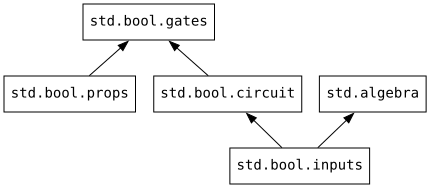

# Boolean functions and circuits: `std.bool.*`

The two bits are the names `0` and `1`, which are decimal's digits too: Ein has no truth values of its own, as it
has no numbers. Four modules, each entered by its last name, which closes its relations
([Q-M1f.265](../../../../decisions/stdlib/bool/Q-M1f.265-each-std-bool-module-is-entered-by-its-last-name.md),
[Q-M1f.328](../../../../decisions/stdlib/bool/Q-M1f.328-boolean-functions-and-circuits-ship-as-four-std.md)). An
arrow reads *imports*:



Nothing but `std.bool.inputs` guesses, and it guesses only an input's value. No rule of the four writes `absent`,
`not` or `or`. Their rules are [the next page](19-boolean-rules.md).

## Using `std.bool.gates` — the sixteen functions

A function of two bits is its column of four outputs, at inputs 00, 01, 10 and 11; there are $2^4 = 16$, each
with a name, capitalised because `and`, `or` and `not` are Ein's own words:

| name | column | output | | name | column | output |
|---|---|---|---|---|---|---|
| `Zero` | `f0000` | 0 | | `Nor` | `f1000` | not (a or b) |
| `And` | `f0001` | a and b | | `Xnor` | `f1001` | not (a xor b) |
| `Andn` | `f0010` | a and not b | | `Nsnd` | `f1010` | not b |
| `Fst` | `f0011` | a | | `Orn` | `f1011` | a or not b |
| `Randn` | `f0100` | not a and b | | `Nfst` | `f1100` | not a |
| `Snd` | `f0101` | b | | `Rorn` | `f1101` | not a or b |
| `Xor` | `f0110` | a xor b | | `Nand` | `f1110` | not (a and b) |
| `Or` | `f0111` | a or b | | `One` | `f1111` | 1 |

```lisp
(import std.bool.gates :symbols (Xor And))
```

Two layouts ([Q-M1f.325](../../../../decisions/stdlib/bool/Q-M1f.325-a-boolean-function-is-a-value-of-one-table.md)):

| fact | meaning |
|---|---|
| `(gate2 NAME A B OUT)` | the table, a row for each function and each input, $16 \cdot 4 = 64$, generated: NAME of A and B is OUT. A function is a value, so a rule about any function needs no parameter, and a search can make the function a hypothesis |
| `(NAME A B OUT)`, `(Xor 0 1 1)` | a relation a function, its four rows, derived from the table by sixteen rules, `Zero-rows` to `One-rows`, in every program that imports the module ([Q-M1f.263](../../../../decisions/stdlib/bool/Q-M1f.263-every-program-that-imports-std-bool-gates.md)) |
| `(column-name NAME COLUMN)` | the column as a second name, `(column-name Xor f0110)`: a value, which any program may write |
| `(inv A B)`, `(le A B)`, `(bit A)` | not A is B; A is at most B; A is a bit |

```lisp
(import std.bool.gates :symbols (Xor gate2 column-name inv le))

(query :goal (Xor ?a ?b ?out))
(query :goal (gate2 ?f 1 1 0))
(query :goal (column-name Xor ?column))
(query :goal (inv ?a ?b))
(query :goal (le ?a ?b))
```

<!-- output -->
```text
  query 1 of 5      (Xor ?a ?b ?out)
  over              all of R — 1 state → 1 projection class
    class 1 of 1    1 state (1)
                      ?a = 0 · ?b = 0 · ?out = 0
                      ?a = 0 · ?b = 1 · ?out = 1
                      ?a = 1 · ?b = 0 · ?out = 1
                      ?a = 1 · ?b = 1 · ?out = 0
  as :expect        (model (Xor 0 0 0) (Xor 0 1 1) (Xor 1 0 1) (Xor 1 1 0))

  query 2 of 5      (gate2 ?f 1 1 0)
  over              all of R — 1 state → 1 projection class
    class 1 of 1    1 state (1)
                      ?f = Xor
                      ?f = std.bool.gates.Andn
                      ?f = std.bool.gates.Nand
                      ?f = std.bool.gates.Nfst
                      ?f = std.bool.gates.Nor
                      ?f = std.bool.gates.Nsnd
                      ?f = std.bool.gates.Randn
                      ?f = std.bool.gates.Zero
  as :expect        (model (gate2 Xor 1 1 0) (gate2 std.bool.gates.Andn 1 1 0)
                           (gate2 std.bool.gates.Nand 1 1 0)
                           (gate2 std.bool.gates.Nfst 1 1 0)
                           (gate2 std.bool.gates.Nor 1 1 0)
                           (gate2 std.bool.gates.Nsnd 1 1 0)
                           (gate2 std.bool.gates.Randn 1 1 0)
                           (gate2 std.bool.gates.Zero 1 1 0))

  query 3 of 5      (column-name Xor ?column)
  over              all of R — 1 state → 1 projection class
    class 1 of 1    1 state (1)
                      ?column = f0110
  as :expect        (model (column-name Xor f0110))

  query 4 of 5      (inv ?a ?b)
  over              all of R — 1 state → 1 projection class
    class 1 of 1    1 state (1)
                      ?a = 0 · ?b = 1
                      ?a = 1 · ?b = 0
  as :expect        (model (inv 0 1) (inv 1 0))

  query 5 of 5      (le ?a ?b)
  over              all of R — 1 state → 1 projection class
    class 1 of 1    1 state (1)
                      ?a = 0 · ?b = 0
                      ?a = 0 · ?b = 1
                      ?a = 1 · ?b = 1
  as :expect        (model (le 0 0) (le 0 1) (le 1 1))
```

The first query is `Xor`'s truth table. The second reads the table the other way, the functions that give `0` at
11; a name the file does not list is printed by its full name.

**A function's name is the module's**, as a relation and as the value in the table, `std.bool.gates.Xor`, so a
program that writes one, as a gate's function too, lists it: `(import std.bool.gates :symbols (Xor And))`. A name
a program writes and does not list is its own, a name no row has: a gate of that function computes nothing, and
nothing says so
([Q-M1f.264](../../../../decisions/imports/Q-M1f.264-a-gate-functions-name-a-program-writes-and-does.md);
[the run is below](#using-stdboolcircuit--a-circuit-simulated-by-saturation)).

## Using `std.bool.props` — what is known of the sixteen

Thirty relations, every fact derived from the table's rows by monotone rules in a module of their own
([Q-M1f.326](../../../../decisions/stdlib/bool/Q-M1f.326-the-properties-of-the-sixteen-functions-are.md)): a
program that does not import it pays nothing for them. *For every input* is a conjunction of a function's four
rows, and *not in a class* one witness row, so no rule needs `absent`.

```lisp
(import std.bool.props :symbols (commutative identity-of))
(import std.bool.gates :symbols (Xor And))
```

| relation | meaning |
|---|---|
| `(column F A B C D)` | F gives A, B, C and D at 00, 01, 10 and 11 |
| `(swap-of F G)` | G is F with its inputs exchanged: $G(a, b) = F(b, a)$ |
| `(complement-of F G)` | G is F with its output negated: $G(a, b) = \lnot F(a, b)$ |
| `(dual-of F G)` | G is De Morgan's dual of F: $G(a, b) = \lnot F(\lnot a, \lnot b)$ |
| `(left-negated F G)`, `(right-negated F G)` | G is F with its first, its second input negated |
| `(commutative F)` | $F(a, b) = F(b, a)$ |
| `(associative F)` | $F(F(a, b), c) = F(a, F(b, c))$ at all eight points, each `(assoc-at F A B C)` |
| `(idempotent F)` | $F(a, a) = a$ |
| `(reads-first F)`, `(reads-second F)` | the output depends on the first, the second input |
| `(ignores-first F)`, `(ignores-second F)` | it does not |
| `(right-identity-of F E)`, `(left-identity-of F E)`, `(identity-of F E)` | $F(a, E) = a$; $F(E, a) = a$; both, one-sided too ([Q-M1f.327](../../../../decisions/stdlib/bool/Q-M1f.327-identity-and-absorbing-elements-are-derived-one.md)) |
| `(right-absorbing-of F E)`, `(left-absorbing-of F E)`, `(absorbing-of F E)` | $F(a, E) = E$; $F(E, a) = E$; both |
| `(preserves-zero F)` / `(escapes-zero F)` | $F(0, 0) = 0$ / $F(0, 0) = 1$ |
| `(preserves-one F)` / `(escapes-one F)` | $F(1, 1) = 1$ / $F(1, 1) = 0$ |
| `(monotone F)` / `(escapes-monotone F)` | raising an input never lowers the output / one row does |
| `(affine F)` / `(escapes-affine F)` | a sum modulo 2 of inputs and a constant / not |
| `(self-dual F)` / `(escapes-self-dual F)` | F is its own dual / a row and its opposite give the same |
| `(complete-alone F)` | outside all five of Post's classes, so every function can be built from F alone: `Nand` and `Nor` |

```lisp
(import std.bool.props :symbols (commutative identity-of absorbing-of dual-of complete-alone column))
(import std.bool.gates :symbols (Xor And Or))

(query :goal (identity-of And ?e))
(query :goal (absorbing-of And ?e))
(query :goal (dual-of And ?g))
(query :goal (complete-alone ?f))
(query :goal (column Xor ?a ?b ?c ?d))
```

<!-- output -->
```text
  query 1 of 5      (identity-of And ?e)
  over              all of R — 1 state → 1 projection class
    class 1 of 1    1 state (1)
                      ?e = 1
  as :expect        (model (identity-of And 1))

  query 2 of 5      (absorbing-of And ?e)
  over              all of R — 1 state → 1 projection class
    class 1 of 1    1 state (1)
                      ?e = 0
  as :expect        (model (absorbing-of And 0))

  query 3 of 5      (dual-of And ?g)
  over              all of R — 1 state → 1 projection class
    class 1 of 1    1 state (1)
                      ?g = Or
  as :expect        (model (dual-of And Or))

  query 4 of 5      (complete-alone ?f)
  over              all of R — 1 state → 1 projection class
    class 1 of 1    1 state (1)
                      ?f = std.bool.gates.Nand
                      ?f = std.bool.gates.Nor
  as :expect        (model (complete-alone std.bool.gates.Nand)
                           (complete-alone std.bool.gates.Nor))

  query 5 of 5      (column Xor ?a ?b ?c ?d)
  over              all of R — 1 state → 1 projection class
    class 1 of 1    1 state (1)
                      ?a = 0 · ?b = 1 · ?c = 1 · ?d = 0
  as :expect        (model (column Xor 0 1 1 0))
```

1 is neutral for `And` and 0 decides it; its dual is `Or`; and the two functions complete alone are `Nand` and
`Nor`. A query with a variable in the function's place lists the functions that have a property:

```lisp
(import std.bool.props :symbols (commutative associative idempotent))

(query :goal (commutative ?f))
(query :goal (idempotent ?f))
```

<!-- output -->
```text
  query 1 of 2      (commutative ?f)
  over              all of R — 1 state → 1 projection class
    class 1 of 1    1 state (1)
                      ?f = std.bool.gates.And
                      ?f = std.bool.gates.Nand
                      ?f = std.bool.gates.Nor
                      ?f = std.bool.gates.One
                      ?f = std.bool.gates.Or
                      ?f = std.bool.gates.Xnor
                      ?f = std.bool.gates.Xor
                      ?f = std.bool.gates.Zero
  as :expect        (model (commutative std.bool.gates.And)
                           (commutative std.bool.gates.Nand)
                           (commutative std.bool.gates.Nor)
                           (commutative std.bool.gates.One)
                           (commutative std.bool.gates.Or)
                           (commutative std.bool.gates.Xnor)
                           (commutative std.bool.gates.Xor)
                           (commutative std.bool.gates.Zero))

  query 2 of 2      (idempotent ?f)
  over              all of R — 1 state → 1 projection class
    class 1 of 1    1 state (1)
                      ?f = std.bool.gates.And
                      ?f = std.bool.gates.Fst
                      ?f = std.bool.gates.Or
                      ?f = std.bool.gates.Snd
  as :expect        (model (idempotent std.bool.gates.And)
                           (idempotent std.bool.gates.Fst)
                           (idempotent std.bool.gates.Or)
                           (idempotent std.bool.gates.Snd))
```

[`examples/binary_logic/post.ein`](../../../../../examples/binary_logic/post.ein) reads Post's five classes off
these relations, and [`tests/stdlib/bool/props/`](../../../../../tests/stdlib/bool/props/) holds every one.

## Using `std.bool.circuit` — a circuit, simulated by saturation

Wires are names and a gate is a fact. Saturation is simulation: a firing a gate, and nothing guessed.

```lisp
(import std.bool.circuit :symbols (gate val))
(import std.bool.gates :symbols (Xor And))
```

| fact | who writes it | meaning |
|---|---|---|
| `(gate INSTANCE FUNCTION IN1 IN2 OUT)` | the program | a gate; FUNCTION is one of the sixteen |
| `(val WIRE BIT)` | the program, for a wire it drives; the theory, for a gate's output | the wire carries the bit |

A gate whose two inputs carry values puts the table's output on its output wire. A wire that carries both bits is
a contradiction.

```lisp
(import std.bool.circuit :symbols (gate val))
(import std.bool.gates :symbols (Xor And))

(gate g1 Xor a b sum)
(gate g2 And a b carry)
(val a 1) (val b 1)

(query :goal (val sum ?s))
(query :goal (val carry ?c))
```

<!-- output -->
```text
  ∅                 in R — root is alive and owes nothing
  …
  universe          no candidate: R is {∅} or empty, decided by root alone
  …
  query 1 of 2      (val sum ?s)
  over              all of R — 1 state → 1 projection class
    class 1 of 1    1 state (1)
                      ?s = 0
  as :expect        (model (val sum 0))
  …
  query 2 of 2      (val carry ?c)
  over              all of R — 1 state → 1 projection class
    class 1 of 1    1 state (1)
                      ?c = 1
  as :expect        (model (val carry 1))
```

A half adder: R is the one state root is, the sum bit is `0` and the carry `1`.

A gate whose input carries no value computes nothing, and its output carries none. With `b` undriven:

```lisp
(import std.bool.circuit :symbols (gate val))
(import std.bool.gates :symbols (Xor And))

(gate g1 Xor a b sum)
(val a 1)

(query :goal (val sum ?s))
```

<!-- output -->
```text
  query             (val sum ?s)
  over              all of R — 1 state → 1 projection class
    class 1 of 1    1 state (1) — the goal has no row: undetermined here
  as :expect        (model)
```

A function's name the file does not list is the file's own name, which no row of the table has, so the gate
computes nothing, and nothing says so. This program lists nothing from `std.bool.gates`:

```lisp
(import std.bool.circuit :symbols (gate val))

(gate g1 Xor a b sum)
(val a 1) (val b 1)

(query :goal (val sum ?s))
```

<!-- output -->
```text
  query             (val sum ?s)
  over              all of R — 1 state → 1 projection class
    class 1 of 1    1 state (1) — the goal has no row: undetermined here
  as :expect        (model)
```

A wire driven two ways is a contradiction, and the core names the gate, the table's row and the three values:

```lisp
(import std.bool.circuit :symbols (gate val))
(import std.bool.gates :symbols (Fst))

(gate g1 Fst a b out)
(val a 1) (val b 0)
(val out 0)
```

<!-- output -->
```text
  unsat core        (gate g1 Fst a b out)
  unsat core        (std.bool.gates.gate2 Fst 1 0 1)
  unsat core        (val a 1)
  unsat core        (val b 0)
  unsat core        (val out 0)
  refuted by        std.bool.circuit.one-value

  (false)
```

## Using `std.bool.inputs` — inputs as hypotheses

The one module of `std.bool` with a search in it. An input wire has exactly one value, and which one is for the
search to try.

```lisp
(import std.bool.inputs :symbols (is-a in require))
```

| fact | who writes it | meaning |
|---|---|---|
| `(is-a WIRE Input)` | the program | the wire is an input |
| `(in WIRE BIT)` | the search: a hypothesis | the input is set to the bit |
| `(require WIRE BIT)` | the program | a state in which the wire carries the other bit is a contradiction |

*Exactly one* is two declarations of `std.algebra`, which the module states: `(total-owed in is-a)`, so a state
with an input unset owes and is not an answer, and `(functional in)`, so no input has two values. The obligation is
also what proposes the candidates, `(in w 0)` and `(in w 1)` for each input, and no other fact is ever guessed
([Hypotheses](../../03-syntax-and-semantics/09-hypotheses.md)). So R is the input assignments that contradict
nothing:

$$
R = \{\, \sigma : \mathit{Inputs} \to \{0, 1\} \;:\; \text{every required wire carries its required bit under}\ \sigma \,\}
$$

With no requirement R is every assignment, and a query's classes are a truth table's rows:

```lisp
(import std.bool.inputs :symbols (is-a in))
(import std.bool.circuit :symbols (gate val))
(import std.bool.gates :symbols (Nand))

(gate g1 Nand a b out)
(is-a a Input) (is-a b Input)

(query :goal (and (in a ?a) (in b ?b) (val out ?out)))
```

<!-- output -->
```text
  ∅                 not in R — root owes 2 instances
    owed            in owes a a Bit.
    owed            in owes b a Bit.
  …
  universe          4 candidates, 0 dead alone
  …
  query             (and (in a ?a) (in b ?b) (val out ?out))
  over              all of R — 4 states → 4 projection classes
    class 1 of 4    1 state (1)
                      ?a = 0 · ?b = 0 · ?out = 1
    class 2 of 4    1 state (2)
                      ?a = 0 · ?b = 1 · ?out = 1
    class 3 of 4    1 state (3)
                      ?a = 1 · ?b = 0 · ?out = 1
    class 4 of 4    1 state (4)
                      ?a = 1 · ?b = 1 · ?out = 0
```

With requirements R is the assignments that satisfy them, which is satisfiability:

```lisp
(import std.bool.inputs :symbols (is-a in require))
(import std.bool.circuit :symbols (gate val))
(import std.bool.gates :symbols (Xor))

(gate g1 Xor a b out)
(is-a a Input) (is-a b Input)
(require out 1)

(query :goal (and (in a ?a) (in b ?b)))
```

<!-- output -->
```text
  (region
    ;; state 1 of 2 — 2 candidates · minimal and maximal · from {(in a 0), (in b 1)}
    (model (in a 0) (in b 1))
    ;; state 2 of 2 — 2 candidates · minimal and maximal · from {(in a 1), (in b 0)}
    (model (in a 1) (in b 0)))

  query             (and (in a ?a) (in b ?b))
  over              all of R — 2 states → 2 projection classes
    class 1 of 2    1 state (1)
                      ?a = 0 · ?b = 1
    class 2 of 2    1 state (2)
                      ?a = 1 · ?b = 0
```

Where no assignment satisfies the requirements, R is empty because every alive state owes an input it cannot be
given, not because every state is dead: the read-out says *empty — every alive node owes*, and `--single` answers
`Open`. Here `a xor a` is required to be 1:

```lisp
(import std.bool.inputs :symbols (is-a in require))
(import std.bool.circuit :symbols (gate val))
(import std.bool.gates :symbols (Xor))

(gate g1 Xor a a out)
(is-a a Input)
(require out 1)

(query :goal (in a ?a))
```

<!-- output -->
```text
  empty             every alive node owes — no commitment pays every debt
  …
  universe          2 candidates, 2 dead alone
  …
  owing             ∅ — owes 1
                      in owes a a Bit.
```

<!-- output -->
```text
  verdict           Open — R is empty: every alive node owes
  decided           yes — R is empty
```

A state of the search is a partial assignment, each input unset, 0 or 1, so the search grows as $3^n$ in $n$
inputs: a demonstration, not a SAT solver. Where every input is to be tried anyway, writing the inputs as test
vectors asks one saturation.

## What they are for

[`examples/binary_logic/`](../../../../../examples/binary_logic/README.md) has a program for each: simulation
(saturation alone); a truth table (the inputs as hypotheses, a query's classes the rows); satisfiability
(requirements on the outputs); equivalence of two circuits (R empty where they never differ); a puzzle of knights
and knaves; and synthesis of one missing gate (the function a hypothesis over the table). The full adder built
from gates and held against `std.math.bits`' table is there too, and
[`examples/binary_arithmetic/`](../../../../../examples/binary_arithmetic/README.md) has binary arithmetic's.

## How it works

`std.bool.gates` is a table of facts and sixteen rules that copy a function's four rows into a relation of its
own. `std.bool.props` first gathers a function's four rows into one fact, its column; a property that holds *for every
input* is then a rule whose one premise is the column, with the property as a pattern between its places, and one
that fails is a rule with a witness row. `std.bool.circuit` is one rule that fires a gate and one that refutes a wire
with two values. `std.bool.inputs` is one rule that puts a hypothesis on its wire, one that refutes a requirement
not met, and the two facts of `std.algebra`'s that it writes over `in`. Every rule of the four is
on [the next page](19-boolean-rules.md).
