# The Boolean modules' rules

How `std.bool.gates`, `std.bool.props`, `std.bool.circuit` and `std.bool.inputs` work: every rule of the four, as
the module writes it and as the engine draws it. What a program writes to use them is
[the page before](18-boolean-functions.md); how to read a drawing is [the index](README.md#how-a-rule-is-shown).

None of these rules has a parameter, and none writes `absent`, `not` or `or`. A rule's `:why` says what one firing
does, in the words a trace prints.

## `std.bool.gates`

The table `gate2` is facts. Sixteen rules, one a function, copy a function's four rows into a relation of its own,
`(Xor A B OUT)`; they differ in the function's name alone.

#### `Zero-rows`

<!-- rule std.bool.gates Zero-rows -->
```lisp
(rule Zero-rows ()
  :match  (gate2 Zero ?a ?b ?o)
  :assert (Zero ?a ?b ?o)
  :why    "the table's row: Zero of {?a} and {?b} is {?o}")
```

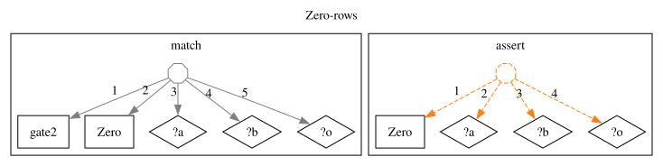
<!-- /rule -->

#### `And-rows`

<!-- rule std.bool.gates And-rows -->
```lisp
(rule And-rows ()
  :match  (gate2 And ?a ?b ?o)
  :assert (And ?a ?b ?o)
  :why    "the table's row: And of {?a} and {?b} is {?o}")
```

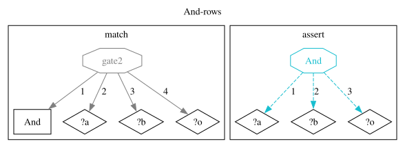
<!-- /rule -->

#### `Andn-rows`

<!-- rule std.bool.gates Andn-rows -->
```lisp
(rule Andn-rows ()
  :match  (gate2 Andn ?a ?b ?o)
  :assert (Andn ?a ?b ?o)
  :why    "the table's row: Andn of {?a} and {?b} is {?o}")
```

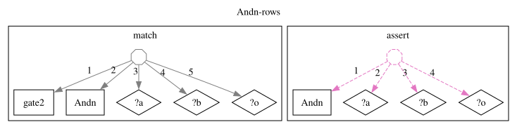
<!-- /rule -->

#### `Fst-rows`

<!-- rule std.bool.gates Fst-rows -->
```lisp
(rule Fst-rows ()
  :match  (gate2 Fst ?a ?b ?o)
  :assert (Fst ?a ?b ?o)
  :why    "the table's row: Fst of {?a} and {?b} is {?o}")
```

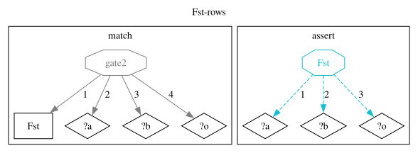
<!-- /rule -->

#### `Randn-rows`

<!-- rule std.bool.gates Randn-rows -->
```lisp
(rule Randn-rows ()
  :match  (gate2 Randn ?a ?b ?o)
  :assert (Randn ?a ?b ?o)
  :why    "the table's row: Randn of {?a} and {?b} is {?o}")
```

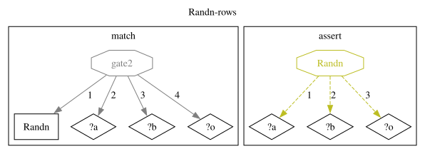
<!-- /rule -->

#### `Snd-rows`

<!-- rule std.bool.gates Snd-rows -->
```lisp
(rule Snd-rows ()
  :match  (gate2 Snd ?a ?b ?o)
  :assert (Snd ?a ?b ?o)
  :why    "the table's row: Snd of {?a} and {?b} is {?o}")
```

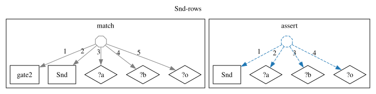
<!-- /rule -->

#### `Xor-rows`

<!-- rule std.bool.gates Xor-rows -->
```lisp
(rule Xor-rows ()
  :match  (gate2 Xor ?a ?b ?o)
  :assert (Xor ?a ?b ?o)
  :why    "the table's row: Xor of {?a} and {?b} is {?o}")
```

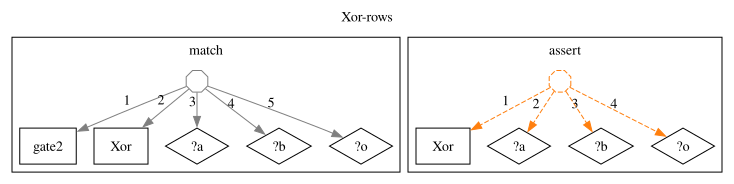
<!-- /rule -->

#### `Or-rows`

<!-- rule std.bool.gates Or-rows -->
```lisp
(rule Or-rows ()
  :match  (gate2 Or ?a ?b ?o)
  :assert (Or ?a ?b ?o)
  :why    "the table's row: Or of {?a} and {?b} is {?o}")
```

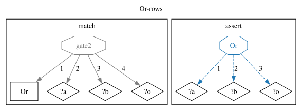
<!-- /rule -->

#### `Nor-rows`

<!-- rule std.bool.gates Nor-rows -->
```lisp
(rule Nor-rows ()
  :match  (gate2 Nor ?a ?b ?o)
  :assert (Nor ?a ?b ?o)
  :why    "the table's row: Nor of {?a} and {?b} is {?o}")
```


<!-- /rule -->

#### `Xnor-rows`

<!-- rule std.bool.gates Xnor-rows -->
```lisp
(rule Xnor-rows ()
  :match  (gate2 Xnor ?a ?b ?o)
  :assert (Xnor ?a ?b ?o)
  :why    "the table's row: Xnor of {?a} and {?b} is {?o}")
```


<!-- /rule -->

#### `Nsnd-rows`

<!-- rule std.bool.gates Nsnd-rows -->
```lisp
(rule Nsnd-rows ()
  :match  (gate2 Nsnd ?a ?b ?o)
  :assert (Nsnd ?a ?b ?o)
  :why    "the table's row: Nsnd of {?a} and {?b} is {?o}")
```

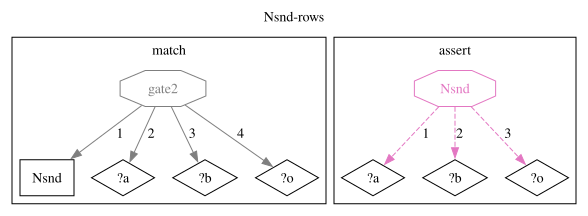
<!-- /rule -->

#### `Orn-rows`

<!-- rule std.bool.gates Orn-rows -->
```lisp
(rule Orn-rows ()
  :match  (gate2 Orn ?a ?b ?o)
  :assert (Orn ?a ?b ?o)
  :why    "the table's row: Orn of {?a} and {?b} is {?o}")
```

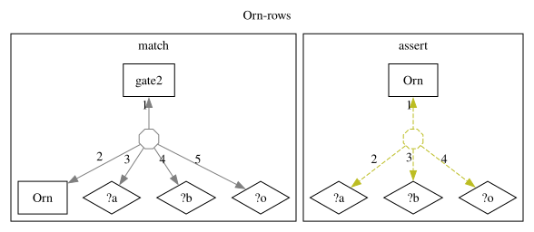
<!-- /rule -->

#### `Nfst-rows`

<!-- rule std.bool.gates Nfst-rows -->
```lisp
(rule Nfst-rows ()
  :match  (gate2 Nfst ?a ?b ?o)
  :assert (Nfst ?a ?b ?o)
  :why    "the table's row: Nfst of {?a} and {?b} is {?o}")
```

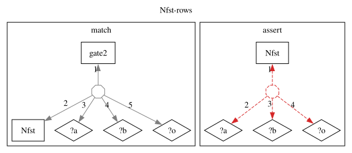
<!-- /rule -->

#### `Rorn-rows`

<!-- rule std.bool.gates Rorn-rows -->
```lisp
(rule Rorn-rows ()
  :match  (gate2 Rorn ?a ?b ?o)
  :assert (Rorn ?a ?b ?o)
  :why    "the table's row: Rorn of {?a} and {?b} is {?o}")
```

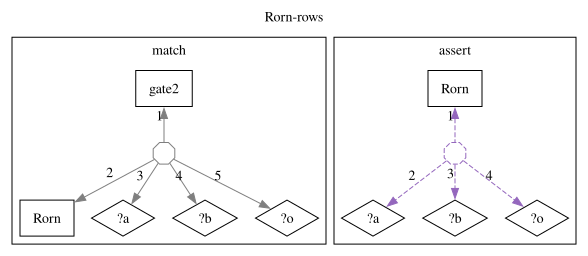
<!-- /rule -->

#### `Nand-rows`

<!-- rule std.bool.gates Nand-rows -->
```lisp
(rule Nand-rows ()
  :match  (gate2 Nand ?a ?b ?o)
  :assert (Nand ?a ?b ?o)
  :why    "the table's row: Nand of {?a} and {?b} is {?o}")
```

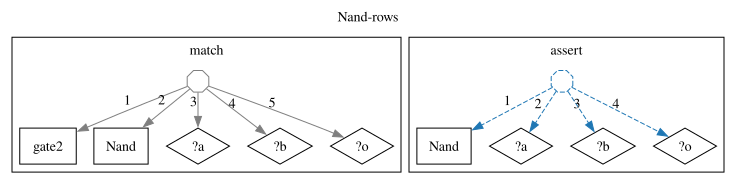
<!-- /rule -->

#### `One-rows`

<!-- rule std.bool.gates One-rows -->
```lisp
(rule One-rows ()
  :match  (gate2 One ?a ?b ?o)
  :assert (One ?a ?b ?o)
  :why    "the table's row: One of {?a} and {?b} is {?o}")
```


<!-- /rule -->

### The entry

The closing rule: it closes the held extents of the table, of the sixteen relations and of the module's other relations, and names the
sixteen rules.

#### `gates`

<!-- rule std.bool.gates gates -->
```lisp
(rule gates ()
  :match  ()
  :assert (and (__closed__ gate2) (__closed__ column-name) (__closed__ inv) (__closed__ le)
               (__closed__ bit) (__closed__ gates-rule)
               (__closed__ Zero) (__closed__ And) (__closed__ Andn) (__closed__ Fst)
               (__closed__ Randn) (__closed__ Snd) (__closed__ Xor) (__closed__ Or)
               (__closed__ Nor) (__closed__ Xnor) (__closed__ Nsnd) (__closed__ Orn)
               (__closed__ Nfst) (__closed__ Rorn) (__closed__ Nand) (__closed__ One)
               (gates-rule Zero-rows) (gates-rule And-rows) (gates-rule Andn-rows)
               (gates-rule Fst-rows) (gates-rule Randn-rows) (gates-rule Snd-rows)
               (gates-rule Xor-rows) (gates-rule Or-rows) (gates-rule Nor-rows)
               (gates-rule Xnor-rows) (gates-rule Nsnd-rows) (gates-rule Orn-rows)
               (gates-rule Nfst-rows) (gates-rule Rorn-rows) (gates-rule Nand-rows)
               (gates-rule One-rows))
  :why    "the sixteen functions are written and derived, and never guessed: every relation of the module is closed")
```

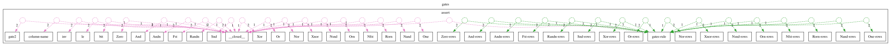
<!-- /rule -->

## `std.bool.props`

### A function's column, and the functions made from it

`column-of` gathers a function's four rows into one fact, `(column F A B C D)`, its outputs at 00, 01, 10 and 11.
Most properties are then a pattern on that one fact. The five rules after it relate two functions: each matches
the two columns, with the same variables in exchanged places or with `inv` between them.

#### `column-of`

<!-- rule std.bool.props column-of -->
```lisp
(rule column-of ()
  :match  (and (gate2 ?f 0 0 ?a) (gate2 ?f 0 1 ?b) (gate2 ?f 1 0 ?c) (gate2 ?f 1 1 ?d))
  :assert (column ?f ?a ?b ?c ?d)
  :why    "the four rows of {?f}")
```

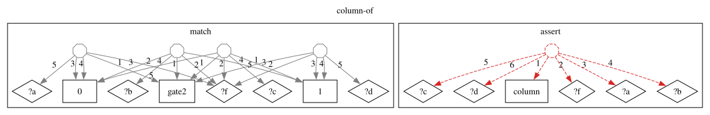
<!-- /rule -->

#### `swap`

<!-- rule std.bool.props swap -->
```lisp
(rule swap ()
  :match  (and (column ?f ?a ?b ?c ?d) (column ?g ?a ?c ?b ?d))
  :assert (swap-of ?f ?g)
  :why    "{?g}'s rows at 01 and 10 are {?f}'s at 10 and 01")
```

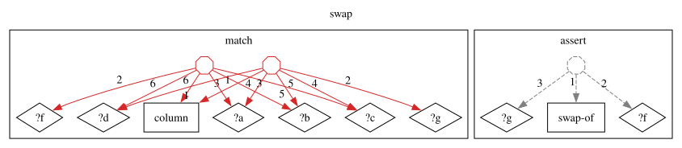
<!-- /rule -->

#### `complement`

<!-- rule std.bool.props complement -->
```lisp
(rule complement ()
  :match  (and (column ?f ?a ?b ?c ?d) (inv ?a ?a1) (inv ?b ?b1) (inv ?c ?c1) (inv ?d ?d1)
               (column ?g ?a1 ?b1 ?c1 ?d1))
  :assert (complement-of ?f ?g)
  :why    "every output of {?g} is the negation of {?f}'s")
```

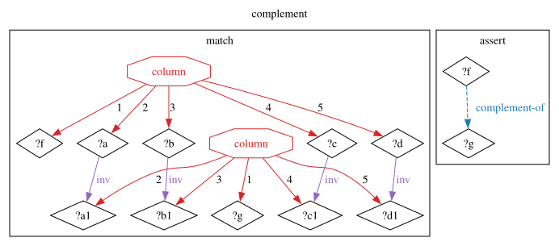
<!-- /rule -->

#### `dual`

<!-- rule std.bool.props dual -->
```lisp
(rule dual ()
  :match  (and (column ?f ?a ?b ?c ?d) (inv ?a ?a1) (inv ?b ?b1) (inv ?c ?c1) (inv ?d ?d1)
               (column ?g ?d1 ?c1 ?b1 ?a1))
  :assert (dual-of ?f ?g)
  :why    "{?g} is {?f} with both inputs and the output negated")
```

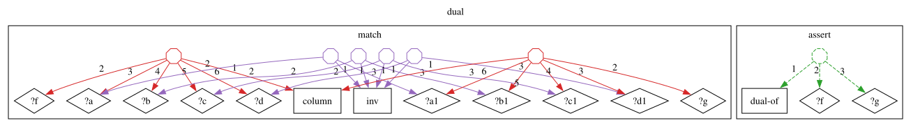
<!-- /rule -->

#### `left-neg`

<!-- rule std.bool.props left-neg -->
```lisp
(rule left-neg ()
  :match  (and (column ?f ?a ?b ?c ?d) (column ?g ?c ?d ?a ?b))
  :assert (left-negated ?f ?g)
  :why    "{?g} is {?f} with its first input negated")
```

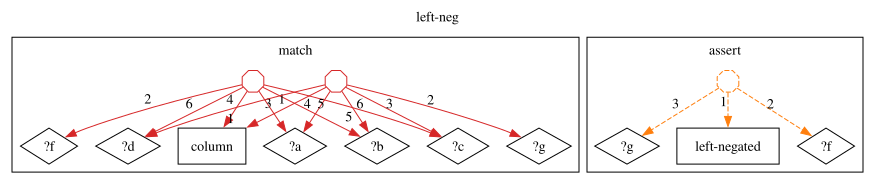
<!-- /rule -->

#### `right-neg`

<!-- rule std.bool.props right-neg -->
```lisp
(rule right-neg ()
  :match  (and (column ?f ?a ?b ?c ?d) (column ?g ?b ?a ?d ?c))
  :assert (right-negated ?f ?g)
  :why    "{?g} is {?f} with its second input negated")
```


<!-- /rule -->

### Properties of one function

*For every input* is the whole column in one premise: `commutative-r` matches a column whose outputs at 01 and 10
are one variable. Associativity is checked a point at a time, by four rows of the table, and holds where all eight
points do.

$$
\begin{aligned}
\operatorname{commutative}(F) &\iff F(0, 1) = F(1, 0) \\
\operatorname{idempotent}(F) &\iff F(0, 0) = 0 \land F(1, 1) = 1
\end{aligned}
$$

#### `commutative-r`

<!-- rule std.bool.props commutative-r -->
```lisp
(rule commutative-r ()
  :match  (column ?f ?a ?b ?b ?d)
  :assert (commutative ?f)
  :why    "{?f} gives the same at 01 and at 10")
```

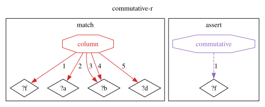
<!-- /rule -->

#### `assoc-point`

<!-- rule std.bool.props assoc-point -->
```lisp
(rule assoc-point ()
  :match  (and (gate2 ?f ?a ?b ?x) (gate2 ?f ?x ?c ?l) (gate2 ?f ?b ?c ?y) (gate2 ?f ?a ?y ?l))
  :assert (assoc-at ?f ?a ?b ?c)
  :why    "({?a} {?f} {?b}) {?f} {?c} and {?a} {?f} ({?b} {?f} {?c}) are both {?l}")
```

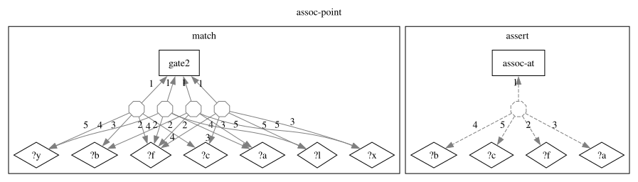
<!-- /rule -->

#### `associative-r`

<!-- rule std.bool.props associative-r -->
```lisp
(rule associative-r ()
  :match  (and (assoc-at ?f 0 0 0) (assoc-at ?f 0 0 1) (assoc-at ?f 0 1 0) (assoc-at ?f 0 1 1)
               (assoc-at ?f 1 0 0) (assoc-at ?f 1 0 1) (assoc-at ?f 1 1 0) (assoc-at ?f 1 1 1))
  :assert (associative ?f)
  :why    "{?f} associates at all eight inputs")
```

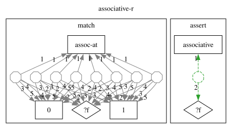
<!-- /rule -->

#### `idempotent-r`

<!-- rule std.bool.props idempotent-r -->
```lisp
(rule idempotent-r ()
  :match  (and (gate2 ?f 0 0 0) (gate2 ?f 1 1 1))
  :assert (idempotent ?f)
  :why    "{?f} of 0 and 0 is 0, and of 1 and 1 is 1")
```

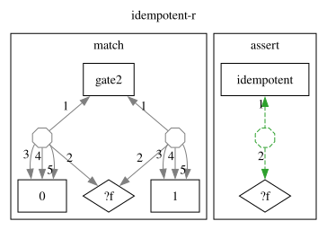
<!-- /rule -->

#### `reads-first-r`

<!-- rule std.bool.props reads-first-r -->
```lisp
(rule reads-first-r ()
  :match  (and (gate2 ?f 0 ?b ?x) (gate2 ?f 1 ?b ?y) (inv ?x ?y))
  :assert (reads-first ?f)
  :why    "with the second input {?b}, changing the first changes {?f}")
```

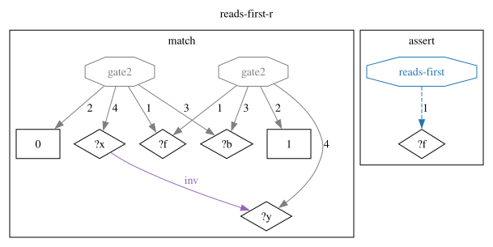
<!-- /rule -->

#### `reads-second-r`

<!-- rule std.bool.props reads-second-r -->
```lisp
(rule reads-second-r ()
  :match  (and (gate2 ?f ?a 0 ?x) (gate2 ?f ?a 1 ?y) (inv ?x ?y))
  :assert (reads-second ?f)
  :why    "with the first input {?a}, changing the second changes {?f}")
```

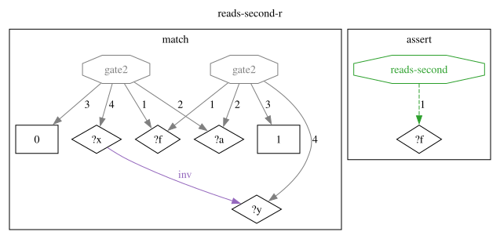
<!-- /rule -->

#### `ignores-first-r`

<!-- rule std.bool.props ignores-first-r -->
```lisp
(rule ignores-first-r ()
  :match  (column ?f ?a ?b ?a ?b)
  :assert (ignores-first ?f)
  :why    "{?f}'s rows do not change with the first input")
```

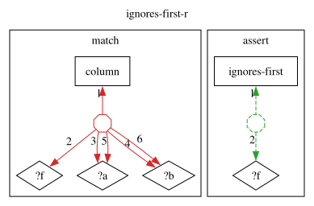
<!-- /rule -->

#### `ignores-second-r`

<!-- rule std.bool.props ignores-second-r -->
```lisp
(rule ignores-second-r ()
  :match  (column ?f ?a ?a ?c ?c)
  :assert (ignores-second ?f)
  :why    "{?f}'s rows do not change with the second input")
```

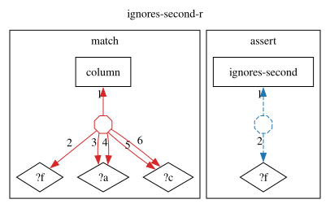
<!-- /rule -->

### Identity and absorbing elements

One-sided first, each from two rows of the table, and the two-sided from both.

#### `right-identity`

<!-- rule std.bool.props right-identity -->
```lisp
(rule right-identity ()
  :match  (and (gate2 ?f 0 ?e 0) (gate2 ?f 1 ?e 1))
  :assert (right-identity-of ?f ?e)
  :why    "{?f} of a bit and {?e} is that bit")
```

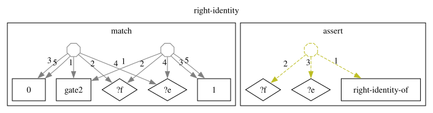
<!-- /rule -->

#### `left-identity`

<!-- rule std.bool.props left-identity -->
```lisp
(rule left-identity ()
  :match  (and (gate2 ?f ?e 0 0) (gate2 ?f ?e 1 1))
  :assert (left-identity-of ?f ?e)
  :why    "{?f} of {?e} and a bit is that bit")
```

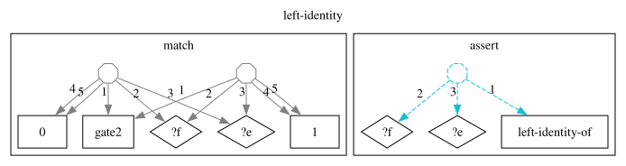
<!-- /rule -->

#### `identity`

<!-- rule std.bool.props identity -->
```lisp
(rule identity ()
  :match  (and (right-identity-of ?f ?e) (left-identity-of ?f ?e))
  :assert (identity-of ?f ?e)
  :why    "{?e} is neutral for {?f} on both sides")
```

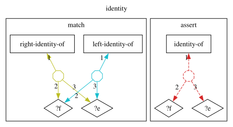
<!-- /rule -->

#### `right-absorbing`

<!-- rule std.bool.props right-absorbing -->
```lisp
(rule right-absorbing ()
  :match  (and (gate2 ?f 0 ?e ?e) (gate2 ?f 1 ?e ?e))
  :assert (right-absorbing-of ?f ?e)
  :why    "{?f} of any bit and {?e} is {?e}")
```

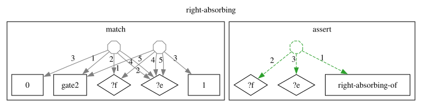
<!-- /rule -->

#### `left-absorbing`

<!-- rule std.bool.props left-absorbing -->
```lisp
(rule left-absorbing ()
  :match  (and (gate2 ?f ?e 0 ?e) (gate2 ?f ?e 1 ?e))
  :assert (left-absorbing-of ?f ?e)
  :why    "{?f} of {?e} and any bit is {?e}")
```

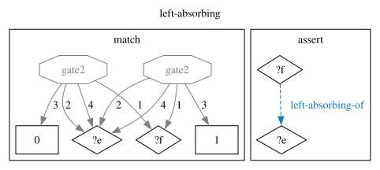
<!-- /rule -->

#### `absorbing`

<!-- rule std.bool.props absorbing -->
```lisp
(rule absorbing ()
  :match  (and (right-absorbing-of ?f ?e) (left-absorbing-of ?f ?e))
  :assert (absorbing-of ?f ?e)
  :why    "{?e} decides {?f} on both sides")
```

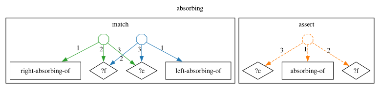
<!-- /rule -->

### Post's five classes

A function is in a class by a rule over its column or its rows, and *outside* a class by a rule with one witness:
a row, or two rows, that the class forbids. So being outside needs no `absent`. A function outside all five is
complete alone.

#### `preserves-zero-r`

<!-- rule std.bool.props preserves-zero-r -->
```lisp
(rule preserves-zero-r ()
  :match  (gate2 ?f 0 0 0)
  :assert (preserves-zero ?f)
  :why    "{?f} of 0 and 0 is 0")
```

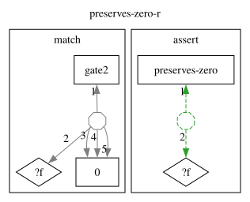
<!-- /rule -->

#### `preserves-one-r`

<!-- rule std.bool.props preserves-one-r -->
```lisp
(rule preserves-one-r ()
  :match  (gate2 ?f 1 1 1)
  :assert (preserves-one ?f)
  :why    "{?f} of 1 and 1 is 1")
```

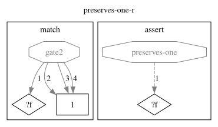
<!-- /rule -->

#### `monotone-r`

<!-- rule std.bool.props monotone-r -->
```lisp
(rule monotone-r ()
  :match  (and (column ?f ?a ?b ?c ?d) (le ?a ?b) (le ?a ?c) (le ?b ?d) (le ?c ?d))
  :assert (monotone ?f)
  :why    "{?f}'s outputs never fall as an input rises")
```

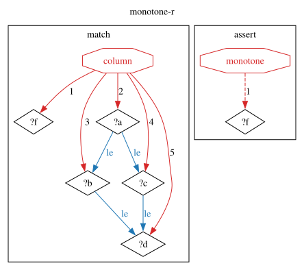
<!-- /rule -->

#### `affine-r`

<!-- rule std.bool.props affine-r -->
```lisp
(rule affine-r ()
  :match  (and (column ?f ?a ?b ?c ?d) (gate2 Xor ?a ?b ?x) (gate2 Xor ?c ?d ?x))
  :assert (affine ?f)
  :why    "{?f}'s four outputs have an even number of ones")
```

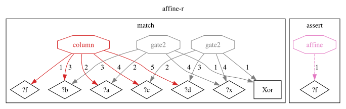
<!-- /rule -->

#### `self-dual-r`

<!-- rule std.bool.props self-dual-r -->
```lisp
(rule self-dual-r ()
  :match  (dual-of ?f ?f)
  :assert (self-dual ?f)
  :why    "{?f} is its own dual")
```

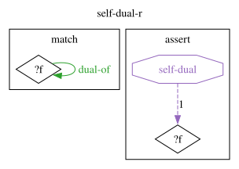
<!-- /rule -->

#### `escapes-zero-r`

<!-- rule std.bool.props escapes-zero-r -->
```lisp
(rule escapes-zero-r ()
  :match  (gate2 ?f 0 0 1)
  :assert (escapes-zero ?f)
  :why    "{?f} of 0 and 0 is 1")
```

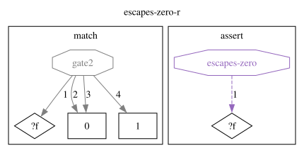
<!-- /rule -->

#### `escapes-one-r`

<!-- rule std.bool.props escapes-one-r -->
```lisp
(rule escapes-one-r ()
  :match  (gate2 ?f 1 1 0)
  :assert (escapes-one ?f)
  :why    "{?f} of 1 and 1 is 0")
```

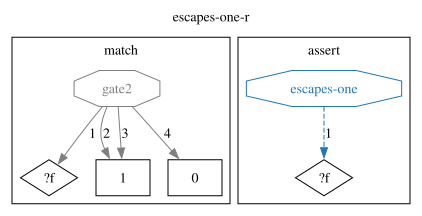
<!-- /rule -->

#### `escapes-monotone-r`

<!-- rule std.bool.props escapes-monotone-r -->
```lisp
(rule escapes-monotone-r ()
  :match  (and (gate2 ?f ?a ?b 1) (le ?a ?c) (le ?b ?d) (gate2 ?f ?c ?d 0))
  :assert (escapes-monotone ?f)
  :why    "{?f} is 1 at {?a}{?b} and 0 at {?c}{?d}, which is not lower")
```

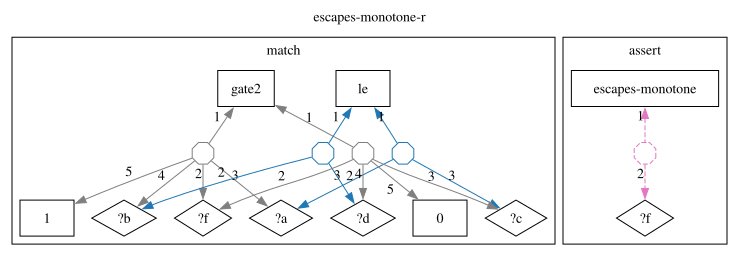
<!-- /rule -->

#### `escapes-affine-r`

<!-- rule std.bool.props escapes-affine-r -->
```lisp
(rule escapes-affine-r ()
  :match  (and (column ?f ?a ?b ?c ?d) (gate2 Xor ?a ?b ?x) (gate2 Xor ?c ?d ?y) (inv ?x ?y))
  :assert (escapes-affine ?f)
  :why    "{?f}'s four outputs have an odd number of ones")
```

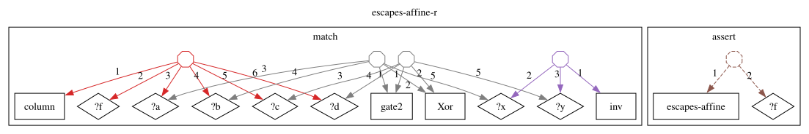
<!-- /rule -->

#### `escapes-self-dual-r`

<!-- rule std.bool.props escapes-self-dual-r -->
```lisp
(rule escapes-self-dual-r ()
  :match  (and (gate2 ?f ?a ?b ?x) (inv ?a ?a1) (inv ?b ?b1) (gate2 ?f ?a1 ?b1 ?x))
  :assert (escapes-self-dual ?f)
  :why    "{?f} gives {?x} at {?a}{?b} and at its opposite")
```

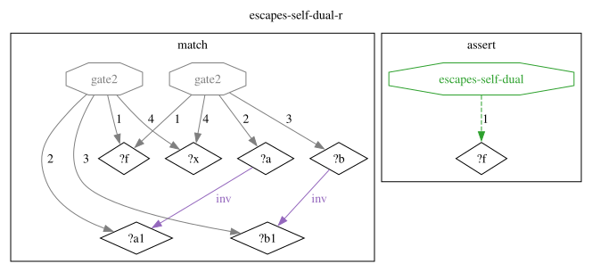
<!-- /rule -->

#### `complete-alone-r`

<!-- rule std.bool.props complete-alone-r -->
```lisp
(rule complete-alone-r ()
  :match  (and (escapes-zero ?f) (escapes-one ?f) (escapes-monotone ?f) (escapes-affine ?f) (escapes-self-dual ?f))
  :assert (complete-alone ?f)
  :why    "{?f} is outside each of Post's five classes")
```

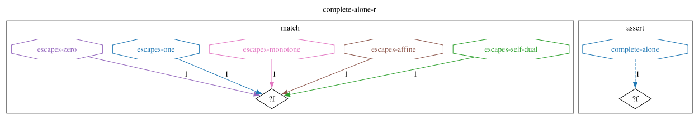
<!-- /rule -->

### The entry

The closing rule: it closes the held extent of each of the module's relations and names each rule above and the entry `gates`. Its drawing
is not shown: it has a node for each of those facts.

#### `props`

<!-- rule std.bool.props props -->
```lisp
(rule props ()
  :match  ()
  :assert (and (__closed__ column) (__closed__ swap-of) (__closed__ complement-of)
               (__closed__ dual-of) (__closed__ left-negated) (__closed__ right-negated)
               (__closed__ commutative) (__closed__ associative) (__closed__ idempotent)
               (__closed__ reads-first) (__closed__ reads-second) (__closed__ ignores-first)
               (__closed__ ignores-second) (__closed__ right-identity-of)
               (__closed__ left-identity-of) (__closed__ identity-of)
               (__closed__ right-absorbing-of) (__closed__ left-absorbing-of)
               (__closed__ absorbing-of) (__closed__ preserves-zero) (__closed__ preserves-one)
               (__closed__ monotone) (__closed__ affine) (__closed__ self-dual)
               (__closed__ escapes-zero) (__closed__ escapes-one) (__closed__ escapes-monotone)
               (__closed__ escapes-affine) (__closed__ escapes-self-dual)
               (__closed__ complete-alone) (__closed__ assoc-at) (__closed__ props-rule)
               (props-rule column-of) (props-rule swap) (props-rule complement) (props-rule dual)
               (props-rule left-neg) (props-rule right-neg) (props-rule commutative-r)
               (props-rule assoc-point) (props-rule associative-r) (props-rule idempotent-r)
               (props-rule reads-first-r) (props-rule reads-second-r)
               (props-rule ignores-first-r) (props-rule ignores-second-r)
               (props-rule right-identity) (props-rule left-identity) (props-rule identity)
               (props-rule right-absorbing) (props-rule left-absorbing) (props-rule absorbing)
               (props-rule preserves-zero-r) (props-rule preserves-one-r) (props-rule monotone-r)
               (props-rule affine-r) (props-rule self-dual-r) (props-rule escapes-zero-r)
               (props-rule escapes-one-r) (props-rule escapes-monotone-r)
               (props-rule escapes-affine-r) (props-rule escapes-self-dual-r)
               (props-rule complete-alone-r) (props-rule gates))
  :why    "what is known of the sixteen is derived from the rows and never guessed: every relation of the module is closed")
```
<!-- /rule -->

## `std.bool.circuit`

`propagate` is the simulation: a gate, the values on its two inputs, and the table's row for them, in one match.
`one-value` is the one check.

#### `propagate`

<!-- rule std.bool.circuit propagate -->
```lisp
(rule propagate ()
  :match  (and (gate ?g ?f ?a ?b ?o) (val ?a ?x) (val ?b ?y) (gate2 ?f ?x ?y ?z))
  :assert (val ?o ?z)
  :why    "{?g}: {?f} of {?x} and {?y} is {?z}, on {?o}")
```

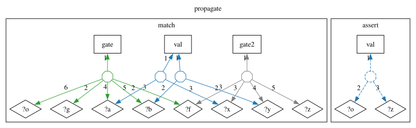
<!-- /rule -->

#### `one-value`

<!-- rule std.bool.circuit one-value -->
```lisp
(rule one-value ()
  :match  (and (val ?w ?x) (val ?w ?y) (neq ?x ?y))
  :assert (false)
  :why    "the wire {?w} carries both {?x} and {?y}")
```

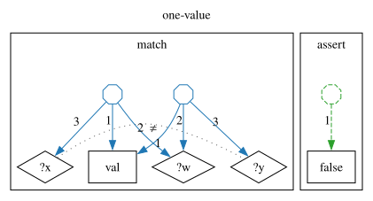
<!-- /rule -->

#### `circuit`

<!-- rule std.bool.circuit circuit -->
```lisp
(rule circuit ()
  :match  ()
  :assert (and (__closed__ gate) (__closed__ val) (__closed__ circuit-rule)
               (circuit-rule propagate) (circuit-rule one-value) (circuit-rule gates))
  :why    "a circuit is simulated and never guessed: every relation of the theory is closed")
```

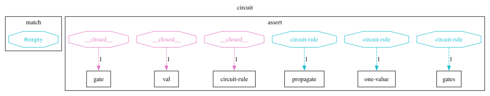
<!-- /rule -->

## `std.bool.inputs`

`in-drives` puts a hypothesis `(in WIRE BIT)` on the wire as a value. `required` refutes a state in which a
required wire carries the other bit. That an input has exactly one value is not a rule of this module: it writes
two facts of `std.algebra`'s, `(total-owed in is-a)` and `(functional in)`, and the
[obligation](03-relation-algebra-rules.md#the-totality-obligations) and the
[check](03-relation-algebra-rules.md#the-cardinality-checks) they activate do the rest.

#### `in-drives`

<!-- rule std.bool.inputs in-drives -->
```lisp
(rule in-drives ()
  :match  (in ?w ?v)
  :assert (val ?w ?v)
  :why    "the input {?w} is set to {?v}")
```

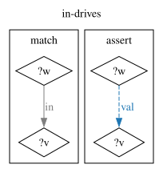
<!-- /rule -->

#### `required`

<!-- rule std.bool.inputs required -->
```lisp
(rule required ()
  :match  (and (require ?w ?v) (val ?w ?u) (neq ?u ?v))
  :assert (false)
  :why    "{?w} is required to carry {?v} and carries {?u}")
```

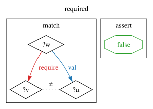
<!-- /rule -->

#### `inputs`

<!-- rule std.bool.inputs inputs -->
```lisp
(rule inputs ()
  :match  ()
  :assert (and (__closed__ is-a) (__closed__ require) (__closed__ inputs-rule)
               (inputs-rule in-drives) (inputs-rule required) (inputs-rule circuit))
  :why    "types and requirements are written, never guessed")
```

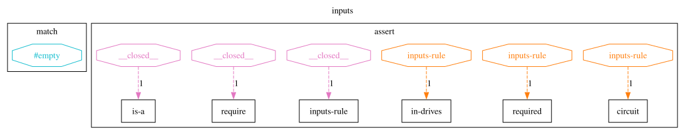
<!-- /rule -->
