# Negation as rules: `std.negation`, `std.contradiction`

Two things about a stored negation that Ein leaves to a rule, each a module:

- **the elimination of a double negation**, `std.negation`. `(not (not g))` is a fact, and nothing concludes `g`
  from it ([constraints § The negation of a negation](../../03-syntax-and-semantics/06-constraints.md#the-negation-of-a-negation));
  the module's rules do, for the relations a program names;
- **the contradiction, as a rule that concludes `(false)`**, `std.contradiction`. A state that holds a fact and its
  negation is dead with no rule, and need hold no `(false)`; the module's rules conclude it, so the state holds the
  fact, with its derivation.

Both are written the same way. A pattern fixes its fact's count of arguments, and its relation may be a parameter
([Q-M1f.393](../../../../decisions/language/Q-M1f.393-a-rule-unpacks-a-fact-by-its-count.md)), so *any fact* is one
rule a count, `…-0` for a fact of no argument to `…-6` for one of six, and each rule is activated a relation. A fact
of more than six arguments is out of both modules' reach: a program that needs the rule at another count writes it,
three lines.

## Using `std.negation` — eliminating a double negation

```lisp
(import std.negation :symbols (eliminate-2))
(eliminate-2 likes)            ; for the relation likes, whose facts have two arguments
```

With $R$ the relation an activator names and $n$ the rule's count:

$$
\lnot\lnot R(x_1, \dots, x_n) \implies R(x_1, \dots, x_n)
$$

| a program writes | it produces |
|---|---|
| `(eliminate-N R)`, `N` the count of arguments of `R`'s facts | for each fact `(not (not (R x1 … xN)))` the state holds, the fact `(R x1 … xN)` |

A program lists the rules it activates, `eliminate-0` to `eliminate-6`. The import brings nothing else: the module
has no relation and no fact.

```lisp
(import std.negation :symbols (eliminate-2))

(relation likes  Person Food :why "{?3} likes {?4}")
(relation avoids Person Food :why "{?3} avoids {?4}")

(not (not (likes Dan Soup)))
(not (not (avoids Dan Fish)))

(eliminate-2 likes)

(solve :no-search)
(query :goal (likes ?who ?what))
(query :goal (avoids ?who ?what))
```

<!-- output -->
```text
  ∅                 in R — root is alive and owes nothing
  …
  query 1 of 2      (likes ?who ?what)
  over              all of R — 1 state → 1 projection class
    class 1 of 1    1 state (1)
                      ?what = Soup · ?who = Dan
  as :expect        (model (likes Dan Soup))

  query 2 of 2      (avoids ?who ?what)
  over              all of R — 1 state → 1 projection class
    class 1 of 1    1 state (1) — the goal has no row: undetermined here
  as :expect        (model)
```

`likes` was asked for and `avoids` was not: its double negation is held just the same, and concludes nothing. The
state is alive either way, since a fact beside the negation of its negation contradicts nothing
([Q-M1f.391](../../../../decisions/language/Q-M1f.391-the-negation-of-a-negation-is-a-fact.md)).

### What the rules do not read

- **A relation at another count.** `(eliminate-1 likes)` reads `(not (not (likes ?a)))`, and no fact of `likes` has
  one argument: nothing is concluded, and nothing is refused.
- **A single negation.** `(not (likes Dan Fish))` is a denial, and stays one.
- **A double negation under an arrow.** `(think Bob (not (not (likes Dan Soup))))` is what Bob thinks, a fact of
  `think`; the rules read a double negation the state holds. The same step inside a context is a rule of the
  program's own, the same patterns each under the context's relation:
  [`examples/beliefs/06_double_negation.ein`](../../../../../examples/beliefs/06_double_negation.ein) writes it for
  `think` beside the library's rule.

### A program the import refuses

Each rule concludes `(?R …)`, a fact of whichever relation its activator names, and its arguments are whatever the
double negation held, a fact among them. The loader reads such a conclusion as writing into every rule of that count
of parameters whose name the program writes as an argument
([Q-M1f.42](../../../../decisions/language/Q-M1f.42-a-conclusion-whose-relation-is-a-parameter.md)), and refuses it
where one of those parameters names a relation, whether or not any run would derive the activator
([diagnostics § 2.9](../07-diagnostics.md#29-a-rule-shape-that-reads-nothing)). This program names its hypothesis
rule twice in `:hrules`, and the rule's first parameter stands first in a pattern:

```lisp
(import std.negation)

(relation is-a   T T :why "{?3} is a {?4}")
(relation chosen T   :why "{?3} is chosen")
(relation served T   :why "{?3} is served")

(is-a Tea Drink) (is-a Milk Drink)

(hrule guess (?R ?T)
  :match  (is-a ?x ?T)
  :assert (?R ?x)
  :why    "is {?x} {?R}?")

(solve :hrules (guess (chosen Drink)
                guess (served Drink)))
(query :goal (chosen ?x))
```

<!-- output -->
```text
kb load error: rule 'std.negation.eliminate-2': its :assert writes (?R ?a ?b), whose ?a is rule 'guess''s parameter ?R, which names a relation, and (not (not (?R ?a ?b))) can bind ?a to a fact, as an argument of (?R ?a ?b) — a relation is named by a symbol, not a fact
```

Without the import the program loads. `std.algebra`'s copiers, `converse` and `imply2-fwd` among them, are read the
same way and refuse the same program.

## Using `std.contradiction` — a fact beside its negation concludes `(false)`

```lisp
(import std.contradiction :symbols (clash-2))
(clash-2 seats)                ; one relation

(import std.contradiction)
(clash-of-declared)            ; every declared relation
```

With $R$ the relation an activator names and $n$ the rule's count:

$$
R(x_1, \dots, x_n) \;\land\; \lnot R(x_1, \dots, x_n) \implies \bot
$$

| a program writes | it produces |
|---|---|
| `(clash-N R)`, `N` the count of arguments of `R`'s facts | `(false)`, wherever the state holds a fact of `R` beside its negation |
| `(clash-of-declared)` | for each declaration `(relation R L1 … LN)`, `N` from none to six, the activators `(clash-N R)` and `(clash-0 R)` |

A program lists the `clash-N` it writes. `clash-of-declared` is a relation the module reads and does not declare, so
a program writes it as it is, with nothing to list. The import brings nothing else: no relation and no fact.

**The verdict is the kernel's, with the rule or without it.** A state that holds a fact and its negation is dead
whatever the program imports. What the rule adds is the fact `(false)` in that state, derived, with the pair as its
premises: a trace shows the firing, and the state's refutation can be read as a rule's.

```lisp
(import std.contradiction :symbols (clash-2))

(relation seats   Guest Chair :why "{?3} is seated at {?4}")
(relation invited Guest       :why "{?3} is invited")
(relation barred  Guest       :why "{?3} is barred")

(rule the-invited-sit ()
  :match  (invited ?g)
  :assert (seats ?g C1)
  :why    "{?g} is invited, and sits at C1")
(rule the-barred-do-not ()
  :match  (barred ?g)
  :assert (not (seats ?g C1))
  :why    "{?g} is barred from C1")

(invited Ann)
(barred Ann)

(clash-2 seats)

(solve :no-search)
(query :goal (seats ?g ?c))
```

<!-- output -->
```text
  …
  unsat core        (barred Ann)
  unsat core        (invited Ann)
  refuted by        clash-2

  (false)
  …
```

and the firing, as `ein solve FILE --events F` writes it to `F`:

<!-- output -->
```text
{"e": "fire", "n": 18, "rule": "clash-2", "activator": ["seats"], "bindings": [["R", "seats"], ["a", "Ann"], ["b", "C1"]], "premises": ["(seats Ann C1)", "(not (seats Ann C1))"], "derived": ["(false)"], "redundant": false}
```

With the line `(clash-2 seats)` taken out the answer is the same, R empty and the same core, no rule fires on the
pair, and the row reads `refuted by the-barred-do-not, the-invited-sit`.

**The `refuted by` row names `clash-N`, or what derived the pair.** A state the rule calls dead holds two
contradictions over one core, the pair and the `(false)` derived from it. The row names the last rules of the
derivation of the one the core was taken over
([Q-M1e2.21](../../../../decisions/read-out/Q-M1e2.21-refuted-by-names-the-first-recorded-derivation.md)): `clash-N`
for `(false)`, and for the pair the rules that derived its two facts, `(given)` for a fact the program wrote. Which
of the two it is, is the explanation's choice, and a core is an explanation
([Q-M1f.6](../../../../decisions/answer/Q-M1f.6-a-core-is-an-explanation.md)): of two explanations of one size, the
one whose fact comes first as text, so the pair for a relation named `between`, which sorts before `false`, and
`(false)` for `seats`, which sorts after it.

### Every declared relation: `(clash-of-declared)`

The program lists three of the rules only to ask which relations each was activated for:

```lisp
(import std.contradiction :symbols (clash-0 clash-1 clash-2))

(relation seats   Guest Chair :why "{?3} is seated at {?4}")
(relation invited Guest       :why "{?3} is invited")
(relation open-house          :why "everybody is welcome")

(invited Ann)
(seats Ann C1)
(not (seats Ann C2))

(clash-of-declared)

(solve :no-search)
(query :goal (clash-0 ?R))
(query :goal (clash-1 ?R))
(query :goal (clash-2 ?R))
```

<!-- output -->
```text
  ∅                 in R — root is alive and owes nothing
  …
  query 1 of 3      (clash-0 ?R)
  over              all of R — 1 state → 1 projection class
    class 1 of 1    1 state (1)
                      ?R = invited
                      ?R = open-house
                      ?R = seats
  as :expect        (model (clash-0 invited) (clash-0 open-house)
                           (clash-0 seats))

  query 2 of 3      (clash-1 ?R)
  over              all of R — 1 state → 1 projection class
    class 1 of 1    1 state (1)
                      ?R = invited
  as :expect        (model (clash-1 invited))

  query 3 of 3      (clash-2 ?R)
  over              all of R — 1 state → 1 projection class
    class 1 of 1    1 state (1)
                      ?R = seats
  as :expect        (model (clash-2 seats))
```

Each declaration gives its relation the activator of its count, and every declaration a `clash-0` as well: a
declaration states `(relation R)` beside `(relation R LABEL…)`, and `clash-0` matches only a fact of no argument, so
on `invited` and `seats` it is silent. No fact here stands beside its negation, the denial is of another chair, and
root is alive.

What `(clash-of-declared)` does not reach is a relation nothing declares, which has no declaration to read: it takes
its activator written, `(clash-1 guest)`.

## How it works

### `std.negation`

One rule a count of arguments. Each reads the negation of the negation of a fact of the relation its activator
names, and concludes the fact.

#### `eliminate-0`

A fact of no argument.

<!-- rule std.negation eliminate-0 -->
```lisp
(rule eliminate-0 (?R)
  :match  (not (not (?R)))
  :assert (?R)
  :why    "it is not so that ({?R}) is not so")
```

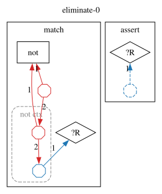
<!-- /rule -->

#### `eliminate-1`

<!-- rule std.negation eliminate-1 -->
```lisp
(rule eliminate-1 (?R)
  :match  (not (not (?R ?a)))
  :assert (?R ?a)
  :why    "it is not so that ({?R} {?a}) is not so")
```

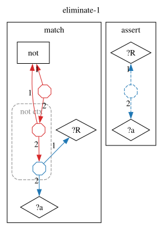
<!-- /rule -->

#### `eliminate-2`

<!-- rule std.negation eliminate-2 -->
```lisp
(rule eliminate-2 (?R)
  :match  (not (not (?R ?a ?b)))
  :assert (?R ?a ?b)
  :why    "it is not so that ({?R} {?a} {?b}) is not so")
```

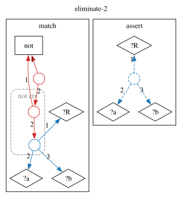
<!-- /rule -->

#### `eliminate-3`

<!-- rule std.negation eliminate-3 -->
```lisp
(rule eliminate-3 (?R)
  :match  (not (not (?R ?a ?b ?c)))
  :assert (?R ?a ?b ?c)
  :why    "it is not so that ({?R} {?a} {?b} {?c}) is not so")
```

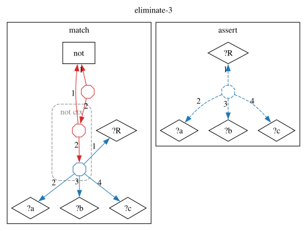
<!-- /rule -->

#### `eliminate-4`

<!-- rule std.negation eliminate-4 -->
```lisp
(rule eliminate-4 (?R)
  :match  (not (not (?R ?a ?b ?c ?d)))
  :assert (?R ?a ?b ?c ?d)
  :why    "it is not so that ({?R} {?a} {?b} {?c} {?d}) is not so")
```

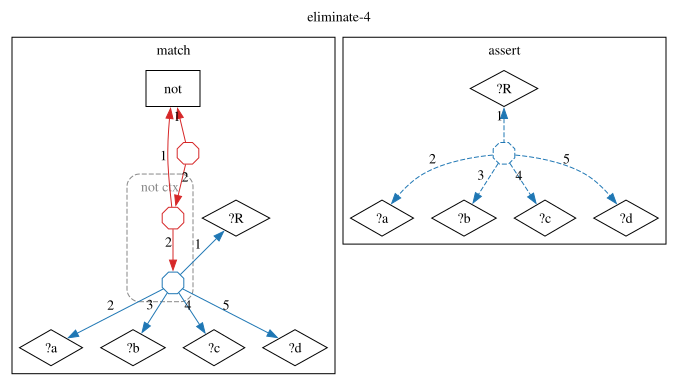
<!-- /rule -->

#### `eliminate-5`

<!-- rule std.negation eliminate-5 -->
```lisp
(rule eliminate-5 (?R)
  :match  (not (not (?R ?a ?b ?c ?d ?e)))
  :assert (?R ?a ?b ?c ?d ?e)
  :why    "it is not so that ({?R} {?a} {?b} {?c} {?d} {?e}) is not so")
```

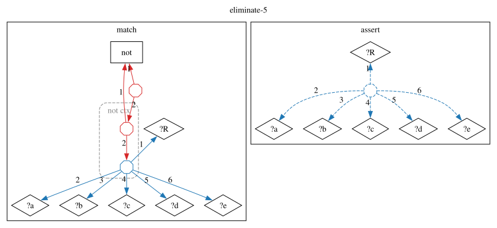
<!-- /rule -->

#### `eliminate-6`

<!-- rule std.negation eliminate-6 -->
```lisp
(rule eliminate-6 (?R)
  :match  (not (not (?R ?a ?b ?c ?d ?e ?f)))
  :assert (?R ?a ?b ?c ?d ?e ?f)
  :why    "it is not so that ({?R} {?a} {?b} {?c} {?d} {?e} {?f}) is not so")
```

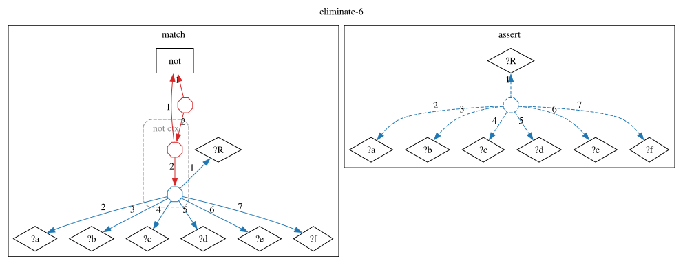
<!-- /rule -->

### `std.contradiction`

Seven rules that conclude `(false)`, one a count, each with the relation a parameter; and seven with no parameter
that derive their activators, each from the declarations of one count, where the program holds
`(clash-of-declared)`. A rule that concludes `(false)` is in the first half of the agenda
([Q-M1f.313](../../../../decisions/engine/Q-M1f.313-the-agenda-fires-first-what-leads-to-false.md)), so a pair is
refuted as soon as it is matched.

#### `clash-0`

A fact of no argument beside its negation.

<!-- rule std.contradiction clash-0 -->
```lisp
(rule clash-0 (?R)
  :match  (and (?R) (not (?R)))
  :assert (false)
  :why    "({?R}) holds beside its negation.")
```

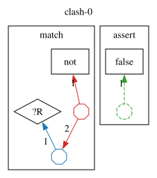
<!-- /rule -->

#### `clash-1`

<!-- rule std.contradiction clash-1 -->
```lisp
(rule clash-1 (?R)
  :match  (and (?R ?a) (not (?R ?a)))
  :assert (false)
  :why    "({?R} {?a}) holds beside its negation.")
```

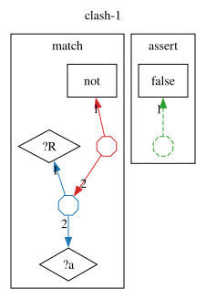
<!-- /rule -->

#### `clash-2`

<!-- rule std.contradiction clash-2 -->
```lisp
(rule clash-2 (?R)
  :match  (and (?R ?a ?b) (not (?R ?a ?b)))
  :assert (false)
  :why    "({?R} {?a} {?b}) holds beside its negation.")
```

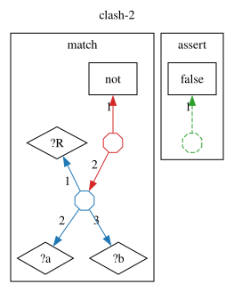
<!-- /rule -->

#### `clash-3`

<!-- rule std.contradiction clash-3 -->
```lisp
(rule clash-3 (?R)
  :match  (and (?R ?a ?b ?c) (not (?R ?a ?b ?c)))
  :assert (false)
  :why    "({?R} {?a} {?b} {?c}) holds beside its negation.")
```

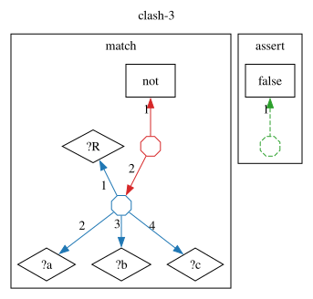
<!-- /rule -->

#### `clash-4`

<!-- rule std.contradiction clash-4 -->
```lisp
(rule clash-4 (?R)
  :match  (and (?R ?a ?b ?c ?d) (not (?R ?a ?b ?c ?d)))
  :assert (false)
  :why    "({?R} {?a} {?b} {?c} {?d}) holds beside its negation.")
```

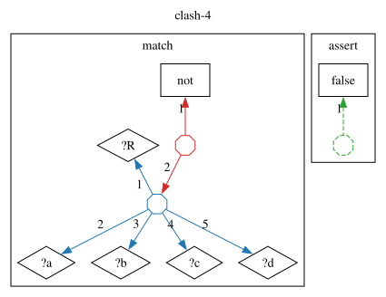
<!-- /rule -->

#### `clash-5`

<!-- rule std.contradiction clash-5 -->
```lisp
(rule clash-5 (?R)
  :match  (and (?R ?a ?b ?c ?d ?e) (not (?R ?a ?b ?c ?d ?e)))
  :assert (false)
  :why    "({?R} {?a} {?b} {?c} {?d} {?e}) holds beside its negation.")
```

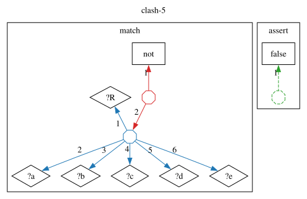
<!-- /rule -->

#### `clash-6`

<!-- rule std.contradiction clash-6 -->
```lisp
(rule clash-6 (?R)
  :match  (and (?R ?a ?b ?c ?d ?e ?f) (not (?R ?a ?b ?c ?d ?e ?f)))
  :assert (false)
  :why    "({?R} {?a} {?b} {?c} {?d} {?e} {?f}) holds beside its negation.")
```

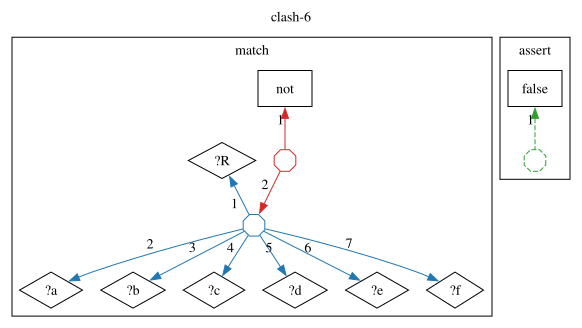
<!-- /rule -->

#### `clash-of-0`

Reads the fact `(relation R)` every declaration states, so it names every declared relation, whatever its count.

<!-- rule std.contradiction clash-of-0 -->
```lisp
(rule clash-of-0 ()
  :match  (and (clash-of-declared) (relation ?R))
  :assert (clash-0 ?R)
  :why    "{?R} is declared.")
```

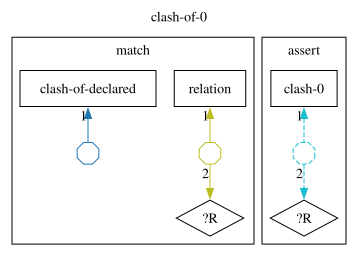
<!-- /rule -->

#### `clash-of-1`

Reads a declaration of one label; and so each rule after it, at its count.

<!-- rule std.contradiction clash-of-1 -->
```lisp
(rule clash-of-1 ()
  :match  (and (clash-of-declared) (relation ?R ?A))
  :assert (clash-1 ?R)
  :why    "{?R} is declared with one argument.")
```

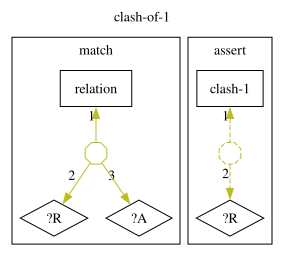
<!-- /rule -->

#### `clash-of-2`

<!-- rule std.contradiction clash-of-2 -->
```lisp
(rule clash-of-2 ()
  :match  (and (clash-of-declared) (relation ?R ?A ?B))
  :assert (clash-2 ?R)
  :why    "{?R} is declared with two arguments.")
```

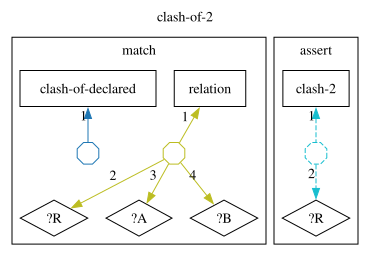
<!-- /rule -->

#### `clash-of-3`

<!-- rule std.contradiction clash-of-3 -->
```lisp
(rule clash-of-3 ()
  :match  (and (clash-of-declared) (relation ?R ?A ?B ?C))
  :assert (clash-3 ?R)
  :why    "{?R} is declared with three arguments.")
```

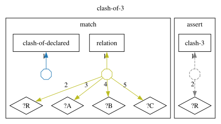
<!-- /rule -->

#### `clash-of-4`

<!-- rule std.contradiction clash-of-4 -->
```lisp
(rule clash-of-4 ()
  :match  (and (clash-of-declared) (relation ?R ?A ?B ?C ?D))
  :assert (clash-4 ?R)
  :why    "{?R} is declared with four arguments.")
```

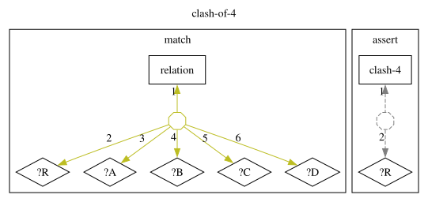
<!-- /rule -->

#### `clash-of-5`

<!-- rule std.contradiction clash-of-5 -->
```lisp
(rule clash-of-5 ()
  :match  (and (clash-of-declared) (relation ?R ?A ?B ?C ?D ?E))
  :assert (clash-5 ?R)
  :why    "{?R} is declared with five arguments.")
```

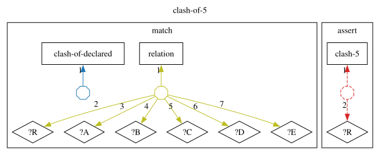
<!-- /rule -->

#### `clash-of-6`

<!-- rule std.contradiction clash-of-6 -->
```lisp
(rule clash-of-6 ()
  :match  (and (clash-of-declared) (relation ?R ?A ?B ?C ?D ?E ?F))
  :assert (clash-6 ?R)
  :why    "{?R} is declared with six arguments.")
```

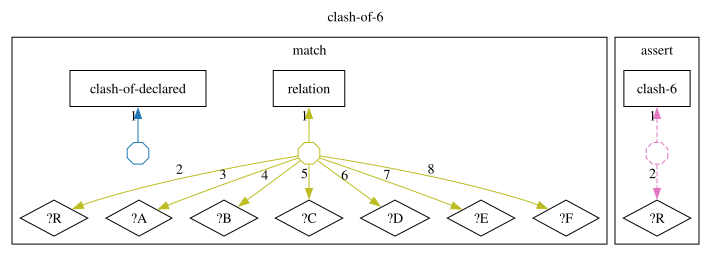
<!-- /rule -->

## See also

- [Constraints](../../03-syntax-and-semantics/06-constraints.md) — a stored negation, `(false)`, and the negation of
  a negation; [Rules § Rules and contexts](../../03-syntax-and-semantics/05-rules.md) — a rule for what somebody
  thinks.
- [Diagnostics § 2.9](../07-diagnostics.md#29-a-rule-shape-that-reads-nothing) — the refusal above.
- [`tests/stdlib/negation/`](../../../../../tests/stdlib/negation/) and
  [`tests/stdlib/contradiction/`](../../../../../tests/stdlib/contradiction/) — a program for each rule or family.
