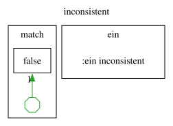

# The rule every program gets: `std.core`

`std.core` is the one module of the standard library that every program gets with no import line. The load brings
it into every program, whole, after the program's own forms and those of the modules it imports, and its one rule is
then a rule of the program under its full name, `std.core.inconsistent`
([Q-M1f.551](../../../../decisions/stdlib/Q-M1f.551-std-core-is-loaded-into-every-program.md)).

## What it says

```lisp
(rule inconsistent ()
  :match (false)
  :ein   inconsistent
  :why   "a state that derives a contradiction is inconsistent")
```

With $S$ a state, and $\bot$ the fact `(false)`:

$$
\bot \in S \implies S \text{ is inconsistent}
$$

`(false)` is a fact, the library's word for a contradiction: a rule concludes it, a program states it, and another
fact may hold it under an arrow. The rule states no `:assert`. `:ein inconsistent` is a word to the engine and no
fact ([`02-syntax.md` § Conclusion forms in `:assert`](../02-syntax.md#conclusion-forms-in-assert)): where a rule
that states it fires, the saturation of the state ends and the state is dead, and the firing writes nothing. So a
state that holds `(false)` is dead by this rule, and the engine reads `(false)` by its name nowhere to judge one.

| a state holds | the rule |
|---|---|
| `(false)`, concluded by a rule, stated by the program or committed | fires once, on that fact, and the state is dead |
| no `(false)` | does not fire; the state is alive, unless a program's own rule states the key. A fact beside its stored negation is a contradiction only by a rule that concludes `(false)` from the two, `std.contradiction`'s where a program imports it |
| `(false)` only under an arrow, `(think Ann (false))` | does not fire: the rule matches a held `(false)` |

A program's own rule may state the same word over other premises, with no `(false)` between
([`examples/features/18_ein_inconsistent.ein`](../../../../../examples/features/18_ein_inconsistent.ein)).

## In a program

[`tests/stdlib/core/01_false_ends_the_state.ein`](../../../../../tests/stdlib/core/01_false_ends_the_state.ein)
imports nothing. A switch is on and off at once, which its rule `on-and-off` concludes `(false)` from:

```lisp
(on  s1)
(off s1)

(rule on-and-off ()
  :match  (and (on ?s) (off ?s))
  :assert (false)
  :why    "{?s} is on and off at once")

(solve :expect (false))
```

`ein saturate --dump tests/stdlib/core/01_false_ends_the_state.ein` lists the module's rule beside the program's,
and the one fact derived:

<!-- output -->
```text
;; Rules — the saturation agenda's (2)
;;   on-and-off  :params ()  stratum 0
;;   std.core.inconsistent  :params ()  :ein inconsistent
```

<!-- output -->
```text
;; ── DERIVED (1 facts) ──
  (false :rule on-and-off)
```

`ein solve tests/stdlib/core/01_false_ends_the_state.ein --trace t.md` tells root's two steps, the second the
module's, which derives nothing:

<!-- output -->
```text
### Step 1 — `on-and-off`
> s1 is on and off at once
Premises: `on(s1)`, `off(s1)`
Derives `false`.

### Step 2 — `std.core.inconsistent`
> a state that derives a contradiction is inconsistent
Premises: `false`
States `:ein inconsistent`: the state is inconsistent, and the step derives no fact.
```

**An explanation reads through the rule.** A dead state's core is the frontier of the `(false)` the rule matched,
and `refuted by` names the rule that concluded that `(false)`, since an explanation names the rules a program wrote
or imported:

<!-- output -->
```text
  unsat core        (off s1)
  unsat core        (on s1)
  refuted by        on-and-off
```

[`02_loaded_and_alive.ein`](../../../../../tests/stdlib/core/02_loaded_and_alive.ein) is the same program with the
switch on and not off: the rule is loaded, no state holds `(false)`, and root is alive.

## Importing it

A file may import the module as it imports any module, in a program or in a module, in any of an import's three
shapes. The import binds the module's names: `:symbols (inconsistent)` writes and prints its rule `inconsistent`, and
`:as c` prints it `c.inconsistent`. It brings no second copy, and the module stays where every load puts it, after
the program's forms and its imports', so a program lists the same rules in the same order, and answers what it
answers, with the line and without
([`examples/features/21_import_of_core.ein`](../../../../../examples/features/21_import_of_core.ein) imports it
bare). No import leaves it out: every load brings it. A saved file carries it beside the program's other modules
([`10-answer-dump.md`](../10-answer-dump.md#a-state-file-is-its-program-and-the-choices-made)), and a `.einb` stores
the program without it.

## Replacing it

The module is read from the standard library the load resolves
([`01-install.md`](../../01-install.md#point-it-at-a-different-stdlib)), so a library `$EIN_STDLIB` names brings its
own `core.ein` into every program, in the place of the checkout's or the copy built into the binary. Take a copy of
the library whose `core.ein` reads `(absurd)` where the library's reads `(false)`:

```lisp
(rule absurd ()
  :match (absurd)
  :ein   inconsistent
  :why   "a state that holds (absurd) is inconsistent")
```

With `$EIN_STDLIB` naming the copy, `ein saturate --dump tests/stdlib/core/01_false_ends_the_state.ein` lists its rule
as a rule of the program, and the `(false)` the program concludes is a fact no rule reads:

<!-- output -->
```text
;; Rules — the saturation agenda's (2)
;;   on-and-off  :params ()  stratum 0
;;   std.core.absurd  :params ()  :ein inconsistent
```

so `ein solve` on the same program finds root alive, where the library's own module finds it dead:

<!-- output -->
```text
  ∅                 in R — root is alive and owes nothing
```

and refutes the program's claim that R is empty, exit 1:

<!-- output -->
```text
  (solve :expect)   FAILED
                    (false) says every node is dead, and R has 1 state
```

The library's `MANIFEST.sha256` is what makes the directory a standard library, and nothing compares the module with
it. A library there with no `core.ein` refuses every program, with the directory it names
([`07-diagnostics.md` § 2.7](../07-diagnostics.md#27-the-module-every-program-gets-cannot-be-read)):

<!-- output -->
```text
kb load error: std.core was not found in $EIN_STDLIB: /path/to/lib holds no core.ein — every program gets std.core, and a library $EIN_STDLIB names is where it is read from (Q-M1f.551): write core.ein there, or unset $EIN_STDLIB to use the checkout or the embedded copy
```

## The rule

### `std.core`

#### `inconsistent`

A held `(false)`: the state is inconsistent.

<!-- rule std.core inconsistent -->
```lisp
(rule inconsistent ()
  :match (false)
  :ein   inconsistent
  :why   "a state that derives a contradiction is inconsistent")
```


<!-- /rule -->
