# Requirements and payments: `std.debts`

An [obligation](../../03-syntax-and-semantics/08-obligations.md) says what a state still **owes**. What it concludes
is `(open R)` ([Q-M1d.2](../../../../decisions/hypotheses/Q-M1d.2-an-obligation-is-a-rule-that-concludes-open-r.md)),
a fact of the kernel's relation `open`, one for the relation however many instances the state owes, which the state
that owes holds alone: a debt a state kept would outlive its own payment in the state that paid it, so a fork drops
it, and each state that owes holds its own
([Q-M1f.566](../../../../decisions/hypotheses/Q-M1f.566-what-a-state-owes-is-open-r-a-fact-and-open-f.md)). A rule
that reads it makes its program not monotone
([Q-M1f.569](../../../../decisions/hypotheses/Q-M1f.569-a-rule-may-read-an-open-fact-and-its-program.md)).

`std.debts` states, for the four obligations of the library, the two halves of a debt as facts, one an instance,
which every larger state keeps because each stays true as the state grows, and the one verdict over them that stays
true as well:

| fact | what it says |
|---|---|
| `(debt-due R J)` | the **requirement**: the obligation's trigger holds for the instance `J` |
| `(debt-paid R J)` | the **payment**: the trigger holds for `J`, and a witness is held |
| `(debts-discharged)` | no requirement is unpaid |

With $T_o$ the trigger of an obligation $o$ over a relation $R$ and $W_o$ the witness its `absent` looks for:

$$
\begin{aligned}
T_o(j) &\implies \operatorname{due}(R, j) \\
T_o(j) \land W_o(j) &\implies \operatorname{paid}(R, j) \\
\forall R, j.\ \big(\operatorname{due}(R, j) \to \operatorname{paid}(R, j)\big) &\implies \operatorname{discharged}
\end{aligned}
$$

What the obligation owes in a state $S$ is the difference, the requirements with no payment beside them:

$$
\operatorname{owed}_o(S) \;=\; \{\, j : \operatorname{due}(R, j) \in S,\ \operatorname{paid}(R, j) \notin S \,\}
$$

A requirement is never retracted and a payment never withdrawn, so both sets only grow with the state, and where a
state holds `(debts-discharged)` every larger state holds it. The difference does not grow: it shrinks as payments
arrive, which is why what a state owes, `(open R)`, is a fact of that state alone, never inherited,
and these three are facts every larger state keeps.

## Using `std.debts`

```lisp
(import std.debts)
(debts-of-owed)
```

One fact asks for all of it: the requirements and the payments of every obligation of the library the program
activates, and `(debts-discharged)`.

| a program writes | it produces |
|---|---|
| `(debts-of-owed)` beside `(total-owed R isa)` | `(total-due R isa)` and `(total-paid R isa)` |
| `(debts-of-owed)` beside `(surjective-owed R isa)` | `(surjective-due R isa)` and `(surjective-paid R isa)` |
| `(debts-of-owed)` beside `(slot-owed-room R isa sub Super Index)` | `(room-due R isa sub Super Index)` and `(room-paid …)` |
| `(debts-of-owed)` beside `(slot-owed-fill R isa sub Super Index)` | `(fill-due R isa sub Super Index)` and `(fill-paid …)` |
| `(debts-of-owed)` | `(debts-discharged)`, where no `(debt-due R J)` lacks its `(debt-paid R J)` |
| `(total-due R isa)`, for `(relation R A B)` | `(debt-due R (total-owed-of R isa A B a))` for each member `a` of `A` |
| `(total-paid R isa)` | `(debt-paid R (total-owed-of R isa A B a))` where the state holds `(R a b)` for a member `b` of `B` |
| `(surjective-due R isa)`, `(surjective-paid R isa)` | the same for each member `b` of `B`, under `surjective-owed-of`, paid by a member of `A` |
| `(room-due …)`, `(room-paid …)` | `(debt-due R (slot-owed-room-of R isa sub Super Index a Kind))` for each member `a` of a kind under `Super` but `Index`; paid where `a` is in a slot |
| `(fill-due …)`, `(fill-paid …)` | `(debt-due R (slot-owed-fill-of R isa sub Super Index i Kind))` for each slot `i` and each such kind; paid where the slot has a member of it |

The obligation's activator may be written or derived: `(bijective R)` gives a relation `total-owed` and
`surjective-owed` through [`std.bijection`](04-bijections.md), and `(slot-partition …)` the two of
[`std.slots`](05-slots.md).

**The instance** `J` is a fact no state holds, which stands as the second argument of a requirement or a payment:
a relation named for the obligation, the obligation's parameters in their order, and then what its trigger bound.
`(total-owed-of seats is-a Guest Chair Ann)` reads *`seats` owes Ann a Chair, by `total-owed` over `is-a`*. Two
obligations over one relation have different instances, so a requirement is paid only by its own payment.

**The names.** `debt-due`, `debt-paid`, `debts-discharged`, the four instance relations and `debts-of-owed` are
relations the module writes or reads and does not declare, so a program writes each as it is, with nothing to list
([what to list](README.md#what-to-list)). The rules are the module's, and a program that writes one's name, to
activate a pair by hand or to ask for its activators, lists it.

### A search: every state of R is discharged

Two guests, two chairs, every guest owed a chair and every chair a guest, and no two alike:

```lisp
(import std.algebra :symbols (total-owed surjective-owed functional injective))
(import std.debts)

(relation is-a  T T         :why "{?3} is a {?4}")
(relation seats Guest Chair :why "{?3} is seated at {?4}")

(is-a Ann Guest) (is-a Bob Guest)
(is-a C1 Chair)  (is-a C2 Chair)

(total-owed      seats is-a)
(surjective-owed seats is-a)
(functional seats)
(injective  seats)

(debts-of-owed)

(query :goal (debt-due seats ?j))
(query :goal (debt-paid seats ?j))
(query :goal (debts-discharged))
```

<!-- output -->
```text
  ∅                 not in R — root owes 4 instances
    owed            seats owes Ann a Chair.
    owed            seats owes Bob a Chair.
    owed            seats owes C1 a preimage in Guest.
    owed            seats owes C2 a preimage in Guest.
  …
  lattice           monotone (the static check) — R is convex: no hole
  …
  (region
    ;; state 1 of 2 — 2 candidates · minimal and maximal · from {(seats Ann C1), (seats Bob C2)}
    (model (seats Ann C1) (seats Bob C2))
    ;; state 2 of 2 — 2 candidates · minimal and maximal · from {(seats Ann C2), (seats Bob C1)}
    (model (seats Ann C2) (seats Bob C1)))

  query 1 of 3      (debt-due seats ?j)
  over              all of R — 2 states → 1 projection class
    class 1 of 1    2 states (1, 2)
                      ?j = (surjective-owed-of seats is-a Guest Chair C1)
                      ?j = (surjective-owed-of seats is-a Guest Chair C2)
                      ?j = (total-owed-of seats is-a Guest Chair Ann)
                      ?j = (total-owed-of seats is-a Guest Chair Bob)
  …
  query 2 of 3      (debt-paid seats ?j)
  over              all of R — 2 states → 1 projection class
    class 1 of 1    2 states (1, 2)
                      ?j = (surjective-owed-of seats is-a Guest Chair C1)
                      ?j = (surjective-owed-of seats is-a Guest Chair C2)
                      ?j = (total-owed-of seats is-a Guest Chair Ann)
                      ?j = (total-owed-of seats is-a Guest Chair Bob)
  …
  query 3 of 3      (debts-discharged)
  over              all of R — 2 states → 1 projection class
    class 1 of 1    2 states (1, 2)
                      the goal holds: it has no variable
  as :expect        (model (debts-discharged))
```

R is the two matchings, as it is without the module: the rules add facts to the states and change no state's
verdict. The four requirements are root's, the same four instances the read-out's `owed` rows name; each state of R
holds a payment for every one of them, and `(debts-discharged)`.

### A state that owes

Root of the program above owes four and is no state of R, so no query reads it. A smaller program stops at root,
`(solve :no-search)`: two people, two foods, every person owed a food, and one arrow.

```lisp
(import std.algebra :symbols (total-owed))
(import std.debts)

(relation is-a  T T         :why "{?3} is a {?4}")
(relation likes Person Food :why "{?3} likes {?4}")

(is-a Ann Person) (is-a Bob Person)
(is-a Soup Food)  (is-a Stew Food)

(total-owed likes is-a)
(debts-of-owed)

(likes Bob Stew)

(solve :no-search)
(query :goal (likes ?who ?what))
```

`ein solve` says R is empty, every alive node owing, and `ein saturate --dump` lists what root derived beyond the
program, its `open` facts among it:

<!-- output -->
```text
;; ── DERIVED (12 facts) ──
;;   debt-due (2)
  (debt-due likes (total-owed-of likes is-a Person Food Ann) :rule std.debts.total-due)
  (debt-due likes (total-owed-of likes is-a Person Food Bob) :rule std.debts.total-due)
  (debt-paid likes (total-owed-of likes is-a Person Food Bob) :rule std.debts.total-paid)
;;   open (3)
  (open likes :rule total-owed)
  (open (likes Ann Soup) :rule total-owed)
  (open (likes Ann Stew) :rule total-owed)
;;   std.contradiction.clash-0 (2)
  (std.contradiction.clash-0 is-a :rule std.contradiction.clash-of-0)
  (std.contradiction.clash-0 likes :rule std.contradiction.clash-of-0)
;;   std.contradiction.clash-2 (2)
  (std.contradiction.clash-2 is-a :rule std.contradiction.clash-of-2)
  (std.contradiction.clash-2 likes :rule std.contradiction.clash-of-2)
  (std.debts.total-due likes is-a :rule std.debts.debts-of-total)
  (std.debts.total-paid likes is-a :rule std.debts.debts-of-total)
```

Two requirements, one payment, and no `(debts-discharged)`. The requirement with no payment is Ann's, the instance
the kernel owes. The kernel's side of it is `(open likes)`, one fact for the relation, beside the two hypotheses
the obligation writes for what would pay Ann, and a state that pays her holds none of the three; the module's side
names the instance, and stays in that state beside the payment that joins it. The rest are activators:
`std.contradiction`'s, which `std.algebra` imports, for the two declared relations, and the module's pair.

### What a rule may read of them

A rule reads a requirement, a payment or `(debts-discharged)` as it reads any fact, and what it concludes from them
stays true as the state grows. The seating program again, its three queries replaced by two relations, two rules
and two queries of the program's own:

```lisp
(relation served Guest :why "{?3} is served")
(relation dinner       :why "dinner begins")

(rule the-seated-are-served ()
  :match  (debt-paid seats (total-owed-of seats is-a Guest Chair ?g))
  :assert (served ?g)
  :why    "{?g} has a chair, and is served")

(rule dinner-when-all-is-settled ()
  :match  (debts-discharged)
  :assert (dinner)
  :why    "nothing is owed: dinner begins")

(query :goal (served ?g))
(query :goal (dinner))
```

<!-- output -->
```text
  lattice           monotone (the static check) — R is convex: no hole
  …
  query 1 of 2      (served ?g)
  over              all of R — 2 states → 1 projection class
    class 1 of 1    2 states (1, 2)
                      ?g = Ann
                      ?g = Bob
  as :expect        (model (served Ann) (served Bob))

  query 2 of 2      (dinner)
  over              all of R — 2 states → 1 projection class
    class 1 of 1    2 states (1, 2)
                      the goal holds: it has no variable
  as :expect        (model (dinner))
```

**The difference is the half a rule must not store.** A rule that concludes a fact from a requirement with no
payment concludes what a larger state loses, and the fact stays where the payment arrives. The seating program
with these lines in the place of its queries:

```lisp
(relation waiting Guest :why "{?3} is waiting for a chair")

(rule the-unseated-wait ()
  :match  (and (debt-due seats (total-owed-of seats is-a Guest Chair ?g))
               (absent (debt-paid seats (total-owed-of seats is-a Guest Chair ?g))))
  :assert (waiting ?g)
  :why    "{?g} is required a chair and has none")

(query :goal (waiting ?g))
```

<!-- output -->
```text
  WARNING           THIS PROGRAM IS NOT MONOTONE: NOTHING IS CLAIMED OF THIS ANSWER.
                    IT IS NOT CLAIMED TO BE RIGHT, SOUND OR COMPLETE (Q-M1f.564).
                    THE `lattice` ROWS BELOW NAME THE SITES.
  …
  lattice           not monotone: 1 site (the static check) — no hole in this cube
  …
    site            the-unseated-wait: absent reads debt-paid at absent depth 1, concludes a positive fact — at stake: the state
  …
    stale           {(seats Ann C1)}, owing: (waiting Ann) ← the-unseated-wait (absent (debt-paid seats (total-owed-of seats is-a Guest Chair Ann)))
  …
  query             (waiting ?g)
  over              all of R — 2 states → 1 projection class
    class 1 of 1    2 states (1, 2)
                      ?g = Ann
                      ?g = Bob
  as :expect        (model (waiting Ann) (waiting Bob))
```

Both guests are *waiting* in both states of R, where both are seated: root concluded it of each, and a state built
on root keeps what root holds. The static check flags the rule, the read-out opens with the warning, and of a
flagged program nothing is claimed
([the read-out § 5.1](../08-read-out.md#51-under-lattice-and-monotone-the-warning),
[Q-M1f.564](../../../../decisions/answer/Q-M1f.564-a-non-monotone-program-loads-with-a-warning.md)). It is the
reason what a state owes, `(open R)`, is held by that state alone and inherited by no fork, and
why a rule that reads it flags its program too, by a site of its own, `open-read`.

### `(debts-discharged)` is about the requirements that are stated

The fact says that no **stated** requirement is unpaid. It agrees with what the engine says a state owes where every
obligation the program activates is one of the library's four. An obligation of the program's own is unknown to it
until the program states its two halves, by two rules that conclude `debt-due` and `debt-paid`, the trigger and the
trigger with the witness:

```lisp
(import std.debts)

(relation is-a   T T         :why "{?3} is a {?4}")
(relation seats  Guest Chair :why "{?3} is seated at {?4}")
(relation window Chair       :why "{?3} is by the window")

(is-a Ann Guest)
(is-a C1 Chair) (is-a C2 Chair)
(window C2)

;; the program's own obligation: every guest a chair by the window
(rule by-the-window ()
  :match  (and (is-a ?g Guest)
               (absent (and (window ?c) (seats ?g ?c))))
  :assert (open seats)
  :why    "{?g} has no chair by the window yet.")

;; and its two halves, as facts
(rule window-due ()
  :match  (is-a ?g Guest)
  :assert (debt-due seats (by-the-window-of ?g))
  :why    "{?g} is required a chair by the window.")
(rule window-paid ()
  :match  (and (is-a ?g Guest) (window ?c) (seats ?g ?c))
  :assert (debt-paid seats (by-the-window-of ?g))
  :why    "{?g} has the chair {?c} by the window.")

(debts-of-owed)

(query :goal (debts-discharged))
```

<!-- output -->
```text
  ∅                 not in R — root owes 1 instance
    owed            Ann has no chair by the window yet.
  …
  (region
    ;; state 1 of 1 — 1 candidate · minimal and maximal · from {(seats Ann C2)}
    (model (seats Ann C2)))

  query             (debts-discharged)
  over              all of R — 1 state → 1 projection class
    class 1 of 1    1 state (1)
                      the goal holds: it has no variable
  as :expect        (model (debts-discharged))
```

With the two rules `window-due` and `window-paid` left out, root still owes Ann her chair and **holds
`(debts-discharged)`**: nothing is stated as required, so nothing stated is unpaid. `ein saturate --dump` lists
root's `(open seats)`, what the kernel says it owes, beside that `(debts-discharged)`.

### Activating a pair by hand

A program that wants one obligation's requirements and payments and nothing else writes the two activators, with
the obligation's own arguments, and lists the two rules:

```lisp
(import std.debts :symbols (total-due total-paid))
(total-due  likes is-a)
(total-paid likes is-a)
```

Nothing then concludes `(debts-discharged)`, which waits for `(debts-of-owed)`. The obligation itself need not be
activated: the pair reads the declaration and the membership relation, as the obligation does.

### What an import brings, and what the facts cost

- **An import by itself changes nothing a program holds.** The module declares no relation and writes no fact, and
  each of its rules acts under its activator or where the program holds `(debts-of-owed)`. It brings `std.algebra`
  and `std.slots` whole, whose names the rules read.
- **The words are shared.** `debt-due`, `debt-paid`, `debts-discharged`, `debts-of-owed` and the four instance
  relations are no module's, so a program that uses one of them for a relation of its own shares it with these
  rules.
- **A state holds more.** A requirement for each instance and a payment for each paid one are facts of every state,
  and a description's budget counts facts (`--region-budget`): a description that stops at its budget stops sooner.
  A description that is exhausted answers the same R.

## How it works

Thirteen rules: a requirement and a payment for each of the four obligations, four that derive those activators
from an obligation's, and one for `(debts-discharged)`. None of the first twelve reads an `absent`.

### The requirement and the payment of each obligation

`std.algebra`'s `total-owed` is *for `(relation R A B)`, each member of `A`, while no member of `B` is its partner*.
The requirement is what stands before the `absent`, and the payment is that with what the `absent` looks for.

#### `total-due`

<!-- rule std.debts total-due -->
```lisp
(rule total-due (?R ?isa)
  :match  (and (relation ?R ?A ?B)
               (?isa ?a ?A))
  :assert (debt-due ?R (total-owed-of ?R ?isa ?A ?B ?a))
  :why    "{?R} is required to give {?a} a {?B}.")
```

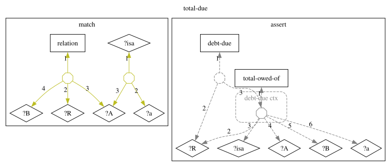
<!-- /rule -->

#### `total-paid`

<!-- rule std.debts total-paid -->
```lisp
(rule total-paid (?R ?isa)
  :match  (and (relation ?R ?A ?B)
               (?isa ?a ?A)
               (?isa ?b ?B)
               (?R ?a ?b))
  :assert (debt-paid ?R (total-owed-of ?R ?isa ?A ?B ?a))
  :why    "{?R} gives {?a} the {?B} {?b}.")
```

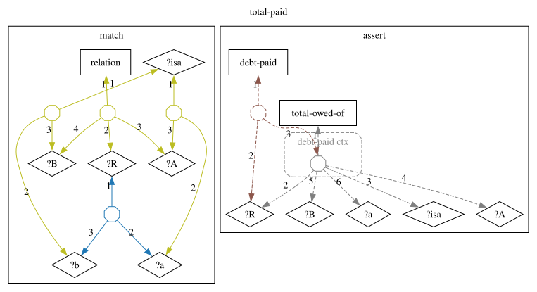
<!-- /rule -->

#### `surjective-due`

The same from the other label: each member of `B`.

<!-- rule std.debts surjective-due -->
```lisp
(rule surjective-due (?R ?isa)
  :match  (and (relation ?R ?A ?B)
               (?isa ?b ?B))
  :assert (debt-due ?R (surjective-owed-of ?R ?isa ?A ?B ?b))
  :why    "{?R} is required to give {?b} a preimage in {?A}.")
```

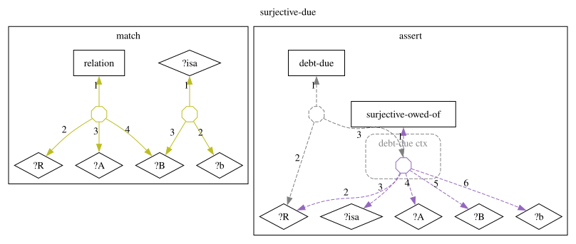
<!-- /rule -->

#### `surjective-paid`

<!-- rule std.debts surjective-paid -->
```lisp
(rule surjective-paid (?R ?isa)
  :match  (and (relation ?R ?A ?B)
               (?isa ?b ?B)
               (?isa ?a ?A)
               (?R ?a ?b))
  :assert (debt-paid ?R (surjective-owed-of ?R ?isa ?A ?B ?b))
  :why    "{?R} gives {?b} the preimage {?a}.")
```

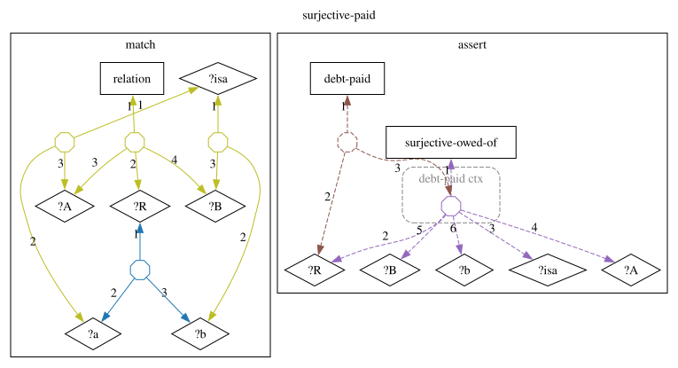
<!-- /rule -->

#### `room-due`

`std.slots`' `slot-owed-room`: each member of a kind under the family, the index kind apart, is required a slot.

<!-- rule std.debts room-due -->
```lisp
(rule room-due (?R ?isa ?sub ?super ?index)
  :match  (and (?isa ?a ?Ta)
               (?sub ?Ta ?super)
               (neq ?Ta ?index))
  :assert (debt-due ?R (slot-owed-room-of ?R ?isa ?sub ?super ?index ?a ?Ta))
  :why    "{?a} is required to be in some {?index}.")
```

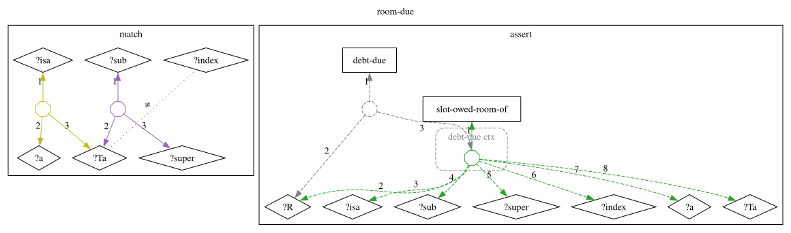
<!-- /rule -->

#### `room-paid`

<!-- rule std.debts room-paid -->
```lisp
(rule room-paid (?R ?isa ?sub ?super ?index)
  :match  (and (?isa ?a ?Ta)
               (?sub ?Ta ?super)
               (neq ?Ta ?index)
               (?isa ?i ?index)
               (?R ?a ?i))
  :assert (debt-paid ?R (slot-owed-room-of ?R ?isa ?sub ?super ?index ?a ?Ta))
  :why    "{?a} is in {?i}.")
```

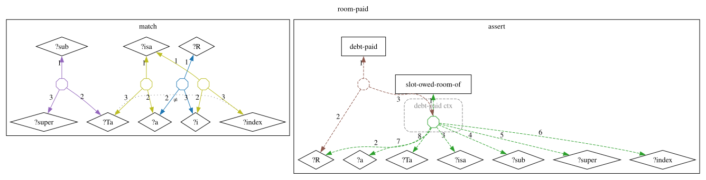
<!-- /rule -->

#### `fill-due`

`std.slots`' `slot-owed-fill`: each slot is required a member of each such kind.

<!-- rule std.debts fill-due -->
```lisp
(rule fill-due (?R ?isa ?sub ?super ?index)
  :match  (and (?isa ?i ?index)
               (?sub ?Tv ?super)
               (neq ?Tv ?index))
  :assert (debt-due ?R (slot-owed-fill-of ?R ?isa ?sub ?super ?index ?i ?Tv))
  :why    "slot {?i} is required to have a {?Tv}.")
```

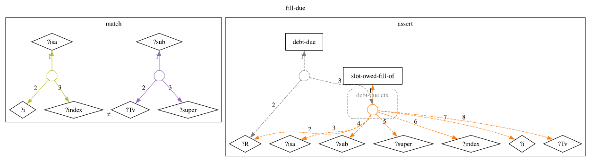
<!-- /rule -->

#### `fill-paid`

<!-- rule std.debts fill-paid -->
```lisp
(rule fill-paid (?R ?isa ?sub ?super ?index)
  :match  (and (?isa ?i ?index)
               (?sub ?Tv ?super)
               (neq ?Tv ?index)
               (?isa ?v ?Tv)
               (?R ?i ?v))
  :assert (debt-paid ?R (slot-owed-fill-of ?R ?isa ?sub ?super ?index ?i ?Tv))
  :why    "slot {?i} has the {?Tv} {?v}.")
```

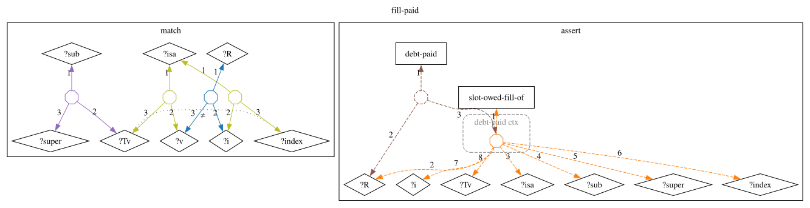
<!-- /rule -->

### Every activated obligation at once

Four rules with no parameter. Each reads the fact `(debts-of-owed)` beside one obligation's activator, and concludes
the two activators of its pair with the same arguments.

#### `debts-of-total`

<!-- rule std.debts debts-of-total -->
```lisp
(rule debts-of-total ()
  :match  (and (debts-of-owed) (total-owed ?R ?isa))
  :assert (and (total-due ?R ?isa) (total-paid ?R ?isa))
  :why    "{?R} owes each member a partner over {?isa}: its requirements and payments are stated.")
```

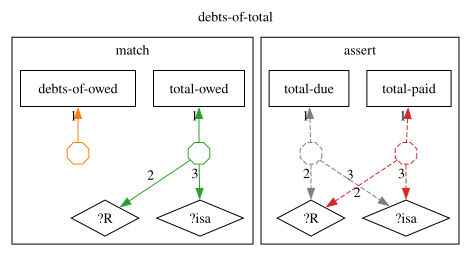
<!-- /rule -->

#### `debts-of-surjective`

<!-- rule std.debts debts-of-surjective -->
```lisp
(rule debts-of-surjective ()
  :match  (and (debts-of-owed) (surjective-owed ?R ?isa))
  :assert (and (surjective-due ?R ?isa) (surjective-paid ?R ?isa))
  :why    "{?R} owes each member a preimage over {?isa}: its requirements and payments are stated.")
```

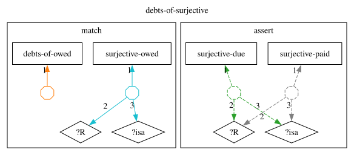
<!-- /rule -->

#### `debts-of-room`

<!-- rule std.debts debts-of-room -->
```lisp
(rule debts-of-room ()
  :match  (and (debts-of-owed) (slot-owed-room ?R ?isa ?sub ?super ?index))
  :assert (and (room-due ?R ?isa ?sub ?super ?index) (room-paid ?R ?isa ?sub ?super ?index))
  :why    "{?R} owes each member a {?index}: its requirements and payments are stated.")
```

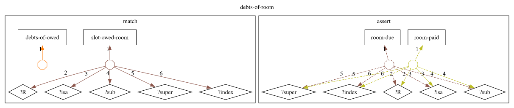
<!-- /rule -->

#### `debts-of-fill`

<!-- rule std.debts debts-of-fill -->
```lisp
(rule debts-of-fill ()
  :match  (and (debts-of-owed) (slot-owed-fill ?R ?isa ?sub ?super ?index))
  :assert (and (fill-due ?R ?isa ?sub ?super ?index) (fill-paid ?R ?isa ?sub ?super ?index))
  :why    "{?R} owes each {?index} a member of each kind: its requirements and payments are stated.")
```

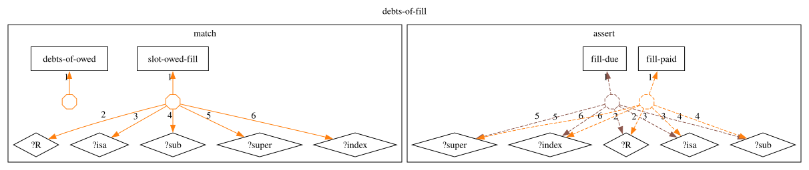
<!-- /rule -->

### Discharged

#### `discharged-from-nothing-unpaid`

*For every requirement, a payment*, written as the `absent` of a requirement that has no payment: an `absent`
inside an `absent`, which a larger state can only turn from failing to holding, so the static check keeps calling
the program monotone. It is judged at the boundary, when the closure holds every requirement and payment there is
to hold, as every `absent` is. It holds of a state in which nothing is required.

<!-- rule std.debts discharged-from-nothing-unpaid -->
```lisp
(rule discharged-from-nothing-unpaid ()
  :match  (and (debts-of-owed)
               (absent (and (debt-due ?R ?j) (absent (debt-paid ?R ?j)))))
  :assert (debts-discharged)
  :why    "every requirement is paid.")
```

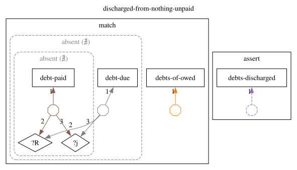
<!-- /rule -->

## See also

- [Obligations](../../03-syntax-and-semantics/08-obligations.md) — `(open R)`, what a state owes and how it is read.
- [The relation algebra § the totality obligations](02-relation-algebra.md) and [slots](05-slots.md) — the four
  obligations these rules restate.
- [`tests/stdlib/debts/`](../../../../../tests/stdlib/debts/) — a program for each rule or family.
