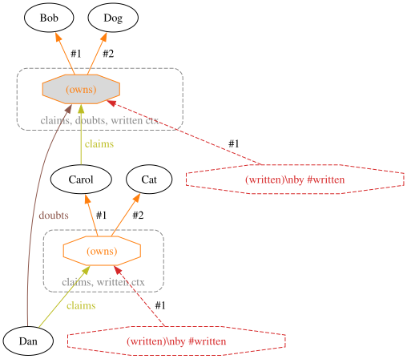
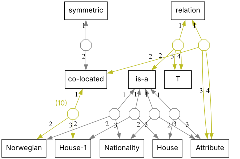
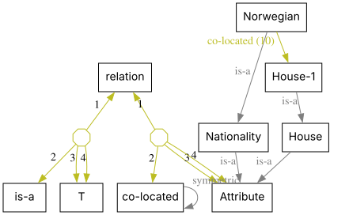
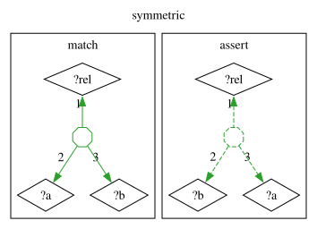
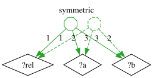
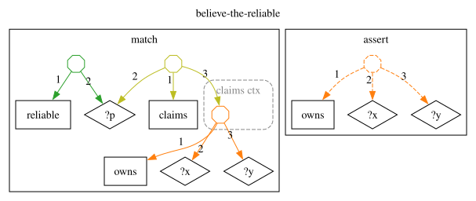
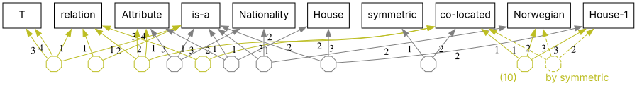

# Rendering — what `ein render` draws

`ein render` writes DOT on stdout and never draws an image: turning it into one is Graphviz's job,
`ein render kb FILE | dot -Tsvg > kb.svg`. **Every form has a fixed DOT shape**, and only the graph's structure is
fixed: positions, ranks and the style choices this page does not state are free
([Q21](../../../decisions/cli/Q21-every-form-has-a-fixed-dot-shape-and-its-layout.md)). Every view reads its program
through the loader first, so a program the loader refuses is refused with its line, exit 1, as every other command
refuses it ([Q-M1f.71](../../../decisions/cli/Q-M1f.71-a-view-refuses-a-program-the-loader-refuses.md)), and every
renderer has a command that reaches it
([Q-M1e.20](../../../decisions/cli/Q-M1e.20-every-renderer-has-a-command-that-reaches-it.md)).

| command | draws | section |
|---|---|---|
| `ein render program FILE` | the program as written, in three parts: its knowledge base as one graph, a digraph per rule, its query | [§ The program as written](#the-program-as-written--ein-render-program) |
| `ein render rules FILE`, `ein render rule --name N FILE` | each rule, or one, as its match and its conclusion | [§ Rules](#rules--ein-render-rules-and-ein-render-rule) |
| `ein render constraints FILE` | the facts a program states of the relations it does not declare | [§ Constraints](#constraints--ein-render-constraints) |
| `ein render kb FILE` | a KB, loaded and saturated, as one graph | [§ The KB](#the-kb--ein-render-kb) |
| `ein render lattice FILE` | the nodes a describing `ein solve` run visits | [§ The lattice](#the-lattice--ein-render-lattice) |
| `ein render region DIR` | the solution region as a Hasse diagram, from an `ein oracle --dump` directory | [§ The region](#the-region--ein-render-region) |
| `ein render h-space FILE` | the structure of the hypothesis set | [§ The hypothesis space](#the-hypothesis-space--ein-render-h-space) |
| `ein solve FILE --trace OUT.md` | a markdown narrative with a drawing per step, not DOT alone | [§ The trace](#the-trace--ein-solve---trace) |

**Every view that draws facts takes `--fold`**: `program`, `kb`, `rules`, `rule`, `constraints`, and `ein solve` for
the trace's drawings. Without it each fact is drawn as the graph has it; with it a fact of three arrows is one
labelled arrow ([§ A fact as the graph has it](#a-fact-as-the-graph-has-it--the-canonical-form-and-the-fold)).

## Node-shape legend

| element | DOT shape |
|---|---|
| an atom: a name under an arrow, the relation under a fact's first arrow among them | `box`, labelled with its name. A relation is one node for every fact of it in the drawing |
| a fact, of any count, held or not | `octagon` with no name in it, `label=""`, its first arrow numbered `1` at its relation's atom and the next numbered `2`, `3`, … at its arguments in turn, each number the arrow's `xlabel` |
| that octagon where the fact is in a context only, pointed at and not held | inside a dashed, rounded frame, labelled with the relations of the facts that point at it and `ctx`: `claims ctx`, `claims, doubts ctx` |
| that octagon where the knowledge base holds the fact | in no frame, whatever points at it; no octagon is filled |
| under `--fold`, a fact of three arrows, a relation and two arguments, that no drawn fact points at | an edge from the first argument to the second, with the relation's name on it: the edge's `xlabel` in a drawing of a knowledge base, its `label` in a rule's panel and in a trace's slice |
| a derived fact | dashed: its octagon and its arrows, or its folded edge |
| what a fact rests on: a given fact's source, a derived fact's rule | beside its octagon, an `xlabel`: `(10)` for `"condition (10)"`, `by <rule>`; on a folded edge, after the relation's name |
| a pattern variable `?x`, in a rule's drawing | `diamond` |

A fact's arrows share its relation's colour, picked from a fixed palette by the relation's name, the same on every
run.

**No relation is drawn otherwise than another**
([Q-M1f.421](../../../decisions/cli/Q-M1f.421-no-view-draws-a-relation-otherwise-than-another.md)). `is-a` and
`relation` are relations like any other: a fact of `is-a` is an octagon, or a folded edge, and a declaration is the
fact it is stored as, an octagon whose first arrow is at the atom `relation`. Every atom is a box, whatever points
at it: Ein has no types, and no drawing gives one theory's reading of a relation to every program.

## A fact as the graph has it — the canonical form and the fold

**The canonical form is the default**
([Q-M1f.419](../../../decisions/cli/Q-M1f.419-ein-render-draws-a-fact-as-the-graph-has-it.md)). In the knowledge
base a fact is a node with ordered arrows, the first at its relation, an atom, which is one node for every fact of
it ([the knowledge base](../../reasoning/01-static-ir/01-knowledge-base.md#the-graph)), and every view draws it so:
an octagon with no name in it, an arrow numbered `1` to the relation's box and an arrow numbered `2`, `3`, … to each
argument. An arrow's number is its `xlabel`, which Graphviz places beside the arrow once the graph is laid out, and
not its `label`, which `dot` lays out as one more node on the arrow, and one of which makes it lay out every arrow of
the digraph over two ranks; so is a folded arrow's relation in a drawing of a knowledge base. A knowledge base of
some hundreds of facts in long chains is laid out in seconds so, and in minutes with labels. DOT has no hyperedge,
and needs none: a fact of any count is its node
([Q1](../../../decisions/language/Q1-the-knowledge-base-is-a-hypergraph-of-atoms.md),
[Q21](../../../decisions/cli/Q21-every-form-has-a-fixed-dot-shape-and-its-layout.md)). No view writes a relation's
name in a fact's node, or a fact's text in any node. [Objects](../03-syntax-and-semantics/01-objects.md#as-a-graph)
has the graph beside the drawings of one program.

**`--fold` folds a fact of three arrows.** A fact of a relation and two arguments that no drawn fact points at is
one arrow from its first argument to its second, with its relation's name on it, `a -> b [xlabel="rel"]` in a
drawing of a knowledge base and `a -> b [label="rel"]` in a rule's panel, and its relation is then no node for that
fact
([Q-M1f.382](../../../decisions/language/Q-M1f.382-a-labelled-arrow-is-a-fact-of-three-arrows.md)). Nothing else is
folded: a fact of two arrows, `(rel a)`, stays its octagon and is never a loop, a fact of four arrows or more is its
octagon, and a fact that a drawn fact points at is its node in either form. What a fact is, drawn both ways, is
[`../03-syntax-and-semantics/03-facts.md`](../03-syntax-and-semantics/03-facts.md).

## A fact under an arrow — every object once

**Every view draws an object once**
([Q-M1f.395](../../../decisions/cli/Q-M1f.395-ein-render-draws-every-object-once.md)). A fact that a drawn fact
points at, an argument of it, is a node of the knowledge base like any other
([facts](../03-syntax-and-semantics/03-facts.md#a-fact-inside-a-fact)), and is drawn as **its node**, whatever its
count and whether or not the knowledge base holds it. A fact of three arrows is folded **only where nothing points
at it**; one that something points at is its octagon and no arrow, so a fact stated and also claimed is drawn once,
not as an arrow and again as a node.

The arrows that enter such a fact show which contexts it is in. What they cannot show is whether the knowledge
base also holds it, and one mark says that
([Q-M1f.398](../../../decisions/docs/Q-M1f.398-a-fact-in-a-context-only-is-drawn-in-a-frame.md)):

- **a fact in a context only**, pointed at and not held, **stands in a dashed frame**, labelled with the relations
  of the facts that point at it and the word `ctx`. Facts of several relations that point at one fact name one
  frame, `claims, doubts ctx`, in the relations' order. Frames stand side by side, one for each label, and none
  holds another; an atom is in no frame; *which* fact speaks about a framed fact is read off the arrows that enter;
- **a held fact stands in no frame**, whatever points at it. No octagon is filled.

Everything drawn outside a frame is held. The program below states one fact that two others are about, and claims
one that it does not state:

```lisp
(claims Carol (owns Bob Dog))
(doubts Dan (owns Bob Dog))
(owns Bob Dog)
(claims Dan (owns Carol Cat))
```

`ein render program` draws `(owns Bob Dog)` once, in no frame, with the third arrows of the two facts that point at
it entering it, and `(owns Carol Cat)` in the frame `claims ctx`:


`ein render kb` draws the same knowledge base the same way, saturated:



A fact under an arrow of a fact that is itself under an arrow is drawn the same way, in the frame of what points
at it where it is not held, and a view that holds a frame asks Graphviz to rank the whole graph at once,
`newrank=true`. A drawing in which every fact under an arrow is held has no frame.

## The program as written — `ein render program`

`ein render program FILE [--fold] [--rule-mode sidebyside|overlay]` draws the program as it is written, in three
parts ([Q-M1f.420](../../../decisions/cli/Q-M1f.420-ein-render-program-draws-the-programs-knowledge.md)):

- **`kb`**, the program's knowledge base: every fact and declaration it states, drawn as one graph by the KB view's
  own code, as [§ The KB](#the-kb--ein-render-kb) draws one. It is not split into declarations and facts: a
  declaration is the fact the loader stores, of `relation`. A written check, `(eq …)` or `(neq …)`, is no fact and
  is not drawn. For a program with no rule, no import and no macro it is what `ein render kb` draws of it, but for
  the fact `(relation r)` the loader adds beside a declaration with labels;
- **a digraph per rule, hrule and macro**, `rule_<name>_…` and `macro_<name>`, as
  [§ Rules](#rules--ein-render-rules-and-ein-render-rule) draws one; a macro's body is drawn as a rule's match is;
- **`query`**: each `(query …)` a cluster, its `:goal` drawn as a rule's match is and its other clauses in a note
  beside it, and the `(solve …)` clause a note.

A written `(trace …)` is drawn after them, as [§ The trace](#the-trace--ein-solve---trace) says. The program view is
drawn from the parsed forms, so a macro's call is drawn as written and imports are not resolved; an `(import …)` and
a `(config …)` draw nothing. The examples from here to the end of [§ The KB](#the-kb--ein-render-kb) are drawings of
one program:

```lisp
(rule symmetric (?rel)
  :match  (?rel ?a ?b)
  :assert (?rel ?b ?a)
  :why    "{?rel} is symmetric: {?a} ↔ {?b}.")

(relation is-a T T :why "{?3} is a {?4}")
(relation co-located Attribute Attribute :why "{?3} and {?4} are in the same house")
(is-a Nationality Attribute) (is-a House Attribute)
(is-a Norwegian Nationality) (is-a House-1 House)
(symmetric co-located)
(co-located Norwegian House-1 :source "condition (10)")
(solve :no-search)
```

Its digraph `kb`: the two declarations, the four facts of `is-a`, the fact of `symmetric` about `co-located`, and the
given fact with its source's short id beside it. `co-located` is one box, under the first arrow of the given fact
and under the second arrows of its declaration and of the fact of `symmetric`.



The same digraph under `--fold`: each fact of three arrows that nothing points at is one labelled arrow, and the
declarations, of four arrows, and the fact of `symmetric`, of two, stay octagons.



## Rules — `ein render rules` and `ein render rule`

`ein render rules FILE` prints one digraph per rule, and `ein render rule --name N FILE` the one named; each takes
`--fold`. Each draws a rule as its match and its conclusion, in one of two modes, `--rule-mode`:

**`sidebyside`, the default**: two clusters, `match` and `assert`, top to bottom.



**`overlay`**, the most compact: the match solid and what the conclusion adds dashed, in one graph.



Within each panel the drawing tells apart the three things a `:match` or an `:assert` holds:

- **a pattern**, `(R a b …)`, is drawn as a fact is: an octagon with no name in it, its arrow `1` at its relation,
  a box, or the variable's diamond where the relation is a `?var`, and its next arrows at its arguments, in the
  relation's colour. Under `--fold` a pattern of three arrows that nothing points at is one arrow from `a` to `b`
  labelled `R`;
- **a guard**, `(neq ?a ?b)` or `(eq …)`, is a *dotted, undirected* `≠` or `=` link: it is computed, not data, so it
  is never drawn as a fact;
- **an `(absent …)`** is a cluster labelled `absent (∄)`: what it holds is drawn inside, the nodes it alone names
  inside and the shared ones outside, so the *no such match exists* reading survives. A `(not P)` is a pattern of
  `not`, drawn red, whose arrow `1` is at the box `not` and whose arrow `2` is at `P`'s node, as the reasoning pages
  draw a negation; a macro's call, `std.macro`'s `forall` and `unknown` among them, is a pattern as written;
- **a pattern under an arrow of a pattern**, the `(owns ?x ?y)` of `(claims ?p (owns ?x ?y))`, is its own octagon in
  the frame of the patterns that point at it, `claims ctx`, with its arrow `1` at its relation and the next at its
  variables and names, so that what it binds is drawn ([§ A fact under an arrow](#a-fact-under-an-arrow--every-object-once)). It
  stands in no frame where it is also a premise, or, in the conclusion's panel, a literal of the conclusion, dashed
  there where it is no premise; a pattern that something points at is that octagon and no arrow. A frame is read in
  the drawing it is in: a panel of the side-by-side mode, or the whole overlay, where a conclusion that the match
  points at is the match's octagon, dashed and in no frame.



The `match` and `assert` copies of a node are two nodes, so the panels do not collapse, and both are labelled with
its name. Variables are diamonds and atoms boxes.

## Constraints — `ein render constraints`

`ein render constraints FILE [--fold]` draws a program's **structural constraints**: the facts it states, with no
`:source` and no `:rule`, of a relation it does not declare, the context the program supplies, *co-located is
symmetric*, *color-loc is a bijection*, as opposed to its stated conditions about its declared relations. No name is
read for what it means: each is drawn as a fact, by the KB view's code, `(symmetric next-to)` an octagon whose
arrow `1` is at `symmetric` and whose arrow `2` is at `next-to`; `(implies right-of next-to)` an octagon of three
arrows, or under `--fold` an edge from `right-of` to `next-to` labelled `implies`. A declaration is a fact of
`relation`, which no program declares, and is drawn among them. A fact that such a fact has as an argument is drawn
as in every view, an octagon, in its frame where the program does not state it
([§ A fact under an arrow](#a-fact-under-an-arrow--every-object-once)).

## The KB — `ein render kb`

`ein render kb FILE` loads `FILE`, saturates it, and draws the result as **one graph**, every fact the knowledge
base holds and every atom one node across the facts that name it: `Norwegian` appears **once**, under the arrows of
its facts of `is-a`, of the given fact and of every derived fact that names it.

| element | DOT shape and style |
|---|---|
| an atom | a `box`, the node default, labelled with its name; never declared on a line of its own |
| a fact, held, that no drawn fact points at | `f_… [shape=octagon, label="", …]`, its edges `f_… -> "rel" [xlabel="1", …]`, `f_… -> "a" [xlabel="2", …]`, … under the comment `// facts` |
| under `--fold`, such a fact of three arrows | an edge `a -> b [xlabel="rel …", …]` |
| a fact that a drawn fact points at, held or not | that octagon, under `// facts in a context`: inside `subgraph cluster_ctx_…`, its frame, where the knowledge base does not hold it, and outside every frame where it does ([§ A fact under an arrow](#a-fact-under-an-arrow--every-object-once)) |
| a stored negation, `(not g)` | a fact of `not`: an octagon whose arrow `2` is at `g`'s node, in the frame `not ctx` where `g` is not held |
| a fact that applies a rule, `(symmetric co-located)` | a fact like any other: an octagon whose arrow `1` is at the rule's name |
| a declaration, `(relation co-located Attribute Attribute)` | the fact it is stored as, and beside it the fact `(relation co-located)` the loader adds |
| a background fact | `style=solid` |
| a given fact, `:source` | `style=solid`, the short source id beside it, `xlabel="(10)"` for `"condition (10)"`; folded, after the relation's name on the edge |
| a derived fact | `style=dashed`, `xlabel="by <rule>"`; folded, after the relation's name |
| the colour, `--colour-by relation` (default) | one colour per relation, fixed by its name |
| the colour, `--colour-by origin` | background grey, given black, derived blue; `none`, black throughout |

For the program above, whose one given fact is *"The Norwegian lives in the first house"*, condition (10):



```sh
ein render kb examples/zebra2.ein                       # root, after saturation
ein render kb examples/zebra2.ein --fold                # each fact of three arrows one labelled arrow
ein render kb examples/zebra2.ein --colour-by origin    # given / derived
ein solve examples/lattice/02_genuine_3set_death.ein --dump-answer out/
ein render kb out/models/02.ein --since out/models/01.ein  # a state, and what it holds beyond another, in bold
```

A `--dump-answer` state file ([`10-answer-dump.md`](10-answer-dump.md)) is a `FILE`: its program and the choices made,
which load to the state, so a state is drawn the way root is. `--since FILE` loads a second file and draws at
`penwidth=3` every fact it lacks, its octagon and its arrows: a state against the state of ∅ is what its commitment
added.

## The lattice — `ein render lattice`

`ein render lattice FILE` runs a describing `ein solve` and draws the nodes it visits as a DAG, one node per
commitment: **R green, owing amber, dead red**. `--view solution`, the default, draws the nodes of R and the nodes one
fact above them that are not in it; `--view full` every node the run visited. `--region-budget` is the run's budget,
as `ein solve`'s, and a run that reaches it is drawn as far as it went. What a node holds is
[`06-lattice-dump.md`](../../ein.rs/06-lattice-dump.md), which `ein solve --dump-lattice DIR` writes.

## The region — `ein render region`

`ein render region DIR` draws an `ein oracle --dump` directory ([`11-region-dump.md`](11-region-dump.md)): the hypothesis
lattice with every node classified by saturation alone. **`--visited DIR`** and **`--answer DIR`** put an `ein solve`
run on it, from that run's own `--dump-lattice` (`nodes.json`, every node it visited) and `--dump-answer`
(`index.json`, every state it reported, [`10-answer-dump.md`](10-answer-dump.md)). It reads those files and nothing else,
no load and no solve, so the picture is of the run whose answer it shows.

```sh
ein oracle examples/branching/15_lookahead_two_step_on.ein --dump cube/
ein solve  examples/branching/15_lookahead_two_step_on.ein --maximal \
    --dump-lattice run/lattice --dump-answer run/answer
ein render region cube/ --visited run/lattice --answer run/answer | dot -Tsvg > region.svg
#                       --view auto|full|border|lines|table
```

With neither option the cube is drawn with **no run overlaid**: every node carries its status and nothing else, and
the title says so. Either option alone draws its half. A run whose universe is not the cube's, another program or
another `--region-limit`'s candidates, is an error, exit 1, naming the file: its commitments would not be the cube's
nodes.

**The nodes are the pure cube.** Every subset $C$ of the root candidates is a node. There is one rank per layer, `L0`
at the top, and a thin edge from $C$ to $C \cup \lbrace h \rbrace$ for each single hypothesis $h$. Where saturation
derives candidates, **it is drawn as a move inside the cube**, not as a node of its own: the state of $C$ holds
candidates $C$ did not commit to, and their union with $C$ is the closure $\operatorname{cl}(C)$. A `sat` arrow goes
from $C$ to $\operatorname{cl}(C)$, and $C$ is drawn *transient*, a dashed outline and a paler fill, because it is the
state it lands on. A cube edge that adds a fact
saturation already derived is *absorbed*, dotted: it moves nothing. The drawing rests on an alive node and its
closure being one state, so that committing to what saturation derived changes no fixpoint.

A dead node's move is not drawn, since a contradictory fixpoint holds everything. Facts a fixpoint holds that are not
coordinates, derived facts and facts over a candidate relation that root's generator did not propose, are counted in
the tooltip, not drawn: they decide a node's status without being a position in the cube.

### One channel per question

| channel | says | values |
|---|---|---|
| **fill** | what the cube says | green **R** (alive, discharged; one colour per component when R has several); amber **owing**; salmon **dead**; a salmon-to-amber gradient for dead and owing |
| **shape** | what the run did | **octagon**: a state the run reported, or a node of an empty R's owing frontier; **rounded box**: a node the run visited; **ellipse**: neither, with the reason under the facts when the run's visits are known |
| **border** | the lines and the defects | double: **R's minimal line**; heavy green: **R's maximal line**; purple: a **hole**; red: **MISSING**; orange: **not reached**; magenta: **SPURIOUS**, the run's reading of a node against the cube's, or an **unsound exclusion** |

The lines are named *minimal* and *maximal*, never *top* or *bottom*, so that a reader who flips the picture is not
misled: with `L0` at the top, the maximal line is the lower one.

### Edges

| edge | style | meaning |
|---|---|---|
| from R to R | green, solid | inside R |
| from R to owing | orange, dashed | adding the fact adds a debt |
| from R to dead | red, solid | adding the fact kills |
| from owing to R | blue, solid | adding the fact pays the last debt: how the minimal line is reached |
| from owing to owing | light orange | still owing |
| from owing to dead | red, dashed | kills an owing node |
| from dead to R | magenta, bold | revives a dead node: dead is not upward-closed here |
| from dead to owing | magenta, dashed | revives a dead node, owing |
| from dead to dead | grey, thin | dead to dead |
| absorbed | grey, dotted, no arrowhead | adds a fact saturation already derived |
| `sat` | dark blue, heavy | from $C$ to $\operatorname{cl}(C)$, which does not move the layout |
| `+fact` | purple label | a **repair edge**: the fact that takes a hole back into R |
| `✗ alive` | magenta, dashed | an unsound exclusion: from a dead node the run visited to an unvisited node above it that the cube says is alive |
| `+k` | grey, dashed | the `lines` view only: inclusion across `k` facts, the nodes between hidden |

A node on the maximal line is one whose upward edges all leave R, so the picture shows why it is maximal. Every edge's
tooltip names the fact it adds.

### A run, overlaid

The run is joined to the cube by the facts' text: a commitment's node is the set of its facts, and a reported state
sits on its **closure**, the node its fixpoint's candidates make. Each node then says what the run did with it:

- **state N**: the run reported this node's state, numbered as stdout and `models/NN.ein` number it (*dump only* when
  stdout's cut left it to the directory); **frontier N, owes k** on an empty R of the owing kind;
- **from: state N**: the commitment a state was read from, where its saturation lands elsewhere, the `sat` arrow's
  tail;
- **visited**: the run saturated this node, and its reading, `dead`, `owing` or `in-r`, is in the tooltip;
- or, when its visits are known, why it did not visit it: *above a dead node* (a node it visited is dead and below
  this one, and dead is upward-closed), *above a state's denial* (an alive node it visited denies one of this node's
  facts and lies below it, and what a state denies is dead above it; the tooltip and the table name the state and the
  fact), *the run stopped first* (`-n`, `--single`, a budget), or *not needed* by the question asked. Why each of
  these licenses skipping a node is [`07-finding-r.md`](../../reasoning/02-kb-evolution/07-finding-r.md).

**The answer is R** ([Q-M1e2.7](../../../decisions/answer/Q-M1e2.7-the-answer-is-a-region-r-of-the-hypothesis.md)).
A run answers the part of R its question asked, all of it for a bare `ein solve`, one line for `--minimal` or
`--maximal`, and the drawing compares the run with **that part**, by state:

- a node of the part asked is **MISSING** when no reported state is its state and the run says it is complete
  (`exhausted`). On a run that stopped, the same node is **not reached**: a bound, not a defect;
- a reported state is **SPURIOUS** when its state is no node of the part asked: dead or owing in the cube, or in R and
  not on the line asked.

**Every reading the run printed is checked against the cube.** A visited node whose kind or closure is not the cube's,
a state printed on a line the cube does not put it on, a line the run certified that leaves out a state on it, a
frontier node the cube does not call owing: each is marked `≠ the cube`, magenta, with what the two say. Every
exclusion the run made is checked too: an unvisited node above a dead one the run visited is **unsound** where the
cube says it is alive, and the dead node carries a `✗ alive` edge to it; a node drawn *above a state's denial* that the
cube says is alive is marked `≠ the cube`. On a correct run none of these marks appears.

### Views

| view | draws | `auto` picks it |
|---|---|---|
| `full` | every node and edge of the cube | $n \le 6$ (64 nodes, 192 edges) |
| `border` | R, its holes, every node one edge from R, the root, and what the run got wrong (a missing node, a spurious state, a node read otherwise, an unsound exclusion); the hidden nodes counted per layer in the rank column | while that is at most 64 nodes |
| `lines` | the root, both lines, the holes, what the run got wrong, an owing frontier, and where saturation takes them, joined by inclusion; when R is empty, `N` and `E` instead of lines | past that |
| `table` | every node as markdown, one section per layer: status, why, where saturation takes it, and with a run what it did. Each row carries `<a id="mMASK">`, so the head's lists of missing, spurious and `≠ the cube` nodes link to their rows | never: it is not DOT |

A run of layers with nothing drawn is one rank label, `L2–L16 · 65519 … hidden: 0 R, 0 owing, 65519 dead`, not a
column of empty ranks. A node of more than four facts is labelled by its bits, `#0 #3 #5`, and the legend lists the
bits. The legend's lists are capped at twelve entries, and `--view table` has all of them: its head names at most fifty
nodes a list, with how many there are, and every row carries its own mark.

**Sub-cubes** are listed under the drawing with their dimension and free facts, and each node's tooltip names the ones
it is in. A sub-cube's outline is its edges from R to R: sub-cubes overlap whenever two share a node, so a cluster per
sub-cube cannot be drawn.

## The hypothesis space — `ein render h-space`

`ein render h-space FILE` prints a read-out of the structure of the program's hypothesis set, or, with `--view`, one
of four **undirected** graphs: `exclusion`, the pairs of candidates that exclude each other, the theory's and the
puzzle's in two strokes; `cover`, the groups and their members, the grids among them; `coupling`, the questions'
hypergraph; and `one-step`, the same over the edges read one application back. `--view json` is the whole document,
and `--dump DIR` writes `h-space.json` and the four graphs.

```sh
ein render h-space examples/zebra2.ein --view cover | dot -Tsvg > cover.svg
```

They use none of the shapes above. In `exclusion` a candidate is a box; in `cover` a group is a box and a candidate an
oval; in the two hypergraphs a question is a box and an edge of three questions or more a point. What each of these is
is [`05-hypothesis-space.md`](../../reasoning/02-kb-evolution/05-hypothesis-space.md); the command's options, what
each stroke means and what the document `h-space.json` holds are
[hypotheses and the answer, in code § 2.3](../../ein.rs/08-reasoning-in-code/03-hypotheses-and-the-answer.md#23-the-command).

## The trace — `ein solve --trace`

`ein solve FILE --trace OUT.md` writes the **region trace**, a markdown narrative rather than a drawing: the
read-out's rows, root's derivation, each listed state's from its first minimal commitment, and `N`, each minimal dead
set with why, the owing nodes where R is empty of that kind. Each step is a section with the rule's name, its `:why`
in English, its premises with their quoted `:source` sentences and, after a declaration it reads, the declaration's
own `:why`, what it derives, as written, and an inline `dot` block, the step's **derivation
slice**: the facts the step started from, its firings as rule nodes labelled with the rendered `:why`, and the facts
derived, in bold. **Each fact is drawn as its node**, an octagon with no name in it, its arrow `1` at its relation
and its next arrows at its arguments, and never as a node labelled with its text; a fact one of them points at is
its node too, in the frame of its context where the state does not hold it. A commitment's facts are red, a stored
negation grey. **Only that cone is drawn**, never the whole KB; a refuted commitment's slice ends in a `⊥` node, which
its core's facts point at, and a note, `learned no-good`, points at each fact of the no-good it lifts to. States
folded away are `<details>` blocks.

| option | does |
|---|---|
| `-G`, `--no-diagrams` | no inline `dot` blocks |
| `-F`, `--full-kb-snapshots` | each traced state's whole KB appended, drawn as [§ The KB](#the-kb--ein-render-kb) draws one |
| `--fold` | every drawing of the trace folded: in a slice a fact of three arrows that no fact of the cone points at is one arrow from its first argument to its second, labelled with its relation, through a point where the firings' arrows meet it; a snapshot is drawn as `ein render kb --fold` draws one |
| `-R`, `--reorder` | each section's steps clustered by the fact they derive about, rather than in the engine's order ([Q20](../../../decisions/read-out/Q20-the-trace-is-in-the-engines-order-and-reorder.md)) |
| `-l`, `--relevant` | each derivation pruned to what the goal reads |

Every drawing is an inline fenced `dot` block, never an image. A trace reads back as a `(trace …)` form
([`02-syntax.md` § Trace](02-syntax.md#trace)), which `ein render program` draws as its steps, each a box, with an
arrow from each premise it names.

## See also

- [`../03-syntax-and-semantics/`](../03-syntax-and-semantics/README.md): each concept drawn as a graph.
- [`02-syntax.md`](02-syntax.md): the forms each drawing draws.
- [`08-read-out.md`](08-read-out.md): the read-out a trace begins with.
