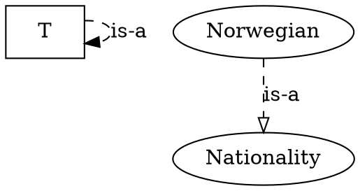
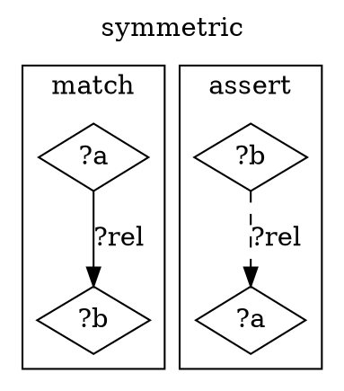
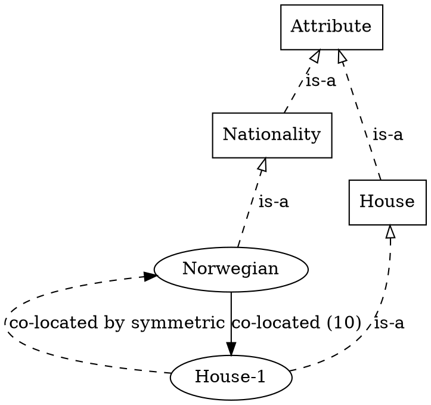

# Rendering — what `ein render` draws

`ein render` writes DOT on stdout and never draws an image: turning it into one is Graphviz's job,
`ein render kb FILE | dot -Tsvg > kb.svg`. **Every form has a fixed DOT shape**, and only the graph's structure is
fixed: positions, ranks and the style choices this page does not state are free
([Q21](../../../decisions/cli/Q21-every-form-has-a-fixed-dot-shape-and-its-layout.md)). Every view reads its program
through the loader first, so a program the loader refuses is refused with its line, exit 1, as every other command
refuses it ([Q-M1f.71](../../../decisions/cli/Q-M1f.71-a-view-refuses-a-program-the-loader-refuses.md)), and every
renderer has a command that reaches it
([Q-M1e.20](../../../decisions/cli/Q-M1e.20-every-renderer-has-a-command-that-reaches-it.md)).

| command | draws | section |
|---|---|---|
| `ein render program FILE` | the program as written: one digraph per group, the rules, the ontology, the facts, the query | [§ The program as written](#the-program-as-written--ein-render-program) |
| `ein render rules FILE`, `ein render rule --name N FILE` | each rule, or one, as its match and its conclusion | [§ Rules](#rules--ein-render-rules-and-ein-render-rule) |
| `ein render constraints FILE` | the structural properties a program states of its relations | [§ Constraints](#constraints--ein-render-constraints) |
| `ein render kb FILE` | a KB, loaded and saturated, as one graph | [§ The KB](#the-kb--ein-render-kb) |
| `ein render lattice FILE` | the nodes a describing `ein solve` run visits | [§ The lattice](#the-lattice--ein-render-lattice) |
| `ein render region DIR` | the solution region as a Hasse diagram, from an `ein oracle --dump` directory | [§ The region](#the-region--ein-render-region) |
| `ein render h-space FILE` | the structure of the hypothesis set | [§ The hypothesis space](#the-hypothesis-space--ein-render-h-space) |
| `ein solve FILE --trace OUT.md` | a markdown narrative with a drawing per step, not DOT alone | [§ The trace](#the-trace--ein-solve---trace) |

## Node-shape legend

| element | DOT shape |
|---|---|
| a type: a name a signature declares, or the parent of an `is-a` fact | `box` |
| an instance: the child of an `is-a` fact | `oval` (ellipse) |
| any other name | `rectangle` |
| a fact of three arguments or more, Levi-bipartite | `octagon` |
| a fact of `=` with two arguments, an equality node | `doublecircle` |
| a pattern variable `?x` | `diamond` |
| a relation's signature | a dashed, labelled edge |
| a fact | a solid, labelled edge |
| a derived or committed fact | a dashed, labelled edge |
| an `is-a` fact | a dashed edge with an empty arrowhead, labelled `is-a` |

A relation's edges share a colour, picked from a fixed palette by the relation's name, the same on every run.

## Hyperedge encoding — Levi-bipartite

DOT has no hyperedge. A fact of any arity `(name a b c)` is encoded **Levi-bipartite**: one `octagon` node for the
fact, with a directed edge to each argument labelled by its position. That is the canonical drawing of every fact
([Q1](../../../decisions/language/Q1-the-knowledge-base-is-a-typed-labelled.md)), and the facts of three arguments
or more are always drawn so.

**The default is compact.** A binary fact `(rel a b)` is drawn as one labelled, relation-coloured arrow `a → b
[label="rel"]`, and a **unary** fact `(rel a)` as a labelled self-loop `a → a [label="rel"]`, which is how a property
tag reads: `(symmetric R)`, `(bijective R)`, `(relation R)`. `ein render program --levi` draws every fact as an
octagon instead. What a fact is, drawn both ways, is
[`../03-syntax-and-semantics/03-facts.md`](../03-syntax-and-semantics/03-facts.md).

## The program as written — `ein render program`

`ein render program FILE [--levi] [--rule-mode sidebyside|overlay]` prints one digraph per group of the program as
it is written: `rule_<name>_…` for each rule, `ontology` for the declarations and the background facts, `facts` for
the given ones, `query` for the queries. It is drawn from the parsed forms, so a macro call is drawn as written and
imports are not resolved.



## Rules — `ein render rules` and `ein render rule`

`ein render rules FILE` prints one digraph per rule, and `ein render rule --name N FILE` the one named. Each draws a
rule as its match and its conclusion, in one of two modes, `--rule-mode`:

**`sidebyside`, the default**: two clusters, `match` and `assert`, top to bottom.



**`overlay`**, the most compact: the match solid and what the conclusion adds dashed, in one graph.

Within each panel the drawing tells apart the three things a `:match` or an `:assert` holds:

- **a relation** `(R a b)` is a labelled arrow `a → b`, relation-coloured, `R` possibly a `?var`; `(R a b c …)` is a
  Levi octagon;
- **a guard**, `(neq ?a ?b)` or `(eq …)`, is a *dotted, undirected* `≠` or `=` link: it is computed, not data, so it
  is never drawn as a relation's arrow;
- **an `(absent …)`** is a cluster labelled `absent (∄)`: what it holds is drawn inside, the variables it alone binds
  inside and the shared ones outside, so the *no such match exists* reading survives. A `(not P)` is drawn red with a
  `¬` before its label.

The `match` and `assert` copies of a variable are two nodes, so the panels do not collapse, and both are labelled
with the variable's name. Variables are diamonds and names rectangles.

## Constraints — `ein render constraints`

`ein render constraints FILE` draws a program's **structural constraints**: its un-annotated facts whose head is no
declared relation, the context the program supplies, *co-located is symmetric*, *color-loc is a bijection*, as opposed
to its stated conditions. Each relation such a fact is about is a rectangle labelled with its properties,
`next-to «symmetric»`, `color-loc «bijective»`; a property of two relations, `(implies right-of next-to)`, is an edge
between them; a module the program imports is a rectangle labelled `«import»`. No property is built in, so the view
draws whatever rules a program activates.

## The KB — `ein render kb`

`ein render kb FILE` loads `FILE`, saturates it, and draws the result as **one graph**, every name fused across the
forms it appears in: `Norwegian` appears **once**, with its `is-a` edge to `Nationality`, its given fact edge to
`House-1` and every derived edge that names it.

| element | DOT shape and style |
|---|---|
| a type, the parent of an `is-a` fact | `shape=box` |
| an instance, a leaf child | `shape=oval` |
| a binary fact `(rel a b)` | an edge `a → b [label=rel …]` |
| a unary fact `(rel a)` | a self-loop `a → a [label=rel …]` |
| a fact of another arity | a `shape=octagon` node and an edge to each argument, labelled `#1`, `#2`, … |
| an `is-a` fact | `style=dashed, arrowhead=empty, label="is-a"` |
| a background fact | `style=solid` |
| a given fact, `:source` | `style=solid`, its label carrying the short source id, `(10)` for `"condition (10)"` |
| a derived fact | `style=dashed`, its label carrying `by <rule>` |
| the colour, `--colour-by relation` (default) | one colour per relation, fixed by its name |
| the colour, `--colour-by origin` | background grey, given black, derived blue; `none`, black throughout |

**Left out**: a fact that activates a rule, `(symmetric co-located)`, which is the relation's context and not its data
(the constraints view draws it), and a stored negation, `(not …)`.

`is-a` is the one relation the drawing knows a convention for, and it is a convention of presentation, not of
reasoning: a program that writes membership with relations of its own, as `zebra.ein` writes `type` and `instance`,
has those facts drawn as ordinary coloured arrows. For the proposition *"The Norwegian lives in the first house"*,
condition (10):



```sh
ein render kb examples/zebra2.ein                       # root, after saturation
ein render kb examples/zebra2.ein --colour-by origin    # given / derived
ein solve examples/lattice/02_genuine_3set_death.ein --dump-answer out/
ein render kb out/models/02.ein --since out/root.ein    # a state, and what it added, in bold
```

A `--dump-answer` state file ([`10-answer-dump.md`](10-answer-dump.md)) is a `FILE`: it loads as a program and saturates to
itself, so a state is drawn the way root is. `--since FILE` loads and saturates a second file and draws at
`penwidth=3` every fact it lacks: a state against its `root.ein` is what the commitment added. `--no-types` leaves out
the type boxes and their `is-a` edges, and `--no-instances` the instance ovals and every fact edge.

## The lattice — `ein render lattice`

`ein render lattice FILE` runs a describing `ein solve` and draws the nodes it visits as a DAG, one node per
commitment: **R green, owing amber, dead red**. `--view solution`, the default, draws the nodes of R and the nodes one
fact above them that are not in it; `--view full` every node the run visited. `--region-budget` is the run's budget,
as `ein solve`'s, and a run that reaches it is drawn as far as it went. What a node holds is
[`06-lattice-dump.md`](../../ein.rs/06-lattice-dump.md), which `ein solve --dump-lattice DIR` writes.

## The region — `ein render region`

`ein render region DIR` draws an `ein oracle --dump` directory ([`11-region-dump.md`](11-region-dump.md)): the hypothesis
lattice with every node classified by saturation alone. **`--visited DIR`** and **`--answer DIR`** put an `ein solve`
run on it, from that run's own `--dump-lattice` (`nodes.json`, every node it visited) and `--dump-answer`
(`index.json`, every state it reported, [`10-answer-dump.md`](10-answer-dump.md)). It reads those files and nothing else,
no load and no solve, so the picture is of the run whose answer it shows.

```sh
ein oracle examples/branching/15_lookahead_two_step_on.ein --dump cube/
ein solve  examples/branching/15_lookahead_two_step_on.ein --maximal \
    --dump-lattice run/lattice --dump-answer run/answer
ein render region cube/ --visited run/lattice --answer run/answer | dot -Tsvg > region.svg
#                       --view auto|full|border|lines|table
```

With neither option the cube is drawn with **no run overlaid**: every node carries its status and nothing else, and
the title says so. Either option alone draws its half. A run whose universe is not the cube's, another program or
another `--region-limit`'s candidates, is an error, exit 1, naming the file: its commitments would not be the cube's
nodes.

**The nodes are the pure cube.** Every subset `C` of the root candidates is a node. There is one rank per layer, `L0`
at the top, and a thin edge from `C` to `C + h` for each single hypothesis `h`. Where saturation derives candidates,
**it is drawn as a move inside the cube**, not as a node of its own: the state of `C` holds candidates `C` did not
commit to, and their union with `C` is the closure `cl(C)`. A `sat` arrow goes from `C` to `cl(C)`, and `C` is drawn
*transient*, a dashed outline and a paler fill, because it is the state it lands on. A cube edge that adds a fact
saturation already derived is *absorbed*, dotted: it moves nothing. The drawing rests on an alive node and its
closure being one state, so that committing to what saturation derived changes no fixpoint.

A dead node's move is not drawn, since a contradictory fixpoint holds everything. Facts a fixpoint holds that are not
coordinates, derived facts and facts over a candidate relation that root's generator did not propose, are counted in
the tooltip, not drawn: they decide a node's status without being a position in the cube.

### One channel per question

| channel | says | values |
|---|---|---|
| **fill** | what the cube says | green **R** (alive, discharged; one colour per component when R has several); amber **owing**; salmon **dead**; a salmon-to-amber gradient for dead and owing |
| **shape** | what the run did | **octagon**: a state the run reported, or a node of an empty R's owing frontier; **rounded box**: a node the run visited; **ellipse**: neither, with the reason under the facts when the run's visits are known |
| **border** | the lines and the defects | double: **R's minimal line**; heavy green: **R's maximal line**; purple: a **hole**; red: **MISSING**; orange: **not reached**; magenta: **SPURIOUS**, the run's reading of a node against the cube's, or an **unsound exclusion** |

The lines are named *minimal* and *maximal*, never *top* or *bottom*, so that a reader who flips the picture is not
misled: with `L0` at the top, the maximal line is the lower one.

### Edges

| edge | style | meaning |
|---|---|---|
| R → R | green, solid | inside R |
| R → owing | orange, dashed | adding the fact adds a debt |
| R → dead | red, solid | adding the fact kills |
| owing → R | blue, solid | adding the fact pays the last debt: how the minimal line is reached |
| owing → owing | light orange | still owing |
| owing → dead | red, dashed | kills an owing node |
| dead → R | magenta, bold | revives a dead node: dead is not upward-closed here |
| dead → owing | magenta, dashed | revives a dead node, owing |
| dead → dead | grey, thin | dead to dead |
| absorbed | grey, dotted, no arrowhead | adds a fact saturation already derived |
| `sat` | dark blue, heavy | `C ⇒ cl(C)`, which does not move the layout |
| `+fact` | purple label | a **repair edge**: the fact that takes a hole back into R |
| `✗ alive` | magenta, dashed | an unsound exclusion: from a dead node the run visited to an unvisited node above it that the cube says is alive |
| `+k` | grey, dashed | the `lines` view only: inclusion across `k` facts, the nodes between hidden |

A node on the maximal line is one whose upward edges all leave R, so the picture shows why it is maximal. Every edge's
tooltip names the fact it adds.

### A run, overlaid

The run is joined to the cube by the facts' text: a commitment's node is the set of its facts, and a reported state
sits on its **closure**, the node its fixpoint's candidates make. Each node then says what the run did with it:

- **state N**: the run reported this node's state, numbered as stdout and `models/NN.ein` number it (*dump only* when
  stdout's cut left it to the directory); **frontier N, owes k** on an empty R of the owing kind;
- **from: state N**: the commitment a state was read from, where its saturation lands elsewhere, the `sat` arrow's
  tail;
- **visited**: the run saturated this node, and its reading, `dead`, `owing` or `in-r`, is in the tooltip;
- or, when its visits are known, why it did not visit it: *above a dead node* (a node it visited is dead and below
  this one, and dead is upward-closed), *above a state's denial* (an alive node it visited denies one of this node's
  facts and lies below it, and what a state denies is dead above it; the tooltip and the table name the state and the
  fact), *the run stopped first* (`-n`, `--single`, a budget), or *not needed* by the question asked. Why each of
  these licenses skipping a node is [`07-finding-r.md`](../../reasoning/02-kb-evolution/07-finding-r.md).

**The answer is R** ([Q-M1e2.7](../../../decisions/answer/Q-M1e2.7-the-answer-is-a-region-r-of-the-hypothesis.md)).
A run answers the part of R its question asked, all of it for a bare `ein solve`, one line for `--minimal` or
`--maximal`, and the drawing compares the run with **that part**, by state:

- a node of the part asked is **MISSING** when no reported state is its state and the run says it is complete
  (`exhausted`). On a run that stopped, the same node is **not reached**: a bound, not a defect;
- a reported state is **SPURIOUS** when its state is no node of the part asked: dead or owing in the cube, or in R and
  not on the line asked.

**Every reading the run printed is checked against the cube.** A visited node whose kind or closure is not the cube's,
a state printed on a line the cube does not put it on, a line the run certified that leaves out a state on it, a
frontier node the cube does not call owing: each is marked `≠ the cube`, magenta, with what the two say. Every
exclusion the run made is checked too: an unvisited node above a dead one the run visited is **unsound** where the
cube says it is alive, and the dead node carries a `✗ alive` edge to it; a node drawn *above a state's denial* that the
cube says is alive is marked `≠ the cube`. On a correct run none of these marks appears.

### Views

| view | draws | `auto` picks it |
|---|---|---|
| `full` | every node and edge of the cube | `n ≤ 6` (64 nodes, 192 edges) |
| `border` | R, its holes, every node one edge from R, the root, and what the run got wrong (a missing node, a spurious state, a node read otherwise, an unsound exclusion); the hidden nodes counted per layer in the rank column | while that is at most 64 nodes |
| `lines` | the root, both lines, the holes, what the run got wrong, an owing frontier, and where saturation takes them, joined by inclusion; when R is empty, `N` and `E` instead of lines | past that |
| `table` | every node as markdown, one section per layer: status, why, where saturation takes it, and with a run what it did. Each row carries `<a id="mMASK">`, so the head's lists of missing, spurious and `≠ the cube` nodes link to their rows | never: it is not DOT |

A run of layers with nothing drawn is one rank label, `L2–L16 · 65519 … hidden: 0 R, 0 owing, 65519 dead`, not a
column of empty ranks. A node of more than four facts is labelled by its bits, `#0 #3 #5`, and the legend lists the
bits. The legend's lists are capped at twelve entries, and `--view table` has all of them: its head names at most fifty
nodes a list, with how many there are, and every row carries its own mark.

**Sub-cubes** are listed under the drawing with their dimension and free facts, and each node's tooltip names the ones
it is in. A sub-cube's outline is its R → R edges: sub-cubes overlap whenever two share a node, so a cluster per
sub-cube cannot be drawn.

## The hypothesis space — `ein render h-space`

`ein render h-space FILE` prints a read-out of the structure of the program's hypothesis set, or, with `--view`, one
of four **undirected** graphs: `exclusion`, the pairs of candidates that exclude each other, the theory's and the
puzzle's in two strokes; `cover`, the groups and their members, the grids among them; `coupling`, the questions'
hypergraph; and `one-step`, the same over the edges read one application back. `--view json` is the whole document,
and `--dump DIR` writes `h-space.json` and the four graphs.

```sh
ein render h-space examples/zebra2.ein --view cover | dot -Tsvg > cover.svg
```

They use none of the shapes above. In `exclusion` a candidate is a box; in `cover` a group is a box and a candidate an
oval; in the two hypergraphs a question is a box and an edge of three questions or more a point. What each object is,
what each stroke means and what the document holds is
[`05-hypothesis-space.md`](../../reasoning/02-kb-evolution/05-hypothesis-space.md).

## The trace — `ein solve --trace`

`ein solve FILE --trace OUT.md` writes the **region trace**, a markdown narrative rather than a drawing: the
read-out's rows, root's derivation, each listed state's from its first minimal commitment, and `N`, each minimal dead
set with why, the owing nodes where R is empty of that kind. Each step is a section with the rule's name, its `:why`
in English, its premises with their quoted `:source` sentences, and an inline `dot` block, the step's **derivation
slice**: the facts the step started from, its firings as rule nodes labelled with the rendered `:why`, and the facts
derived, in bold. **Only that cone is drawn**, never the whole KB; a refuted commitment's slice ends in a `⊥` node.
States folded away are `<details>` blocks.

| option | does |
|---|---|
| `-G`, `--no-diagrams` | no inline `dot` blocks |
| `-F`, `--full-kb-snapshots` | each traced state's whole KB appended, drawn as [§ The KB](#the-kb--ein-render-kb) draws one |
| `-R`, `--reorder` | each section's steps clustered by the fact they derive about, rather than in the engine's order ([Q20](../../../decisions/read-out/Q20-the-trace-is-in-the-engines-order-and-reorder.md)) |
| `-l`, `--relevant` | each derivation pruned to what the goal reads |

Every drawing is an inline fenced `dot` block, never an image. A trace reads back as a `(trace …)` form
([`02-syntax.md` § Trace](02-syntax.md#trace)).

## See also

- [`../03-syntax-and-semantics/`](../03-syntax-and-semantics/README.md): each concept drawn as a graph.
- [`02-syntax.md`](02-syntax.md): the forms each drawing draws.
- [`08-read-out.md`](08-read-out.md): the read-out a trace begins with.
