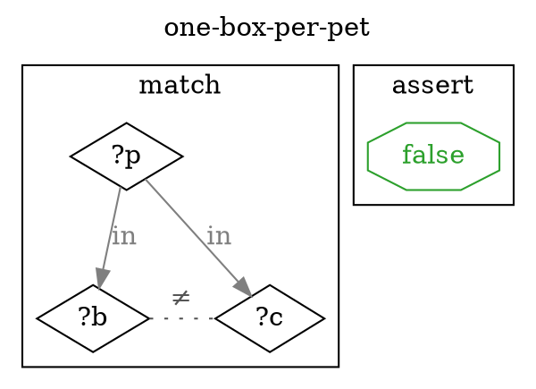
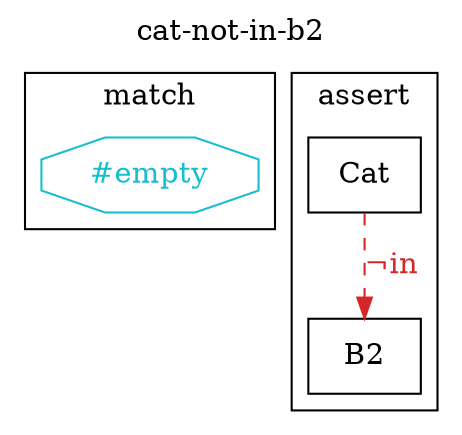

# Constraints

A **constraint** says what cannot be. In Ein it is written two ways: a rule that concludes `(false)` where its
pattern matches, and a **stored negation** `(not P)`, a fact that denies `P`. A state that derives `(false)`, or that
holds both a fact and its negation, is **dead**: it is no answer, and nothing it would add counts. Constraints are
the upper bound of the answer, what a state may not hold; [obligations](obligations.md) are the lower bound, what a
state still has to find.

## In Ein

```lisp
(relation is-a T T :why "{?1} is a {?2}")
(relation in Pet Box :why "the {?1} is in box {?2}")

(hrule guess ()
  :match  (and (is-a ?p Pet) (is-a ?b Box))
  :assert (in ?p ?b)
  :why    "guess that the {?p} is in box {?b}")

(rule one-box-per-pet ()
  :match  (and (in ?p ?b) (in ?p ?c) (neq ?b ?c))
  :assert (false)
  :why    "the {?p} cannot be in both box {?b} and box {?c}")

(rule cat-not-in-b2 ()
  :match  ()
  :assert (not (in Cat B2))
  :why    "the cat is never in box B2")

(is-a Dog Pet)
(is-a Cat Pet)
(is-a B1 Box)
(is-a B2 Box)
(in Dog B1)
```

The hrule proposes where each pet might be ([hypotheses](hypotheses.md)); the two constraints cut the guesses down.
`one-box-per-pet` refutes any state that puts one pet in two boxes, and `cat-not-in-b2` stores `(not (in Cat B2))`
at root, so no state may hold `(in Cat B2)`: `ein show hyps FILE` lists two candidates, and that is not one of them.

```text
  (region
    ;; state 1 of 2 — ∅, root itself · minimal
    (model (in Dog B1))
    ;; state 2 of 2 — 1 candidate · maximal · from {(in Cat B1)}
    (model (in Cat B1) (in Dog B1)))
```

The answer has two states. The third candidate, `(in Dog B2)`, is dead: `--trace` lists it among the minimal dead
sets, with the facts its death rests on and the rule that refuted it.

## As a graph

`ein render rule --name cat-not-in-b2 FILE` draws a stored negation red, its label prefixed `¬`, and
`ein render rule --name one-box-per-pet FILE` draws `(false)` as an octagon in the conclusion's panel:





The empty `:match` is drawn as the octagon `#empty`, the loader's name for it. `ein render kb FILE` leaves stored
negations out: it draws what holds.

## In words

A refutation's `:why` says what cannot be, and it is what the read-out prints of a dead state. Where root itself is
dead, `ein solve FILE` names the facts the contradiction rests on, the **unsat core**, and what refuted it. A program
that states `(in Cat B2 :source "the cat sleeps in box B2")` beside `cat-not-in-b2`:

```text
  unsat core        (in Cat B2)
  source            (in Cat B2) :source "the cat sleeps in box B2"
  refuted by        (given), cat-not-in-b2

  (false)
```

`(given)` names the statement that the negation contradicts, and `cat-not-in-b2` the rule that stored the negation.
For a dead state other than root, `--trace` writes the same, under the minimal dead sets:

```text
{(in Dog B2)} — dead

Core: `(in Dog B1)`, `(in Dog B2)`

Refuted by `one-box-per-pet`.
```

A core is an explanation, not part of the answer: where a contradiction can be reached two ways it names one, and
which one may depend on the order rules fire in
([Q-M1f.6](../../../decisions/answer/Q-M1f.6-a-core-is-an-explanation.md)).

## In mathematics

Let `Cl(S)` be the fixpoint of a state `S` under the program's rules ([rules](rules.md)). `S` is **dead** when

```text
false ∈ Cl(S)    or    ∃ f : f ∈ Cl(S) ∧ ¬f ∈ Cl(S)
```

and **alive** otherwise. On a program whose rules read no `absent` a hypothesis can change, `Cl` is monotone, so a
state that contains a dead one is dead: constraints cut the answer from above, and the dead states are closed
upward. A **core** of a dead state is a set of its terminal facts, statements of the problem and hypotheses, whose
closure is already dead, as small as the recorded derivations allow; the smallest over every recorded derivation is
the one reported ([Q-M1e2.11](../../../decisions/answer/Q-M1e2.11-a-core-is-the-smallest-over-every-derivation.md)).

## Two shapes: `(false)` and `(not P)`

**`(false)`** is a contradiction with no further content. It takes no argument: `(false k)` is refused wherever it is
written, and two contradictions are told apart by what they rest on, not by a witness argument. A rule concludes it
where the state is impossible as a whole rather than one proposition false, as `one-box-per-pet` does.

**`(not P)`** is a fact whose one argument is the fact it denies. It is stored like any fact, by a rule's conclusion
or written by the program, and it is a contradiction only beside `P`: the pair is one wherever either half came
from, a statement, a rule or a hypothesis. A negation is of a fact; a name has none, so a conclusion `(not ?x)` where
`?x` can hold a name is refused at load.

## The three states of a fact

At any moment a fact `P` is in one of three states, and a pattern can ask about each:

| state | the knowledge base holds | matched by |
|---|---|---|
| **asserted** | `P` | `P` |
| **negated** | `(not P)` | `(not P)` |
| **open** | neither | `(unknown P)`, which is `(and (absent P) (absent (not P)))` |

`(not P)` in a `:match` matches a stored negation: it is not *P is not provable*. That question is
`(absent P)`, negation as failure, asked of a whole state ([rules](rules.md)). `unknown` is a macro of the standard
library, which a program imports to write it ([macros](macros.md)).

Stored negations are what lets elimination be written as rules. *Every colour but one is excluded for this house,
so it is the remaining one* is a rule whose premise is a `forall` over stored negations; the standard library's
bijection and slot theories are written so ([the stdlib reference](../reference/stdlib.md)).

## What a constraint is not

A constraint narrows what a state may hold; it never chooses among possibilities. *One of these* is a hypothesis,
and the engine finds which choices survive. A rule never states a disjunction, and a constraint never retracts a
fact: the knowledge base only grows, and a state that reaches a contradiction is dead as a whole.

A constraint is judged in the state it fires in, and says nothing about other states: no rule can require that there
be exactly one answer ([Q-M1d.7](../../../decisions/language/Q-M1d.7-a-rule-is-a-sentence-about-the-state-it-fires.md)).
A claim about the answer as a whole is a query's `:expect` ([queries](query.md)).

## See also

- [Obligations](obligations.md): the other bound, what a state still owes.
- [Rules](rules.md): the pattern language, `absent` among it.
- [Solutions and models](solutions-and-models.md): which states the answer is, and what dead means to it.
- [The read-out reference](../reference/read-out.md): the `unsat core`, `refuted by` and `N` rows.
