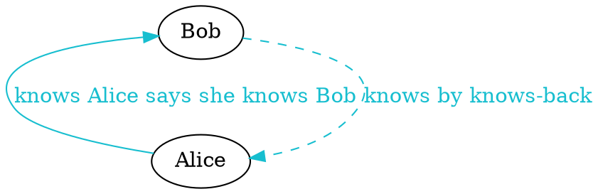
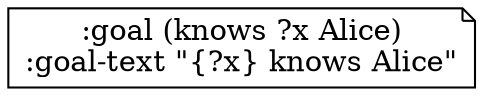

# Natural language

Every relation, rule, hrule and macro a program declares says in English what it means, and every fact the engine
prints can be read as English from those texts. The engine invents no prose: a sentence is always one the program
wrote, filled in, and where a program wrote none, a fact reads as its s-expression, which is true. This page is what
a program writes, what the engine prints from it and where, and whose words are whose.

## In Ein

```lisp
(relation knows Person Person :why "{?1} knows {?2}")

(rule knows-back ()
  :match  (knows ?a ?b)
  :assert (knows ?b ?a)
  :why    "{?a} knows {?b}, so {?b} knows {?a}")

(knows Alice Bob :source "Alice says she knows Bob")

(query :goal (knows ?x Alice) :goal-text "{?x} knows Alice")
(solve :no-search)
```

Four texts: the relation's `:why`, a template filled by position; the rule's `:why`, filled by the firing's
variables; the fact's `:source`, the sentence of the problem it states; and the query's `:goal-text`, filled per
answer. A string is natural-language text, any Unicode, with the escapes `\n \t \r \" \\ \u{…}`, and is written only
after `:why`, `:source` and `:goal-text`: it is never a value
([Q-M1e2.23](../../../decisions/language/Q-M1e2.23-a-string-is-natural-language-text-never-a-value.md)).

## As a graph

The views carry the program's texts where they draw what the texts are about. `ein render kb FILE` labels a given
fact's arrow with its source and a derived one with its rule:



and `ein render program FILE` draws a query as a note holding its goal and its `:goal-text`:



## In words

The same program, as `ein solve FILE` prints its query's answer, each row of the projection with its `:goal-text`:

```text
  query             (knows ?x Alice)
  over              all of R — 1 state → 1 projection class
    class 1 of 1    1 state (1)
                      ?x = Bob
                        “Bob knows Alice”
```

as `--dump-answer DIR` writes a state, each fact with its reason and its statement:

```text
(knows Alice Bob) ; source "Alice says she knows Bob" — Alice knows Bob
(knows Bob Alice) ; rule knows-back: Alice knows Bob, so Bob knows Alice — Bob knows Alice
```

and as `--trace OUT.md` writes a firing, its reason quoted, a given premise with its source, and the conclusion with
its statement:

```text
### Step 1 — `knows-back`

> Alice knows Bob, so Bob knows Alice

Premises: `knows(Alice, Bob)` — from Alice says she knows Bob

Derives `knows(Bob, Alice)` — Bob knows Alice
```

## In mathematics

A template `t` is a string with references `{?v}`. For a binding `σ` of variables to values,

```text
render(t, σ) = t with each {?v} that σ binds replaced by σ(?v), printed as written;
               a reference σ does not bind is left as it is
```

A relation `r` with template `t_r` gives each fact its **statement**, `stmt(r(v₁, …, vₙ)) = render(t_r, {?i ↦ vᵢ})`.
A fact's **reason** is read off its first recorded justification `j`:

```text
reason(f) = the quoted :source             if j is a statement with a source
            render(t_ρ, σ_j)               if j is a firing of rule ρ with bindings σ_j
            none                           otherwise
```

and a fact with no statement and no reason reads as its s-expression.

## 1. The four texts

| text | on | fills | printed by |
|---|---|---|---|
| `:why` | `(relation R …)` | **by position**: `{?1}` the fact's first argument, `{?2}` its second, … — the fact's **statement** | a `--dump-answer` state file, after each fact; `--trace`, after each fact a step derives (a firing of several conclusions names each, in its rule's order, `; ` between two) |
| `:why` | `(rule …)`, `(hrule …)` | the firing's variables: a parameter, or a variable a positive premise binds — a derived fact's **reason** | `--trace`'s step, a rule node of the derivation views, an obligation's owe line, a state file after each fact the rule derived first |
| `:why` | `(macro …)` | a parameter | nothing (§ 5): it documents the pattern |
| `:goal-text` | `(query …)` | the goal's variables, per row | the read-out's projection rows, in `“…”` |
| `:source` | a fact the program states | — | a state file after the fact; `--trace`'s premises line |

A reference nothing can bind is printed as written, `{?zz}`: a template with a misspelt variable loads, and shows
the misspelling where it is printed.

## 2. Every declaration carries a `:why`

A `(relation …)`, `(rule …)`, `(hrule …)` or `(macro …)` without `:why "…"` is refused at load, one line per form,
on every command ([diagnostics](../reference/diagnostics.md)). `--no-require-why`, which every command that loads a
program takes, loads one without; it decides whether a program loads, never what a loaded program answers
([configuration](../reference/config.md)). `:goal-text` and `:source` stay optional: a query's answer reads through
its rows, and only a statement of the problem has a sentence to quote.

A `:why` that only fills the slot is worse than none, so a `:why` says what its form says, in English:

- a relation's is the sentence one fact of it reads as: `(relation drink-loc Drink House :why "{?1} is drunk in {?2}")`;
- a rule's says what it concludes and from what: `:why "{?a} knows {?b}, so {?b} knows {?a}"`;
- a refutation's, a rule that concludes `(false)`, says what cannot be; an obligation's, one that concludes
  `(open …)`, what is still owed;
- an hrule's names the guess it proposes: `:why "guess that {?x} is in box {?b}"`;
- a made-up name, `p` or `r1`, is said as what it is, `"p holds of {?1}"`, and never given a meaning it does not
  have.

The standard library is written to this rule throughout, and is the house style.

## 3. A fact in English: the fallback ladder

A fact has two texts, from two places:

- its **statement**, what it says: its relation's `:why`, filled with its arguments;
- its **reason**, why it holds: read off its **first recorded justification**.

The reason, by how the fact was first reached:

| the first justification | the reason | the state file writes |
|---|---|---|
| a statement, with a `:source` | the program's `:source`, quoted | `; source "…" — <statement>` |
| a statement with none (a background fact) | none | `; <statement>` |
| a rule's firing | the rule's `:why`, filled with that firing's bindings | `; rule r: <reason> — <statement>` |
| a hypothesis | none: the commitment, which the read-out names | `; hypothesis N — <statement>` |

**The ladder.** A fact reads from the program's texts where it has one: its `:source`, its rule's `:why`, its
relation's `:why`. Where it has none it reads as its s-expression, `(R a b)`, and **never as invented prose**: there
is no built-in vocabulary that turns a relation into a verb.

**First recorded.** A fact may be reached several ways, and which arrives first can move with the order rules fire
in. A reason is an explanation, as a core is: it is not part of the answer, and within one run the order is fixed, so
the same run writes the same reasons.

A state file of `ein solve examples/zebra.ein --dump-answer DIR`, `DIR/models/01.ein`, held to a run of that
command. A rule the program does not list in an import prints by its full name, `std.slots.slot-fill`, and one it
lists by the name it writes, `includes`:

<!-- state-file: examples/zebra.ein -->
```lisp
(co-located Englishman Red) ; source "condition (2)" — Englishman and Red are in the same house
(co-located House-1 Water) ; rule std.slots.slot-fill: every Drink except Water is excluded for slot House-1 ⟹ Water is at House-1. — House-1 and Water are in the same house
(instance House-5 House) ; House-5 is an instance of House
(next-to House-2 House-1) ; rule includes: next-to includes right-of: from House-2 →right-of→ House-1, derive House-2 →next-to→ House-1. — House-2's house is next to House-1's
```
<!-- /state-file -->

**What is not rendered.** The read-out's `(model …)` blocks and its `as :expect` line are Ein text a claim can be
pasted from, so they stay s-expressions, as `ein solve`'s stdout and the dump's `answer.txt` do. A state file reloads
to its facts because the English is a comment, and a line break in a text is a comment line of its own. `--trace`
writes markdown, so there a text's line break is a hard break and the line after it stays in its block, a rule's
`:why` in its quote ([Q-M1f.109](../../../decisions/read-out/Q-M1f.109-a-texts-line-break-in-the-trace-is-a-markdown.md)).

A bare `ein solve` renders no fact, so the texts cost nothing there.

## 4. The four registers

Which texts a fact can read from depends on who could have written them, and every fact's relation is in one of four
registers:

| register | the relation is | who can give its facts a text |
|---|---|---|
| **puzzle** | declared by the program or a module of its own it imports, or the name of one of their rules (an activator) | the program |
| **stdlib** | the name of a standard library rule (an activator, `(bijective color-loc)`), or a relation a standard library rule concludes without declaring it | nobody: no form declares it, and a fact of it reads by its reason |
| **kernel** | a name the engine reserves: `__closed__`, `__symmetric__`, `absent`, `and`, `eq`, `false`, `neq`, `not`, `open`, `or`, `relation`, `written` | the engine, which does not (§ 6) |
| **undeclared** | written or derived, never declared, and no rule's | nobody, until the program declares it |

So a fact that reads as an s-expression says who could fix it: a program that wants its own relations read declares
them with a `:why`; an activator of a standard library rule, `(symmetric next-to)`, has no form that could carry one,
and reads as written.

## 5. Where a template has nowhere to live

- **A macro's `:why`** is required, like the others, and rendered nowhere. A macro is expanded at load, and a fact's
  justification names the rule whose `:match` used it, whose `:why` says what the pattern meant there. The macro's
  `:why` documents the pattern for a reader of the program
  ([Q-M1f.59](../../../decisions/read-out/Q-M1f.59-a-macros-why-documents-the-pattern-and-is.md)).
- **A relation nobody declares** has no declaration to carry a `:why`, and the standard library cannot declare a
  program's relations. A fact of one that a rule derived reads by its reason; one the program states falls back to
  its s-expression. A program that wants it read declares it
  ([Q-M1f.60](../../../decisions/read-out/Q-M1f.60-a-fact-of-a-relation-nobody-declares-has-no.md)).
- **A goal's conjuncts.** `:goal-text` is one string for the whole query; each conjunct's fact reads by its
  relation's `:why` wherever a surface prints it
  ([Q-M1f.61](../../../decisions/read-out/Q-M1f.61-a-query-has-one-goal-text-and-each-conjunct.md)).

## 6. The domain and the engine: whose words are whose

**Every text a program writes is the domain's**: the program's `:why`s, `:source`s and `:goal-text`s, and the
standard library's, which is a program. The engine fills them and never edits them. **The words around them are the
engine's**: the read-out's labels ([the read-out reference](../reference/read-out.md)), the trace's headings and its
*Derives* and *Premises*, the provenance words a state file writes (`source`, `rule`, `hypothesis`) and its
separators (`: `, ` — `), and the verdict and protocol words the engine reserves
([the engine's reserved strings](../../ein.rs/reserved-engine-strings.md)). The engine owns no domain
word: it has no sentence for a relation that has none, and a kernel relation, `not`, `relation` or `written`, reads
as its s-expression. A word the engine adds to an output is the engine's, listed on one of those two pages, and never
part of a vocabulary for the domain.

## 7. What is checked

- Every `{?ref}` in a `:why` of the standard library, and of every program the project ships as an example or a
  test, names something its form can fill: a relation's, a position within its signature; a rule's or an hrule's, a
  variable it binds (a parameter, or a positive premise's, macros expanded); a macro's, a parameter. None writes
  `{x}`, a reference with its `?` missing.
- No line of a dump's `answer.txt`, of a state file's facts, or of a trace carries an unfilled `{?`, over every
  example program the test suite dumps.
- Each text is printed byte for byte on every surface that prints it, Cyrillic, CJK, an emoji and every escape among
  them, and `--no-require-why` decides loading alone.
- § 3's block is lines of the state file its marker's run writes, and § 4's `kernel` register is the engine's
  reserved names, name for name.

The test suite holds this page to the binary.

## See also

- [Relations](relations.md) and [rules](rules.md): where the `:why` templates are written.
- [Facts](facts.md): the record a reason is read from.
- [The read-out reference](../reference/read-out.md): every row `ein solve` prints, the projection rows among them.
- [The answer dump](../reference/answer-dump.md): the state files, and why they reload.
