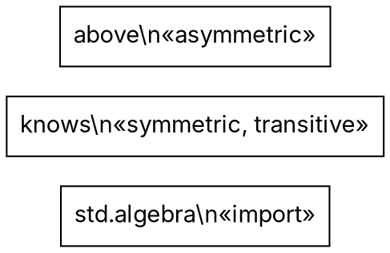
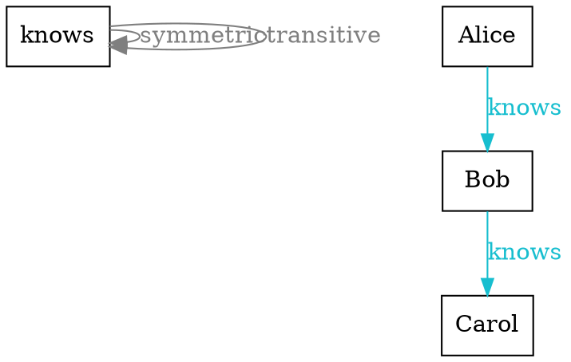

# Properties and operators

A relation's algebraic **properties**, symmetric, transitive, functional, bijective, and the **operators** that make
one relation from others, converse, composition, intersection, union, are not built into Ein. Each is a fact about a
relation, `(symmetric knows)`, given its meaning by an ordinary rule of the standard library's `std.algebra`, the
relation algebra written in Ein. A program imports the module, lists the rules whose facts it writes, and states the
facts; the rules derive what the property implies, or refute a state that breaks it.

## In Ein

```lisp
(import std.algebra :symbols (symmetric transitive asymmetric))

(relation knows Person Person :why "{?1} knows {?2}")
(relation above Box Box :why "box {?1} is above box {?2}")

(symmetric knows)
(transitive knows)
(knows Alice Bob)
(knows Bob Carol)

(asymmetric above)
(above B1 B2)

(query :goal (knows Carol ?x) :goal-text "Carol knows {?x}")
(solve :no-search)
```

`(symmetric knows)` is the activator of `std.algebra`'s rule `symmetric`, which is, word for word:

```lisp
(rule symmetric (?rel)
  :match  (?rel ?a ?b)
  :assert (?rel ?b ?a)
  :why    "{?rel} is symmetric: {?a} ↔ {?b}.")
```

`symmetric` and `transitive` together close `knows`: Carol knows Alice and Bob, though neither fact is written.
`asymmetric` is a check: it derives nothing, and refutes any state with both `(above a b)` and `(above b a)`.

```text
  query             (knows Carol ?x)
  over              all of R — 1 state → 1 projection class
    class 1 of 1    1 state (1)
                      ?x = Alice
                        “Carol knows Alice”
                      ?x = Bob
                        “Carol knows Bob”
  as :expect        (model (knows Carol Alice) (knows Carol Bob))
```

## As a graph

`ein render constraints FILE` draws each relation with the properties the program states of it:



`ein render program FILE` draws each property fact as what it is, a unary fact about a relation's name: a labelled
self-loop on that name, beside the relation's own facts (the view trimmed to `knows`):



## In words

Each rule of `std.algebra` carries a `:why` that names the property and what it did. `ein solve FILE --trace OUT.md`
on the program above:

```text
### Step 2 — `symmetric`

> knows is symmetric: Alice ↔ Bob.

Premises: `knows(Alice, Bob)`

Derives `knows(Bob, Alice)` — Bob knows Alice

### Step 5 — `transitive`

> knows is transitive.

Premises: `knows(Alice, Bob)`, `knows(Bob, Carol)`

Derives `knows(Alice, Carol)` — Alice knows Carol
```

A check's reason says what was violated, *(asymmetric above) violated: both above(B1,B2) and above(B2,B1).*, and is
what a dead state's `refuted by` row names. A property fact itself has no statement: it is a fact about a rule's
activation, and no declaration carries a sentence for it.

## In mathematics

A binary relation is a set of pairs, and `std.algebra` is Tarski's relation algebra `⟨∪, ∩, ¬, 0, 1, ;, ˘, 1'⟩` over
those sets:

```text
R˘    = { (b, a) : (a, b) ∈ R }                          converse
R ; S = { (a, c) : ∃b. (a, b) ∈ R ∧ (b, c) ∈ S }          composition
1'    = { (a, a) }                                       identity
```

and the properties are inclusions:

```text
symmetric     R˘ ⊆ R             transitive    R ; R ⊆ R
functional    R˘ ; R ⊆ 1'        injective     R ; R˘ ⊆ 1'
irreflexive   R ∩ 1' = ∅         asymmetric    R ∩ R˘ = ∅
total         every a of the domain has some (a, b) ∈ R
surjective    every b of the range has some (a, b) ∈ R
```

A **closure** rule makes an inclusion hold by deriving the pairs it lacks, so its fixpoint is the least relation
containing `R` with the property; `transitive` is guarded by `a ≠ c`, so an irreflexive relation's closure stays
irreflexive. A **check** rule makes a state that breaks the inclusion dead. The relation algebra is as expressive as
first-order logic with three variables, so most constraints over at most three variables can be written with it;
one over more is a rule of the program's own.

## Three distinctions that decide whether a rule is safe

- **Intrinsic or extensive.** An intrinsic operator reads only the pairs a relation has: `converse`, `compose`,
  `meet`, `difference`, `join`, `difunctional`. An extensive one ranges over every pair of the domain and the range,
  to reach the pairs a relation lacks, so it takes the program's membership relation and the types as parameters,
  `(complement R S is-a Dom Ran)`: `complement`, `top`, `identity`, `connex`.
- **Check or closure.** A check concludes `(false)` on a violation: `functional`, `injective`, `total`, `surjective`,
  `empty`, `irreflexive`, `antisymmetric`, `asymmetric`, `connex`. A closure derives the pairs that make the
  property hold: `symmetric`, `transitive`, `includes`, `difunctional`, `reflexive`.
- **Closed world.** A rule that reads an absence, the extensive operators, `difference`, the `compose-negative`
  pair and `infer-closure`, is sound only where its operand is decided by saturation alone. On a relation the
  answer is searched for, as the attribute relations of a Zebra puzzle are, an absence at root is not an absence in
  every state, and such a rule would conclude too much. Each is opted into per use, never implied.

## `std.algebra`, activator by activator

**The relative layer.**

| activator | effect | class |
|---|---|---|
| `(converse R1 R2)` | `R2` is `R1`'s converse: `R1(a,b)` derives `R2(b,a)` | intrinsic |
| `(imply1 R1 R2)` | `(R1 a)` derives `(R2 a)`: one unary property implies another, `(imply1 functional __closed__)` | intrinsic |
| `(imply2-fwd R1 R2)` | `(R1 a b)` derives `(R2 a b)` | intrinsic |
| `(imply2-reverse R1 R2)` | `(R1 a b)` derives `(R2 b a)`, the same as `converse` | intrinsic |
| `(compose R1 R2 R3)` | `R1(a,b) ∧ R2(b,c)` derives `R3(a,c)`; `(compose R R R)` is the transitive closure | intrinsic |
| `(identity R isa Dom)` | every member of `Dom` gets `R(a,a)` | extensive |

**The Boolean layer.**

| activator | effect | class |
|---|---|---|
| `(meet R1 R2 R3)` | `R3` holds the pairs in both `R1` and `R2` | intrinsic |
| `(difference R1 R2 R3)` | `R3` holds the pairs in `R1` that `R2` lacks | intrinsic, closed world |
| `(join R1 R2 R3)` | `R3` holds the pairs in either; list `derive-join`, `join-l` and `join-r` | intrinsic |
| `(empty R)` | check: any `R(a,b)` is a contradiction | check |
| `(top R isa Dom Ran)` | `R` holds every pair of `Dom × Ran` | extensive |
| `(complement R1 R2 isa Dom Ran)` | `R2` holds every pair of `Dom × Ran` that `R1` lacks | extensive, closed world |

**Cardinality**, each a check.

| activator | refutes a state where |
|---|---|
| `(functional R)` | one `a` has two different images |
| `(injective R)` | one `c` is reached from two different `a` |
| `(total R isa)` | an `a` of the domain has every `b` of the range explicitly excluded by a stored negation |
| `(surjective R isa)` | the dual of `total` |
| `(bijective R)` | shorthand: it derives `(functional R)`, `(injective R)`, `(total R)` and `(surjective R)` |

`total` and `surjective` fire only where every partner carries a stored negation: an empty-yet relation is not a
violation. What an empty-yet relation still **owes** is the pair of obligations `total-owed` and `surjective-owed`,
activated beside them, which report a debt and refute nothing ([obligations](obligations.md)).

**Other checks.**

| activator | refutes a state where |
|---|---|
| `(irreflexive R)` | some `R(a,a)` holds |
| `(antisymmetric R)` | `R(a,b)` and `R(b,a)` hold with `a ≠ b` |
| `(asymmetric R)` | `R(a,b)` and `R(b,a)` hold, a self-loop included |
| `(connex R isa Dom)` | two different members of `Dom` are related neither way; extensive, closed world |

**Closures.**

| activator | derives |
|---|---|
| `(symmetric R)` | `R(b,a)` from every `R(a,b)`; `symmetric-negative` mirrors stored negations the same way |
| `(transitive R)` | the transitive closure, guarded by `a ≠ c` |
| `(includes R S)` | every `R` pair into `S`: `S` contains `R` |
| `(difunctional R)` | `R(a,b) ∧ R(c,b) ∧ R(c,d)` derives `R(a,d)` |

**Typing and lemmas.** `(converse-illtyped-dom R1 R2 isR*)` and `converse-illtyped-ran` refute a converse pair whose
signatures do not reverse-match under the hierarchy `isR*`. A handful of rules with no parameter relate the operator
facts to one another, so a program states each fact once: `symmetric-is-self-converse` and
`self-converse-is-symmetric` (a symmetric relation is its own converse, and back), `converse-pair-symmetric`,
`compose-contravariant` and `join-converse`. `(compose-negative-s R S T)` and `(compose-negative-r R S T)`, for a
composite `T` that is closed, turn a missing composite into a missing factor; closed world.

## A direct relation beside its closure

`(transitive R)` makes `R` its own transitive closure. Where both the direct relation and its closure are wanted, a
second relation holds the closure, fed by `includes`:

```lisp
(import std.algebra :symbols (includes transitive))

(relation is-a T T :why "{?1} is a {?2}")
(relation is-a* T T :why "{?1} is a {?2}, directly or not")
(includes is-a is-a*)
(transitive is-a*)

(is-a Rex Dog)
(is-a Dog Mammal)

(solve :no-search)
```

`is-a` keeps the direct edges and `is-a*` every ancestor: `(is-a* Rex Mammal)` holds, `(is-a Rex Mammal)` does not.

## A property is a fact, and the algebra is written in Ein

Nothing on this page is a primitive of the engine. Each property is a plain fact, and each rule an ordinary rule a
program could have written itself, matched, derived and explained as any other. That is also what lets one property
imply another: `bijective-properties` reads `(bijective R)` and concludes four property facts, and
`symmetric-is-self-converse` reads `(symmetric R)` and concludes `(converse R R)`.

**A signature is data a rule reads.** A declaration stores `(relation R A B)`, so a rule can read a relation's types:
`total` and `surjective` take the domain and the range from it, and the converse checks read two signatures. The
engine reads a signature's shape and nothing else, so a type is what the program's rules make of it. The pattern
`(relation ?R ?A ?B)` matches binary declarations only; `(relation ?R)` matches every declared relation.

**The quantifiers are Ein too.** `forall` and `unknown` are macros of `std.macro`, declared in Ein:

```lisp
(macro forall (?b ?G ?B)
  (absent (and ?G (absent ?B)))
  :why "every {?b} the guard {?G} holds of satisfies {?B}: none satisfies the guard and not the body")
(macro unknown (?P)
  (and (absent ?P) (absent (not ?P)))
  :why "{?P} is unknown: neither it nor its negation holds")
```

## See also

- [Theories](theory.md): a rule set as a whole, and how its rules interact.
- [The stdlib reference](../reference/stdlib.md): every module, `std.bijection`, `std.slots` and the calculator
  among them.
- [Relations](relations.md): why a property is written beside a declaration and not inside it.
- [Constraints](constraints.md): what a check's `(false)` does to a state.
