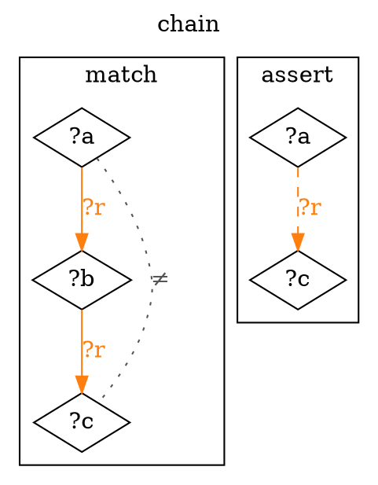
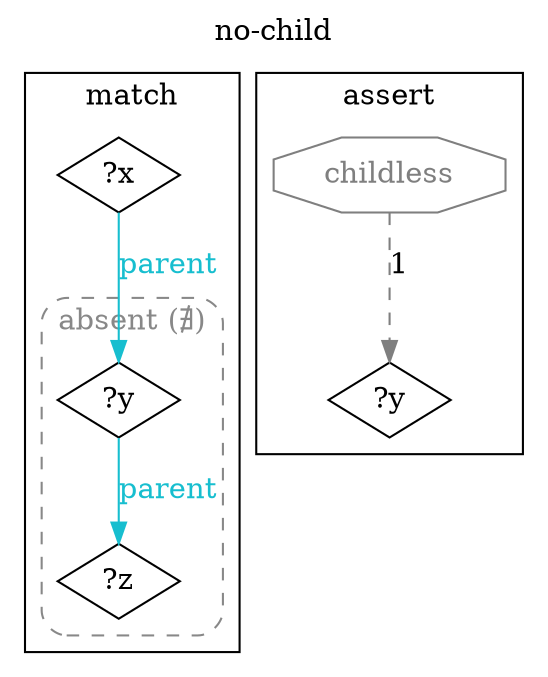

# Rules

A **rule** says: wherever these facts hold, so does that. It has a pattern to find in the knowledge base, a
conclusion to state for each place the pattern matches, and a reason, in English, that each firing gives
([Q4](../../../decisions/language/Q4-a-rule-is-a-pattern-a-conclusion-and-a-reason.md)). Rules only add: a firing
states facts, it never removes one, so the knowledge base grows to a **fixpoint**, the state where no rule adds
anything more. That fixpoint is what a program means.

## In Ein

```lisp
(relation parent Person Person :why "{?1} is a parent of {?2}")
(relation ancestor Person Person :why "{?1} is an ancestor of {?2}")
(relation has-cat Person :why "{?1} has a cat")
(relation has-dog Person :why "{?1} has a dog")
(relation pet-owner Person :why "{?1} owns a pet")
(relation childless Person :why "{?1} has no child")

(rule parent-is-ancestor ()
  :match  (parent ?a ?b)
  :assert (ancestor ?a ?b)
  :why    "{?a} is a parent of {?b}, so an ancestor of {?b}")

(rule chain (?r)
  :match  (and (?r ?a ?b) (?r ?b ?c) (neq ?a ?c))
  :assert (?r ?a ?c)
  :why    "{?a} {?r} {?b} and {?b} {?r} {?c}, so {?a} {?r} {?c}")

(rule owns-a-pet ()
  :match  (or (has-cat ?p) (has-dog ?p))
  :assert (pet-owner ?p)
  :why    "{?p} has a cat or a dog")

(rule no-child ()
  :match  (and (parent ?x ?y) (absent (parent ?y ?z)))
  :assert (childless ?y)
  :why    "{?y} is a child of {?x} and a parent of no one")

(chain ancestor)

(parent Ann Bea)
(parent Bea Cid)
(has-dog Bea)

(query :goal (ancestor Ann ?x) :goal-text "Ann is an ancestor of {?x}")
(solve :no-search)
```

`(rule NAME (PARAMETERS) :match PATTERN :assert CONCLUSION :why "REASON")`, and no other keyword
([Q-M1e2.28](../../../decisions/language/Q-M1e2.28-each-form-takes-a-closed-list-of-keywords.md)). `?a`, `?b` are
**variables**, bound by the match and local to the rule. `chain` has a **parameter**, `?r`, which stands for a
relation: the rule fires once for each **activator** fact headed by its name, `(chain ancestor)`, with `?r` bound to
`ancestor`. A rule with no parameter, `()`, fires wherever its pattern matches. `ein saturate --dump FILE` lists what
the four rules derive:

```text
;; ── DERIVED (5 facts) ──
;;   ancestor (3)
  (ancestor Ann Bea :rule parent-is-ancestor)
  (ancestor Bea Cid :rule parent-is-ancestor)
  (ancestor Ann Cid :rule chain)
  (childless Cid :rule no-child)
  (pet-owner Bea :rule owns-a-pet)
```

`(ancestor Ann Cid)` needs two rules: `parent-is-ancestor` concludes the two facts `chain` reads.

## As a graph

`ein render rule --name chain FILE` draws a rule as two panels, what it matches and what it asserts. Variables are
diamonds, a relation pattern a labelled arrow, a guard a dotted undirected link, and the conclusion dashed:



`--rule-mode overlay` draws one panel instead, the matched pattern solid and the conclusion dashed over it, which is
the compact form for a single firing. An `(absent …)` is a dashed cluster marked `∄`, its own variables inside it and
the shared ones outside, so the drawing still reads *no such match exists*; `ein render rule --name no-child FILE`:



A stored negation `(not P)` is drawn red, its label prefixed `¬`, and `(false)` as an octagon. `ein render rules
FILE` draws every rule of a program, one digraph each.

## In words

A rule's `:why` is its **reason**, a template filled with the firing's bindings: a parameter, or a variable a
positive premise binds. `ein solve FILE --trace OUT.md` writes root's derivation one firing a step:

```text
### Step 4 — `chain`

> Ann ancestor Bea and Bea ancestor Cid, so Ann ancestor Cid

Premises: `ancestor(Ann, Bea)`, `ancestor(Bea, Cid)`

Derives `ancestor(Ann, Cid)` — Ann is an ancestor of Cid
```

The quote is the rule's reason, and the line after *Derives* is the conclusion's statement, its relation's `:why`.
A good reason says what the rule concludes and from what; a refutation's says what cannot be
([natural language](natural-language.md)).

## In mathematics

A rule is a triple `(p̄, φ, ψ)`: parameters `p̄`, a premise `φ(p̄, x̄)` over the variables `x̄`, and a conclusion
`ψ(p̄, x̄)`, a set of atoms. For an activator binding `p̄ ↦ ā` and a state `S`, a **match** is a substitution `θ` of
the variables by values with `S ⊨ φ[ā]θ`; the firing adds `ψ[ā]θ`. With `P` the program's rules, the immediate
consequence of a state is

```text
T_P(S) = S ∪ { ψ[ā]θ : (p̄, φ, ψ) ∈ P, ā an activator of it in S, S ⊨ φ[ā]θ }
```

and the state a program describes is the least fixpoint above its facts, `Cl(S₀) = ⋃ₖ T_Pᵏ(S₀)`. On a program
without `absent`, `T_P` is monotone and `Cl` is unique, whatever order the rules fire in. `(absent ψ)` holds in a
state `W` under `θ` when no extension of `θ` makes `ψ` match a fact of `W`, which is `W ⊭ ∃ȳ. ψθ` with `ȳ` the
variables `θ` leaves free; it is judged at a fixpoint of the positive rules, never halfway through one.

## The pattern

A `:match` is a **premise**, made of these:

| premise | example | holds where |
|---|---|---|
| a pattern | `(parent ?a ?b)`, `(?r ?a ?b)` | a fact of the state matches it, binding its variables; a nested pattern matches into a fact held as an argument |
| a stored negation | `(not (in Cat B1))` | the state holds that negation as a fact ([constraints](constraints.md)) |
| a conjunction | `(and P Q …)` | every conjunct holds, under one binding; read flat at any depth |
| a disjunction | `(or P Q …)` | some disjunct holds; each disjunct binds what the conclusion uses |
| a guard | `(eq ?a ?b)`, `(neq ?a ?b)` | the two values are the same name or fact, or are not |
| negation as failure | `(absent P)` | no fact of the state matches `P` (below) |
| the empty conjunction | `()`, as a whole `:match` | always: the rule fires once, or once per activator |

The [standard library's macros](macros.md) add two more, expanded where they are written: `(unknown P)`, *neither `P`
nor its negation*, and `(forall ?b G B)`, *every `?b` that satisfies `G` satisfies `B`*.

**What a premise is not.** A name, a variable or a string written where a premise goes is refused at load. There is
no aggregate, no counting and no arithmetic in a pattern: *only one candidate remains* is written with `forall` over
nested `absent`s, and arithmetic is a theory of the standard library. `(= ?a ?b)` is a pattern over a relation named
`=`, which matches stored `=` facts; it is not unification, and `(eq ?a ?b)` is the comparison. A pattern over a
relation nothing makes is legal and never matches, which is how a misspelt relation goes unnoticed: the symptom is a
rule that never fires.

## Guards: `eq` and `neq`

`eq` and `neq` are relations, computed and never stored
([Q-M1e2.26](../../../decisions/language/Q-M1e2.26-eq-and-neq-are-the-relations-of-equality-and-non.md)): `(eq x x)`
for every value, `(neq x y)` for every two different values. A guard whose two sides are bound is a test. One whose
side nothing else in its conjunction binds binds it: `eq` to the other side, `neq` over the program's names but the
other, in the place it is written
([Q-M1f.34](../../../decisions/language/Q-M1f.34-a-guard-that-binds-its-variable-binds-it-where.md)). A conjunction
means the same in any order of its conjuncts. `(not (eq ?a ?b))` is `(neq ?a ?b)`
([Q-M1f.31](../../../decisions/language/Q-M1f.31-not-eq-x-y-is-neq-x-y-in-every-place.md)). A guard's argument is a
value: a variable, a name, or a fact that holds no variable
([Q-M1f.30](../../../decisions/language/Q-M1f.30-a-guard-argument-holds-no-variable-inside-a-fact.md)). As a
conclusion, a guard is checked: a true one adds nothing, a false one is `(false)`.

## The conclusion

An `:assert` is a conjunction of facts and stored negations, read flat at any depth, with `(false)` and guards among
them; or `()`, which concludes nothing; or, whole, an obligation `(open ?R)` ([obligations](obligations.md)). It is
never a disjunction: *one of these* is the [hypotheses](hypotheses.md)' job. Every variable a conclusion writes is
bound by a parameter or a premise on every way of satisfying the `:match`, each disjunct of an `(or …)` included
([Q-M1e2.37](../../../decisions/language/Q-M1e2.37-a-conclusions-variable-is-bound-by-every-way.md)); to conclude a
fact of every name, write the binding out, a typed premise or `(eq ?y ?y)`.

## Parameters and activators

A parameter is bound by an activator fact, `(chain ancestor)`, whose arguments are the parameters' values in order.
A variable that stands for a relation, in the head position of a pattern or a conclusion, must be a parameter:
`(?r ?a ?b)` with `?r` bound by nothing else is refused at load. That is how one rule serves every relation it is
activated on, and it is how the standard library's properties work: `(transitive knows)` is the activator of a
`transitive` rule ([properties and operators](properties-and-operators.md)). A rule with parameters and no activator
fact never fires; an activator may itself be derived by a rule, and then the rule starts firing once it is.

## Negation as failure: `absent`

`(absent P)` holds where no fact of the state matches `P`, its variables that nothing outside it binds read as
*there is some*. It is not judged at the moment a firing is considered. The positive rules run to a fixpoint first,
asking no negative question, and every `absent` is judged against that fixpoint, a whole state; a firing it admits
adds facts, the positive rules run again, and so on until nothing is admitted. So `(absent (parent ?y ?z))` asks
about every parent fact the state will hold, not those derived so far.

The definition, and what a rule set whose `absent`s read each other in a cycle still owes to the order rules are
admitted in, is [the semantics of `absent`](../../reasoning/kb-evolution/absent-and-naf.md). Two things follow for a
program:

- **A refutation may not rest on an `absent` a hypothesis could still fill.** A program whose contradiction could
  depend on such an absence is refused at load ([Q-M1e2.5](../../../decisions/language/Q-M1e2.5-a-refutation-may-not-rest-on-an-absent.md)).
- **A program whose rules read under `absent` what a hypothesis can change is flagged.** Adding a fact can then
  retract a conclusion, the answer's region may have holes, and the read-out's `lattice` row says so, naming the
  sites; of such a program's answer the engine claims nothing ([solutions and models](solutions-and-models.md)).

## Every firing is recorded

A firing that adds a fact records the rule, its activator, the premises it read, its bindings and the `absent`
queries that had to find nothing; a firing whose conclusion is already there records itself as one more way of
reaching it ([facts](facts.md)). Every derived fact has a recoverable reason, which the trace prints and a
contradiction's core reads. A rule that concludes several facts derives each with the same record, and the trace's
*Derives* line names every one, in the order the rule writes them.

## The order rules fire in

Rules fire in a fixed order: first what leads to `(false)`, a rule that concludes it, a stored negation, or a fact
whose negation can be concluded, then the rest, each half in the order rules are written and facts arrive
([Q-M1f.313](../../../decisions/engine/Q-M1f.313-the-agenda-fires-first-what-leads-to-false.md)). On a program
without a flagged `absent`, the order decides no answer: it decides the order of the trace's steps and which way of
reaching a fact is recorded first. The order is not a thing a program states: rules have no priority.

## What is refused

At the parse or at load, on every command, one line each ([diagnostics](../reference/diagnostics.md)):

- a keyword a rule does not take, `:where` among them, and a keyword pair inside a pattern;
- a rule, relation or macro with no `:why`, unless `--no-require-why`;
- a relation variable no parameter binds, and a parameter whose activator would bind it to a fact;
- a conclusion variable nothing binds;
- `not`, `eq`, `neq` or `absent` at another count of arguments, `(and)` and `(or)` with nothing to join, and a
  connective, a guard or an `absent` where a value goes, written or produced by a macro's expansion;
- a conclusion `(not ?x)` where the program shows that `?x` can hold a name, which has no negation;
- a premise that reads nothing: a name, a variable or a string where a premise goes.

## See also

- [Constraints](constraints.md): rules that conclude what cannot be.
- [Theories](theory.md): how rules read one another's conclusions, and a rule set as a whole.
- [Macros and imports](macros.md): `forall`, `unknown`, and a program's own macros.
- [Properties and operators](properties-and-operators.md): the standard library's parameterised rules.
- [The syntax reference](../reference/syntax.md): the `(rule …)` form, clause by clause.
