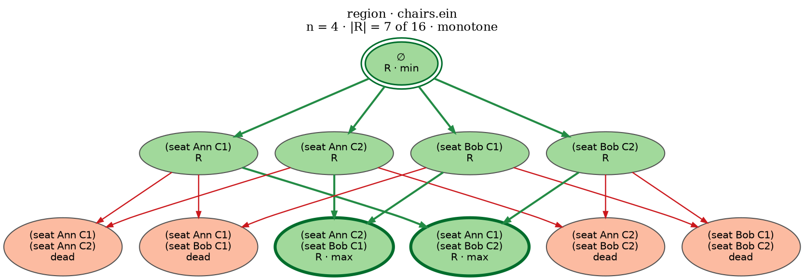

# Solutions and models

The answer to a program is not one assignment but a **region R**: every set of candidate facts whose state is alive
and owes nothing ([Q-M1e2.7](../../../decisions/answer/Q-M1e2.7-the-answer-is-a-region-r-of-the-hypothesis.md)).
The engine saturates the program to **root**, takes the facts it may assume, the **candidates** H
([hypotheses](hypotheses.md)), and judges every **commitment**, a set of candidates assumed together, by its
**state**: root with those facts added, saturated again. A state is **dead** when it derives `(false)`, **owing**
when an obligation is unpaid, and a **solution** when it is neither. Restrictions bound R from above, obligations from
below, and R is everything in between: a puzzle with one answer is one where the two meet in one state. A **model**
is what a solution adds to what the program said.

## In Ein

Restrictions alone, two people and two chairs with no sharing ([hypotheses](hypotheses.md) has the program):

```text
solve · chairs.ein
──────────────────────────────────────────────────────────────
  asked             all of R — describe
  states (k_s)      7
  commitments (k_c) 7
  exhausted         yes — every commitment is classified: this is all of R
  ∅                 in R — root is alive and owes nothing
  minimal line      1 state — ∅
  maximal line      2 states
  components        1
  sub-cubes         2, each of dimension 2
  merged            none — every state is reached by one commitment, so k_c = k_s
  N                 4 minimal dead sets
  lattice           monotone (the static check) — R is convex: no hole
  universe          4 candidates, 0 dead alone
```

Seven of the sixteen commitments are solutions: nobody seated, each single seating, and the two full seatings. Adding
the obligation that everyone sits, and stating that Ann sits on the second chair ([obligations](obligations.md) has
the program), moves the lower bound up to meet the upper one:

```text
  states (k_s)      1
  ∅                 not in R — root owes 1 instance
    owed            Bob has no chair yet
  minimal line      1 state, from 1 commitment — the least guess is 1 candidate
  maximal line      1 state
  …
  (region
    ;; state 1 of 1 — 1 candidate · minimal and maximal · from {(seat Bob C1)}
    (model (seat Ann C2) (seat Bob C1)))
```

One state, both lines at once: the puzzle has one answer. `-P` prints its model, the one fact the program did not
say, `(seat Bob C1)`.

## As a graph

`ein oracle FILE --dump DIR` classifies every node of the lattice, and `ein render region DIR` draws it as a Hasse
diagram, one layer per number of candidates, an edge per added candidate. Fill is the node's status: green in R,
amber owing, red dead. A double border marks the minimal line, a heavy green one the maximal line. The chairs
program, abridged to its first three layers (the four nodes of layer 3 and the top are dead):



With a run's dumps beside it, `--visited` and `--answer`, the drawing also shows what that run did: which nodes it
visited and which states it reported ([rendering](../reference/rendering.md)).

## In words

The read-out names R in its own words, row by row ([the read-out](../reference/read-out.md)): `states (k_s)` and
`commitments (k_c)` count it, `∅` says whether root itself is a solution and, if not, what it owes, `minimal line`
and `maximal line` give its two edges, `empty` says which kind of empty an empty R is, and `exhausted` says whether
what is printed is all of R. `--single` answers in one word: **Solution** (R is one state), **Ambiguity** (two or
more), **Contradiction** (no node is alive) or **Open** (nodes are alive and every one owes). Each state is printed as
the claim that names it, `(model …)`, so the answer reads back into the program as its own expectation
([query](query.md)).

## In mathematics

```text
root        = sat(program)
H           = the candidates proposed at root;  n = |H|
C ⊆ H       a commitment, a node of the lattice (2^H, ⊆)
state(C)    = sat(root ∪ C)
dead(C)     ⟺ (false) ∈ state(C)          alive(C) ⟺ ¬dead(C)
owes(C)     = the obligation instances state(C) leaves unpaid;  discharged(C) ⟺ owes(C) = ∅

R           = { C ⊆ H : alive(C) ∧ discharged(C) }
k_c         = |R|                                    commitments
k_s         = |{ state(C) : C ∈ R }|                 states
min(R), max(R)                                       R's minimal and maximal members
model(C)    = { f ∈ state(C) : f positive } \ { f ∈ program : f positive }
```

On a monotone program, one where adding a fact never takes a conclusion away or adds a debt, dead and discharged are
both upward-closed: a dead commitment stays dead and a discharged one stays discharged as candidates are added. R then
has no hole, and its two lines describe it: R = ⋃ [a … b] over a ∈ min(R), b ∈ max(R) with a ⊆ b. The full definition,
stated for a second implementation, is [the solution semantics](../../../kernel/inference/solution_semantics.md).

## Context and problem

A program is a **problem** stated in a **context**:

| term | what it is | in [`zebra2.ein`](../../../../examples/zebra2.ein) |
|---|---|---|
| **theory** | relations, their properties, and the rules that give them meaning | `(relation drink-loc Drink House)`, `(bijective drink-loc)`, the `co-located` rules and the stdlib rules behind them |
| **ontology** | facts a solution needs that the problem does not state, because they are obvious | `(is-a Tea Drink)` |
| **context** | theory and ontology | everything that carries no `:source` and is not a hint or the question |
| **problem** | facts, the question, and the hints of what to guess, stated in a context | the clues with `:source "condition (n)"`, the `(query …)`, the `(hrule guess …)` |

The boundary is not in the language: one file may mix all four, and an import may bring either half of a context, a
library of rules or a library of facts ([macros and imports](macros.md)). **R is a property of a problem in a
context**: the same clues in another context have another region.

## The words

| word | what it is |
|---|---|
| **root** | the program's facts saturated by its rules, nothing assumed. It is the commitment ∅, and a node like any other |
| **candidate** | a fact the engine may assume; **H** is all of them, built once at root ([hypotheses](hypotheses.md)) |
| **commitment** | a set of candidates assumed together; as a point of the lattice, a **node** |
| **state** | root with the commitment's facts added and saturated to its fixpoint. It is never cut at the first contradiction |
| **dead** · **alive** | the state holds `(false)` · it does not |
| **owing** · **discharged** | the state has an unpaid obligation instance · it has none ([obligations](obligations.md)) |
| **solution** | a node of R: alive and discharged |
| **state class** | the commitments that reach one state. Where saturation derives a candidate, several commitments have one state; the smallest that reach it are its **minimal generators**, how few guesses the solution needs |
| **minimal line** · **maximal line** | R's minimal and maximal members: the least that must be guessed, and the most that can be |
| **component** | a part of R connected by one-candidate steps inside R. A set of solutions, never one |
| **sub-cube** | every commitment between two members `a ⊆ b`; R is the union of its largest ones, and the read-out gives their dimension, the number of free facts |
| **N** | the minimal dead sets: the smallest commitments whose state is dead |
| **exhausted** | what is printed is all of R; a run a budget stopped prints a part, and says so |
| **model** | what a solution's state adds to the program: its positive facts not in the program as loaded |

## Root as a solution

**∅ is in R exactly when root is alive and owes nothing**, whatever the generator proposes, and including when it
proposes nothing. A program that states no obligation and whose root is consistent always has ∅ in R. That is not a
defect: a puzzle that does not say what it requires is solved by saying nothing more. A question about *the* answer of
such a program is asked over its maximal line ([query](query.md)).

## How many: `k_s` and `k_c`

| count | counts | |
|---|---|---|
| **k_c** | R in **commitments** | the ways to guess a solution |
| **k_s** | R in **states** | the different solutions |

They differ exactly where saturation derives a candidate at a node of R: the node and its closure are then two
commitments with one state, and the read-out's `merged` row lists the states several commitments reach, each with its
minimal ones. **One solution** has two readings, and a claim of exactly one says which it means:

- **k_s = 1**: what a program that states what it requires can mean;
- **one maximal state**: what a program with restrictions only can mean, since there ∅ is in R and k_s = 1 only when
  nothing can be added at all.

A count is exact, and printed up to 2^63 − 1; past that the surfaces read it as *this many or more*
([Q-M1f.218](../../../decisions/answer/Q-M1f.218-a-count-is-exact-and-reported-up-to-2-63-1.md)).

## Restrictions and obligations: the two lines

A **restriction** is a rule that concludes `(false)` ([constraints](constraints.md)). It kills nodes, and sets the
**maximal line**. An **obligation** is a rule that concludes `(open ?R)` while a witness is missing
([obligations](obligations.md)). A state that owes is not a solution, and obligations set the **minimal line**.

| the program states | R | minimal line | maximal line |
|---|---|---|---|
| neither | the whole lattice | {∅} | {every candidate} |
| restrictions only | every alive node | {∅}, while root is alive | where the restrictions bite |
| obligations only | every discharged node | where the debts are paid | {every candidate}, on a monotone program |
| both | between the two | where the debts are paid | where the restrictions bite. A well-posed puzzle has them meet in one state |

The lines a program's shape makes trivial, {∅} and {every candidate}, are reported as such and never searched for.

## A worked region

[`examples/lattice/02_genuine_3set_death.ein`](../../../../examples/lattice/02_genuine_3set_death.ein): three candidates
`a = (a-prop X)`, `b = (b-prop X)` and `c = (c-prop X)`, one rule that concludes `(false)` when all three hold, no
obligation.

| commitment | alive | owes | in R |
|---|---|---|---|
| `∅` | yes | no | **yes**: minimal |
| `{a}`, `{b}`, `{c}` | yes | no | **yes** |
| `{a,b}`, `{a,c}`, `{b,c}` | yes | no | **yes**: maximal |
| `{a,b,c}` | **no** | no | no |

R has seven nodes and seven states, `k_c = k_s = 7`, since no rule derives a candidate. Its minimal line is {∅}, the
trivial line of a program with restrictions only; its maximal line is the three pairs. It is one component, the union
of three sub-cubes `[∅ … pair]` of dimension 2, and N is the one dead triple: the conflict is genuinely three-way.
`ein solve` prints the same: `states (k_s) 7`, `maximal line 3 states`, `sub-cubes 3, each of dimension 2`, `N 1
minimal dead set`.

## Model

**A model is the positive part of a solution's state, less the positive part of the program as loaded**
([Q-M1e.6](../../../decisions/answer/Q-M1e.6-a-model-is-what-a-solutions-state-adds.md)): no `(not …)`, nothing the
file states, nothing the loader writes down. It is what the puzzle did not say and the solution established. `-P`
prints it per state, `-p` with the negations. The engine judges states, and a model decides nothing: it is computed
from a state where a surface prints one ([Q-M1e.7](../../../decisions/answer/Q-M1e.7-a-state-is-what-the-engine-judges-and-a-model-is.md)).

**Projection.** A query's goal cuts a state down to the goal's rows. States that differ only in facts the goal does
not name give one row set, so a query answers with **projection classes**, the states grouped by what the goal sees.
Two friends choosing between two tables give one class per table, and the seats inside it are hidden. A goal with no
row in a state, as at ∅ of a program with restrictions only, puts that state in the class *undetermined here*
([query](query.md)).

## Two kinds of empty R

| R is empty because | the read-out's `empty` row | `--single` | the claim |
|---|---|---|---|
| no node is alive: root is dead, and every node with it | *every node is dead*, with root's core (`unsat core`) and the rule that refutes it (`refuted by`) | `Contradiction` | `(solve :expect (false))` |
| every alive node owes | *every alive node owes — no commitment pays every debt*, and the owing nodes with their debts | `Open` | `(solve :expect (region (owing (model …) …)))` |

`(solve :expect (region))` holds on either. A query over an empty R has no state to answer from, and its `over` row
says which kind of empty it is.

## Asking about R

A bare `ein solve` **describes** all of R: both counts, the lines, the components and sub-cubes, N, and every state,
listed as far as the screen allows. Every other question is a mode that does the least work it needs
([Q-M1e2.31](../../../decisions/answer/Q-M1e2.31-each-question-about-r-does-the-least-work-it.md)):

| question | asks |
|---|---|
| `ein solve` | all of R |
| `--minimal`, `--maximal` | one line |
| `-n N` | N states of the part asked |
| `--single` | is R one state: `Solution`, `Ambiguity`, `Contradiction` or `Open` |
| `--count` | `k_s` and `k_c`, reading no state |
| `--no-search` | root alone: whether ∅ is in R, and nothing past it |
| `ein oracle` | all of R by brute force, every node classified |

**No two commands disagree**, and `ein oracle` is the reference each is held to
([Q-M1e2.32](../../../decisions/answer/Q-M1e2.32-no-two-commands-disagree-and-the-oracle-is.md)); **no configuration
flag or option changes R** ([Q-M1e2.30](../../../decisions/answer/Q-M1e2.30-no-configuration-option-lever-or-flag-changes-r.md));
**every answer exits 0**, and only a refuted claim exits 1
([Q-M1e2.33](../../../decisions/cli/Q-M1e2.33-every-answer-exits-0.md)). Where a run cannot finish, its counts are lower
bounds and say so, `exhausted` says *no*, and every state it does print is a certified member of R. What every row
prints, and what it counts, is [the read-out](../reference/read-out.md); the commands are [the CLI](../reference/cli.md).

**R is over H.** A relation H has no candidate of holds in R only what the program states and saturation derives, and
the read-out names it, an `outside` row under `universe`
([Q-M1e2.3](../../../decisions/answer/Q-M1e2.3-r-is-over-the-universe-and-the-read-out-names.md)).

## A program the engine cannot vouch for

Everything above holds of a **monotone** program, and the read-out's `lattice` row says whether a program is one: no
`absent` over a relation a commitment can change, and no obligation trigger over one. A program that fails that check
is **flagged**: R is still the set of alive, discharged nodes, each built as root with its commitment added, and every
command agrees on it, but the engine claims nothing more of it, not soundness and not completeness
([Q-M1e2.2](../../../decisions/answer/Q-M1e2.2-a-node-is-a-fork-of-root-an-assumption-on.md)). Such a region may have
holes, and the engine answers it by visiting every node, within a limit. What a flagged program is, and how to write
one that is not, is [monotonicity](../../../kernel/inference/monotonicity.md).

## See also

- [Query](query.md): asking about R, and claiming it.
- [Hypotheses](hypotheses.md): H, the space R is drawn from.
- [Obligations](obligations.md) and [constraints](constraints.md): the two bounds.
- [The read-out](../reference/read-out.md): every row `ein solve` prints.
- [The solution semantics](../../../kernel/inference/solution_semantics.md): the definition of R, for a second
  implementation.
- [How R is found](../../../kernel/inference/finding_r.md): the oracle and the routes.
