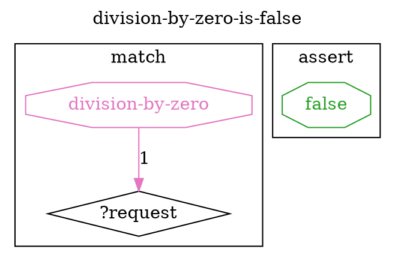
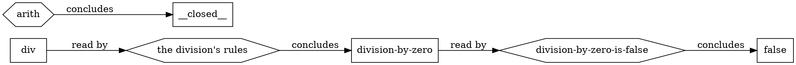

# Theories

A **theory** is a set of rules that together give a body of knowledge its meaning: the relations they read and
conclude, the facts they need, and what they refute. Arithmetic is a theory, and so are kinship, the relation algebra
and a Zebra puzzle's rules. A single rule says one thing; a theory says what follows from all of them at once, since
one rule reads what another concludes. In Ein a theory is written as a **module**, a file a program imports whole,
and a program is itself a theory: its own rules together with every module it imports.

## In Ein

The smallest theory of the standard library, `std.math.arith`, is arithmetic's own part, shared by every base. Its
rules and declarations, the comments left out:

```lisp
(relation z
  :why "zero, the number with no digit")

(relation division-by-zero Request
  :why "{?1} divides by zero")

(rule division-by-zero-is-false ()
  :match  (division-by-zero ?request)
  :assert (false)
  :why    "{?request} divides by zero: no number is the answer")

(relation arith-module-rule Rule
  :why "{?1} is a rule of std.math.arith")

(rule arith ()
  :match  ()
  :assert (and (__closed__ division-by-zero)
               (__closed__ arith-module-rule)
               (arith-module-rule division-by-zero-is-false))
  :why    "arithmetic is computed and never guessed: its flag is closed")
```

It declares zero, a **flag**, a rule that refutes any state holding the flag, and a **closing rule**, `arith`, which
says what the theory never guesses and names its rules. `std.math.decimal-arith`, decimal school arithmetic, is built
on it, and a program asks it a question by stating a **request**:

```lisp
(import std.math.decimal-arith :symbols (add sum-of))
(import std.math.decimal :symbols (n))
(import std.math.arith :symbols (z))

(add (n (n z 4) 2) (n z 7))

(query :goal (sum-of (n (n z 4) 2) (n z 7) ?s) :goal-text "42 + 7 is {?s}")
```

```text
  universe          no candidate: R is {∅} or empty, decided by root alone
  …
  query             (sum-of (n (n z 4) 2) (n z 7) ?s)
  over              all of R — 1 state → 1 projection class
    class 1 of 1    1 state (1)
                      ?s = (n (n z 4) 9)
                        “42 + 7 is (n (n z 4) 9)”
```

The import brings `std.math.decimal-arith` whole, with `std.math.decimal`, `std.math.arith`, the digit tables and the
rules both bases share. Nothing in the engine knows what `7` is: the sum is derived by rules over tables of digit
names, and the `universe` row says the theory left nothing to guess.

## As a graph

`ein render rules FILE` draws each rule of a theory in its two panels; on `std.math.arith`, the refutation:



What makes the rules a theory is how they connect: one rule's conclusion is another's premise. That is a graph of
rules and relations, which no `ein render` view draws as a whole; drawn by hand for the division above, a relation a
box and a rule a hexagon, the shapes of [objects](objects.md):



An edge through an `absent` is the one that matters most: the read-out's `strata` row reports a cycle of such edges,
where what a theory concludes may depend on the order its rules are admitted in ([rules](rules.md)).

## In words

A theory explains itself through its rules' reasons, chained. The trace of a program that divides seven by zero, the
two steps that refute it (`ein solve FILE --trace OUT.md`):

```text
### Step 12 — `std.math.positional.div-by-zero`

> the divisor of (n z 7) divided by z is zero

Premises: `std.math.decimal-arith.done(std.math.decimal-arith.div-m1(std.math.decimal-arith.quotient(n(z, 7), z), n(z, 7), z), z)`

Derives `std.math.arith.division-by-zero(div(n(z, 7), z))` — (div (n z 7) z) divides by zero

### Step 13 — `std.math.arith.division-by-zero-is-false`

> (div (n z 7) z) divides by zero: no number is the answer

Premises: `std.math.arith.division-by-zero(div(n(z, 7), z))`

Derives `false`.
```

The flag is one step and the contradiction the next, so the trace shows what was wrong before it shows that the state
died. A rule the program does not list in an import prints by its full name.

## In mathematics

A theory is a pair `T = (P, F)` of rules and facts over a set of relations. Its meaning on a state `S` is the
fixpoint `Cl_T(S)`, the least set containing `S ∪ F` and closed under `P` ([rules](rules.md)). Two theories over
shared relations compose by union, and their consequences interact:

```text
Cl_{T₁ ∪ T₂}(S) ⊇ Cl_{T₁}(S) ∪ Cl_{T₂}(S)
```

in general strictly, since a rule of `T₂` may read what only `T₁` concludes. Writing `Alive(T)` for the states `S`
with `Cl_T(S)` not dead ([constraints](constraints.md)), adding a rule or a fact to a theory without `absent` can only
shrink `Alive`: a derivation rule makes `Cl` larger, a refutation rule makes more of it dead. A theory computes a
function `f` by requests: for a request `q(ā)` in `S`, `q-of(ā, b̄) ∈ Cl_T(S)` exactly when `b̄ = f(ā)`, and for no
request no result.

## A theory is a module, imported whole

`(import M …)` brings every declaration, rule and fact of module `M`, with the modules `M` imports, all the way down,
one copy per program ([Q-M1f.247](../../../decisions/imports/Q-M1f.247-every-import-brings-its-module-whole.md)). A
list in an import selects names, not rules: `:symbols (add sum-of)` lets the file write those two short, and the rest
of the theory comes anyway. So a theory is never taken in part, and **the answer does not depend on the import
form** ([Q-M1f.249](../../../decisions/imports/Q-M1f.249-the-answer-does-not-depend-on-the-import-form.md)). No
import brings a module's `(query …)`, `(solve …)` or `(config …)`: those are a program's own. Names, full and short,
are [macros and imports](macros.md)'.

## How rules interact

**One reads what another concludes.** That is the only way rules interact: there is no call, no order a program
states, and no shared variable between rules. `parent-is-ancestor` concludes `ancestor` facts, which `chain` reads
([rules](rules.md)); a theory's request rules conclude walk facts, which its column rules read, which conclude a
result. Saturation runs every rule to the fixpoint, so on a theory without a flagged `absent` the result does not
depend on the order the rules fire in.

**A rule may read a theory's own facts about itself.** Property facts are facts, so a rule can conclude one and
another rule can be activated by it: `std.algebra`'s `bijective-properties` reads `(bijective R)` and concludes four
property facts, each the activator of a rule of its own, and `symmetric-is-self-converse` concludes `(converse R R)`
from `(symmetric R)` ([properties and operators](properties-and-operators.md)).

**A rule may read a relation nothing makes.** A library rule reads markers its importer may never write, and then
never fires ([Q-M1f.120](../../../decisions/language/Q-M1f.120-a-rule-may-read-a-relation-nothing-makes.md)): that
is how importing a whole theory costs nothing for the parts a program does not use.

## Derivation rules and refutation rules

A theory's rules are of two kinds. A **derivation** rule concludes facts, and so adds to what holds; a
**refutation** rule concludes `(false)`, and so removes states from the answer. The two meet on one relation all the
time: `symmetric` derives `(above b a)` from `(above a b)`, and `asymmetric` refutes a state holding both. A program
that states both properties of one relation, and one pair of it, is dead at root, and says so:

```lisp
(import std.algebra :symbols (symmetric asymmetric))

(relation above Box Box :why "box {?1} is above box {?2}")

(asymmetric above)
(symmetric above)
(above B1 B2)

(solve :expect (false))
```

```text
  unsat core        (above B1 B2)
  refuted by        asymmetric
```

The standard library's theories refute in **two steps**: a rule derives a **flag**, a fact that names what is wrong,
`(division-by-zero REQUEST)`, `(malformed REQUEST)`, `(not-decimal NUMERAL THING)`, and one rule per flag concludes
`(false)` from it. The flag is part of the explanation: a trace shows it, a claim or a program's rule can read it,
and the core names the fact the fault was written in. A flag means the request is malformed; no flag does not mean
it is well-formed, since a theory flags what it can detect
([Q-M1f.318](../../../decisions/stdlib/math/Q-M1f.318-a-flag-means-malformed-and-no-flag-does-not-mean.md)). A
malformed value is flagged by the theory that defines the representation, where it is written, and not by the theories
that compute with it ([Q-M1f.210](../../../decisions/stdlib/math/Q-M1f.210-a-malformed-number-is-its-representations-fault.md)).

## What a theory owes

Besides what holds and what cannot, a theory can say what a state still **owes**: a rule whose whole conclusion is
`(open ?R)` reports that `?R`'s extent is incomplete where its pattern matches, and derives nothing. `std.algebra`'s
`total-owed` is the dual of the check `total`: where `total` refutes a state in which every partner of an `a` is
excluded, `total-owed` reports an `a` that has no partner yet. A state that owes nothing is **discharged**, and the
answer is the alive and discharged states. [Obligations](obligations.md) has the form and what reads it.

## The closing rule: what a theory never guesses

The engine proposes hypotheses for relations a program leaves open, and a computed relation is not open: guessing a
sum would be wrong, not just slow. So each module of the calculator ends in a **closing rule**, its entry, with an
empty `:match`: it fires once in every program that imports the module, concludes `(__closed__ R)` for every relation
of the module and every table it reads, so that no hypothesis is ever proposed for one, and names every rule of the
module ([Q-M1f.240](../../../decisions/imports/Q-M1f.240-a-module-keeps-its-entry-rule-which-a-program.md),
[Q-M1f.365](../../../decisions/stdlib/math/Q-M1f.365-the-calculator-closes-its-own-relations-so.md)). A program that
imports the calculator and states requests therefore has nothing to search: one saturation decides it. A relation the
program declares itself is the program's to close. A closing rule names the entries of the modules below it, so the
entries form the same tree as the imports
([Q-M1f.283](../../../decisions/stdlib/math/Q-M1f.283-zero-is-a-relation-of-no-argument-and-each.md)).

## Requests and results: asking a theory

A theory computes only what is asked. A **request** fact, `(add X Y)`, is answered by a **result** fact that repeats
the operands, `(sum-of X Y S)`; a goal reads the result with a variable in the answer's place, and a rule of the
program may match it ([Q-M1f.363](../../../decisions/stdlib/math/Q-M1f.363-a-calculation-is-a-request-fact-answered.md)).
The same sum written twice is one request; written with other numerals for the same values, it is another request
with its own answer.

**A theory over a theory.** `std.math.int` computes with integers by asking `std.math.decimal-arith` for the natural
numbers' parts, and `std.math.rat` asks both. Inside, a theory calls the one below it with a **tag**, a fact that
names the caller, and gets the answer back under it, `(div-call TAG X Y)` answered by `(div-done TAG Q R)`, so the
rule that reads it has one premise and no join on a number. The tagged calls are an interface, held to their shapes
([Q-M1f.189](../../../decisions/stdlib/math/Q-M1f.189-the-decimal-arithmetics-tagged-calls-are.md)).

**One theory, two bases.** The rules decimal and binary arithmetic share are written once, in `std.math.positional`,
every relation they use a parameter, and a base connects to them by one call of the module's macro inside its closing
rule: the expansion is one activator fact per shared rule, naming the base's own relations
([Q-M1f.266](../../../decisions/stdlib/math/Q-M1f.266-a-base-is-connected-to-the-shared-rules-by-one.md)). The
trace above shows those activators among what `decimal-arith` concludes, `std.math.positional.add-column(…)`.

## Two theories over one relation

Two theories meet wherever they share a relation, and what they say there is the union of what each says, plus what
follows from both. `(symmetric knows)` with `(transitive knows)` closes `knows` in both directions; `(symmetric
above)` with `(asymmetric above)` contradicts on the first pair. Nothing warns of either: the fixpoint is the
meaning.

Two modules may declare the same short name, and each name keeps its full name, `std.bijection.domain-elimination`
and `std.elim.domain-elimination`. A file that lists one short name from both is refused, since one short name names
one declaration in a file ([Q-M1f.234](../../../decisions/imports/Q-M1f.234-one-short-name-bound-to-two-full-names-in-one.md)):

```text
'domain-elimination' is bound to two full names in the program, std.bijection.domain-elimination and std.elim.domain-elimination — one short name names one declaration in a file: list it from one module, or write the other by its full name
```

Those two modules are two theories of the same idea, elimination by exhaustion, one reading types from a relation's
signature and one taking them as parameters; a program uses one of them for a given relation.

## A theory that disagrees is another module

Nothing a theory says is built into the engine: Ein has no numbers, no types and no symmetry of its own
([Q-M1e2.24](../../../decisions/language/Q-M1e2.24-ein-has-no-numbers-and-no-ranges.md)). Division by zero is a
contradiction because `std.math.arith` says so; a theory in which it is allowed, a wheel or a meadow, would be a module
that does not import `std.math.arith`. The standard library's theories are the ones the language ships, not the only
ones it admits: [the stdlib reference](../reference/stdlib.md) lists them.

## What a theory cannot say

A rule is a sentence about the one state it fires in. No rule reads another state, the number of states, or how far
the search has gone, so no theory can require that there be exactly one answer, or count its models
([Q-M1d.7](../../../decisions/language/Q-M1d.7-a-rule-is-a-sentence-about-the-state-it-fires.md)). A claim about the
answer as a whole is stated beside the theory, as a query's `:expect`, and checked against the answer
([queries](query.md)).

## See also

- [Rules](rules.md), [constraints](constraints.md) and [obligations](obligations.md): the three kinds of sentence a
  theory is made of.
- [Properties and operators](properties-and-operators.md): `std.algebra`, a theory of relations.
- [Macros and imports](macros.md): how a theory is brought into a program, and its names.
- [The stdlib reference](../reference/stdlib.md): every theory the standard library ships.
- [Hypotheses](hypotheses.md): what the engine guesses where a theory leaves a relation open.
