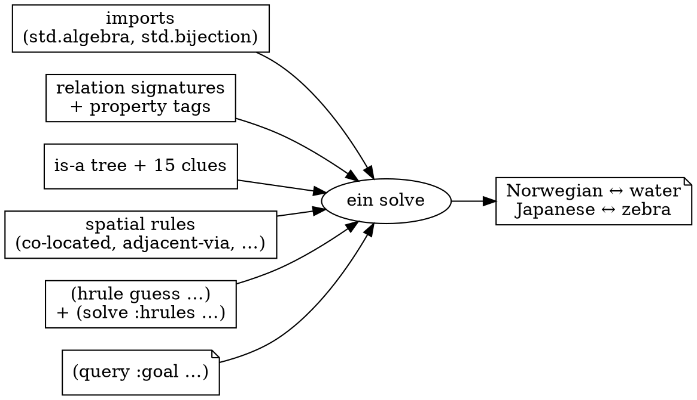

# 4 — Solving the whole puzzle

You've met objects and facts (Ch.1), how a rule derives new facts (Ch.2),
and the rule families that prune the search (Ch.3). Now we assemble the real
puzzle, solve it, and hand off to the full trace.

## What `zebra2.ein` is made of

Open [`examples/zebra2.ein`](../../examples/zebra2.ein) — it's just the
pieces from this guide, in layers:

```lisp
(import std.algebra   :symbols (symmetric transitive includes))   ; the library logic
(import std.bijection :symbols (bijective-properties bijective-setup typecheck-setup))

(relation nation-loc Nationality House :why "the {?1} lives in {?2}")   ; the schema
(relation color-loc  Color       House :why "{?2} is painted {?1}")
;; … drink-loc, smoke-loc, pet-loc, right-of, next-to, is-a and is-a* likewise

(symmetric next-to) (transitive is-a*)              ; activate the properties
(bijective color-loc) (bijective nation-loc) …

(rule co-located …) (rule adjacent-via-fwd …) (rule disjunctive-prune-fwd …) …  ; the spatial rules

(hrule guess (?R ?T1 ?T2)                           ; what may be guessed
  :match  (and (is-a ?a ?T1) (is-a ?b ?T2))
  :assert (?R ?a ?b)
  :why    "guess: ({?R} {?a} {?b})?")
(solve :hrules (guess (color-loc Color House) (nation-loc Nationality House) (drink-loc Drink House)
                      (smoke-loc Cigarette House) (pet-loc Pet House)))

(is-a Norwegian Nationality) …                      ; the type tree
(nation-loc Norwegian House-1 :source "condition (10)")   ; the 15 clues
(co-located nation-loc Englishman color-loc Red :source "condition (2)")
…

(query                                              ; the question
  :goal (and (drink-loc Water ?h_water)  (nation-loc ?who_water ?h_water)
             (pet-loc   Zebra ?h_zebra)  (nation-loc ?who_zebra ?h_zebra))
  :goal-text "The {?who_water} drinks water in {?h_water}; the {?who_zebra} owns zebra in {?h_zebra}")
```

The pieces, and how `ein solve` turns them into the answer:



Nothing here is new — it's Chapters 1–3 at full size. The `(hrule guess …)`
is Chapter 2's `guess`, written out: it proposes `(?R ?a ?b)` for every `?a`
of one type and `?b` of another, and `(solve :hrules …)` names the five
relations it runs over, each with its two types. The `(query …)` is the only
piece we haven't used: a `:goal` pattern Ein matches against the solved KB,
and a `:goal-text` template that renders the headline answer.

## Solve it

<!-- transcript: ein solve examples/zebra2.ein --single -->
```sh
$ ein solve examples/zebra2.ein --single
solve · examples/zebra2.ein --single
──────────────────────────────────────────────────────────────
  asked             is R one state? (--single)
  verdict           Solution — R is one state
  decided           yes — R holds no other state
  lattice           monotone (the static check) — R is convex: no hole
  universe          56 candidates
    outside         is-a*, next-to — no candidate: no hrule proposes them. R holds of them only what the program states and saturation derives
  route             the obligation tree, over states — L1 dead is upward-closed · L2 discharged is upward-closed · L3 a commitment's state is its closure's · L4 the lines are local · L5 an owed instance's alternatives are exhaustive
  work              45 saturations · 7 582 facts beyond root

  ;; state 1 of 1 — 18 candidates · from {(color-loc Green House-5), (nation-loc Ukrainian House-2)}
  (model (color-loc Blue House-2) (color-loc Green House-5)
         (color-loc Ivory House-4) (color-loc Red House-3)
         (color-loc Yellow House-1) (drink-loc Coffee House-5)
         (drink-loc Juice House-4) (drink-loc Milk House-3)
         (drink-loc Tea House-2) (drink-loc Water House-1)
         (nation-loc Englishman House-3) (nation-loc Japanese House-5)
         (nation-loc Norwegian House-1) (nation-loc Spaniard House-4)
         (nation-loc Ukrainian House-2) (pet-loc Dog House-4)
         (pet-loc Fox House-1) (pet-loc Horse House-2) (pet-loc Snail House-3)
         (pet-loc Zebra House-5) (smoke-loc Chesterfields House-2)
         (smoke-loc Kools House-1) (smoke-loc Lucky_Strike House-4)
         (smoke-loc Old_Gold House-3) (smoke-loc Parliament House-5))

  query             (and (drink-loc Water ?h_water) (nation-loc ?who_water ?h_water) (pet-loc Zebra ?h_zebra) (nation-loc ?who_zebra ?h_zebra))
  over              all of R — 1 state → 1 projection class
    class 1 of 1    1 state (1)
                      ?h_water = House-1 · ?h_zebra = House-5 · ?who_water = Norwegian · ?who_zebra = Japanese
                        “The Norwegian drinks water in House-1; the Japanese owns zebra in House-5”
  as :expect        (model (drink-loc Water House-1)
                           (nation-loc Japanese House-5)
                           (nation-loc Norwegian House-1)
                           (pet-loc Zebra House-5))
```
<!-- /transcript -->

`--single` asks *is the answer one state?* — and the verdict word, `Solution`,
says yes. The state is listed as a `(model …)` of the guessed facts, and the
query block reads the goal off it. The headline sentence came from the
puzzle's own `:goal-text` template — Ein has no built-in vocabulary. Had the
puzzle two answers, the word would be `Ambiguity`, with two of them shown;
none, `Contradiction` (with the facts that clash) or `Open` (with what is
still owed).

## Three next moves

```sh
ein solve examples/zebra2.ein                 # describe every state the puzzle allows
ein solve examples/zebra2.ein --trace out.md  # write a full markdown derivation trace
ein solve examples/zebra2.ein -s              # + the wall clock
```

A bare `ein solve` describes the whole set of states — R — with its counts,
its lines and what it cost. On this puzzle it classifies every commitment
(`exhausted yes`) and finds the one state `--single` showed; `--single` asks
only whether R is one state, and its `work` row is smaller for it. `--trace`
writes the derivation step by step, each step's premises and what it derives,
with inline graphs.

## Where to go next

- **The full human-style solution, step by step** —
  [`docs/kernel/inference/zebra_walkthrough.md`](../kernel/inference/zebra_walkthrough.md).
  This guide taught the pieces; the walkthrough shows all of them firing on
  the real puzzle, line by line against the Wikipedia solution. **Read it
  now** — it's the natural sequel to this chapter.
- **Drive Ein from your own program** — [`docs/api/rust.md`](../api/rust.md)
  (load a `.ein`, call `solve`, read the answer and trace, in about thirty
  lines). From a language that is not Rust, run the binary and read
  `--json-summary` / `--events`; there is no binding for another language,
  and [`docs/api/README.md`](../api/README.md) says why.
- **How the engine actually searches** (saturation, the hypothesis loop,
  the commitment lattice) — [`docs/kernel/inference/`](../kernel/inference/).
  This guide deliberately never opened that box; the reference docs do.


