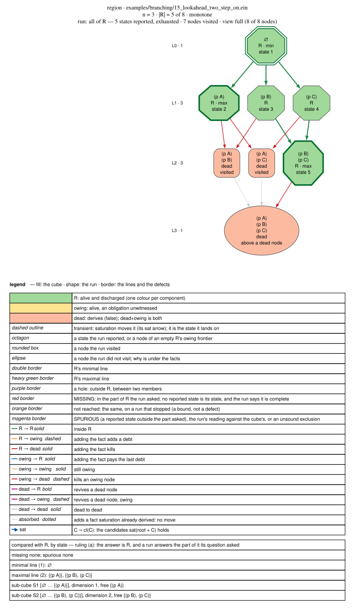
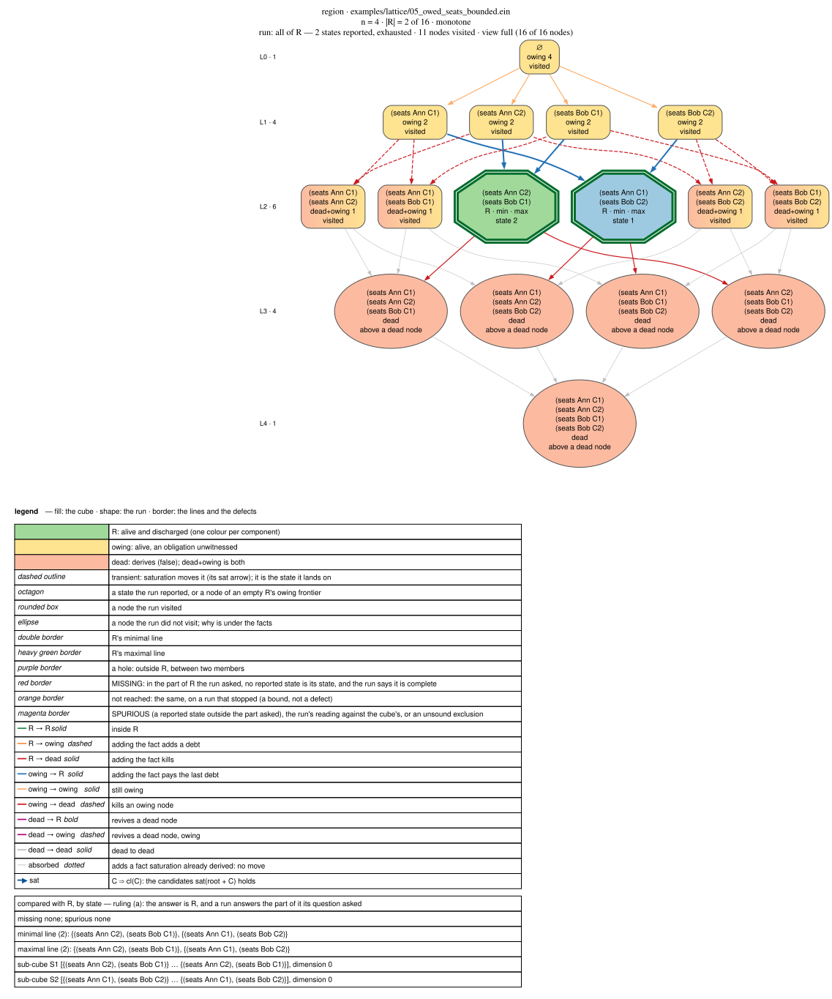
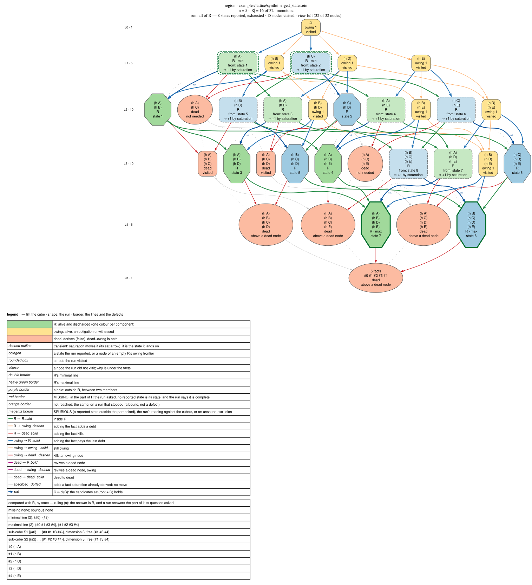
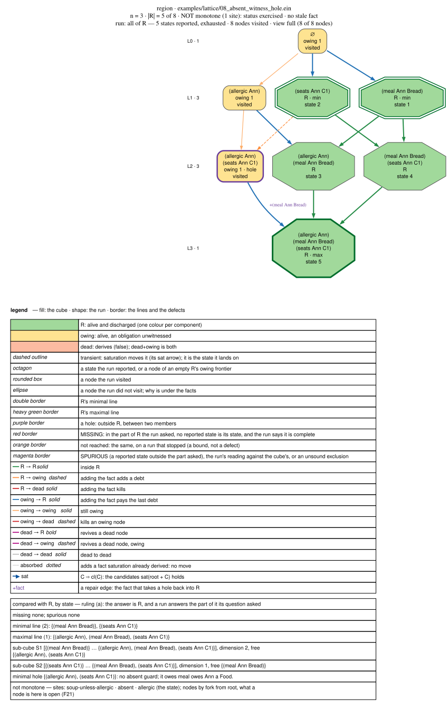
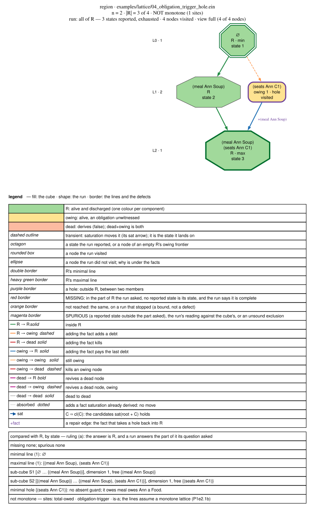
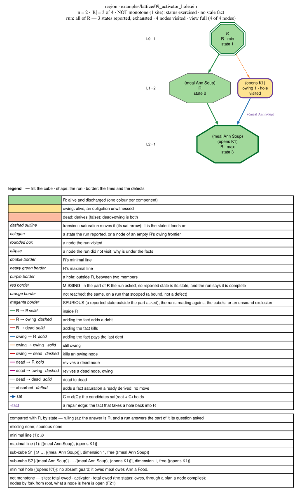
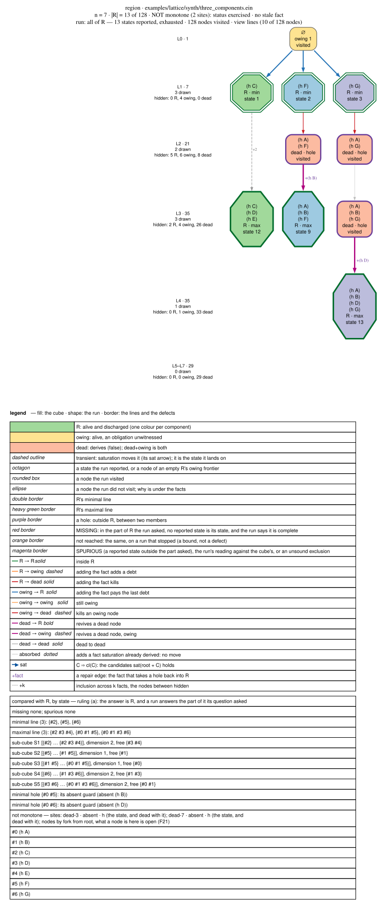

# Monotone and non-monotone programs — the two kinds of region compared

**What the answer is when adding a fact can take one away.** The answer to a
program is the region R of its hypothesis lattice, the commitments whose state
is alive and discharged ([`solution_semantics.md`](solution_semantics.md)).
The lattice is the domain, and it is never itself monotone or not: what can be
are the functions on its nodes, a node's state and its status (§ 7).
That page is written for a **monotone** program, where growth never takes a
conclusion away and never adds a debt. This page sets the two cases side by
side: what each means, what causes the second, how each looks on the lattice,
how it is detected, what each property lets the engine simplify, and how to
compute R stably, provably and effectively in each. M1e2
[S1e2.1b.6](../../../plans/m1e2_correctness/p1e2.1b_non_monotone_programs/s1e2.1b.6_monotone_and_non_monotone_programs_compared.md)
wrote it, at the user's request of 2026-10-16, for a reader who needs R **as a
whole**: a complete answer with the provenance of its topology, the region's
properties studied to improve a theory, or a search over theories for one
with a single solution.

**What is ruled and what is not.** The monotone column is settled. Three cells
of the non-monotone column are **open**: what a node's state is, what is
reported when R has holes, and what a search may learn from a refutation that
rests on an `absent`. On 2026-11-02 the user deferred every decision about a
non-monotone program to
[F21](../../../plans/followups/f21_non_monotone_programs_decided.md), and
M1e2's [P1e2.1b](../../../plans/m1e2_correctness/p1e2.1b_non_monotone_programs/README.md)
detects, documents and warns (§ 8). Until a decision, the engine builds every
node by fork from root. Every other claim carries a test, a dated command, or
a theorem whose premise a test enforces
([`standard_of_proof.md`](../standard_of_proof.md)), and § 7 labels each of
its claims by that standard.

---

## 1. Where it starts: R is its node set

> **R = { C ⊆ H : sat(root + C) is alive and discharged }**,
> [`solution_semantics.md` § 2](solution_semantics.md#2-the-answer--the-region-r).

The user, 2026-10-16: *"In general non-monotonic case R is completely defined
only by full set of nodes … Let's go from it, and simplify the results if our
case allows or if it is requested explicitely."* That is exact
([§ 2.1 there](solution_semantics.md#21-in-general-r-is-its-node-set)):

- **Any subset of the cube is the region of some program.**
  [`utils/region_synth.py`](../../../utils/region_synth.py) writes a program
  for a chosen region, and the oracle gives it back node for node: 2 100
  random targets with 0 mismatches (2026-10-15, M1e2 S1e2.1a.8), and 300 per
  commit (`ein-cli/tests/region_dump.rs::a_random_region_written_as_a_program_comes_back`).
  The one target it refuses is a dead ∅ under a non-empty R, because the
  oracle builds every node from root's fixpoint. Which construction a node's
  state is defined by is open (Q-M1e2.2, F21's D2).
- **There are 2^(2ⁿ) regions**, so nothing shorter than the set describes all
  of them. The shortest exact form of one is the union of its maximal
  sub-cubes, which the oracle computes (`region.json`'s `subcubes`). It is
  small when R is regular, and it reaches 2ⁿ⁻¹ isolated points (parity).

## 2. The ladder

Each step down is licensed by a property the step above does not have, and
each makes a shorter description exact:

| step | licensed by | R is described by | a claimed R is certified by |
|---|---|---|---|
| **general** | nothing | the node set, or its maximal sub-cubes | every node classified: 2ⁿ saturations |
| **convex** | **no hole**, observed on the cube | the two lines: R = ⋃ [a … b] over minimal a ⊆ maximal b | as above: a hole is known only after the cube is enumerated |
| **monotone** | the **static check** says *monotone*, before any search (§ 5.1) | the two lines, computed from the alive down-set and N, or from N and E, without visiting 2ⁿ nodes | N and E, one saturation per member, and the static verdict |
| **shape** | which constraints the program states | restrictions only: the minimal line is {∅}. Obligations only: the maximal line is {⊤}. Both, and well-posed: every component a point | as monotone |

**Convex is the common non-monotone case in the corpus.** Of the 18 flagged
programs within the oracle's limit, 9 have no hole, and each of the 9 with
one was written to show it (`cargo run --release -p ein-infer --example
site_census`, 2026-11-02 at `4562bf70`; the holes by cause are M1e2
S1e2.1b.3's [hole census](../../../plans/m1e2_correctness/p1e2.1b_non_monotone_programs/hole_census.md)).
That says more about the corpus than about programs. **A conditional obligation makes holes as a matter of
course**: [`lattice/06_friends_tables.ein`](../../../examples/lattice/06_friends_tables.ein),
*a group that sits owes its members' seats*, the way a person writes *if you
come, you all sit*, has R of 21 isolated nodes and 166 holes. Its monotone twin
[`06_friends_tables_everyone_sits.ein`](../../../examples/lattice/06_friends_tables_everyone_sits.ein),
*everyone must sit*, has 8 seatings and no hole (Q-M1e2.7, 2026-10-16,
[`open_questions.md`](../../../plans/m1e2_correctness/open_questions.md#q-m1e27--the-answer-is-a-region-of-the-lattice)).

## 3. The comparison

| | monotone | non-monotone | evidence |
|---|---|---|---|
| **what it means** | adding a commitment never takes a conclusion away and never adds a debt | some commitment does one or the other | the definition in [`monotone.rs`](../../../ein.rs/crates/ein-infer/src/monotone.rs)'s module docs; the cube counts each breach as a violation (`region.json`'s `violations`) |
| **what causes it** | nothing: no read of the third kind (§ 5.1) | a **site**, from one of three sources: an `absent` at odd depth in a saturation rule over a relation a commitment can change; an obligation's **trigger** over one; a rule whose **activator** relation a commitment can change, so a node compiles a plan root never had | one fixture per cause, each its program's only site, each with the hole its cause makes: [`08_absent_witness_hole.ein`](../../../examples/lattice/08_absent_witness_hole.ein), [`04_obligation_trigger_hole.ein`](../../../examples/lattice/04_obligation_trigger_hole.ein), [`09_activator_hole.ein`](../../../examples/lattice/09_activator_hole.ein) (`ein-infer/tests/region.rs::each_cause_has_a_fixture_whose_cube_shows_its_hole`) |
| **what does not cause it** | | an `absent` over a static relation (zebra2's spatial reads, `region.rs::zebra2_is_monotone_by_construction`); an obligation's witness `absent` (`owed-seats`, `lattice/05`, `region.rs::monotone_programs_show_no_violation_and_the_non_monotone_three_are_flagged`); a rule that reads a stored negative of a hypothesised relation ([`complete-records-stale.ein`](../../../examples/ein-bugs/complete-records-stale.ein), monotone by the static check, no violation on its cube) | as listed |
| **how it looks** | a **band**. Dead is an up-set, drawn at the bottom; owing is a down-set among the alive nodes, near L0; R lies between, and components separate where dead and owing meet | **islands**: a node outside R between two members (a hole), joined to R above it by a repair edge; a dead node with an alive superset; a discharged node with an owing superset | § 4's drawings |
| **dead** | upward-closed | not, where a refutation rests on an `absent` (W3's `bad`) or on a plan a node compiled (`ACTIVATOR_REFUTES` in `region.rs`) | `region.json`'s `dead_not_upward_closed`. On no cube the static check calls monotone is it non-zero: 155 cubes, 0 (`site_census --json`'s rows, 2026-11-02 at `6743dd17`), and `region.rs::fact_grain_never_calls_a_violated_cube_monotone` sweeps them per commit |
| **discharged** | upward-closed | not, where a trigger grows (`lattice/04`), an `absent` takes a witness away (`lattice/08`) or a commitment compiles an obligation (`lattice/09`) | `discharged_not_upward_closed`, asserted on all three by `each_cause_has_a_fixture_whose_cube_shows_its_hole` |
| **R's shape** | convex | any subset of the cube | § 1's round trips |
| **the lines, decided** | locally: a node of R is maximal iff every edge up leaves R, minimal iff every edge down does | globally only. Across a hole the one-fact test calls a node a line node that is not one | `region.json`'s `local_max` and `local_min`. On the monotone corpus they never disagree with the cube ([`solution_semantics.md` § 2.4](solution_semantics.md#24-shape)). On [`synth/local_not_global.ein`](../../../examples/lattice/synth/local_not_global.ein), *A and B together or not at all*, ∅ is maximal by the one-fact test and {A,B} minimal, and neither is (`region.rs::across_a_hole_the_one_fact_test_misreads_the_lines`) |
| **N/E duality** | holds: the minimal line is E's alive members, the maximal line the discharged maximal sets containing no member of N | not guaranteed. It fails on the maximal side on `naf-upward-closure`, `synth/three_components` and `synth/trigger_hole`, which have holes, and on [`synth/maximal_not_top.ein`](../../../examples/lattice/synth/maximal_not_top.ein), which has none; it holds on `lattice/04`, `08` and `09` | `region.rs::the_duality_holds_without_holes_and_fails_on_the_hole`; `region.json`'s `duality` (`ein oracle FILE --dump DIR`, 2026-11-02) |
| **trivial lines** | restrictions only: min = {∅}. Obligations only: max = {⊤}, so the maximal line says nothing (ruled for the monotone case, 2026-10-16) | max ≠ {⊤} where a trigger grows: `synth/maximal_not_top.ein` states obligations and nothing dead, and its maximal line is {A,B} while ⊤ owes | `every_synthetic_program_has_the_region_it_was_written_for` |
| **learned nogoods, kill cache, singleton writeback** | sound: every superset of a dead set is dead | unsound where the refutation read a third-kind relation: W3, and `synth/three_components`' learned clauses {A,F} and {A,G} (S1e2.1a.8). The language is ruled, *forbid* ([S1e2.4.1 § 5](../../../plans/m1e2_correctness/p1e2.4_what_the_switch_left/s1e2.4.1_refutation_under_absent.md#5-the-ruling), 2026-11-02): a refutation may not rest on an `absent` over a relation a commitment can extend. **What a route may learn before that refusal ships is open**: F21's D6, measured by [S1e2.1b.4](../../../plans/m1e2_correctness/p1e2.1b_non_monotone_programs/s1e2.1b.4_refutation_resting_on_absent.md). Since the switch no route learns on a flagged program | the dead row's evidence |
| **saturation on the cube** | a **closure operator**: C ⊆ cl(C), cl(cl(C)) = cl(C), C ⊆ D ⇒ cl(C) ⊆ cl(D). R's states are closed sets, each the union of the intervals [g … cl] over its minimal generators g | cl need not be monotone. States still partition the commitments, but not as the closed sets of a closure system | `region.rs::a_monotone_verdict_makes_saturation_a_closure_operator`: every node of every monotone cube within the limit, dead ones included, and saturation moves a node on 15 of them. On `CL_NOT_MONOTONE`, flagged, cl is not monotone |
| **a node's state** | unique, the least fixpoint: built by fork from root or from scratch, one fact set, by the theorem (`ein-cli/tests/region_dump.rs` holds `utils/region.py`, the scratch route, to the oracle on Q-M1e2.7's seven programs) | depends on the route. On W8's [`stale-naf-fork.ein`](../../../examples/ein-bugs/wrong-answers/stale-naf-fork.ein), `{(q one)}` is dead by fork, because root derived `(p one)` under `(absent (q one))`, and in R from scratch. A parent path can differ from both (§ 7.2). **Which one R is defined over is open**: Q-M1e2.2, F21's D2, with [S1e2.1b.2](../../../plans/m1e2_correctness/p1e2.1b_non_monotone_programs/s1e2.1b.2_fork_or_scratch.md)'s evidence | § 6.4: the guard split reads scratch, and disagrees with the oracle on exactly W8's two witnesses; § 7 |
| **holes, reported** | there are none | the read-out names up to four minimal holes today (`ein solve examples/lattice/04_obligation_trigger_hole.ein`: `minimal hole {(seats Ann C1)} — owes 1`). **What is reported, a qualifier, the pieces or a refusal, is open**: Q-M1e2.7 (d), F21's D4, with [S1e2.1b.3](../../../plans/m1e2_correctness/p1e2.1b_non_monotone_programs/s1e2.1b.3_holes.md)'s evidence: every hole by cause and kind, and each option drafted on real programs ([hole census](../../../plans/m1e2_correctness/p1e2.1b_non_monotone_programs/hole_census.md)) | `region.json`'s `holes`, `minimal_holes`, `repairs` |
| **certificate** | N, E and the static verdict: polynomial in \|N\| + \|E\| | the full classification. With the guard split, each cell's guess and its N and E (§ 6.4, not built) | route 1 is held to the oracle (`region.rs::route_1_is_the_oracle_on_every_monotone_program_it_reaches`) |
| **detection** | static: [`monotone.rs`](../../../ein.rs/crates/ein-infer/src/monotone.rs), a sufficient condition read at **relation grain**, as the user ruled on 2026-11-02 ([S1e2.1b.1](../../../plans/m1e2_correctness/p1e2.1b_non_monotone_programs/s1e2.1b.1_the_site_census.md#the-question-it-puts-to-the-user)) | the static check flags a **site**; only the cube says whether it did harm | § 5 |

## 4. The drawings

Seven regions drawn by [`ein render region`](../ir/03-ein-lang/04_dot_rendering.md#region-rendering--the-cube-and-a-region-run),
each with a bare `ein solve` on its cube. Fill is the node's status, shape is
what the run did there, and border is the lines and the defects; a purple
border is a hole, and a `+fact` edge is the repair that takes it back into R.

The run is what makes the pairs comparable. On a monotone program `ein solve`
takes route 1, which grows the alive down-set and never enters a node above a
dead one: it visits 7 of 8 nodes on `branching/15`, 11 of 16 on `lattice/05`
and 25 of 32 on `merged_states`. On a flagged program it takes route 2, the
cube, and visits every node.

**Monotone.**

| program | what it shows |
|---|---|
| [`branching/15_lookahead_two_step_on.ein`](../../../examples/branching/15_lookahead_two_step_on.ein) | restrictions only: dead is an up-set, the minimal line is {∅}, and R is the band above it |
| [`lattice/05_owed_seats_bounded.ein`](../../../examples/lattice/05_owed_seats_bounded.ein) | restrictions and obligations: owing from above, dead from below, and R squeezed to two isolated points, the shape of a well-posed puzzle |
| [`lattice/synth/merged_states.ein`](../../../examples/lattice/synth/merged_states.ein) | saturation moves nodes: a `sat` arrow from each transient commitment to its closure, and 16 commitments in 8 states |







**Non-monotone**, one per cause and one for dead holes.

| program | cause | what it shows |
|---|---|---|
| [`lattice/08_absent_witness_hole.ein`](../../../examples/lattice/08_absent_witness_hole.ein) | an `absent` | an owing hole: being allergic takes away the soup that paid Ann's meal |
| [`lattice/04_obligation_trigger_hole.ein`](../../../examples/lattice/04_obligation_trigger_hole.ein) | a trigger | an owing hole: seating Ann makes her a Diner, and a Diner owes a meal |
| [`lattice/09_activator_hole.ein`](../../../examples/lattice/09_activator_hole.ein) | an activator | the same cube as `lattice/04`, by another mechanism: opening the kitchen declares that every guest owes a meal. The picture cannot tell the causes apart; the static check can |
| [`lattice/synth/three_components.ein`](../../../examples/lattice/synth/three_components.ein) | `absent`s | the user's shape of 2026-10-15: three components, two of them with dead holes, each revived by a repair edge |









Re-made with one command, from the repository root with `ein` on `PATH`:

```sh
for p in branching/15_lookahead_two_step_on lattice/05_owed_seats_bounded lattice/synth/merged_states \
         lattice/08_absent_witness_hole lattice/04_obligation_trigger_hole lattice/09_activator_hole lattice/synth/three_components; do
  f=examples/$p.ein; o=$(mktemp -d); d=docs/kernel/inference/diagrams/monotonicity_$(basename $p)
  ein oracle $f --dump $o/cube > /dev/null && ein solve $f --dump-lattice $o/lattice --dump-answer $o/answer > /dev/null &&
  ein render region $o/cube --visited $o/lattice --answer $o/answer > $d.dot && dot -Tsvg $d.dot -o $d.svg && rm -r $o
done
```

## 5. Detection

### 5.1 Static

[`ein_infer::monotone`](../../../ein.rs/crates/ein-infer/src/monotone.rs)
decides from the compiled plans, before any search
([`region_dump.md` § Monotonicity](region_dump.md#monotonicity--the-static-check)).
H is the relations of the candidate list, and D the relations a commitment
can change: H, closed under *a saturation plan that reads D asserts into D*.
A read of a relation outside D is **static**. A read of one in D is
**dynamic**, at monotone or non-monotone polarity by its `absent` depth and
its rule's kind. A **site** is a dynamic read at non-monotone polarity, or a
rule whose activator relation is in D. No site is the theorem's premise: dead
and discharged are then both upward-closed, so R has no hole.

The check reads at **relation grain**, as the user ruled on 2026-11-02. A
fact-grain reading, dynamic only where a candidate or a fact derived from one
can match the read's pattern, was prototyped and held to the cube, and it is
not what ships
([site census § 5](../../../plans/m1e2_correctness/p1e2.1b_non_monotone_programs/site_census.md#5-the-grain)).

### 5.2 On the cube

The check is sufficient, not necessary. The oracle (`ein oracle FILE --dump
DIR`, n ≤ 16) counts what a site did: holes, dead nodes with an alive
superset, discharged nodes with an owing superset. A flagged program whose
cube shows one is **exercised**, and one whose cube shows none is
**conservative**.

`cargo run --release -p ein-infer --example site_census`, 2026-11-02 at
`4562bf70` with M1e2 T1e2.1b.3.2's attribution, over the corpus and the
register's witnesses:

| | |
|---|---:|
| files that load and saturate | 208 of 271 |
| flagged | **26** |
| … within the limit | 18: **10 exercised**, **8 conservative** |
| … past it | 8 |
| sites | 37: 28 `absent`, 7 trigger, 2 activator |
| monotone cubes with a violation | **0** of 155 |
| flagged programs that would leave the set at fact grain | 2, `features/05` and `features/12`, both past the limit |
| a violation no site is named for | **0** |

Every conservative program is flagged over a relation it means to decide,
and never makes the site bite. The census's first take, at `4b822a8d` the same
day, had 22 flagged and 6 exercised, and its take at `6743dd17` 25 and 9. The
differences are the four fixtures banked for this page: `lattice/08`,
`lattice/09`, `synth/maximal_not_top` and, after `6743dd17`,
`synth/local_not_global`, flagged with two holes. One activator site was
exercised nowhere until
[`09_activator_hole.ein`](../../../examples/lattice/09_activator_hole.ein):
`features/01`'s is past the limit and static at fact grain.

**The census names a site for every violation.** For each minimal hole and
each violation's witness it names a cause and the site that made it: a dead
node by its refutation, an owing node by the debt new against the node of R
below it. The take at `6743dd17` named none on `lattice/08` and `lattice/09`
(*a violation no site is named for: 2*), whose owing holes come from an
`absent` that took a witness away and from an obligation a node compiled.
S1e2.1b.3 added a rule for each, and one for a refutation a node compiles; the
re-take above names `soup-unless-allergic` and `total-owed`'s activator
([hole census § 8](../../../plans/m1e2_correctness/p1e2.1b_non_monotone_programs/hole_census.md#8-the-attribution-gap-closed)).

## 6. How to solve

### 6.1 Three words

The user's, as this page uses them:

- **stable**: the answer is a function of the program alone. It does not
  depend on a lever, on interner ids, on rule order or on `--jobs`. That is
  the config principle.
- **proved**: the answer comes with a certificate that a second, simpler
  check accepts.
- **effective**: the cost grows with the size of the answer's description,
  not with 2ⁿ, wherever the case allows.

### 6.2 Per question

| question | monotone | non-monotone |
|---|---|---|
| **is R non-empty** (a first solution) | any sound search. A node found is proved by one saturation, and learned nogoods are safe | a node found is proved the same way. A *no* needs care: learning from a refutation across a hole can prune all of R. On [`synth/trigger_hole.ein`](../../../examples/lattice/synth/trigger_hole.ein), with 9 nodes in R, the walk answered `Contradiction` ([S1e2.1a.8](../../../plans/m1e2_correctness/p1e2.1a_the_solution_region/s1e2.1a.8_region_to_program.md#the-fixtures-and-what-the-engine-answers-on-them), 2026-10-15, before the switch). What may be learned is open, F21's D6 |
| **the lines** | grow the alive down-set layer by layer (route 1), or enumerate N and E and dualise: the minimal line is E's alive members, the maximal line the discharged complements of the minimal transversals of N. Prior art: MARCO-style MUS/MSS enumeration (Liffiton et al., *Constraints* 2016); incremental monotone dualisation is quasi-polynomial in input plus output (Fredman & Khachiyan, *J. Algorithms* 1996) | no duality. **Split on the guards** (§ 6.4): fix the truth of each ground fact a third-kind read can see change, g of them. Inside each cell the program is monotone and has lines, and R is the union over the cells of the part each cell's guess survives. That is the Gelfond–Lifschitz reduct's move, so it presumes a stable reading of a node, which is open (F21's D2). Cost: 2ᵍ × the monotone cost |
| **\|R\|, components, sub-cubes** | from the lines: the sub-cubes, then inclusion–exclusion | per cell, then the union; or enumeration |
| **states, not commitments** | the closed sets in R and their minimal generators: formal concept analysis's closed sets and minimal generators (Ganter & Wille 1999) | classes by state, read node by node |
| **stable, how** | a node's state is unique. Output is ordered by rendered text, the candidate list is config-free, and a lever may only reorder or prune soundly (`ein-cli/tests/lever_invariance.rs`) | first the node, which is open (F21's D2, § 7), then the same |
| **proved, how** | N, E and the static verdict | per cell, its guess and its N and E; otherwise the full classification |
| **effective, how** | route 1 visits the alive down-set and never a node above a dead one (§ 4's runs), and saturation jumps over transient nodes. Dualising N and E instead, past route 1's reach, is P1e2.1c's | g, not n, sets the exponent, where g is small. § 6.4 measures g, and it is small on only part of the corpus |

### 6.3 What the engine implements

Two of these strategies, and none of the non-monotone ones:

- **The oracle** — the general case, every node classified, at n ≤ 16
  ([`region_dump.md` § The limit](region_dump.md#the-limit)). It is `ein
  oracle FILE --dump DIR`, and inside `ein solve` it is **route 2**, the
  route a flagged program takes, which past the limit stops at the budget with
  a partial answer that says so.
- **Route 1** — a monotone program's R from its alive down-set and N, with the
  static verdict as its licence
  ([`ein_infer::downset`](../../../ein.rs/crates/ein-infer/src/downset.rs)).
  It is a bare `ein solve` on a program the check calls monotone, and it is
  held to the oracle node for node
  (`region.rs::route_1_is_the_oracle_on_every_monotone_program_it_reaches`).

The lines by duality past route 1's reach are
[P1e2.1c](../../../plans/m1e2_correctness/p1e2.1c_the_region_search/README.md)'s.
The guard split is a prototype, below. Building any of it into `ein solve`
is out of this page's scope
([Q-M1e2.8](../../../plans/m1e2_correctness/open_questions.md#q-m1e28--where-does-the-rework-of-ein-solve-go));
the non-monotone search past the limit is open, F21's D7 (it was
[S1e2.1c.3](../../../plans/m1e2_correctness/p1e2.1c_the_region_search/s1e2.1c.3_the_non_monotone_search.md)'s
until 2026-11-02).

### 6.4 The guard split, prototyped

[`utils/guard_split.py`](../../../utils/guard_split.py) builds the cells as
programs and runs them through the engine:

- **The guards.** Every third-kind read is pointed at `gs-<rel>`, a static
  relation that holds the program's given facts of `<rel>` and the facts the
  guess calls present. A derivable activator is a guard too, and a cell
  compiles its rule when the guess calls it present. The guards are the facts
  one saturation of the relaxed program (every guard read empty, every
  candidate given) can hold, that the program does not give, and that a
  rewritten read's pattern can match.
- **The cells.** Each guess γ is checked by the cell's own rules, monotonically:
  a fact called present is owed, a fact called absent refutes. So R(P_γ) is
  the part of the cube on which the guess is the truth, and the split's R is
  the union. Each cell is solved by a bare `ein solve`, route 1, and read back
  from `--json-summary`: a state's commitments are the intervals [g … cl] over
  its minimal generators, which is exact because cl is a closure operator on
  a monotone cube (§ 3).
- **The check.** The union is held to `ein oracle --dump` on the original
  program, node for node.

`python3 utils/guard_split.py --corpus` (2 s), 2026-11-02, against the
binary and corpus of `6743dd17` and `synth/local_not_global.ein`, which was
banked with the script. It takes every flagged corpus and register program
and every program under `examples/lattice/synth/`. Within the limit that is
**21 programs, and 19 agree with the oracle node for node**:

| program | n | g | cells (non-empty) | \|R\| | node for node | saturations: cells / cube |
|---|---:|---:|---:|---:|---|---:|
| [`corpus/fuzz_findings/d3-unsat-core.ein`](../../../corpus/fuzz_findings/d3-unsat-core.ein) | 5 | 1 | 2 (2) | 20 | yes | 36 / 32 |
| [`branching/13_lookahead_naf_world.ein`](../../../examples/branching/13_lookahead_naf_world.ein) | 2 | 2 | 4 (2) | 4 | yes | 9 / 4 |
| [`branching/14_lookahead_unjudgeable.ein`](../../../examples/branching/14_lookahead_unjudgeable.ein) | 2 | 1 | 2 (2) | 4 | yes | 7 / 4 |
| [`ein-bugs/alive-empty-interlayer.ein`](../../../examples/ein-bugs/alive-empty-interlayer.ein) | 3 | 2 | 4 (4) | 4 | yes | 17 / 8 |
| [`ein-bugs/naf-upward-closure.ein`](../../../examples/ein-bugs/naf-upward-closure.ein) | 2 | 1 | 2 (2) | 3 | yes | 7 / 4 |
| [`ein-bugs/wrong-answers/f07-fpoff.ein`](../../../examples/ein-bugs/wrong-answers/f07-fpoff.ein) | 1 | 2 | 4 (2, 1 node in two) | 2 | yes | 6 / 2 |
| [`ein-bugs/wrong-answers/naf-nowb.ein`](../../../examples/ein-bugs/wrong-answers/naf-nowb.ein) | 2 | 1 | 2 (2) | 3 | yes | 7 / 4 |
| [`ein-bugs/wrong-answers/stale-naf-fork-warn.ein`](../../../examples/ein-bugs/wrong-answers/stale-naf-fork-warn.ein) | 1 | 1 | 2 (2) | 1 | **no**: {(q one)} extra | 4 / 2 |
| [`ein-bugs/wrong-answers/stale-naf-fork.ein`](../../../examples/ein-bugs/wrong-answers/stale-naf-fork.ein) | 1 | 1 | 2 (2) | 1 | **no**: {(q one)} extra | 4 / 2 |
| [`features/07_unstratifiable.ein`](../../../examples/features/07_unstratifiable.ein) | 1 | 2 | 4 (2, 1 node in two) | 2 | yes | 6 / 2 |
| [`lattice/04_obligation_trigger_hole.ein`](../../../examples/lattice/04_obligation_trigger_hole.ein) | 2 | 1 | 2 (2) | 3 | yes | 7 / 4 |
| [`lattice/08_absent_witness_hole.ein`](../../../examples/lattice/08_absent_witness_hole.ein) | 3 | 1 | 2 (2) | 5 | yes | 13 / 8 |
| [`lattice/09_activator_hole.ein`](../../../examples/lattice/09_activator_hole.ein) | 2 | 1 | 2 (2) | 3 | yes | 7 / 4 |
| [`lattice/synth/local_not_global.ein`](../../../examples/lattice/synth/local_not_global.ein) | 2 | 2 | 4 (2) | 2 | yes | 13 / 4 |
| [`lattice/synth/maximal_not_top.ein`](../../../examples/lattice/synth/maximal_not_top.ein) | 3 | 1 | 2 (1) | 2 | yes | 13 / 8 |
| [`lattice/synth/merged_states.ein`](../../../examples/lattice/synth/merged_states.ein) | 5 | 0 | 1 (1) | 16 | yes | 25 / 32 |
| [`lattice/synth/one_model_per_component.ein`](../../../examples/lattice/synth/one_model_per_component.ein) | 4 | 0 | 1 (1) | 4 | yes | 11 / 16 |
| [`lattice/synth/three_components.ein`](../../../examples/lattice/synth/three_components.ein) | 7 | 2 | 4 (4) | 13 | yes | 109 / 128 |
| [`lattice/synth/trigger_hole.ein`](../../../examples/lattice/synth/trigger_hole.ein) | 5 | 2 | 4 (4) | 9 | yes | 74 / 32 |
| [`lattice/synth/trivial_line.ein`](../../../examples/lattice/synth/trivial_line.ein) | 5 | 0 | 1 (1) | 24 | yes | 32 / 32 |
| [`tests/region/07_cube.ein`](../../../tests/region/07_cube.ein) | 2 | 1 | 2 (2) | 3 | yes | 7 / 4 |

**Where it disagrees.** On W8's two witnesses, `stale-naf-fork` and its
`-warn` twin, the split puts `{(q one)}` in R and the oracle does not. The
oracle builds a node by fork from root, which already holds `(p one)`, derived
under `(absent (q one))`; a cell builds it from scratch, where `(p one)` is
never derived. So **the guard split is not yet sound against the oracle's
node**. It gives the reading the scratch route gives, `{(q one)}` in R
([P1e2.1b](../../../plans/m1e2_correctness/p1e2.1b_non_monotone_programs/README.md#why-a-phase-of-its-own),
`utils/region.py`), and which reading R takes is open (F21's D2). On `features/07` and `f07-fpoff` one node lies in two cells: the
program has two stable readings there, and the union is still the oracle's R.

**g against n.** Within the limit g is at most 2 and n at most 7. g exceeds
n on the two unstratifiable programs, because a guard need not be a
candidate. On every program with a guard except `three_components`, the 2ᵍ
cells cost more saturations than the 2ⁿ of the cube. The exponent matters only
past the limit, where the split takes the guards and builds no cell:

| program | sites | n | g |
|---|---|---:|---:|
| [`features/01_not_and_absent.ein`](../../../examples/features/01_not_and_absent.ein) | absent, activator | 35 | 18 |
| [`features/04_open.ein`](../../../examples/features/04_open.ein) | absent | 81 | 28 |
| [`features/05_stdlib_domain_elim.ein`](../../../examples/features/05_stdlib_domain_elim.ein) | absent | 56 | 0 |
| [`features/12_expect_false.ein`](../../../examples/features/12_expect_false.ein) | absent | 20 | 0 |
| [`lattice/06_friends_tables.ein`](../../../examples/lattice/06_friends_tables.ein) | obligation-trigger | 19 | 19 |
| [`saturation/square-unique/corner-house.ein`](../../../examples/saturation/square-unique/corner-house.ein) | absent | 118 | 40 |
| [`saturation/square-unique/cul-de-sac.ein`](../../../examples/saturation/square-unique/cul-de-sac.ein) | absent | 114 | 37 |
| [`saturation/square-unique/terminus.ein`](../../../examples/saturation/square-unique/terminus.ein) | absent | 153 | 49 |

So g ≪ n holds on 2 of the 8, the two that fact grain unflags, where no
candidate can match the read and the split has one cell. On the others g is
18 to 49. **On `lattice/06_friends_tables`, the conditional obligation, g = n**:
its trigger reads the candidate relation itself, so every candidate is a
guard and the split is no cheaper than the cube. The case § 2 calls a
matter of course is the one the split does not shorten, which is F21's D7
to answer.

## 7. Two properties of the node functions, and path dependence

Written 2026-11-02, at the user's *"Ok, just add all of this into followup
and docs - will return to it later"*. It records an analysis and decides
nothing: every question it leaves is [F21](../../../plans/followups/f21_non_monotone_programs_decided.md)'s
(§ 8), which carries the same analysis with the user's words in full. Each
claim is labelled by its standing under
[`standard_of_proof.md`](../standard_of_proof.md): **held by a test**,
**measured** (with the command, commit and date), **argued** (with the premise
it rests on), or **unverified** (with what would check it). § 7.8 lists them
together.

### 7.1 A domain and two arrows

The user, 2026-11-02: *"lattice is a domain of non-binary truth (liveness,
dischargeness) function, or 2 binary functions; And while lattice is
set-indexed dag - then path-independence === monotonicity; Correct me if I'm
wrong"*.

```
L ──state──▶ KB ──(dead, owes)──▶ {0,1}²
```

- **The lattice** L = (2^H, ⊆), the commitments over the candidate universe
  H, is the domain: a Boolean lattice, never monotone or non-monotone itself.
- **The state**, `state(C)`, is the KB a node holds.
- **The status** is two binary functions of the state, `dead` and `owes`,
  which are `region.json`'s two bits per node ([`region_dump.md`](region_dump.md)).
  R = alive ∧ discharged.

So *monotone* is asked of an arrow: of the state (§ 7.3), of the status
(§ 7.5), and, as a third and stronger question, of the program (§ 7.6).

### 7.2 Paths, and the general form

The user, 2026-11-02: *"I guess this is a special case of more common
sat(P+C1+C2) != sat(sat(P+C1)+C2) ? so in general non-monotonic is not only
about root scratch and fixpoint"*: sat(P ∪ C1 ∪ C2) against
sat(sat(P ∪ C1) ∪ C2). A node's state can be built along a path,
each step forking the last fixpoint, writing the next facts and saturating:

| construction | form | used by |
|---|---|---|
| scratch | sat(P ∪ C) | `utils/region.py`; the guard split's cells (§ 6.4) |
| fork from root | sat(sat(P) ∪ C), the case C1 = ∅ | every shipped route: the oracle, route 1, route 2 |
| a parent path | sat(sat(P ∪ C \ {h}) ∪ {h}), and longer chains | the walk's `-y` check before 2026-10-18; any route that extends a parent's fixpoint |

Every shipped route builds a node from root with all of C at once, so C1 = ∅
is the only case a route meets. **Measured**
([`node_census.md`](../../../plans/m1e2_correctness/p1e2.1b_non_monotone_programs/node_census.md),
`cargo run --release -p ein-infer --example node_census`, `bc1dff73`,
2026-11-02):

- fork and scratch hold different facts on 4 of the 256 nodes of the 18
  flagged cubes within the limit, and on none of the 268 213 nodes of the 155
  monotone ones (`-- --control`);
- a one-step parent path, `sanity::check_commutativity`, reaches a different
  state from the direct fork on 8 of `d3-unsat-core`'s 26 checked nodes, 2 of
  `lattice/08`'s 4 and 1 of the probe `via_hole.ein`'s 4, and the direct fork is
  scratch's node on all of them. On `lattice/08` nothing is derived at root:
  `soup-unless-allergic` fires at the parent `{(seats Ann C1)}` and keeps
  `(meal Ann Soup)` after `(allergic Ann)` is added.

So on a flagged program, by today's fork, a node's state can depend on the
path that built it, and a route that extended a parent's fixpoint would build
a node other than the oracle's. Every split C1 ⊆ C and longer chains are
**unverified**: M1e2's S1e2.1b.7 measures them. Which construction defines a
node is open (§ 8, D2), and whether a route may extend a parent is open too
(D3).

**The traversal: a tree of paths, and what it may be memoized by** (argued,
2026-11-02, from a question of the user's).

- **The general object is the path tree.** A node is an ordered sequence of
  distinct candidates, and a step is `s → sat(s ∪ {h})`. Unmemoized it has
  ⌊e·n!⌋ nodes, ≈ 5.7·10¹³ at n = 16 against the cube's 65 536.
- **Memoizing by C** is sound exactly when the state is path-independent, and
  it collapses the tree onto the cube.
- **Memoizing by the state** (the KB) is sound whenever a step is a function of
  the KB's contents, not of its insertion history, a premise unverified for
  the engine. It collapses the tree onto a DAG of reachable states, which is
  acyclic because a step only adds.
- **On a path-independent program**, the reachable states are the image of
  C ↦ sat(P ∪ C). Ordered by ⊆, they form a lattice whose join is
  sat(P ∪ C1 ∪ C2) and whose meet is not the intersection. That lattice is the
  read-out's `merged`: k_c commitments onto k_s states.
- **On a path-dependent program**, only the state key is sound. The DAG is not
  a lattice, since one C reaches several states, and it can be larger than the
  cube.
- **This suggests one more reading of a node, open in F21's D2 as (F):** the
  states its paths reach whose facts are not stale. That is the stability
  condition of default logic and of stable models. It would give 0 states per
  C on an odd cycle, 1 on a stratified program, and several on an even cycle.
  These counts are unverified (§ 7.8).

### 7.3 The state: path-independent ⇔ monotone, given cumulativity

- **Path-independent**: every path to C gives one fact set, `state(C)`.
- **Monotone**: C ⊆ C′ ⇒ `state(C)` ⊆ `state(C′)`.
- **Cumulative** saturation: X ⊆ Y ⊆ sat(X) ⇒ sat(Y) = sat(X).

**⇒ holds always (argued).** Construction is append-only: the KB never
retracts ([`absent_semantics.md`](absent_semantics.md) § Explicitly not
provided). Take C ⊆ C′ and build C′ by way of C: the result holds `state(C)`,
and by path independence it is `state(C′)`.

**⇐ needs cumulativity (argued).** Take a path ∅ = K_0 ⊆ K_1 ⊆ … ⊆ K_k = C,
with S_0 = sat(P) and each step S_i = sat(S_{i−1} ∪ K_i), and suppose
S_{i−1} = sat(P ∪ K_{i−1}). By monotonicity S_{i−1} ⊆ sat(P ∪ K_i), so
P ∪ K_i ⊆ S_{i−1} ∪ K_i ⊆ sat(P ∪ K_i), and by cumulativity
S_i = sat(P ∪ K_i). By induction every path ends at sat(P ∪ C).

**Who is cumulative.** A monotone program is: its saturation is a closure
operator (argued; § 7.6 has the test beside it). A stratified program
evaluated stratum by stratum should be, since its fixpoint is its perfect
model; that is **unverified**, and S1e2.1b.7's cumulativity census checks it:
on each flagged program, each node, add a derived fact before saturating and
compare the fixpoint.

**The engine's boundary breaks cumulativity.** It admits equal-priority
candidates one a round in (priority, FIFO) order, not in stratum order
(`node_census.md` § 4). Take r2 `a ∧ b ∧ absent(q) → p`, written before r1
`a ∧ absent(z) → q`. Built at once, {a, b} gives {a, b, p, q}, with `p`
stale; by way of {a} it gives {a, b, q}. The state function is monotone and
the state is path-dependent: {a, b, q} ⊆ sat({a, b}), and sat({a, b, q}) ≠
sat({a, b}). This example as written is **unverified** in the engine; banking
it as a fixture and reading {a, b} by fork from {a} and from scratch with
`node_census` checks it (S1e2.1b.7). Its relative `stratified_stale`
(`p ← ¬q`, `q ← ¬r`, one priority, `derive-p` written first) is **measured**:
its scratch root holds a stale `(p one)`, and swapping the two rules' text
changes its universe (`node_census.md` § 2.3 and § 7.1, `bc1dff73`). No
corpus program shows the gap: from scratch, no corpus node holds a stale fact
(§ 4 there).

So the state has **one property**, monotone ⇔ path-independent wherever
saturation is cumulative. It is broken by an odd-depth `absent` over D (§ 7.4)
and by the FIFO gap. It is
[Q-M1e2.2](../../../plans/m1e2_correctness/open_questions.md#q-m1e22--does-a-guards-absent-premise-bind-the-state-the-search-ends-in)'s
subject.

### 7.4 A state difference needs an `absent`

The user, 2026-11-02: *"Is this possible without absent? We already decide
the case with absent in s1e2.4.1"*. For the state, no.

- **Argued.** A path or scratch difference needs a fact admitted under a read
  that a later fact falsifies. A positive read, or one at even `absent` depth,
  only becomes true as facts grow, and a stored negative read positively only
  grows. An activator only adds plans as facts grow, and an obligation rule
  asserts `(open …)` and derives nothing. What is left is an odd-depth
  `absent` in a saturation rule, `SiteKind::Absent`. The premise is the read
  kinds as [`monotone.rs`](../../../ein.rs/crates/ein-infer/src/monotone.rs)
  classifies them.
- **Measured, consistent with it** (`node_census.md` § 2, § 4, § 6.1,
  `bc1dff73`): each of the 5 nodes where fork and scratch differ, 4 in the
  corpus and 1 probe, holds a fact derived under an `absent` that the
  commitment falsifies. Of the 11 parent-path differences, 7 hold such a
  fact, and `d3-unsat-core`'s other 4 are dead nodes that differ by admission
  order on an odd `absent` loop.
- **An activator can hide the `absent`** (held by a test:
  `region.rs::each_cause_has_a_fixture_whose_cube_shows_its_hole`, its
  `ACTIVATOR_REFUTES`). The rule a node compiles there reads
  `(absent (?R ?x))`; the program's only site is the activator, and a check of
  root's plans does not see the `absent`.
- **An activator can hide the `absent` from a refutation's derivation as
  well** (measured: `cargo run --release -p ein-infer --example hole_census --
  --written`, 2026-11-02 at `4562bf70`,
  [hole census § 2](../../../plans/m1e2_correctness/p1e2.1b_non_monotone_programs/hole_census.md#2-by-cause-and-kind)).
  On `ein-infer/examples/shared/written.rs`'s `ACTIVATOR_UNDER_ABSENT`, `act`
  derives the activator `(watch r)` under `(absent (q ?x))`, and the plan it
  compiles refutes `(r A)` reading no `absent`. The dead hole `{(p A), (r A)}`
  has no `absent` premise, because a derivation does not record the activator
  its plan was compiled from. What that means for learning from a refutation
  is M1e2 S1e2.1b.4's.

### 7.5 The status: `dead` follows the state, `owes` does not

- **`dead`** inherits monotonicity from the state (argued): a contradiction is
  facts, and on a monotone state they stay.
- **`owes`** does not. An instance is owed when its trigger holds and no
  witness does, so a trigger, or an activator that compiles an obligation,
  adds a debt over a monotone, path-independent state. Held by a test:
  `each_cause_has_a_fixture_whose_cube_shows_its_hole` asserts, on
  `lattice/04` (a trigger), `lattice/09` (an activator) and `lattice/08`,
  that no dead node has an alive superset and some discharged node has an
  owing one. Measured: fork and scratch agree on every node of `lattice/04`
  and `lattice/09` (`node_census.md` § 2.1). **A hole needs no path
  dependence.**
- So holes are a question about the status, Q-M1e2.7 (d) (§ 8, D4), and not
  about the state.

### 7.6 The program: the third, stronger property

A **monotone program**, the logic-programming term, has a consequence
operator that is monotone on every KB. Then saturation is a closure operator,
both arrows are monotone, and R has no hole (§ 5.1's theorem). Held by a
test: `region.rs::a_monotone_verdict_makes_saturation_a_closure_operator` on
every monotone cube within the limit, and
`region.rs::monotone_programs_show_no_violation_and_the_non_monotone_three_are_flagged`.
The first holds cl, the state's projection onto H, to the closure axioms,
which is adjacent to cumulativity of the whole state and not the same claim;
the `--control` run of § 7.2 measures the whole state, fork against scratch,
on 268 213 monotone nodes.

The static check approximates this third property: a site says the operator
is not monotone over D. The node functions can still be monotone on the
program's own lattice, and those programs are the check's **conservative**
flags: 8 of the 18 flagged programs within the limit (measured, § 5.2,
`4562bf70`).

**The check's verdict is relative to root.** A read over a relation outside D
is *static* because root's fixpoint completes it and a fork never re-derives
it. So a *Monotone* verdict says the operator is monotone on root's fixpoint
extended by commitments, which is what the theorem and every shipped route
need, and not on every KB. A scratch build re-derives root inside each node,
where § 7.3's FIFO race can still reach a static read: with `a` given and
only `b` a candidate, r2 `a ∧ b ∧ absent(q) → p` written before r1
`a ∧ absent(z) → q` has no site (`q` is not in D), and by § 7.3's argument
its scratch state on {b} would hold a stale `p` that its fork state does not.
That is **argued and unverified**. The corpus shows no such case (the
`--control` run: fork and scratch agree on all 268 213 monotone nodes), and
S1e2.1b.7 writes the program and runs it. If it holds, building a node from
scratch (F21's D2 (B)) needs admission in stratum order on programs the check
calls monotone too, and [`solution_semantics.md` § 1.5](solution_semantics.md#15-commitment-node-state)'s
*from scratch gives the same fact set* needs the same qualifier.

| property | of | broken by | its question |
|---|---|---|---|
| **state monotone** (⇔ path-independent, given cumulativity) | `state`: L → KB | an odd-depth `absent` over D; the FIFO gap | which KB a node holds; whether a route that extends a parent agrees with the oracle (D1–D3) |
| **status monotone** | `(dead, owes)`: KB → {0,1}² | `dead`: as the state. `owes`: a trigger, or an activator that compiles an obligation | holes, and whether two lines describe R (D4) |
| **monotone program** | the operator, on every KB | any site | the static check's verdict, and route 1's licence |

### 7.7 What *forbid* covers, and option (E)

*Forbid*, ruled 2026-11-02
([S1e2.4.1 § 5](../../../plans/m1e2_correctness/p1e2.4_what_the_switch_left/s1e2.4.1_refutation_under_absent.md#5-the-ruling)),
refuses `(absent P)` ⟹ `(false)` or `(not …)` over a relation a commitment
can still extend. The refusal is not built yet (M1e2's
[S1e2.2.5](../../../plans/m1e2_correctness/p1e2.2_wrong_answers/s1e2.2.5_naf_upward_closure.md),
with its F1–F5 open). It does not cover:

- an `absent` that concludes a **positive** fact: `derive-p` on `features/07`
  and `stale-naf-fork`, `soup-unless-allergic` on `lattice/08`. Every state
  difference of § 7.4 is of this kind;
- the **derived** refutation, S1e2.4.1's `via` class (`stale-naf-fork`'s
  `p-and-q-clash`, the probe `via_hole.ein`), unless its F2 takes it;
- a refutation **compiled at a node** through an activator
  (`ACTIVATOR_REFUTES`), unless its F3 reads the plans a node compiles;
- obligation **triggers and activators**, which refute nothing;
- the **FIFO gap**.

**Option (E)** extends *forbid* to every `SiteKind::Absent` over a relation a
commitment can extend, whatever it concludes. *Forbid*'s own statement
applies word for word: such a read *"judges a state that has not yet decided
P as if P were false"*. Under (E), no program that loads keeps a site that
breaks the state, so the state is monotone and path-independent on every one
of them, and only status holes remain (argued, from §§ 7.3–7.5; premise: the
refusal reads D and the plans a node compiles). Its cost is **measured**: the
site census (`cargo run --release -p ein-infer --example site_census`, at
`4b822a8d` and `6743dd17`, 2026-11-02) lists **13** programs with an `absent`
site that concludes a positive fact: `d3-unsat-core`, `f07-fpoff`,
`stale-naf-fork` and its `-warn` twin, `features/01`, `/04`, `/05`, `/07`,
`/12`, the three `square-unique` demos, and `lattice/08`. Five of them
*forbid* already reaches, under F1 (b) and F2 with `via`: `features/05` and
`/12` by a refuting site of their own, `d3-unsat-core` and W8's pair through
`via` (S1e2.4.1 § 1). (E) is an option, not a ruling (§ 8, D1).

### 7.8 The standing of each claim

| claim | standing | held by, or what would check it |
|---|---|---|
| fork ≠ scratch on 4 of 256 flagged nodes, 0 of 268 213 monotone | measured | `node_census`, `bc1dff73`, 2026-11-02 |
| a one-step parent path differs on `d3-unsat-core`, `lattice/08`, `via_hole.ein` | measured | `node_census` § 6.1, same run |
| every split C1 ⊆ C, and longer chains | unverified | S1e2.1b.7's path census |
| the path tree collapses onto the cube iff the state is path-independent, and onto a state DAG always | argued | premise for the second half: a step is a function of the KB's contents; unverified for the engine |
| (F)'s per-C state counts: 0 on an odd cycle, 1 stratified, several on an even cycle | unverified | S1e2.1b.7's path census, over the state-memoized DAG |
| path-independent ⇒ monotone | argued | premise: the KB never retracts. No test named here enforces it |
| monotone ⇒ path-independent, given cumulativity | argued | premise: cumulativity |
| a monotone program's saturation is cumulative | argued | the closure-operator test is adjacent; the `--control` run measures C1 = ∅ on every fact |
| a stratified program evaluated stratum by stratum is cumulative | unverified | S1e2.1b.7's cumulativity census |
| the FIFO example is path-dependent in the engine as written | unverified | the example banked as a fixture, read by `node_census` (S1e2.1b.7); its relative `stratified_stale` is measured |
| a state difference needs an `absent` | argued, and measured consistent | `node_census` § 2, § 4, § 6.1 |
| an activator can hide an `absent` from root's plans | held by a test | `each_cause_has_a_fixture_whose_cube_shows_its_hole` |
| an activator derived under an `absent` hides it from the refutation's derivation | measured | `hole_census -- --written`, `4562bf70` |
| `dead` follows the state | argued | premise: the state is monotone |
| `owes` breaks over a path-independent state | held by a test, and measured | `each_cause_has_a_fixture_whose_cube_shows_its_hole`; `node_census` § 2.1 |
| a monotone program has both properties and no hole | held by a test | `a_monotone_verdict_makes_saturation_a_closure_operator`, `monotone_programs_show_no_violation_and_the_non_monotone_three_are_flagged` |
| a *Monotone* verdict can leave scratch ≠ fork through a FIFO race over a static read | argued, unverified | the program of § 7.6 written and run by `node_census` (S1e2.1b.7); the `--control` run finds no corpus case |
| 8 conservative flags of 18 within the limit | measured | `site_census`, `4562bf70` |
| (E) leaves a monotone, path-independent state on every program that loads | argued | premise: S1e2.2.5's F1 reads D and its F3 sees compiled plans |
| (E)'s 13 programs | measured | `site_census`, `4b822a8d` and `6743dd17` |

## 8. What is open

Every decision about a non-monotone program was deferred on 2026-11-02 to
[F21](../../../plans/followups/f21_non_monotone_programs_decided.md), on the
user's direction: *"prepare everything we are able to do now, without making
final decisions; And then leave further investigation of non-monotonic
lattices as followup"*. Until a decision, the engine does what the last
column says, and M1e2's
[S1e2.1b.5](../../../plans/m1e2_correctness/p1e2.1b_non_monotone_programs/s1e2.1b.5_the_detector.md)
puts a warning on every surface that reports R saying so.

| decision | F21 | the evidence | until it is taken |
|---|---|---|---|
| (E): *forbid* extended to every `absent` site | D1 | § 7.7; [`site_census.md`](../../../plans/m1e2_correctness/p1e2.1b_non_monotone_programs/site_census.md) | *forbid* as ruled; the 13 load |
| what a node's state is (Q-M1e2.2): fork, scratch, guards as premises, refuse a cycle through an odd `absent`, the stable endpoints of every path (§ 7.2); (D)'s scope; admission in stratum order | D2 | § 7.2–7.3; [S1e2.1b.2](../../../plans/m1e2_correctness/p1e2.1b_non_monotone_programs/s1e2.1b.2_fork_or_scratch.md), `node_census.md` § 9–10 | fork from root |
| whether a route may build a node from a parent's fixpoint on a flagged program | D3 | § 7.2 | only on a monotone program |
| what is reported when R has holes (Q-M1e2.7 (d)) | D4 | § 7.5; [S1e2.1b.3](../../../plans/m1e2_correctness/p1e2.1b_non_monotone_programs/s1e2.1b.3_holes.md), its [hole census](../../../plans/m1e2_correctness/p1e2.1b_non_monotone_programs/hole_census.md) | the read-out names up to four minimal holes |
| refuse, qualify, or search differently | D5 | § 6 | route 2, and the warnings |
| what a route may learn from a refutation resting on an `absent` | D6 | § 3's learned-nogoods row; [S1e2.1b.4](../../../plans/m1e2_correctness/p1e2.1b_non_monotone_programs/s1e2.1b.4_refutation_resting_on_absent.md) | nothing, on a flagged program |
| the search past the oracle's limit | D7 | § 6.4 | partial past `--region-limit`, the cube when asked |

**Ruled**, and not open: the static check reads at relation grain (2026-11-02,
[S1e2.1b.1](../../../plans/m1e2_correctness/p1e2.1b_non_monotone_programs/s1e2.1b.1_the_site_census.md#the-question-it-puts-to-the-user)),
and *forbid* (2026-11-02, S1e2.4.1 § 5).

## Cross-references

- [`solution_semantics.md`](solution_semantics.md): R defined, for the
  monotone case; § 2.1 is this page's starting point.
- [`region_dump.md`](region_dump.md): the oracle's directory, and the static
  check it reports.
- [`04_dot_rendering.md` § Region rendering](../ir/03-ein-lang/04_dot_rendering.md#region-rendering--the-cube-and-a-region-run):
  how § 4's drawings are read.
- [`absent_semantics.md`](absent_semantics.md): what an `absent` means at fire
  time, which is why a fork and a scratch build can differ.
- [`lattice_diagrams.md`](lattice_diagrams.md): **superseded**, the 2026-05
  design's search lattice, not the cube drawn here.
- The phase: [P1e2.1b](../../../plans/m1e2_correctness/p1e2.1b_non_monotone_programs/README.md),
  its [site census](../../../plans/m1e2_correctness/p1e2.1b_non_monotone_programs/site_census.md)
  and its [node census](../../../plans/m1e2_correctness/p1e2.1b_non_monotone_programs/node_census.md).
- [F21](../../../plans/followups/f21_non_monotone_programs_decided.md): every
  decision this page leaves open, with § 7's analysis and the user's words.
