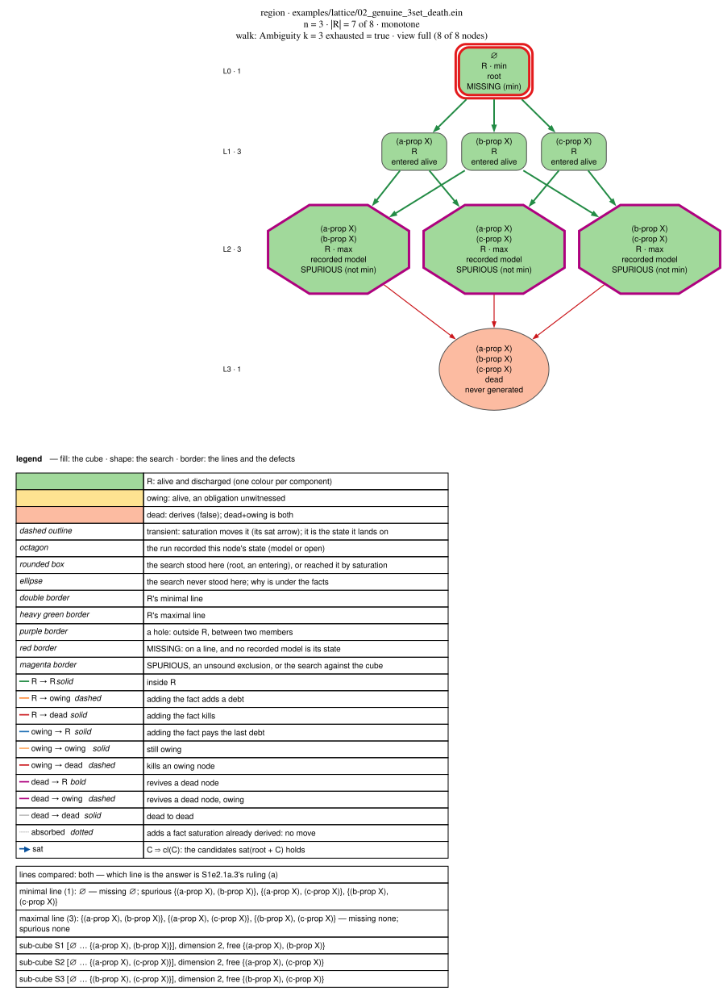
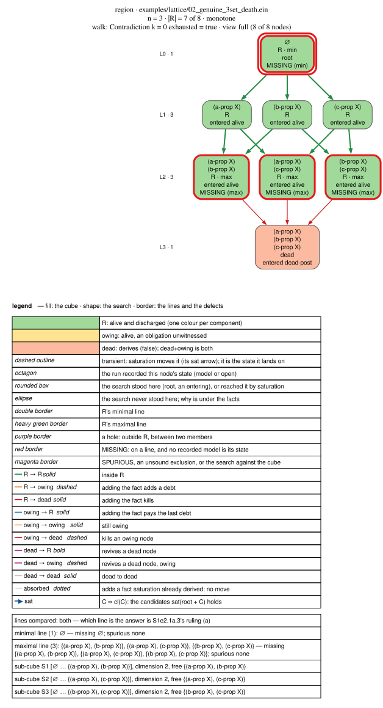

# Solution semantics — the region, its nodes, and what the engine reports

> **Normative. Rewritten 2026-10-16** by M1e2
> [S1e2.1a.3](../../../plans/m1e2_correctness/p1e2.1a_the_solution_region/s1e2.1a.3_the_definition.md),
> around the user's reading of 2026-10-15 and their rulings of 2026-10-16
> ([Q-M1e2.7](../../../plans/m1e2_correctness/open_questions.md#q-m1e27--the-answer-is-a-region-of-the-lattice)):
> **the answer to a program is a region R of its hypothesis lattice**, the
> nodes that are alive and discharged. Before this, the page defined a
> solution as one kind of state, a maximal alive commitment or one that owes
> nothing (2026-08-28, M1e,
> [Q-M1e.6](../../history/m1e_review_processing/open_questions.md#q-m1e6--what-is-a-solution-and-what-is-a-model)).
> That definition is a special case of this one, § 2.6.
>
> **Scope.** The page is written for a **monotone** program, § 1.6: one where
> adding a fact never takes a conclusion away and never adds a debt. That is
> M1e2 P1e2.1a's scope. R is still a node set on any other program, but which
> state a node is, and what a hole means, are
> [P1e2.1b](../../../plans/m1e2_correctness/p1e2.1b_the_non_monotone_lattice/README.md)'s.
> Each place the definition depends on monotonicity says so.
>
> **§ 6 is the honest half.** §§ 1–5 are the definition. The shipped search
> does not compute it, and § 6 says where it differs and how to reproduce
> each difference. A reader who needs what `ein solve` prints today reads § 5's
> first table and § 6. R itself **is** computed today, exactly, by
> [`ein solve --dump-region`](region_dump.md) for n ≤ 16.

---

## 1. The vocabulary, in dependency order

Each term is defined using only the ones above it. The one-line versions are
in the [glossary](../glossary.md#search-and-answers).

### 1.1 Context and problem

The user's split, 2026-10-16: *"theory = relations and their properties
defined by rules, ontology = simple facts like (is-a Tee Drink) required for
solution but not stated in the problem because it is obvious for humans living
on Earth; theory + ontology = context; problem = facts + query + hypothesis
hints, in context"*.

| term | what it is | in [`zebra2.ein`](../../../examples/zebra2.ein) |
|---|---|---|
| **theory** | relations, their properties, and the rules that give them meaning | `(relation drink-loc Drink House)`, `(bijective drink-loc)`, the `co-located` rules, and the stdlib rules behind them |
| **ontology** | facts a solution needs that the problem does not state, because they are obvious | `(is-a Tea Drink)` |
| **context** | theory + ontology | everything that carries no `:source` and is not a hint or the query |
| **problem** | facts + query + hypothesis hints, stated in a context | the clue facts, each with `:source "condition (n)"`, the `(query …)`, the `(hrule guess …)` |
| **program** | context + problem, as Ein text. Its imports bring theory in from the [stdlib](../../../stdlib/) | one `.ein` file |

**The boundary is not in the language.** One file mixes all four, and only
zebra2's `:source` comments mark which part is which. **R is a property of a
problem in a context**: the same problem in another context has another
region.

### 1.2 Names

A **name** is a constant the program mentions, in a fact **or in a rule**:
rules are part of the program, so a rule cannot assert a new name (the user,
2026-10-16). Ein never makes a name at run time, so the lattice below is
finite. A name that a rule asserts and no fact mentions is still a name, and a
candidate list that leaves it out is an engine bug
([W4](../../../corpus/wrong_answers.toml)).

### 1.3 Root

**Root** is `sat(program)`: the program's facts, saturated to quiescence by
its rules, with nothing hypothesised. It is a node like any other, the node
∅ of § 1.5. **Root is never written by the search.** The shipped walk still
writes it (§ 6.3) until S1e2.1a.5 retires the walk. The rule follows from the
user's ruling of 2026-10-16 that every answer `ein solve` gives is the
oracle's, since the oracle never writes
([`solve_interface.md`](../../../plans/m1e2_correctness/p1e2.1a_the_solution_region/solve_interface.md)).

### 1.4 Candidate and universe

A **candidate** (hypothesis) is a fact the generator proposes at root, with
**no config switch applied**: no lookahead filter, no kill cache, no forced
positive, the obligations rung at its default order
([`hypgen::generate_config_free`](../../../ein.rs/crates/ein-infer/src/hypgen.rs)).
Which facts can be proposed at all is decided by:

- the **generation ladder**: the program's own `(hrule …)` if it declares
  one, else the facts that would discharge what root owes
  ([`oblgen.rs`](../../../ein.rs/crates/ein-infer/src/oblgen.rs)), else the
  blind combinatorial enumerator;
- the query's scoping: `:hypothesis-relations`, `:no-hypothesis`,
  `(__closed__ R)`. A fact of an excluded relation is not a candidate at all.

The **universe** H is the candidate list, and n = |H|. It replaces `alive₀`
as the space every later definition quantifies over: the user ruled on
2026-10-15 that no config option may change the problem's lattice
([configuration.md § 2.5](../configuration.md#25-the-config-principle-read-against-every-row)),
and `alive₀` is taken through the lookahead and after the forced-positive
cascade (§ 6.3).

**H must contain every fact a model needs** (ruling (h), 2026-10-16). If it
does not, either the program is wrong (a name it never mentions) or the engine
is (a candidate it never proposes, [W4](../../../corpus/wrong_answers.toml) and
[W6](../../../corpus/wrong_answers.toml)). The universe is defined by the
generator today. A declarative definition, every type-correct ground atom of
every hypothesisable relation, is what a check of the generator would be held
to, and is not written yet.

### 1.5 Commitment, node, state

A **commitment** C is a subset of H. Seen as a point of the lattice, it is a
**node**. Without merging, the lattice is the **n-cube**: a node is an n-bit
word, an edge adds or removes one candidate, and layer L*k* holds the C(n, k)
commitments of k candidates.

A node's **state** is `sat(root + C)`: root's fixpoint, forked, with C's facts
written in and the saturation resumed to quiescence. It is never stopped at
the first contradiction. For a monotone program, building the state from
scratch gives the same fact set. Then:

| | the state |
|---|---|
| **dead** | holds `(false)` |
| **alive** | is not dead |
| **owing n** | has n obligation instances with no witness, § 4. Read on a dead state too |
| **discharged** | owes nothing |

**Closure.** cl(C) is the candidates the state holds. Always C ⊆ cl(C). A
node with cl(C) ≠ C is **transient**: saturation moves it, `C ⇒ cl(C)`.

**State class.** The commitments that reach one state. For a monotone program
saturation is a closure operator on the cube (extensive, idempotent,
monotone), so a state s has:

- a **top**, s itself, the closed set;
- **bottoms**, its **minimal generators**: the smallest commitments that
  force it. Their size is how many facts a solution needs guessed.

The class is the union of the intervals [g … s] over its minimal generators.
If g ⊆ C ⊆ s and cl(g) = s, then s = cl(g) ⊆ cl(C) ⊆ cl(s) = s.

### 1.6 Monotone

A program is **monotone** when no read of its compiled plans can take a
conclusion away or add a debt as the commitment grows: no `absent` at odd
depth in a saturation rule over a relation a commitment can change, and no
obligation trigger over one
([`region_dump.md` § Monotonicity](region_dump.md#monotonicity--the-static-check),
[`ein_infer::monotone`](../../../ein.rs/crates/ein-infer/src/monotone.rs)).
Then:

- **dead is upward-closed**: a contradiction stays as facts are added;
- **discharged is upward-closed**: a witness stays, and no new debt arrives;
- so R (§ 2) has no holes, and its two lines describe it;
- and cl is a closure operator, § 1.5.

The static check is a sufficient condition, and the cube is its check: on
every one of the corpus's **146** monotone cubes, 53 of them with at least one
candidate, no dead node has an alive superset and no discharged node has an
owing one (`utils/region_census.py --all`, 2026-10-16, § 8).

---

## 2. The answer — the region R

> **R = { C ⊆ H : sat(root + C) is alive and discharged }.**
> A **solution** is a node of R.

### 2.1 In general, R is its node set

The user, 2026-10-16: *"In general non-monotonic case R is completely defined
only by full set of nodes … Let's go from it, and simplify the results if our
case allows or if it is requested explicitly."*

That is exact. A non-monotone program can have any subset of the cube as its
region: [`utils/region_synth.py`](../../../utils/region_synth.py) writes a
program for any target, except a dead root under a non-empty R (M1e2
[S1e2.1a.8](../../../plans/m1e2_correctness/p1e2.1a_the_solution_region/s1e2.1a.8_region_to_program.md)).
There are 2^(2ⁿ) possible regions, so nothing shorter describes all of them.
The shortest exact form of any one is the union of its maximal sub-cubes,
§ 2.4.

What makes a shorter description exact is a property of the program, in
order:

| property | what it licenses |
|---|---|
| **convex** (no hole) | the two lines describe R exactly: R = ⋃ [a … b] over minimal a ⊆ maximal b |
| **monotone** (§ 1.6) | convex, and the lines follow from N and E without visiting the cube (§ 2.4), with N, E and the static verdict as a certificate |
| **shape** | restrictions only: the minimal line is {∅}. Obligations only: the maximal line is {⊤}, every candidate (§ 2.4) |

[S1e2.1b.6](../../../plans/m1e2_correctness/p1e2.1b_the_non_monotone_lattice/s1e2.1b.6_the_two_lattices_compared.md)
writes the same ladder for the non-monotone case.

### 2.2 ∅

**∅ ∈ R exactly when root is alive and discharged, whatever the generator
proposes**, including when it proposes nothing (the user, 2026-10-16). A
program that states no obligation and whose root is consistent always has ∅
in R. That is not a defect: a puzzle that does not say what it requires is
solved by saying nothing more. In the corpus, ∅ ∈ R on **41 of the 51**
monotone programs with a candidate and a non-empty R, and the other ten all
owe at root (§ 8).

### 2.3 How many: k_s and k_c

Ruling (a) × (e), 2026-10-16: `k` is replaced by two counts, both reported.

| | counts | |
|---|---|---|
| **k_c** | \|R\| in **commitments** | the ways to guess a solution |
| **k_s** | \|R\| in **states** (state classes, § 1.5) | the different solutions |

They differ exactly where saturation derives a candidate at a node of R:
then the node and its closure are two commitments with one state. On
[`features/02_star_in_identifiers.ein`](../../../examples/features/02_star_in_identifiers.ein)
k_c = **32 768** and k_s = **728**. They differ on 13 of the 64 non-empty
regions the oracle reaches that have a candidate at all (§ 8).

**One solution** has two readings, and an expectation of exactly one (§ 5)
has to say which:

- **k_s = 1**: what a program that states what it requires can mean;
- **one maximal state**: what a program with restrictions only can mean,
  since there ∅ ∈ R and k_s = 1 only when nothing can be added at all. 25 of
  the 51 non-empty monotone regions with a candidate have one maximal node and
  several states, and only 12 have k_s = 1 (§ 8).

### 2.4 Shape

| term | what it is |
|---|---|
| **minimal line** / **maximal line** | R's minimal and maximal elements. With restrictions only the minimal line is {∅}; with obligations only the maximal line is {⊤}. These are the **trivial lines**, visible from the program's shape, never to be enumerated or chased (ruling (f), monotone) |
| **convex** | no **hole**: no node outside R between two members of R. A monotone program is convex |
| **sub-cube** [a … b] | every commitment between a and b. Its **dimension** \|b\| − \|a\| is its number of free facts. R is the union of its maximal sub-cubes |
| **component** | a maximal part of R connected by one-fact edges inside R. **Not a model**: a set of models (ruling (i)). A well-posed puzzle is one where every component is a point |
| **N** | the minimal dead sets: the minimal nogoods |
| **E** | the minimal discharging sets, dead or not |

**The duality.** Without holes, the minimal line is E's alive members, and the
maximal line is the largest sets containing no member of N, kept where
discharged. It is Reiter's diagnosis duality and MUS/MCS enumeration's, and it
is the route past the oracle's limit
([P1e2.1c](../../../plans/m1e2_correctness/p1e2.1c_the_region_search/README.md)).
In the corpus it holds on every region without a hole, and fails only on
regions with one (§ 8).

**Locally.** Without holes, a node of R is maximal exactly when every edge up
leads to a dead node, and minimal exactly when every edge down leads to an
owing one. Across a hole, the local test and the cube can disagree. On the
corpus they never do (§ 8).

### 2.5 Worked: `examples/lattice/02_genuine_3set_death.ein`

Three candidates `a = (a-prop X)`, `b = (b-prop X)`, `c = (c-prop X)`; one
rule asserting `(false)` when all three hold; no obligation.

| commitment | alive? | owes? | in R? |
|---|---|---|---|
| `∅` | yes | no | **yes**: minimal |
| `{a}`, `{b}`, `{c}` | yes | no | **yes** |
| `{a,b}`, `{a,c}`, `{b,c}` | yes | no | **yes**: maximal |
| `{a,b,c}` | **no** | no | no |

**R has 7 nodes and 7 states** (k_c = k_s = 7; no rule derives a candidate).
Its minimal line is {∅}, the trivial line of a program with restrictions only.
Its maximal line is the three pairs. It is one component, the union of three
sub-cubes [∅ … pair] of dimension 2. N = {{a,b,c}}, E = {∅}, and the duality
gives both lines. The conflict is genuinely three-way, which is what the
fixture is named for.



Drawn by [`ein render region`](../ir/03-ein-lang/04_dot_rendering.md#region-rendering--the-cube-and-the-walk-s1e21a2)
([`.dot`](diagrams/region_02_genuine_3set_death.dot)), re-made with:

```sh
ein solve -e examples/lattice/02_genuine_3set_death.ein --dump-region out/
ein render region out/ > docs/kernel/inference/diagrams/region_02_genuine_3set_death.dot
dot -Tsvg docs/kernel/inference/diagrams/region_02_genuine_3set_death.dot \
    -o docs/kernel/inference/diagrams/region_02_genuine_3set_death.svg
```

Fill is the node's status, shape is what the run did there, and the octagons
are the three states the walk recorded: the maximal line, and 3 of R's 7
states. *MISSING* and *SPURIOUS* in the drawing compare the walk with each line
separately, which is the drawing's reading from before ruling (a); against R,
the four unrecorded nodes are all unreported (§ 6.1).

### 2.6 The old definition, as a special case

From 2026-08-28 until this rewrite, a solution was:

```
solution(S)  ≡  S is saturated
              ∧ S is consistent
              ∧ ( S owes nothing                                    [obligations arm]
                ∨ ∀ h ∈ alive₀ \ integrated(S):  S ∪ {h} is dead )  [maximality arm]
```

where *integrated* were the candidates true in S, committed or derived
(cl(C) of § 1.5), and the arm was chosen by whether the program **stated** an
obligation (the M1d scope rule, § 4). Under R:

- **the maximality arm is the maximal line**, and it is the right answer to
  *which states can nothing be added to*, which is one question about R and
  not the definition of it. The user, 2026-10-16: *"our default behaviour that
  searches for maximal solutions is not completely wrong but it is relevant
  only in special case with no obligations"*;
- **the obligations arm is R itself**: every alive node that owes nothing;
- **`complete`**, *the active rung proposes nothing*, is a property of the
  generator. Under R it is replaced by **discharged**, a property of the
  state (§ 6.1).

---

## 3. Model

> A **model** is the **positive part of a solution's state, minus the
> positive part of the initial KB**.

The **initial KB** is the program as loaded, *before the first saturation*:
problem statements, `(relation …)` signatures, `(is-a …)` declarations,
rules, no derived facts. So a model carries no `(not …)`, nothing the file
itself stated, and nothing the loader wrote down. It is **what the puzzle did
not say and the solution established**: what a node of R adds.

The distinction from the state is load-bearing, because two runs can agree on
every model and disagree on every recorded KB. `ein solve -e
examples/lattice/02_genuine_3set_death.ein` records `(not (c-prop X))` in the
first state, written by the lookahead kill cache with provenance
`<lookahead-dies-immediately>`, and `-K` records the same model without it.
Same models; different KBs.

**Projection.** A query's goal cuts a model down to the goal's rows. Models
that differ only in facts the goal does not name give one row set, so a query
answers with **projection classes**: the models with one projection (ruling
(i), 2026-10-16, the user's grouping named). Two friends' groups choosing
between two tables have one projection class per choice of table, and the
seats inside it are hidden information. In a program with restrictions only,
the goal has no row at ∅, so a query over R has to say *undetermined in these
solutions*. No surface computes projection classes yet;
[S1e2.1a.4](../../../plans/m1e2_correctness/p1e2.1a_the_solution_region/s1e2.1a.4_the_language.md)
gives the query its form.

---

## 4. Restrictions and obligations — the two lines

A **restriction** is a rule that asserts `(false)`. It kills nodes, and sets
the **maximal line**: the user's *"top bound defined by restrictions"*.

An **obligation** is a rule that asserts the verdict atom `(open ?R)` while a
witness is missing (M1d S1d.2.4). What a state **owes** is its undischarged
instances, and a state that owes none is **discharged**. It sets the
**minimal line**: the user's *"bottom bound defined by obligations"*.

| program states | R | minimal line | maximal line |
|---|---|---|---|
| neither | the whole cube [∅ … ⊤] | {∅} | {⊤} |
| restrictions only | every alive node | {∅}, while root is alive | where restrictions bite |
| obligations only | every discharged node | where the debts are paid | {⊤}, for a monotone program |
| both | between the two | where the debts are paid | where restrictions bite. A well-posed puzzle has the two meet in one state |

The 2026-08-25 **scope rule**, *only a program that states an obligation is
judged by discharge*, was a rule about which arm of § 2.6 a program got. Under
R there is one definition for every program, and a program that states no
obligation simply has ∅ in R when its root is consistent. The census that
measured the scope rule over the corpus is
[openness_census.md](../../history/m1d_satisfiability/openness_census.md).

Normative detail on what an obligation quantifies over:
[`domain_contract.md`](../../history/m1d_satisfiability/domain_contract.md)
(C1–C4) and
[`completeness.md`](../../history/m1d_satisfiability/completeness.md).

---

## 5. What the answer reports

### 5.1 Today

What `ein solve` prints at `9248236d`. The words judge the walk's recorded
nodes, not R (§ 6).

| word | means today | `k` |
|---|---|---|
| `Solution` | one recorded model | 1 |
| `Ambiguity` | several recorded models | > 1 |
| `Open` | consistent and quiescent, with an obligation the program stated still unwitnessed | 0 models |
| `Contradiction` | no recorded model | 0 |

`k` counts the **recorded** models. `stats.solution_nodes` counts what the
search recorded. **`exhausted`** says the walk did not stop early: no depth cap
reached with a live frontier, no `--solutions` cut, not the tree traversal.

A program the static check (§ 1.6) finds a site in gets one more line under
the verdict, `lattice  not monotone (n sites) — this answer assumes it is`.
The search and the words are unchanged.

### 5.2 Ruled, and not yet implemented

| ruling (2026-10-16) | what changes | stage |
|---|---|---|
| (a), (e) | **k_s and k_c replace `k`** on every surface. Where the run cannot know R, each is a lower bound and says so | [S1e2.1a.5](../../../plans/m1e2_correctness/p1e2.1a_the_solution_region/s1e2.1a.5_the_read_out.md) |
| the default | **`ein solve` with no flag describes R in full**, exhaustively and certified. Flags make the task simpler: *any* solution; *a single one* expected, so k ≥ 2 contradicts it; *maximal* only; *minimal* only. Route 1, a monotone program's R from its alive down-set, is in the library and held to the oracle. **One tool, consistent with the oracle**: every question about R is a mode of `ein solve` that does the least work it needs, the cube is `ein oracle`, and there is no `ein walk` (the user, 2026-10-16). The interface was approved the same day ([`solve_interface.md`](../../../plans/m1e2_correctness/p1e2.1a_the_solution_region/solve_interface.md)) | [S1e2.1a.9](../../../plans/m1e2_correctness/p1e2.1a_the_solution_region/s1e2.1a.9_solve_describes_the_region.md) |
| (i) | **the verdict words judge a stated expectation.** `Ambiguity` is relevant where exactly one solution is expected, `Contradiction` where some is. Without an expectation, `solve` explores and describes R | S1e2.1a.5 |
| (g) | **`exhausted` means the reported region is all of R.** A run a budget stopped (`-m`, `-E`, `-T`) reports what it found as a lower bound, and every node in it is checked | S1e2.1a.5, S1e2.1a.9 |
| (b), (c) | **solving and asking come apart**: `(solve :hrules …)` defines the lattice, `(solution …)` states the expected region, `(query :goal … :expect …)` asks about the goal's projection classes | S1e2.1a.4 |
| (e) | **the region's printed form**: every state of R, and each state with several generating commitments with its minimal ones, as `(region (model …) …)` with `(merged (to from) …)` | S1e2.1a.4, S1e2.1a.5 |

**Empty R has two kinds**, and the read-out keeps them apart:

- **no alive node**: root is dead, and a core says why. 21 corpus programs,
  none with a candidate;
- **every alive node owes**: the debts no alive extension pays. 15 corpus
  programs, two of them with candidates: W1's `owed-two-step` row, its witness
  and its control (§ 8).

The 2026-08-25 ruling named them `Contradiction` and `Open`. Under (i) a word
judges an expectation, and whether the exploring read-out keeps those names is
S1e2.1a.5's page diff.

**A certificate** is evidence that a claimed R is R, cheaper to check than
recomputing it. For a monotone program it is N, E and the static verdict, one
saturation per member. Route 1
([`ein_infer::downset`](../../../ein.rs/crates/ein-infer/src/downset.rs)) produces
N and the alive members of E, which are the minimal line, as it goes: a dead
commitment it visits has every proper subset alive. No surface prints them
yet. For a non-monotone program, nothing smaller than every node's
classification is known.

---

## 6. What the engine implements, and where it differs

Everything above is the definition. `ein solve` computes a **walk** over the
lattice, and the walk tests a different predicate. Each difference below is
observable today. Measured over the 185 programs whose R is known
([`walk_and_region.md`](../../../plans/m1e2_correctness/p1e2.1a_the_solution_region/walk_and_region.md),
2026-10-16):

- on a monotone program the walk is a search for **R's maximal line**, and
  without a depth cap it finds that line on 156 of 172;
- the rest are the four ways it can fail: § 6.1, the depth cap, § 6.2–6.3's
  writes, and the obligations rung;
- **its node is `sat(root ∪ K ∪ P ∪ C)`**, so it calls 92 of its enterings
  dead that R keeps alive;
- it never calls a node alive that R calls dead.

### 6.1 The walk looks for the maximal line

A walk **records** a node when
[`hypgen::complete`](../../../ein.rs/crates/ein-infer/src/hypgen.rs) holds:
*the active rung proposes nothing at this node, now*. A candidate is not
proposed when it is already asserted, already negated, already seen in this
call, or **provably dies in one rule firing** against this state (the
pre-branch lookahead).

That is a property of the generator, and it finds the maximal line at best.
So the walk:

- **never records ∅ while any candidate exists.** ∅ is recorded only when the
  generator proposes nothing. Probes of 2026-10-16
  ([Q-M1e2.7 § The second answer](../../../plans/m1e2_correctness/open_questions.md#the-second-answer-2026-10-16)):
  two mutually exclusive candidates give `Ambiguity` k = 2 where R is
  {∅, {(p A)}, {(p B)}}; one candidate dead alone and one alive gives
  `Solution` {(p A)} where R is {∅, {(p A)}};
- **reports R's maximal line where no obligation is stated**, and not R. On
  `lattice/02` (§ 2.5) it records the three pairs, 3 of R's 7 states;
- **misses maximal nodes** whose remaining candidates need more than one
  firing to die ([W1](../../../corpus/wrong_answers.toml)).

Against the maximal line, `complete` was read as follows on 2026-08-28. The
rows still describe the walk:

| | holds? | consequence |
|---|---|---|
| `complete(S) ⇒ S is maximal`, as the generator sees `S` | **yes** | every filter that can make `complete` true is a genuine refutation of the candidate it dropped |
| `maximal(S) ⇒ complete(S)` | **no** | a remaining hypothesis that needs *two* firings to die is still proposed, so a maximal state goes unrecorded |
| `complete(S) ⇒ S is a solution` | **no** | maximality is one conjunct of three, and the state the engine records is not the state `complete` was asked about, § 6.2. Until 2026-08-28 this row read *yes*, with the gloss *"so the engine never records a false model"*; that was the maximality argument doing duty for the whole conjunction, and it was withdrawn |

With `enable-pre-branch-lookahead` off (`-L`) the walk under-reports far more:
`complete` is then true only when every remaining hypothesis is already
asserted or already negated.

### 6.2 What is recorded is `S ∪ K`, and the criteria were checked against `S`

Every consistency check in the engine happens **before** the last write into
the KB it guards, and two writers run after it:

- the **singleton writeback**: a commitment `{h}` that died stores `(not h)`
  at root (`solve.rs` `write_negation`);
- the **lookahead kill cache**:
  [`hypgen::write_negated`](../../../ein.rs/crates/ein-infer/src/hypgen.rs)
  stores `(not h)` for a candidate the one-step probe killed, into the KB the
  generator was called on. `compute_alive` calls it on **root**; `complete()`
  calls it on **the fork about to be recorded**.

Neither write can create a contradiction by itself: `h` is neither asserted
nor negated when it is proposed. But `(not P)` is an ordinary match form
([`02_patterns.md`](../ir/03-ein-lang/02_patterns.md)), so a rule may read
these facts. Write `K` for what the search wrote: **the engine recorded
`S ∪ K` and had checked the criteria against `S`.**

> **Since 2026-08-30 (M1e `CO-M1`)** `record_node` re-saturates a KB written
> since its last saturation and refuses one its rules then refute, at all four
> callers. Measured 2026-08-30: of the corpus's 2 149 recorded states, 2 067
> were dirty and 6 refuted, all three witnesses below among them. The table
> describes the engine before that fix and is kept as the reason for it. Of the
> two consequences after it, *records a state its own rules refute* no longer
> holds at default settings. *Under-reports* still does: a maximal state that
> never reaches `record_node` (W1), and `-K` leaving `K` unwritten so the
> re-saturation has nothing to read (W9). Both are
> [M1e2](../../../plans/m1e2_correctness/README.md)'s.

`record_node` has four callers:

| caller | what it establishes | the last write before it |
|---|---|---|
| `solve.rs:1977`: an entered commitment, the path every corpus solve takes | consistency, by `try_commitment_set`, then `complete()` | `complete()` itself, at `:1895` |
| `solve.rs:1030`: `tree_node` | the same | `complete()`, at `:1024` |
| `solve.rs:1118`: phase 1, `alive = ∅` | consistency at `:1091` | `compute_alive`, at `:1098` |
| `solve.rs:1550`: between layers, `alive = ∅` | consistency at phase 1 or in the cascade | the layer's writebacks, and `compute_alive` at `:1534` |

Measured 2026-08-28 against `a3f4e7b`: **three of the four had a witness**, a
program whose recorded model, fed back as a program, the same engine answered
`Contradiction` on
([`search_soundness_probes/probes/`](../../history/m1e_review_processing/search_soundness_probes/probes/)).
A recorded fact set is also a function of a lever: `-K` removes the kill
cache's writes, so two runs that agree on every model can disagree on every
recorded KB
([Q-M1e.7](../../history/m1e_review_processing/open_questions.md#q-m1e7--the-read-out-prints-the-solution-kb-and-calls-it-a-model)).

### 6.3 The search writes into root, and its universe is not H

The definition's root is `sat(program)` and is never written (§ 1.3). The
walk writes into it three ways:

- a **forced positive**: when exactly one candidate is still alive at root,
  it is promoted into root as a fact with no premises, provenance
  `<forced-positive>`, and root is re-saturated. From then on every node holds
  it, and ∅ is gone from the walk. Its warrant, *every model extending root
  contains it*, holds only when ∅ is not itself a solution. In a monotone
  program it is never needed: if every candidate but h is dead alone, the alive
  nodes are at most ∅ and {h}, and two saturations decide R
  ([W2](../../../corpus/wrong_answers.toml));
- the **singleton writeback** and the **kill cache**, § 6.2.

And the walk's space is `alive₀`, the candidates left at root *after* the
lookahead and the cascade, where the definition's is H (§ 1.4). The two differ
on **29 of the 194** programs whose walk the census reads: on 7 a candidate
was promoted into root, on 26 one was dropped before the search (§ 8). A
config switch decides both, which the config principle forbids for a universe.

### 6.4 `exhausted` certifies the walk, not R

```
$ ein solve -e -s --no-lookahead examples/lattice/02_genuine_3set_death.ein
  solutions (k)   0
  verdict         No solution — the constraints are contradictory
  …
  exhausted        true
  enterings        7 (alive=6 dead_pre=0 dead_post=1)
  layers_explored  3
```

R has 7 nodes (§ 2.5). The walk **entered all of them but ∅**, every pair
survived, the triple died, and it reported that there are none. Nothing was
truncated: the lattice really was walked to the end.



([`.dot`](diagrams/region_02_genuine_3set_death_no_lookahead.dot); the same
commands as § 2.5 with `-L` added.)

*The lattice was walked to the end* and *every solution in it was recognised*
are two claims, and only the first is what `exhausted` tracks today
([Q-M1e.8](../../history/m1e_review_processing/open_questions.md#q-m1e8--exhausted-certifies-the-lattice-not-the-model-set)).
Ruling (g) makes it the second, § 5.2.

### 6.5 The premise the walk prunes by

The walk reads *"no live child"* from the next layer's results rather than by
re-forking every remaining candidate, and its learned clauses prune every
superset of a dead set. Both require **dead to be upward-closed**:
`X ⊆ Y ∧ dead(X) ⇒ dead(Y)`.

For a **monotone** program that is a theorem (§ 1.6), and the cube agrees on
every monotone corpus program (§ 8). **Under `absent` it fails.** Probed on
2026-08-28: a twenty-line program in which a rule refutes `(p A)` only while
`(q A)` is missing has `{(p A)}` dead and `{(p A), (q A)}` alive, and five of
six shipped configurations answer it wrongly. In R's terms, `{(p A)}` is a
**hole** ([W3](../../../corpus/wrong_answers.toml),
[Q-M1e.9](../../history/m1e_review_processing/open_questions.md#q-m1e9--is-dead-really-upward-closed-under-absent)).
An obligation whose trigger a commitment can grow makes a hole too
([`lattice/04`](../../../examples/lattice/04_obligation_trigger_hole.ein)).
What the walk should do on such a program is
[P1e2.1b](../../../plans/m1e2_correctness/p1e2.1b_the_non_monotone_lattice/README.md)'s.

### 6.6 What the oracle does not check

[`ein_infer::region`](../../../ein.rs/crates/ein-infer/src/region.rs) computes
R by saturation alone and checks the **walk**. It shares the saturator with
the engine, so it cannot see a derivation the saturator loses
([W7](../../../corpus/wrong_answers.toml)). It takes H from the generator, so
it cannot see a candidate the generator never proposes (W4, W6).

---

## 7. Where each term lives in the code

| term | site |
|---|---|
| candidate, the ladder | [`hypgen.rs`](../../../ein.rs/crates/ein-infer/src/hypgen.rs), [`oblgen.rs`](../../../ein.rs/crates/ein-infer/src/oblgen.rs), [`hrule.rs`](../../../ein.rs/crates/ein-infer/src/hrule.rs) |
| the universe H | `hypgen::generate_config_free` |
| a node's state, dead, owing, closure, class | [`region.rs`](../../../ein.rs/crates/ein-infer/src/region.rs) `compute`, `Node` |
| R, its lines, holes, components, sub-cubes, N, E, the duality | `region::Topology` |
| R of a monotone program from its alive down-set (route 1), k_s, k_c, the merged classes | [`downset.rs`](../../../ein.rs/crates/ein-infer/src/downset.rs) `compute`, `Description` |
| monotone | [`monotone.rs`](../../../ein.rs/crates/ein-infer/src/monotone.rs) |
| owes, discharged | [`obligations.rs`](../../../ein.rs/crates/ein-infer/src/obligations.rs) `tally` |
| the walk's `alive₀` | `Run::phase1` → `compute_alive` → `hypgen::open_hypotheses` |
| the walk's commitment, entering | `apriori::CanonicalSetId`; [`commitment.rs`](../../../ein.rs/crates/ein-infer/src/commitment.rs) `try_commitment_set`, `Kind` |
| complete | `hypgen::complete` |
| a recorded node, the model set | `Run::record_node`, `Run::finalise`. Its doc comment carries § 2.6's conjuncts and which of them each of its **four** callers establishes |
| today's verdict words, `k` | [`verdict.rs`](../../../ein.rs/crates/ein-infer/src/verdict.rs) |
| today's `exhausted` | `Run::finalise`, from `lstate.truncated` |

---

## 8. Measured

[`utils/region_census.py`](../../../utils/region_census.py) is the region of
every corpus program the oracle reaches, re-takable with one command. The
page with every table, and what each number settles, is
[`region_census.md`](../../../plans/m1e2_correctness/p1e2.1a_the_solution_region/region_census.md).
Taken 2026-10-16 at `9248236d`, `--all --levers`: 249 programs; R computed on
159 (n ≤ 16), 146 of them monotone, and 93 of those have no candidate at all,
so their R is root or nothing. The counts below that say *with a candidate*
leave those out.

- **Monotone cubes**: all 146 have no violation of upward closure, no hole,
  and a duality that gives both lines (§ 1.6, § 2.4).
- **Holes**: on 5 programs, all flagged non-monotone, all known: W3's two
  witnesses, `lattice/04`'s trigger, and two programs written for their holes.
- **Trivial lines** (ruling (f)): restrictions only gives min = {∅} on 25 of
  25 monotone programs with a candidate; obligations only gives max = {⊤} on
  5 of 5 (§ 2.4).
- **∅ ∈ R** on 41 of the 51 monotone non-empty regions with a candidate
  (§ 2.2). **Empty R**: 21 with no alive node, 15 where every alive node owes
  (§ 5.2).
- **k_c ≠ k_s** on 13 regions, up to 32 768 against 728 (§ 2.3).
- **The universe**: alive₀ ≠ H on 29 of 194 walks (§ 6.3).
- **Route 1** (S1e2.1a.9,
  [`route1_reach.md`](../../../plans/m1e2_correctness/p1e2.1a_the_solution_region/route1_reach.md),
  `cargo run --release -p ein-infer --example route1_reach`, 2026-10-16): R
  of 162 of 195 programs from the alive set and N alone, 15 of them past the
  oracle's limit. With its budget raised, `zebra.ein`'s R is **one state**,
  reached by 261 982 of its commitments, with 63 on the minimal line and
  270 454 alive.
- **The walk against R** (S1e2.1a.9,
  [`walk_and_region.md`](../../../plans/m1e2_correctness/p1e2.1a_the_solution_region/walk_and_region.md),
  `--example walk_vs_region`, 2026-10-16): `-e` gives R's maximal line on 143
  of the 172 monotone programs whose R is known, and `-e -m n` on 156. Zebra's
  walk enters 111 commitments where route 1 visits 270 912, because the walk
  stops at the first complete commitment of a state, and zebra has 27 alive
  states.
- **The config principle**: no lever changes R on any of the 159, except
  `enable-symmetric-mirror` on
  [`features/06_symmetric_native.ein`](../../../examples/features/06_symmetric_native.ein),
  where it removes three facts from root
  ([configuration.md § 2.5](../configuration.md#25-the-config-principle-read-against-every-row)).

## Cross-references

- [`region_dump.md`](region_dump.md): R computed, `ein solve --dump-region`.
- [`04_dot_rendering.md` § Region rendering](../ir/03-ein-lang/04_dot_rendering.md#region-rendering--the-cube-and-the-walk-s1e21a2):
  R drawn, `ein render region`.
- [`absent_semantics.md`](absent_semantics.md): worlds, the NAF boundary, and
  the corollaries a non-monotone program has to be read beside.
- [`configuration.md`](../configuration.md): the config principle, and every
  lever's row read against it.
- [`completeness.md`](../../history/m1d_satisfiability/completeness.md): why
  an obligation's alternatives are jointly exhaustive.
- [`domain_contract.md`](../../history/m1d_satisfiability/domain_contract.md):
  C1–C4, what an obligation quantifies over.
- [`features.md`](features.md): the measured feature × config matrix.
- [`glossary.md`](../glossary.md#search-and-answers): one-line entries for
  every term on this page.
- [`definitions.md`](../../../plans/m1e2_correctness/p1e2.1a_the_solution_region/definitions.md):
  the plan's table this page was written from, with each term's status and
  source.
